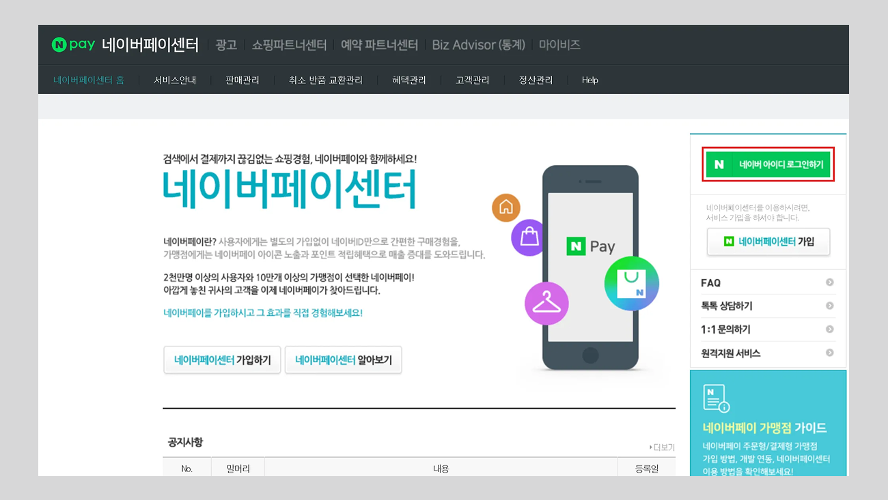
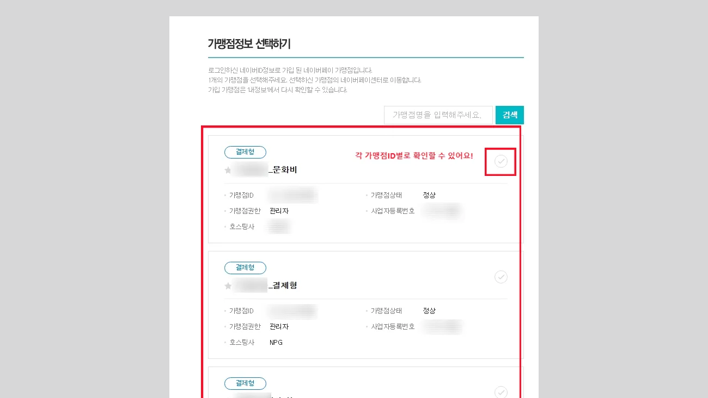
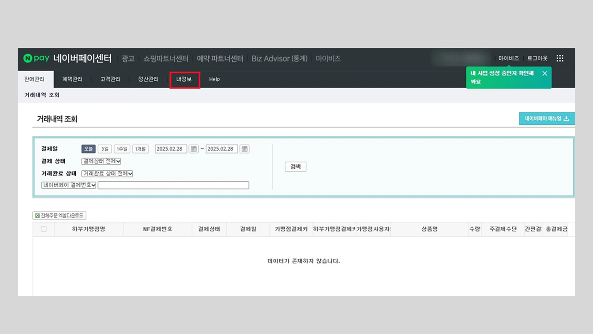
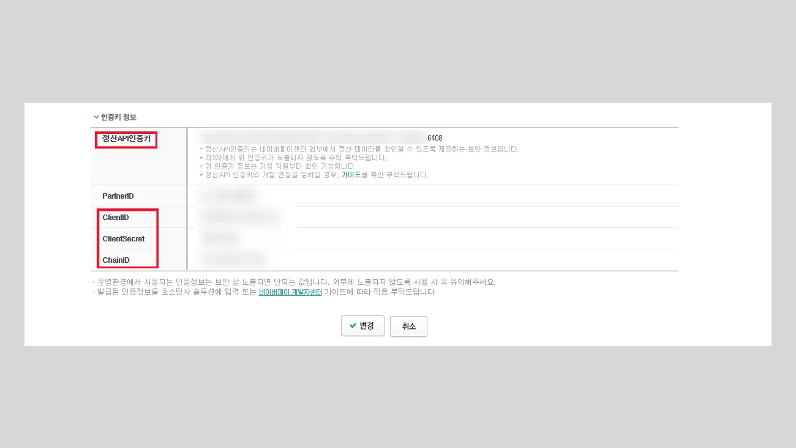
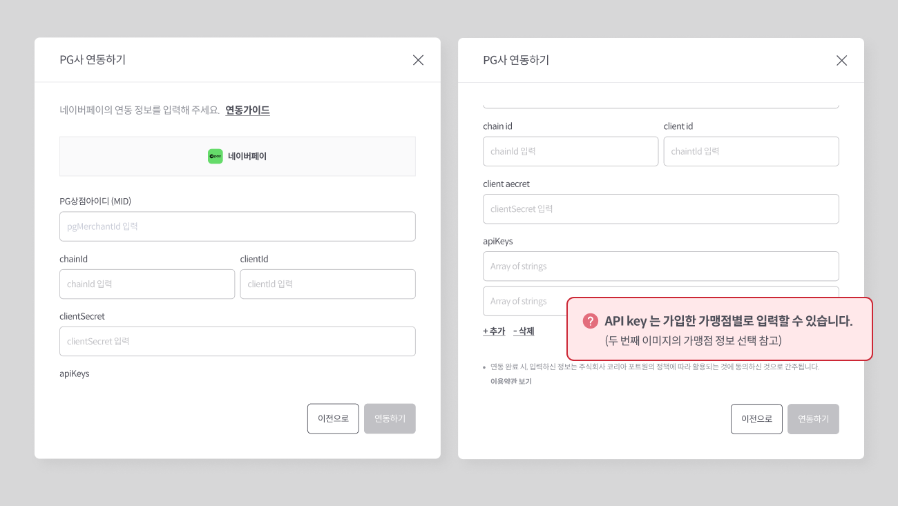

# 네이버페이(결제형)

> 원문: https://support.alfred.kr/21fe8268-560a-81ca-bb03-d47bae4e3150

> **필요정보**
>
> - **상점아이디 (MID)**
>
> - **정산API인증키 (api keys)**
>
> - **ClientID**
>
> - **ClientSecret**
>
> - **ChainID**

현재 알프레드는 네이버페이 ‘결제형’ 서비스에 해당하는 경우 연동 가능합니다.

1. **네이버페이센터에 로그인 합니다.**
  [https://admin.pay.naver.com/](https://admin.pay.naver.com/)

  

1. **가맹 유형에 따라 구분된 가맹점ID 목록 중, 확인을 원하시는 가맹점ID를 선택합니다.**

  

1. **메뉴 중`내정보`를 클릭합니다.**

  

1. **내 정보 페이지 하단에서 인증키 정보를 확인합니다.**
  - **정산API인증키, ClientID, ClientSecret, ChainID 를 복사하여둡니다.**

  

1. **토스페이(간편결제) 연동창에서 상점아이디 (MID) 및 복사한 연동키들을 입력합니다.**

  
