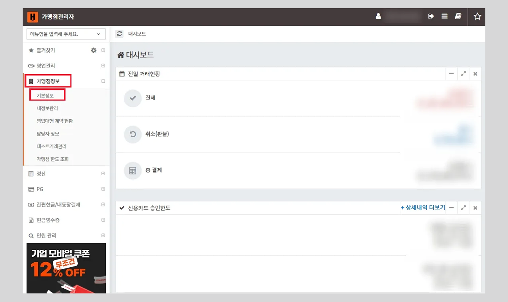
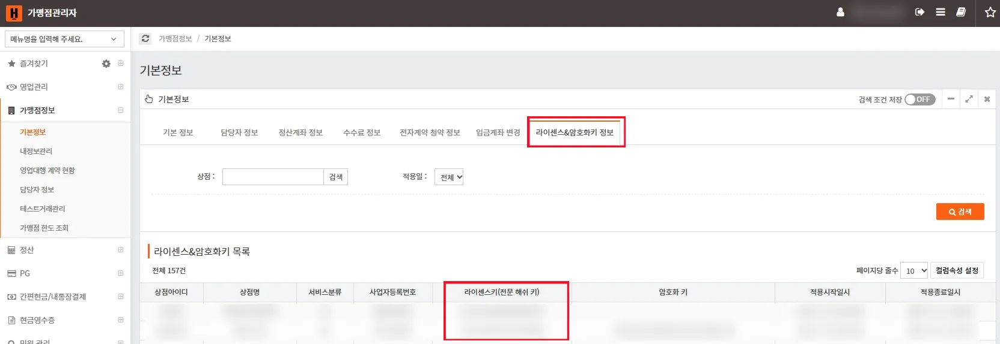
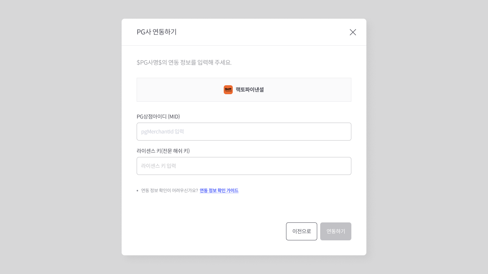

# 헥토파이낸셜

> 원문: https://support.alfred.kr/21fe8268-560a-816f-9798-ca1562736802

> **필요정보**
>
> - **라이센스키 (전문 해쉬 키)**
>
> - **상점아이디 (MID)**

- **핵토파이낸셜 관리자 페이지에 로그인합니다.**
  [https://nspay.settlebank.co.kr/login.do?returnURL=%2F](https://nspay.settlebank.co.kr/login.do?returnURL=%2F)

- **좌측 메뉴에서`가맹점정보`>`기본 정보`를 선택합니다.**

  

- **‘`라이센스&암호화키 정보`’ 클릭 > 라이센스키(전문 해쉬키)를 확인하여 복사합니다.**

  

- **헥토파이낸셜 연동화면에서 상점아이디 (MID) 및 복사한 라이센스 키를 입력합니다.**

  
