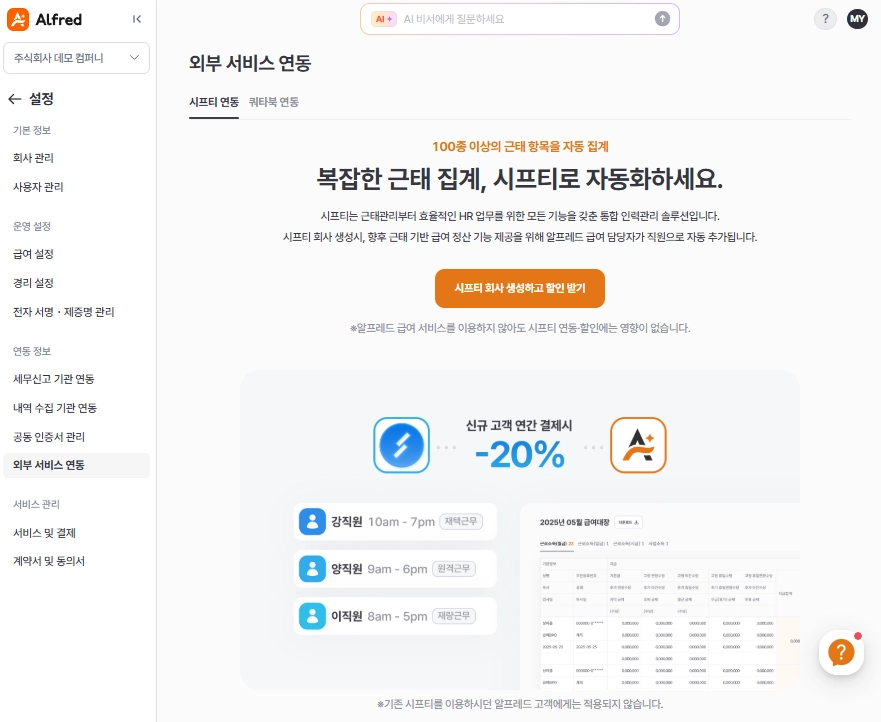
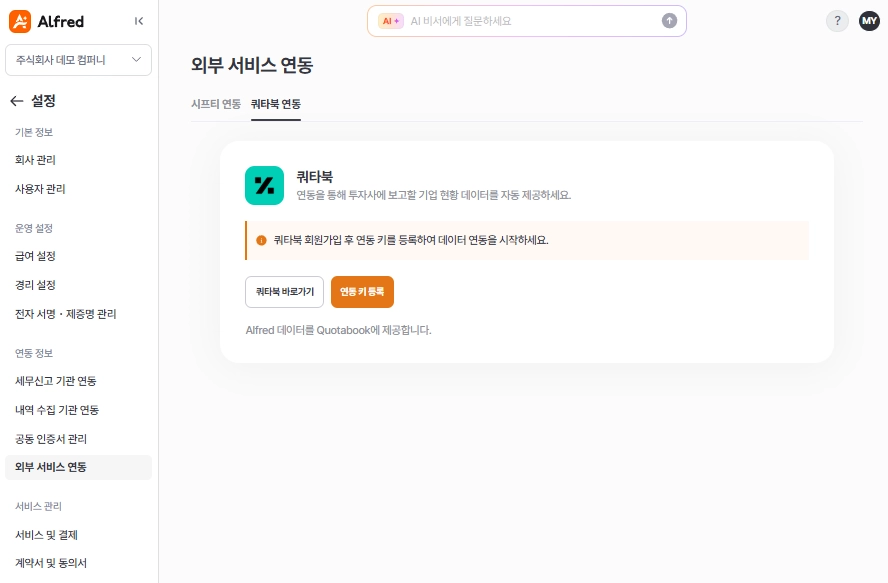

# 외부 서비스 연동

> 원문: https://support.alfred.kr/f27e8268-560a-8277-bfc1-8137dea69928

> **외부 서비스 연동**에서는 Alfred Business를 시프티(근태관리)·쿼타북(투자사 보고) 등 외부 서비스와 연결해, 근태 집계나 기업 현황 데이터 제공을 자동화할 수 있습니다.

**이 메뉴에서 할 수 있는 일**

- 시프티 연동으로 근태 집계 자동화 (신규 고객 연동 할인)
- 쿼타북 연동으로 투자사 보고용 기업 현황 데이터 자동 제공

**경로:** 설정 > 외부 서비스 연동

**노출 대상:** 전체

이 메뉴는 두 개의 탭으로 구성됩니다.

**① 시프티 연동 → ② 쿼타북 연동**

---

### 1. 시프티 연동

시프티는 근태관리부터 HR 업무를 위한 기능을 갖춘 통합 인력관리 솔루션입니다. 100종 이상의 근태 항목을 자동으로 집계해, 복잡한 근태 집계를 자동화할 수 있습니다.

> 

**연동 방법**

`시프티 회사 생성하고 할인 받기` 버튼을 눌러 시프티 회사를 생성하면 연동이 시작됩니다.

**>>** [[외부 연동] 시프티 연동 가이드](01-외부-연동-시프티-연동-가이드.md)

**할인 혜택**

신규 고객이 시프티를 연간 결제할 경우 20% 할인이 적용됩니다.

>

- 연동·할인 관련 유의사항
  - Alfred 급여 서비스를 이용하지 않아도 시프티 연동·할인에는 영향이 없습니다.
  - 기존에 시프티를 이용하던 Alfred 고객에게는 할인이 적용되지 않습니다.

---

### 2. 쿼타북 연동

쿼타북 연동을 통해 투자사에 보고할 기업 현황 데이터를 자동으로 제공할 수 있습니다. Alfred 데이터를 쿼타북(Quotabook)에 제공하는 방식입니다.

> 

**연동 방법**

1. 쿼타북에 회원가입합니다. (`쿼타북 바로가기` 버튼으로 이동)
1. `연동 키 등록` 버튼을 눌러 연동 키를 등록하면 데이터 연동이 시작됩니다.

>

---

### FAQ. 자주 묻는 질문

**시프티 연동 할인은 누구에게 적용되나요?**

신규 고객이 시프티를 연간 결제할 때 20% 할인이 적용됩니다. 기존에 시프티를 이용하던 Alfred 고객에게는 적용되지 않습니다.

**시프티 연동은 어떻게 할 수 있나요?**

‘시프티에 한 번도 가입한 적이 없는 이메일’로 신규 가입해 주시면 연동 가능합니다.

기존에 시프티를 이용 중이셨던 사업장도 연결할 수 있도록 준비 중에 있습니다. 아직은 시프티 신규 이용 사업장만 연동이 가능합니다.

**Alfred 급여 서비스를 쓰지 않아도 시프티를 연동할 수 있나요?**

네. Alfred 급여 서비스를 이용하지 않아도 시프티 연동·할인에는 영향이 없습니다.

**시프티 회사를 생성하면 왜 Alfred 담당자가 직원으로 추가되나요?**

향후 근태 기반 급여 정산 기능 제공을 위해 Alfred 급여 담당자가 직원으로 자동 추가됩니다.

**쿼타북 연동은 어떻게 시작하나요?**

쿼타북 회원가입 후, 외부 서비스 연동 > 쿼타북 연동 탭에서 `연동 키 등록`으로 연동 키를 등록하면 데이터 연동이 시작됩니다.

## 하위 페이지

- [[외부 연동] 시프티 연동 가이드](01-외부-연동-시프티-연동-가이드.md)
