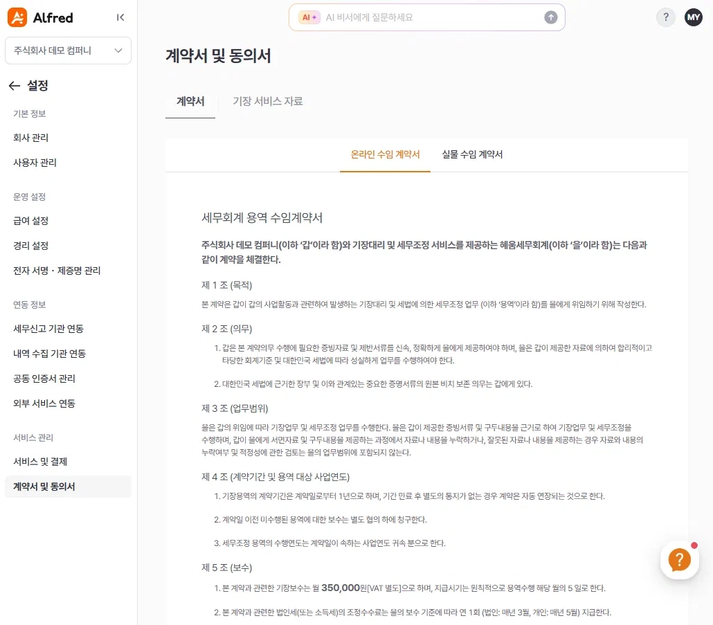
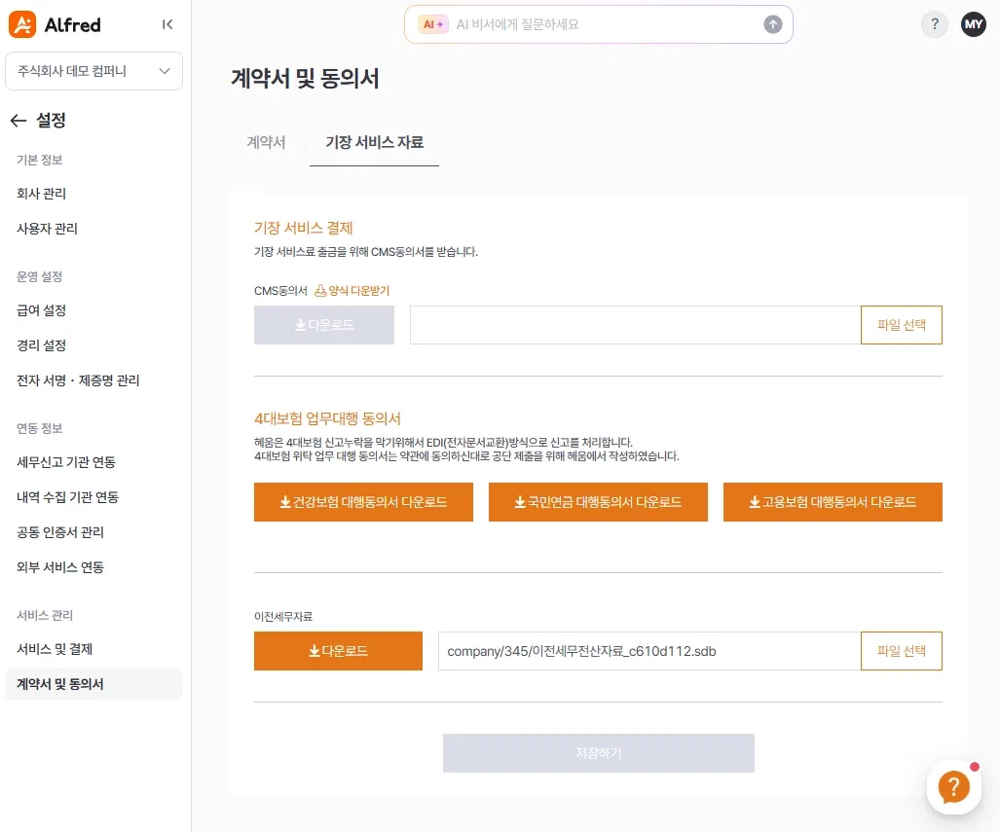

# 계약서 및 동의서

> 원문: https://support.alfred.kr/1e2e8268-560a-8386-91c2-810d0e777367

> **계약서 및 동의서**에서는 세무회계 용역 수임계약서를 확인하고, 기장 서비스 이용에 필요한 결제 동의서·4대보험 업무대행 동의서 등을 관리할 수 있습니다.

**이 메뉴에서 할 수 있는 일**

- 온라인·실물 수임계약서 내용 확인
- 기장 서비스 결제용 CMS 동의서 제출
- 4대보험 업무대행 동의서 다운로드
- 이전 세무자료 관리

**경로:** 설정 > 계약서 및 동의서

**노출 대상:** 전체

이 메뉴는 두 개의 탭으로 구성됩니다.

**① 계약서 → ② 기장 서비스 자료**

---

### 1. 계약서

세무 기장대리 및 세무조정 서비스에 대한 수임계약서를 확인하는 탭입니다. 계약 형태에 따라 두 가지로 구분됩니다.\

> 

- **온라인 수임 계약서**: 세무회계 용역 수임계약서 내용을 화면에서 바로 확인할 수 있습니다. 계약 목적·의무·업무범위·계약기간·보수 등 조항이 표시됩니다.
- **실물 수임 계약서**: 별도로 체결한 실물 계약서를 확인할 수 있습니다.

>

---

### 2. 기장 서비스 자료

기장 서비스 이용에 필요한 결제 동의서와 4대보험 업무대행 동의서, 이전 세무자료를 관리하는 탭입니다.

> 

#### 기장 서비스 결제 (CMS 동의서)

기장 서비스료 출금을 위해 CMS 동의서를 받습니다.

1. `양식 다운받기`로 CMS 동의서 양식을 내려받습니다.
1. 작성한 동의서를 `파일 선택`으로 업로드합니다.

#### 4대보험 업무대행 동의서

세무법인 혜움은 4대보험 신고 누락을 막기 위해 EDI(전자문서교환) 방식으로 신고를 처리합니다. 4대보험 위탁 업무 대행 동의서는 약관에 동의하신 뒤 공단 제출을 위해 혜움에서 작성합니다.

아래 동의서를 다운로드할 수 있습니다.

- 건강보험 대행동의서
- 국민연금 대행동의서
- 고용보험 대행동의서

#### 이전 세무자료

이전에 사용하던 세무 프로그램의 세무자료(전산자료)를 업로드해 관리할 수 있습니다. `다운로드`로 등록된 자료를 확인하거나 `파일 선택`으로 새 자료를 업로드합니다.

>

---

### FAQ. 자주 묻는 질문

**CMS 동의서는 왜 제출하나요?**

기장 서비스료를 자동 출금하기 위한 동의서입니다. `양식 다운받기`로 양식을 받아 작성한 뒤 `파일 선택`으로 업로드합니다.

**4대보험 대행동의서는 왜 필요한가요?**

4대보험 신고 누락을 막기 위해 EDI(전자문서교환) 방식으로 신고를 처리하며, 공단 제출을 위해 건강보험·국민연금·고용보험 대행동의서가 필요합니다. 약관 동의 후 혜움에서 작성합니다.

**이전 세무자료는 왜 올리나요?**

이전에 사용하던 세무 프로그램의 전산자료를 이어받아 기장 업무에 활용하기 위한 자료입니다.
