# Alfred Business 메뉴 구조

> 원문: https://support.alfred.kr/387e8268-560a-81c6-94dd-fb190288196b

> Alfred Business의 메뉴는 업무 흐름에 맞춰 구성되어 있습니다.

### 메뉴 구조

사용 중인 플랜(`세무 기장 수임` 여부)에 따라 확인 가능한 보고서 차이를 먼저 확인해보세요.

[>>세무 기장 대행 서비스 알아보기](https://www.heumtax.com/)

> 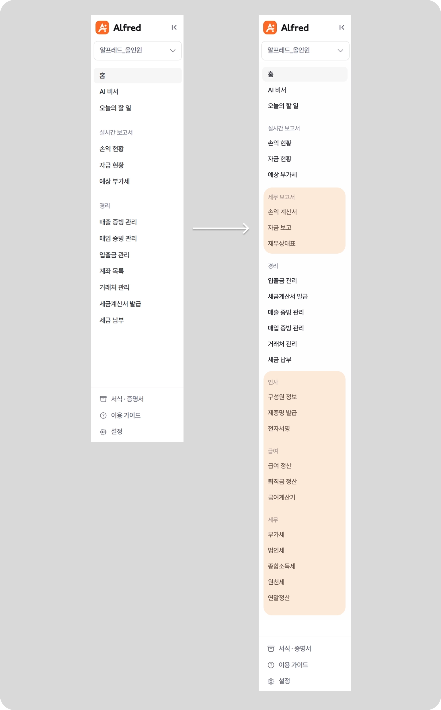

---

### 메뉴 설명

#### 홈

- 자금·손익·예상 부가세 등 주요 현황 확인
- 확인이 필요한 업무를 '오늘의 할 일'에서 처리
- 추천 질문으로 AI 비서에게 바로 질문

> 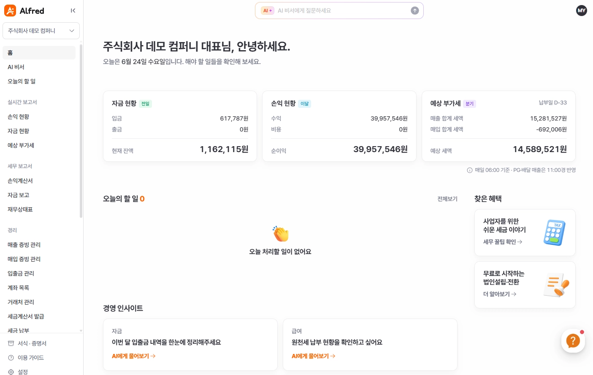

#### AI 비서

- 사업 현황, 세무, 자금 등을 대화로 질문하고 답변 확인
- 구독과 상관없이 모든 사용자가 이용

> 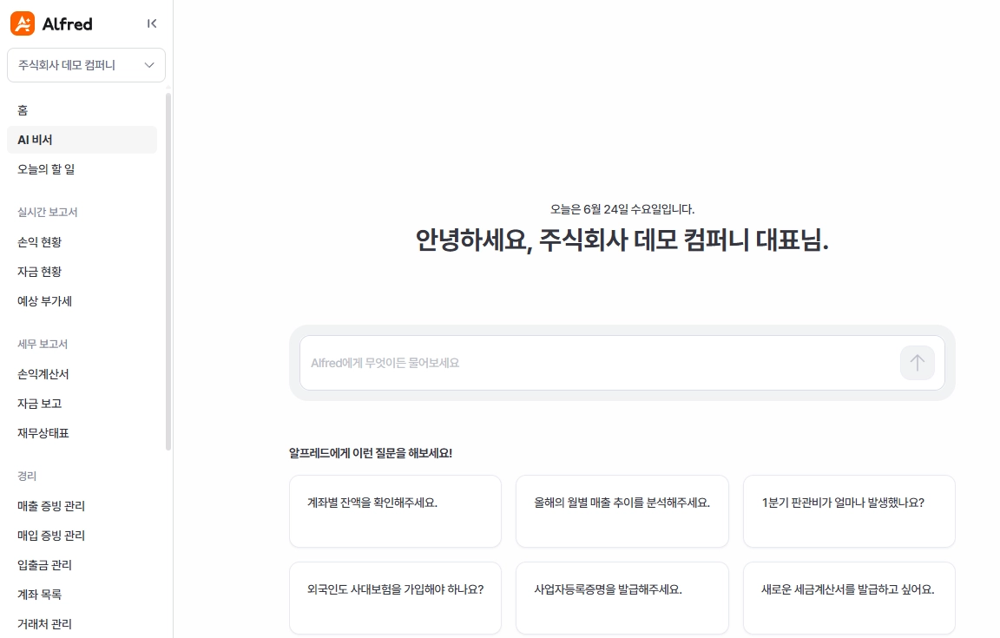

#### 오늘의 할 일

- 확인·결정이 필요한 업무를 카드로 확인
- 카드에서 바로 처리하거나 관련 화면으로 이동

> 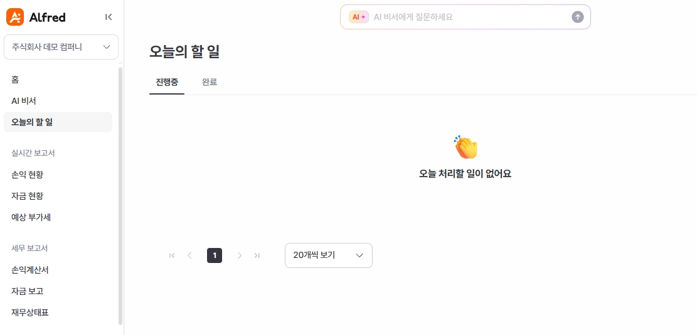

#### 실시간 보고서

- **손익 현황:** 손익과 매출·매입을 탭으로 확인 가능
- **자금 현황:** 일별 자금과 기간별 추이 확인
- **예상 부가세:** 예상 납부 세액 확인

> 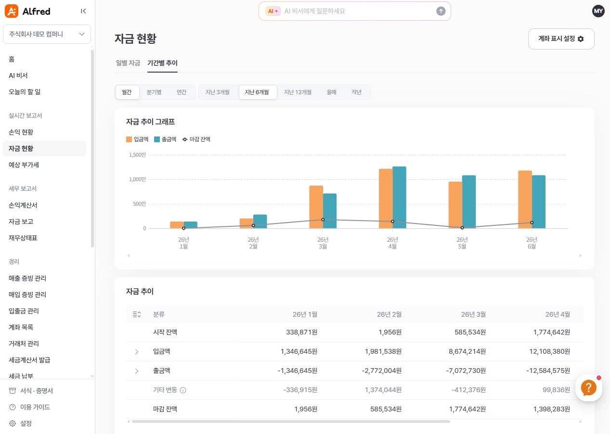

#### 세무 보고서

- **손익계산서:** 손익계산서, 비용 분석, 인건비 내역을 탭으로 확인 가능
- **자금 보고** : 자금 흐름과 미수·미지급금 확인
- **재무상태표**

> 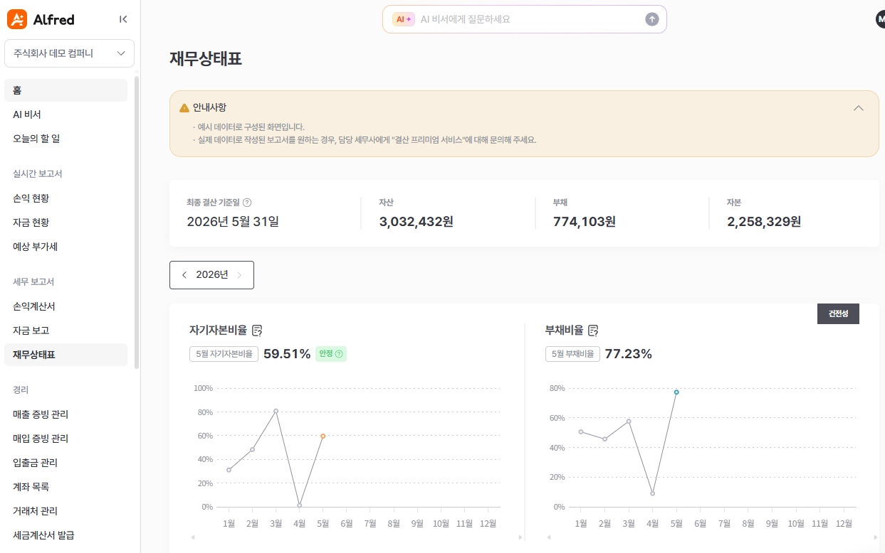

#### 경리

- **매출 증빙 관리 :** 매출 증빙 조회, 매출 내역과 거래처 매칭 및 계정과목 분류
- **매입 증빙 관리 :** 매입 증빙 조회, 매입 내역과 거래처 매칭 및 계정과목 분류
- **입출금 관리 :** 입출금 내역 조회
- **계좌 목록 :** 보유 계좌 목록 및 잔액 조회
- **거래처 관리** : 자주 발생하는 거래처 정보 입력 및 미정산 금액 관리
- **세금계산서 발급**
- **세금 납부** : 인터넷 지로 고지서 조회 및 세금 납부

> 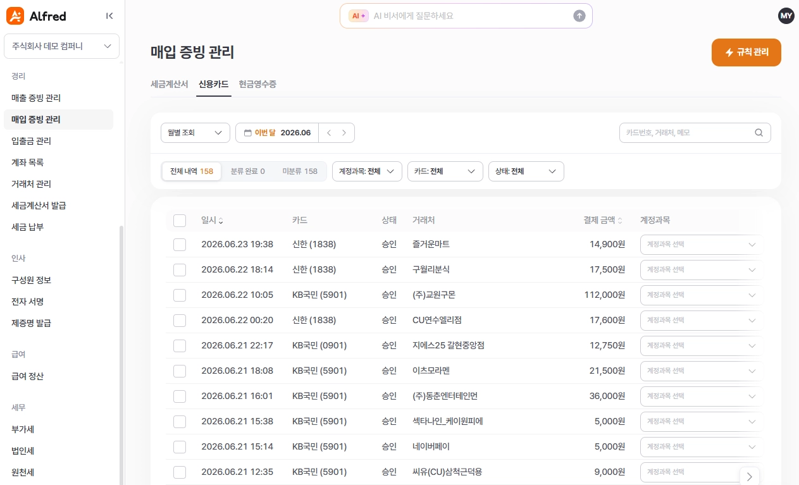

#### 인사(유료 버전 제공)

- **구성원 정보**_`(급여 구독, 급여 구독&세무 기장시 노출)`
- **직원 관리**_`(세무 기장시 노출)`
- **전자서명** : 근로계약 관련 문서내 전자서명 발급
- **제증명 발급 :** 표준 취업 규칙, 경력증명서, 재직증명서, 퇴직증명서 발급

> 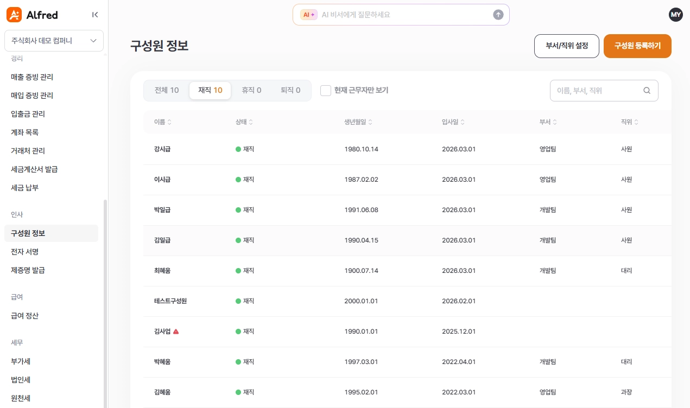

#### 급여(유료 버전 제공)

- **급여 정산**_`(급여 구독, 급여 구독&세무 기장시 노출)`
- **급여 관리**_`(세무 기장시 노출)`

> 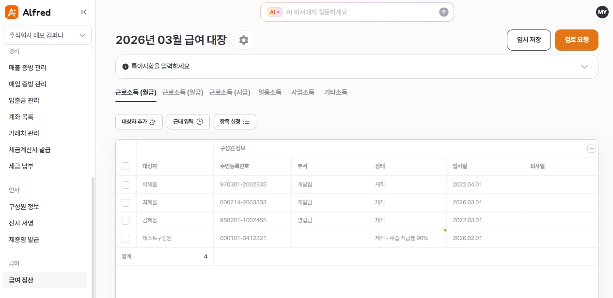

#### 세무

각 세금 신고 업무 진행과 과거 신고 이력 확인 가능

- **부가세**
- **법인세**
- **종합소득세**
- **원천세**
- **연말정산**

> 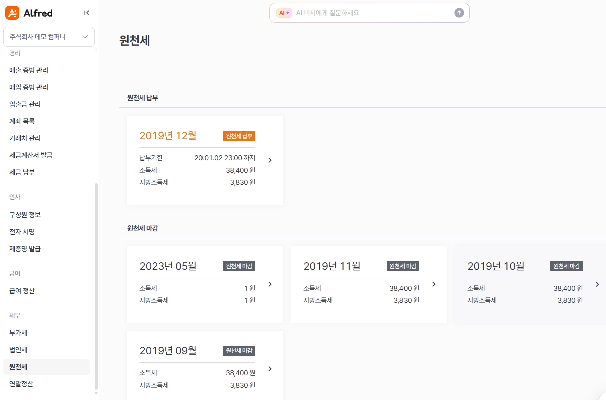

#### 서식·증명서

- **서식 모음** : 자주 사용하는 업무 서식 다운로드
- **증명서 발급 :** 세무 관련 증명서 발급

> 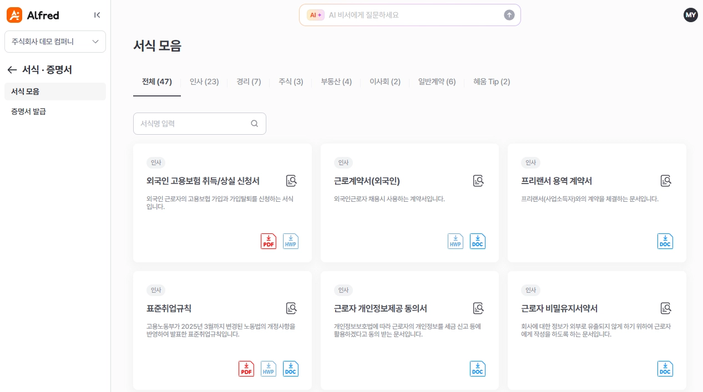

#### 설정

- **회사·사용자 관리** : 회사 정보 및 사용자 관리
- **급여·경리 등 운영 설정** : 급여, 경리 기능 설정
- **전자서명·제증명 관리** : 전자서명 및 구성원제증명 발급에서 사용할 전자 문서 관리
- **기관 연동 및 인증서 관리** : 세무 신고 및 경리 업무에 필요한 기관 연동
- **서비스 이용 및 결제 관리** : 현재 이용 중인 Alfred 플랜과 계약서 조회
- **계약서 및 동의서** : 세무 기장 계약서 및 수임 동의서 조회

> 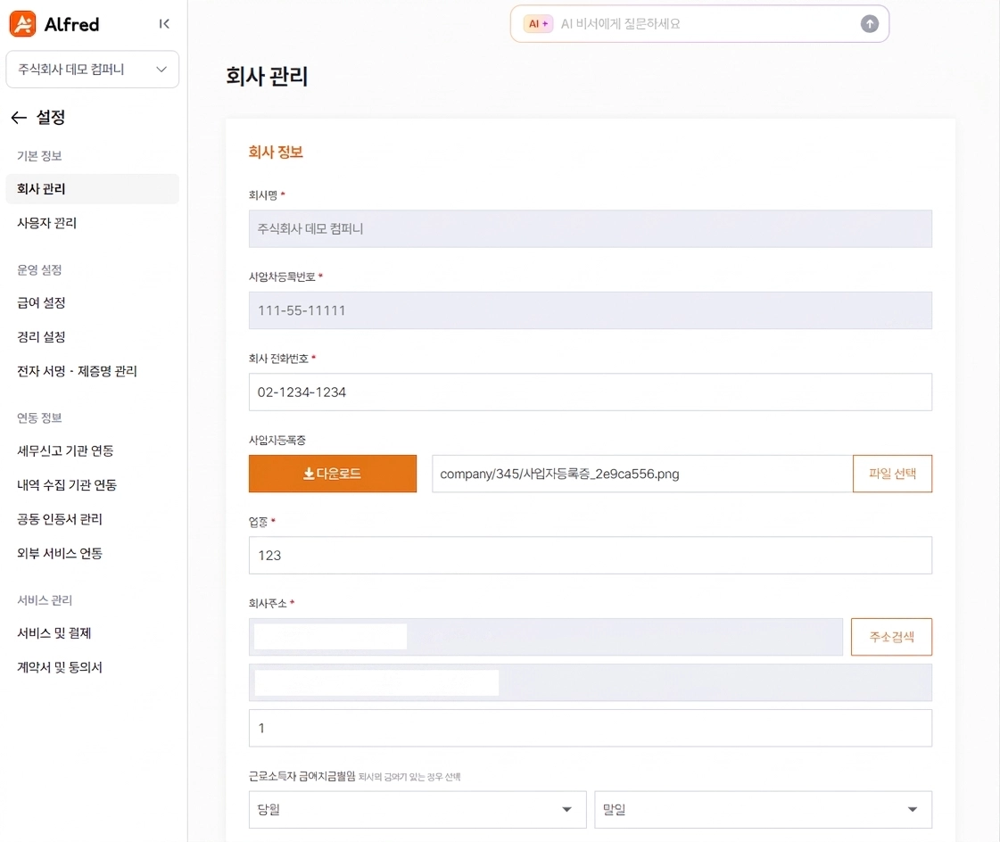

---

### 이전 메뉴 위치 찾기

개편으로 일부 메뉴의 이름과 위치가 바뀌었습니다. 자주 찾던 메뉴가 보이지 않는다면 아래 표에서 새 위치를 확인해 주세요. **정보는 그대로이며, 찾아가는 경로만 바뀌었습니다.**

| 이전 위치 | 현재 위치 |
| --- | --- |
| 실시간 보고서 > 자금보고서 | 실시간 보고서 > **자금 현황** |
| 실시간 보고서 > 손익 현황 | 실시간 보고서 > **손익 현황** |
| 실시간 보고서 > 매출·매입 보고서 | 실시간 보고서 > 손익 현황 > **매출·매입 보고서** 세부  탭으로 통합 |
| 세무 결산 자료 | **세무 보고서** (이름 변경) |
| 세무 결산 자료 > 자금 흐름 | 세무 보고서 > **자금 보고** |
| 세무 결산 자료 > 미수·미지급금 | 세무 보고서 > 자금 보고 > **미수·미지급금** 세부  탭으로 통합 |
| 비용 분석, 인건비 내역 | 세무 보고서 > 손익계산서 > **비용 분석, 인건비 내역** 세부 탭으로 통합 |
| 급여 > 구성원 관리 | **인사** > 구성원 정보 |
| 세무 > 인사 > 직원관리 | **인사** > 구성원 정보 |
| 급여 > 구성원 관리 > 전자서명·제증명 | **인사** > 제증명 발급 |
| 세무 > 인사 > 급여관리 | **급여 >** 급여 정산 |
| Home > 서식/증명서 | **서식·증명서** |
| 시프티 연동, 쿼타북 연동 | 설정 > 연동 정보 > **외부 서비스 연동** (탭으로 통합) |
| 급여 정보, 경리 정보 (분리) | 설정 > **운영 설정** 으로 통합 |
| 서비스 정보 | 설정 > **서비스 관리** (이름 변경) |
| 카드 매출 보고서 | `[삭제]` |
