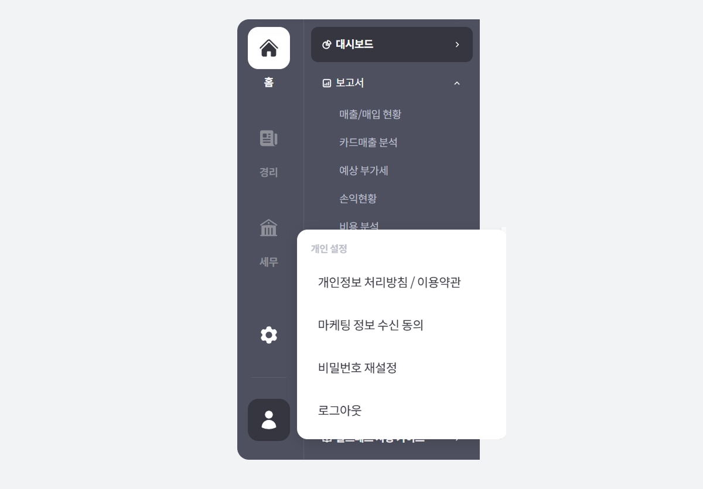
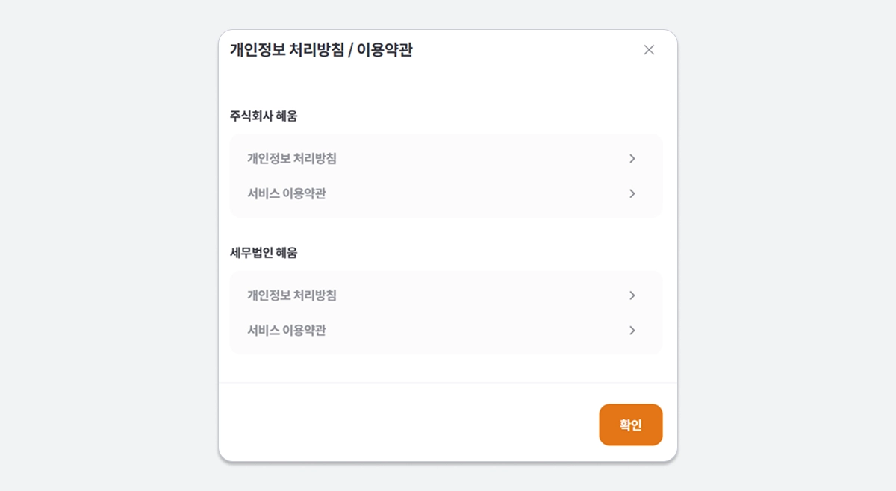
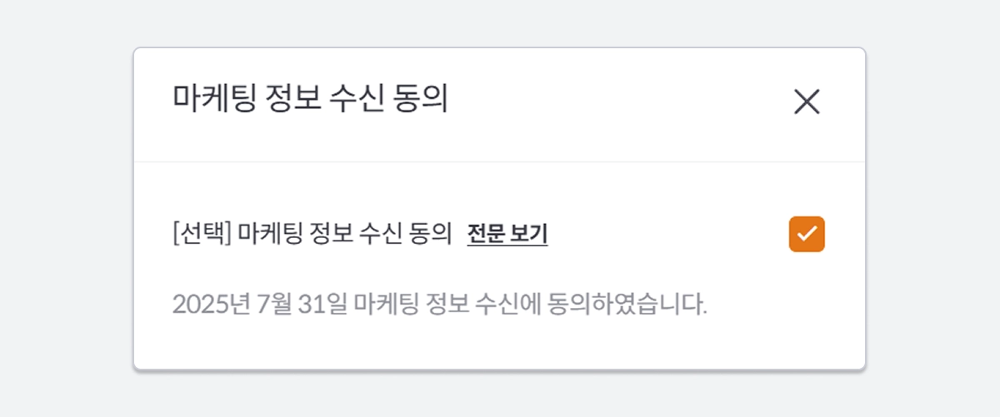
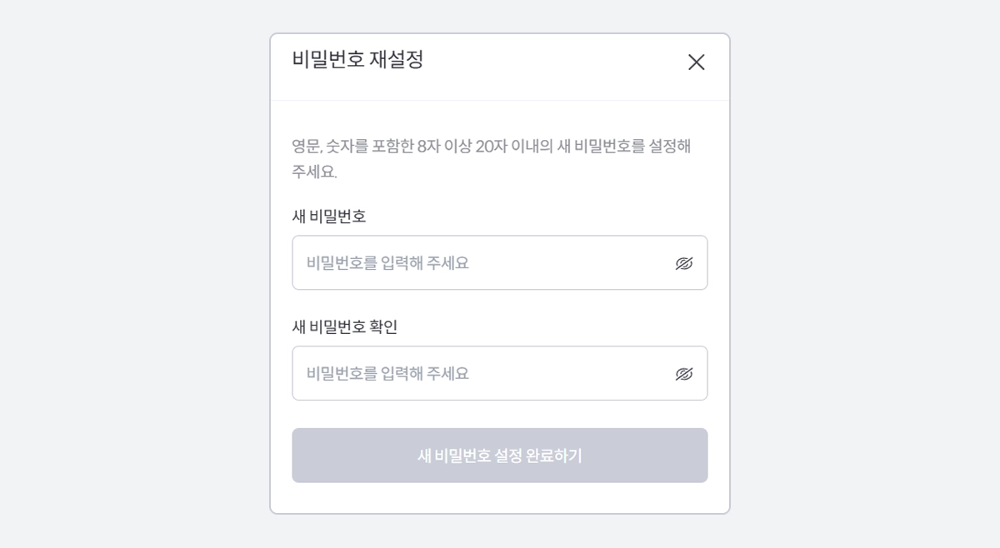

# 개인 설정 안내

> 원문: https://support.alfred.kr/23be8268-560a-8037-8ff5-e6e68269da75

알프레드 메뉴 하단의 개인 설정 관련 안내입니다.

#### 개인정보 처리방침 / 이용약관

클릭시 서비스 이용 약관 및 개인정보 처리 방침을 확인 할 수 있습니다.

- 각 약관 오른쪽 > 버튼을 누르면 약관으로 이동 됩니다.
- 세무 수임하지 않으신 알프레드 무료 고객은 세무법인 혜움 약관이 노출되지 않습니다.

#### 마케팅 수신 동의

마케팅 수신 동의 여부를 변경 할 수 있습니다.

- 체크박스를 클릭하여 마케팅 정보 수신을 동의 / 비동의로 언제든 변경 가능합니다.

#### 비밀번호 재설정

알프레드 로그인 후 비밀번호를 변경하려는 경우, 비밀번호 재설정을 클릭 후 새 비밀번호만 입력하면 됩니다.

