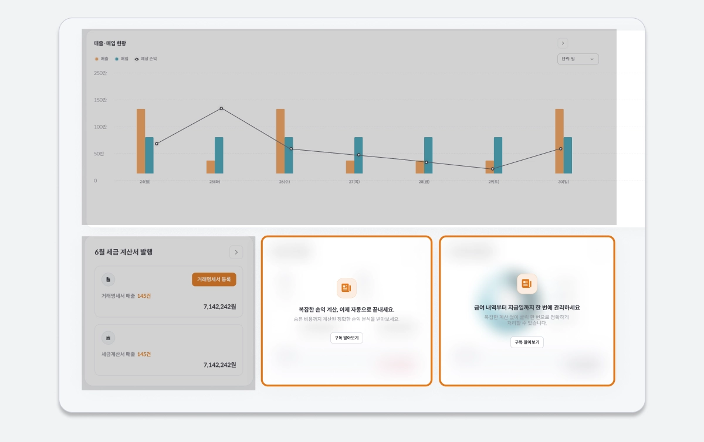
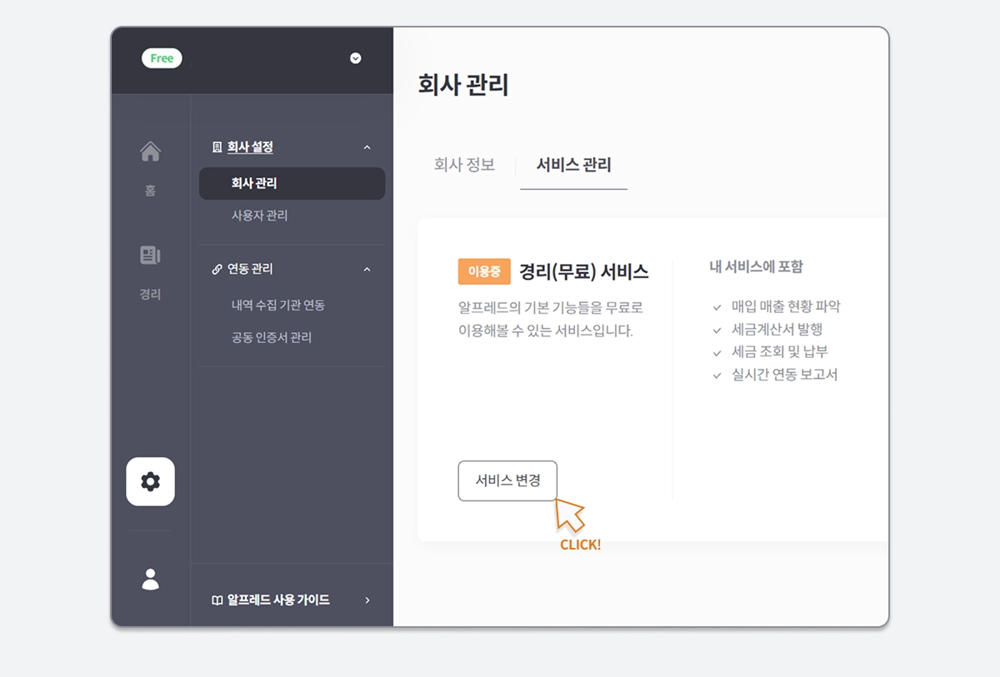
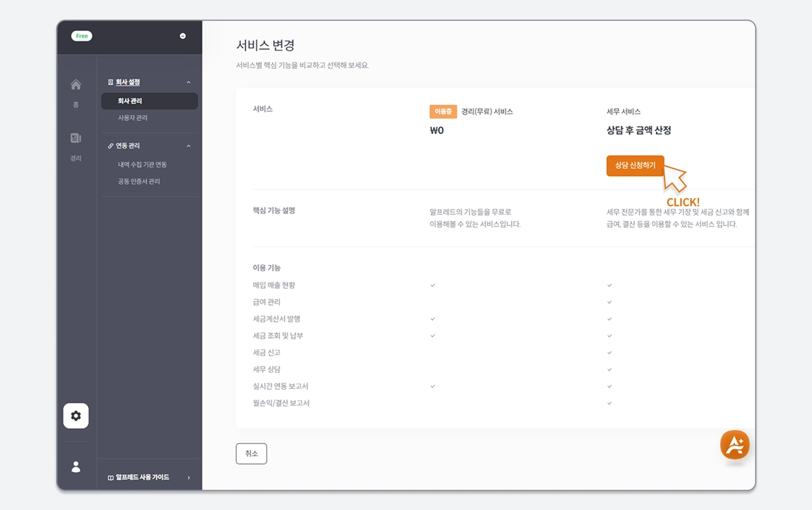
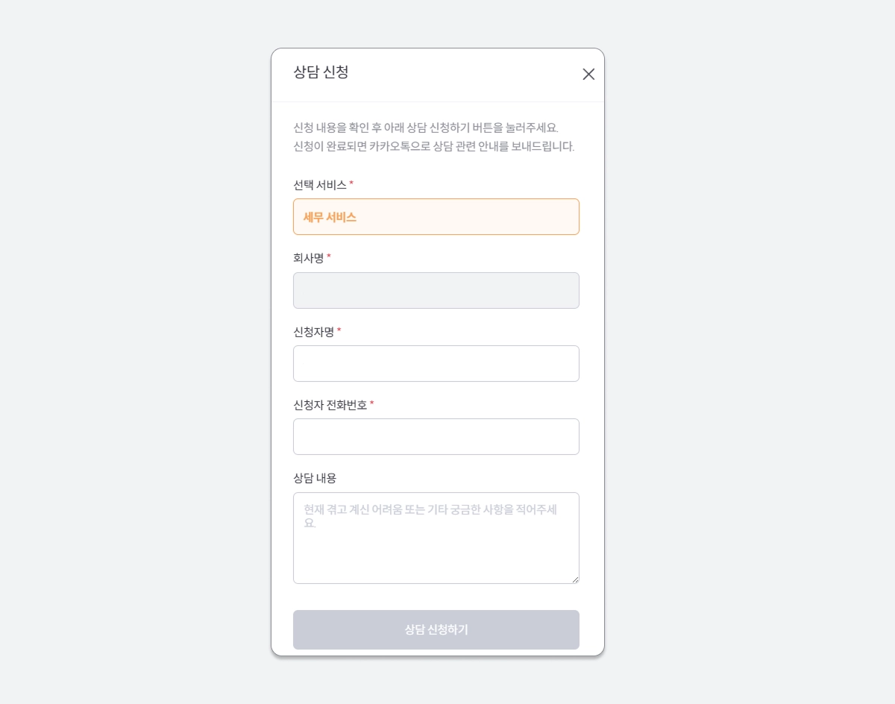
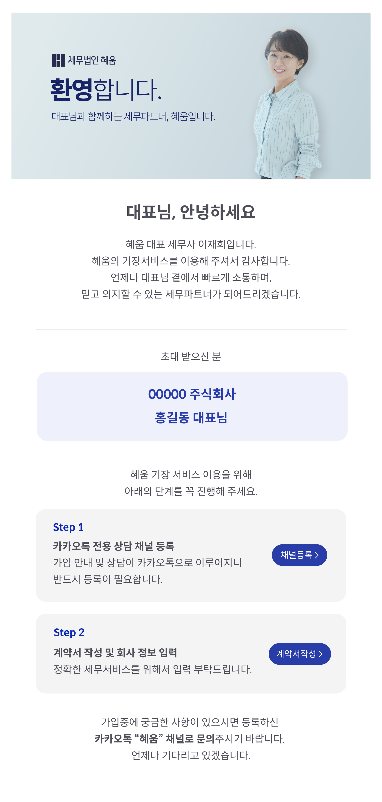
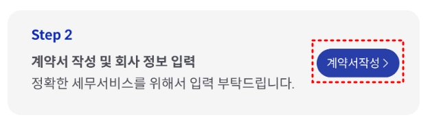

# 세무기장 고객으로 전환하기

> 원문: https://support.alfred.kr/21fe8268-560a-810a-909f-e0fb0cf7d550

### 유료기장고객 전환방법 (컨설팅 신청)

---

**신청 바로가기**

[Heum Report https://app.alfred.kr/settings/plan/detail](https://app.alfred.kr/settings/plan/detail)

#### 신청 경로

**방법 1.** 대시보드의 손익 현황, 인건비 현황에 마우스를 올리면 나타나는 **구독 알아보기 버튼을 클릭**합니다.

**방법 2. 설정 > 회사 관리 > 서비스 관리** 에서 **서비스 변경 클릭** 후 **상담 신청하기 버튼을 클릭**합니다.

#### 상담 신청하기

구독 알아보기, 상담 신청하기 클릭시 나타나는 상담 신청을 작성 후 신청 버튼을 클릭하면 접수 완료됩니다.

- 접수된 문의에 대하여는 1~2영업일 이내로 연락 드립니다.

---

**컨설팅 이후 초대메일을 수신받아 세무수입고객으로 가입하는 방법은 아래와같습니다.**

### 컨설팅 후 가입하기

#### 초대 이메일 수신

- 혜움에 알려주신 이메일로 '**초대 이메일**'이 발송됩니다.

- 초대 이메일의 **[계약서 작성]**을 클릭하면 혜움서비스 가입이 됩니다.

- 가입 후 원할한 세무서비스 제공을 위하여 **홈택스 수임동의** 및 **CMS결제 동의**를 진행해주세요.
- 세무신고 기관 연동과 내역 수집 기관 연동을 진행해주세요.
  - 세무신고 기관 연동은 지출, 수입 내역의 세무 처리를 위해 필요합니다.
  - 내역 수집 기관 연동은 알프레드 기능 사용을 위해 필요합니다.
