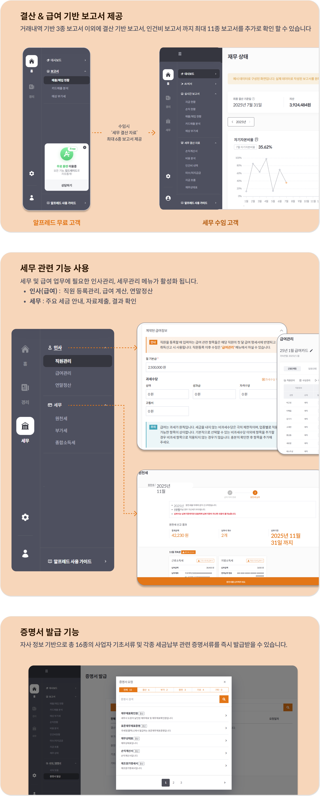

# 세무 수임 고객 제공 기능차이

> 원문: https://support.alfred.kr/122e8268-560a-81b9-a593-c4c021e09b2d

**세무기장 고객으로 전환 방법 안내 ↓**

- 📄 [세무기장 고객으로 전환하기](01-세무기장-고객으로-전환하기.md)

> - 세무수임 고객과 일반 알프레드 고객(무료)대상 제공되는 기능이 다릅니다.
>
> - 세무수임고객 전용 기능은 세무대리인(세무법인)이 처리한 세무정보를 기반으로 제공하는 기능입니다.
>
> - 혜움이 세무 대리인이 아닌경우, 법적으로 결산내역, 급여내역 등을 관리할 수 없기에 꼭 혜움을 세무대리인으로 지정하는 세무수임고객이 되셔야 해당기능 사용이 가능합니다.

**세무 수임 고객 전용으로 제공되는 메뉴는 아래와 같습니다.**

#### 세무 수임이 궁금해요

- 아래 링크를 통해 세무수임 컨설팅 부터 받고 혜움 세무법인을 이용할 수 있습니다.
- 세무요금 (기장료)가 발생하며 수임시 세무수임고객 전용 기능을 사용할 수 있습니다.

[간편하고 친절한 전문 세무 상담 혜움 전문 세무사의 1:1 맞춤형 케어 https://www.heumtax.com/consulting?type=biz&utm_source=alfred_helpdesk&utm_medium=web&utm_campaign=alfred_manual&utm_content=service_comparison](https://www.heumtax.com/consulting?type=biz&utm_source=alfred_helpdesk&utm_medium=web&utm_campaign=alfred_manual&utm_content=service_comparison)

## 하위 페이지

- [세무기장 고객으로 전환하기](01-세무기장-고객으로-전환하기.md)
