# 공동인증서 등록/연동에 실패 가이드(FAQ)

> 원문: https://support.alfred.kr/39de8268-560a-800c-a664-f7a98873f34f

## FAQ

---

#### 1. 연동 화면에서 인증서들이 다 회색으로 노출되고 선택되지 않아요. 불가 라고 노출되어요.

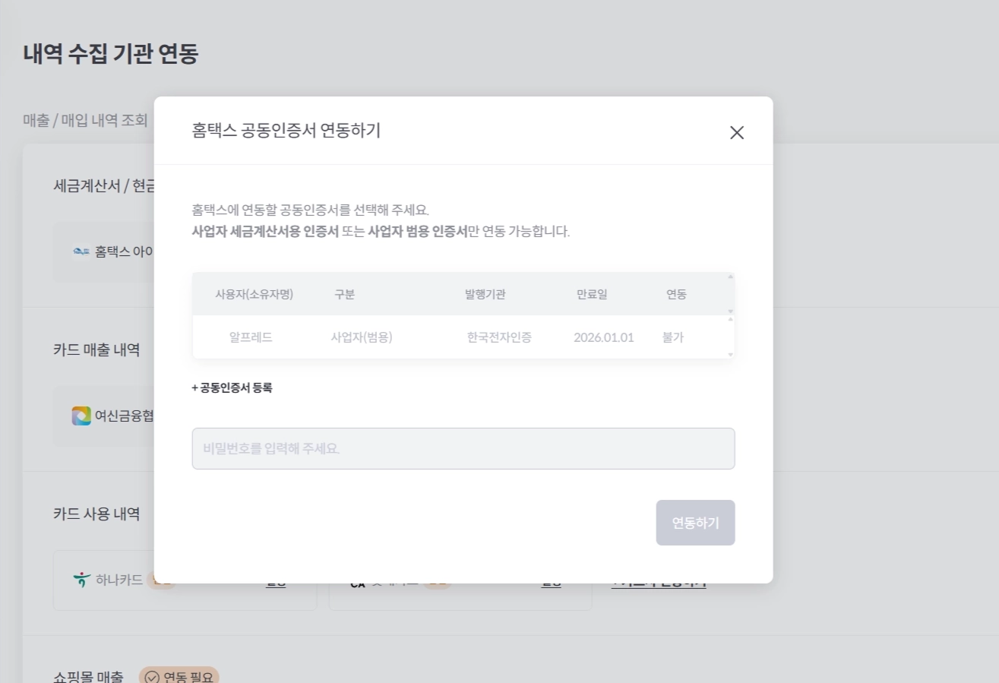

- 연동하려는 기관에 따라서 연동 가능한 공동인증서 종류가 다릅니다. 연동하시려는 기관과 공동 인증서의 구분을 확인해주세요.

  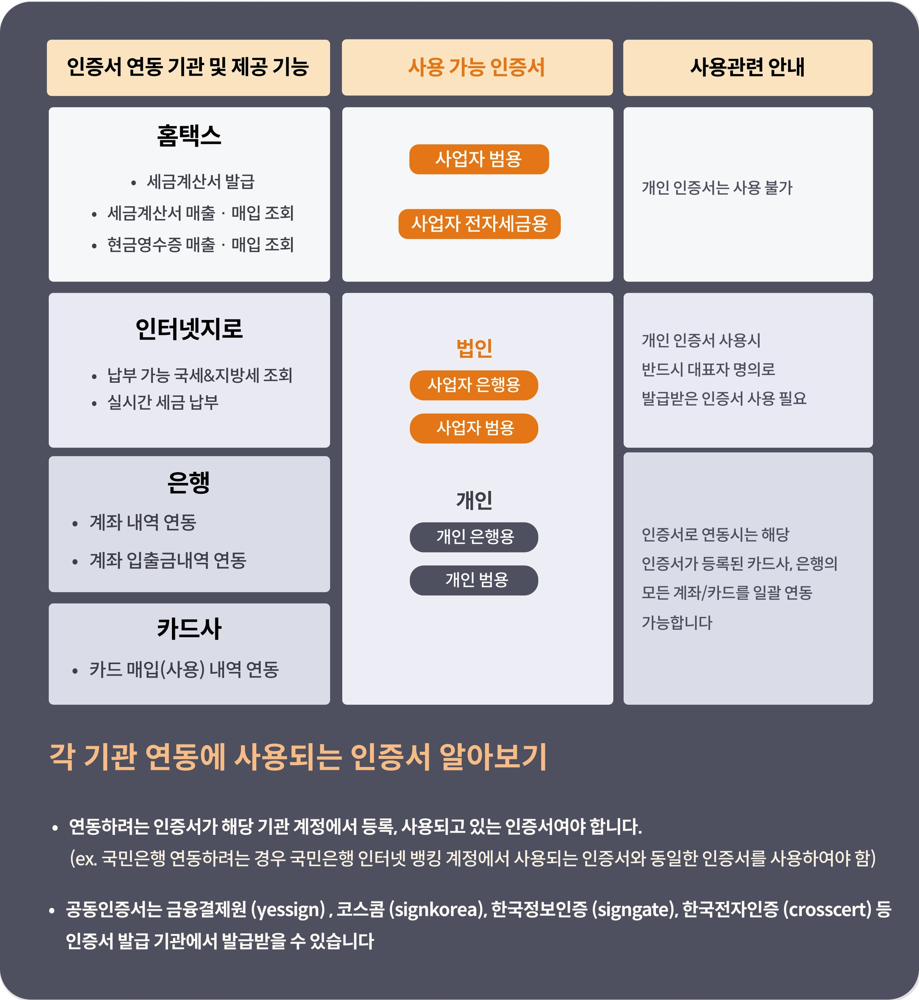

#### 2. 인증서 프로그램이 실행되지 않거나 에러가 발생해요.

- 다음 사항을 먼저 확인해주세요.
  1. **운영체제를 확인해주세요.**
    1. 윈도우 10, 11만 지원합니다. (맥(Mac OS)은 지원하지 않습니다.)
  1. **윈도우 언어 설정을 확인해주세요.**
    1. 윈도우 언어 설정이 한국어로 되어 있지 않은 경우 인증서 프로그램이 정상적으로 동작하지 않습니다. 다음 두 가지 설정을 확인해주세요.
      1. 시스템 표시 언어 한국어로 설정
        1. 한국어 언어팩 설치 및 시스템 표시 언어 한국어로 설정
      1. 시스템 로캘 한국어 설정
        1. (윈도우10) 설정 → 시간 및 언어 → 지역 → 관련 설정 아래의 ‘추가 날짜, 시간 및 국가별 설정’ → 국가 또는 지역 → 관리자 옵션 → 시스템 로캘 변경 → 한국어 선택 후 재부팅
        1. (윈도우11) 설정 → 시간 및 언어 → 언어 및 지역 → 관련 설정 아래의 ‘관리자 언어 설정’ → 관리자 옵션 → 시스템 로캘 변경 → 한국어 선택 후 재부팅
  1. **가상화 환경에서 사용하고 계신지 확인해주세요.**
    1. 윈도우 샌드박스, Parallels, VMware, QEMU 등과 같은 가상화 환경에서는 인증서 프로그램이 정상적으로 동작하지 않을 수 않습니다. 가상화 환경이 아닌 곳에서 인증서 업로드를 다시 시도해주세요.
- **‘vb6ko.dll’ 파일이 없다는 에러가 발생해요.**
  vb6ko.dll 99.8KB

  - 위 파일을 다운로드 하여 다음 경로에 복사하신 뒤 다시 시도해주세요.
    - 32비트 윈도우 사용자: C:\Windows\System32
    - 64비트 윈도우 사용자: C:\Windows\SysWOW64
- **인증서 암호화에 실패했다는 에러가 발생해요.**
  - 아래 가이드를 따라서 인증서 프로그램을 재설치 해주세요. 반드시 완전히 삭제 후 재설치가 필요합니다.
  - 만약 해결이 안되는 경우 `C:\InfoTech\common\iftUpdate.exe` 파일을 실행하여 모듈을 업데이트 한 후 다시 시도해주세요.
- **위의 모든 경우에 해당하지 않아요.**
  - 아래 가이드를 따라서 인증서 프로그램을 재설치 해주세요. 반드시 완전히 삭제 후 재설치가 필요합니다.
- **인증서 업로드 프로그램 삭제 및 재설치 방법 (좌측 삼각형 클릭!)**
  1. 먼저 아래와 같이 윈도우 키를 입력 후, **프로그램 추가/제거 메뉴를 선택**해주세요.

  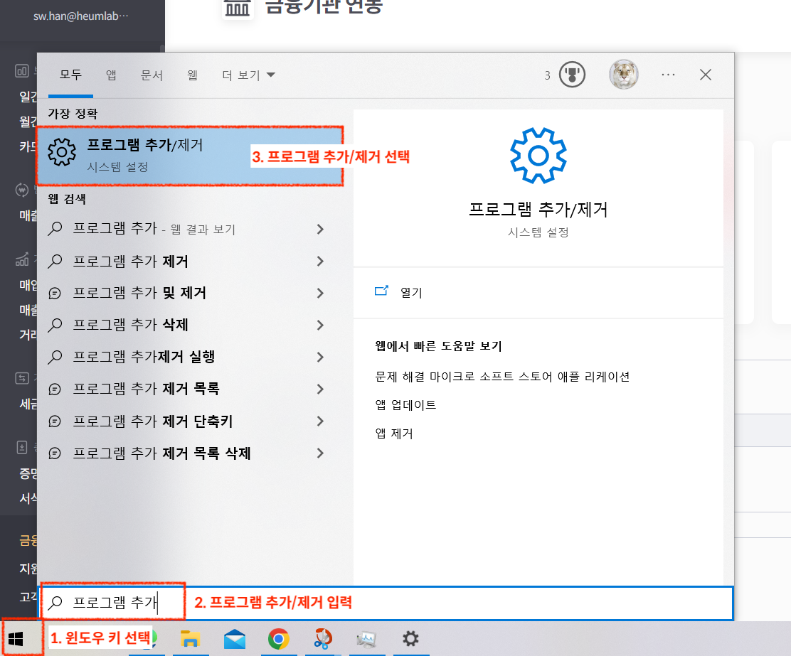

  1. 나타난 창에서 **ExAdapter, iftNxService 두 가지 단어를 모두 검색**합니다.

  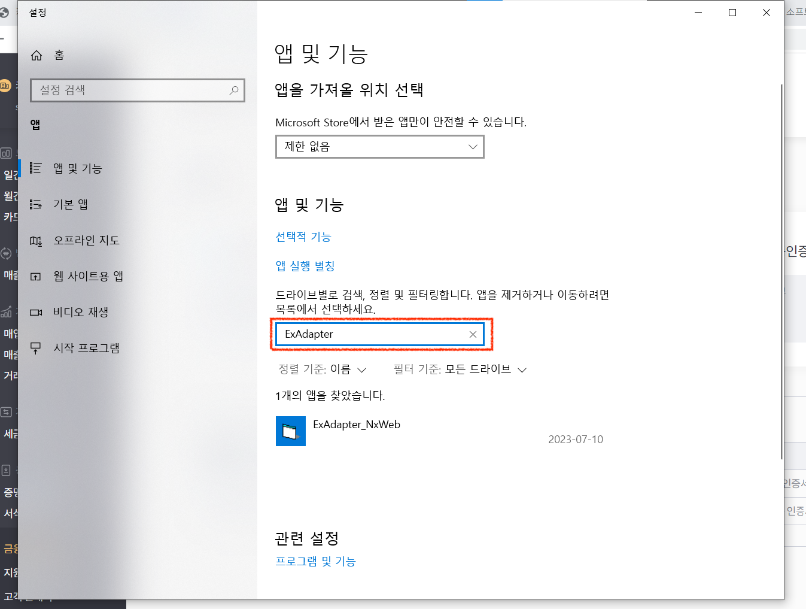

  1. 검색된 프로그램을 **선택하고 제거** 합니다. (**ExAdapter, iftNxService 둘 다 삭제 해야 합니다.)**

  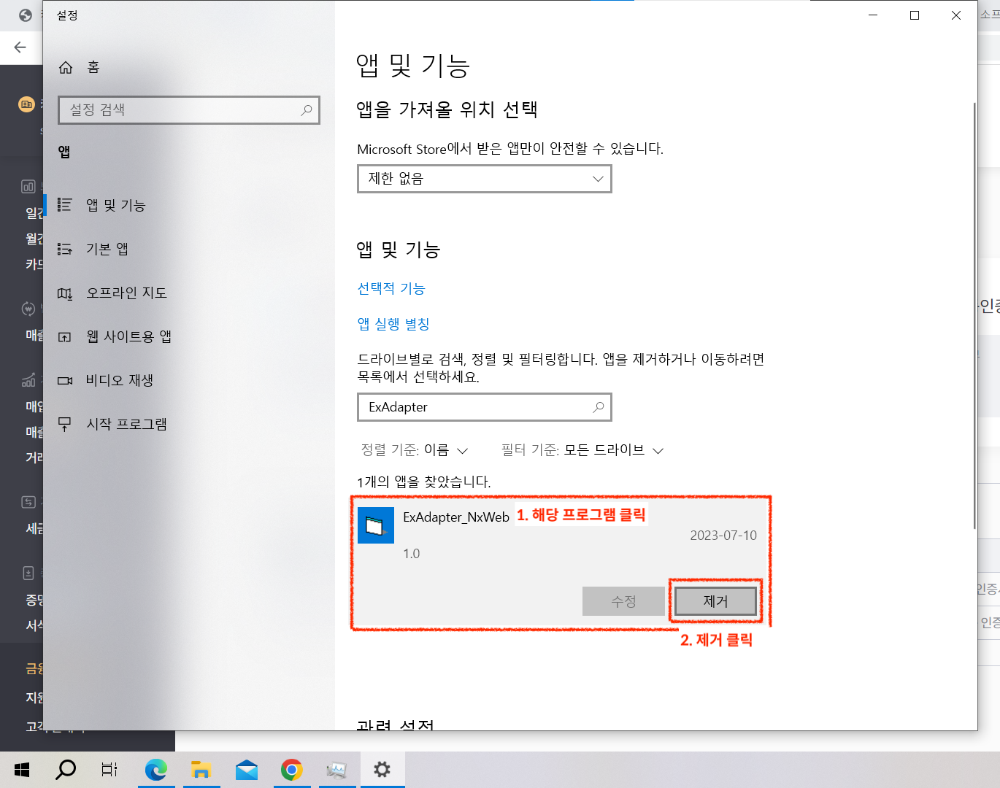

  1. 제거 선택 시, 확인을 누르면 프로그램 삭제 프로세스가 진행됩니다. “완전히 제거되었습니다” 문구가 노출되면 제거가 완료되었습니다. 확인을 누릅니다.

  

  1. **PC를 재시작해주세요. (반드시 재시작 후에 새로 설치해야합니다.)**
  1. 레포트 화면에서 **공동인증서 등록** 버튼을 눌러 새롭게 인증서 프로그램을 다운로드 받아주세요.

    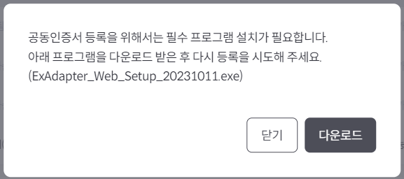

  1. 다운로드 한 프로그램을 설치하고 완료를 확인합니다. 마침을 누릅니다.

    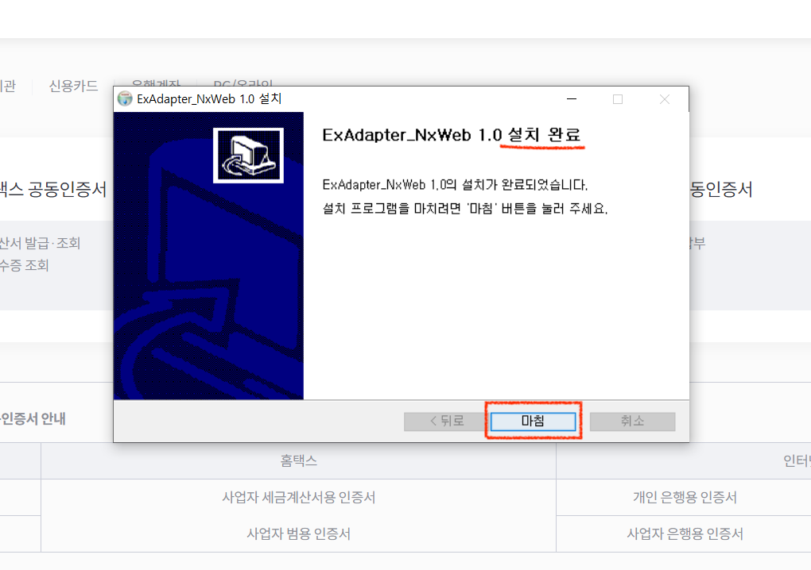

  1. 레포트 화면을 새로고침 후 다시 등록을 시도해주세요.

#### 3. 올바른 비밀번호를 입력했으나 비밀번호가 틀렸다는 오류가 나요.

- **다음 사항을 확인해주세요.**
  1. **윈도우 언어 설정을 확인해주세요.**
    1. 윈도우 언어 설정이 한국어로 되어 있지 않은 경우 인증서 프로그램이 정상적으로 동작하지 않습니다. 다음 두 가지 설정을 확인해주세요.
      1. 시스템 표시 언어 한국어로 설정
        1. 한국어 언어팩 설치 및 시스템 표시 언어 한국어로 설정
      1. 시스템 로캘 한국어 설정(반드시 `관리자 권한`으로 변경해야 적용 가능)
        1. (윈도우10) 설정 → 시간 및 언어 → 지역 → 관련 설정 아래의 ‘추가 날짜, 시간 및 국가별 설정’ → 국가 또는 지역 → 관리자 옵션 → 시스템 로캘 변경 → 한국어 선택 후 재부팅
        1. (윈도우11) 설정 → 시간 및 언어 → 언어 및 지역 → 관련 설정 아래의 ‘관리자 언어 설정’ → 관리자 옵션 → 시스템 로캘 변경 → 한국어 선택 후 재부팅
        1. (위에 방법으로 안 될 경우) win + r(실행) >> intl.cpl 입력 → 국가 또는 지역 창 에서 관리자 옵션 탭이동 → 시스템 로캘 변경 클릭 → 한국어 설정 확인 → beta : 세계 언어 지원을 위해 unicode utf-8 사용 해제 체크 확인 → 재부팅
  1. **가상화 환경에서 사용하고 계신지 확인해주세요.**
    1. 윈도우 샌드박스, Parallels, VMware, QEMU 등과 같은 가상화 환경에서는 인증서 프로그램이 정상적으로 동작하지 않을 수 않습니다. 가상화 환경이 아닌 곳에서 인증서 업로드를 다시 시도해주세요.

#### 4. 인증서 프로그램에서 연동하려고 하는 인증서가 보이지 않아요.

- **인증서가 만료된 경우**
  - 인증서가 만료된 경우 인증서 프로그램 상에서 표시되지 않습니다. 만료되지 않은 유효한 인증서를 사용해주세요.
- **인증서 파일의 위치가 올바르지 않은 경우**
  - 인증서 파일이 들어있는 NPKI 폴더의 위치를 확인해주세요.
    - 하드디스크 인증서 경로
      - `C:\Users\${PC사용자명}\AppData\LocalLow\NPKI`
    - 이동식디스크 인증서 경로 (맨 앞에 드라이브 문자는 변경될 수 있습니다.)
      - `D:\NPKI`
- **p12, pfx 형식의 인증서를 등록하려고 하는 경우**
  - [https://www.crosscert.com](https://www.crosscert.com) 한국전자인증 홈페이지에서 다음과 같이 인증서를 불러와주세요.
    - 인증서 관리 → 5.인증서 보기, 전자서명 테스트 클릭 → 인증서 찾기 클릭 → 인증서 파일 선택 후 저장매체에 저장 하기 체크하여 인증서 가져오기
- **위 방법으로 해결이 어려운 경우**
  - [https://www.crosscert.com](https://www.crosscert.com) 한국전자인증 홈페이지에서 다음과 같이 인증서를 불러와주세요.
    - 인증서 관리 → 5.인증서 보기, 전자서명 테스트 클릭 → 인증서 찾기 클릭 → 인증서 파일 선택 후 저장매체에 저장 하기 체크하여 인증서 가져오기
  - 위 단계를 완료한 후 다시 레포트에서 인증서 등록을 시도해주세요.

#### 5. 인증서를 선택하지 않았다는 메시지가 떠요.

- **다음 사항을 먼저 확인해주세요.**
  1. **운영 체제를 확인해주세요.**
    1. 윈도우 10, 11만 지원합니다. (맥(Mac OS)은 지원하지 않습니다.)
  1. **윈도우 언어 설정을 확인해주세요.**
    1. 윈도우 언어 설정이 한국어로 되어 있지 않은 경우 인증서 프로그램이 정상적으로 동작하지 않습니다. 다음 두 가지 설정을 확인해주세요.
      1. 시스템 표시 언어 한국어로 설정
        1. 한국어 언어팩 설치 및 시스템 표시 언어 한국어로 설정
      1. 시스템 로캘 한국어 설정
        1. (윈도우10) 설정 → 시간 및 언어 → 지역 → 관련 설정 아래의 ‘추가 날짜, 시간 및 국가별 설정’ → 국가 또는 지역 → 관리자 옵션 → 시스템 로캘 변경 → 한국어 선택 후 재부팅
        1. (윈도우11) 설정 → 시간 및 언어 → 언어 및 지역 → 관련 설정의 ‘기본 언어 설정’ → 관리자 옵션 → 시스템 로캘 변경 → 한국어 선택 후 재부팅
  1. **가상화 환경에서 사용하고 계신지 확인해주세요.**
    1. 윈도우 샌드박스, Parallels, VMware, QEMU 등과 같은 가상화 환경에서는 인증서 프로그램이 정상적으로 동작하지 않을 수 않습니다. 가상화 환경이 아닌 곳에서 인증서 업로드를 다시 시도해주세요.
  1. 설정 → **프로그램 추가/제거 메뉴** 에서 ‘**iftNxService**’라는 이름의 프로그램이 설치되어 있다면 삭제해주세요.
- 위의 모든 경우에 해당하지 않아요.
  - 아래 가이드를 따라서 인증서 프로그램을 재설치 해주세요. 반드시 완전히 삭제 후 재설치가 필요합니다.
- **인증서 업로드 프로그램 삭제 및 재설치 방법 (좌측 삼각형 클릭!)**
  1. 먼저 아래와 같이 윈도우 키를 입력 후, **프로그램 추가/제거 메뉴를 선택**해주세요.

  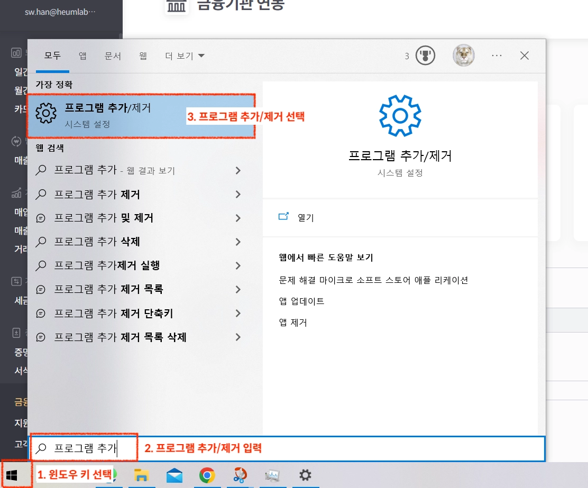

  1. 나타난 창에서 **ExAdapter, iftNxService 두 가지 단어를 모두 검색**합니다.

  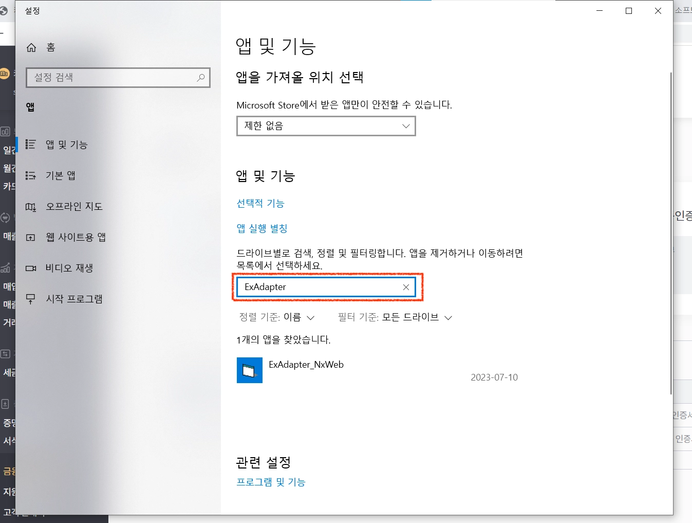

  1. 검색된 프로그램을 **선택하고 제거** 합니다. (**ExAdapter, iftNxService 둘 다 삭제 해야 합니다.)**

  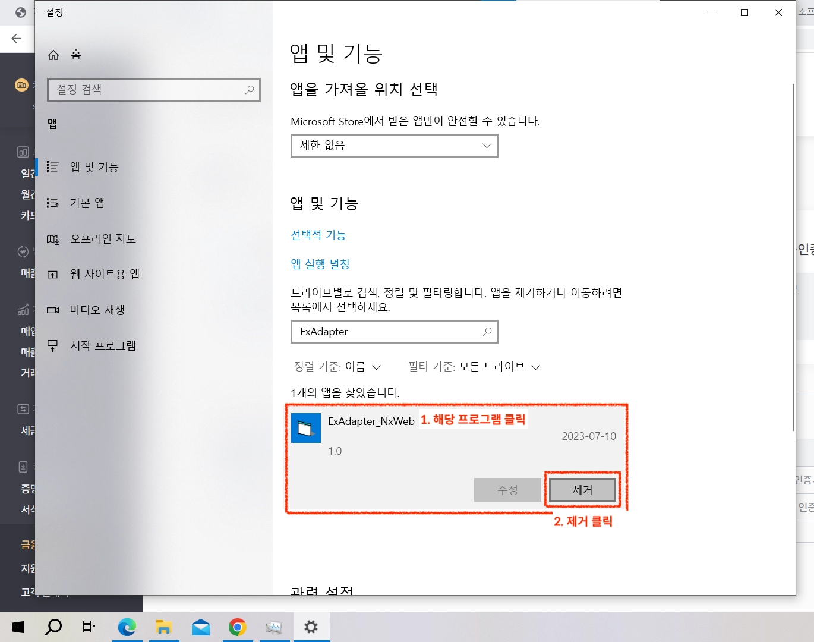

  1. 제거 선택 시, 확인을 누르면 프로그램 삭제 프로세스가 진행됩니다. “완전히 제거되었습니다” 문구가 노출되면 제거가 완료되었습니다. 확인을 누릅니다.

  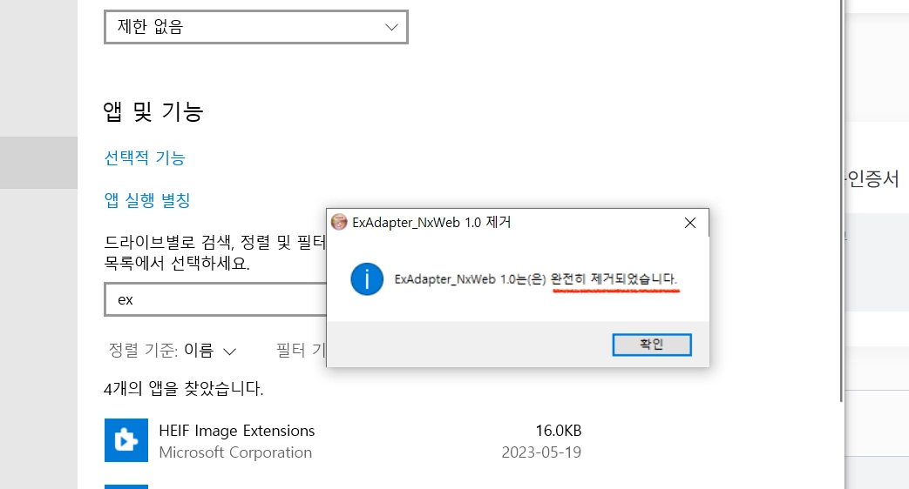

  1. **PC를 재시작해주세요. (반드시 재시작 후에 새로 설치해야합니다.)**
  1. 레포트 화면에서 **공동인증서 등록** 버튼을 눌러 새롭게 인증서 프로그램을 다운로드 받아주세요.

    ExAdapter_Web_Setup.zip 10.2 MiB

    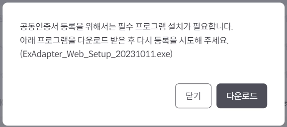

  1. 다운로드 한 프로그램을 설치하고 완료를 확인합니다. 마침을 누릅니다.

    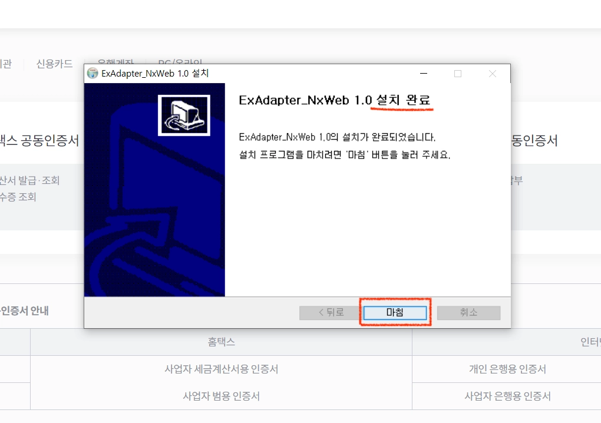

  1. 레포트 화면을 새로고침 후 다시 등록을 시도해주세요.

#### 6. 연동에 실패해요.

- 연동 중에 직접 해당 서비스를 이용 중이면 연동에 실패합니다. (eg. 홈택스 인증서 연동 중, 홈택스 로그인 및 이용 시 연동 실패)
- 홈택스, 인터넷지로와 같이 해당 서비스에 가입하셨나요?
  - 홈택스의 경우 미가입한 사업자는 연동되지 않습니다. (폐업자 동일)
- 해당 인증서가 유효한 인증서인지 확인해주세요.
  - 정지하거나 비밀번호를 바꾼 인증서이신가요? 새로운 인증서를 등록 후 이용해주세요.
  - 만료된 인증서는 연동이 불가합니다. 갱신된 혹은 새로운 인증서를 등록 후 이용해주세요.
