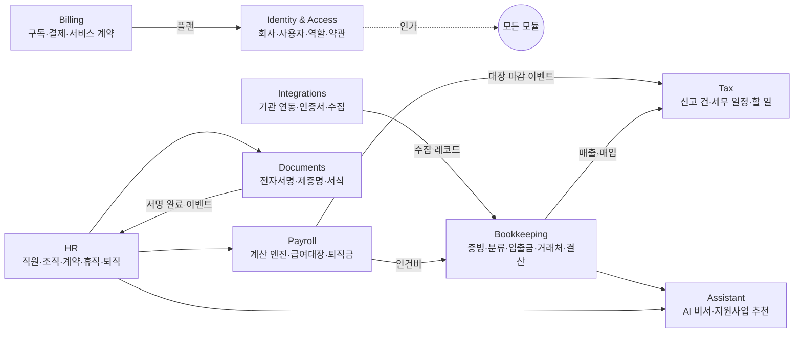

# semu 백엔드 재설계

현행 서비스의 웹 클라이언트를 정적 분석한 결과([`docs/reference/spec/`](../reference/spec/)), 지원 사이트 매뉴얼([`alfred-manual/`](../../alfred-manual/README.md)), 현행 클라이언트 규칙을 추적해 정리한 [`docs/reference/rules/`](../reference/rules/README.md)를 근거로, 같은 업무를 처리하는 백엔드 API 서버를 처음부터 다시 설계한 문서입니다. 코드는 [`apps/api/src/`](../../apps/api/src/)에 있습니다. 이 문서 묶음은 구현 전에 도메인 경계·리소스·상태 전이·규칙의 위치를 합의하는 데 씁니다.

- **근거:** 현행 동작은 엔트리 번들과 매뉴얼로만 확인했습니다. 원본 서버(nexus-api·sf-api·remittance-api)는 호출하지 않았고, 서버 내부 구현은 클라이언트가 보내고 읽는 값으로만 추정했습니다. 화면 컴포넌트는 lazy chunk라 번들에 없어서 응답 형태 상당수가 추정입니다
- **목표:** 현행 세 백엔드가 다루는 업무(인증·회사·구독, 연동, 세무, 인사, 급여, 경리)를 빠짐없이 덮되, 서버가 규칙과 트랜잭션을 책임지는 구조로 바꿉니다
- **범위 밖:** UI, 홈택스·4대보험 EDI·은행 전문의 바이트 단위 명세, 세무 대리인 내부 업무 도구(데스크)의 화면
- **이전 설계:** 현행 와이어를 그대로 받는 호환 API로 먼저 구현했던 설계는 [`docs/reference/legacy-design/`](../reference/legacy-design/)에 남겼습니다. 재설계는 그 구현에서 얻은 규칙과 결정을 가져오되 와이어 호환은 버립니다

## 현행 구조의 핵심 문제

분석에서 반복해서 나온 문제를 다섯 갈래로 묶었습니다. 재설계 결정은 모두 이 중 하나 이상을 고치기 위한 것입니다.

| # | 문제 | 대표 사례 | 고치는 문서 |
|---|---|---|---|
| P1 | **규칙이 클라이언트에 있음** | 약관 재동의 판정(`!history.isAgreed \|\| version !== …`)과 메뉴 노출·업셀 판정을 클라이언트가 함. 급여 구독 시 `직원 관리` 메뉴 숨김, 본사 대리인 프로모션 링크가 화면 코드에 있음. 엑셀 급여 업로드는 클라이언트가 그리드를 채운 뒤 따로 저장 | [identity-access.md](identity-access.md), [payroll.md](payroll.md) |
| P2 | **여러 호출을 클라이언트가 이어 붙임 (원자성 없음)** | 앱 초기화 = nexus `GET /user/me` + sf `GET /member/profile`을 합치고 이메일이 다르면 로그아웃. 첨부 = 업로드 URL 받기 → 스토리지 PUT → 등록. 급여대장 마감과 원천세 신고 항목 갱신이 따로 움직임 | [conventions.md](conventions.md#커맨드), [payroll.md](payroll.md), [tax.md](tax.md) |
| P3 | **도메인 경계가 섞임** | 백엔드 세 곳(nexus·sf·remittance)이 배포 단위로 나뉘어 같은 개념을 나눠 가짐. `GET /api/company/:id/`가 nexus와 sf 양쪽에 있고, 회사 ID도 nexus ID와 `sfCompanyId` 둘. sf가 nexus 구독을 프록시함. 인건비 보고서가 경리 메뉴에 있지만 급여 데이터. 서식 모음만 `/nexus-api/` 아래 | [README.md](#바운디드-컨텍스트) |
| P4 | **API 형태가 제각각** | 응답 snake_case를 클라이언트가 camelCase로 바꾸는데 급여만 변환을 끄고 `LEGACY_RAW_KEYS` 아래는 예외. FormData는 snake_case를 직접 씀. 끝 슬래시 필수, DRF `limit/offset` 봉투, 경로 속 `v2`(`/integrations/v2/`, `/api/v2/.../giros/:id/payment`). 오류를 문자열로 매칭(`token is invalid`). 메시지 코드 대소문자 혼재(`nps_under_60h_enrolled`, `EI_FOREIGNER_OPTIONAL`), 한글 상태(`임시저장`, `퇴사처리중`) | [conventions.md](conventions.md) |
| P5 | **접근 제어·보안이 클라이언트에 기댐** | 회사 JWT를 `localStorage`에 두고 외부 스크립트에 `window.__CLAIR_GET_JWT`로 노출. 세션 쿠키+CSRF와 회사 JWT 두 인증 방식. 회사 ID를 클라이언트가 문자열로 비교. 플랜·약관 게이트가 화면 진입 시점에만 있음 | [identity-access.md](identity-access.md) |

## 설계 원칙

1. **서버가 규칙의 단일 출처입니다.** 클라이언트는 서버가 계산한 `allowedActions`, `warnings`, 파생 상태를 그립니다. 같은 규칙을 클라이언트가 미리 검사하는 것은 UX 최적화일 뿐 강제 수단이 아닙니다
2. **업무 단위 하나 = 요청 하나 = 트랜잭션 하나.** 여러 엔티티를 바꾸는 업무(급여대장 승인, 전자서명 완료, 증빙 분류)는 커맨드 엔드포인트 하나로 받고 서버에서 원자적으로 처리합니다
3. **상태는 enum 하나로, 전이는 서버가 검증합니다.** 날짜·플래그 조합으로 흩어진 상태 대신 `status` 하나와 전이표를 둡니다. 날짜로 계산되는 상태(직원 재직 여부)는 저장하지 않고 서버가 파생합니다
4. **세무·급여 기록은 지우지 않고 정정합니다.** 신고, 확정된 급여대장, 발급된 증명서와 세금계산서는 버전과 정정 이력을 남깁니다 ([compliance.md](compliance.md))
5. **외부 기관 연동은 비동기 작업으로 모델링합니다.** 홈택스·은행·카드사·4대보험·메일·알림톡처럼 실패하거나 늦게 끝나는 호출은 `Job` 리소스로 상태를 추적합니다
6. **한 가지 형태.** 경로·필드·enum·오류·페이지네이션 규칙은 [conventions.md](conventions.md) 하나를 따릅니다

## 바운디드 컨텍스트

현행 서버 분할(nexus·sf·remittance)은 배포 단위이지 도메인 경계가 아니었습니다. 재설계는 업무 경계로 나눕니다. 처음에는 **모듈러 모놀리스 하나**로 구현하고, 모듈 사이에는 아래 표의 공개 인터페이스와 도메인 이벤트([events.md](events.md))로만 통신하게 합니다. 분리 배포는 수집처럼 부하 특성이 다른 모듈부터 필요할 때 합니다.

| 컨텍스트 | 소유하는 것 | 현행 대응 | 문서 |
|---|---|---|---|
| Identity & Access | 회사(테넌트), 사용자, 소속, 역할·권한, 세션·토큰, 약관 동의, 초대, 세무 대리인 배정 | nexus `/api/login`, `/api/user/*`, `/api/perm/*`, `/api/company/:id/user/*`, `/api/signup/*`, 메뉴 트리 | [identity-access.md](identity-access.md) |
| Billing | 구독, 출금 동의, 청구·결제, 기장 서비스 계약, 상담·리드, 외부 파트너 연결 | nexus `/subscriptions`, `/payment`, sf `/contract`, `/consult`, `/partner/*` | [billing.md](billing.md) |
| Integrations | 기관 연동(홈택스·은행·카드·PG·배달·지로), 자격 증명, 인증서, 수집 요청과 결과, 홈택스 수임동의, 사업자 상태조회 | remittance `/integrations/*`, `/scrap/*`, `/certificates` | [integrations.md](integrations.md) |
| Tax | 신고 건(부가세·원천세·종소세·법인세), 필요 자료와 제출 파일, 세무 일정, 할 일 카드, 예상 부가세 | sf `/tax/*`, 세무 대리인 데스크 | [tax.md](tax.md) |
| HR | 직원(근로·일용·사업·기타소득자), 부서·직위, 근로·급여계약, 휴직, 퇴직, 4대보험 자격 판정, 공제 정보, 가족, 메모, 문서 보관함 | sf `/employment/*` | [hr.md](hr.md) |
| Documents | 전자서명 요청·템플릿·직인, 제증명 발급과 발급대장, 서식 모음 | sf `/e-sign-*`, `/certificates/*`, nexus `/nexus-api/document-form` | [documents.md](documents.md) |
| Payroll | 계산 엔진, 기준표(요율·간이세액), 급여 설정, 급여대장, 명세서, 퇴직금 정산, 인건비 집계 | sf `/payroll/*`, `/employment/settings/*`, `/report/labor-cost` | [payroll.md](payroll.md) |
| Bookkeeping | 매출·매입 증빙, 계정과목, 자동분류 규칙, 계좌·입출금, 거래처, 세금계산서 발행, 지로, 결산 보고서 | remittance `/transaction-sales/*`, `/giros/*`, sf `/report/*`, `/evidence/*` | [bookkeeping.md](bookkeeping.md) |
| Assistant | AI 대화, 도구 제안, 지원사업 추천 | nexus `/ai-agent/*`, `/grants` | [assistant.md](assistant.md) |

## 문서 목록

| 문서 | 내용 |
|---|---|
| [conventions.md](conventions.md) | 경로·필드·enum·오류·페이지네이션·커맨드·멱등성·동시성·작업(Job) 규칙 |
| [identity-access.md](identity-access.md) | 테넌트·역할·권한 모델, 인증 흐름, 약관, 감사 로그 |
| [billing.md](billing.md) | 구독·결제·서비스 계약 |
| [integrations.md](integrations.md) | 기관 연동, 수집 작업, 자격 증명 보관 |
| [tax.md](tax.md) | 신고 건 상태 머신, 세무 일정, 할 일 카드 |
| [hr.md](hr.md) | 직원 애그리거트, 상태 파생, 유효일 데이터 |
| [documents.md](documents.md) | 전자서명·제증명 |
| [payroll.md](payroll.md) | 계산 엔진, 급여대장 상태 머신, 퇴직금 |
| [bookkeeping.md](bookkeeping.md) | 증빙·분류·입출금·결산 |
| [assistant.md](assistant.md) | AI 비서와 지원사업 추천 |
| [events.md](events.md) | 도메인 이벤트와 컨텍스트 간 연계 |
| [compliance.md](compliance.md) | 세법·개인정보 법적 요구가 설계에 주는 제약 |
| [review.md](review.md) | 설계 검토: 현행 대비 매핑, 위험, 결정 필요 사항 |
| [rule-decisions/](rule-decisions/README.md) | 현행 클라이언트 규칙의 열린 질문에 대한 서버 결정 (컨텍스트별) |
