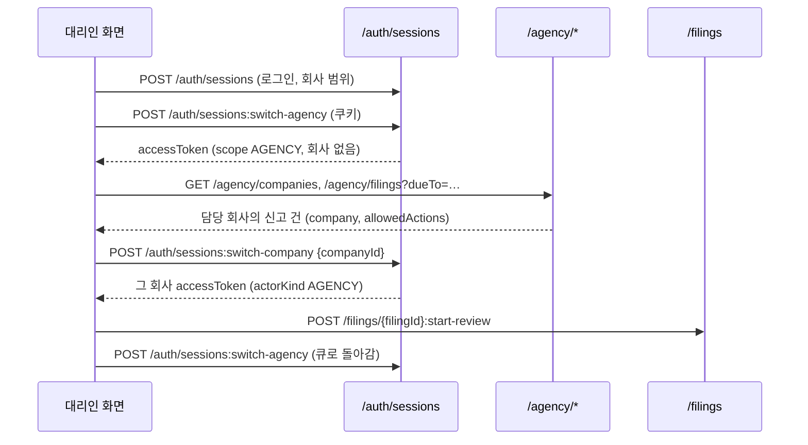
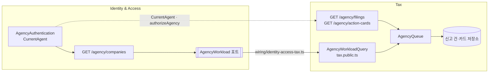

# 대리인 작업 큐: 담당 회사를 가로지르는 조회

세무 대리인 담당자와 팀장이 담당 회사 전체의 신고 건과 할 일 카드를 한 화면에서 보는 `/agency/*` 리소스입니다. 결정 D3([review.md](review.md#결정))을 구현합니다. 토큰 범위와 인증은 [identity-access.md](identity-access.md#토큰-범위), 신고 건과 카드의 규칙은 [tax.md](tax.md)에 있습니다. 코드는 [`identity-access/agency/`](../../apps/api/src/modules/identity-access/agency/)와 [`tax/agency/`](../../apps/api/src/modules/tax/agency/)에 있습니다.

## 현행에서 고칠 점

- **회사 토큰 하나로는 여러 회사를 볼 수 없습니다.** 재설계는 경로에서 회사 ID를 없애고 토큰 하나를 회사 하나에 묶었습니다. 현행 데스크의 `GET /desk/filings/?status=&due_before=&cursor=`는 담당 회사 전체를 한 번에 주는데, 이 규칙만으로는 회사마다 토큰을 바꿔 가며 반복 조회해야 합니다
- **경로 이름에 행위자가 숨어 있습니다.** 현행 `/desk/*`는 조회와 처리 커맨드를 함께 둬서, 같은 신고 건을 고객과 대리인이 다른 경로로 바꿉니다. 재설계는 처리를 회사 범위의 `/filings/{filingId}:{command}` 하나로 모았으므로 `/agency/*`에는 조회만 둡니다

## 흐름



- `/agency/*`는 모두 **읽기**입니다. 처리하려면 그 회사 토큰으로 바꿔 회사 범위 경로를 부릅니다. 회사 리소스의 인가·버전·감사가 한 길로만 지나갑니다
- 범위를 바꾸면 이전 범위의 access token은 폐기됩니다. 화면은 전환 응답의 토큰만 씁니다

## 엔드포인트

| 엔드포인트 | 소유 | 쿼리 | 정렬 |
|---|---|---|---|
| `GET /agency/companies` | Identity & Access | `assigneeId`, `limit`, `cursor` | 회사 이름(코드값), ID |
| `GET /agency/filings` | Tax | `companyId`, `taxType`, `status`, `open`, `overdue`, `dueFrom`, `dueTo`, `limit`, `cursor` | 기한(신고 기한, 없으면 납부 기한) 오름차순, 기한 없는 건은 끝, ID |
| `GET /agency/action-cards` | Tax | `status=OPEN\|CLOSED`(기본 `OPEN`), `companyId`, `kind`, `limit`, `cursor` | 회사 범위 `/action-cards`와 같음(진행중은 마감일, 완료는 최근) |

```jsonc
// GET /v1/agency/companies
{ "items": [{
  "id": "cmp_01J...", "name": "세무 상점", "businessType": "INDIVIDUAL", "plans": ["TAXATION"],
  "assigneeIds": ["usr_01J..."],
  "workload": { "openFilingCount": 1, "overdueFilingCount": 0, "openActionCardCount": 1, "nearestDueDate": "2026-11-10" }
}], "nextCursor": "..." }

// GET /v1/agency/filings?dueTo=2026-11-30&open=true
{ "items": [{
  "id": "fil_01J...", "taxType": "WITHHOLDING_TAX", "status": "REQUESTED", "dueDate": "2026-11-10", "isOverdue": false,
  "progress": { "stage": "MATERIALS_OPEN", "index": 1, "count": 4 }, ...  // GET /filings 항목과 같은 필드
  "company": { "id": "cmp_01J...", "name": "주식회사 세무" },
  "allowedActions": ["START_REVIEW", "CANCEL"]                           // 대리인 기준. 비면 고객 차례이거나 끝남
}] }

// GET /v1/agency/action-cards
{ "items": [{ "id": "acd_01J...", "kind": "SUBMIT_MATERIALS", "status": "OPEN", "dueDate": "2026-11-07",
              "subject": { "type": "FILING", "filingId": "fil_01J...", ... },
              "company": { "id": "cmp_01J...", "name": "세무 상점" } }] }
```

- 커서는 [conventions.md](conventions.md#페이지네이션)의 불투명 커서(`paginate`)입니다. 알아볼 수 없는 커서도 400이 아니라 그 정렬 키 뒤의 항목(대개 빈 페이지)을 돌려줍니다. 정렬과 커서는 같은 키를 코드값으로 비교합니다. 회사 이름도 코드값 순이라 대문자가 소문자보다, 짧은 이름이 같은 앞부분의 긴 이름보다 먼저 옵니다
- 항목 모양은 회사 범위 목록(`GET /filings`, `GET /action-cards`)의 항목에 `company`를 더한 것입니다. 신고 건은 대리인 기준 `allowedActions`도 넣어 "내 차례인 건"을 거를 수 있게 합니다
- 할 일 카드는 고객이 할 일입니다. 대리인에게는 독촉할 목록이고, 완료(`:complete`)는 `/agency/*`에 없습니다
- 집계(`workload`)는 회사 목록 한 페이지에 대해서만 셉니다. 큐 전체 집계가 필요해지면 `GET /agency/filings:count?groupBy=status`처럼 집계 엔드포인트로 둡니다([conventions.md](conventions.md#페이지네이션))

## 권한 판정

| 단계 | 어디서 | 실패 |
|---|---|---|
| 토큰이 대리인 범위인가 | `AgencyAuthentication` | 회사 범위 토큰이면 403 `TOKEN_SCOPE_MISMATCH`(`requiredScope: AGENCY`), 모르거나 만료·폐기면 401 |
| 대리인이 활성이고 담당 회사가 무엇인가 | `AgentDirectory.resolve` (요청마다) | 비활성·고객 사용자면 401 |
| 권한과 플랜 | `authorizeAgency({ permission, plans })` | 권한이 없으면 403 `PERMISSION_DENIED`. 플랜이 없는 담당 회사는 빠짐 |
| 고른 회사가 담당인가 | 각 핸들러 | 배정되지 않은 `companyId`는 404 `COMPANY_NOT_FOUND`(없는 회사와 구분하지 않음) |

| 엔드포인트 | 권한 | 플랜(회사별로 거름) |
|---|---|---|
| `GET /agency/companies` | `company:read` | 없음. 플랜이 없는 담당 회사도 나오고 일감은 0 |
| `GET /agency/filings` | `filing:read` | `TAXATION` (회사 범위 `GET /filings`와 같음) |
| `GET /agency/action-cards` | `action-card:read` | 카드에 저장한 요건(`filing:read` + `TAXATION`) |

- **담당 회사만 보입니다.** 담당은 본인 배정, 팀장이면 팀원 배정까지입니다(회사 범위 행위자 계산과 같은 규칙). Tax는 배정을 모르고, Identity & Access가 넘긴 회사만 읽습니다
- 고객 사용자는 대리인 범위 토큰을 받을 수 없으므로(403 `AGENCY_SCOPE_NOT_ALLOWED`) `/agency/*`에 닿는 길이 없습니다
- 권한은 지금 대리인 모두 `*`입니다. D5에서 대리인 권한을 나누면 `authorizeAgency`의 권한 검사가 그대로 그 권한을 봅니다

## 컨텍스트 경계



- **누가 무엇을 소유하는가.** 담당 회사 목록과 배정은 Identity & Access, 신고 건·카드와 그 큐는 Tax입니다. `/agency/` 접두사는 경로일 뿐이고 두 컨텍스트가 나눠 가집니다
- **Tax → Identity & Access:** Tax 핸들러는 다른 컨텍스트가 `authorize`를 쓰듯 `CurrentAgent`와 `authorizeAgency`만 씁니다. 배정 저장소를 읽지 않습니다
- **Identity & Access → Tax:** 회사 목록의 일감 개수는 Identity & Access가 선언한 포트 `AgencyWorkload.of(companies)`로 받습니다. Tax는 공개 서비스 `AgencyWorkloadQuery`를 [tax.public.ts](../../apps/api/src/modules/tax/tax.public.ts)에 내보내고, 어댑터 [identity-access-tax.ts](../../apps/api/src/wiring/identity-access-tax.ts)가 둘을 잇습니다. 개수는 큐와 같은 `AgencyQueue` 서비스가 세므로 목록과 큐가 어긋나지 않습니다
- **회사 범위 저장소 조회를 회사마다 반복합니다.** 저장소에 회사를 가로지르는 조회를 새로 두지 않았습니다. 담당 회사가 수백 곳으로 늘면 신고 건 표에 `(due, company_id)` 색인을 두고 SQL 조회로 바꿉니다

## 오류 코드

| 상태 | `code` | 언제 |
|---|---|---|
| 401 | `UNAUTHENTICATED` | 토큰이 없거나 만료·폐기, 대리인이 비활성 |
| 403 | `TOKEN_SCOPE_MISMATCH` | 회사 범위 토큰으로 `/agency/*`, 대리인 범위 토큰으로 회사 경로(`requiredScope`) |
| 403 | `AGENCY_SCOPE_NOT_ALLOWED` | 고객 사용자의 `:switch-agency` |
| 403 | `PERMISSION_DENIED` | 대리인 권한 밖(D5 이후) |
| 404 | `COMPANY_NOT_FOUND` | `companyId`가 배정되지 않은 회사 |
| 400 | `VALIDATION_FAILED` | 잘못된 날짜·enum·`limit` |

## 현행 엔드포인트 대응

| 현행 | 재설계 |
|---|---|
| `GET /desk/filings/?status=&due_before=&cursor=` | `GET /agency/filings?status=&dueTo=&cursor=` (대리인 범위 토큰) |
| `GET /desk/filings/:filingId/` 이하 처리 커맨드 | `:switch-company` 뒤 `GET /filings/{filingId}`, `POST /filings/{filingId}:{command}` ([tax.md](tax.md#현행-엔드포인트-대응)) |
| 데스크의 담당 회사 목록 | `GET /agency/companies` |

## 구현 상태

| 항목 | 상태 |
|---|---|
| `:switch-agency`, 범위별 미들웨어, `authorizeAgency` | 구현 |
| `GET /agency/companies`, `GET /agency/filings`, `GET /agency/action-cards` | 구현. HTTP 테스트는 [agency-companies.http.test.ts](../../apps/api/src/modules/identity-access/agency/agency-companies.http.test.ts), [agency-queue.http.test.ts](../../apps/api/src/modules/tax/agency/agency-queue.http.test.ts) |
| 배정 관리(생성·해제) | 범위 밖. 대리인 내부 도구가 만들고 이 API는 읽기만 함 |
| 큐 전체 집계, 실시간 갱신(SSE), 다른 컨텍스트의 큐(급여대장·4대보험) | 없음 |

## 열린 질문

1. **다른 컨텍스트의 큐.** 급여대장 승인 대기, 수집 실패처럼 대리인이 챙길 일이 Payroll·Integrations에도 있습니다. 같은 방식(`/agency/payroll-ledgers` 등 각 컨텍스트 소유)으로 늘릴지, 할 일 카드를 공개 포트로 열어 한 큐로 모을지([tax.md](tax.md#열린-질문) 7번) 정해야 합니다
2. **팀장의 범위.** 팀장은 팀원 배정을 모두 봅니다. 지점·팀 단위로 더 넓히거나(본사 관리자) 좁힐지는 대리인 조직 모델이 정해지면 다시 봅니다
3. **목록 기한 기준.** 큐의 기한은 `dueDate ?? paymentDue`입니다. 자료 제출 마감(`submitDue`)으로 정렬하는 보기가 필요한지 업무 확인이 필요합니다
