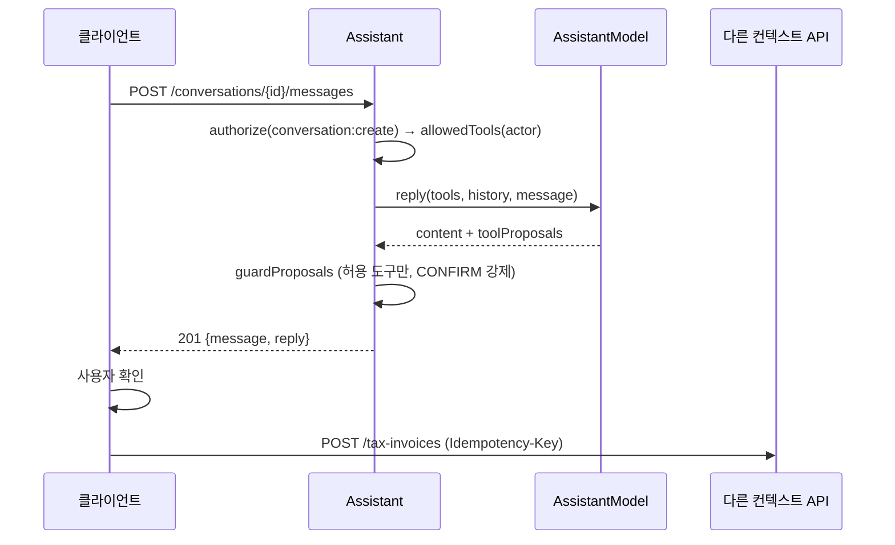
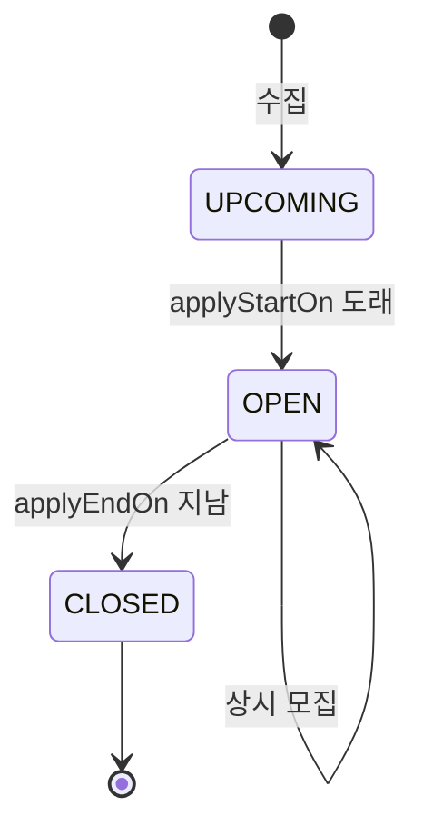

# Assistant: AI 비서와 지원사업 추천

AI 비서 대화(질문·답변·도구 제안)와 정부·지자체 지원사업 공고의 목록·맞춤 추천을 맡습니다. 코드는 [`apps/api/src/modules/assistant/`](../../apps/api/src/modules/assistant/)입니다.

- **근거:** 화면과 API가 lazy chunk라 번들에서 대화 API는 확인하지 못했습니다. 진입 조건은 번들(B:77553, B:99952, B:104680), 기능 범위는 매뉴얼(`02-AI-비서.md`, `12-AI비서.md`, `06-지원금-추천.md`), 도구 허용과 대화 저장은 레거시 서버(`legacy/src/modules/platform/assistant/`)에서 가져왔습니다
- **규칙:** [assistant-tool-access](../reference/rules/assistant-tool-access.md), [grant-recommendation](../reference/rules/grant-recommendation.md). 결정은 [rule-decisions/assistant.md](rule-decisions/assistant.md)

## 현행에서 고칠 점

| 현행 | 문제 | 재설계 |
|---|---|---|
| `/ai-agent`는 회사의 시스템 관리자만(`requiresSystemAdmin`), 상단바 입력창도 숨김. 매뉴얼은 "전체" | 진입 조건이 화면 가드에만 있고 매뉴얼과 다름 (P1, P5) | 모든 사용자가 `conversation:create`로 진입. 쓸 수 있는 도구만 권한·플랜으로 좁힘. `isSystemAdmin` 개념은 비서에서 쓰지 않음 |
| 레거시 도구 허용이 메뉴 코드(`integrate_transaction`)와 `tax_plan`으로 판정, 매뉴얼 기능표와 어긋남 | 무료 고객의 세금계산서 발행, 세무 기장 고객의 급여 조회가 빠짐 | 도구마다 같은 일을 하는 일반 API의 권한·플랜을 그대로 요구. 매뉴얼 기능표를 따름 |
| 쓰기 도구는 `requires_confirmation`만 붙이고 확인 후 실행 경로가 보이지 않음 | 비서가 권한·멱등성·감사 로그를 우회할 여지 | 비서는 제안만. 확인 후 실행은 클라이언트가 해당 컨텍스트의 일반 API(`POST /tax-invoices` 등)로 함 |
| 모델이 돌려준 도구 제안을 그대로 저장·표시 | 모델 출력이 권한 판정이 됨 | 서버가 허용 도구로 거르고 쓰기 도구에는 확인을 강제(`guardProposals`) |
| `POST /ai-agent/messages {conversation_id: null}`로 새 대화와 이어 쓰기를 한 엔드포인트가 처리 | 생성과 추가가 한 경로에 섞임 | `POST /conversations`(첫 메시지로 생성)와 `POST /conversations/{id}/messages`로 나눔 |
| 지원금 추천이 시작일을 보지 않고 개수 제한이 없으며, 업종 없는 회사는 업종 제한 공고에서 빠짐(레거시) | 매뉴얼과 다름 | 시작일 ≤ 오늘 ≤ 마감, 최대 15개, 업종 불명확이면 업종으로 거르지 않음 |
| 회사 업종·지역의 출처가 정해지지 않음 | 추천이 회사 데이터 여러 곳에 기댐 | `CompanyGrantProfiles` 포트 하나로 받음 |

## 용어

| 업무 용어 | 영문 | 설명 |
|---|---|---|
| AI 비서 | assistant | 세무·노무 질의와 업무 도구 제안을 하는 대화형 기능 |
| 대화 | `Conversation` (`cnv_`) | 사용자 한 명의 대화 묶음. 제목은 첫 메시지 앞 40자 |
| 메시지 | `Message` (`msg_`) | `USER` 또는 `ASSISTANT`가 쓴 글 하나 |
| 도구 | `AssistantTool` | `KNOWLEDGE_QA`, `FINANCE_SUMMARY`, `ISSUE_TAX_INVOICE`, `REQUEST_CERTIFICATE`, `LOOKUP_PAYROLL` |
| 도구 방식 | `ToolMode` | `READ`(비서가 읽고 답함), `CONFIRM`(제안 → 사용자 확인 → 일반 API 실행) |
| 도구 제안 | `ToolProposal` | 비서가 답과 함께 돌려주는 도구 호출 `{tool, arguments, requiresConfirmation}` |
| 지원사업 공고 | `Grant` (`grt_`) | 공공 지원사업. 업종(KSIC)·지역(법정동) 코드, 신청 기간 |
| 전체 지원금 | open grants | 오늘 신청 가능한 공고 |
| 맞춤 추천 | grant recommendations | 전체 지원금 중 회사 업종·지역에 맞는 최대 15개 |
| 상시 모집 | always open | `applyEndOn = null` |

## 리소스

### 대화

```jsonc
// POST /v1/conversations {"message": "○○상사에 100,000원 세금계산서 발행해 주세요."} → 201
{
  "conversationId": "cnv_01J...",
  "message": { "id": "msg_01J...", "role": "USER", "content": "...", "toolProposals": [], "createdAt": "..." },
  "reply": {
    "id": "msg_01J...",
    "role": "ASSISTANT",
    "content": "아래 내용으로 진행할까요? 확인하면 실행합니다.",
    "toolProposals": [{ "tool": "ISSUE_TAX_INVOICE", "arguments": { ... }, "requiresConfirmation": true }],
    "createdAt": "..."
  }
}
```

- 대화는 만든 사용자만 봅니다. 같은 회사의 다른 사용자·세무 대리인에게는 404입니다 (레거시와 같음)
- 지우면 목록과 조회에서 빠지고 저장소에는 `deletedAt`으로 남습니다
- 목록은 최근 갱신순 커서 페이지입니다
- 메시지는 1–4000자입니다
- 모델 호출이 실패하면 503 `ASSISTANT_UNAVAILABLE`이고 메시지를 저장하지 않습니다

### 도구

`GET /v1/assistant-tools`는 이 행위자가 쓸 수 있는 도구를 돌려줍니다. 화면의 기능 안내와 업셀에 씁니다.

| 도구 | 방식 | 권한 | 플랜 | 확인 후 실행하는 API |
|---|---|---|---|---|
| `KNOWLEDGE_QA` | READ | – | – | – |
| `FINANCE_SUMMARY` | READ | `bank-transaction:read` | – | – |
| `ISSUE_TAX_INVOICE` | CONFIRM | `tax-invoice:issue` | – | Bookkeeping 세금계산서 발행 |
| `REQUEST_CERTIFICATE` | CONFIRM | `certificate-issuance:create` | `TAXATION` | 증명서 발급 요청 (열린 질문 3) |
| `LOOKUP_PAYROLL` | READ | `payroll-ledger:read` | `TAXATION` 또는 `PAYROLL` | – |

- 세금계산서 발행의 전제 조건(거래처 등록, 홈택스 인증서 연동)은 확인 후 실행하는 발행 API가 판정합니다. 비서는 도구 목록에서 빼지 않습니다
- `READ` 도구도 제안으로 남겨 어떤 데이터를 읽었는지 대화에 기록합니다

### 지원사업 공고

```jsonc
// GET /v1/grant-recommendations → 200
{ "items": [{ "id": "grt_01J...", "source": "BIZINFO", "title": "...", "agency": "중소벤처기업부",
  "summary": "...", "url": "...", "industryCodes": ["J"], "regionCodes": ["11"],
  "applyStartOn": "2026-01-01", "applyEndOn": "2026-12-31" }] }
```

- 전체 지원금: `applyStartOn ≤ 오늘 ≤ applyEndOn` 또는 상시 모집. 마감 임박순, 상시는 마지막, 같으면 ID순
- 맞춤 추천: 전체 지원금 중
  - 지역: 공고 지역이 비었거나 회사 지역이 그 코드로 시작 (`11` ⊃ `11680`). 회사 지역이 없으면 전국 공고만
  - 업종: 공고 업종이 비었거나, 회사 업종이 비었거나(불명확), 회사 업종이 공고 업종 코드로 시작 (`C` ⊃ `C10`)
  - 마감 임박순 최대 15개
- "오늘"은 `Asia/Seoul` 날짜입니다. 추천은 조회할 때 계산합니다. 공고 수집은 정기 작업 `assistant.grant-feed`가 매일 04:00에 합니다([grant-feed-task.ts](../../apps/api/src/modules/assistant/grants/grant-feed-task.ts))
  - 원천(`GrantFeedSource`)이 준 공고를 `source`·`externalId`(원천의 공고 번호)로 저장된 공고와 맞춰, 처음 본 것은 만들고 내용이 바뀐 것만 같은 ID로 고칩니다(`mergeGrantFeed`). 원천에서 빠진 공고는 지우지 않고, 신청 마감일이 지나면 조회에서 빠집니다. `externalId`는 응답에 넣지 않습니다
  - 회사에 속하지 않는 공용 데이터라 회사별로 나누지 않고 한 트랜잭션입니다. 원천은 트랜잭션 밖에서 읽고, 읽지 못하면(`GrantFeedUnavailable`) 실패로 남겨 재시도합니다
- 메뉴 권한 없이 모든 사용자가 봅니다(`grant:read`는 기본 권한). 약관 게이트를 걸지 않습니다

## 상태

대화와 공고는 상태 머신이 없습니다. 메시지 한 번의 흐름과 공고 노출 기간만 둡니다.





공고 상태는 저장하지 않고 날짜로 파생합니다. `OPEN`만 목록과 추천에 나옵니다.

## 커맨드와 엔드포인트

| 메서드 | 경로 | 권한 | 설명 |
|---|---|---|---|
| GET | `/assistant-tools` | `conversation:read` | 쓸 수 있는 도구 |
| GET | `/conversations` | `conversation:read` | 내 대화 목록 (커서) |
| POST | `/conversations` | `conversation:create` | 첫 메시지로 대화 생성, 201 |
| GET | `/conversations/{conversationId}` | `conversation:read` | 대화와 메시지 |
| POST | `/conversations/{conversationId}/messages` | `conversation:create` | 메시지 보내기, 201 |
| DELETE | `/conversations/{conversationId}` | `conversation:delete` | 대화 지우기, 204 |
| GET | `/grants` | `grant:read` | 전체 지원금 (커서, `totalCount`) |
| GET | `/grants/{grantId}` | `grant:read` | 공고 하나 (지난 공고 포함) |
| GET | `/grant-recommendations` | `grant:read` | 맞춤 추천 최대 15개 |

- 대화 엔드포인트는 모두 `requiresTerms: true`입니다. 세무 약관에 동의하지 않은 세무 기장 고객은 403 `TERMS_REAGREEMENT_REQUIRED`입니다
- 데모 계정은 `conversation:create`가 쓰기 권한이라 대화를 만들 수 없습니다 (열린 질문 5)

## 오류 코드

| 코드 | 상태 | 언제 |
|---|---|---|
| `CONVERSATION_NOT_FOUND` | 404 | 없거나, 다른 사용자의 것이거나, 지운 대화 |
| `ASSISTANT_UNAVAILABLE` | 503 | 언어 모델 호출 실패. 메시지를 저장하지 않음 |
| `GRANT_NOT_FOUND` | 404 | 없는 공고 |
| `PERMISSION_DENIED` | 403 | `conversation:*`, `grant:read` 없음, 데모 계정의 쓰기 |
| `TERMS_REAGREEMENT_REQUIRED` | 403 | 필수 약관 미동의 (대화만) |
| `VALIDATION_FAILED` | 400 | 빈 메시지, 4000자 초과, 잘못된 ID |

## 포트

| 포트 | 모양 | 구현 |
|---|---|---|
| `AssistantModel` | `reply({tools, history, message}) → Effect<{content, toolProposals}, AssistantUnavailable>` | 운영: LLM(RAG + 도구 호출) 어댑터. 메모리: 낱말로 도구를 고르는 결정적 가짜 |
| `CompanyGrantProfiles` | `profileOf(companyId) → Effect<{industryCodes, regionCode \| null}>` | 지역은 Identity & Access 회사 주소, 업종은 홈택스 업종 코드 보유처(현행 remittance `business_types`). 메모리: 데모 회사 표 |
| `GrantRepository` | `find`, `list`, `save` | 공고 수집 작업(`assistant.grant-feed`)이 씀 |
| `GrantFeedSource` | `notices() → Effect<GrantNotice[], GrantFeedUnavailable>` | 운영: 기업마당(`BIZINFO`) 지원사업정보 API 어댑터(미구현). 원천 코드를 KSIC·법정동 코드 앞부분으로 바꿈. 메모리: 주어진 공고를 그대로 돌려주는 가짜(서버는 빈 목록) |

- `READ` 도구가 실제 데이터를 읽는 포트(거래·계좌 요약, 직원·급여 조회)는 아직 없습니다. Bookkeeping·Payroll이 읽기 포트를 내보내면 모델 어댑터가 씁니다
- 발행하는 이벤트는 없습니다. 소비하는 이벤트도 없습니다

## 현행 엔드포인트 대응

번들에는 비서·지원금 API 호출부가 없습니다(lazy chunk, spec §5 끝). 레거시 서버 경로와 화면을 기준으로 둡니다.

| 현행 | 재설계 | 비고 |
|---|---|---|
| 레거시 `GET /api/company/:id/ai-agent/conversations` | `GET /conversations` | 커서 페이지, 회사는 토큰에서 |
| 레거시 `GET /api/company/:id/ai-agent/conversations/:conversationId` | `GET /conversations/{conversationId}` | `tool_calls` → `toolProposals` |
| 레거시 `DELETE /api/company/:id/ai-agent/conversations/:conversationId` | `DELETE /conversations/{conversationId}` | 204 |
| 레거시 `POST /api/company/:id/ai-agent/messages {conversation_id: null}` | `POST /conversations` | 첫 메시지로 생성 |
| 레거시 `POST /api/company/:id/ai-agent/messages {conversation_id}` | `POST /conversations/{conversationId}/messages` | |
| (없음) 레거시 `allowedAssistantTools` 내부 판정 | `GET /assistant-tools` | 화면 기능 안내용으로 공개 |
| 레거시 `GET /api/company/:id/grants/recommendations` | `GET /grant-recommendations` | `{results}` → `{items}`, 최대 15개 |
| 화면 `/recommend/grant` 전체 지원금 (API 미확인) | `GET /grants` | |
| (없음) | `GET /grants/{grantId}` | 홈 '찾은 혜택' 카드의 상세 |
| 번들 메뉴 `ai_agent`, 라우트 가드 `requiresSystemAdmin` | `authorize({permission: 'conversation:create'})` | 시스템 관리자 게이트 제거 |
| 번들 메뉴 `grant_recommendation` (`requiresMenuAccess: false`) | `grant:read` (기본 권한) | |
| nexus `GET /api/user/me/` `companies[].isSystemAdmin` (#5) | 비서에서 쓰지 않음 | Identity & Access 소관 |
| remittance `GET /api/company/:id/get-business_types`, `POST .../update-business_types` | `CompanyGrantProfiles` 포트의 업종 출처 후보 | 리소스 소유는 이 컨텍스트 밖 |

## 구현 상태

- 구현: 대화 6개 엔드포인트, 지원금 3개 엔드포인트, 도구 허용 규칙, 추천 규칙, 메모리 저장소, 가짜 모델, 데모 공고·회사 업종 시드, 공고 수집 정기 작업과 원천 포트(가짜)
- 테스트: 규칙 단위 테스트, 두 규칙의 픽스처 테스트, 서비스 테스트(모델 제안 거르기, 대화 소유, 정렬·페이지), HTTP 테스트
- 미구현: 실제 LLM 어댑터와 RAG, `READ` 도구의 데이터 읽기 포트, 응답 스트리밍, 공고 원천의 운영 어댑터(기업마당 API), 추천 결과 캐시(`company_grant_recommendations`), 업종·지역 포트의 실제 구현

## 열린 질문

1. 대화를 사용자 개인 것으로 둘지 회사 공유로 둘지. 지금은 레거시대로 개인 것입니다
2. ~~15개를 고르는 순서(매뉴얼의 "AI가 골라")가 무엇인지~~ 학습용 가정으로 마감 임박순(레거시)으로 정했습니다(2026-11-07, [규칙 결정](rule-decisions/assistant.md#grant-recommendation) 1)
3. `REQUEST_CERTIFICATE`의 증명서가 세무 증명(납세증명서 등, 세무 대리인 요청)인지 Documents의 제증명인지. 지금은 `certificate-issuance:create` + `TAXATION`으로 두었습니다
4. 세무 대리인 직원이 고객 회사의 비서를 쓰게 할지. 레거시는 막았고 지금은 허용합니다
5. 데모 계정이 대화를 써 볼 수 있게 할지. 지금은 쓰기 거절 규칙에 따라 막힙니다
6. 회사 지역이 없을 때 지역 제한 공고를 뺄지. 지금은 레거시대로 뺍니다
7. ~~공고 원천~~ 기업마당(`BIZINFO`) 지원사업정보 API를 첫 원천으로 정함(2026-11-14, #109). 원천은 포트(`GrantFeedSource`) 뒤에 두어 K-Startup 등을 더할 때 `source`로 구분합니다. 운영 어댑터는 아직 없습니다. 업종 코드의 출처(홈택스 업종 vs 회사 설정)는 열려 있습니다. 코드 체계는 KSIC·법정동 코드 앞부분 일치로 정했습니다(2026-11-07, [규칙 결정](rule-decisions/assistant.md#grant-recommendation) 5). 원천 어댑터가 자기 코드를 이 체계로 바꿉니다
8. 대화 보존 기간과 개인정보(대화에 주민등록번호 등이 들어올 때) 처리 ([compliance.md](compliance.md))
