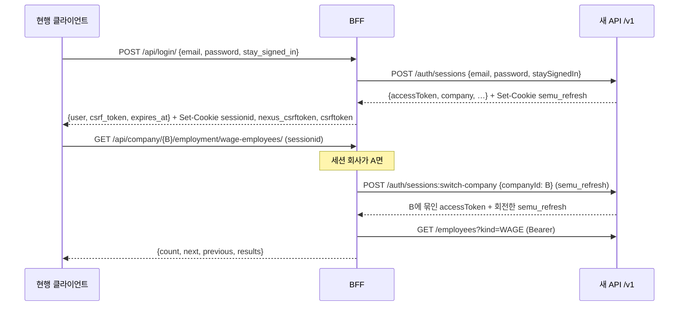

# 현행 클라이언트 호환 계층 (BFF)

[review.md](review.md#결정)의 D2(단계적 이전)를 구현하는 얇은 계층입니다. 현행 웹 클라이언트가 쓰던 와이어(옛 경로, snake_case 키, DRF 봉투, `{detail, code}` 오류, 세션 쿠키 + CSRF)를 그대로 받아 새 `/v1` API로 옮겨 부르고, 응답을 다시 현행 형태로 돌려줍니다. 클라이언트를 고치지 않고 새 백엔드로 갈아탄 뒤, 화면을 하나씩 새 API로 옮기고, 마지막 화면이 떠나면 BFF를 지웁니다.

코드는 [`apps/bff/`](../../apps/bff/)에 있습니다.

## 어디서 도는가

**별도 앱 `apps/bff`.** 새 API와 다른 프로세스이고, 현행 클라이언트가 부르던 nexus·sf 호스트를 이 앱으로 돌립니다.

| 고려 | 별도 앱(선택) | 새 API 서버 안 모듈 |
|---|---|---|
| 새 API의 규약 | 세션 쿠키·CSRF·snake_case가 새 서버에 들어오지 않음. 새 API는 [conventions.md](conventions.md) 하나만 지킴 | 옛 인증 방식과 키 규칙이 같은 프로세스에 섞임 |
| 의존 방향 | BFF는 `/v1` 와이어 계약만 앎. 새 API 내부(Effect 레이어·저장소)를 가져오지 않음 | 핸들러를 건너뛰고 유스케이스를 직접 부르고 싶어짐. 검증·트랜잭션·인증 미들웨어를 우회할 위험 |
| 계약 검증 | 현행 화면 하나를 덮을 때마다 새 API가 실제 클라이언트에 충분한지 드러남(아래 [빈 필드](#빈-필드와-새-api에-필요한-것)) | 내부 호출로 빈틈을 메우면 드러나지 않음 |
| 폐기 | 디렉터리와 라우팅 하나를 지우면 끝 | 새 서버 코드에서 걷어내야 함 |
| 비용 | 홉 하나, 배포 단위 하나, 세션 저장소 하나 | 없음 |

### 새 API를 부르는 방법

BFF는 새 API를 **HTTP 계약으로** 부릅니다. 업스트림은 `(Request) => Promise<Response>` 하나(`UpstreamOptions.fetch`)입니다.

- 운영: `fetch`로 `SEMU_API_URL`(기본 `http://localhost:3000`)의 `/v1`을 부릅니다
- 테스트: 새 API 앱의 웹 핸들러(`HttpRouter.toWebHandler(AppLive)`)를 그대로 넣어 **프로세스 안에서** 부릅니다. 네트워크 없이 빠르고, 메모리·SQLite 저장소 모두로 돕니다
- 한 프로세스로 배포하고 싶으면 운영도 같은 웹 핸들러를 넣으면 됩니다. BFF 코드는 바뀌지 않습니다

Effect 레이어를 직접 부르지 않는 이유는 위 표의 "의존 방향"입니다. 새 API의 검증(`VALIDATION_FAILED`), 요청 트랜잭션, 인증·인가는 모두 HTTP 경계에 있고, BFF가 그것을 건너뛰면 BFF가 또 하나의 백엔드가 됩니다.

## 인증 번역

| 현행 | 새 API | BFF |
|---|---|---|
| 세션 쿠키 `sessionid` + CSRF(`nexus_csrftoken`/`csrftoken` 쿠키, `X-CSRFToken`/`X-XSRF-TOKEN` 헤더) | access token(10분, `Authorization`) + refresh 쿠키(`Path=/v1/auth`) | 브라우저에는 현행 쿠키만 줍니다. 새 API의 refresh 쿠키와 access token은 **BFF 세션 저장소에만** 둡니다. 쓰기 요청은 헤더 = 쿠키 = 세션의 CSRF 토큰이어야 합니다(403 `CSRF_FAILED`) |
| 세션은 회사와 무관, 경로 `/api/company/:companyId/`가 회사를 정함 | 토큰 하나 = 회사 하나 | 경로의 회사가 세션의 회사와 다르면 `:switch-company`를 부른 뒤 보냅니다. 접근할 수 없는 회사는 새 API처럼 존재 여부를 숨긴 404 `NOT_FOUND`입니다 |
| `POST /api/user/me/jwt/ {company_id}` → 회사 JWT | `:switch-company` | 세션을 그 회사로 전환하고 지금 access token을 `{token}`으로 줍니다. 이 토큰은 `/v1`에 그대로 쓸 수 있어, 새 API로 옮긴 화면이 쓰는 경로가 됩니다([화면 이전](#화면-이전)) |
| 만료 처리 없음(세션 쿠키 수명) | access 10분, refresh 회전·재사용 탐지 | 만료 30초 전이면 미리 `:refresh`. 새 API가 401을 주면(권한 변경 등으로 폐기) 한 번 갱신해 다시 보냅니다. 갱신이 401이면 BFF 세션을 지우고 현행 401 `UNAUTHENTICATED`와 쿠키 삭제로 응답합니다 |
| 로그아웃 | `DELETE /auth/sessions/current` | 새 세션을 끝내고 BFF 세션과 쿠키를 지웁니다. 새 API가 실패하거나 응답하지 않아도 BFF 세션과 쿠키는 지웁니다 |
| 로그인 CSRF | (해당 없음, 토큰은 본문으로) | 로그인에는 아직 CSRF 토큰이 없으므로 출처로 막습니다. JSON 본문만 받고(그 밖은 415 `UNSUPPORTED_MEDIA_TYPE`, HTML 폼이 사전 요청 없이 보내는 `text/plain`을 거름), `Origin`이 있으면 허용 목록(`BFF_ALLOWED_ORIGINS`, 기본은 `BFF_PUBLIC_URL`의 출처)에 있어야 하고, 없으면 `Sec-Fetch-Site: cross-site`를 거절합니다(403 `CSRF_FAILED`). 다시 로그인하면 이전 BFF 세션과 그 새 API 세션을 끝냅니다 |

### 동시 요청

새 API는 refresh 쿠키를 회전시키고 이전 값이 다시 오면 탈취로 보고 세션을 폐기합니다. 회사 전환은 이전 access token을 폐기합니다. 현행 클라이언트는 앱 시작 때 회사 상세·권한·구독을 병렬로 부르므로 BFF가 그대로 흘려보내면 세션이 깨집니다. 그래서 세션마다 **읽기·쓰기 자물쇠**를 둡니다.

- 갱신·전환은 쓰기(`exclusive`): 한 번에 하나, 앞서 온 호출이 끝난 뒤에 합니다. 자물쇠 안에서 저장소의 최신 세션을 다시 읽으므로 같은 갱신을 두 번 하지 않습니다
- 새 API 호출은 읽기(`shared`): 같은 회사에 대한 호출끼리는 함께 갑니다. 호출 도중 다른 요청이 회사를 바꾸지 못합니다
- 한계: 새 API 세션 하나는 한 회사에만 묶이므로, 탭 두 개에서 서로 다른 회사를 번갈아 열면 요청마다 전환이 일어나 느려집니다. 결과가 섞이지는 않습니다(전환은 쓰기 자물쇠 안에서만 일어남)

- 같은 세션 자물쇠를 안에서 다시 잡으면 교착되므로 `SessionLocks`가 그 자리에서 오류를 던집니다(`AsyncLocalStorage`로 쥔 자물쇠를 기억)
- 새 API 요청 하나는 제한 시간이 지나면 취소하고 현행 504 `GATEWAY_TIMEOUT`, 연결 실패는 502 `BAD_GATEWAY`입니다. 제한 시간은 헤더가 아니라 **본문을 다 읽을 때까지**이고, `send`가 본문을 메모리로 다 읽어 돌려주므로 자물쇠 안에서 본문을 읽다 멈추는 일이 없습니다. 기다림이 끝나면 자물쇠도 풀립니다
  - 일반 호출은 `BFF_UPSTREAM_TIMEOUT_MS`(기본 10초), refresh 쿠키를 회전시키는 로그인·갱신·회사 전환은 `BFF_AUTH_TIMEOUT_MS`(기본 30초)입니다
  - 본문을 메모리에 다 읽으므로 크기도 묶습니다. 응답 하나가 `BFF_UPSTREAM_MAX_RESPONSE_BYTES`(기본 10MB)를 넘으면 더 읽지 않고 요청을 취소한 뒤 502 `UPSTREAM_RESPONSE_TOO_LARGE`입니다. `Content-Length`가 이미 크면 읽기 전에 멈추고, 없거나 틀려도 읽은 바이트를 셉니다. 제한 시간·크기 환경 변수는 비우면 기본값이고, 숫자가 아니거나 0 이하이거나 제한 시간이 Node 타이머 한도(2147483647ms)를 넘으면 BFF가 시작하지 않습니다
  - **남는 창:** 갱신·전환이 BFF 쪽에서 시간 초과로 끝났는데 새 API가 그 뒤에 처리를 마치면, refresh 쿠키는 이미 회전했고 BFF는 새 값을 받지 못했습니다. 다음 갱신은 이전 값을 보내 재사용 탐지에 걸리고, 새 API가 세션을 폐기해 사용자는 다시 로그인합니다(401 `UNAUTHENTICATED`). 인증 호출 제한 시간을 길게 둬 이 창을 "새 API가 30초 넘게 걸린 갱신"으로 줄였습니다. 없애려면 새 API에 회전 직후 짧은 유예(이전 값 한 번 허용)나 멱등 키를 둬야 합니다
- 자물쇠는 도착 순서대로 내줍니다. 줄 맨 앞이 쓰기면 진행 중인 읽기가 끝난 뒤 혼자, 맨 앞이 읽기면 이어진 읽기까지 함께 들어갑니다. 늦게 온 요청이 앞 요청을 앞지르지 않아 읽기도 쓰기도 굶지 않습니다
- 갱신이 필요 없으면 쓰기 자물쇠를 잡지 않습니다. `GET /api/member/profile/`은 저장소만 읽고, `GET /api/user/me/`는 `callApi`가 필요할 때만 갱신합니다
- CSRF 토큰은 `timingSafeEqual`로 비교합니다

세션 저장소는 지금 프로세스 메모리 하나(`memorySessionStore`)라 BFF 인스턴스도 하나입니다. 만료된 세션은 요청이 올 때 1분마다 쓸어 냅니다. 여러 대로 늘리면 `SessionStore`를 공유 저장소로 바꾸고 자물쇠도 그 저장소의 잠금으로 옮겨야 합니다. 저장 키는 쿠키 값의 SHA-256입니다.

## 형태 번역

| 항목 | 현행 → 새 API (요청) | 새 API → 현행 (응답) |
|---|---|---|
| 키 | snake_case → camelCase(`transformKeys(…, camelCase)`) | 화면별 매퍼가 필드를 하나씩 옮깁니다. 이름만 다른 게 아니라 구조가 달라서입니다(`address.zipCode` → `zip_code`, `resignation.leaveDate` → `leave_date`) |
| 원문 키 | `LEGACY_RAW_KEYS`(`other_deductions`, `taxable_incomes`) 아래는 바꾸지 않습니다. 현행 클라이언트가 그 뒤 형제 키까지 변환을 끄던 특이점은 클라이언트 쪽 일이라 따라 하지 않습니다 | 같음 |
| ID | 현행 정수·문자열 ID 대신 새 접두사 ID(`cmp_`, `emp_`)를 그대로 내보냅니다. 현행 `id`와 `sf_company_id`는 같은 새 회사 ID입니다 | 클라이언트는 ID를 불투명하게 다루므로 그대로 둡니다. 데이터 이관 때 현행 ID ↔ 새 ID 대응표가 생기면 BFF가 바꿔 줄 수 있습니다 |
| enum | 현행 정수 상태 `?status=1..5`, 이름 → 새 상태 집합. `3`(재직)은 `JOINED`+`LEAVE`, `2`(근무 중)는 `JOINED` | `status_code`·`status_display`(한글 탭 이름), 경고 `MISSING_REGISTRATION_NUMBER` → `missing_required_info`, `CORPORATION` → `corporate`, `kind: WAGE` → `wage-salary`·`wageemployee`, 사용자 종류 → `user_type` 정수. 새 API가 나중에 더한 값은 소문자로 내보냅니다 |
| 목록 | `limit/offset`(기본 20, 최대 100) | 새 커서 목록을 끝까지 읽고(200개씩) BFF에서 거르고·정렬하고·잘라 DRF 봉투 `{count, next, previous, results}`로 줍니다. 링크는 `Host` 헤더가 아니라 설정한 공개 주소(`BFF_PUBLIC_URL`) 기준 절대 주소입니다. 끝까지 읽기는 50쪽(직원 10,000명)에서 멈추고 같은 커서가 다시 오면 멈춥니다(502 `UPSTREAM_LIST_TOO_LARGE`, `UPSTREAM_CURSOR_REPEATED`). 회사 하나의 직원 수에서는 감당할 만하고, 화면을 옮기면 사라집니다 |
| 검색·정렬 | 현행 서버와 같게 | `search`는 이름·부서 이름·직위 이름 부분 일치(영문 대소문자 무시). `ordering`이 없으면 `name`, 쉼표로 여러 키(`-status,name`), 키는 현행과 같은 `name`, `status`, `birth_date`, `join_date`, `leave_date`, `department`, `position`, `employee_number`, `created`. 값이 없으면 가장 앞(SQLite `NULL`), 마지막은 ID 순 |
| 버전 | `If-Match` 그대로 | 새 `ETag`를 그대로 옮깁니다 |
| 끝 슬래시 | 있어도 없어도 받습니다 | |

### 오류

새 API의 RFC 9457 문제를 현행 `{ detail, code, …extras }`로 바꿉니다(`fromProblem`).

| 새 API | 현행 |
|---|---|
| 400 `VALIDATION_FAILED` + `violations[{field, code}]` | 422 `VALIDATION_FAILED` + `errors: { snake_field: ["This field is required."] }`. 요청 부분 전체(`body`)는 `non_field_errors` |
| 401 `UNAUTHENTICATED`, `SESSION_INVALID` | 401 `UNAUTHENTICATED` |
| 401 `INVALID_CREDENTIALS` | 401 `INVALID_CREDENTIALS` |
| 403 `PERMISSION_DENIED`, `ENTITLEMENT_REQUIRED`, `DEMO_READ_ONLY` | 같은 코드. `ENTITLEMENT_REQUIRED`에는 현행 `promotion_url: null`을 붙임 |
| 403 `TERMS_REAGREEMENT_REQUIRED` | 403 `TAX_TERMS_REQUIRED` |
| 404 `*_NOT_FOUND` | 404 `NOT_FOUND` (`detail`: "Employee not found.") |
| 409 `*_DUPLICATE`, `*_ALREADY_REGISTERED` / `*_TRANSITION_INVALID` | 409 `CONFLICT` / `INVALID_TRANSITION` |
| 422 `LEAVE_INVALID`, `WORK_CONTRACT_INVALID`, `PAYROLL_CONTRACT_INVALID` + `violations` | 422 `VALIDATION_FAILED` + `errors`. 중첩 필드(`paid.allowance`, `fixedAllowances.overtime.hours`)는 라우트가 현행의 평평한 필드(`paid_allowance`, `fixed_overtime_hours`)로 되돌림. 문구는 새 위반 코드(`END_DATE_REQUIRED`) |
| 409 `LEAVE_OVERLAP`, `RETIREMENT_COMPLETED` | 400 같은 코드(현행 HR 오류의 상태). `overlapping_leave_id`는 그대로 |
| 422 `RESIGNATION_REJECTED` (`reason`) | 422 `VALIDATION_FAILED`: `LEAVE_DATE_BEFORE_JOIN` → `leave_date`, `LEAVING_REASON_INVALID` → `leaving_reason` (현행 문구) |
| 412 `VERSION_MISMATCH` | 412 `VERSION_CONFLICT` |
| 그 밖 | 상태와 코드를 그대로 둡니다(예: 423 `ACCOUNT_LOCKED`). 현행 클라이언트는 모르는 코드에 일반 오류 문구를 띄웁니다 |

- `detail`은 새 `detail`, 없으면 `title`에 마침표를 붙입니다. 추가 필드는 키만 snake_case로 바꿉니다(`duplicateEmployeeId` → `duplicate_employee_id`, `requiredPlans` → `required_plans`)
- BFF가 직접 내는 오류(세션 없음, CSRF, 잘못된 현행 쿼리, 없는 경로, 잘못된 퍼센트 인코딩)도 같은 형태입니다. 현행에서 경로 자체가 없던 경우(새 ID 형식이 아닌 직원·회사 ID)는 400이 아니라 404("Employee not found.", "Company not found.")입니다

## 첫 조각

| 현행 | 새 API |
|---|---|
| `POST /api/login/` | `POST /v1/auth/sessions` |
| `POST /api/logout/` | `DELETE /v1/auth/sessions/current` |
| `GET /api/user/me/` | `GET /v1/me` (회사 없는 사용자는 로그인 응답) |
| `GET /api/member/profile/` | 세션의 사용자 (`/v1/me`와 같은 값) |
| `POST /api/user/me/jwt/` | `POST /v1/auth/sessions:switch-company` |
| `GET /api/company/:companyId/`, `GET /api/settings/company/:companyId/` | (전환) + `GET /v1/companies/current` |
| `GET /api/company/:companyId/employment/wage-employees/` | (전환) + `GET /v1/employees?kind=WAGE`(끝까지), `GET /v1/departments`, `GET /v1/positions` |
| `GET …/wage-employees/count-by-status/` | (전환) + `GET /v1/employees?kind=WAGE`(끝까지) |
| `GET …/wage-employees/:employeeId/` | (전환) + `GET /v1/employees/{employeeId}`, 부서·직위 |

인증·회사 전환은 모든 화면의 전제라 먼저 했고, 업무 흐름은 **인사 구성원 목록·상세**를 골랐습니다. 세무 기장·급여 고객 모두 쓰는 화면이고, 상태 파생·경고·탭 건수·DRF 페이지·부서 이름 조인처럼 번역 종류가 가장 많이 모여 있어 다음 조각의 틀이 됩니다.

### 빈 필드와 새 API에 필요한 것

BFF가 채우지 못해 `null`·기본값으로 두는 필드입니다. 화면이 이 값을 꼭 써야 하면 새 API에 더할지, 화면을 먼저 옮길지 정합니다.

| 현행 필드 | 이유 | 다음 |
|---|---|---|
| `GET /api/user/me/`의 다른 회사 `tax_plan`, `is_system_admin` | `/v1/me.companies`에 플랜·관리자 여부가 없음. 지금 회사만 채움 | `CompanySummary`에 `plans`, `isOwner` 추가 검토. 세무 약관 게이트는 `/v1/me.pendingTermCodes`로 대신할 수 있음 |
| 프로필 `phone`, `marketing_agreed`, `last_login_at` | 새 `UserProfile`에 없음 | 마케팅 동의는 약관 동의 기록으로 |
| 회사 `payday_month`·`payday_day`, `corp_type`, `corp_investment_type`, `updated_at` | 급여일은 Payroll 급여 설정, 법인 종류는 아직 없음 | 회사 설정 화면 조각에서 Payroll 설정을 함께 읽음 |
| 직원 `employee_number`, `work_code`, `english_name`, `is_residence`, `source` | 새 `Employee`에 없음 | HR 문서의 애그리거트에는 있으나 미구현 |
| 직원 `contract_end_date`(`contract_type`은 현행의 계약 없음 값 `none`) | 근로계약 하위 리소스. 목록에서 행마다 부르면 N+1 | 계약 만료는 `warnings`로 남음. 근로계약 자체는 [인사 하위 리소스 조각](#인사-하위-리소스-조각)이 옮김. 필요하면 `/v1/employees`에 현재 계약 요약을 넣음 |

## 인사 하위 리소스 조각

D9 순서의 두 번째 조각입니다. 구성원 상세 화면의 근로 정보·급여 정보·휴직·퇴직 탭입니다. 모든 경로는 `…/employment/wage-employees/:employeeId/` 아래에 있고, 첫 조각처럼 직원이 근로소득자가 아니면 404 "Employee not found."입니다(현행 경로가 근로소득자만 받았음). 코드는 `apps/bff/src/hr/`의 `contracts.*`, `leaves.*`, `retirement.*`, 공통 도우미 `employee-scope.ts`입니다.

| 현행 | 새 API |
|---|---|
| `GET …/work-contracts/` | `GET /v1/employees/{id}/work-contracts` (BFF가 시작일 내림차순·DRF 페이지) |
| `POST …/work-contracts/` | `POST /v1/employees/{id}/work-contracts` |
| `GET …/work-contracts/:contractId/` | `GET /v1/employees/{id}/work-contracts`에서 찾음 (새 API에 단건 조회 없음) |
| `GET …/work-contracts/indefinite-conversion-alert/` | `GET /v1/employees/{id}/indefinite-conversion` |
| `GET`·`POST …/payroll-contracts/` | `GET`·`POST /v1/employees/{id}/payroll-contracts` |
| `GET`·`PUT`·`DELETE …/payroll-contracts/:contractId/` | `GET`·`PUT`·`DELETE /v1/payroll-contracts/{id}` (BFF가 경로의 직원과 계약의 `employeeId`를 맞춰 봄) |
| `GET …/leave-of-absence-info/` | `GET /v1/employees/{id}/leaves`의 `summary` + 휴직 행 |
| `GET …/leave-of-absences/`, `…/:leaveId/` | `GET /v1/employees/{id}/leaves` |
| `POST …/leave-of-absences/` | `POST /v1/employees/{id}/leaves` (+ 복직일이 있으면 `POST /v1/leaves/{id}:return`) |
| `PUT …/leave-of-absences/:leaveId/` | 복직일을 처음 넣을 때만 `POST /v1/leaves/{id}:return` |
| `DELETE …/leave-of-absences/:leaveId/` | `DELETE /v1/leaves/{id}` |
| `GET …/retirement-info/` | `GET /v1/employees/{id}`의 `resignation`, `severanceSettlementStatus` |
| `PUT …/retirement-info/` | 퇴직일·사유가 바뀌면 `POST /v1/employees/{id}:resign`, 퇴직일을 지우면 `:cancel-resignation` |
| `DELETE …/retirement-info/` | `POST /v1/employees/{id}:cancel-resignation` |

### 번역

- **enum.** 계약 형태 `regular`/`contract` ↔ `PERMANENT`/`FIXED_TERM`, 계약 상태·임금 형태·지급 시기·무기계약 전환 상태는 소문자, 지급 방법 `direct` ↔ `CASH`, 휴직 사유 `etc` ↔ `OTHER`, 정산 상태는 소문자입니다
- **단위·구조.** 수습 지급률은 현행 퍼센트(90) ↔ 새 ppm(900000), 수습이 있는데 지급률이 없으면 현행처럼 100%입니다. 고정수당은 현행 평평한 필드(`fixed_overtime_enabled/hours/amount`) ↔ 새 `fixedAllowances.overtime`, 상여금은 `has_bonus`+`bonus_amount` ↔ `bonus`, 지급 시기는 `pay_month`+`pay_day` ↔ `payTiming`, 계좌는 `bank_code`·`account_number`·`account_holder` ↔ `account`입니다. 유급 휴직은 `is_paid`+`paid_allowance` ↔ `paid.allowance`(응답은 수당이 있으면 유급)입니다
- **파생 값.** 급여계약의 기본급·시급·고정수당 금액·최저임금 판정(`minimum_wage.hourly`·`contract_hourly`·`is_below`)은 새 API가 계산한 `derived`·`warnings`를 옮깁니다. 응답의 고정수당 `amount`는 자동계산이면 계산한 금액입니다
- **목록.** 하위 리소스 목록은 새 API가 한 번에 다 주므로(직원 하나의 계약·휴직) BFF가 현행 순서(시작일 내림차순, 같으면 ID 내림차순)로 정렬하고 DRF 봉투로 자릅니다
- **기본값.** 현행 본문의 빠진 필드는 현행 서버(zod 스키마)와 같은 기본값으로 채웁니다(`monthly_work_hours` 209, `pay_day` 25, `pay_method` `transfer` 등). 타입이 틀리면 BFF가 422 필드 오류로 막고, 업무 규칙은 새 API가 검증합니다. 급여계약은 새 스키마가 거절할 범위(정수 원 ≥ 0, 시간 > 0, 지급일 1–31, 은행 코드 3자리, 종료일 ≥ 시작일)도 BFF가 먼저 봅니다. 계좌번호는 현행처럼 공백·하이픈을 빼고 숫자 6–20자리만 받습니다
- **계좌번호 유지.** 현행 `PUT`은 가린 계좌번호(`*` 포함)나 빠진 계좌번호를 "그대로"로 읽었습니다. 새 `PUT`은 전체 교체라 계좌를 빼면 지우므로, BFF가 `GET /v1/payroll-contracts/{id}/account-number`로 원문을 읽어 다시 보냅니다. 열람 사유("현행 급여 정보 수정: 기존 계좌 유지")가 새 API의 개인정보 접근 기록에 남고, 원문은 현행 클라이언트에 가지 않습니다. 실패할 쓰기 때문에 열람 기록이 남지 않도록 본문 검증과 클라이언트 `If-Match` 비교(412)를 열람 **전에** 합니다. 계산 뒤에야 알 수 있는 거절(기본급 음수 `BASE_SALARY_NEGATIVE`)과 열람과 쓰기 사이의 경합은 열람 뒤에 날 수 있습니다
- **급여계약 버전.** 현행 `PUT`은 버전을 보지 않았습니다. 클라이언트가 `If-Match`를 보내면 넘기고, 없으면 BFF가 방금 읽은 계약의 `ETag`를 넣어 읽은 뒤의 변경을 덮어쓰지 않습니다

### 직원 버전과 `If-Match`

현행 휴직·퇴직 쓰기는 직원 상태를 바꾸므로 직원 버전(`If-Match`, 응답 `ETag`)을 요구했습니다(없으면 428 `PRECONDITION_REQUIRED`, 다르면 412 `VERSION_CONFLICT`).

- **퇴직.** 새 `:resign`·`:cancel-resignation`도 직원 버전을 보고 올리므로 `If-Match`를 그대로 넘기고 새 `ETag`를 돌려줍니다. 현행처럼 퇴직일이 바뀌는 쓰기만 `If-Match`가 필수이고, 사유만 고칠 때는 있으면 넘깁니다. 다른 점: 사유만 고쳐도 새 `:resign`이라 직원 버전이 오릅니다(현행은 그대로). 퇴직금 정산이 끝난 뒤에는 사유만 고쳐도 `RETIREMENT_COMPLETED`(400)입니다
- **휴직.** 새 휴직 쓰기는 직원 버전을 보지도 올리지도 않습니다(직원 상태는 날짜로 계산). BFF가 지금 직원 버전과 비교해 현행 428/412를 흉내 내고, 응답 `ETag`는 그 버전 그대로 줍니다. 다음 쓰기에 같은 값을 보내면 맞습니다. 그래서 휴직끼리의 동시 수정은 직원 버전으로 막히지 않습니다. 새 API의 휴직 겹침 검사(`LEAVE_OVERLAP`)와 복직의 휴직 버전 검사가 그 자리를 대신합니다
- **두 호출.** 현행 `POST`가 복직일까지 담으면 새 API에서는 등록과 `:return` 두 호출입니다
  - 복직일 범위(시작일 < 복직일 ≤ 종료일+1)는 BFF가 등록 **전에** 보고 현행 문구로 422를 줍니다. 그래서 되돌릴 일은 드뭅니다
  - `:return`을 새 API가 분명히 거절하면(4xx) 방금 만든 휴직을 지워 되돌리고 그 거절을 줍니다. 휴직을 지우면 새 API가 휴직·복직 4대보험 신고를 함께 철회합니다
  - 결과를 모르면(시간 초과 504, 연결 실패·5xx) 복직이 이미 기록됐을 수 있으므로 지우지 않고 `PARTIAL_WRITE`(같은 상태)로 다시 읽으라고 알립니다
  - 되돌리기가 실패하면 휴직 ID와 상태만 로그에 남기고 502 `PARTIAL_WRITE`입니다

### 옮기지 못한 것

새 API에 자리가 없는 **쓰기 필드**는 조용히 버리지 않고, 기본값이 아니면 422 `VALIDATION_FAILED`(`"Not supported by the new API yet."`)로 거절합니다. 사용자가 넣은 값이 사라지지 않게 하고, 스테이징에서 어떤 필드가 실제로 쓰이는지 드러나게 하려는 것입니다. **응답 필드**는 첫 조각처럼 `null`·현행 기본값으로 둡니다.

| 현행 | 쓰기 | 응답 | 이유 |
|---|---|---|---|
| 근로계약 `PUT`·`DELETE` | 경로 없음(404) | | 새 근로계약은 유효일 이력으로 쌓기만 함 |
| 근로계약 `work_type`(`regular` 밖), `work_code`, `work_condition`, `work_schedule_policy`, `job_description`, `document` | 422 | `regular`, `null` | 새 `WorkContract`에 없음. 새 `standardOccupationCode`(한국표준직업분류)는 현행 `work_code`(4대보험 직종코드)와 다른 분류라 옮기지 않음 |
| 근로계약 `creation_method`, `e_sign_request`, `updated` | | `manual`, `null`, `created`와 같음 | 전자서명은 아직 없음. 새 근로계약은 고칠 수 없음 |
| 급여계약 지급항목 `payment_item`이 현행 정수 ID | 422 | | 새 지급항목 ID(`pit_…`)만 받음. 데이터 이관 대응표가 생기면 바꿔 줄 수 있음 |
| 급여계약 지급항목 `name` | 버림 | 없음 | 항목 이름은 Payroll의 지급항목이 가짐 |
| 급여계약 `e_sign_request` | | `null` | 전자서명은 아직 없음 |
| 휴직 `created`, `updated` | | `null` | 새 `Leave`에 시각이 없음 |
| 휴직 `PUT`의 복직일 밖 변경, 복직일 고치기·지우기 | 422 `non_field_errors` | | 새 API는 휴직 수정이 없고 `:return`만 있음. 지우고 다시 등록해야 함. 복직 예정일이 `null`이면 현행처럼 종료일+1로 보고 비교함 |
| 퇴직 `retirement_benefit_type`(`grant` 밖), `has_interim_settlement`, `interim_settlement_date`·`reason`, `severance_amount` | 422 | `grant`, `false`, `null` | 새 도메인에 `RetirementPlan`(퇴직금 제도·중간정산)이 있지만 HTTP 엔드포인트가 없음. 새 `Resignation` 본문에 퇴직금이 없음 |
| 퇴직일 없이 사유·상세 사유만 저장 | 422 | | 새 API는 퇴직(`:resign`)과 함께만 사유를 받음 |
| 퇴직 `updated` | | 직원 `updatedAt` | 퇴직 정보만의 수정 시각이 없음 |
| 퇴직이 없을 때 `DELETE` | 204, 버전 그대로 | | 현행은 성공하고 버전을 올렸음. 새 취소는 퇴직이 없으면 거절하므로 BFF가 버전만 확인 |

### 열린 질문

1. **퇴직금 설정 엔드포인트.** 퇴직금 제도·중간정산을 새 API에 둘지(예: `PUT /v1/employees/{id}/retirement-plan`), 퇴직금(`severanceAmount`)을 `Resignation`에 넣을지 정합니다. 도메인 타입(`RetirementPlan`)과 규칙(`checkRetirementPlan`)은 이미 있습니다
2. **근로계약 수정·삭제.** 새 API가 잘못 넣은 계약을 고칠 길이 없습니다. 이력 모델을 유지하면 "취소"(`DELETE` 또는 `:void`)만이라도 둘지 정합니다
3. **근로계약의 현행 필드.** 근무 형태(단시간 등)와 담당업무 직종코드는 4대보험 신고와 최저임금 판단에 쓰입니다. `WorkContract`에 넣을지, 직원(`Employee`)에 둘지 정합니다. 첫 조각의 `work_code` 빈 필드와 같은 질문입니다
4. **휴직 수정.** 기간 연장(복직 예정일 변경)은 실무에서 흔합니다. 새 API에 휴직 수정(`PATCH /v1/leaves/{id}`, 휴직 버전)을 둘지 정합니다
5. **급여계약 `PUT`의 계좌 유지.** 지금은 BFF가 원문을 열람해 다시 보냅니다. 새 `PUT`이 `account.accountNumber`가 없을 때 저장된 번호를 유지하게 하면 열람 없이 됩니다

## 화면 이전

1. **BFF로 갈아타기.** 현행 클라이언트의 API 호스트를 BFF로 돌립니다. 이 전환은 클라이언트가 실제로 부르는 경로가 모두 BFF에 있을 때만 합니다. 없는 경로는 현행 404 `NOT_FOUND`이므로, 스테이징에서 404를 경로별로 모아 남은 조각을 셉니다
2. **화면 하나씩 새 API로.** 옮길 화면은 `POST /api/user/me/jwt/`로 받은 access token을 `Authorization: Bearer`로 `/v1`에 직접 보냅니다(현행 회사 JWT를 쓰던 자리와 같음). 401이면 `/jwt`를 다시 부릅니다. 화면이 옮겨지면 그 화면의 경로를 BFF의 `ROUTES`에서 지웁니다
3. **인증까지 옮기기.** 마지막으로 로그인·회사 전환 화면이 `/v1/auth/sessions`를 직접 부르고 refresh 쿠키를 브라우저가 갖게 합니다. 이때부터 BFF 세션이 필요 없습니다
4. **BFF 폐기.** `ROUTES`가 비면 `apps/bff/`와 호스트 라우팅을 지웁니다. `apps/api/legacy/`도 이때 지웁니다(D2 근거로 남겨 둔 것)

옮기는 순서는 D9의 첫 구현 범위를 따릅니다: 인증·회사 → 인사 → 급여 → 세무(원천세). 조각마다 "현행 요청 → 현행 응답"을 새 API 위에서 확인하는 테스트(`apps/bff/test/*.http.test.ts`)를 함께 둡니다.

## 테스트

- `test/legacy-client.ts`가 현행 브라우저를 흉내 냅니다: 쿠키를 저장해 보내고, 쓰기 요청에 `csrftoken` 쿠키 값을 `X-CSRFToken`으로 붙이고, snake_case로 보냅니다. 업스트림은 새 API 앱(데모 시드)의 웹 핸들러입니다
- `pnpm test:sqlite`는 같은 테스트를 새 API의 SQLite 저장소 위에서 돌립니다
- 인사 하위 리소스(`test/hr-subresources.http.test.ts`): 근로·급여계약·휴직·퇴직의 현행 요청이 새 API에 쓰이고 현행 형태로 돌아오는지, 직원 버전 `If-Match`(428/412), 가린 계좌번호 유지, 옮기지 못한 필드의 422, 복직 거절 시 되돌리기, 다른 직원 경로의 계약 404
- 오류(잘못된 비밀번호, 검증 실패, CSRF 누락, 권한·플랜 부족, 없는 직원), 회사 전환(경로로 전환, `/jwt`, 접근 불가 회사, 동시 전환), 토큰 만료 갱신, 새 API가 폐기한 세션을 덮습니다
- 경계: `text/plain` 로그인(415), 다른 출처 로그인, 다시 로그인, 업스트림 시간 초과·응답 크기 초과·로그아웃 실패, 끝없는 커서·반복 커서, 잘못된 퍼센트 인코딩·회사 ID, 만료 세션 정리, 자물쇠 중첩·순서
