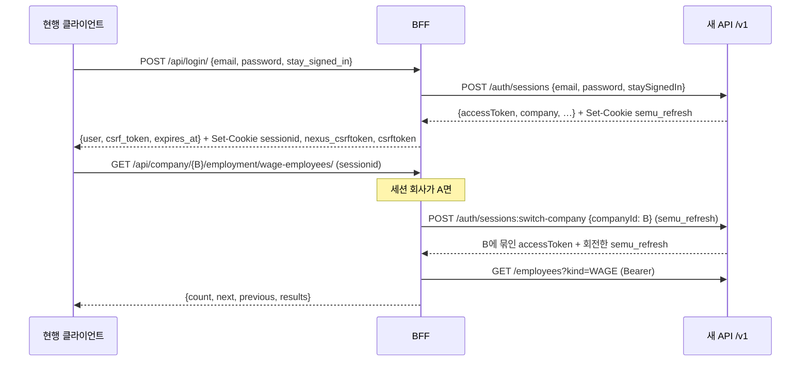

# 현행 클라이언트 호환 계층 (BFF)

[review.md](review.md#결정)의 D2(단계적 이전)를 구현하는 얇은 계층입니다. 현행 웹 클라이언트가 쓰던 와이어(옛 경로, snake_case 키, DRF 봉투, `{detail, code}` 오류, 세션 쿠키 + CSRF)를 그대로 받아 새 `/v1` API로 옮겨 부르고, 응답을 다시 현행 형태로 돌려줍니다. 클라이언트를 고치지 않고 새 백엔드로 갈아탄 뒤, 화면을 하나씩 새 API로 옮기고, 마지막 화면이 떠나면 BFF를 지웁니다.

코드는 [`apps/bff/`](../../apps/bff/)에 있습니다.

## 어디서 도는가

**별도 앱 `apps/bff`.** 새 API와 다른 프로세스이고, 현행 클라이언트가 부르던 nexus·sf 호스트를 이 앱으로 돌립니다.

| 고려 | 별도 앱(선택) | 새 API 서버 안 모듈 |
|---|---|---|
| 새 API의 규약 | 세션 쿠키·CSRF·snake_case가 새 서버에 들어오지 않음. 새 API는 [conventions.md](conventions.md) 하나만 지킴 | 옛 인증 방식과 키 규칙이 같은 프로세스에 섞임 |
| 의존 방향 | BFF는 `/v1` 와이어 계약만 앎. 새 API 내부(Effect 레이어·저장소)를 가져오지 않음 | 핸들러를 건너뛰고 유스케이스를 직접 부르고 싶어짐. 검증·트랜잭션·인증 미들웨어를 우회할 위험 |
| 계약 검증 | 현행 화면 하나를 덮을 때마다 새 API가 실제 클라이언트에 충분한지 드러남(아래 [빈 필드](#빈-필드와-새-api에-필요한-것)) | 내부 호출로 빈틈을 메우면 드러나지 않음 |
| 폐기 | 디렉터리와 라우팅 하나를 지우면 끝 | 새 서버 코드에서 걷어내야 함 |
| 비용 | 홉 하나, 배포 단위 하나, 세션 저장소 하나 | 없음 |

### 새 API를 부르는 방법

BFF는 새 API를 **HTTP 계약으로** 부릅니다. 업스트림은 `(Request) => Promise<Response>` 하나(`UpstreamOptions.fetch`)입니다.

- 운영: `fetch`로 `SEMU_API_URL`(기본 `http://localhost:3000`)의 `/v1`을 부릅니다
- 테스트: 새 API 앱의 웹 핸들러(`HttpRouter.toWebHandler(AppLive)`)를 그대로 넣어 **프로세스 안에서** 부릅니다. 네트워크 없이 빠르고, 메모리·SQLite 저장소 모두로 돕니다
- 한 프로세스로 배포하고 싶으면 운영도 같은 웹 핸들러를 넣으면 됩니다. BFF 코드는 바뀌지 않습니다

Effect 레이어를 직접 부르지 않는 이유는 위 표의 "의존 방향"입니다. 새 API의 검증(`VALIDATION_FAILED`), 요청 트랜잭션, 인증·인가는 모두 HTTP 경계에 있고, BFF가 그것을 건너뛰면 BFF가 또 하나의 백엔드가 됩니다.

## 인증 번역

| 현행 | 새 API | BFF |
|---|---|---|
| 세션 쿠키 `sessionid` + CSRF(`nexus_csrftoken`/`csrftoken` 쿠키, `X-CSRFToken`/`X-XSRF-TOKEN` 헤더) | access token(10분, `Authorization`) + refresh 쿠키(`Path=/v1/auth`) | 브라우저에는 현행 쿠키만 줍니다. 새 API의 refresh 쿠키와 access token은 **BFF 세션 저장소에만** 둡니다. 쓰기 요청은 헤더 = 쿠키 = 세션의 CSRF 토큰이어야 합니다(403 `CSRF_FAILED`) |
| 세션은 회사와 무관, 경로 `/api/company/:companyId/`가 회사를 정함 | 토큰 하나 = 회사 하나 | 경로의 회사가 세션의 회사와 다르면 `:switch-company`를 부른 뒤 보냅니다. 접근할 수 없는 회사는 새 API처럼 존재 여부를 숨긴 404 `NOT_FOUND`입니다 |
| `POST /api/user/me/jwt/ {company_id}` → 회사 JWT | `:switch-company` | 세션을 그 회사로 전환하고 지금 access token을 `{token}`으로 줍니다. 이 토큰은 `/v1`에 그대로 쓸 수 있어, 새 API로 옮긴 화면이 쓰는 경로가 됩니다([화면 이전](#화면-이전)) |
| 만료 처리 없음(세션 쿠키 수명) | access 10분, refresh 회전·재사용 탐지 | 만료 30초 전이면 미리 `:refresh`. 새 API가 401을 주면(권한 변경 등으로 폐기) 한 번 갱신해 다시 보냅니다. 갱신이 401이면 BFF 세션을 지우고 현행 401 `UNAUTHENTICATED`와 쿠키 삭제로 응답합니다 |
| 로그아웃 | `DELETE /auth/sessions/current` | 새 세션을 끝내고 BFF 세션과 쿠키를 지웁니다. 새 API가 실패하거나 응답하지 않아도 BFF 세션과 쿠키는 지웁니다 |
| 로그인 CSRF | (해당 없음, 토큰은 본문으로) | 로그인에는 아직 CSRF 토큰이 없으므로 출처로 막습니다. JSON 본문만 받고(그 밖은 415 `UNSUPPORTED_MEDIA_TYPE`, HTML 폼이 사전 요청 없이 보내는 `text/plain`을 거름), `Origin`이 있으면 허용 목록(`BFF_ALLOWED_ORIGINS`, 기본은 `BFF_PUBLIC_URL`의 출처)에 있어야 하고, 없으면 `Sec-Fetch-Site: cross-site`를 거절합니다(403 `CSRF_FAILED`). 다시 로그인하면 이전 BFF 세션과 그 새 API 세션을 끝냅니다 |

### 동시 요청

새 API는 refresh 쿠키를 회전시키고 이전 값이 다시 오면 탈취로 보고 세션을 폐기합니다. 회사 전환은 이전 access token을 폐기합니다. 현행 클라이언트는 앱 시작 때 회사 상세·권한·구독을 병렬로 부르므로 BFF가 그대로 흘려보내면 세션이 깨집니다. 그래서 세션마다 **읽기·쓰기 자물쇠**를 둡니다.

- 갱신·전환은 쓰기(`exclusive`): 한 번에 하나, 앞서 온 호출이 끝난 뒤에 합니다. 자물쇠 안에서 저장소의 최신 세션을 다시 읽으므로 같은 갱신을 두 번 하지 않습니다
- 새 API 호출은 읽기(`shared`): 같은 회사에 대한 호출끼리는 함께 갑니다. 호출 도중 다른 요청이 회사를 바꾸지 못합니다
- 한계: 새 API 세션 하나는 한 회사에만 묶이므로, 탭 두 개에서 서로 다른 회사를 번갈아 열면 요청마다 전환이 일어나 느려집니다. 결과가 섞이지는 않습니다(전환은 쓰기 자물쇠 안에서만 일어남)

- 같은 세션 자물쇠를 안에서 다시 잡으면 교착되므로 `SessionLocks`가 그 자리에서 오류를 던집니다(`AsyncLocalStorage`로 쥔 자물쇠를 기억)
- 새 API 요청 하나는 제한 시간이 지나면 취소하고 현행 504 `GATEWAY_TIMEOUT`, 연결 실패는 502 `BAD_GATEWAY`입니다. 제한 시간은 헤더가 아니라 **본문을 다 읽을 때까지**이고, `send`가 본문을 메모리로 다 읽어 돌려주므로 자물쇠 안에서 본문을 읽다 멈추는 일이 없습니다. 기다림이 끝나면 자물쇠도 풀립니다
  - 일반 호출은 `BFF_UPSTREAM_TIMEOUT_MS`(기본 10초), refresh 쿠키를 회전시키는 로그인·갱신·회사 전환은 `BFF_AUTH_TIMEOUT_MS`(기본 30초), 요청 안에서 메일을 다 보내는 명세서 발송은 `BFF_SEND_TIMEOUT_MS`(기본 2분, [두 번 보내지 않기](#두-번-보내지-않기))입니다
  - 본문을 메모리에 다 읽으므로 크기도 묶습니다. 응답 하나가 `BFF_UPSTREAM_MAX_RESPONSE_BYTES`(기본 10MB)를 넘으면 더 읽지 않고 요청을 취소한 뒤 502 `UPSTREAM_RESPONSE_TOO_LARGE`입니다. `Content-Length`가 이미 크면 읽기 전에 멈추고, 없거나 틀려도 읽은 바이트를 셉니다. 제한 시간·크기 환경 변수는 비우면 기본값이고, 숫자가 아니거나 0 이하이거나 제한 시간이 Node 타이머 한도(2147483647ms)를 넘으면 BFF가 시작하지 않습니다
  - **남는 창:** 갱신·전환이 BFF 쪽에서 시간 초과로 끝났는데 새 API가 그 뒤에 처리를 마치면, refresh 쿠키는 이미 회전했고 BFF는 새 값을 받지 못했습니다. 다음 갱신은 이전 값을 보내 재사용 탐지에 걸리고, 새 API가 세션을 폐기해 사용자는 다시 로그인합니다(401 `UNAUTHENTICATED`). 인증 호출 제한 시간을 길게 둬 이 창을 "새 API가 30초 넘게 걸린 갱신"으로 줄였습니다. 없애려면 새 API에 회전 직후 짧은 유예(이전 값 한 번 허용)나 멱등 키를 둬야 합니다
- 자물쇠는 도착 순서대로 내줍니다. 줄 맨 앞이 쓰기면 진행 중인 읽기가 끝난 뒤 혼자, 맨 앞이 읽기면 이어진 읽기까지 함께 들어갑니다. 늦게 온 요청이 앞 요청을 앞지르지 않아 읽기도 쓰기도 굶지 않습니다
- 갱신이 필요 없으면 쓰기 자물쇠를 잡지 않습니다. `GET /api/member/profile/`은 저장소만 읽고, `GET /api/user/me/`는 `callApi`가 필요할 때만 갱신합니다
- CSRF 토큰은 `timingSafeEqual`로 비교합니다

세션 저장소는 지금 프로세스 메모리 하나(`memorySessionStore`)라 BFF 인스턴스도 하나입니다. 만료된 세션은 요청이 올 때 1분마다 쓸어 냅니다. 여러 대로 늘리면 `SessionStore`를 공유 저장소로 바꾸고 자물쇠도 그 저장소의 잠금으로 옮겨야 합니다. 저장 키는 쿠키 값의 SHA-256입니다.

## 형태 번역

| 항목 | 현행 → 새 API (요청) | 새 API → 현행 (응답) |
|---|---|---|
| 키 | snake_case → camelCase(`transformKeys(…, camelCase)`) | 화면별 매퍼가 필드를 하나씩 옮깁니다. 이름만 다른 게 아니라 구조가 달라서입니다(`address.zipCode` → `zip_code`, `resignation.leaveDate` → `leave_date`) |
| 원문 키 | `LEGACY_RAW_KEYS`(`other_deductions`, `taxable_incomes`) 아래는 바꾸지 않습니다. 현행 클라이언트가 그 뒤 형제 키까지 변환을 끄던 특이점은 클라이언트 쪽 일이라 따라 하지 않습니다 | 같음 |
| ID | 현행 정수·문자열 ID 대신 새 접두사 ID(`cmp_`, `emp_`)를 그대로 내보냅니다. 현행 `id`와 `sf_company_id`는 같은 새 회사 ID입니다 | 클라이언트는 ID를 불투명하게 다루므로 그대로 둡니다. 데이터 이관 때 현행 ID ↔ 새 ID 대응표가 생기면 BFF가 바꿔 줄 수 있습니다 |
| enum | 현행 정수 상태 `?status=1..5`, 이름 → 새 상태 집합. `3`(재직)은 `JOINED`+`LEAVE`, `2`(근무 중)는 `JOINED` | `status_code`·`status_display`(한글 탭 이름), 경고 `MISSING_REGISTRATION_NUMBER` → `missing_required_info`, `CORPORATION` → `corporate`, `kind: WAGE` → `wage-salary`·`wageemployee`, 사용자 종류 → `user_type` 정수. 새 API가 나중에 더한 값은 소문자로 내보냅니다 |
| 목록 | `limit/offset`(기본 20, 최대 100) | 새 커서 목록을 끝까지 읽고(200개씩) BFF에서 거르고·정렬하고·잘라 DRF 봉투 `{count, next, previous, results}`로 줍니다. 링크는 `Host` 헤더가 아니라 설정한 공개 주소(`BFF_PUBLIC_URL`) 기준 절대 주소입니다. 끝까지 읽기는 50쪽(직원 10,000명)에서 멈추고 같은 커서가 다시 오면 멈춥니다(502 `UPSTREAM_LIST_TOO_LARGE`, `UPSTREAM_CURSOR_REPEATED`). 회사 하나의 직원 수에서는 감당할 만하고, 화면을 옮기면 사라집니다 |
| 검색·정렬 | 현행 서버와 같게 | `search`는 이름·부서 이름·직위 이름 부분 일치(영문 대소문자 무시). `ordering`이 없으면 `name`, 쉼표로 여러 키(`-status,name`), 키는 현행과 같은 `name`, `status`, `birth_date`, `join_date`, `leave_date`, `department`, `position`, `employee_number`, `created`. 값이 없으면 가장 앞(SQLite `NULL`), 마지막은 ID 순 |
| 버전 | `If-Match` 그대로 | 새 `ETag`를 그대로 옮깁니다 |
| 끝 슬래시 | 있어도 없어도 받습니다 | |

### 오류

새 API의 RFC 9457 문제를 현행 `{ detail, code, …extras }`로 바꿉니다(`fromProblem`).

| 새 API | 현행 |
|---|---|
| 400 `VALIDATION_FAILED` + `violations[{field, code}]` | 422 `VALIDATION_FAILED` + `errors: { snake_field: ["This field is required."] }`. 요청 부분 전체(`body`)는 `non_field_errors` |
| 401 `UNAUTHENTICATED`, `SESSION_INVALID` | 401 `UNAUTHENTICATED` |
| 401 `INVALID_CREDENTIALS` | 401 `INVALID_CREDENTIALS` |
| 403 `PERMISSION_DENIED`, `ENTITLEMENT_REQUIRED`, `DEMO_READ_ONLY` | 같은 코드. `ENTITLEMENT_REQUIRED`에는 현행 `promotion_url: null`을 붙임 |
| 403 `TERMS_REAGREEMENT_REQUIRED` | 403 `TAX_TERMS_REQUIRED` |
| 404 `*_NOT_FOUND` | 404 `NOT_FOUND` (`detail`: "Employee not found.") |
| 409 `*_DUPLICATE`, `*_ALREADY_REGISTERED` / `*_TRANSITION_INVALID` | 409 `CONFLICT` / `INVALID_TRANSITION` |
| 422 `LEAVE_INVALID`, `WORK_CONTRACT_INVALID`, `PAYROLL_CONTRACT_INVALID` + `violations` | 422 `VALIDATION_FAILED` + `errors`. 중첩 필드(`paid.allowance`, `fixedAllowances.overtime.hours`)는 라우트가 현행의 평평한 필드(`paid_allowance`, `fixed_overtime_hours`)로 되돌림. 문구는 새 위반 코드(`END_DATE_REQUIRED`) |
| 409 `LEAVE_OVERLAP`, `RETIREMENT_COMPLETED` | 400 같은 코드(현행 HR 오류의 상태). `overlapping_leave_id`는 그대로 |
| 422 `RESIGNATION_REJECTED` (`reason`) | 422 `VALIDATION_FAILED`: `LEAVE_DATE_BEFORE_JOIN` → `leave_date`, `LEAVING_REASON_INVALID` → `leaving_reason` (현행 문구) |
| 412 `VERSION_MISMATCH` | 412 `VERSION_CONFLICT` |
| 409 `PAYROLL_LEDGER_READ_ONLY` | 409 `INVALID_TRANSITION` (현행 급여카드도 입력할 수 없는 상태를 이 코드로 거절) |
| 409 `ADDITIONAL_LEDGER_BLOCKED` (`reason`) | 409 `ADDITIONAL_CARD_NOT_ALLOWED`. 급여카드 라우트가 `reason`을 현행 값으로 바꿈(`REGULAR_LEDGER_NOT_SUBMITTED` → `parent_not_calculated` 등) |
| 409 `WAGE_ROW_ON_ADDITIONAL_LEDGER` | 409 `WAGE_INCOME_ON_ADDITIONAL_CARD` |
| 422 `RATE_TABLE_NOT_FOUND` (`month`) | 같은 상태·코드. `_NOT_FOUND`로 끝나지만 경로의 리소스가 없는 게 아니라 귀속월의 기준표가 없는 것이라 접미사 규칙(404)에서 뺌 |
| 그 밖 | 상태와 코드를 그대로 둡니다(예: 423 `ACCOUNT_LOCKED`). 현행 클라이언트는 모르는 코드에 일반 오류 문구를 띄웁니다 |

- `detail`은 새 `detail`, 없으면 `title`에 마침표를 붙입니다. 추가 필드는 키만 snake_case로 바꿉니다(`duplicateEmployeeId` → `duplicate_employee_id`, `requiredPlans` → `required_plans`)
- BFF가 직접 내는 오류(세션 없음, CSRF, 잘못된 현행 쿼리, 없는 경로, 잘못된 퍼센트 인코딩)도 같은 형태입니다. 현행에서 경로 자체가 없던 경우(새 ID 형식이 아닌 직원·회사 ID)는 400이 아니라 404("Employee not found.", "Company not found.")입니다

## 첫 조각

| 현행 | 새 API |
|---|---|
| `POST /api/login/` | `POST /v1/auth/sessions` |
| `POST /api/logout/` | `DELETE /v1/auth/sessions/current` |
| `GET /api/user/me/` | `GET /v1/me` (회사 없는 사용자는 로그인 응답) |
| `GET /api/member/profile/` | 세션의 사용자 (`/v1/me`와 같은 값) |
| `POST /api/user/me/jwt/` | `POST /v1/auth/sessions:switch-company` |
| `GET /api/company/:companyId/`, `GET /api/settings/company/:companyId/` | (전환) + `GET /v1/companies/current` |
| `GET /api/company/:companyId/employment/wage-employees/` | (전환) + `GET /v1/employees?kind=WAGE`(끝까지), `GET /v1/departments`, `GET /v1/positions` |
| `GET …/wage-employees/count-by-status/` | (전환) + `GET /v1/employees?kind=WAGE`(끝까지) |
| `GET …/wage-employees/:employeeId/` | (전환) + `GET /v1/employees/{employeeId}`, 부서·직위 |

인증·회사 전환은 모든 화면의 전제라 먼저 했고, 업무 흐름은 **인사 구성원 목록·상세**를 골랐습니다. 세무 기장·급여 고객 모두 쓰는 화면이고, 상태 파생·경고·탭 건수·DRF 페이지·부서 이름 조인처럼 번역 종류가 가장 많이 모여 있어 다음 조각의 틀이 됩니다.

### 빈 필드와 새 API에 필요한 것

BFF가 채우지 못해 `null`·기본값으로 두는 필드입니다. 화면이 이 값을 꼭 써야 하면 새 API에 더할지, 화면을 먼저 옮길지 정합니다.

| 현행 필드 | 이유 | 다음 |
|---|---|---|
| `GET /api/user/me/`의 다른 회사 `tax_plan`, `is_system_admin` | `/v1/me.companies`에 플랜·관리자 여부가 없음. 지금 회사만 채움 | `CompanySummary`에 `plans`, `isOwner` 추가 검토. 세무 약관 게이트는 `/v1/me.pendingTermCodes`로 대신할 수 있음 |
| 프로필 `phone`, `marketing_agreed`, `last_login_at` | 새 `UserProfile`에 없음 | 마케팅 동의는 약관 동의 기록으로 |
| 회사 `payday_month`·`payday_day`, `corp_type`, `corp_investment_type`, `updated_at` | 급여일은 Payroll 급여 설정, 법인 종류는 아직 없음 | 회사 설정 화면 조각에서 Payroll 설정을 함께 읽음 |
| 직원 `employee_number`, `work_code`, `english_name`, `is_residence`, `source` | 새 `Employee`에 없음 | HR 문서의 애그리거트에는 있으나 미구현 |
| 직원 `contract_end_date`(`contract_type`은 현행의 계약 없음 값 `none`) | 근로계약 하위 리소스. 목록에서 행마다 부르면 N+1 | 계약 만료는 `warnings`로 남음. 근로계약 자체는 [인사 하위 리소스 조각](#인사-하위-리소스-조각)이 옮김. 필요하면 `/v1/employees`에 현재 계약 요약을 넣음 |

## 인사 하위 리소스 조각

D9 순서의 두 번째 조각입니다. 구성원 상세 화면의 근로 정보·급여 정보·휴직·퇴직 탭입니다. 모든 경로는 `…/employment/wage-employees/:employeeId/` 아래에 있고, 첫 조각처럼 직원이 근로소득자가 아니면 404 "Employee not found."입니다(현행 경로가 근로소득자만 받았음). 코드는 `apps/bff/src/hr/`의 `contracts.*`, `leaves.*`, `retirement.*`, 공통 도우미 `employee-scope.ts`입니다.

| 현행 | 새 API |
|---|---|
| `GET …/work-contracts/` | `GET /v1/employees/{id}/work-contracts` (BFF가 시작일 내림차순·DRF 페이지) |
| `POST …/work-contracts/` | `POST /v1/employees/{id}/work-contracts` |
| `GET …/work-contracts/:contractId/` | `GET /v1/employees/{id}/work-contracts`에서 찾음 (새 API에 단건 조회 없음) |
| `GET …/work-contracts/indefinite-conversion-alert/` | `GET /v1/employees/{id}/indefinite-conversion` |
| `GET`·`POST …/payroll-contracts/` | `GET`·`POST /v1/employees/{id}/payroll-contracts` |
| `GET`·`PUT`·`DELETE …/payroll-contracts/:contractId/` | `GET`·`PUT`·`DELETE /v1/payroll-contracts/{id}` (BFF가 경로의 직원과 계약의 `employeeId`를 맞춰 봄) |
| `GET …/leave-of-absence-info/` | `GET /v1/employees/{id}/leaves`의 `summary` + 휴직 행 |
| `GET …/leave-of-absences/`, `…/:leaveId/` | `GET /v1/employees/{id}/leaves` |
| `POST …/leave-of-absences/` | `POST /v1/employees/{id}/leaves` (+ 복직일이 있으면 `POST /v1/leaves/{id}:return`) |
| `PUT …/leave-of-absences/:leaveId/` | 복직일을 처음 넣을 때만 `POST /v1/leaves/{id}:return` |
| `DELETE …/leave-of-absences/:leaveId/` | `DELETE /v1/leaves/{id}` |
| `GET …/retirement-info/` | `GET /v1/employees/{id}`의 `resignation`, `severanceSettlementStatus` |
| `PUT …/retirement-info/` | 퇴직일·사유가 바뀌면 `POST /v1/employees/{id}:resign`, 퇴직일을 지우면 `:cancel-resignation` |
| `DELETE …/retirement-info/` | `POST /v1/employees/{id}:cancel-resignation` |

### 번역

- **enum.** 계약 형태 `regular`/`contract` ↔ `PERMANENT`/`FIXED_TERM`, 계약 상태·임금 형태·지급 시기·무기계약 전환 상태는 소문자, 지급 방법 `direct` ↔ `CASH`, 휴직 사유 `etc` ↔ `OTHER`, 정산 상태는 소문자입니다
- **단위·구조.** 수습 지급률은 현행 퍼센트(90) ↔ 새 ppm(900000), 수습이 있는데 지급률이 없으면 현행처럼 100%입니다. 고정수당은 현행 평평한 필드(`fixed_overtime_enabled/hours/amount`) ↔ 새 `fixedAllowances.overtime`, 상여금은 `has_bonus`+`bonus_amount` ↔ `bonus`, 지급 시기는 `pay_month`+`pay_day` ↔ `payTiming`, 계좌는 `bank_code`·`account_number`·`account_holder` ↔ `account`입니다. 유급 휴직은 `is_paid`+`paid_allowance` ↔ `paid.allowance`(응답은 수당이 있으면 유급)입니다
- **파생 값.** 급여계약의 기본급·시급·고정수당 금액·최저임금 판정(`minimum_wage.hourly`·`contract_hourly`·`is_below`)은 새 API가 계산한 `derived`·`warnings`를 옮깁니다. 응답의 고정수당 `amount`는 자동계산이면 계산한 금액입니다
- **목록.** 하위 리소스 목록은 새 API가 한 번에 다 주므로(직원 하나의 계약·휴직) BFF가 현행 순서(시작일 내림차순, 같으면 ID 내림차순)로 정렬하고 DRF 봉투로 자릅니다
- **기본값.** 현행 본문의 빠진 필드는 현행 서버(zod 스키마)와 같은 기본값으로 채웁니다(`monthly_work_hours` 209, `pay_day` 25, `pay_method` `transfer` 등). 타입이 틀리면 BFF가 422 필드 오류로 막고, 업무 규칙은 새 API가 검증합니다. 급여계약은 새 스키마가 거절할 범위(정수 원 ≥ 0, 시간 > 0, 지급일 1–31, 은행 코드 3자리, 종료일 ≥ 시작일)도 BFF가 먼저 봅니다. 계좌번호는 현행처럼 공백·하이픈을 빼고 숫자 6–20자리만 받습니다
- **계좌번호 유지.** 현행 `PUT`은 가린 계좌번호(`*` 포함)나 빠진 계좌번호를 "그대로"로 읽었습니다. 새 `PUT`은 전체 교체라 계좌를 빼면 지우므로, BFF가 `GET /v1/payroll-contracts/{id}/account-number`로 원문을 읽어 다시 보냅니다. 열람 사유("현행 급여 정보 수정: 기존 계좌 유지")가 새 API의 개인정보 접근 기록에 남고, 원문은 현행 클라이언트에 가지 않습니다. 실패할 쓰기 때문에 열람 기록이 남지 않도록 본문 검증과 클라이언트 `If-Match` 비교(412)를 열람 **전에** 합니다. 계산 뒤에야 알 수 있는 거절(기본급 음수 `BASE_SALARY_NEGATIVE`)과 열람과 쓰기 사이의 경합은 열람 뒤에 날 수 있습니다
- **급여계약 버전.** 현행 `PUT`은 버전을 보지 않았습니다. 클라이언트가 `If-Match`를 보내면 넘기고, 없으면 BFF가 방금 읽은 계약의 `ETag`를 넣어 읽은 뒤의 변경을 덮어쓰지 않습니다

### 직원 버전과 `If-Match`

현행 휴직·퇴직 쓰기는 직원 상태를 바꾸므로 직원 버전(`If-Match`, 응답 `ETag`)을 요구했습니다(없으면 428 `PRECONDITION_REQUIRED`, 다르면 412 `VERSION_CONFLICT`).

- **퇴직.** 새 `:resign`·`:cancel-resignation`도 직원 버전을 보고 올리므로 `If-Match`를 그대로 넘기고 새 `ETag`를 돌려줍니다. 현행처럼 퇴직일이 바뀌는 쓰기만 `If-Match`가 필수이고, 사유만 고칠 때는 있으면 넘깁니다. 다른 점: 사유만 고쳐도 새 `:resign`이라 직원 버전이 오릅니다(현행은 그대로). 퇴직금 정산이 끝난 뒤에는 사유만 고쳐도 `RETIREMENT_COMPLETED`(400)입니다
- **휴직.** 새 휴직 쓰기는 직원 버전을 보지도 올리지도 않습니다(직원 상태는 날짜로 계산). BFF가 지금 직원 버전과 비교해 현행 428/412를 흉내 내고, 응답 `ETag`는 그 버전 그대로 줍니다. 다음 쓰기에 같은 값을 보내면 맞습니다. 그래서 휴직끼리의 동시 수정은 직원 버전으로 막히지 않습니다. 새 API의 휴직 겹침 검사(`LEAVE_OVERLAP`)와 복직의 휴직 버전 검사가 그 자리를 대신합니다
- **두 호출.** 현행 `POST`가 복직일까지 담으면 새 API에서는 등록과 `:return` 두 호출입니다
  - 복직일 범위(시작일 < 복직일 ≤ 종료일+1)는 BFF가 등록 **전에** 보고 현행 문구로 422를 줍니다. 그래서 되돌릴 일은 드뭅니다
  - `:return`을 새 API가 분명히 거절하면(4xx) 방금 만든 휴직을 지워 되돌리고 그 거절을 줍니다. 휴직을 지우면 새 API가 휴직·복직 4대보험 신고를 함께 철회합니다
  - 결과를 모르면(시간 초과 504, 연결 실패·5xx) 복직이 이미 기록됐을 수 있으므로 지우지 않고 `PARTIAL_WRITE`(같은 상태)로 다시 읽으라고 알립니다
  - 되돌리기가 실패하면 휴직 ID와 상태만 로그에 남기고 502 `PARTIAL_WRITE`입니다
  - `:return`이 401(그 사이 세션이 폐기됨)로 끝나면 되돌리지 않고 원래 401을 그대로 줍니다. 같은 세션으로는 지우기도 401이라 되돌릴 수 없고, 502 `PARTIAL_WRITE`로 바꾸면 세션·CSRF 쿠키를 지우는 응답이 사라져 클라이언트가 로그아웃 상태를 다음 요청에서야 압니다. 휴직은 복직일 없이 남으므로 휴직 ID와 상태만 로그에 남깁니다. 다시 로그인한 사용자는 목록에서 그 휴직을 보고 `PUT`으로 복직일을 넣거나 지울 수 있습니다

### 옮기지 못한 것

새 API에 자리가 없는 **쓰기 필드**는 조용히 버리지 않고, 기본값이 아니면 422 `VALIDATION_FAILED`(`"Not supported by the new API yet."`)로 거절합니다. 사용자가 넣은 값이 사라지지 않게 하고, 스테이징에서 어떤 필드가 실제로 쓰이는지 드러나게 하려는 것입니다. **응답 필드**는 첫 조각처럼 `null`·현행 기본값으로 둡니다.

| 현행 | 쓰기 | 응답 | 이유 |
|---|---|---|---|
| 근로계약 `PUT`·`DELETE` | 경로 없음(404) | | 새 근로계약은 유효일 이력으로 쌓기만 함 |
| 근로계약 `work_type`(`regular` 밖), `work_code`, `work_condition`, `work_schedule_policy`, `job_description`, `document` | 422 | `regular`, `null` | 새 `WorkContract`에 없음. 새 `standardOccupationCode`(한국표준직업분류)는 현행 `work_code`(4대보험 직종코드)와 다른 분류라 옮기지 않음 |
| 근로계약 `creation_method`, `e_sign_request`, `updated` | | `manual`, `null`, `created`와 같음 | 전자서명은 아직 없음. 새 근로계약은 고칠 수 없음 |
| 급여계약 지급항목 `payment_item`이 현행 정수 ID | 422 | | 새 지급항목 ID(`pit_…`)만 받음. 데이터 이관 대응표가 생기면 바꿔 줄 수 있음 |
| 급여계약 지급항목 `name` | 버림 | 없음 | 항목 이름은 Payroll의 지급항목이 가짐 |
| 급여계약 `e_sign_request` | | `null` | 전자서명은 아직 없음 |
| 휴직 `created`, `updated` | | `null` | 새 `Leave`에 시각이 없음 |
| 휴직 `PUT`의 복직일 밖 변경, 복직일 고치기·지우기 | 422 `non_field_errors` | | 새 API는 휴직 수정이 없고 `:return`만 있음. 지우고 다시 등록해야 함. 복직 예정일이 `null`이면 현행처럼 종료일+1로 보고 비교함 |
| 퇴직 `retirement_benefit_type`(`grant` 밖), `has_interim_settlement`, `interim_settlement_date`·`reason`, `severance_amount` | 422 | `grant`, `false`, `null` | 새 도메인에 `RetirementPlan`(퇴직금 제도·중간정산)이 있지만 HTTP 엔드포인트가 없음. 새 `Resignation` 본문에 퇴직금이 없음 |
| 퇴직일 없이 사유·상세 사유만 저장 | 422 | | 새 API는 퇴직(`:resign`)과 함께만 사유를 받음. 퇴직일을 지워 취소하면서 사유를 보내는 `PUT`도 같음(아래) |
| 퇴직 `updated` | | 직원 `updatedAt` | 퇴직 정보만의 수정 시각이 없음 |
| 퇴직이 없을 때 `DELETE` | 204, 버전 그대로 | | 현행은 성공하고 버전을 올렸음. 새 취소는 퇴직이 없으면 거절하므로 BFF가 버전만 확인 |

**퇴직일을 지우면서 사유를 보내는 `PUT`.** 현행 `PUT {leave_date: null, leaving_reason: '11', …}`은 퇴직을 취소하고(직원 버전 올림, 상실신고 철회) 사유는 그대로 저장했습니다. 현행에서 퇴직일 없는 사유는 뜻 있는 상태였습니다. 사직서 전자서명이 끝나면 퇴직일 없이 사유만 남겼고, `GET`이 그 사유를 돌려주므로 다음 퇴직 등록의 초안이 됩니다. 새 `:cancel-resignation`은 사유까지 지우고 사유만 둘 자리도 없으므로, 취소하고 사유를 버리면 사용자가 남긴 값이 조용히 사라집니다. 그래서 이 경우는 "조용히 버리지 않고 422" 원칙대로 `leaving_reason`(상세 사유만 보내면 `leaving_detail_reason`) 422이고 퇴직은 그대로입니다. 현행 화면의 퇴직 취소는 모달의 [삭제](`DELETE`)이므로 화면 흐름은 막히지 않습니다. 현행 화면이 퇴직일만 비운 `PUT`으로 취소하는지는 화면을 옮길 때 확인하고, 그렇다면 사유를 둘 자리(열린 질문 1의 퇴직금 설정 엔드포인트 등)를 정할 때 함께 다룹니다

### 열린 질문

1. **퇴직금 설정 엔드포인트.** 퇴직금 제도·중간정산을 새 API에 둘지(예: `PUT /v1/employees/{id}/retirement-plan`), 퇴직금(`severanceAmount`)을 `Resignation`에 넣을지 정합니다. 도메인 타입(`RetirementPlan`)과 규칙(`checkRetirementPlan`)은 이미 있습니다
2. **근로계약 수정·삭제.** 새 API가 잘못 넣은 계약을 고칠 길이 없습니다. 이력 모델을 유지하면 "취소"(`DELETE` 또는 `:void`)만이라도 둘지 정합니다
3. **근로계약의 현행 필드.** 근무 형태(단시간 등)와 담당업무 직종코드는 4대보험 신고와 최저임금 판단에 쓰입니다. `WorkContract`에 넣을지, 직원(`Employee`)에 둘지 정합니다. 첫 조각의 `work_code` 빈 필드와 같은 질문입니다
4. **휴직 수정.** 기간 연장(복직 예정일 변경)은 실무에서 흔합니다. 새 API에 휴직 수정(`PATCH /v1/leaves/{id}`, 휴직 버전)을 둘지 정합니다
5. **급여계약 `PUT`의 계좌 유지.** 지금은 BFF가 원문을 열람해 다시 보냅니다. 새 `PUT`이 `account.accountNumber`가 없을 때 저장된 번호를 유지하게 하면 열람 없이 됩니다

## 급여대장 조각

D9 순서의 세 번째 조각입니다. 현행 급여카드(급여 관리, 스펙 1–30의 `cards`·`card-summary`)를 새 급여대장(`/v1/payroll-ledgers`)으로 옮깁니다. 이번에는 **읽기와 대장 자체의 생애 주기**(만들기·이름·계산 확정·확정·해제·추가 카드·삭제)만 옮기고, 행 입력 저장과 명세서·원천세는 [남은 것](#급여대장에서-남은-것)으로 둡니다. 코드는 `apps/bff/src/payroll/`입니다.

> **갈아타기 전에 정할 것: 플랜.** 현행 급여 관리(`payroll_management`)는 기장(`TAXATION`) 플랜의 메뉴였습니다(현행 `payroll.menus.ts`, 새 API의 `LEGACY_MENU_PERMISSIONS.payroll_management`도 `TAXATION`). 새 급여대장은 `PAYROLL` 플랜만 받습니다. 그래서 이 화면의 실제 사용자인 **기장만 쓰는 회사는 이 조각의 모든 경로가 403 `ENTITLEMENT_REQUIRED`**(`required_plans: ["PAYROLL"]`)입니다. 거꾸로 현행에서 이 메뉴를 못 쓰던 급여 플랜만 있는 회사는 열립니다. BFF가 고칠 수 없는 제품 결정이라([열린 질문 7](#급여대장-열린-질문)), 정하기 전에는 이 조각의 경로를 현행 클라이언트에 열지 않습니다. 테스트가 지금 동작(데모 `individual` 회사의 403)을 고정해 둡니다

| 현행 (`/api/company/:companyId/payroll/` 아래) | 새 API |
|---|---|
| `GET card-summary/?year=` | `GET /v1/payroll-ledgers`(끝까지) + 대장마다 `GET …/{id}/rows`. 연도는 BFF가 거름 |
| `GET card-summary/group-by-attr-date/?fixed_cards_only=&attr_date=&status=` | 같음. 귀속월·마감 여부는 새 API 필터(`attributionMonth`, `status=CLOSED`), 현행 세 단계 상태와 묶음은 BFF |
| `POST cards/` `{attribution_month, payment_date?, name?}` | `POST /v1/payroll-ledgers {attributionMonth, paymentDate?, title?}` (201) |
| `GET cards/:cardId/` | `GET /v1/payroll-ledgers/{id}` + `…/rows`. 추가 대장이면 같은 귀속월 목록으로 정기 대장 ID |
| `GET cards/:cardId/?fixed_cards_only=true` | 위 + 같은 귀속월의 `CLOSED` 대장과 그 행 |
| `GET cards/:cardId/card-status/` | `GET /v1/payroll-ledgers/{id}`의 `status` |
| `GET cards/:cardId/fixed-payrolls/?income_type=` | 같은 귀속월의 `CLOSED` 대장과 그 행 |
| `PATCH cards/:cardId/update-name/` `{name}` | `PATCH /v1/payroll-ledgers/{id} {title}` |
| `DELETE cards/:cardId/` | `DELETE /v1/payroll-ledgers/{id}` (추가 대장만) |
| `POST cards/:cardId/calculate/` | `POST /v1/payroll-ledgers/{id}:submit` (입력을 마치며 모든 행을 다시 계산) |
| `POST cards/:cardId/extensions/fix/` | `:close` (제출된 대장만) |
| `POST cards/:cardId/extensions/release/` | 제출된 대장은 `:return-to-draft`, 마감된 대장은 `:reopen {reason}` + `:return-to-draft` |
| `POST cards/:cardId/additional-card/` | `POST /v1/payroll-ledgers {attributionMonth: 경로 카드의 귀속월}` (201) |

### 번역

- **상태.** 새 상태 넷을 현행 `card_status`로: `DRAFT` → `inputting`, `SUBMITTED` → `calculated`, `PENDING_APPROVAL` → `approval_requested`, `CLOSED` → `approved`. 현행 세 단계(`status`, `legacy_status`)는 `input_available`·`calculating`·`done`이고 `step`은 새 값 그대로입니다. 현행 `payslips_sent`·`exported`는 새 API에서 상태가 아니라 마감 뒤 기록이라 나오지 않습니다
- **ID.** 카드 ID는 새 대장 ID(`pyl_`), 행 ID는 새 행 ID(`pyr_`)입니다. 새 대장 ID 형식이 아닌 카드 ID(현행 정수 등)는 새 API를 부르지 않고 404 "Payroll card not found."이고, 없는 대장도 같은 404입니다
- **종류.** `REGULAR` → `default`, `ADDITIONAL` → `addition`. 추가 대장의 `parent_card_id`는 같은 귀속월의 정기 대장입니다(새 대장에는 부모가 없어 목록에서 찾음)
- **집계.** 현행 카드 머리는 소득 구분별 인원(`headcount`, `headcount_by_type`)·합계(`total_by_type`, `net_pay_total_by_type`)·`gross_total`·`net_total`·`uncalculated_count`를 담습니다. 새 대장 응답에는 소득 구분별 집계가 없어 **대장마다 행을 읽어** BFF가 셉니다(동시에 4개씩). 계산 결과가 없는 행은 0원으로 셉니다. 행을 읽을 대장이 `maxLedgerRowReads`(기본 200, 월 대장으로 10년 남짓)개를 넘으면 행을 읽기 전에 502 `UPSTREAM_LIST_TOO_LARGE`입니다. 현행 클라이언트는 `year`·`attr_date`로 거르면 됩니다
- **행.** 새 행 입력을 현행 행에 펼친 입력 필드로 옮깁니다(현행은 입력 JSON을 행에 그대로 펼쳤음). 근무 시트는 분 → 시간(`regular_minutes` 90 → `regular_hours` 1.5), 일할계산은 `proration`이 있으면 `prorate_requested: true`, 사업·기타소득 공제 방식은 소문자입니다. 계산 결과는 현행 `calculation`(보험료는 근로자·사업주 따로)과 행의 금액 열로 옮깁니다. `calculated_at`은 결과가 있을 때 행의 `updatedAt`입니다(새 API는 행을 저장하면 바로 계산함)
- **지급항목 키.** 현행 `taxable_incomes`·`other_deductions`·`payment_items[].item_id`는 회사 지급항목의 정수 ID였습니다. 새 행 입력은 항목 코드(`MEAL`)를 가지므로 코드를 키로 씁니다. 원문 키(`LEGACY_RAW_KEYS`)라 변환하지 않습니다
- **목록 순서.** 현행 SQL 순서(귀속월 내림차순, 같은 달은 `kind` 문자열 순이라 추가 카드가 먼저, 그다음 만든 순)를 따릅니다. 대장 전체 읽기는 인사 목록과 같은 쪽 수 상한·반복 커서 검사를 둡니다(502 `UPSTREAM_LIST_TOO_LARGE`, `UPSTREAM_CURSOR_REPEATED`)
- **검증.** 현행 zod 스키마와 같은 범위를 BFF가 먼저 봅니다: 귀속월 `YYYY-MM`, 지급일 `YYYY-MM-DD`(실제 날짜인지는 새 API가 봄), 이름은 앞뒤 공백을 빼고 1–100자, `year`는 2000–2100 정수, `fixed_cards_only`는 `true`·`false`, `status`는 현행 세 단계, 모르는 `income_type`은 현행처럼 404 "Income type not found."입니다. 모두 새 API를 부르기 전에 422(또는 404)입니다. 현행 본문의 모르는 필드는 현행 zod처럼 무시합니다(새 API에 자리가 없는 현행 필드가 이 본문에는 없음)

### 쓰기와 버전

현행 카드 쓰기는 `If-Match`를 보내지 않았고 현행 서버는 지금 버전으로 전이했습니다.

- 클라이언트가 `If-Match`를 보내면 형식을 **먼저** 보고(틀리면 412, 새 API를 부르지 않음) 새 API에 그대로 넘깁니다. 다르면 새 API의 412 `VERSION_MISMATCH`가 현행 412 `VERSION_CONFLICT`가 됩니다
- 계산 확정·이름 변경·삭제는 `If-Match`가 없으면 새 API도 버전을 보지 않습니다(현행과 같음)
- 확정·해제는 BFF가 상태를 먼저 읽고 판단하므로, `If-Match`가 없으면 **방금 읽은 버전**을 넣어 읽은 뒤의 변경을 덮어쓰지 않습니다
- 응답 `ETag`는 새 대장 버전입니다

**현행 규칙을 지키려고 BFF가 막는 것** (새 API는 받지만 현행은 막았음, 모두 새 API를 부르기 전):

- 확정·해제는 세무 대리인만. 현행 `legacyFix`·`legacyRelease`는 `actors: ['agency']`였고 새 직접 운영은 고객도 마감·마감 해제를 받습니다. 경로 회사에서 고객으로 행동하면(행위자 종류 `CLIENT`) 현행과 같은 403 `PERMISSION_DENIED`입니다([열린 질문 6](#급여대장-열린-질문)을 정할 때까지). 확인 순서는 현행처럼 행위자가 상태보다 먼저입니다
  - 기준은 사용자 종류(`user.kind`)가 아니라 그 회사에서의 행위자 종류입니다. 세무 대리인 계정도 그 회사의 멤버면 현행(접근 디렉터리)과 새 API(멤버십이 배정보다 먼저) 모두 고객으로 다루므로 BFF도 막습니다
  - 행위자 종류는 새 API 세션 응답(로그인·갱신·회사 전환)의 `company.actorKind`를 BFF 세션에 `companyId`·access token과 함께 둔 것입니다. 요청마다 `/v1/me`를 부르지 않습니다
  - 확인은 `callApi`의 `guard`로 대장 읽기와 각 커맨드(`:close`·`:reopen`·`:return-to-draft`)를 보내기 직전, 세션 자물쇠 안에서 합니다. 그래서 늘 **그 호출에 실제로 쓰는 토큰의 grant**로 봅니다. 경로 회사로 전환한 뒤에 보고, 401로 갱신해 다시 보낼 때도 다시 봅니다. 거절된 호출은 새 API에 닿지 않습니다
  - 세션은 새 API가 토큰을 폐기한 것(멤버 가입·제거 등)을 401을 받기 전까지 모릅니다. 저장된 값이 `AGENCY`로 오래됐으면 첫 호출이 401로 갱신되고 새 grant로 다시 확인되므로 커맨드가 고객으로 나가지 않습니다. 반대로 `CLIENT`로 오래됐으면 거절하기 전에 한 번 갱신해 다시 확인합니다(이 호출에서 이미 갱신·전환했으면 하지 않음). 그래서 고객의 확정·해제는 거절마다 갱신 한 번이 더 듭니다. `actorKind`가 없는 세션도 고객처럼 막습니다
  - 첫 확인이 대장 읽기라, 새 대장 ID 형식이 아닌 카드 ID는 행위자와 상관없이 404입니다(현행은 고객이면 403이 먼저였음)
  - 되돌리기의 `:close`(해제 두 호출 중 둘째가 거절된 경우)는 확인하지 않습니다. 그사이 행위자 종류가 바뀌어도 반쯤 해제된 대장을 남기지 않는 쪽이 낫기 때문입니다
- 확정(`fix`)은 제출된(계산중) 대장만, 409 `INVALID_TRANSITION`. 새 `:close`는 입력 중인 대장도 마감합니다
- 해제(`release`)는 제출됐거나 마감된 대장만. 승인 대기·입력 중이면 409입니다
- 삭제는 추가 대장만(409). 새 API는 추가 대장이 없는 정기 대장도 지웁니다. 입력 중인지는 새 API가 봅니다

**현행과 다르게 남는 것:**

- 데스크로 내보낸(`exported`) 카드는 현행에서 해제할 수 없었습니다(`legacyRelease`의 출발 상태에 없음). 새 API에서는 내보내기가 상태가 아니라 BFF가 구분하지 못하므로 다른 마감 대장처럼 해제합니다
- 회사가 승인 운영(`CLIENT_APPROVAL`)이면 확정도 새 API가 409 `INVALID_TRANSITION`입니다(새 `:close`는 직접 운영에만 있음). 현행 확정은 운영 방식과 상관없었습니다
- 추가 카드(`additional-card`)는 현행이 **경로의 카드**를 부모로 삼아 그 상태(`parent_not_calculated`)와 지급일을 봤습니다. 새 API는 귀속월의 정기 대장을 봅니다. 추가 카드 경로에서 다시 추가 카드를 만들 때만 다릅니다(그때도 부모는 정기 대장)

### 확정 해제의 두 호출

현행 해제는 마감된 카드를 바로 입력 상태로 돌렸습니다. 새 API는 마감 해제(`:reopen`, `CLOSED` → `SUBMITTED`, 사유 필수)와 입력으로 되돌리기(`:return-to-draft`)가 따로입니다.

- 사유는 현행에 없으므로 BFF가 `현행 급여관리 확정 해제`를 넣습니다. 새 대장의 `reopenReason`에 남습니다
- 직접 운영(`DIRECT_CLOSE`) 대장만 두 호출로 해제합니다. 되돌리기가 `:close`이고 승인 운영(`CLIENT_APPROVAL`)에는 `:close`가 없어서, 승인 운영의 마감된 대장은 쓰기 전에 409입니다
- `:return-to-draft`를 새 API가 분명히 거절하면(4xx) `:close`(`If-Match`는 `:reopen` 뒤 버전)로 다시 마감하고, **되돌리기 응답이 성공일 때만** 처음 거절을 줍니다
- 결과를 모르면(시간 초과 504, 연결 실패·5xx) 이미 입력 상태로 돌아갔을 수 있으므로 되돌리지 않고 `PARTIAL_WRITE`(같은 상태)로 다시 읽으라고 알립니다
- 세션이 끝났으면(401) 되돌릴 수 없으므로 그 401(쿠키 삭제 포함)을 그대로 줍니다. 되돌리는 중에 세션이 끝나도 같습니다
- 되돌리기가 실패하면 대장 ID와 상태만 로그에 남기고 502 `PARTIAL_WRITE`입니다
- 되돌리기의 부작용: 새 `:close`가 마감 시각을 다시 찍으므로 `closedAt`(현행 `approved_at`)이 되돌린 시각으로 바뀌고 원래 확정 시각은 남지 않습니다. 버전은 2 오르고, 해제가 안 됐는데도 `reopenReason`(`현행 급여관리 확정 해제`)이 남습니다. 새 API가 지급월 마감 이벤트(`payroll_pay_month.reopened` 뒤 `closed`)를 한 번씩 더 냅니다. Tax의 소비자는 지금 마감 현황으로 다시 맞추므로(멱등) 결과는 같고 outbox·동기화 작업만 늘어납니다. 금액은 바뀌지 않습니다. 근본 해결은 [열린 질문 3](#급여대장-열린-질문)입니다. 원천세가 신고된 지급월이면 `:reopen`부터 409 `WITHHOLDING_FILED`라 두 호출까지 가지 않습니다

### 빈 필드

응답에서 BFF가 채우지 못해 `null`·현행 기본값으로 두는 필드입니다. 쓰기 쪽에는 이번 조각에서 옮기지 못한 필드가 없습니다(행 입력 저장 자체를 옮기지 않음).

| 현행 필드 | 응답 | 이유 |
|---|---|---|
| 카드 `approval_requested_at`, `payslips_sent_at`, `exported_at`, `export_type` | `null` | 새 대장에 승인 요청 시각이 없고, 명세서 발송·데스크 내보내기는 대장 밖 기록 |
| 카드 `card_status`의 `payslips_sent`·`exported` | `approved` | 같음 |
| 카드 `approved_at` | 새 `closedAt` | 직접 운영의 마감도 현행 `approved`였음 |
| 행 `resident_number`(가림), `is_foreigner`, `residence_country`, `birth_date`, `department`, `email`, `employment_status_label` | `null` | 새 행은 소득자 정보를 사본으로 두지 않음. 근로 행은 `employee_id`로 HR을 읽어야 함 |
| 행 `overrides`, `is_manually_overridden` | `{}`, `false` | 새 API는 계산 금액 직접 수정이 없음 |
| 일용 행 `work_dates`, 사업 행 `detail_type`, `contract_type`, `short_term_work_dates`, `special_occ_type_code` | `[]`, `null` | 새 행 입력에 없음. 일용은 근무일 수만 둠 |
| 지급항목 `item_id` | 새 항목 코드 | 위 [번역](#번역-1) |

### 급여대장에서 남은 것

이번 조각에 없는 현행 급여카드 경로는 현행 404 `NOT_FOUND`입니다(스테이징에서 경로별로 모읍니다).

| 현행 | 새 API | 남긴 이유 |
|---|---|---|
| `POST cards/:c/data/` (임시저장) | 행마다 `POST`·`PATCH /v1/payroll-ledgers/{id}/rows[/{rowId}]` | 현행은 지급·공제 금액을 회사 지급항목 **정수 ID**로 보냄(`taxable_incomes: {"12": 200000}`). 새 행은 항목 코드·이름·비과세 구분을 행마다 가지므로 회사 지급항목(`pit_`) ↔ 행 항목 대응이 먼저 필요. 일괄 저장 하나가 행 호출 여럿이 되어 부분 실패 처리도 정해야 함 |
| `POST cards/:c/refresh-wage-employees-list/`, `GET cards/:c/inquire-wage-employees-change/` | 없음 | 현행은 입·퇴사자로 근로 행을 더하고 뺌. 새 `:recalculate`는 사본만 갱신하고 명부는 바꾸지 않음. 명부 변동 경고(`ROSTER_CHANGED`)는 payroll.md의 열린 질문 |
| `GET cards/:c/can-create-additional-card/` | 없음 | 새 API는 만들기 요청이 409 `ADDITIONAL_LEDGER_BLOCKED`로 답함. 미리 묻는 경로가 필요하면 새 API에 더할지 정함(아래 열린 질문) |
| `GET`·`POST cards/:c/copy/` | 없음 | 이전 대장 입력 복사가 새 API에 없음 |
| `GET cards/fixed-payrolls-with-keyword/`, `GET cards/employee-names/` | 없음 | payroll.md에서 없앤 경로. 지난 행 검색은 HR 직원 검색과 행 목록으로 |
| `GET`·`POST /api/company/new-payroll/maintain-payroll/:id/` | 없음 | payroll.md에서 없앰(이관 때 한 번 정함) |
| 명세서 `cards/:c/payslip/…` (스펙 18–22) | `GET /payslips?ledgerId=`, `POST /payslips:send` | [명세서 조각](#명세서-조각)에서 옮김 |
| `payroll/withholding-summary/:paymentMonth` | `/payroll-ledgers?paymentMonth=` + `/filings` | [원천세 조각](#원천세-조각)에서 옮김 |
| BPO 대장·입력·명세서(스펙 34–113), 퇴직금 정산, 인건비 보고서, 급여 설정 | `/payroll-ledgers`, `/severance-settlements`, `/payroll-settings` 등 | 승인 운영 화면과 설정 화면은 별도 조각 |
| 급여 계산기·참조 코드(스펙 25–33) | `/payroll-calculator:simulate`, `/payroll-reference-codes` | 회사 경로 밖의 참조 데이터. 별도 조각 |

### 급여대장 열린 질문

1. **소득 구분별 집계.** 현행 카드 목록이 소득 구분별 인원·합계를 보여 주므로 BFF가 대장마다 행을 읽습니다(대장 N개면 N+1 호출, 행 전체를 읽음). 새 `PayrollLedger`에 `totalsByIncomeType`(인원·지급·실지급)을 더하면 목록 한 번으로 됩니다
2. **행 입력 저장과 지급항목 ID.** 현행 임시저장을 옮기려면 회사 지급항목(`pit_`)과 행 입력 항목(`code`)의 관계를 정해야 합니다. 행 입력에 `paymentItemId`를 둘지, BFF가 지급항목 목록으로 코드를 찾을지 정합니다. 일괄 저장(`PUT …/rows` 또는 엑셀 가져오기 `Job`)을 새 API에 둘지도 같은 질문입니다
3. **해제 한 번에.** 직접 운영의 해제를 새 API 한 커맨드로 둘지(`:reopen { toDraft: true }` 등) 정합니다. 그러면 BFF의 두 호출·되돌리기와 `PARTIAL_WRITE`가 없어지고 지급월 이벤트도 한 번만 납니다
4. **행 소득자 정보.** 현행 행은 주민등록번호(가림)·부서·이메일을 행에 들고 있었습니다. 새 행에 소득자 사본(가린 번호, 부서)을 둘지, 화면이 HR을 따로 읽을지 정합니다. 사업·기타소득 소득자는 HR 직원이 아닐 수 있어 사본이 필요할 수 있습니다
5. **추가 대장 가능 여부.** 현행 `can-create-additional-card`처럼 미리 물을 경로(또는 정기 대장 `allowedActions`의 `CREATE_ADDITIONAL`)를 둘지 정합니다
6. **현행 확정의 행위자.** 현행 확정·해제는 세무 대리인만 했습니다(고객은 `PERMISSION_DENIED`). 새 직접 운영은 고객·담당자 모두 마감합니다. 마감 해제는 지급월 마감·원천세와 이어지므로, 정할 때까지 BFF가 그 회사에서 고객으로 행동하는 사용자(대리인 계정이라도 멤버면 고객)의 확정·해제를 현행처럼 403으로 막습니다. 고객에게 열기로 하면 BFF의 막음을 지우고, 막기로 하면 새 API 권한(`payroll-ledger:close`)이나 전이표의 행위자로 옮깁니다
7. **급여대장의 플랜 (갈아타기를 막음).** 현행 급여 관리는 기장(`TAXATION`) 메뉴였고 새 급여대장은 `PAYROLL`만 받습니다. 새 API가 급여대장을 `TAXATION`에도 열지(인건비 보고서처럼 `PAYROLL` 또는 `TAXATION`), 기장 고객을 `PAYROLL`로 옮길지 정해야 이 조각을 현행 클라이언트에 열 수 있습니다. 새 API의 `LEGACY_MENU_PERMISSIONS.payroll_management`(`TAXATION`)와 대장 플랜(`PAYROLL`)도 지금 서로 맞지 않습니다

## 명세서 조각

D9 순서의 네 번째 조각입니다. 현행 급여카드의 급여명세서(스펙 18–22, `cards/:c/payslip/…`)를 새 명세서(`/v1/payslips`)로 옮깁니다. 코드는 `apps/bff/src/payroll/payslips.*`와 발송 키 `apps/bff/src/idempotency.ts`입니다. 화면 읽기와 발송 흐름을 옮기고, BPO 명세서·PDF는 [남은 것](#명세서에서-남은-것)입니다.

> **급여대장 조각의 플랜 결정이 그대로 걸립니다.** 새 명세서도 `PAYROLL` 플랜(+ 약관)만 받으므로 기장만 쓰는 회사는 이 조각의 경로도 403 `ENTITLEMENT_REQUIRED`입니다([급여대장 열린 질문 7](#급여대장-열린-질문)). 테스트가 지금 동작을 고정해 둡니다

| 현행 (`/api/company/:companyId/payroll/cards/:cardId/` 아래) | 새 API |
|---|---|
| `GET payslip/` | `GET /v1/payroll-ledgers/{id}` + `…/rows`(카드 머리·행), 마감된 대장이면 `GET /v1/payslips?ledgerId=`, 근로 행이 있으면 `GET /v1/employees?kind=WAGE`(끝까지, 이메일) |
| `POST payslip/` `{wage_salary: [{id, email?, payment_formulas?}]}` | 없음. 바뀌지 않는 값만 받고(`{saved}`) 아무것도 쓰지 않음. 새 API에 둘 자리가 없는 값은 422 |
| `GET payslip/wage-salary/notifications/` | `GET /v1/payroll-ledgers/{id}/rows` + `GET /v1/payslips?ledgerId=`의 `delivery` |
| `POST payslip/wage-salary/notifications/` `{row_ids}` | `GET /v1/payslips?ledgerId=`로 행 → 명세서 ID, `POST /v1/payslips:send {payslipIds}` + `Idempotency-Key` |
| `POST payslip/wage-salary/copy-payment-formulas/` | 없음. 카드만 확인하고 언제나 `{results: {}}` |

### 번역

- **마감 전.** 새 명세서는 마감된 대장 행의 보기라 마감 전에는 없습니다. 마감 전 카드는 `/v1/payslips`를 부르지 않고 모두 미발송(`null`)으로 줍니다. 발송은 새 API를 부르기 전에 현행과 같은 409 `INVALID_TRANSITION`("Payslips are available once the payroll card is approved.")입니다. 목록을 읽은 뒤 발송 사이에 마감이 풀려 새 API가 404 `PAYSLIP_NOT_FOUND`를 주면 같은 409입니다
- **발송 상태.** 새 `delivery.status` `NOT_SENT` → `null`, `SENT` → `success`, `FAILED` → `fail`입니다. 현행 `in_flight`는 새 발송이 동기라 나오지 않습니다. `fail_reason`은 `NO_EMAIL` → `no_email`(현행과 같음), `REJECTED` → `rejected`(현행은 메일 연동의 문구). `sent_at`은 마지막 시도가 성공일 때만 그 시각입니다
- **이메일.** 현행 `payslip_email`(과 행 `email`)은 명세서별 덮어쓰기 ?? 행 사본이었습니다. 새 API는 HR 직원 이메일로만 보내므로 BFF가 그 주소를 채웁니다. 화면이 보여 주는 주소가 실제로 받는 주소입니다. 직원을 읽을 권한(`employee:read`)이 없으면(403 `PERMISSION_DENIED`) 주소를 `null`로 두고 화면은 막지 않습니다. 새 권한 모델에서 그 사용자에게 직원 이메일을 보이지 않으려는 것입니다. 플랜 부족 등 다른 실패는 그대로 줍니다. 근로 행이 없으면(빈 추가 카드) 직원을 읽지 않습니다. 직원 전체 읽기는 인사 목록과 같은 쪽 수 상한·반복 커서 검사를 둡니다(502)
- **행 범위.** 현행처럼 명세서 화면과 발송 현황은 근로소득 행(`wage_salary`)만입니다. 발송은 현행처럼 카드의 어느 행이든 받고(사업소득 행 등), 결과는 카드의 행 순서이며 같은 행 ID는 한 번으로 셉니다. 사업·기타소득자는 HR 직원이 아니라 주소가 없어 언제나 `no_email`입니다
- **행위자.** 현행 발송은 고객·세무 대리인 모두 했으므로(`sendPayslips`의 `actors: ['client', 'agency']`) 확정·해제와 달리 BFF가 막지 않습니다. 새 API의 `payslip:send` 권한이 봅니다
- **검증.** 현행 순서대로 본문 모양 → 카드 404 → 마감 전 409 → 카드에 없는 행 422입니다. `row_ids`는 1–500개의 문자열이고(모양이 틀리면 새 API를 부르기 전에 422), 새 행 ID 형식(`pyr_`)이 아니면 카드를 읽은 뒤 명세서를 읽기 **전에** 422 `row_ids`("Some rows are not on this payroll card.")입니다. 형식은 맞지만 카드에 없는 행은 명세서 목록을 읽은 뒤 같은 422이고 아무것도 보내지 않습니다. `POST payslip/` 본문도 카드·직원을 읽기 전에 모양(500개 이하, `id` 문자열, `email`은 이메일 형식이거나 `null`이고 아니면 현행 문구 "Invalid email address.", `payment_formulas` 객체)과 비지 않은 계산식(422)을 봅니다. 근로 행이 아닌 ID는 현행처럼 404 "Wage row … is not on this payroll card."입니다
- **카드 상태.** 현행 첫 발송은 카드를 `payslips_sent`로 옮겼지만 새 발송은 대장 상태를 바꾸지 않습니다. 카드는 `approved`로 남고 `payslips_sent_at`은 `null`입니다([급여대장 빈 필드](#빈-필드))
- **개인정보.** 주민등록번호는 현행이 가려서(`900101-1******`) 줬고 BFF는 주지 않습니다(`null`, 급여대장 조각과 같음). 이메일은 현행처럼 가리지 않고 화면에 줍니다. BFF는 이메일·금액·명세서 내용을 로그에 남기지 않고(테스트가 `console`을 지켜봄), 발송 키의 지문도 SHA-256만 메모리에 둡니다. 테스트의 메일은 새 API의 가짜 `PayslipMailer.layerFake`라 실제로 나가지 않습니다

### 두 번 보내지 않기

새 `:send`는 `Idempotency-Key`가 필수이고(없으면 428), 키를 회사·사용자마다 24시간 기억합니다([payroll.md](payroll.md)). 메일을 보내기 **전에** 키를 예약하므로 같은 키·같은 본문이 다시 오면 처음 작업을 돌려주고, 본문이 다르면 422 `IDEMPOTENCY_KEY_REUSED`, 앞 요청이 아직 보내는 중이면 409 `IDEMPOTENCY_KEY_IN_PROGRESS`입니다(지금 SQLite에서는 같은 프로세스의 다음 요청이 앞 요청의 커밋을 기다렸다 재응답을 받고, 다른 프로세스는 busy timeout 뒤 5xx라 409는 메모리 저장소에서만 납니다. 발송을 작업자로 옮기면 SQLite에서도 409가 납니다, [conventions.md](conventions.md#멱등성)). 발송 도중 멈추면 503 `PAYSLIP_SEND_INTERRUPTED`이고, 같은 키로 다시 보내면 남은 명세서만 보냅니다. 현행 클라이언트는 키를 보내지 않으므로 BFF가 붙이고, 어떤 키든 세션·대상에 묶어 넘깁니다.

- 키가 없으면(현행 클라이언트) **세션·명세서 ID(카드의 행 순서)** 의 지문(명세서 ID는 대장 하나에 속하므로 대장 ID는 넣지 않음)으로 키(`bff-payslip-send:<UUID>`)를 정합니다. 같은 지문의 앞 발송이 **끝난 뒤 60초**(`payslipSendReplayMs`, 기본 `DEFAULT_PAYSLIP_SEND_REPLAY_MS`) 안에 다시 오면 같은 키를 다시 써서 새 API가 처음 작업을 재응답하고 메일은 다시 나가지 않습니다. `row_ids` 순서가 달라도 같은 선택이면 같은 키입니다
- 작업 전체가 실패했으면(`FAILED`, 나간 메일 없음) 키를 바로 버립니다. 다시 누르면 실제로 다시 보냅니다. 일부라도 나갔으면(`SUCCEEDED`·`PARTIALLY_SUCCEEDED`) 창 동안 재응답합니다
- 결과를 모르는 실패(시간 초과 504, 연결 실패, 새 API의 5xx, 예: 발송 중단 503, 그리고 앞 발송이 아직 처리 중인 409 `IDEMPOTENCY_KEY_IN_PROGRESS`)는 일부가 나갔을 수 있으므로 성공할 때까지, 길게는 새 API의 키 수명인 24시간(`DEFAULT_UNCERTAIN_KEY_MS`) 동안 같은 키를 씁니다. 나중의 재시도가 같은 키로 가서 새 API가 재응답하거나 남은 명세서만 이어 보내게 하고, 이미 받은 사람에게 다시 보내지 않습니다. 처리 중 409를 창만큼만 기억하면 1분 뒤 재시도가 새 키로 가서 이미 받은 사람에게 다시 보내므로 이것도 결과를 모르는 실패로 봅니다(`isUncertainSendFailure`). 지금 SQLite 배포에서는 나지 않지만 발송을 작업자로 옮기면 나는 응답이라 미리 막아 둡니다. 409 `IDEMPOTENCY_KEY_IN_PROGRESS`는 현행 클라이언트에 그대로 줍니다. 그 밖의 분명한 거절(4xx, 예: 마감이 풀려 409)은 아무것도 나가지 않았으므로 보통 창만큼만 기억합니다. 503 뒤 재시도가 마감 풀림 409를 받아도 키는 창만큼으로 줄어, 대장을 다시 마감한 뒤 보내면 새 키로 앞서 받은 사람에게도 다시 보냅니다. 다시 마감하면 금액이 바뀌었을 수 있어 새 발송으로 보는 것이 맞다고 보고 그대로 둡니다. 이 키들도 같은 1만 개 상한 안에 있습니다
- 클라이언트가 `Idempotency-Key`를 보내면 그대로 넘기지 않고 `bff-client:<SHA-256(세션·키·명세서)>`로 바꿔 넘깁니다. 같은 세션이 같은 키로 같은 대상을 다시 보낼 때만 재응답이고(창 없음), 다른 사용자·다른 명세서에 같은 키를 써도 남의 작업을 받지 않습니다. 그대로 넘기면 같은 회사의 다른 사용자가 같은 키로 다른 명세서를 보낼 때 앞 작업이 돌아와, 요청한 명세서는 나가지 않았는데 화면은 성공을 봅니다
- 재응답 작업의 명세서가 요청한 명세서와 다르면 성공처럼 보이지 않게 422 `IDEMPOTENCY_KEY_REUSED`로 거절합니다. 새 API가 본문을 비교하고 BFF가 키를 대상에 묶으므로 생기지 않아야 하는 방어선입니다. 현행에는 멱등 키가 없어 따를 상태 코드 선례가 없으므로, 새 API가 같은 키·다른 본문에 주는 422와 맞춥니다
- 같은 지문의 요청은 한 번에 하나씩 갑니다(BFF 키·클라이언트 키 모두). 뒤 요청은 앞 요청이 끝난 뒤 같은 키로 가 재응답을 받습니다. 새 API가 처리 중인 키를 409로 거절하거나(메모리·작업자) 다른 프로세스가 잠금을 기다리다 5xx를 받을 수 있어, 두 번 누르기가 그 오류 대신 처음 결과를 보게 하려는 것입니다
- 기억하는 키는 1만 개까지이고(`DEFAULT_MAX_IDEMPOTENCY_KEYS`) 넘으면 가장 오래 쓰지 않은 것부터 버립니다
- **발송 제한 시간.** 새 `:send`는 요청 안에서 명세서마다 차례로 메일을 보냅니다(최대 500행). 일반 제한 시간(10초)이면 실제 메일 연동에서 504가 흔하고, 504 뒤 재시도는 앞 발송이 끝날 때까지 기다리거나(SQLite 같은 프로세스) 5xx·처리 중 409를 받아 결과를 모릅니다. 그래서 발송만 따로 긴 제한 시간을 씁니다(`UpstreamOptions.sendTimeoutMs`, 환경 변수 `BFF_SEND_TIMEOUT_MS`, 기본 2분)
- 덮는 경우: 두 번 누르기(동시·연속), 제한 시간 뒤 재시도(새 API가 첫 발송을 끝냈으면 재응답, 아직 보내는 중이면 기다린 뒤 재응답이거나 5xx·409 뒤 같은 키로 다시), 발송 중단 503 뒤 재시도(남은 명세서만), 새 API가 access token을 401로 거절해 BFF가 갱신 뒤 다시 보내는 경우(같은 요청이라 같은 키)
- **대가:** 일부라도 나간 대상을 60초 안에 일부러 다시 보내면 처음 결과가 그대로 돌아오고 메일은 나가지 않습니다(전부 실패한 발송은 바로 다시 보냄). 1분 뒤에는 새 키라 다시 보냅니다. 주소를 HR에서 고친 뒤 다시 보내는 흐름은 보통 1분을 넘습니다
- **남는 창:**
  - 새 API 프로세스가 발송 도중 죽으면 그 요청의 발송 기록이 모두 커밋 전이라, 같은 키로 재시도하면 전부 다시 보냅니다([payroll.md](payroll.md)). 메일 연동에 건별 멱등 키를 넘겨 막을 일입니다
  - 새 API가 마지막 `COMPLETED` 기록을 쓰다 실패하면 건별 처리 밖의 결함이라 SQLite가 `keepChanges`와 상관없이 요청 전체를 되돌리고, 같은 키로 재시도하면 그 요청에서 보낸 명세서를 **전부** 다시 보냅니다. 한 건의 발송 기록을 저장한 뒤 요청 기록을 고치기 전에 실패하면 그 한 건만 다시 보냅니다. 둘 다 드문 저장 실패에서만입니다
  - 24시간이 지나면 새 API도 BFF도 키를 잊으므로, 그 뒤의 같은 발송은 새 발송입니다
  - 세션이 다르면(다시 로그인, 다른 사용자) 각자 보냅니다. 현행도 막지 않았습니다
  - 키 기억은 프로세스 메모리라 BFF 인스턴스가 하나일 때만 맞고 재시작하면 잃습니다(세션 저장소와 같은 한계)

> **갈아타기 전에 남은 것.** 새 `:send`가 키를 처리 전에 예약하고 본문을 비교하게 되어(명세서 열린 질문 1에서 고침), 처리 중 재시도와 발송 도중 실패가 두 번 보내던 창은 닫혔습니다. 이 조각을 현행 클라이언트에 열기 전에 남은 조건은 둘입니다. (1) 급여대장의 플랜 결정([급여대장 열린 질문 7](#급여대장-열린-질문)). (2) 실제 메일 연동을 붙이기 전에 새 API가 발송을 요청 트랜잭션 밖(작업자)으로 옮기는 것. 지금은 발송하는 동안 새 API의 다른 요청이 모두 줄을 섭니다([payroll.md](payroll.md)의 알려진 제약). 가짜 메일러로 여는 스테이징에는 (1)만 걸립니다

### 명세서에서 옮기지 못한 것

| 현행 | 쓰기 | 응답 | 이유 |
|---|---|---|---|
| 명세서 이메일 덮어쓰기(`POST payslip/`의 `email`) | 지금 HR 주소와 같거나 `null`이면 받고(저장할 것 없음), 다르면 422 `wage_salary.N.email` | HR 직원 이메일 | 새 API는 HR 직원 이메일로만 보냄(payroll.md "이메일은 HR 직원 정보"). 현행 화면이 받은 주소를 그대로 돌려보내도 막히지 않게 같은 값은 받음. 직원을 읽을 수 없으면 화면도 `null`을 받았으므로 어떤 주소든 422 |
| 계산식 문구 `payment_formulas` | 비지 않으면 422 | `{}` | 새 API는 엔진의 계산식(`calculation.payments[].formula`)만 있음 |
| `copy-payment-formulas` | | `{results: {}}` | 계산식 문구가 없음. 이관할 현행 문구도 옮길 자리가 없음 |
| 발송 상태 `in_flight` | | 나오지 않음 | 새 발송은 동기 |
| `fail_reason`의 메일 연동 문구 | | `rejected` | 새 API는 사유 코드만 |
| 성공 뒤 실패한 명세서의 `sent_at` | | `null` | 새 `delivery`는 마지막 시도 하나뿐 |
| 카드 `card_status: payslips_sent`, `payslips_sent_at` | | `approved`, `null` | 새 발송은 대장 상태를 바꾸지 않음 |
| 행 `resident_number`(가림) 등 소득자 사본 | | `null` | 급여대장 조각과 같음 |

### 명세서에서 남은 것

이번 조각에 없는 현행 명세서 경로는 현행 404 `NOT_FOUND`입니다.

| 현행 | 새 API | 남긴 이유 |
|---|---|---|
| BPO 명세서 목록·상세 `card/:c/:group/payslip[/:rowId]` (스펙 99–106) | `GET /payslips?ledgerId=`, `GET /payslips/{id}` | BPO(승인 운영) 화면 조각과 함께. 소득 구분 묶음(`wage`·`business`·`daily`·`other`)과 미리보기 근무 정보 번역이 필요 |
| BPO 발송 `card/:c/payslip/send` (스펙 108) | `POST /payslips:send` | 같은 BPO 조각. 이 조각의 `IdempotencyKeys`를 그대로 씀 |
| PDF 다운로드 `card/:c/payslip/download` (스펙 107), 메일의 PDF 첨부 | 없음 | 새 API에 명세서 PDF가 없음(payroll.md 열린 질문 6) |
| 문자·메신저 발송 | 없음 | 현행 명세서도 메일만 보냈고 새 `PayslipMailer`도 메일만 |

### 명세서 열린 질문

1. ~~**멱등 키 예약과 본문 비교.**~~ 고침. 새 `:send`가 키를 회사·사용자마다 처리 전에 예약하고(처리 중이면 409 `IDEMPOTENCY_KEY_IN_PROGRESS`), 같은 키·다른 본문은 422 `IDEMPOTENCY_KEY_REUSED`로 거절하고, 발송 도중 멈추면(503) 보낸 기록을 남겨 재시도가 나머지만 보내며, 키를 24시간 뒤 잊습니다. BFF의 클라이언트 키 묶기·작업 집합 검사는 방어선으로 남고, BFF는 처리 중 409를 결과를 모르는 실패로 봐 키를 24시간 지킵니다
2. **수신 주소.** 사업·기타소득자는 HR 직원이 아니라 언제나 `NO_EMAIL`입니다. 명세서별 수신 주소(현행 덮어쓰기)를 둘지, `Payslip`에 수신 주소(가린 값)를 넣을지 정합니다. 넣으면 BFF가 직원 목록을 읽지 않아도 됩니다
3. **발송 기록.** `delivery`는 마지막 시도 하나라 마지막 성공 시각이 사라집니다. `lastSentAt`이나 `deliveries[]`를 응답에 둘지 정합니다
4. **발송 여부 요약.** 현행 카드 목록은 `payslips_sent`로 발송 여부를 보였습니다. 대장에 `payslipsSentAt` 같은 요약을 둘지 정합니다
5. **계산식 문구.** 회사가 명세서 계산식을 고치던 기능을 둘지는 payroll.md 열린 질문 6(문구와 PDF)과 같은 질문입니다

## 원천세 조각

D9 순서의 다섯 번째 조각입니다. 현행 세무 > 원천세 화면(`/api/company/:companyId/tax/withholding-tax/…`, 근거는 [tax-api-design.md 9절](../reference/legacy-design/tax-api-design.md)과 현행 구현 `apps/api/legacy/src/modules/filings/`)을 새 신고 건(`/v1/filings`)으로 옮기고, 급여 쪽의 원천세 요약(`payroll/withholding-summary/:paymentMonth`)을 새 급여대장과 신고 건으로 만듭니다. 코드는 `apps/bff/src/tax/`입니다. 이번에는 **신고 건 읽기와 고객의 생애 주기**(제출 자료 응답·제출·제출 취소·납부)만 옮기고, 파일과 다른 세목·세무 일정·대리인 경로는 [남은 것](#원천세에서-남은-것)입니다.

> **플랜과 약관은 현행과 같습니다.** 현행 원천세 메뉴(`tax_withholding`)는 기장(`TAXATION`) 플랜과 세무 약관을 요구했고, 새 신고 건도 `filing:*` + `TAXATION` + 약관입니다. 플랜이 없으면 403 `ENTITLEMENT_REQUIRED`(`promotion_url: null`), 약관을 다시 동의해야 하면 403 `TAX_TERMS_REQUIRED`입니다. 급여대장·명세서 조각의 플랜 문제는 여기에는 없습니다. 다만 원천세 요약은 대장을 읽으므로 `PAYROLL`도 필요합니다([열린 질문 3](#원천세-열린-질문))

| 현행 (`/api/company/:companyId/` 아래) | 새 API |
|---|---|
| `GET tax/withholding-tax/?year=&limit=&offset=` | `GET /v1/filings?taxType=WITHHOLDING_TAX`(끝까지). 연도·순서·DRF 페이지는 BFF |
| `GET tax/withholding-tax/:filingId/` | `GET /v1/filings/{id}` + `GET /v1/filings/{id}/history` |
| `PUT tax/withholding-tax/:filingId/requirements/:code/` `{response, note?}` | `GET /v1/filings/{id}` + `PATCH /v1/filings/{id}/requirements/{CODE}` |
| `POST tax/withholding-tax/:filingId/submit/`, `unsubmit/` | `GET /v1/filings/{id}` + `POST /v1/filings/{id}:submit`, `:unsubmit` |
| `POST tax/withholding-tax/:filingId/pay/` `{paid_on}` | `GET /v1/filings/{id}` + `POST /v1/filings/{id}:pay {paidOn}` |
| `GET payroll/withholding-summary/:paymentMonth` (대리인 전용) | `GET /v1/filings?taxType=WITHHOLDING_TAX`(끝까지) + `GET /v1/payroll-ledgers?paymentMonth=`(끝까지) + 마감된 대장마다 `GET …/rows` |

### 번역

- **세목.** 현행은 세목이 경로에 있었고(`requireFilingOfType`) 다른 세목의 신고 건은 404 "Filing not found."였습니다. 새 API는 세목이 필드라, BFF가 쓰기 전에 신고 건을 읽어 `taxType`이 `WITHHOLDING_TAX`가 아니면 커맨드를 보내지 않고 404입니다. 새 신고 건 ID 형식(`fil_`)이 아닌 ID(현행 UUID 등)는 새 API를 부르지 않고 404입니다
- **상태·종류.** 새 상태는 소문자이고 `CANCELED`는 현행 철자 `cancelled`입니다. 종류 `MONTHLY`·`SEMIANNUAL`은 `monthly`·`semiannual`, 종결 방식은 `paid`·`refund`·`no_payment`입니다
- **기간.** 현행 `tax_period_key`는 매월 `2026-10-payment`, 반기 `2026-H2-semiannual`이었으므로 새 `periodKey`에 접미사를 붙입니다. `year`는 기간 시작의 연도, `quarter`는 매월이면 그 달의 분기, 반기면 상반기 2·하반기 4(현행 값)입니다
- **진행 단계.** 현행 `step`·`step_index`·`step_count`는 부가세 밖 세목의 다섯 단계(자료 제출 가능, 자료 검토중, 작업중, 납부, 마감)였습니다. 새 API는 단계 이름을 내려주지 않으므로(클라이언트가 고름) BFF가 상태로 현행 문구를 붙입니다. 예정·취소는 단계가 없어 `null`, 0입니다
- **제출 자료.** 항목 코드는 현행 소문자(`business_income`) ↔ 새 대문자(`BUSINESS_INCOME`)입니다. 이름(`label`)은 새 API가 주지 않으므로 BFF가 현행 문구를 붙입니다. 응답은 소문자, 자동 연계 항목(`payroll_ledger_closed`)의 `linked_status`는 `PROVIDED`면 `closed`, 아니면 `open`입니다. 원천세 항목이 아닌 코드(부가세 코드, 대문자)는 현행처럼 404 "Requirement not found."이고 새 API를 부르지 않습니다
- **문서.** 현행 고객 경로는 행위자와 상관없이 고객 시점으로 문서를 걸렀습니다(바뀐 문서 빼고, 매입매출장은 확인 단계부터, 신고서·납부서·고지서는 신고 뒤부터). 새 API는 대리인에게 모든 문서를 주므로 BFF가 같은 기준으로 거릅니다
- **이력.** 새 `history`를 현행 `timeline`으로 옮깁니다. 커맨드는 현행 전이 이름(`START_REVIEW` → `startReview`), `DOCUMENT_ADDED`는 `document_uploaded`, 그 밖(`REQUIREMENT_ANSWERED` 등)은 소문자이고 현행에 없던 종류(`REQUIREMENT_LINKED`, `DEADLINES_REFRESHED`, `SCHEDULE_CANCELED`)도 소문자로 냅니다. `detail`은 키를 snake_case로 바꾼 `payload`(비면 `null`)이고, 항목 코드·응답 값은 소문자입니다. 문서 추가의 `{type, fileId}`는 현행 `document_uploaded`처럼 `{doc_type: 'return', file_id}`입니다
- **목록.** 새 API에 연도 필터가 없어 원천세 신고 건을 끝까지 읽고(200개씩, 회사 하나에 한 해 12건 남짓) 기간 시작 연도로 거릅니다. 순서는 현행 SQL(기간 시작 내림차순, 수정 차수 내림차순, ID 순)이고 `limit/offset`은 현행처럼 기본 20, 최대 100입니다. 끝까지 읽기는 인사 목록과 같은 쪽 수 상한·반복 커서 검사를 둡니다(502 `UPSTREAM_LIST_TOO_LARGE`, `UPSTREAM_CURSOR_REPEATED`)
- **오류.** 현행 서버(`filings.service.ts`)와 같은 상태·코드·문구로 바꿉니다

| 새 API | 현행 |
|---|---|
| 404 `FILING_NOT_FOUND` / `REQUIREMENT_NOT_FOUND` | 404 `NOT_FOUND` "Filing not found." / "Requirement not found." |
| 409 `FILING_TRANSITION_INVALID`, `FILING_LOCKED` | 409 `INVALID_TRANSITION` "The filing is {현행 상태} and does not allow this action." |
| 403 `FILING_ACTOR_NOT_ALLOWED` | 403 `PERMISSION_DENIED` "Only {client·agency} users can {현행 전이 이름} a filing." (현행은 행위자가 틀리면 권한 부족과 같은 오류였음). 원천세의 제출·제출 취소·납부는 대리인도 보내므로 이 조각의 경로에서는 나지 않음 |
| 409 `REQUIREMENT_AUTO_LINKED` | 422 `VALIDATION_FAILED`, `errors.code` |
| 422 `REQUIREMENT_HAS_FILES` | 422 `VALIDATION_FAILED`, `errors.response` |
| 422 `FILING_REQUIREMENTS_PENDING` | 422 `VALIDATION_FAILED`, `errors.requirements` "Answer every requirement item before submitting." |
| 412 `VERSION_MISMATCH` | 412 `VERSION_CONFLICT` "The filing was changed by someone else. Reload and try again." (다른 조각처럼 `current_version`은 남김) |

### 쓰기와 버전

- **상태 전이(제출·제출 취소·납부)는 `If-Match`가 필수입니다**(현행 `requireIfMatch`). 없으면 428 `PRECONDITION_REQUIRED` "Send If-Match with the filing version.", 형식이 틀리면 412 `VERSION_CONFLICT`이고 둘 다 새 API를 부르기 전입니다. 받은 값을 새 커맨드에 그대로 넘기므로 버전 비교는 새 API가 합니다
- 검사 순서는 현행처럼 `If-Match` → 본문(`paid_on`이 `YYYY-MM-DD`, 실제 날짜인지는 새 API가 봐서 422 `paid_on`) → 신고 건·세목(404) → 새 커맨드입니다
- 제출 자료 응답은 현행처럼 `If-Match`를 받지 않습니다(상태로 잠그고 버전은 오름). 본문(`response`는 `pending`·`not_applicable`, `note`는 1000자 이하 문자열이거나 `null`)을 신고 건을 읽기 **전에** 보고, 모르는 필드는 현행 zod처럼 무시합니다
- **메모 유지.** 현행 저장은 `note = COALESCE(?, note)`라 `note`가 빠지거나 `null`이면 기존 메모가 남았습니다. 새 `PATCH`는 `note: null`을 지우기로 읽으므로, BFF는 문자열일 때만 `note`를 넘깁니다. 그래서 현행처럼 이 경로로는 메모를 지울 수 없습니다
- 응답은 현행처럼 목록 항목 형태이고, 현행에 없던 `ETag`(새 버전)를 붙입니다
- 쓰기는 모두 새 API 호출 하나라(앞의 `GET`은 읽기) 되돌리기·`PARTIAL_WRITE`가 없습니다

**현행과 다르게 남는 것:**

- **고객 경로의 대리인은 이력에 대리인으로 남습니다.** 현행 고객 경로는 요청한 사람이 누구든 고객(`clientActor`)으로 전이를 기록했습니다. 새 API도 그 회사에 배정된 세무 대리인의 원천세 제출·제출 취소·납부와 제출 자료 응답을 받지만(2026-11-07 결정, [열린 질문 4](#원천세-열린-질문)), 요청한 대리인을 행위자로 남기고 대행 표시(`onBehalfOf: CLIENT`)를 붙입니다. BFF는 막지도 바꿔 보내지도 않고 넘기며, `timeline`의 그 줄은 현행 `client` 대신 `actor_type: 'agency'`입니다. 현행 이력에는 대행 표시를 둘 자리가 없어 내보내지 않습니다
- **오류 순서.** 현행 전이는 상태가 틀리면 버전보다 먼저 409였고, 새 API는 버전(412)을 먼저 봅니다. 제출 자료도 현행은 "파일이 붙은 항목의 해당 없음"(422)이 잠금(409)보다 먼저였고 새 API는 잠금이 먼저입니다. 둘 다 거절이라 결과가 바뀌지는 않습니다
- **플랜 게이트와 검증 순서.** 현행은 메뉴 판정(`requireTaxMenu`: 플랜·권한·약관)이 쿼리·`If-Match`·본문 검증보다 먼저였습니다. BFF는 다른 조각처럼 새 API를 부르기 전에 형태를 먼저 보므로, 예를 들어 플랜이 없는 회사에서 `?year=1`은 403 대신 422, `If-Match`가 없는 제출은 403 대신 428입니다. 플랜·권한·약관은 그다음 새 API가 봅니다

### 원천세 요약

현행 `GET payroll/withholding-summary/:paymentMonth`는 담당자 전용으로, 지급월의 완료 카드와 완료 퇴직 정산을 원천징수이행상황신고서 줄(`A01`·`A21`·`A03`·`A25`·`A40`)로 묶었습니다. 새 API에는 이 요약이 없어(Payroll이 지급월 마감 이벤트에 같은 집계를 실어 Tax에 넘길 뿐) BFF가 만듭니다.

- **대리인만.** 현행처럼 그 회사에서 세무 대리인으로 행동하지 않으면 403 `PERMISSION_DENIED` "Only agency staff can read the withholding summary."입니다. 급여대장 확정·해제와 같이 `callApi`의 `guard`로 보내는 호출마다 그 토큰의 grant로 봅니다(오래된 grant면 한 번 갱신해 다시 봄). 첫 호출(신고 건 목록) 전에 보므로 거절된 요청은 새 API의 업무 경로에 닿지 않습니다
- **지급월 형식.** 잘못된 지급월은 새 API의 업무 경로를 읽지 않고 404 "Payment month not found."입니다. 현행처럼 행위자가 먼저라, 이때는 경로 회사로 맞춘 세션(`ensureAccess`, 인증 호출만)의 grant로 대리인인지 보고 아니면 403입니다. 이 경우만 오래된 grant를 갱신해 다시 보지 않습니다(읽는 것이 없어 드러나는 데이터도 없음)
- **대장.** `paymentMonth` 필터로 지급일이 그 달인 대장을 끝까지 읽고, `ledger_closed`는 대장이 하나 이상이고 모두 `CLOSED`일 때 참입니다(현행 `payrollLedgerResponse`). `open_card_ids`·`closed_card_ids`는 새 대장 ID입니다. 마감된 대장의 행만 읽고(급여대장 조각의 행 읽기 상한·동시 4개를 그대로 씀), 계산 결과가 없는 행은 0원으로 셉니다
- **줄.** 근로(월급·일급·시급) → `A01`, 일용 → `A03`, 사업 → `A25`, 기타 → `A40`이고, 인원은 줄마다 직원 ID(없으면 이름)로 중복 없이 셉니다. 현행처럼 모든 줄과 요약에 `verified: false`를 붙입니다(코드 대응 미확인)
- **신고 건.** 지급월 1일을 덮는 원천세 신고 건 중 취소되지 않은 것, 수정 차수가 가장 큰 것입니다(현행 `findWithholdingFiling`). 없으면 `null`입니다. 기장(`TAXATION`) 플랜이 없어 신고 건 읽기가 403 `ENTITLEMENT_REQUIRED`이면(급여만 쓰는 회사) 현행처럼 요약은 주고 `filing: null`입니다. 다른 거절(권한 등)은 그대로 줍니다
- **금액은 로그에 남기지 않습니다**(테스트가 `console`을 지켜봄)

### 원천세에서 옮기지 못한 것

쓰기 쪽에는 새 API에 자리가 없는 필드가 없습니다(현행 `note`·`paid_on` 모두 새 API가 저장). 응답에서 BFF가 채우지 못하는 필드입니다.

| 현행 필드 | 응답 | 이유 |
|---|---|---|
| 제출 자료 파일 `original_name`, `mime_type`, `size_bytes`, `created_at` | `null` (`id`는 새 파일 ID) | 새 신고 건은 파일 ID(`fle_`)만 가짐. 파일 저장소(D7)가 아직 없음([tax.md 열린 질문 2](tax.md#열린-질문)) |
| 문서 `original_name`, `mime_type`, `size_bytes` | `null` | 같음 |
| 요약의 퇴직소득 `A21` 인원·금액 | `null`, 합계에서 빠짐 | 새 퇴직금 정산(`/v1/severance-settlements`)에 지급일이 없어 지급월로 묶을 수 없음([열린 질문 2](#원천세-열린-질문)) |
| 제출 자료 `label`, 진행 단계 `step` | BFF가 현행 문구 | 새 API는 화면 문구를 내려주지 않음(P1). 화면을 새 API로 옮기면 클라이언트가 코드로 고름 |
| 이력의 현행에 없던 종류 | 소문자 | 새 API가 더한 이력(`requirement_linked` 등) |

### 원천세에서 남은 것

이번 조각에 없는 현행 세무 경로는 현행 404 `NOT_FOUND`입니다.

| 현행 | 새 API | 남긴 이유 |
|---|---|---|
| 제출 자료 파일 올리기·내려받기·떼기 `…/requirements/:code/files[/:fileId]/`, 문서 내려받기 `…/documents/:docId/` | 파일 저장소 업로드·다운로드 + `POST`·`DELETE /v1/filings/{id}/requirements/{code}/files[/{fileId}]`, `GET /v1/filings/{id}/documents/{docId}` | 현행은 multipart 업로드와 파일 본문 응답. 새 API에 파일 저장소(D7)가 없어 받을 곳·내려줄 곳이 없음. 떼기만 옮기면 올린 파일 없이 떼기만 남아 화면이 절반이 됨 |
| 부가세·법인세·종합소득세 `tax/surtax/…`, `tax/corporation-tax/…`, `tax/aggr-income-tax/…`, 매입매출장 확인·이의(`ledger/confirm`·`dispute`) | 같은 `/v1/filings` (`taxType`) | 세목별 조각. 부가세 목록의 현행 리포트 필드(`process_step`, `purchase_sales_ledger_*`)와 매입매출장 단계 번역이 더 필요. 이번 조각의 번역(`withholding.mapping.ts`)을 세목 인자로 넓히면 됨 |
| 세무 일정 `tax/calendar/?year=` | `GET /v1/tax-calendar?year=` | 모든 세목을 함께 주는 화면. 세목 조각들이 모인 뒤 |
| 담당자 경로 `/api/desk/filings/…` | `GET /v1/agency/filings` + 회사 토큰의 커맨드 | 회사 경로 밖(대리인 범위 토큰). 대리인 화면 조각 |
| 오늘의 할 일·진행 현황 `home/action-cards/…`, `home/tracker` | `/v1/action-cards`, `GET /v1/filings?open=true` | 홈 화면 조각 |

### 원천세 열린 질문

1. **원천세 요약 엔드포인트.** 지금은 BFF가 신고 건 전체, 지급월 대장 전체, 마감된 대장마다 행을 읽습니다(대장 N개면 N+2 호출 이상). Payroll은 같은 집계(`withholdingSummary`)를 이미 계산해 `payroll_pay_month.closed` 이벤트에 싣습니다. 새 API에 `GET /v1/payroll-pay-months/{month}/withholding`(Payroll) 같은 조회를 둘지, Tax가 이벤트로 받은 집계를 신고 건에 저장해 보여 줄지 정합니다. 줄 코드(`A01` 등)는 Tax가 정한다는 규칙([withholding-ledger-closed](../reference/rules/withholding-ledger-closed.md))과 함께 정합니다
2. **퇴직소득(A21)의 지급월.** 새 퇴직금 정산에는 지급일이 없어 요약의 `A21`이 비어 있습니다. `SeveranceSettlement`에 지급일(`paymentDate`)을 둘지, 퇴직금을 퇴사월 대장의 행으로 넣을지 정합니다([현행 급여 스펙](../reference/spec/payroll.md) 열린 질문 12와 같음). 정하기 전에는 `A21`이 `null`이라 요약의 합계가 퇴직소득을 빼고 셉니다
3. **원천세 요약의 플랜.** 현행 요약은 플랜을 보지 않았고(대리인만), 새로는 대장 읽기에 `PAYROLL`, 신고 건 읽기에 `TAXATION`이 필요합니다. 급여만 쓰는 회사(`TAXATION` 없음)는 BFF가 신고 건을 `null`로 두어 현행과 같게 맞췄습니다. 기장만 쓰는 회사(데모 `individual`)는 403 `ENTITLEMENT_REQUIRED`(`required_plans: ["PAYROLL"]`)이고 테스트가 지금 동작을 고정해 둡니다. [급여대장 열린 질문 7](#급여대장-열린-질문)(급여대장을 어떤 플랜이 여는가)과 함께 정합니다. 약관도 같습니다: 현행 요약은 세무 약관을 보지 않았지만, 새로는 신고 건 읽기가 약관 재동의를 요구할 때 403 `TAX_TERMS_REQUIRED`이고 BFF는 `ENTITLEMENT_REQUIRED`만 `filing: null`로 내리므로 요약 전체가 실패합니다
4. ~~고객 경로의 대리인~~: 2026-11-07에 정했습니다. 배정된 세무 대리인이 원천세의 제출·제출 취소·납부와 제출 자료 응답을 고객 대신 하고, 새 API는 행위자를 대리인으로, 대행 표시(`onBehalfOf: CLIENT`)와 함께 기록합니다. 별도 대행 커맨드 대신 같은 커맨드를 대리인에게 여는 쪽으로 했습니다([tax.md](tax.md#커맨드), [rule-decisions/tax.md](rule-decisions/tax.md#filing-status-transitions) 1)
5. **신고 건 연도 필터.** 현행 목록은 `year`로 걸렀고 새 목록에는 기간 필터가 없어 BFF가 끝까지 읽습니다. 회사 하나의 원천세는 한 해 12건 남짓이라 지금은 문제가 없고, 오래 쓴 회사가 늘면 `GET /v1/filings`에 `periodFrom`·`periodTo`를 더할지 정합니다

## 화면 이전

1. **BFF로 갈아타기.** 현행 클라이언트의 API 호스트를 BFF로 돌립니다. 이 전환은 클라이언트가 실제로 부르는 경로가 모두 BFF에 있을 때만 합니다. 없는 경로는 현행 404 `NOT_FOUND`이므로, 스테이징에서 404를 경로별로 모아 남은 조각을 셉니다
2. **화면 하나씩 새 API로.** 옮길 화면은 `POST /api/user/me/jwt/`로 받은 access token을 `Authorization: Bearer`로 `/v1`에 직접 보냅니다(현행 회사 JWT를 쓰던 자리와 같음). 401이면 `/jwt`를 다시 부릅니다. 화면이 옮겨지면 그 화면의 경로를 BFF의 `ROUTES`에서 지웁니다
3. **인증까지 옮기기.** 마지막으로 로그인·회사 전환 화면이 `/v1/auth/sessions`를 직접 부르고 refresh 쿠키를 브라우저가 갖게 합니다. 이때부터 BFF 세션이 필요 없습니다
4. **BFF 폐기.** `ROUTES`가 비면 `apps/bff/`와 호스트 라우팅을 지웁니다. `apps/api/legacy/`도 이때 지웁니다(D2 근거로 남겨 둔 것)

옮기는 순서는 D9의 첫 구현 범위를 따릅니다: 인증·회사 → 인사 → 급여 → 세무(원천세). 조각마다 "현행 요청 → 현행 응답"을 새 API 위에서 확인하는 테스트(`apps/bff/test/*.http.test.ts`)를 함께 둡니다.

## 테스트

- `test/legacy-client.ts`가 현행 브라우저를 흉내 냅니다: 쿠키를 저장해 보내고, 쓰기 요청에 `csrftoken` 쿠키 값을 `X-CSRFToken`으로 붙이고, snake_case로 보냅니다. 업스트림은 새 API 앱(데모 시드)의 웹 핸들러입니다
- `pnpm test:sqlite`는 같은 테스트를 새 API의 SQLite 저장소 위에서 돌립니다
- 인사 하위 리소스(`test/hr-subresources.http.test.ts`): 근로·급여계약·휴직·퇴직의 현행 요청이 새 API에 쓰이고 현행 형태로 돌아오는지, 직원 버전 `If-Match`(428/412), 가린 계좌번호 유지, 옮기지 못한 필드의 422, 복직 거절 시 되돌리기, 다른 직원 경로의 계약 404
- 급여대장(`test/payroll-ledgers.http.test.ts`): 현행 카드 만들기·읽기·목록·묶음이 새 대장과 그 행에서 현행 형태로 나오는지, 계산 확정·확정·해제가 새 커맨드로 가는지, 현행이 막던 전이(입력 중 확정, 정기 카드 삭제)와 고객의 확정·해제(403, 그 회사의 멤버인 대리인 계정·같은 세션에서 멤버가 된 경우·대리인 회사에서 멤버 회사로 전환한 경우·`actorKind` 없는 grant 포함, 다른 회사에 묶인 대리인 세션과 멤버십이 지워진 뒤의 200), `If-Match` 형식 검사와 읽은 버전 넣기, 해제 두 호출의 되돌리기(거절·결과 모름·시간 초과·세션 끝남·되돌리기 실패·승인 운영), 되돌리기 `:close`의 `If-Match`, 추가 카드 거절 사유, 마감된 같은 달 카드, 대장 전체 읽기의 커서 상한과 행 읽기 상한, 기장만 쓰는 회사의 403(지금 동작 고정)
- 명세서(`test/payroll-payslips.http.test.ts`): 카드 404·마감 전 409가 행 ID 형식 422보다 먼저인지, 클라이언트 키를 세션·키·대상 각각에 묶는지(다른 사용자가 같은 키로 다른 행을 보내도 실제로 보냄, 다른 세션·같은 키·같은 대상, 같은 세션·같은 키·다른 대상, 같은 세션·다른 키), BFF 키도 세션·대상 각각에 묶는지, 결과를 모르는 실패(503, 처리 중 409 `IDEMPOTENCY_KEY_IN_PROGRESS`) 뒤에는 창이 지나도 같은 키이고 분명한 거절(마감 풀림 409) 뒤에는 창만큼인지·같은 키 두 번 누르기가 한 번에 하나씩 가는지, 다른 명세서의 재응답 작업을 422로 거절하는지, 발송이 긴 제한 시간을 쓰는지, 전부 실패한 발송은 바로 다시 보내는지, 마감된 카드의 명세서 화면·발송 현황이 새 명세서와 HR 이메일에서 현행 형태로 나오는지, 마감 전 카드는 `/v1/payslips`를 부르지 않고 발송은 409인지, 발송 결과·실패 사유·`sent_at`, 카드의 어느 행이든 발송하고 화면은 근로 행만, 고객도 발송, 본문 검증이 새 API 전, 카드에 없는 행은 보내기 전에 422, 발송 중 마감 풀림(409), 직원 읽기 권한이 없을 때와 다른 실패, 빈 추가 카드의 부모와 직원 읽기 생략, 두 번 누르기(동시·연속)·다른 행 집합·다른 세션·시간 초과 뒤 재시도·토큰 갱신 뒤 재전송의 키와 실제 발송 횟수, 재응답 시간이 지난 뒤 다시 보내기, 클라이언트 키 그대로 넘기기, 로그에 이메일·금액이 없는지, 이메일·계산식 저장의 받음과 422, 기장만 쓰는 회사의 403(지금 동작 고정). `src/idempotency.test.ts`는 같은 지문의 직렬화(앞 요청 실패 뒤에도), 재응답 시간 경계, 결과에 따른 키 버리기·예외 뒤 유지, 키 수 상한(오래 쓰지 않은 것부터)을 봅니다
- 원천세(`test/tax-withholding.http.test.ts`): 원천세 신고 건 목록이 현행 형태·연도·DRF 페이지로 나오고 새 API의 순서와 상관없이 현행 SQL 순서인지, 잘못된 연도는 새 API 전에 422, 상세의 항목 이름·자동 연계 상태·이력, 다른 세목·없는 신고 건·새 ID 형식이 아닌 ID의 404(마지막은 새 API를 부르지 않음, 부가세 신고 건에 보낸 제출도 404), 옮기지 않은 경로(다른 세목·세무 일정·파일·문서)의 404, 플랜·약관 게이트(무료 회사 403 `ENTITLEMENT_REQUIRED`, 약관 미동의 403 `TAX_TERMS_REQUIRED`), 제출 자료 응답과 본문 검증이 신고 건 읽기 전인지·`note`가 빠지거나 `null`이면 기존 메모가 남는지·원천세 밖 코드의 404, 자동 연계·잠금 오류의 현행 번역, 전이의 `If-Match` 428·412와 `paid_on` 검증이 새 API 전인지, 제출·제출 취소의 버전(412 현행 문구)·남은 항목 422·틀린 상태 409, 고객 경로의 대리인이 제출 자료 응답·제출·제출 취소·납부를 하고 `timeline`에 `agency`로 남는지, 대리인에게도 고객 시점 문서만 보이는지와 문서 추가 이력의 `doc_type` payload, 신고 뒤 문서·이력과 납부·환급 건 납부 409, 새 API가 거절한 날짜의 필드 오류, 원천세 요약의 줄·합계·신고 건과 지급월 마감 뒤 급여대장 마감분 연계, 여러 대장·여러 행에 걸친 같은 직원과 직원 없는 같은 이름의 인원 중복 제거, 마감 전 대장과 빈 달, 고객 요약 403이 업무 호출 전·지급월 형식 404보다 먼저인지, 대리인의 잘못된 지급월 404가 업무 호출 없이인지, 대장·행 호출마다 그 grant로 행위자를 다시 보는지(갱신된 grant가 고객이면 다시 보내지 않음), `TAXATION`이 없는 회사의 `filing: null`과 다른 거절은 그대로인지, 기장만 쓰는 회사의 요약 403(지금 동작 고정), 끝없는·반복 커서 502, 로그에 금액이 없는지. `src/tax/withholding.mapping.test.ts`는 기간 키·분기, 단계 없음·`cancelled`, 항목 코드, 현행 순서와 지급월을 덮는 신고 건, 오류 번역을 봅니다
- 오류(잘못된 비밀번호, 검증 실패, CSRF 누락, 권한·플랜 부족, 없는 직원), 회사 전환(경로로 전환, `/jwt`, 접근 불가 회사, 동시 전환), 토큰 만료 갱신, 새 API가 폐기한 세션을 덮습니다
- 경계: `text/plain` 로그인(415), 다른 출처 로그인, 다시 로그인, 업스트림 시간 초과·응답 크기 초과·로그아웃 실패, 끝없는 커서·반복 커서, 잘못된 퍼센트 인코딩·회사 ID, 만료 세션 정리, 자물쇠 중첩·순서
