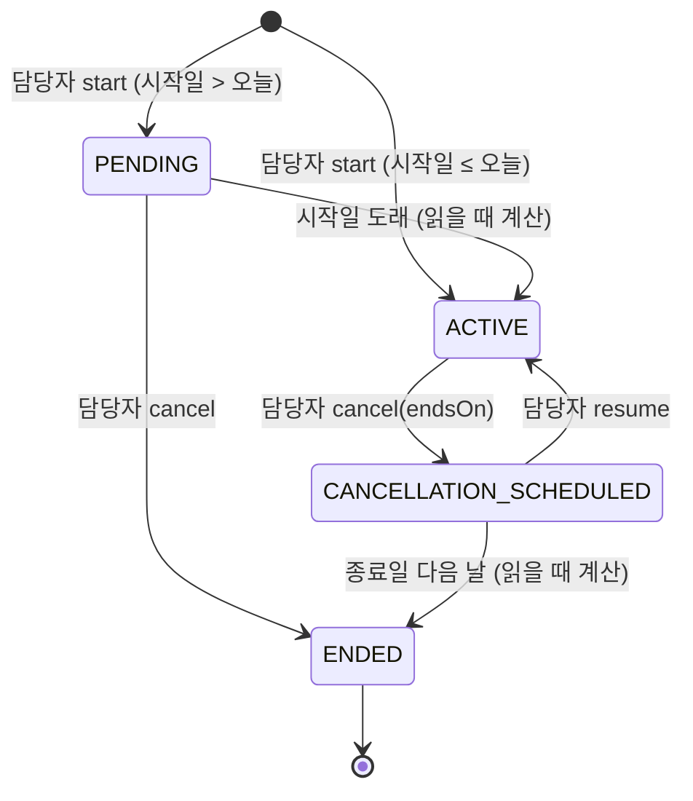
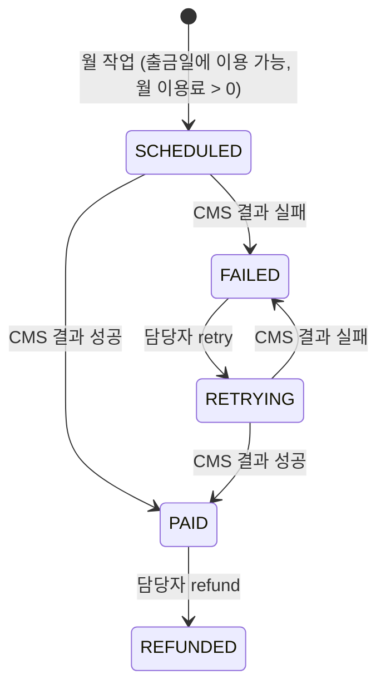
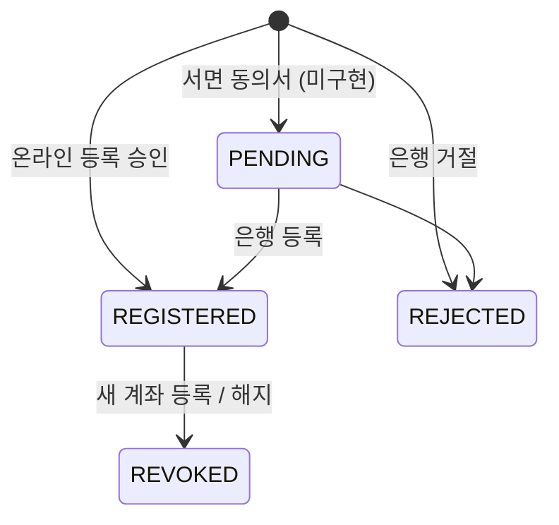
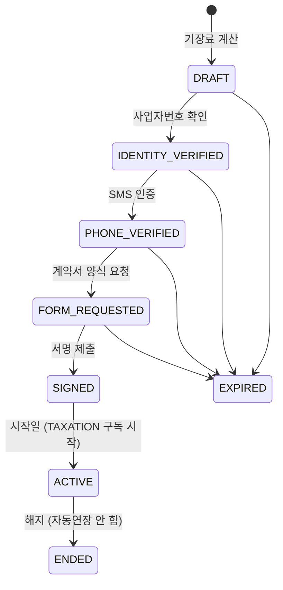

# Billing: 구독·결제·서비스 계약

유료 상품 구독, CMS 자동출금 동의(결제 수단), 정기결제, 세무 대리인과의 서비스 계약, 도입 문의(리드), 외부 파트너 연결을 맡습니다. 코드는 [`apps/api/src/modules/billing/`](../../apps/api/src/modules/billing/)입니다.

- **근거:** 서비스 및 결제 화면(spec §1.6, 매뉴얼 `08-설정/10`), 계약서 및 동의서 화면(§1.7, `08-설정/11`), 세무 수임 가입 흐름(§1.3), 엔티티 제안(§2.7, 2.8, 2.12, 2.13, 2.15), 상태(§3.3, 3.4), 레거시 서버(`legacy/src/modules/platform/billing/`)
- **규칙:** [subscription-entitlement](../reference/rules/subscription-entitlement.md), [payment-schedule](../reference/rules/payment-schedule.md). 결정은 [rule-decisions/billing.md](rule-decisions/billing.md)
- **플랜의 원본:** 회사가 쓸 수 있는 플랜(`TAXATION`, `PAYROLL`)은 이 컨텍스트의 구독 하나에서 계산합니다. Identity & Access는 토큰을 발급할 때 `CompanyPlans` 포트로 읽기만 합니다 ([identity-access.md](identity-access.md))

## 현행에서 고칠 점

| 현행 | 문제 | 재설계 |
|---|---|---|
| 플랜이 세 곳에 있음: 구독 목록 `isSubscribed`, `me.companies[].taxPlan`, sf 회사의 `tax_plan`·`has_payroll_plan` 캐시 | 갱신 누락으로 어긋남 (P3) | 구독이 유일한 원본. `/me`의 `company.plans`는 매 토큰 발급 때 구독에서 계산하고 캐시 열은 두지 않음 |
| `isFree`(유료 구독 없음)를 클라이언트가 계산, 모르는 코드가 오면 무료가 아님 | 프로모션·업셀 판정이 화면마다 갈림 (P1) | 서버가 "유료 플랜 없음"으로 정해 `/me`의 `promotions`로 줌. 상품은 enum이라 모르는 코드가 없음 |
| 매일 작업이 `pending→active`, `cancelled→ended`를 바꿔야 플랜이 바뀜 | 작업이 늦으면 시작일에 플랜이 없음 | 상태를 읽을 때 오늘 날짜로 다시 계산(`refreshedStatus`). 날짜로 정해지는 전이는 작업에 기대지 않음 |
| 구독 목록이 nexus `perm/subscription`과 sf `/nexus-api/.../subscriptions` 두 경로 | 같은 데이터를 sf가 프록시 (P3) | `GET /subscriptions` 하나 |
| 구독 변경 `PUT perm/subscription/:code`가 상태·날짜를 통째로 덮어씀 | 어떤 전이인지 경로에 안 드러남 | `POST /subscriptions`, `:cancel`, `:resume` 커맨드 |
| 고객 관리자도 회사 API 권한이 모두 있음 | 담당자 전용 동작(구독 변경, 결제 재시도)을 권한 문자열로 막을 수 없음 | 담당자 커맨드는 대리인 전용 권한(`subscription:manage`, `payment:retry`, `payment:refund`)으로 봄. 카탈로그의 `agentOnly`라 관리자의 `*`가 덮지 않고 대리인 기본 권한에만 있음 (D5) |
| 결제 내역이 DRF `limit/offset` 봉투, `isScheduled` 플래그, 숫자 ID | P4 | 커서 페이지, `status` enum 하나, `pay_` ID + 화면용 `number` |
| CMS 출금 동의가 로그인 없는 공개 API(`/public/api/alfred/withdrawal-consent`)로 사업자번호만 받아 회사에 붙음 | 남의 사업자번호로 계좌를 등록할 수 있음 (P5) | 로그인한 회사의 `POST /billing-mandates`. 비로그인 경로가 필요하면 담당자가 보낸 일회용 링크로만 (열린 질문 3) |
| 출금 계좌번호 원문을 암호화해 저장 | 저장할 이유가 없는 민감 정보 | 원문은 CMS 게이트웨이에만 넘기고 마스킹 값과 게이트웨이 참조만 저장 |
| 상담 신청이 회사명·사업자번호·`labelIds:[38\|27]`·동의 날짜를 클라이언트가 채움 | 숫자 라벨, 날짜 위조 가능 | 회사 정보는 토큰에서, 상품은 `products: [TAXATION]`, 동의는 `true`를 받고 날짜는 서버가 찍음 |
| 계약서가 `settings/company/:sfId/contract?name=수임계약서`처럼 한글 이름 쿼리 | P4 | `GET /service-contracts`, `type: BOOKKEEPING \| SOCIAL_INSURANCE_AGENCY` |
| 온라인 리드를 `?timestamp=`로 식별·갱신 | 추측 가능한 키로 남의 리드를 고침 | 리드 생성 응답의 ID와 편집 토큰으로 갱신 (미구현) |

## 용어

| 업무 용어 | 영문 | 설명 |
|---|---|---|
| 플랜 | `Plan` | `TAXATION`(세무 아웃소싱), `PAYROLL`(급여 아웃소싱). 상품과 1:1 |
| 무료 재무 프로그램 | free | 유료 플랜이 하나도 없는 상태. 상품이 아님 |
| 구독 | `Subscription` (`sub_`) | 회사의 상품 이용 기간. `startsOn` ~ `endsOn`(포함) |
| 해지 예약 | `CANCELLATION_SCHEDULED` | 종료일을 정해 둔 구독. 종료일까지 플랜 유지 (현행 `cancelled`) |
| 이용 가능 | `isEntitled` | 오늘 이 구독으로 플랜을 쓸 수 있는지 (현행 `isSubscribed`) |
| 결제 수단 | `BillingMandate` (`mdt_`) | CMS 자동출금 동의. 회사마다 `REGISTERED` 하나 |
| 결제 | `Payment` (`pay_`) | 월 이용료 출금 한 건. 화면용 결제 번호 `number`(비연속 가능) |
| 출금일 | `scheduledOn` | 매달 25일, 비영업일이면 다음 영업일 |
| 결과 반영일 | `resultExpectedOn` | 출금 다음 날 오후(CMS 결과 파일) |
| 서비스 계약 | `ServiceContract` (`svc_`) | 세무 대리인과의 기장 수임 계약, 4대보험 업무대행 동의 |
| 조정수수료 | `adjustmentFeeMonth` | 결산 조정료를 받는 달. 법인 3월, 개인 5월 |
| 도입 문의 | `Consultation` (`led_`) | 무료·부분 고객의 상품 도입 상담 신청(리드) |
| 담당자 | agency staff | 세무 대리인 직원. 구독 변경·결제 재시도·환불을 함 |

## 리소스

### 구독

```jsonc
// GET /v1/subscriptions → 200
{
  "items": [
    {
      "id": "sub_01J...",
      "plan": "PAYROLL",
      "status": "CANCELLATION_SCHEDULED",
      "isEntitled": true,
      "startsOn": "2025-01-01",
      "endsOn": "2026-12-31",
      "monthlyFee": 330000,
      "allowedActions": ["RESUME"],   // 담당자에게만. 고객은 항상 []
      "createdAt": "...",
      "version": 2
    }
  ]
}
```

- 상품 두 개뿐이라 페이지 없이 전체를 줍니다. 화면의 서비스 카드 3개(무료·세무·급여)는 이 목록과 `/me`의 `promotions`로 그립니다
- `status`와 `isEntitled`는 저장값이 아니라 오늘 날짜(회사 시간대)로 계산한 값입니다
- 같은 플랜의 끝나지 않은 구독은 하나뿐입니다. `monthlyFee`는 원 단위 VAT 포함이고 0이면 청구하지 않습니다
- 기장 구독은 근거가 된 `serviceContractId`를 가집니다. 구독을 시작할 때 그 계약이 같은 회사 것인지 확인하고, 아니면 404 `SERVICE_CONTRACT_NOT_FOUND`입니다

### 결제

```jsonc
// GET /v1/payments?limit=20 → 200
{
  "items": [
    {
      "id": "pay_01J...",
      "number": 1006,
      "plan": "PAYROLL",
      "amount": 330000,
      "scheduledOn": "2026-11-25",
      "status": "SCHEDULED",
      "resultExpectedOn": "2026-11-26",
      "account": { "bankCode": "088", "accountNumberMasked": "*********4321" },
      "allowedActions": [],
      "version": 1
    }
  ],
  "nextCursor": "..."
}
```

- 출금일 최신순 커서 페이지이고 `?status=`로 거릅니다
- 결제 내역에는 급여 아웃소싱(`PAYROLL`)만 보입니다(`LISTED_PAYMENT_PLANS`, 2025-12 매뉴얼 기준). 목록에 없는 결제는 상세도 404입니다
- `failureReason`: `INSUFFICIENT_BALANCE`, `ACCOUNT_CLOSED`, `MANDATE_NOT_REGISTERED`, `OTHER`
- 재시도는 같은 결제를 `RETRYING`으로 바꾸고 `scheduledOn`을 새 출금일로 옮깁니다. 결제 번호는 그대로입니다
- 결제 1일 전 알림톡(`noticeDate`)은 알림 컨텍스트가 결제 예정을 보고 보냅니다 (미구현)

### 결제 수단 (CMS 출금 동의)

```jsonc
// POST /v1/billing-mandates  Idempotency-Key: ...
{ "bankCode": "004", "accountNumber": "123-456-789012", "accountHolder": "세무 카페", "payerNumber": "1048145235" }
// → 201
{ "id": "mdt_01J...", "bankCode": "004", "accountNumberMasked": "********9012", "accountHolder": "세무 카페",
  "source": "ONLINE", "status": "REGISTERED", "createdAt": "...", "registeredAt": "..." }
```

- `payerNumber`는 예금주 생년월일 6자리 또는 사업자번호 10자리입니다. 계좌번호와 함께 저장하지 않습니다
- 은행이 받아들이면 이전 `REGISTERED`는 `REVOKED`가 됩니다. 거절되면 `REJECTED`로 남기고 422 `MANDATE_REJECTED`(`reason`)입니다
- 서면 동의서 업로드(`source: UPLOAD`, `PENDING`에서 시작)는 파일 업로드가 정해지면 붙입니다

### 서비스 계약

```jsonc
// GET /v1/service-contracts → 200 (TAXATION 고객만)
{ "items": [{ "id": "svc_01J...", "type": "BOOKKEEPING", "form": "ONLINE", "status": "ACTIVE",
  "monthlyFee": 350000, "adjustmentFeeMonth": 3, "startsOn": "2025-01-01", "termMonths": 12, "autoRenew": true,
  "signedAt": "...", "createdAt": "..." }] }
```

- 온라인 계약 본문(제1조…제5조)은 이 값으로 클라이언트가 렌더합니다. 실물 계약은 `documentFileId`
- 계약을 맺는 흐름(직접 계약·가입 초대 계약)은 [상태](#상태)의 제안이고 아직 구현하지 않았습니다

### 도입 문의

```jsonc
// POST /v1/consultations
{ "products": ["TAXATION"], "name": "김알프", "phone": "01012345678", "email": "cafe@semu.example",
  "memo": "...", "privacyConsent": true, "thirdPartyConsent": true }
// → 201 { "id": "led_01J...", "products": ["TAXATION"], "status": "NEW", ... }
```

- 회사 이름·사업자번호·개인/법인은 토큰의 회사로 정합니다. UTM 값은 공개 리드(`/leads`)에서만 받습니다
- 이미 구독 중인 상품만 문의하면 409 `PRODUCT_ALREADY_SUBSCRIBED`, 같은 상품의 진행 중 문의가 있으면 409 `CONSULTATION_ALREADY_OPEN`
- 개인정보 수집·제3자 제공 동의 일자는 접수일로 서버가 찍습니다

## 상태

### 구독



- 플랜 판정: `ACTIVE` 또는 `CANCELLATION_SCHEDULED`이고 `startsOn ≤ 오늘 ≤ endsOn` (`isEntitledOn`)
- 날짜 전이도 저장소에 반영하려면 매일 작업이 `refreshedStatus`로 덮어쓰면 됩니다. 판정은 작업 여부와 상관없이 같습니다

### 결제



### 결제 수단



### 서비스 계약 (제안, 미구현)



지금 구현은 `ACTIVE`·`ENDED`만 저장하고 읽습니다.

## 커맨드와 엔드포인트

| 동사 | 경로 | 권한 | 플랜 | 비고 |
|---|---|---|---|---|
| GET | `/subscriptions` | `subscription:read` | – | |
| GET | `/subscriptions/{subscriptionId}` | `subscription:read` | – | `ETag` |
| POST | `/subscriptions` | `subscription:manage` + 담당자 | – | 201 |
| POST | `/subscriptions/{subscriptionId}:cancel` | `subscription:manage` + 담당자 | – | `{endsOn}`, `If-Match` |
| POST | `/subscriptions/{subscriptionId}:resume` | `subscription:manage` + 담당자 | – | `If-Match` |
| GET | `/payments` | `payment:read` | – | 커서, `?status=` |
| GET | `/payments/{paymentId}` | `payment:read` | – | `ETag` |
| POST | `/payments/{paymentId}:retry` | `payment:retry` + 담당자 | – | `{retryOn?}`, `Idempotency-Key`, `If-Match` |
| POST | `/payments/{paymentId}:refund` | `payment:refund` + 담당자 | – | `Idempotency-Key`, `If-Match` |
| GET | `/billing-mandates` | `billing-mandate:read` | – | |
| POST | `/billing-mandates` | `billing-mandate:create` | – | `Idempotency-Key` |
| POST | `/consultations` | `consultation:create` | – | 기본 권한 |
| GET | `/service-contracts` | `service-contract:read` | `TAXATION` | |
| GET | `/service-contracts/{serviceContractId}` | `service-contract:read` | `TAXATION` | |

HTTP로 열지 않는 작업(`Payments` 서비스):

| 작업 | 시점 | 멱등성 |
|---|---|---|
| `scheduleMonth(month)` | 매달 출금일 며칠 전 | 같은 구독·출금일이면 만들지 않음 |
| `recordWithdrawal(paymentId, result)` | CMS 결과 파일 수신 (출금 다음 날 오후) | 이미 반영된 결과는 그대로 둠 |

## 오류 코드

| 코드 | 상태 | 뜻 |
|---|---:|---|
| `SUBSCRIPTION_NOT_FOUND` | 404 | 구독이 없거나 다른 회사의 것 |
| `SUBSCRIPTION_ALREADY_EXISTS` | 409 | 같은 플랜의 끝나지 않은 구독이 있음 (`subscriptionId`) |
| `SUBSCRIPTION_TRANSITION_INVALID` | 409 | 지금 상태에서 할 수 없는 커맨드 (`currentStatus`) |
| `SUBSCRIPTION_END_DATE_INVALID` | 422 | 종료일이 오늘이나 시작일보다 앞섬 |
| `PAYMENT_NOT_FOUND` | 404 | 결제가 없거나 결제 내역에 보이지 않는 상품 |
| `PAYMENT_TRANSITION_INVALID` | 409 | 재시도는 `FAILED`만, 환불은 `PAID`만 (`currentStatus`). 현행 `INVALID_TRANSITION` |
| `RETRY_DATE_INVALID` | 422 | 재시도 출금일이 과거 |
| `MANDATE_REJECTED` | 422 | 은행이 계좌를 거절 (`mandateId`, `reason`) |
| `CONSULTATION_ALREADY_OPEN` | 409 | 같은 상품의 진행 중 문의가 있음 (`consultationId`) |
| `PRODUCT_ALREADY_SUBSCRIBED` | 409 | 문의한 상품을 모두 이미 구독 중 (`products`) |
| `SERVICE_CONTRACT_NOT_FOUND` | 404 | 계약이 없거나 다른 회사의 것 |

공통: 401 `UNAUTHENTICATED`, 403 `PERMISSION_DENIED`·`ENTITLEMENT_REQUIRED`·`TERMS_REAGREEMENT_REQUIRED`, 412 `VERSION_MISMATCH`, 428 `IDEMPOTENCY_KEY_REQUIRED`.

## 포트와 이벤트

| 포트 | 방향 | 모양 | 메모리 구현 |
|---|---|---|---|
| `CompanyPlans` (Identity & Access 선언) | Billing이 구현 | `plansOf(companyId): Effect<ReadonlySet<Plan>>` | `SubscriptionCompanyPlansLive` (구독 저장소에서 계산) |
| `CmsGateway` | Billing 선언 | `registerAccount({bankCode, accountNumber, accountHolder, payerNumber}): Effect<{accepted: true, reference} \| {accepted: false, reason}>` | `layerFake`: 계좌번호가 `0000`으로 끝나면 `ACCOUNT_NOT_FOUND` |
| `PublicHolidays` | Billing 선언 | `all(): Effect<ReadonlySet<string>>` | 2026년 공휴일·대체공휴일 |

이벤트 (제안, 미구현):

| 이벤트 | 내용 | 받는 쪽 |
|---|---|---|
| `billing.subscription.changed` | `{companyId, plans}` | Identity & Access: 해당 회사 access token 무효화(`invalidateAccess`). 지금은 다음 토큰 갱신(최대 10분) 때 반영 |
| `billing.payment.scheduled` | `{paymentId, companyId, amount, scheduledOn}` | 알림: D-1 알림톡 |
| `billing.payment.failed` | `{paymentId, companyId, failureReason}` | 알림: 고객·담당자 안내 |
| `billing.service-contract.signed` | `{serviceContractId, companyId, startsOn, monthlyFee}` | Billing 자신: `TAXATION` 구독 시작 |

## 현행 엔드포인트 대응

번호는 [spec platform.md §5](../reference/spec/platform.md#5-엔드포인트-표)입니다. 회사 ID 접두(`/api/company/:cid`)는 모두 토큰으로 대신합니다.

| # | 현행 | 재설계 | 비고 |
|---|---|---|---|
| 21 | GET `/api/external/validate_payload` | `GET /partner-links:preview` (미구현) | 파트너 payload JWT 검증. `PartnerAuth` 포트 |
| 22 | GET `/api/external/company_system_admin_list` | `:preview` 응답의 `adminEmailsMasked` (미구현) | 별도 엔드포인트 없앰 |
| 23 | POST `/api/external/attach` | `POST /partner-links` (미구현) | 파트너 API key + 로그인한 사용자. 비밀번호를 파트너가 받지 않음 |
| 24 | POST `/api/external/join-company` | `POST /partner-links:register-company` (미구현) | 회사 생성은 Identity & Access `POST /companies`를 부름 |
| 25 | POST `/public/api/consult` | `POST /leads` (미구현) | 비로그인 공개 리드. UTM 포함 |
| 26 | POST `/public/api/alfred/withdrawal-consent` | `POST /billing-mandates` | 로그인 필요로 바꿈. 비로그인은 일회용 링크 (열린 질문 3) |
| 34 | GET `/api/join/signup-invitations/:token/existence/` | Identity & Access 초대 (`/invitations:preview`) | 가입 초대는 Identity & Access 소관 |
| 35 | POST `/api/join/signup-invitations/` | Identity & Access 초대 | 같음 |
| 36 | POST `/api/join/contracts/:signupSession/` | `POST /service-contracts/{id}:sign` (미구현) | 가입 초대에 붙은 기장 계약 동의 |
| 37 | POST `/api/join/direct-contract/calculate-fee/` | `POST /service-contracts:quote` (미구현) | 공개, 기장료 계산 |
| 38 | GET `/api/join/direct-contract/:contractId/:businessNumber/` | `POST /service-contracts/{id}:verify-business` (미구현) | 사업자번호를 경로에 두지 않음 |
| 39 | POST `/api/join/direct-contract/send-sms/:contractId/` | `POST /service-contracts/{id}:send-verification` (미구현) | `Idempotency-Key` |
| 40 | POST `/api/join/direct-contract/verify-sms/:contractId/` | `POST /service-contracts/{id}:verify-phone` (미구현) | |
| 41 | POST `/api/join/direct-contract/request-contract-form/:contractId/` | `POST /service-contracts/{id}:request-form` (미구현) | |
| 42 | POST `/api/join/direct-contract/sign-contract/:contractId/` | `POST /service-contracts/{id}:sign` (미구현) | 서명 후 `TAXATION` 구독 시작 |
| 43 | POST `/api/lead/online?timestamp=` | `POST /leads` (미구현) | `timestamp` 키 대신 ID + 편집 토큰 |
| 44 | PATCH `/api/lead/online?timestamp=` | `PATCH /leads/{leadId}` (미구현) | 편집 토큰 필요 |
| 71 | GET `/api/company/:cid/perm/subscription/` | `GET /subscriptions` | `isSubscribed` → `isEntitled`, 플랜은 `/me` |
| 72 | POST `/api/company/:cid/consult/` | `POST /consultations` | `labelIds` → `products` |
| 73 | GET `/api/company/:cid/payment/` | `GET /payments` | 커서 페이지, `isScheduled` → `status` |
| 74 | GET `/nexus-api/company/:cid/subscriptions/` | `GET /subscriptions` | 프록시 없앰 |
| 78 | GET `/api/settings/company/:sid/attachments/?name=CMS동의서` | `GET /billing-mandates` | 나머지 첨부(사업자등록증 등)는 회사 문서 (열린 질문 5) |
| 79 | PUT `/api/settings/company/:sid/attachments/` (`CMS동의서`) | `POST /billing-mandates` `source: UPLOAD` (미구현) | 파일 업로드 정해지면 |
| 80 | GET `/api/settings/company/:sid/attachments_form/` | 정적 양식 파일 (미구현) | 열린 질문 5 |
| 81 | GET `/api/settings/company/:sid/contract/?name=수임계약서\|4대보험대행동의약관` | `GET /service-contracts` | `type`으로 구분 |
| – | 레거시 PUT `/api/company/:cid/perm/subscription/:code` | `POST /subscriptions`, `:cancel`, `:resume` | 담당자 전용 |
| – | 레거시 POST `/api/company/:cid/payment/:paymentId/retry` | `POST /payments/{paymentId}:retry` | 담당자 전용, 같은 결제를 재시도 |
| – | (없음) 레거시 `runBillingCycle`, CMS 결과 반영 | `Payments.scheduleMonth`, `recordWithdrawal` | 작업, HTTP 아님 |

## 구현 상태

| 범위 | 상태 |
|---|---|
| 구독 조회·담당자 커맨드, `CompanyPlans` 구현 | 구현, HTTP 테스트 |
| 결제 조회·재시도·환불, 월 결제 예정 생성, 출금 결과 반영 | 구현. 작업 두 개는 서비스 테스트만 |
| 결제 수단 온라인 등록·조회 | 구현. 서면 동의서 업로드 미구현 |
| 도입 문의(로그인) | 구현. 담당자 배정·알림톡 미구현 |
| 서비스 계약 조회 | 구현. 계약 체결 흐름(#36-42) 미구현 |
| 공개 리드(#25, 43, 44), 파트너 연결(#21-24) | 미구현 |
| `Idempotency-Key` | 필수 검사만. 같은 키 재요청 재생은 공유 저장소가 필요해 미구현 |
| 이벤트 발행 | 미구현 |

## 열린 질문

1. 구독은 누가 바꾸는가: 데스크 담당자 수동, 계약 서명 자동, 결제 실패 연속 시 자동 해지 중 무엇이 있는지 확인이 필요합니다. 지금은 담당자 커맨드만 둡니다
2. 출금일 25일은 레거시 제안값입니다. 계약별 출금일이 있으면 서비스 계약에 둡니다
3. CMS 출금 동의를 가입 전(로그인 없이) 받아야 하는 흐름이 있는지. 있다면 담당자가 보낸 일회용 링크 토큰으로만 받습니다
4. 세무 아웃소싱(기장료)도 CMS로 걷는지. 지금은 결제 내역에서 급여 아웃소싱만 보여 줍니다
5. 기장 서비스 자료 첨부(사업자등록증, 4대보험 대행동의서, 이전세무자료)의 소유 컨텍스트. 권한 카탈로그의 `company-document:*`를 Billing에 둘지 Identity & Access(회사)에 둘지 정해야 합니다
6. 환불이 부분 환불일 수 있는지, 월 중간 시작·종료의 일할 계산이 있는지
7. 구독 변경을 바로 반영하려면 `billing.subscription.changed`로 access token을 무효화해야 합니다. 10분 지연을 받아들일지
8. 파트너(쿼타북·오버택스 등)별 연결 범위와 키 관리
