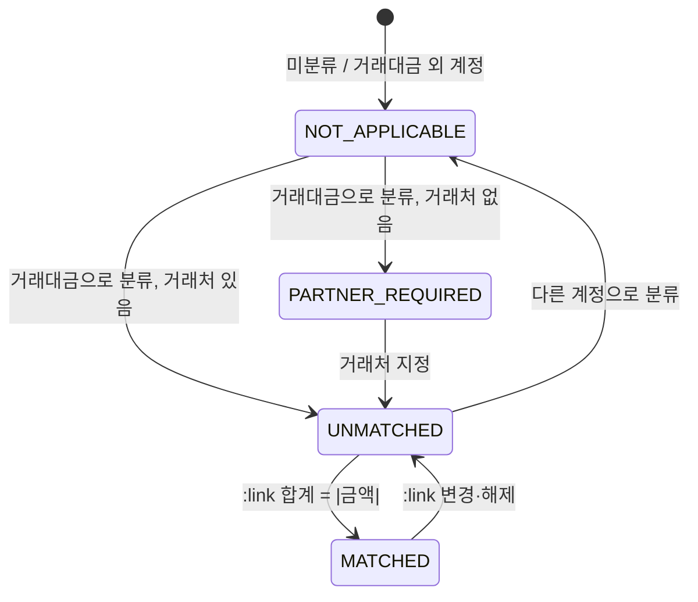
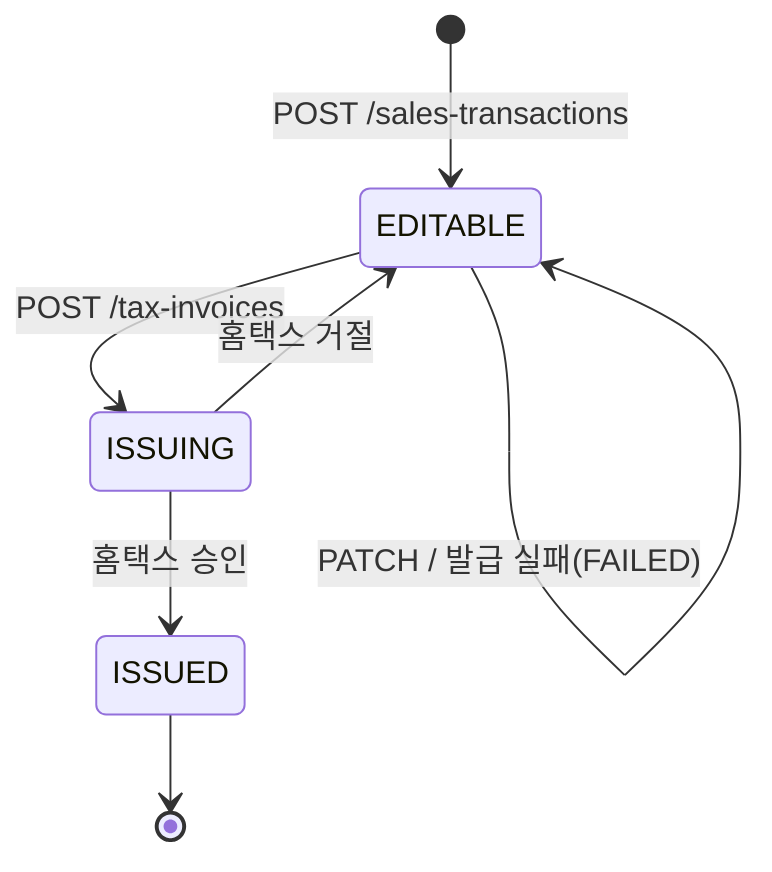
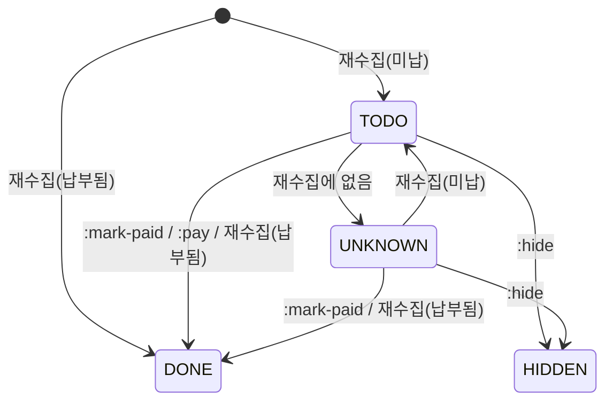

# Bookkeeping: 증빙·입출금·거래처·실시간 보고서

수집한 매출·매입 증빙과 입출금을 계정과목으로 분류하고, 거래처와 맞춰 실시간 손익·자금을 보여 줍니다. 세금계산서 발급과 지로 납부도 여기서 합니다. 세무 결산 보고서와 예상 부가세 계산은 Tax 몫이고, Bookkeeping은 그 재료(분류된 증빙)를 공개 계약으로 엽니다.

수집(스크래핑) → 반영(`ScrapedRecordIngestion`) → 자동분류 → 사람이 확인·정정 → 증빙 연결 → 실시간 보고서.

## 현행에서 고칠 점

- **매출·매입이 경로 변수입니다.** `/evidence/:side`가 테이블 이름을 그대로 노출하고, 일괄 분류도 `bulk-classify`처럼 동사 경로입니다. 재설계는 `/evidence` 하나에 `side` 필터를 두고 커맨드는 `:classify`·`:batchClassify`로 씁니다
- **증빙 연결 상태를 컬럼에 저장합니다.** 분류·거래처·연결이 바뀔 때마다 다시 계산해야 하고 빠뜨리면 화면이 틀립니다. 재설계는 읽을 때 계산합니다
- **검증이 첫 위반 하나만 문장으로 돌려줍니다.** 규칙 조건, 거래명세서 합계 모두 그렇습니다. 재설계는 422 `violations`·`problems`에 모두 담습니다
- **수집 묶음 하나가 DB 제약에 걸리면 전체가 되돌아갑니다.** 금액 없는 매출 증빙, 매입으로 온 PG 증빙이 그렇습니다. 재설계는 그 레코드만 거절하고 인덱스와 이유를 돌려줍니다
- **날짜를 UTC로 자릅니다.** 카드 승인 날짜와 사업자 상태조회 캐시가 `slice(0, 10)`이라 한국 시간 새벽이 전날이 됩니다. 재설계는 회사 시간대 날짜를 씁니다
- **홈 부가세 기한이 근사입니다.** 다음 달 25일을 주말·공휴일 보정 없이 씁니다. 재설계는 Tax의 세무 일정을 받습니다
- **멱등 키가 본문에 있습니다.** 지로 납부의 `request_id`는 선택이고, 세금계산서 발급에는 없습니다. 재설계는 둘 다 `Idempotency-Key` 헤더(필수, 없으면 428)입니다
- **잠금과 동시성 검사가 없습니다.** 재설계는 단건 리소스에 `ETag`를 주고, `If-Match`를 보내면 버전이 다를 때 412로 막습니다

## 용어

| 업무 용어 | 키 |
|---|---|
| 매출·매입 증빙 | `Evidence` (`side: SALES | PURCHASE`) |
| 증빙 원천 | `source`: `TAX_INVOICE`, `CASH_RECEIPT`, `CARD`, `PG`, `MALL`, `DELIVERY` |
| 계정과목 | `AccountTitle` (기본 `SYSTEM`, 회사 `COMPANY`, 자동 `AUTO_ETC`) |
| 적용 범위 | `appliesTo`: `SALES`, `PURCHASE`, `DEPOSIT`, `WITHDRAWAL` |
| 손익 구분 | `plCategory`: `REVENUE`, `COGS`, `SGA`, `NON_OPERATING_INCOME`, `NON_OPERATING_EXPENSE`, `INCOME_TAX`, `NONE` |
| 분류 | `classification { accountTitleId, method: MANUAL | RULE, ruleId }` |
| 자동분류 규칙 | `ClassificationRule` (`scope: SALES | PURCHASE | BANK`) |
| 계좌 / 입출금 | `BankAccount` / `BankTransaction` (`direction: DEPOSIT | WITHDRAWAL`) |
| 일별 잔액 | `BalanceSnapshot` (`source: SCRAPED | DERIVED`) |
| 증빙 연결 | `settlement { status, linkedAmount, links }` |
| 거래처 | `Partner` |
| 미정산 금액 | `outstanding { salesAmount, purchaseAmount }` |
| 거래명세서 | `SalesTransaction` |
| 전자세금계산서 발급 | `TaxInvoice` |
| 지로 고지서 | `Giro` |
| 수집 키 | `externalKey` |

## 증빙

### 리소스

| 메서드 | 경로 | 권한 | 설명 |
|---|---|---|---|
| GET | `/v1/evidence` | `evidence:read` | 목록. `side`, `source`, `from`, `to`, `partnerId`, `search`, `classification`, 커서 |
| GET | `/v1/evidence::count` | `evidence:read` | 같은 필터의 전체·분류·미분류 건수 |
| GET | `/v1/evidence/{evidenceId}` | `evidence:read` | 단건 + `ETag` |
| PATCH | `/v1/evidence/{evidenceId}` | `evidence:update` | 메모(200자)·공제 여부(매입)·거래처. `If-Match` |
| POST | `/v1/evidence/{evidenceId}:classify` | `evidence:classify` | 계정과목(`null`이면 미분류로)·거래처. `MANUAL`로 기록. `If-Match` |
| POST | `/v1/evidence:batchClassify` | `evidence:classify` | 최대 500건을 같은 계정으로 |

- 증빙은 수집으로만 생깁니다. 만들기·지우기 엔드포인트가 없습니다
- 금액은 `amounts { supplyAmount, vatAmount, totalAmount }`로 채워 주고, 합계에서 세액을 나눈 경우 `vatEstimated: true`입니다 ([evidence-amounts](../reference/rules/evidence-amounts.md))
- 계정과목은 증빙 쪽 범위(`SALES`·`PURCHASE`)에서 선택 가능한 것만 받습니다 ([account-title-constraints](../reference/rules/account-title-constraints.md))

## 계정과목

| 메서드 | 경로 | 권한 | 설명 |
|---|---|---|---|
| GET | `/v1/account-titles` | `account-title:read` | 기본 + 회사 계정 트리(평탄화, `depth`·`parentId`·`selectable`) |
| POST | `/v1/account-titles` | `account-title:create` | 하위 계정 추가. 201 `{ accountTitle, autoCreatedEtc, movedCount }` |
| PATCH | `/v1/account-titles/{accountTitleId}` | `account-title:update` | 이름·설명. 기본 계정은 409. `If-Match` |
| DELETE | `/v1/account-titles/{accountTitleId}?moveToId=` | `account-title:delete` | 분류된 거래·규칙을 `moveToId`로 옮기고 지움. `If-Match` |

- 기본 체계 54행은 코드(`system-account-titles.ts`)에 있고 ID가 고정입니다(`acc_` + 정렬 순서)
- 첫 하위 계정을 추가하면 `기타 {상위명}`을 만들어 기존 거래를 옮깁니다

## 자동분류 규칙

| 메서드 | 경로 | 권한 | 설명 |
|---|---|---|---|
| GET | `/v1/classification-rules?scope=&includeHidden=` | `classification-rule:read` | 우선순위 순 |
| POST | `/v1/classification-rules` | `classification-rule:create` | 맨 뒤 우선순위로 추가 |
| PATCH | `/v1/classification-rules/{ruleId}` | `classification-rule:update` | 이름·조건·결과·숨김(`status: ACTIVE | HIDDEN`). `If-Match` |
| DELETE | `/v1/classification-rules/{ruleId}` | `classification-rule:delete` | |
| POST | `/v1/classification-rules:reorder` | `classification-rule:update` | 범위의 규칙 ID 전체를 새 순서로. 빠지거나 남으면 422 |
| POST | `/v1/classification-rules/{ruleId}:apply` | `classification-rule:apply` | 한 규칙을 이전 거래에. 202 + Job |
| POST | `/v1/classification-rules:apply` | `classification-rule:apply` | 범위의 모든 활성 규칙을 이전 거래에. 202 + Job |

- 매칭·검증: [classification-rule-matching](../reference/rules/classification-rule-matching.md)
- 적용 모드 `FILL_EMPTY`·`OVERWRITE`, 사람이 분류한 행은 건너뜀: [classification-apply-mode](../reference/rules/classification-apply-mode.md)
- 입출금 규칙의 결과 계정은 `DEPOSIT` 또는 `WITHDRAWAL` 범위에서 선택 가능해야 합니다
- Job은 지금 동기로 끝나 `SUCCEEDED { examinedCount, updatedCount }`로 바로 옵니다. `/v1/jobs/{id}` 조회는 공유 리소스가 생기면 붙입니다

## 계좌와 입출금

### 리소스

| 메서드 | 경로 | 권한 | 설명 |
|---|---|---|---|
| GET | `/v1/bank-accounts` | `bank-account:read` | 계좌번호는 마스킹(끝 6자리) |
| GET | `/v1/bank-accounts::summary` | `bank-account:read` | 활성 계좌 수, 총 자산(종류별), 총 부채(대출) |
| PATCH | `/v1/bank-accounts/{bankAccountId}` | `bank-account:update` | 별칭(30자)·자금 현황 포함(`cashReport`). `If-Match` |
| GET | `/v1/bank-accounts/{bankAccountId}/balances?from&to` | `bank-account:read` | 일별 마감 잔액 |
| GET | `/v1/bank-transactions` | `bank-transaction:read` | 필터: 계좌, 구분, 기간, 분류, 증빙 연결 상태, 검색 |
| GET | `/v1/bank-transactions/{bankTransactionId}` | `bank-transaction:read` | `settlement` 포함 |
| PATCH | `/v1/bank-transactions/{bankTransactionId}` | `bank-transaction:update` | 메모(50자)·거래처. `If-Match` |
| POST | `/v1/bank-transactions/{bankTransactionId}:classify` | `bank-transaction:classify` | `If-Match` |
| POST | `/v1/bank-transactions:batchClassify` | `bank-transaction:classify` | |
| POST | `/v1/bank-transactions/{bankTransactionId}:link` | `bank-transaction:update` | 증빙 연결 전체 교체(빈 배열 = 해제). `If-Match` |

- 잔액 스냅샷: [bank-balance-snapshot](../reference/rules/bank-balance-snapshot.md)
- 증빙 연결 상태와 검사: [settlement-match-status](../reference/rules/settlement-match-status.md)

### 증빙 연결 상태



저장하지 않고 읽을 때 계산하므로 전이는 분류·거래처·연결의 결과입니다.

## 거래처

| 메서드 | 경로 | 권한 | 설명 |
|---|---|---|---|
| GET | `/v1/partners` | `partner:read` | 검색(이름·대표자·사업자번호·메모), 미정산 금액 포함 |
| POST | `/v1/partners` | `partner:create` | 같은 사업자번호의 증빙을 이 거래처에 잇습니다 |
| GET | `/v1/partners/{partnerId}` | `partner:read` | 계좌·담당자·미정산 |
| PATCH | `/v1/partners/{partnerId}` | `partner:update` | `If-Match` |
| DELETE | `/v1/partners/{partnerId}` | `partner:delete` | 소프트 삭제. `If-Match` |

- 사업자번호는 회사 안에서 유일합니다(409 `PARTNER_BUSINESS_NUMBER_DUPLICATE`, 기존 `partnerId` 포함)
- 증빙·입출금·자동분류 규칙·거래명세서에 넣는 `partnerId`는 같은 회사의 지우지 않은 거래처여야 합니다. 아니면 404 `PARTNER_NOT_FOUND`입니다
- 거래처 계좌번호는 `AccountNumberCipher`로 암호화해 저장하고 마스킹해 돌려줍니다
- 미정산: [partner-outstanding-amount](../reference/rules/partner-outstanding-amount.md)
- 상태조회 캐시: [business-status-cache](../reference/rules/business-status-cache.md)

## 거래명세서와 세금계산서 발급

### 상태



| 커맨드 | 허용 상태 | 결과 |
|---|---|---|
| `PATCH`, `DELETE /sales-transactions/{id}` | `EDITABLE` | 아니면 409 `SALES_TRANSACTION_LOCKED { lock }` |
| `POST /tax-invoices` | `EDITABLE` | 성공 201, 거절 422 `TAX_INVOICE_REJECTED` (실패 기록은 남음) |
| `POST /tax-invoices/{id}:sync` | `ISSUED` | 홈택스 상세 동기화 표시 |

### 리소스

| 메서드 | 경로 | 권한 | 설명 |
|---|---|---|---|
| GET | `/v1/sales-transactions` | `sales-transaction:read` | `issueStatus`, 품목 요약(`첫 품목 외 N건`) |
| POST | `/v1/sales-transactions` | `sales-transaction:create` | 합계 검증 422 `SALES_STATEMENT_INVALID { problems }` |
| GET | `/v1/sales-transactions/{salesTransactionId}` | `sales-transaction:read` | 발급 이력 포함 |
| PATCH | `/v1/sales-transactions/{salesTransactionId}` | `sales-transaction:update` | `If-Match` |
| DELETE | `/v1/sales-transactions/{salesTransactionId}` | `sales-transaction:delete` | `If-Match` |
| POST | `/v1/tax-invoices` | `tax-invoice:issue` | `{ salesTransactionId }` + `Idempotency-Key` |
| GET | `/v1/tax-invoices?salesTransactionId=` | `tax-invoice:read` | |
| GET | `/v1/tax-invoices/{taxInvoiceId}` | `tax-invoice:read` | 발급 시점 명세서 스냅샷 |
| POST | `/v1/tax-invoices/{taxInvoiceId}:sync` | `tax-invoice:read` | |

- 합계 검증과 잠금: [sales-statement-totals](../reference/rules/sales-statement-totals.md)
- `Idempotency-Key`는 [공통 규칙](conventions.md#멱등성)을 따릅니다. 키는 회사·행위자마다 따로이고 24시간 동안 기억합니다
  - 같은 키·같은 명세서면 처음 응답(201)을 그대로 돌려줍니다. 그 뒤 `:sync`로 발급 건이 바뀌었어도 재생은 처음 응답입니다. 다른 명세서에 쓰면 422 `IDEMPOTENCY_KEY_REUSED`, 앞 요청이 처리 중이면 409 `IDEMPOTENCY_KEY_IN_PROGRESS`(메모리 저장소)입니다
  - 홈택스가 거절하면 `FAILED` 발급 건은 남기고 키는 남기지 않습니다. 명세서를 고쳐 같은 키로 다시 보내면 새로 발급합니다(이전에는 같은 키가 거절을 재생했습니다)
  - 발급 결과를 확인하지 못하면(연동 결함·시간 초과) 503 `EXTERNAL_OUTCOME_UNKNOWN`입니다. `ISSUING` 발급 건이 남아 명세서를 잠그므로(`SALES_TRANSACTION_LOCKED`, `lock: ISSUING`) 수정은 막힙니다
  - 그 명세서로 오는 발행 요청은 사용자·키와 상관없이 `ISSUING` 발급 건에 저장한 참조로 홈택스에 다시 물어 `ISSUED`(증빙 포함)나 `FAILED`로 마치고, 그 결과를 응답합니다. 그래서 처음 요청한 사람이 돌아오지 않아도 명세서가 풀리고, 새 발급 건을 만들지 않으므로 두 번 발급되지 않습니다. 메모리 저장소에서 같은 발급 건을 지금 다른 요청이 홈택스에 보내는 중이면 409 `SALES_TRANSACTION_LOCKED`(`lock: ISSUING`)입니다
  - 처음 키의 재시도는 자기 참조의 발급 건을 상태와 상관없이 찾습니다. 이미 다른 요청이 마쳤으면 그 결과(`ISSUED` 응답이나 422 `TAX_INVOICE_REJECTED`)를 받고, `ISSUED`로 저장한 뒤 증빙을 만들다 멈췄으면 빠진 매출 증빙을 만들어 마칩니다. 그 경우 다른 키의 요청은 `ISSUED` 잠금(409)을 받으므로, 증빙은 처음 키가 재시도할 때 생깁니다
  - 결과를 모르는 기록(`UNCERTAIN`)은 24시간이 지나도 만료하지 않습니다([공통 규칙](conventions.md#멱등성)). 며칠 뒤 같은 키로 보내도 같은 참조로 이어 갑니다. `:sync`는 읽기 권한이라 발급을 마치지 않습니다
  - 홈택스에는 클라이언트 키 대신 시도마다 만든 멱등 참조를 넘기고, 발급 건의 `idempotencyKey`에 그 참조를 둡니다(이 규칙 이전 행은 키 원문). 요청 기록은 `bookkeeping_idempotency_keys` 표(`BookkeepingIdempotency`)에 지로 납부와 함께 둡니다
- 발급에 성공하면 승인번호를 수집 키로 매출 `TAX_INVOICE` 증빙을 바로 만들고 `salesTransactionId`로 잇습니다. 나중에 홈택스 수집이 같은 승인번호로 오면 그 증빙을 덮어씁니다

## 지로 고지서

### 상태



| 커맨드 | 허용 상태 | 완료 이유 |
|---|---|---|
| `:mark-paid` | `TODO`, `UNKNOWN` | `MARKED_BY_USER` (수동 완료) |
| `:hide` | `TODO`, `UNKNOWN` | |
| `:pay` | `TODO` | `PAID_IN_APP` |

허용하지 않으면 409 `GIRO_TRANSITION_INVALID`입니다. 응답의 `allowedCommands`가 보낼 수 있는 커맨드입니다. 규칙 전체: [giro-status-transitions](../reference/rules/giro-status-transitions.md)

### 리소스

| 메서드 | 경로 | 권한 | 설명 |
|---|---|---|---|
| GET | `/v1/giros?status=` | `giro:read` | |
| GET | `/v1/giros::summary` | `giro:read` | 납부 필요 건수·금액, 확인 필요 건수 |
| GET | `/v1/giros/{giroId}` | `giro:read` | 이력 포함 |
| POST | `/v1/giros/{giroId}:mark-paid` | `giro:update` | 메모. `If-Match` |
| POST | `/v1/giros/{giroId}:hide` | `giro:update` | 메모. `If-Match` |
| POST | `/v1/giros/{giroId}:pay` | `giro:pay` | 출금 계좌·비밀번호·금액 + `Idempotency-Key`. 실패 422 `GIRO_PAYMENT_FAILED { resultCode }` |

- `Idempotency-Key`는 [공통 규칙](conventions.md#멱등성)을 따릅니다. 같은 키·같은 본문이면 처음 응답(과 같은 `ETag`)을 돌려주고 다시 출금하지 않습니다. 본문이 다르면 422 `IDEMPOTENCY_KEY_REUSED`, 앞 요청이 처리 중이면 409 `IDEMPOTENCY_KEY_IN_PROGRESS`(메모리 저장소)입니다
  - 본문 지문은 고지서·은행·계좌 끝 4자리로 만듭니다. 비밀번호와 계좌번호 전체는 지문에도 남기지 않습니다
  - 금융결제원이 거절하면 납부 시도(`FAILED`)와 고지서 이력(`PAYMENT_FAILED`)은 남기고 키는 남기지 않습니다. 비밀번호를 고쳐 같은 키로 다시 보내면 새로 납부를 요청합니다(이전에는 같은 키가 거절을 재생했습니다)
  - 납부 결과를 확인하지 못하면 503 `EXTERNAL_OUTCOME_UNKNOWN`이고 고지서는 `TODO`로 남습니다. 같은 키·같은 본문의 재시도는 같은 멱등 참조로 금융결제원에 다시 물어 이중 출금 없이 마칩니다. 이 기록(`UNCERTAIN`)은 24시간이 지나도 만료하지 않으므로 며칠 뒤 같은 키로 보내도 새로 출금하지 않습니다
  - **다른 키로 보내면 새 납부라 막지 못합니다.** 게이트웨이를 부르기 전에 `PENDING` 납부 시도를 저장해 막는 것은 [열린 질문](conventions.md#멱등성)입니다
  - 결과를 모르는 납부를 이어 갈 때 고지서가 이미 `TODO`가 아니면(수동 완료·재수집) 409 `GIRO_TRANSITION_INVALID`이고 그 기록을 지웁니다
  - 납부 게이트웨이에는 클라이언트 키 대신 시도마다 만든 멱등 참조를 넘기고, 납부 시도 ID도 그 참조입니다. 이 규칙 이전의 납부 시도(ID `<고지서>:<키>`)는 재생에 쓰지 않습니다. 그때 납부된 고지서는 `DONE`이라 같은 키가 와도 409 `GIRO_TRANSITION_INVALID`입니다
- 계좌 비밀번호는 포트로 한 번 넘기고 저장하지 않습니다

## 실시간 보고서

| 메서드 | 경로 | 권한 | 플랜 | 설명 |
|---|---|---|---|---|
| GET | `/v1/reports/realtime-pl?year&cumulative` | `report:read` | | 월별 손익, 줄별 내역, 미분류 건수 |
| GET | `/v1/reports/cash-status?date` | `report:read` | | 하루 자금 흐름, 계정과목별·자금 분류별 묶음 |
| GET | `/v1/reports/home-summary?date` | `report:read` | | 이번 달 손익, 어제 자금, 예상 부가세, 남은 지로 |
| GET | `/v1/reports/labor-cost?year` | `settlement-report:read` | `TAXATION` | Payroll 인건비를 그대로 실음 |

- 손익: [realtime-pl-inclusion](../reference/rules/realtime-pl-inclusion.md). 정책은 공급가액·입출금 포함 고정
- 자금: [cash-status-other-change](../reference/rules/cash-status-other-change.md)
- 홈 부가세 기한: [vat-due-date-approximation](../reference/rules/vat-due-date-approximation.md)
- 결산 기반 세무 보고서(재무상태표·손익계산서·현금흐름·미수미지급)는 Tax가 맡습니다. 인건비만 Payroll 데이터라 여기 둡니다

## 수집 반영 (Integrations → Bookkeeping)

HTTP 엔드포인트가 아니라 공개 서비스입니다. Integrations는 `bookkeeping.public.ts`만 import합니다.

```ts
class ScrapedRecordIngestion extends Context.Service<ScrapedRecordIngestion, {
  ingest(companyId: Id<'company'>, records: ReadonlyArray<ScrapedRecord>): Effect.Effect<IngestionResult>
}>
// ScrapedRecord = ScrapedEvidence | ScrapedCardApproval | ScrapedBankAccount | ScrapedBankTransaction
//               | ScrapedBankBalance | ScrapedGiroBills
// IngestionResult = { insertedCount, updatedCount, rejected: [{ index, reason }], classifiedCount }
```

- **멱등**: 증빙은 `(회사, 원천, externalKey)`, 계좌는 `(회사, 은행, 계좌번호 다이제스트)`, 거래는 `(계좌, externalKey)`, 지로는 전자납부번호로 덮어씁니다. 다시 와도 분류·거래처·메모는 지킵니다
- **순서**: 계좌 먼저, 나머지는 보낸 순서
- **거절**: `DATE_INVALID`, `AMOUNTS_MISSING`, `SOURCE_SIDE_MISMATCH`, `BANK_ACCOUNT_UNKNOWN`, `EXTERNAL_KEY_MISSING`. 나머지 레코드는 반영합니다
- **후처리**: 사업자번호로 거래처 연결 → 닿은 날의 `DERIVED` 스냅샷 → 지로 전체 갱신 → 새 행에 `FILL_EMPTY` 자동분류
- 계좌번호 원문은 `accountNumberDigest(bankCode, accountNumber)`로 찾고 `AccountNumberCipher`로 암호화해 둡니다
- 규칙: [scraped-record-ingestion](../reference/rules/scraped-record-ingestion.md)

## 다른 컨텍스트와의 계약

### Tax가 읽는 것 (예상 부가세)

```ts
class VatEvidenceQuery extends Context.Service<VatEvidenceQuery, {
  forPeriod(companyId: Id<'company'>, period: { start: string; end: string }): Effect.Effect<VatEvidence>
}>
// VatEvidence = { sales: VatSalesEvidence[], purchases: VatPurchaseEvidence[], lastSyncedAt: string | null }
// VatSalesEvidence = { evidenceId, source, writtenOn, issuedOn, totalAmount | null, supplyAmount | null,
//                      vatAmount | null, channel, dedupeGroup, isCanceled, syncedAt }
// VatPurchaseEvidence = VatSalesEvidence 필드 + { vatDeduction }
```

- 작성일자(`writtenOn`)로 기간을 거릅니다. 분류 여부와 상관없이 모든 증빙을 줍니다
- 금액은 원천 값 그대로입니다. 세액 나누기·중복 제거(`dedupeGroup`)·카드 공제 판단은 Tax가 합니다

### Bookkeeping이 기대는 포트

| 포트 | 구현 | 모양 |
|---|---|---|
| `VatEstimateSource` | Tax | `current(companyId, businessType, today) → { period, estimatedTaxAmount, dueDate }` |
| `LaborCostSource` | Payroll | `monthly(companyId, year) → LaborCostMonth[] { month, amounts, paidHeadcount, employedCount, joinedCount, leftCount }` |
| `BusinessStatusLookup` | Integrations | `lookup(businessNumber) → { status: REGISTERED | SUSPENDED | CLOSED | UNKNOWN, taxationType, closedOn }` |
| `HometaxInvoiceIssuer` | Integrations | `issue(request) → { ok, approvalNumber, issuedAt } | { ok: false, errorCode, errorMessage }`, `fetchDetail(companyId, approvalNumber)`. `request.idempotencyKey`는 시도마다 만든 멱등 참조이고, 같은 값의 재요청에는 다시 발급하지 않고 같은 결과를 돌려줘야 합니다 |
| `GiroPaymentGateway` | Integrations | `pay({ companyId, giroId, electronicPaymentNumber, taxKind, bankCode, accountNumber, accountPassword, amount, idempotencyKey }) → { ok, resultCode, resultMessage }`. `idempotencyKey`는 시도마다 만든 멱등 참조이고, 같은 값의 재요청에는 다시 출금하지 않고 처음 결과를 돌려줘야 합니다 |
| `AccountNumberCipher` | 공유(데이터 키) | `encrypt(field, plaintext)`, `decrypt(field, token)` (동기). `field`는 `companyAccount`·`partnerAccount`·`giroAccount`이고 필드마다 하위 키와 AAD가 달라 다른 필드로 옮긴 암호문은 열리지 않습니다. 서버는 `layerAesGcm`(AES-256-GCM, 서버 데이터 키에서 파생), 테스트는 `layerFake` |

모두 `ports/`에 있고 `layerFake`가 있습니다. Bookkeeping만 시험할 때(`BookkeepingMemoryLive`)는 가짜를 쓰고, `app.ts`는 `src/wiring/bookkeeping-*.ts` 어댑터로 Integrations·Tax·Payroll에 연결합니다.

### 인건비 (Payroll → Bookkeeping)

마감된 급여대장만 Payroll이 월별로 집계해 `LaborCostSource`로 줍니다. Bookkeeping은 계산하지 않고 `/v1/reports/labor-cost`에 그대로 싣습니다. 재계산 중인 대장은 빠집니다.

## 오류 코드

| 코드 | 상태 | 언제 |
|---|---|---|
| `EVIDENCE_NOT_FOUND` | 404 | |
| `VAT_DEDUCTION_NOT_APPLICABLE` | 422 | 매출 증빙에 공제 여부 |
| `BATCH_TARGET_MISSING` | 422 | 일괄 분류 대상 중 없는 ID |
| `ACCOUNT_TITLE_NOT_FOUND` | 404 | |
| `ACCOUNT_TITLE_NOT_ASSIGNABLE` | 422 | `reason: UNKNOWN | SCOPE_MISMATCH | NOT_SELECTABLE` |
| `ACCOUNT_TITLE_SYSTEM_LOCKED` | 409 | 기본 계정 수정·삭제 |
| `ACCOUNT_TITLE_HAS_CHILDREN` | 409 | |
| `ACCOUNT_TITLE_NAME_DUPLICATE` | 409 | |
| `ACCOUNT_TITLE_DEPTH_EXCEEDED` | 422 | 4단계 |
| `ACCOUNT_TITLE_MOVE_TARGET_INVALID` | 422 | 옮길 계정 없음·자기 자신·선택 불가 |
| `CLASSIFICATION_RULE_NOT_FOUND` | 404 | |
| `CLASSIFICATION_RULE_INVALID` | 422 | `violations[{ index, code }]` |
| `CLASSIFICATION_RULE_ORDER_MISMATCH` | 422 | `:reorder` ID 집합이 다름 |
| `BANK_ACCOUNT_NOT_FOUND`, `BANK_TRANSACTION_NOT_FOUND` | 404 | |
| `SETTLEMENT_LINK_INVALID` | 422 | `reason` ([settlement-match-status](../reference/rules/settlement-match-status.md)) |
| `PARTNER_NOT_FOUND` | 404 | |
| `PARTNER_BUSINESS_NUMBER_DUPLICATE` | 409 | `partnerId` |
| `PARTNER_BUSINESS_NUMBER_REQUIRED` | 422 | 사업자 거래처 |
| `SALES_TRANSACTION_NOT_FOUND`, `TAX_INVOICE_NOT_FOUND` | 404 | |
| `SALES_STATEMENT_INVALID` | 422 | `problems[{ code, field }]` |
| `SALES_TRANSACTION_LOCKED` | 409 | `lock: ISSUED | ISSUING` |
| `TAX_INVOICE_REJECTED` | 422 | 홈택스 거절. 키는 남기지 않음 |
| `IDEMPOTENCY_KEY_REUSED` | 422 | 같은 키, 다른 요청(다른 명세서·고지서·계좌, 다른 엔드포인트) |
| `IDEMPOTENCY_KEY_IN_PROGRESS` | 409 | 같은 키의 앞 요청이 아직 처리 중 (메모리 저장소) |
| `EXTERNAL_OUTCOME_UNKNOWN` | 503 | 지로 납부·세금계산서 발급의 결과를 확인하지 못함. 같은 키·같은 본문으로 다시 보냄 |
| `GIRO_NOT_FOUND` | 404 | |
| `GIRO_TRANSITION_INVALID` | 409 | |
| `GIRO_PAYMENT_FAILED` | 422 | 금융결제원 실패. 키는 남기지 않음 |

공유 문제(`VERSION_MISMATCH` 412, `IDEMPOTENCY_KEY_REQUIRED` 428, `VALIDATION_FAILED` 400, `PERMISSION_DENIED` 403, `ENTITLEMENT_REQUIRED` 403)는 `shared/http`의 것을 씁니다. 표의 `If-Match`는 선택이고, 보내면 검사합니다.

## 권한

`evidence:read|update|classify`, `account-title:read|create|update|delete`, `classification-rule:read|create|update|delete|apply`, `bank-account:read|update`, `bank-transaction:read|update|classify`, `partner:read|create|update|delete`, `business-status:read`, `sales-transaction:read|create|update|delete`, `tax-invoice:read|issue`, `giro:read|update|pay`, `report:read`, `settlement-report:read`(+ `TAXATION` 플랜)

## 현행 엔드포인트 대응

현행 경로는 `apps/api/legacy/src/modules/bookkeeping/**/*.routes.ts` 기준입니다.

| 현행 | 재설계 | 비고 |
|---|---|---|
| `GET /evidence/:side` | `GET /v1/evidence?side=` | |
| `GET /evidence/:side/:id` | `GET /v1/evidence/{id}` | |
| `PATCH /evidence/:side/:id` | `PATCH /v1/evidence/{id}`, `POST /v1/evidence/{id}:classify` | 분류를 커맨드로 분리 |
| `POST /evidence/:side/bulk-classify` | `POST /v1/evidence:batchClassify` | |
| `GET /evidence/:side/export` | 없음 | 엑셀 내보내기는 Documents의 내보내기 Job으로 옮길 예정 |
| `GET /account-titles` | `GET /v1/account-titles` | |
| `POST /account-titles` | `POST /v1/account-titles` | |
| `PATCH /account-titles/:id` | `PATCH /v1/account-titles/{id}` | |
| `DELETE /account-titles/:id` | `DELETE /v1/account-titles/{id}?moveToId=` | |
| `GET /classification-rules` | `GET /v1/classification-rules` | |
| `POST /classification-rules` | `POST /v1/classification-rules` | |
| `PATCH /classification-rules/:id` | `PATCH /v1/classification-rules/{id}` | |
| `DELETE /classification-rules/:id` | `DELETE /v1/classification-rules/{id}` | |
| `PUT /classification-rules/order` | `POST /v1/classification-rules:reorder` | |
| `POST /classification-rules/apply` | `POST /v1/classification-rules:apply`, `POST /v1/classification-rules/{id}:apply` | 202 + Job |
| `GET /classification-rules/apply/:jobId` | 없음 | 공유 `/v1/jobs/{id}`로 옮김(공유 리소스 필요) |
| `POST /classification-rules/preview` | 없음 | 미구현. 저장 전 규칙 미리보기는 `POST /v1/classification-rules:preview`로 붙일 예정 |
| `GET /bank/accounts` | `GET /v1/bank-accounts`, `GET /v1/bank-accounts::summary` | |
| `PATCH /bank/accounts/:id` | `PATCH /v1/bank-accounts/{id}` | |
| `GET /bank/accounts/:id/balances` | `GET /v1/bank-accounts/{id}/balances` | |
| `GET /bank/transactions` | `GET /v1/bank-transactions` | |
| `PATCH /bank/transactions/:id` | `PATCH /v1/bank-transactions/{id}`, `POST …/{id}:classify` | |
| `POST /bank/transactions/bulk-classify` | `POST /v1/bank-transactions:batchClassify` | |
| `POST /bank/transactions/:id/settlements` | `POST /v1/bank-transactions/{id}:link` | 전체 교체 |
| `DELETE /bank/transactions/:id/settlements` | `POST /v1/bank-transactions/{id}:link` `{ links: [] }` | |
| `GET /bank/transactions/export` | 없음 | 내보내기 Job |
| `GET /partners` | `GET /v1/partners` | |
| `POST /partners` | `POST /v1/partners` | |
| `GET /partners/:id` | `GET /v1/partners/{id}` | |
| `PATCH /partners/:id` | `PATCH /v1/partners/{id}` | |
| `DELETE /partners/:id` | `DELETE /v1/partners/{id}` | |
| `GET /partners/:id/adjustment-history/:side` | 없음 | 미구현. `GET /v1/evidence?partnerId=&side=`(연결 금액 포함)로 대체 예정 |
| `GET /partners/:id/bank-transactions` | 없음 | 미구현. `GET /v1/bank-transactions`에 `partnerId` 필터를 붙여 대체 예정 |
| `GET /partner/scrap/business-status` | `GET /v1/business-statuses/{businessNumber}` | Integrations가 소유합니다. 경리는 `BusinessStatusLookup` 포트로 같은 조회를 쓰고 거래처별 하루 캐시만 둡니다 |
| `GET /home/summary-cards` | `GET /v1/reports/home-summary` | |
| `GET /reports/profit-loss/status` | `GET /v1/reports/realtime-pl` | |
| `GET /reports/cash/daily` | `GET /v1/reports/cash-status` | |
| `GET /reports/profit-loss/sales-purchase` | 없음 | 미구현(순수 함수만). PG·현금영수증 중복 결정 뒤 붙임 |
| `GET /reports/cash/period` | 없음 | 미구현(순수 함수만) |
| `GET /transaction-sales` | `GET /v1/sales-transactions` | |
| `GET /transaction-sales/summary`, `/summary/issued-status` | 없음 | 목록 필터 `issueStatus`와 건수로 대체 예정 |
| `POST /transaction-sales` | `POST /v1/sales-transactions` | |
| `GET /transaction-sales/:id` | `GET /v1/sales-transactions/{id}` | |
| `PATCH /transaction-sales/:id` | `PATCH /v1/sales-transactions/{id}` | |
| `DELETE /transaction-sales/:id` | `DELETE /v1/sales-transactions/{id}` | |
| `GET /transaction-sales/:id/invoices` | `GET /v1/tax-invoices?salesTransactionId=` | |
| `POST /transaction-sales/:id/invoices/publish` | `POST /v1/tax-invoices` | `Idempotency-Key` |
| `POST /transaction-sales/:id/invoices/:invoiceId/sync` | `POST /v1/tax-invoices/{id}:sync` | |
| `GET /giros` | `GET /v1/giros` | |
| `GET /giros/summary` | `GET /v1/giros::summary` | |
| `GET /giros/:id` | `GET /v1/giros/{id}` | |
| `POST /giros/:id/manual_done` | `POST /v1/giros/{id}:mark-paid` | |
| `POST /giros/:id/hide` | `POST /v1/giros/{id}:hide` | |
| `POST /api/v2/company/:companyId/giros/:id/payment` | `POST /v1/giros/{id}:pay` | `request_id` → `Idempotency-Key` |
| `GET /giros/:id/payment-accounts` | 없음 | 미구현. 회사 출금 계좌 목록은 `GET /v1/bank-accounts`로 대체 예정 |
| `GET /accounting/settlement/**`, `GET /report/**` (결산 보고서 16개) | Tax | 결산 스냅샷 기반 세무 보고서는 Tax 소유 |
| `GET /report/labor-cost/:year/export` | `GET /v1/reports/labor-cost` | 내보내기는 Job으로 |
| `GET`/`PUT /api/desk/companies/:companyId/settlements/:year/:scope` | Tax | 담당자 결산 업로드 |
| `GET /attachments/:fileId`, `GET /attachments/get-upload-url`, `PUT /api/attachments/upload/:token` | Documents | 첨부는 파일 리소스 |
| `POST /partner/share-company/send`, `GET /share-histories/recent` | 없음 | 미구현. 거래처에 회사 정보 보내기는 Notifications와 함께 정함 |
| `GET /get-business_types`, `POST /update-business_types` | Identity & Access | 회사 업태·종목 |
| `GET /home/ssb/meta` | 없음 | 홈 배너 메타. 화면 설정이라 API에서 뺌 |
| `GET /api/bk-works/bk-schedules/current_year_end` | Tax | 연말 세무 일정 |

## 구현 상태

- 끝남: 위 리소스 표의 엔드포인트 전부, `ScrapedRecordIngestion`, `VatEvidenceQuery`, 포트 6개와 가짜, 메모리 저장소, 데모 시드(현행 데모 숫자 재현)
- 규칙 14개의 픽스처가 순수 함수로 돌아갑니다(`bookkeeping-rules.fixtures.test.ts`)
- 안 함: 규칙 미리보기, 매출·매입 현황, 기간별 자금 추이, 엑셀 내보내기, 거래처 정산 이력, 입출금 `partnerId` 필터, 출금 계좌 목록, 상태조회 결과로 거래처 `businessStatus` 갱신, 회사별 손익 정책 설정, `/v1/jobs/{id}`
- 저장소는 메모리뿐입니다. 실제 DB 어댑터와 앱 조립(`BookkeepingPublicLive`에 실제 저장소 제공)은 공유 작업입니다

## 열린 질문

- **PG와 현금영수증 매출 중복.** 현행 매출·매입 현황은 PG 결제 건에 현금영수증을 발행하면 두 번 셉니다(화면 안내문). 예상 부가세는 `dedupeGroup`으로 한 번만 셀 수 있습니다. 두 숫자를 맞출지 제품 결정이 필요합니다. 그 전까지 매출·매입 현황은 붙이지 않습니다
- **`OVERWRITE`가 사람이 고친 분류를 덮는지.** 매뉴얼은 "모든 이전 거래"라고 합니다. 지금은 건너뜁니다
- **실시간 손익 정책.** 공급가액/합계, 입출금 포함 여부를 회사가 바꿀 수 있게 할지
- **증빙이 있는 비용을 입출금으로도 손익 계정에 분류하면 두 번 잡힙니다.** 막을지, 경고만 할지
- **기본 계정 체계.** 54행은 추정입니다. 현행 서비스 체계와 맞춰야 합니다
- **옮길 계정의 범위 검사.** 계정 삭제 때 옮길 계정의 적용 범위를 보지 않습니다
- **세금계산서 발급의 비동기화.** 현행 120초 동기 대기. 홈택스 응답이 늦으면 `ISSUING`이 오래 남습니다. Job으로 바꿀지
- **수정 발행·위수탁 지원 시점**
- **외화 계좌 잔액의 원화 환산.** 자금 현황이 원화와 외화를 그냥 더합니다
