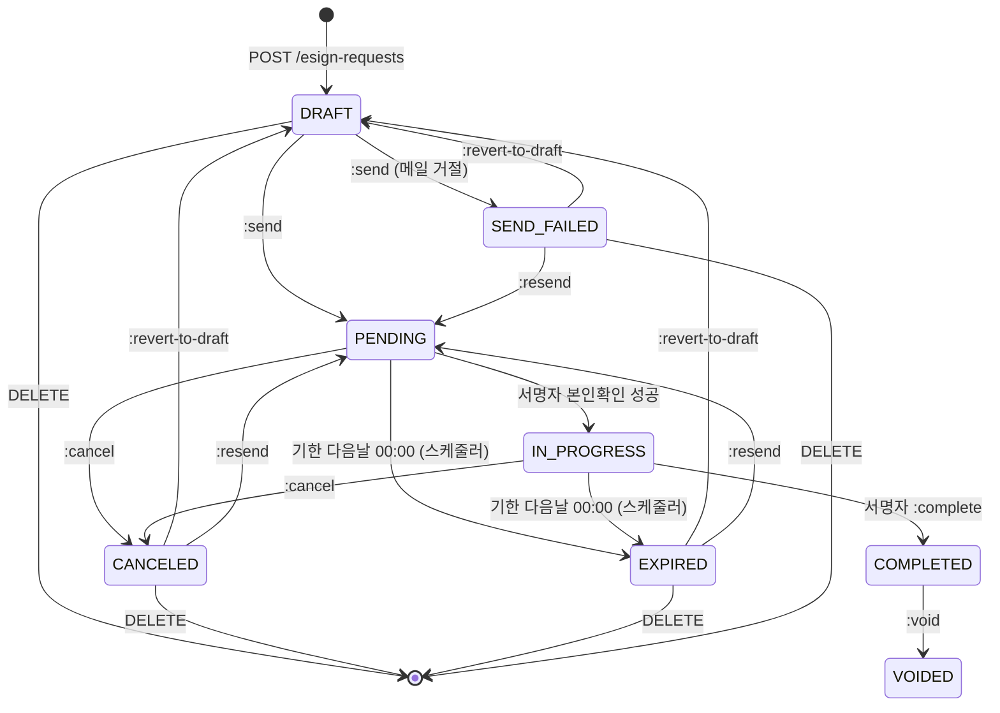
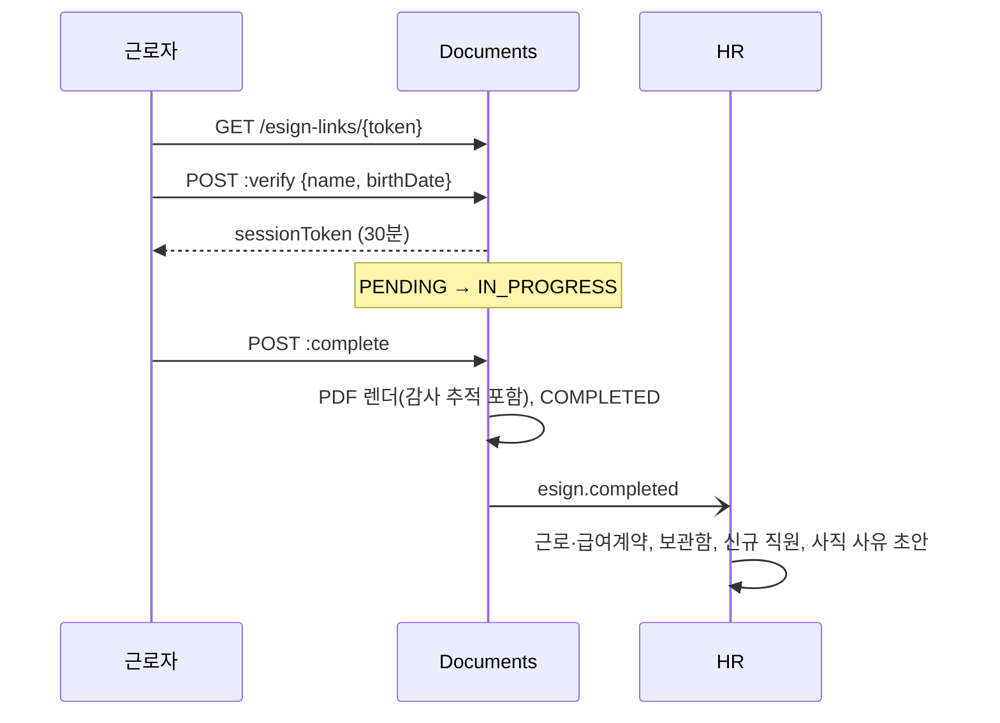
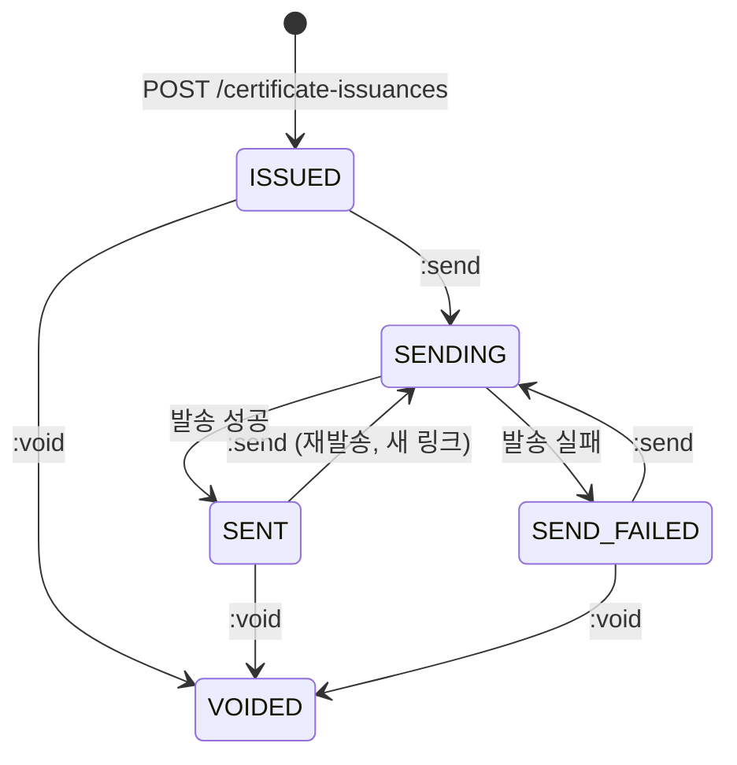

# Documents: 전자서명·제증명·서식 모음

근로계약서·사직서 같은 전자서명 요청, 재직·경력·퇴직증명서 발급, 회사 도장·사인, 전자서명 템플릿, 무료 서식 모음을 다룹니다. 서명이 끝난 계약을 직원 기록에 반영하는 일은 [hr.md](hr.md#이벤트)가 이벤트로 받습니다.

## 현행에서 고칠 점

- **발송 트리거가 보이지 않습니다.** 전용 엔드포인트 없이 생성 `POST`의 플래그나 `PATCH`로 상태를 바꾸는 것으로 추정합니다(spec 미확인 2). 레거시 구현은 `send: true`와 `POST :id/send`를 둘 다 받았습니다
- **"재발송"이 두 호출입니다.** 기한만료 행의 재발송은 `revert-to-draft` 다음에 발송을 다시 부르는 것으로 추정합니다(P2)
- **기한 만료를 누가 언제 처리하는지 없습니다.** 레거시 구현은 조회할 때(lazy) 처리했고 배치는 등록하지 않았습니다
- **`pending`과 `in_progress`의 경계, `in_progress` 취소 허용 여부가 미확인입니다**
- **발급한 증명서를 `DELETE`로 지웁니다.** 발급번호는 남겨야 하는 기록인데 삭제됩니다(원칙 4)
- **근로자 플로우가 `X-ESign-Session` 헤더와 토큰 경로를 섞어 씁니다.** 본인확인 방식과 실패 잠금이 클라이언트에 드러나지 않습니다
- **서식 모음만 `/nexus-api/` 아래에 있습니다(P3).** 회사 범위가 아닌 전역 데이터인데 sf 클라이언트로 부릅니다
- **템플릿 종류 `e_sign_template` / `company_e_sign_template`가 와이어에 드러납니다.** 회사 사본(copy-on-write)인지를 클라이언트가 구분합니다
- **상태 값이 소문자입니다** (`draft`, `in_progress`, `send_failed`)(P4)

## 용어

| 업무 용어 | 키 |
|---|---|
| 전자서명 요청 | `EsignRequest` |
| 전자 문서(요청에 묶인 문서 하나) | `documents[]`, `index` |
| 전자서명 템플릿 | `EsignTemplate`, `purpose`: `SIGNATURE` / `CERTIFICATE` |
| 문서 종류 | `documentKind`: `EMPLOYMENT_CONTRACT`, `DAILY_EMPLOYMENT_CONTRACT`, `PART_TIME_EMPLOYMENT_CONTRACT`, `ANNUAL_SALARY_CONTRACT`, `SERVICE_CONTRACT`, `PRIVACY_CONSENT`, `NDA`, `RESIGNATION`, `EMPLOYMENT_CERTIFICATE`, `CAREER_CERTIFICATE`, `RETIREMENT_CERTIFICATE`, `WORK_RULES` |
| 5인 이상/미만 사업장 | `workplaceSize`: `FIVE_OR_MORE` / `UNDER_FIVE` |
| 수신자(서명자) | `recipient` (`employeeId?`가 없으면 신규 계약자) |
| 서명 기한 | `dueDate` |
| 서명 링크 토큰 | `linkToken` (원문은 메일·알림톡에만, 서버는 해시만) |
| 서명자 세션 | `X-Signer-Session` |
| 회사 도장·사인 | `CompanySeal` |
| 알림 수신자 | `notificationRecipients` |
| 제증명 발급 | `CertificateIssuance` |
| 발급번호 | `issueNumber` (`2026-0003`) |
| 서식 모음 | `DocumentForm`, `category`: `HR` / `ACCOUNTING` / `REAL_ESTATE` / `STOCK` / `BOARD` / `GENERAL_CONTRACT` |

## 전자서명 요청

```
EsignRequest
├─ id, status, version
├─ documents[]: { index, templateId, title, documentKind, category }
├─ workplaceSize?, wageType?, workConditionId?, workSchedulePolicyId?
├─ recipient: { employeeId?, name, email?, phone?, isForeigner, nationalityCode?, visaCode?, birthDate? }
├─ fieldValues: { [index]: { [fieldKey]: value }, hidden: { [index]: fieldKey[] } }
├─ companySealId?, companySealSnapshot? (발송 시점 이미지 고정)
├─ dueDate?, linkTokenHash?, verifyFailures
├─ sentAt?, verifiedAt?, signedAt?, expiredAt?, canceledAt?, voidedAt?, voidReason?, sendError?
├─ resultFileId? (서명 완료 PDF), auditTrail[]
└─ allowedActions[]
```

### 상태



| 커맨드 | 허용 상태 | 결과 | 비고 |
|---|---|---|---|
| `PATCH` | `DRAFT` | 그대로 | 발송 뒤 문서는 바꿀 수 없음(R25) |
| `:send` | `DRAFT` | `PENDING` / `SEND_FAILED` | `Idempotency-Key` 필수, `{ dueDate? }` |
| `:resend` | `CANCELED`, `EXPIRED`, `SEND_FAILED` | `PENDING` / `SEND_FAILED` | 새 링크 토큰, 새 기한. 현행 "재발송"(되돌리기 + 발송)을 한 요청으로 |
| `:revert-to-draft` | `CANCELED`, `EXPIRED`, `SEND_FAILED` | `DRAFT` | 고쳐서 보낼 때 |
| `:cancel` | `PENDING`, `IN_PROGRESS` | `CANCELED` | 서명자 세션 폐기 |
| `:void` | `COMPLETED` | `VOIDED` | `{ reason }` 필수. 완료본과 감사 기록은 남김 |
| `DELETE` | `DRAFT`, `CANCELED`, `EXPIRED`, `SEND_FAILED` | 삭제 | |

전이표와 검사 순서는 [esign-request-transitions](../reference/rules/esign-request-transitions.md)에 있습니다.

- **`PENDING`과 `IN_PROGRESS`의 경계는 본인확인 성공입니다.** 링크 열람만으로는 바뀌지 않습니다. 레거시 구현과 같습니다
- **`IN_PROGRESS`도 취소할 수 있습니다.** 화면은 "서명 전"에만 버튼을 보였지만, 서명 중인 사람이 끝내지 않는 경우를 정리할 길이 필요합니다
- **기한 만료는 스케줄러 작업이 처리합니다.** `dueDate` 다음날 00:00(회사 시간대)에 `EXPIRED`로 바꾸고 `esign.expired`를 냅니다. 조회는 상태를 바꾸지 않지만, 스케줄러가 늦어도 링크는 `dueDate`가 지났으면 닫힌 것으로 답합니다
- 기본 서명 기한은 발송일 + 16일입니다(매뉴얼 스크린샷 2026.06.23 → 07.09). 발송 시 과거 날짜는 422 `ESIGN_DUE_DATE_PAST`입니다

### 발송 검증

`:send`와 `:resend`가 같은 검증을 씁니다 ([esign-send-validation](../reference/rules/esign-send-validation.md)). 위반은 422 `ESIGN_REQUEST_INCOMPLETE`와 `violations`로 한 번에 돌려줍니다.

- 수신자 이메일이 있어야 합니다(R22)
- 외국인 수신자는 국적·체류자격이 있어야 합니다(R22)
- 문서가 하나 이상이고, 모든 템플릿이 켜져 있어야 합니다
- 숨기지 않은 필수 필드는 관리자 입력값, 템플릿 기본값, 직원 기록(`source: employee.joinDate`) 중 하나로 채워져야 합니다. 서명자가 채우는 필드는 보지 않습니다
- 도장은 요청의 `companySealId`, 없으면 첫 템플릿의 기본 도장을 씁니다. 둘 다 없으면 위반입니다

### 엔드포인트

```
GET    /esign-requests?status=&category=&employeeId=&q=&dateField=REQUESTED|SIGNED&from=&to=&cursor=
GET    /esign-requests:count?groupBy=status
POST   /esign-requests                               { documents[{templateId}], recipient, workplaceSize?, wageType?, fieldValues?, companySealId? }
GET    /esign-requests/{esignRequestId}
PATCH  /esign-requests/{esignRequestId}              If-Match
DELETE /esign-requests/{esignRequestId}              If-Match
POST   /esign-requests/{esignRequestId}:send         If-Match, Idempotency-Key { dueDate? }
POST   /esign-requests/{esignRequestId}:resend       If-Match, Idempotency-Key { dueDate? }
POST   /esign-requests/{esignRequestId}:revert-to-draft   If-Match
POST   /esign-requests/{esignRequestId}:cancel       If-Match
POST   /esign-requests/{esignRequestId}:void         If-Match { reason }
GET    /esign-requests/{esignRequestId}/file         COMPLETED만, 열람 기록
```

- 생성은 항상 `DRAFT`입니다. 현행 `send: true` 플래그는 받지 않고, 만들고 바로 보내려면 `POST` 다음에 `:send`를 부릅니다. 두 요청이지만 `DRAFT`가 남아도 업무가 깨지지 않아 원자성이 필요하지 않습니다
- `recipient.employeeId`가 있으면 이름·이메일·내외국인·생년월일을 `HrDirectory`에서 채우고, 요청 값이 있으면 그것을 씁니다

### 서명자 흐름

근로자는 로그인하지 않습니다. 메일·알림톡의 링크 토큰으로 들어와 본인확인 후 짧은 세션으로 서명합니다.

```
GET  /esign-links/{linkToken}                         → { status, companyName, recipientNameMasked, documents[{index,title}], dueDate }
POST /esign-links/{linkToken}:verify                  { name, birthDate } → { sessionToken, expiresAt }
GET  /esign-links/{linkToken}/documents               X-Signer-Session → 본문, 필드, 관리자 값, 서명자 입력 필드, 사직서면 leavingReasons
POST /esign-links/{linkToken}/signatures              X-Signer-Session, multipart(image) → { signatureId }
POST /esign-links/{linkToken}:complete                X-Signer-Session { documents[{index, fieldValues, signatureId}], leavingReasonCode?, leavingDetailReasonCode? }
GET  /esign-links/{linkToken}/file                    X-Signer-Session, COMPLETED만
```



- **본인확인은 이름 + 생년월일 대조입니다** ([esign-identity-verification](../reference/rules/esign-identity-verification.md)). 기대 생년월일은 수신자 입력값, 없으면 직원 기록입니다. 5번 틀리면 링크가 잠기고 429 `IDENTITY_VERIFICATION_LOCKED`입니다. 잠금은 `:resend`(새 토큰)로만 풉니다
- 틀릴 때마다 403 `IDENTITY_VERIFICATION_FAILED`(`remainingAttempts`)입니다
- 닫힌 링크(`DRAFT`, `CANCELED`, `VOIDED`, `EXPIRED`, `SEND_FAILED`, 기한 경과)는 410 `ESIGN_LINK_CLOSED`(`status`)이고, 화면은 `status`로 취소·만료 화면을 고릅니다. 모르는 토큰은 404 `ESIGN_LINK_NOT_FOUND`입니다
- 세션은 30분이고 서버는 토큰·세션의 SHA-256 해시만 저장합니다
- **완료 처리는 한 트랜잭션입니다.** 모든 문서에 서명 이미지가 있는지, 사직서면 퇴직 사유가 유효한지 확인하고, PDF(감사 추적: 이벤트·IP·UA·문서 해시)를 만들어 저장하고 `COMPLETED`로 바꾸고 `esign.completed`를 outbox에 넣습니다. HR 후속처리는 이벤트로 합니다
- 완료·만료 알림톡은 알림 수신자(최대 3명, 없으면 대표자)에게, 완료본 사본은 수신자 이메일로 보냅니다

## 템플릿·도장·알림 설정

```
GET    /esign-templates?purpose=SIGNATURE|CERTIFICATE&q=&active=
GET    /esign-templates/{esignTemplateId}
PATCH  /esign-templates/{esignTemplateId}         { title?, body?, fieldDefaults?, active?, defaultCompanySealId? }
GET    /company-seals
POST   /company-seals                              multipart { image, source: UPLOAD|DRAWN }
DELETE /company-seals/{companySealId}
GET    /company-seals/{companySealId}/image
GET    /esign-notification-recipients
PUT    /esign-notification-recipients              [{ name, positionId?, phone, email? }] (최대 3)
```

- **템플릿은 제품 기본본과 회사별 덮어쓰기를 합친 하나의 리소스로 보입니다.** 현행 `template_type`을 없애고, 응답에 `customized: boolean`만 둡니다. 기본본을 처음 고치면 서버가 회사 덮어쓰기를 만듭니다
- 도장·사인은 회사당 5개까지입니다(409 `COMPANY_SEAL_LIMIT_EXCEEDED`). 삭제는 소프트 삭제이고, 발송된 요청은 발송 시점 이미지를 스냅샷으로 가집니다 ([esign-settings-limits](../reference/rules/esign-settings-limits.md))
- 알림 수신자는 3명까지입니다(422 `NOTIFICATION_RECIPIENT_LIMIT_EXCEEDED`)

## 제증명 발급

```
CertificateIssuance
├─ id, status: ISSUED | SENDING | SENT | SEND_FAILED | VOIDED, version
├─ templateId, title, documentKind, employeeId, employeeName
├─ fieldValues (발급 시점 고정), issueNumber, issuedAt, fileId
├─ sentTo?: { email?, phone? }, sentAt?, sendError?, linkTokenHash?, linkExpiresAt?
└─ voided?: { reason, at, by }
```



```
GET  /certificate-issuances?status=&employeeId=&q=&cursor=
GET  /certificate-issuances:count?groupBy=status
POST /certificate-issuances                       Idempotency-Key { templateId, employeeId, fieldValues?, companySealId? }
GET  /certificate-issuances/{certificateIssuanceId}
GET  /certificate-issuances/{certificateIssuanceId}/file
POST /certificate-issuances/{certificateIssuanceId}:send      If-Match, Idempotency-Key { email?, phone? }
POST /certificate-issuances/{certificateIssuanceId}:void      If-Match { reason }
POST /certificate-issuances:bundle                { ids[] } → ZIP (한 건이면 PDF)
GET  /certificate-links/{linkToken}               → 요약 (만료면 status: EXPIRED)
POST /certificate-links/{linkToken}:verify        { name, birthDate } → { sessionToken, expiresAt }
GET  /certificate-links/{linkToken}/file          X-Signer-Session
```

- **발급번호는 회사·연도별 연번 `YYYY-NNNN`이고, 무효화해도 다시 쓰지 않습니다** ([certificate-issuance](../reference/rules/certificate-issuance.md)). 서버가 발급 트랜잭션 안에서 매깁니다
- **`DELETE`를 없애고 `:void`로 바꿉니다.** 발급대장에 번호가 빠지지 않게 하려는 것입니다(원칙 4). 무효화하면 링크와 세션도 닫습니다
- 퇴직증명서는 퇴직일이 있는 직원에게만 발급합니다(422 `CERTIFICATE_EMPLOYEE_NOT_RESIGNED`)
- 증명서 값은 `HrDirectory`에서 채우고(이름, 마스킹 주민등록번호, 입사일·퇴직일, 부서·직위), 요청의 `fieldValues`가 덮어씁니다. 템플릿 필수 필드가 비면 422 `CERTIFICATE_FIELDS_MISSING`입니다
- 링크는 발송 후 30일 동안 유효하고 재발송하면 새 토큰을 만듭니다. 본인확인과 잠금은 전자서명과 같습니다
- 발급하면 `certificate.issued`를 내고 HR이 보관함에 넣습니다

## 서식 모음

```
GET /document-forms?category=&q=
GET /document-forms:count?groupBy=category
GET /document-forms/{documentFormCode}/file
```

- 회사와 무관한 전역 카탈로그라 인증만 확인하고 권한·플랜은 보지 않습니다(`document-form:read`는 모든 역할 기본값). `/nexus-api/` 접두를 없앱니다
- 매뉴얼 기준 39종이고 카테고리는 영문 enum으로 바꿉니다. 식별자는 `F01`–`F39` 코드입니다(ID 접두사 표에 서식 종류가 없어 임시로 코드를 씁니다)

## 외부 연동 포트

| 포트 | 쓰는 곳 | 메모리·가짜 구현 |
|---|---|---|
| `HrDirectory` (HR `hr.public.ts`) | 수신자·증명서 값, 본인확인 기대값 | HR 메모리 저장소 |
| `DocumentNotifier` | 서명 요청·완료·만료 메일·알림톡, 증명서 링크 | 메모리 outbox, `@fail.invalid` 주소는 실패 |
| `PdfRenderer` | 완료본, 증명서 | 결정적인 텍스트 PDF |
| `SignerIdentityVerifier` | `:verify` | 이름 + 생년월일 비교 |
| `DocumentEvents` | `esign.*`, `certificate.*` | 메모리 목록 |

## 이벤트

| 이벤트 | 낼 때 | 받는 곳 |
|---|---|---|
| `esign.sent` | `:send`, `:resend` 성공 | 알림 |
| `esign.completed` | 서명자 `:complete` | HR(계약·보관함·신규 직원·사직 사유), 알림 |
| `esign.expired` | 스케줄러 만료 | 알림 |
| `esign.canceled`, `esign.voided` | `:cancel`, `:void` | HR(무효화된 계약 표시는 [열린 질문](#열린-질문)) |
| `certificate.issued` | 발급 | HR(보관함) |
| `certificate.sent` | 발송 성공 | |

## 오류 코드

| 코드 | HTTP | 뜻 |
|---|---:|---|
| `ESIGN_REQUEST_NOT_FOUND`, `ESIGN_TEMPLATE_NOT_FOUND`, `COMPANY_SEAL_NOT_FOUND`, `CERTIFICATE_ISSUANCE_NOT_FOUND`, `DOCUMENT_FORM_NOT_FOUND` | 404 | |
| `ESIGN_LINK_NOT_FOUND` | 404 | 모르는 링크 토큰 |
| `ESIGN_REQUEST_TRANSITION_INVALID` | 409 | 현재 상태에서 받을 수 없는 커맨드·수정·삭제 (`currentStatus`, `command`) |
| `CERTIFICATE_TRANSITION_INVALID` | 409 | 같음 |
| `COMPANY_SEAL_LIMIT_EXCEEDED` | 409 | 도장 5개 초과 |
| `ESIGN_REQUEST_INCOMPLETE` | 422 | 발송 검증 위반 (`violations`) |
| `ESIGN_DUE_DATE_PAST` | 422 | 과거 기한 |
| `ESIGN_TEMPLATE_UNAVAILABLE` | 422 | 없는 템플릿, 꺼진 템플릿, 증명서 템플릿을 서명에 씀 |
| `ESIGN_SIGNATURE_MISSING`, `LEAVING_REASON_INVALID` | 422 | 서명자 완료 검증 |
| `NOTIFICATION_RECIPIENT_LIMIT_EXCEEDED` | 422 | 알림 수신자 3명 초과 |
| `CERTIFICATE_EMPLOYEE_NOT_RESIGNED`, `CERTIFICATE_FIELDS_MISSING` | 422 | 발급 검증 |
| `SIGNER_SESSION_REQUIRED`, `SIGNER_SESSION_INVALID` | 401 | 서명자 세션 없음·만료 |
| `IDENTITY_VERIFICATION_FAILED` | 403 | 본인확인 불일치 (`remainingAttempts`) |
| `ESIGN_LINK_CLOSED` | 410 | 닫힌 링크 (`status`) |
| `IDENTITY_VERIFICATION_LOCKED` | 429 | 5회 실패 잠금 |

## 권한

| 권한 | 엔드포인트 | 플랜 |
|---|---|---|
| `esign-request:read` | 목록·상세·건수·완료본 | `PAYROLL` |
| `esign-request:create`, `esign-request:update`, `esign-request:delete` | 생성·수정·삭제·되돌리기 | `PAYROLL` |
| `esign-request:send` | `:send`, `:resend` | `PAYROLL` |
| `esign-request:cancel`, `esign-request:void` | `:cancel`, `:void` | `PAYROLL` |
| `esign-template:read`, `esign-template:update` | 템플릿 | `PAYROLL` |
| `company-seal:read`, `company-seal:create`, `company-seal:delete` | 도장·사인 | `PAYROLL` |
| `esign-setting:update` | 알림 수신자 | `PAYROLL` |
| `certificate-issuance:read`, `certificate-issuance:create`, `certificate-issuance:send`, `certificate-issuance:void` | 제증명 | `PAYROLL` |
| `document-form:read` | 서식 모음 | 없음 |

서명자·증명서 링크(`/esign-links`, `/certificate-links`)는 인증 미들웨어를 붙이지 않고 링크 토큰과 서명자 세션으로 인가합니다.

## 현행 엔드포인트 대응

번호는 [spec §5](../reference/spec/hr.md#5-엔드포인트-표)입니다. `…`은 `/api/company/:companyId/employment`입니다.

| # | 현행 | 재설계 | 비고 |
|---:|---|---|---|
| 1 | `GET /nexus-api/document-form` | `GET /document-forms` | `/nexus-api/` 제거 |
| 2 | `GET /nexus-api/document-form/type-count` | `GET /document-forms:count?groupBy=category` | |
| — | (없음) | `GET /document-forms/{documentFormCode}/file` | 현행은 `file_url` |
| 5 | `GET …/settings/document-categories/` | `GET /reference/document-categories` (HR) | |
| 6, 7 | `GET/POST …/settings/company-seals/` | `GET/POST /company-seals` | |
| 8 | `DELETE …/settings/company-seals/:sealId/` | `DELETE /company-seals/{companySealId}` | 소프트 삭제 |
| — | `GET …/settings/company-seals/:sealId` (레거시 구현이 추가, 이미지) | `GET /company-seals/{companySealId}/image` | |
| 9, 10 | `GET/PUT …/settings/e-sign-noti-recipients/` | `GET/PUT /esign-notification-recipients` | |
| 11, 12 | `GET …/settings/e-sign-templates/(:id/)` | `GET /esign-templates(/{esignTemplateId})` | `template_type` 제거 |
| 13 | `PATCH …/settings/e-sign-templates/:id/` | `PATCH /esign-templates/{esignTemplateId}` | |
| 75 | `GET …/e-sign-requests/` | `GET /esign-requests` | |
| 76 | `POST …/e-sign-requests/` (`send` 플래그) | `POST /esign-requests` + `:send` | 생성은 항상 `DRAFT` |
| 77–79 | `GET/PATCH/DELETE …/e-sign-requests/:id/` | `GET/PATCH/DELETE /esign-requests/{esignRequestId}` | |
| — | `POST …/e-sign-requests/:id/send` (레거시 구현이 추가) | `POST /esign-requests/{esignRequestId}:send` | |
| 80 | `POST …/e-sign-requests/:id/cancel/` | `:cancel` | `IN_PROGRESS`도 허용 |
| 81 | `POST …/e-sign-requests/:id/void/` | `:void` | 사유 필수 |
| 82 | `POST …/e-sign-requests/:id/revert-to-draft/` | `:revert-to-draft`, 재발송은 `:resend` | |
| 83 | `GET …/e-sign-requests/:id/download/` | `GET /esign-requests/{esignRequestId}/file` | |
| 84 | `GET …/certificates/` | `GET /certificate-issuances` | |
| 85 | `POST …/certificates/` | `POST /certificate-issuances` | |
| 86 | `GET …/certificates/:id/` | `GET /certificate-issuances/{certificateIssuanceId}` | |
| — | `GET …/certificates/:id/file` (레거시 구현이 추가) | `GET /certificate-issuances/{certificateIssuanceId}/file` | |
| 87 | `POST …/certificates/download/` | `POST /certificate-issuances:bundle` | |
| 88 | `POST …/certificates/:id/send/` | `:send` | |
| 89 | `DELETE …/certificates/:id/` | `:void` | 발급 기록은 지우지 않음 |
| 90 | `GET …/certificates/count-by-status/` | `GET /certificate-issuances:count?groupBy=status` | |
| 91 | `GET /api/employment/e-sign/:token/summary/` | `GET /esign-links/{linkToken}` | |
| 92 | `POST …/e-sign/:token/verify/` | `POST /esign-links/{linkToken}:verify` | |
| 93 | `GET …/e-sign/:token/documents/` | `GET /esign-links/{linkToken}/documents` | `X-ESign-Session` → `X-Signer-Session` |
| 94, 95 | `GET/POST …/e-sign/:token/seals/` | `POST /esign-links/{linkToken}/signatures` | 목록은 `documents` 응답에 포함 |
| — | `GET …/e-sign/:token/seals/:sealId` (레거시 구현이 추가) | 없앰 | 서명자가 자기 이미지를 다시 받을 일이 없음 |
| 96 | `POST …/e-sign/:token/complete/` | `POST /esign-links/{linkToken}:complete` | |
| 97 | `GET …/e-sign/:token/leaving-reasons/` | `GET /esign-links/{linkToken}/documents`의 `leavingReasons` | 사직서일 때만 |
| 98 | `GET …/e-sign/:token/download/` | `GET /esign-links/{linkToken}/file` | |
| 99 | `GET /api/employment/certificates/:token/summary/` | `GET /certificate-links/{linkToken}` | |
| 100 | `POST …/certificates/:token/verify/` | `POST /certificate-links/{linkToken}:verify` | |
| 101 | `GET …/certificates/:token/download/` | `GET /certificate-links/{linkToken}/file` | |

## 구현 상태

`apps/api/src/modules/documents/`에 있습니다. 저장소는 메모리 구현, 외부 연동은 결정적인 가짜입니다.

| 영역 | 상태 |
|---|---|
| 순수 규칙 (전자서명 전이표, 발송 검증, 본인확인 잠금, 발급번호·증명서 전이, 도장·알림 수신자 한도) | 구현, 단위·픽스처 테스트 |
| 전자서명 요청 (목록·생성·조회·수정·삭제·`:send`·`:resend`·`:revert-to-draft`·`:cancel`·`:void`) | 구현, HTTP 테스트 |
| 서명자 흐름 (요약·`:verify`·문서·`:complete`) | 구현(서명 이미지 업로드는 본문 대신 가짜 ID), HTTP 테스트 |
| 제증명 (목록·발급·조회·`:send`·`:void`) | 구현, HTTP 테스트 |
| 템플릿 조회, 서식 모음 목록·건수 | 구현 |
| 템플릿 수정, 도장·사인, 알림 수신자, 파일 다운로드, `:bundle`, 증명서 링크 | 미구현 (규칙만) |
| 기한 만료 스케줄러 | 서비스 메서드(`expireOverdue`)만 구현, 스케줄 등록 없음 |
| 이벤트 outbox, 멱등성 키 재응답 | 미구현 (`Idempotency-Key` 존재만 검사) |

## 열린 질문

1. **무효화된 계약의 후속처리:** `:void`된 근로계약서로 만든 근로·급여계약을 HR이 지울지, 표시만 할지 정해야 합니다. 지금은 HR이 아무것도 하지 않습니다
2. **본인확인 방식:** 이름 + 생년월일은 레거시 구현의 가정입니다. 현행 `verify` 본문은 미확인이고, OTP(휴대폰)라면 `SignerIdentityVerifier`에 SMS 포트가 필요합니다
3. **서명 기한 16일:** 스크린샷 한 장에서 추정한 값입니다. 회사 설정으로 둘지 정해야 합니다
4. **요청당 수신자 1명:** 목록이 수신자 단위 행이라 1명으로 두었습니다. 여러 명에게 같은 문서를 보내는 UI가 있다면 `:send`가 요청을 수신자별로 나눠 만들어야 합니다
5. **"표준 취업 규칙" 발급:** 개인 증명서가 아닌데 같은 발급 흐름을 탑니다. 직원 없이 발급할 수 있게 할지 정해야 합니다
6. **서식 모음 식별자:** ID 접두사 표(`apps/api/src/shared/ids/ids.ts`)에 서식 종류와 회사 도장이 없어 서식은 코드, 도장은 파일 ID를 씁니다. `documentForm`, `companySeal` 접두사를 추가할지 정해야 합니다
