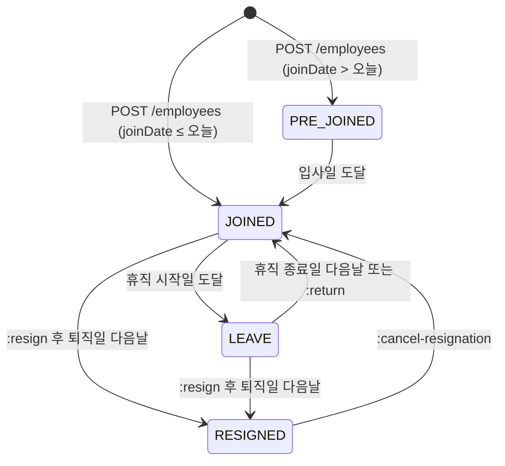

# HR: 직원·조직·계약·휴직·퇴직

직원(근로·일용·사업·기타소득자)과 직원에 딸린 장기 데이터(근로·급여계약, 4대보험 설정, 소득세 공제, 인적공제 대상자, 휴직, 퇴직, 메모, 문서 보관함), 부서·직위를 다룹니다. 전자서명·제증명·서식 모음은 [documents.md](documents.md), 급여 계산과 퇴직금 정산은 [payroll.md](payroll.md)에 있습니다.

## 현행에서 고칠 점

- **직원 종류마다 경로 묶음이 따로 있습니다.** `wage-employees`만 전체 CRUD와 하위 리소스가 있고 `daily/business/other-employees`는 `PATCH`만 있습니다. 서버 테이블도 종류별 4개 + generic FK(`wageemployee` 등 Django ContentType 이름)입니다 ([spec §2.1](../reference/spec/hr.md))
- **같은 직원 목록이 두 세대입니다.** 세무 기장 고객은 레거시 `GET /employee/`(한글 `employment_status`), 급여 구독 고객은 `wage-employees`(영문 `status`, 쿼리는 정수 `1`–`5`)를 씁니다. 급여 구독이면 레거시 메뉴를 클라이언트가 숨깁니다(P1)
- **한글·소문자 상태가 섞여 있습니다.** `재직/휴직/퇴사/임시저장/입사처리중/퇴사처리중/휴직처리중`, `scheduled/active/expired`, `in_progress/completed/excluded`(P4)
- **상태가 저장값인지 계산값인지 드러나지 않습니다.** `WORKING`과 `JOINED`의 차이가 화면 필터에만 있고, "처리중"은 4대보험 신고 작업 플래그(`employee_work.is_*_work`)에서 나옵니다
- **퇴직이 `PUT/DELETE retirement-info`입니다.** 퇴직금 유형 같은 설정 저장과 퇴직 등록(상태 변경 + 상실신고)이 한 요청에 섞여, 어떤 저장이 상태를 바꾸는지 경로에서 보이지 않습니다
- **검증 전용 엔드포인트가 있습니다.** `social-insurance-info/preview`(미저장 값)와 `redetermine`(저장값)이 같은 판정을 두 경로로 부릅니다. 클라이언트가 `AbortSignal`로 취소합니다
- **일괄 교체가 삭제를 겸합니다.** `departments/bulk`는 목록 전체를 교체하고 빠진 항목을 지웁니다. 사용 중인 항목이 빠지면 400입니다
- **주민등록번호·계좌번호를 마스킹 값으로 되돌려 보내면 "변경 없음"으로 해석합니다.** 응답 값과 요청 값의 의미가 다릅니다
- **메모 이력 경로만 끝 슬래시가 없습니다** (`memo-histories`). FormData 업로드는 클라이언트가 snake_case 키를 직접 씁니다(P4)
- **첨부가 여러 호출입니다.** 문서 보관함·가족 첨부는 멀티파트 한 번이지만, 전자서명 완료본을 보관함에 넣는 일은 서버 후속처리(추정)라 보이지 않습니다(P2)

## 용어

| 업무 용어 | 키 |
|---|---|
| 직원(구성원) | `Employee` |
| 소득 유형: 근로·일용·사업·기타소득자 | `kind`: `WAGE` / `DAILY` / `BUSINESS` / `OTHER` |
| 재직 상태: 입사예정·재직·휴직·퇴직 | `status`: `PRE_JOINED` / `JOINED` / `LEAVE` / `RESIGNED` (파생) |
| 주민등록번호·외국인등록번호·여권번호 | `registrationNumber` (응답은 `registrationNumberMasked`), `identityNumberType`: `RRN` / `PASSPORT` |
| 내외국인 | `isForeigner` |
| 국적 / 체류자격 | `nationalityCode` (ISO 3166-1 alpha-2) / `visaCode` (`E-9`) |
| 담당업무(4대보험 직종코드) | `occupationCode` |
| 사번 | `employeeNumber` |
| 입사일 / 퇴직일 | `joinDate` / `resignation.leaveDate` |
| 퇴직(상실)사유 / 상세사유 | `leavingReasonCode` / `leavingDetailReasonCode` (고용보험 상실사유 코드 그대로) |
| 퇴직금·퇴직연금 유형 | `retirementPlan.benefitType`: `SEVERANCE_PAY` / `DB` / `DC` |
| 퇴직금 중간정산 | `retirementPlan.interimSettlement` |
| 퇴직금 정산 상태 | 저장하지 않음. `SeveranceSettlementLookup`으로 Payroll에 물은 정산별 `SeveranceSettlementStatus`: `CALCULATED` / `COMPLETED` / `EXCLUDED`(Payroll과 같은 값, [열린 질문 10](#열린-질문)) |
| 휴직 / 복직 | `Leave` / `:return` |
| 휴직사유: 출산전후휴가·육아휴직·질병·기타 | `reason`: `MATERNITY` / `PARENTAL` / `ILLNESS` / `OTHER` |
| 근로계약 / 급여계약 | `WorkContract` / `PayrollContract` |
| 계약 형태: 정규직·계약직(기간제) | `contractType`: `PERMANENT` / `FIXED_TERM` |
| 근로형태: 일반·단시간·초단시간 | `workType`: `FULL_TIME` / `PART_TIME` / `SHORT_PART_TIME` |
| 임금 산정 방식 | `wageType`: `MONTHLY` / `DAILY` / `HOURLY` |
| 고정수당: 연장·야간·휴일·휴일연장 | `fixedAllowances`: `overtime` / `night` / `holiday` / `holidayOvertime` |
| 사업장 규모(상시 5명 이상 여부) | `CompanyWorkforceSize.hasFiveOrMoreEmployees`. Payroll 급여 설정 `underFiveEmployees`의 반대입니다 |
| 가산 지급배수 | `premiumMultipliers` (Payroll `multipliers`와 같은 ppm 구조) |
| 무기계약 전환 | `indefiniteConversion` |
| 4대보험: 국민연금·건강·고용·산재 | `nps` / `nhis` / `ei` / `iais` |
| 4대보험 자격 판정 | `InsuranceEligibility` |
| 4대보험 신고(취득·상실·휴직·복직·피부양자) | `InsuranceFiling`, `kind`: `ACQUISITION` / `LOSS` / `LEAVE` / `RETURN` / `DEPENDANT` |
| 소득세 및 기타공제 | `TaxWithholding` |
| 인적공제 대상자 | `FamilyMember` |
| 특이사항 | `Memo` |
| 문서 보관함 | `EmployeeDocument` |
| 부서 / 직위 | `Department` / `Position` |

## 직원 애그리거트

```
Employee
├─ id, kind: WAGE | DAILY | BUSINESS | OTHER
├─ identity: name, englishName?, identityNumberType, registrationNumber(암호문), registrationNumberHash(HMAC), birthDate
├─ nationality: isForeigner, nationalityCode?, visaCode?, isResident, countryOfResidence
├─ contact: email?, phone?
├─ placement: employeeNumber?, departmentId?, positionId?, occupationCode?
├─ joinDate, isRejoin
├─ retirementPlan: { benefitType, interimSettlement?: { date, reasonCode } }
├─ resignation?: { leaveDate, leavingReasonCode, leavingDetailReasonCode?, severanceAmount? }
├─ paymentAccount?: { bankCode, accountNumber(암호문), accountHolder }   # DAILY·BUSINESS·OTHER만
├─ source: MANUAL | ESIGN | ERP_IMPORT
├─ status (파생, 저장 안 함), warnings[] (파생), allowedActions[]
└─ version
```

- **직원은 `kind` 하나로 구분하는 한 애그리거트입니다.** 현행 4개 경로 묶음과 종류별 테이블을 `/employees` 하나로 합칩니다. 하위 리소스(계약·4대보험·공제·가족·휴직)는 `WAGE`만 받고, 다른 종류에 만들면 422 `EMPLOYEE_KIND_NOT_SUPPORTED`입니다. 계좌는 `WAGE`면 급여계약에, 나머지는 직원에 둡니다
- **같은 사람이 두 종류로 등록될 수 있습니다** (근로자이면서 기타소득 지급 대상). 중복 판정은 같은 `kind` 안에서만 합니다 ([employee-duplicate-rrn](../reference/rules/employee-duplicate-rrn.md))
- **레거시 "직원 관리"와 "구성원 정보"를 합칩니다.** 세무 기장 고객(`TAXATION`)과 급여 구독 고객(`PAYROLL`)이 같은 `/employees`를 씁니다. 메뉴 숨김 규칙은 [identity-access.md](identity-access.md)의 메뉴 트리가 서버에서 정합니다

### 상태 파생

상태는 저장하지 않고, 조회 시점(`asOf`, 기본은 회사 시간대 오늘)의 날짜로 계산합니다 ([employee-status](../reference/rules/employee-status.md)).



| 순서 | 조건 | 상태 |
|---:|---|---|
| 1 | `resignation.leaveDate < asOf` | `RESIGNED` (퇴직일 당일까지 재직) |
| 2 | `joinDate > asOf` | `PRE_JOINED` |
| 3 | `start ≤ asOf < (actualReturnDate ?? endDate + 1)`인 휴직이 있음 | `LEAVE` |
| 4 | 그 밖 | `JOINED` |

- 현행 `WORKING`(재직이면서 휴직 아님)은 이 표의 `JOINED`와 같습니다. 재직 전체는 `?status=JOINED,LEAVE`로 조회합니다
- 탭 건수는 `GET /employees:count?groupBy=status`입니다. 현행 `count-by-status`의 `{all, joined, …}` 키를 상태 enum으로 바꿉니다
- **레거시 한글 상태는 쓰지 않습니다.** `임시저장`은 `warnings`의 `MISSING_REGISTRATION_NUMBER`, `○○처리중`은 열린 4대보험 신고(`pendingInsuranceFilings`)로 표현합니다. 이관 매핑은 [legacy-employment-status](../reference/rules/legacy-employment-status.md)에 있습니다

### 경고

목록·상세 응답의 `warnings[]`는 서버가 계산합니다. 현행 목록의 ▲ 아이콘과 `contract-expiry-alert` 배너를 대신합니다.

| `code` | 조건 | 규칙 |
|---|---|---|
| `MISSING_REGISTRATION_NUMBER` | `WAGE`인데 주민등록번호가 없음 (전자서명으로 생성된 신규 계약자 등) | [contract-expiry-warning](../reference/rules/contract-expiry-warning.md) |
| `CONTRACT_EXPIRING_SOON` | 퇴직 전이고, 현재 기간제 계약 종료일이 오늘부터 30일 안 | 같음 |
| `CONTRACT_EXPIRED` | 퇴직 전이고, 현재 기간제 계약 종료일이 지났는데 뒤이은 계약이 없음 | 같음 |
| `INDEFINITE_CONVERSION_TARGET` | 퇴직 전이고, 연속된 기간제 계약이 2년을 넘었거나 90일 안에 넘음 (만 55세 이상 제외) | [indefinite-conversion-alert](../reference/rules/indefinite-conversion-alert.md) |

### 엔드포인트

```
GET    /employees?kind=&status=&q=&departmentId=&positionId=&warning=&dateField=&from=&to=&asOf=&sort=&cursor=
GET    /employees:count?groupBy=status|warning&kind=&q=
POST   /employees                                    ?dryRun=true 로 중복만 확인
GET    /employees/{employeeId}
PATCH  /employees/{employeeId}                       If-Match. registrationNumber를 보내면 새 값으로 바꿈
DELETE /employees/{employeeId}                       If-Match
POST   /employees/{employeeId}/registration-number:reveal   X-Access-Reason 필수, 열람 기록
POST   /employees/{employeeId}:resign                If-Match { leaveDate, leavingReasonCode, leavingDetailReasonCode?, severanceAmount? }
POST   /employees/{employeeId}:cancel-resignation    If-Match
POST   /employees:export                             X-Access-Reason 필수 → Job (xlsx)
```

- **등록 필수값은 이름, 주민등록번호(여권이면 여권번호 + 생년월일), 입사일입니다** (`WAGE`). 전자서명 완료로 생기는 직원만 주민등록번호 없이 만들어지고 `MISSING_REGISTRATION_NUMBER` 경고를 받습니다
- **중복:** 같은 회사·같은 `kind`에 같은 주민등록번호(HMAC)가 있으면 409 `EMPLOYEE_DUPLICATE`(`duplicateEmployeeId`)입니다. `isRejoin: true`이고 겹치는 직원이 모두 `RESIGNED`면 허용합니다. 유일성은 저장소 제약 `(companyId, kind, registrationNumberHash, activeKey)`로 보장합니다
- **마스킹 값 되돌려 보내기를 없앱니다.** `PATCH`에 `registrationNumber`가 없으면 그대로이고, 있으면 새 값입니다. `*`가 섞인 값은 400 `INVALID_VALUE`입니다
- **퇴직은 커맨드입니다.** `:resign`이 퇴직일·사유를 기록하고 상실신고(`LOSS`)를 엽니다. `employee.resigned`를 내는 것은 미구현입니다([이벤트](#이벤트)). 퇴직금 유형·중간정산 같은 설정은 `PATCH`의 `retirementPlan`으로 저장합니다 ([retirement-validation](../reference/rules/retirement-validation.md))
- **삭제 가드:** 퇴직금 정산이 `COMPLETED`면 409 `RETIREMENT_COMPLETED`입니다. 정산 상태는 저장하지 않고 삭제 때 Payroll에 묻습니다([퇴직](#퇴직)). 급여대장에 들어간 직원도 막아야 하지만 그 사실은 Payroll이 알고 있어 [열린 질문](#열린-질문)에 둡니다
- `allowedActions`: `UPDATE`, `DELETE`, `RESIGN`, `CANCEL_RESIGNATION`, `REGISTER_LEAVE`

## 유효일 하위 리소스

급여 계산은 "그 달에 유효했던 값"이 필요합니다. 계약은 기간(`startDate`–`endDate`)으로, 4대보험·공제 설정은 `effectiveFrom`부터 다음 버전 전까지 유효한 행으로 쌓습니다. 이전 값을 덮어쓰지 않습니다.

### 근로계약

```
WorkContract
├─ id, employeeId, signedDocumentId? (서명한 근로계약서, 보관함 문서)
├─ contractType: PERMANENT | FIXED_TERM, startDate, endDate?
├─ workType, occupationCode?, weeklyWorkHours?, workSchedulePolicyId?, workConditionId?
├─ probation?: { months, payRatePpm }, standardOccupationCode?, termLimitExemption?
├─ jobDescription?
└─ status (파생): SCHEDULED | ACTIVE | EXPIRED
```

```
GET    /employees/{employeeId}/work-contracts
POST   /employees/{employeeId}/work-contracts
GET    /work-contracts/{workContractId}
PUT    /work-contracts/{workContractId}          If-Match
DELETE /work-contracts/{workContractId}
GET    /employees/{employeeId}/indefinite-conversion?asOf=
```

- 기간제는 종료일이 필수이고, 수습 감액(지급률 100% 미만)은 1년 이상 계약에만 허용합니다 ([work-contract-validation](../reference/rules/work-contract-validation.md)). 한국표준직업분류 코드(`standardOccupationCode`)가 대분류 9(단순노무)면 감액을 받지 않습니다
- 기간제 사용기간 제한의 예외 사유(`termLimitExemption`, 기간제법 제4조 ① 단서)를 계약에 받고, 무기계약 전환 판정이 `exemptReason`으로 돌려줍니다. 예외 사유 없는 계약이 전환일을 넘기면 뒤의 예외 계약과 상관없이 전환입니다(제4조 ②)
- 지급률은 ppm입니다(`90% = 900000`). 현행 정수 퍼센트(`90`)를 바꿉니다

### 급여계약

```
PayrollContract
├─ id, employeeId, esignRequestId?, startDate, endDate?
├─ wageType, amount, monthlyWorkHours(+source: POLICY|MANUAL), dailyWorkHours?
├─ paymentItems[]: { paymentItemId, amount, enabled, ordinaryWage, countsTowardMinimumWage }
├─ fixedAllowances: { overtime|night|holiday|holidayOvertime: { enabled, hours, amount } }, fixedAllowanceAutoCalc
├─ bonus?: { amount, inOrdinaryWage }, annualSalary?
├─ payTiming: { month: CURRENT|NEXT, day: 1–31 }, payMethod: TRANSFER|CASH
├─ account?: { bankCode, accountNumber(암호문), accountHolder }   # 응답은 accountNumberMasked
└─ derived: baseSalary, baseHourlyWage, ordinaryHourlyWage, probationHourlyWage, minimumWageHourly, warnings[BELOW_MINIMUM_WAGE]
```

```
GET    /employees/{employeeId}/payroll-contracts
POST   /employees/{employeeId}/payroll-contracts
GET    /payroll-contracts/{payrollContractId}
PUT    /payroll-contracts/{payrollContractId}     If-Match
DELETE /payroll-contracts/{payrollContractId}
GET    /payroll-contracts/{payrollContractId}/account-number    X-Access-Reason 필수
```

- 파생 금액은 서버가 계산합니다 ([payroll-contract-wage](../reference/rules/payroll-contract-wage.md)). 자동계산 고정수당은 사업장 규모(`CompanyWorkforceSize`, Payroll 급여 설정의 5인 미만 여부)에 맞는 Payroll 기본 지급배수를 곱합니다([열린 질문 3](#열린-질문)). 최저임금 미달은 저장을 막지 않고 `warnings`에 `BELOW_MINIMUM_WAGE`로 담습니다. 최저시급은 Payroll의 기준표(`rateTable`)에서 계약 시작일 기준으로 읽습니다
- 기본 급여조건(지급시기·방법·계좌)은 급여 계산에 쓰므로 급여계약에 둡니다(현행 미확인 사항 10)

### 4대보험 설정과 자격 판정

```
GET  /employees/{employeeId}/social-insurance?asOf=
PUT  /employees/{employeeId}/social-insurance             { effectiveFrom, ...설정 }  If-Match
POST /employees/{employeeId}/social-insurance:determine   { 저장하지 않은 값(선택) } → { determinations, messages, recommended }
```

- **설정은 `effectiveFrom` 이력입니다(2026-11-12, #77).** 소득세 공제처럼 같은 날짜는 덮어쓰고, `GET`은 기준일(`asOf`, 기본 오늘)에 적용되는 항목을 줍니다. 버전은 직원 한 명의 이력 전체에 하나입니다. 근로소득자(`WAGE`)만 저장합니다(422 `EMPLOYEE_KIND_NOT_SUPPORTED`). 코드는 [social-insurance-settings.ts](../../apps/api/src/modules/hr/social-insurance/social-insurance-settings.ts)입니다
- 본문은 `effectiveFrom`, 보험별 `nps`·`nhis`·`ei`·`iais { enrolled, exclusionReason? }`, 판정에 쓰는 근로 조건(`weeklyWorkHours?`, `isRepresentativeOrExecutive`, `isRepresentativeRelative`)입니다. 주 소정근로시간이 없으면 그날의 근로계약에서 읽습니다
- 가입하지 않는 보험은 제외 사유가 있어야 하고(`REQUIRED`), 가입하는 보험은 제외 사유가 없어야 합니다(`NOT_APPLICABLE`). 둘 다 422 `SOCIAL_INSURANCE_SETTING_INVALID`입니다. 상실·취득 신고에 사유 코드가 들어가서입니다. 설정이 없으면 `GET`은 404 `SOCIAL_INSURANCE_SETTING_NOT_FOUND`입니다
- 응답의 `recommended`는 같은 날의 판정이고, 가입 여부가 판정과 다른 보험은 `warnings[] { code: ELIGIBILITY_MISMATCH, insurance }`입니다. 이때 판정은 저장값이 아니라 모두 가입을 출발점으로 합니다. 저장값을 출발점으로 두면 사용자가 정한 제외를 판정이 그대로 물려받아 차이가 보이지 않습니다. 제외 사유만 다른 것은 차이로 보지 않습니다
- **급여는 저장한 설정에 자동 판정을 덮어 적용합니다.** `HrDirectory.socialInsuranceOf`는 그날 적용되는 설정의 가입 여부와 근로 조건을 출발점으로(없으면 모두 가입, 대표자·임원·친족 아님) 자동 판정을 적용합니다. 본문 없는 `:determine`과 같은 값이고, 급여대장 행 사본(`snapshot.socialInsurance`)이 이 값입니다. 그래서 가입으로 저장한 직원도 재직 중 만 60세가 되는 날부터 국민연금을 빼고, 근로계약이 초단시간으로 바뀌면 그날부터 국민연금·건강·고용보험을 뺍니다. 판정은 가입을 빼기만 하므로 사용자가 정한 제외는 그대로 남습니다. 다시 저장하지 않아도 되는 대신, 판정이 빼는 보험을 가입으로 강제할 수는 없습니다
- **자격 판정은 순수 규칙입니다** ([social-insurance-eligibility](../reference/rules/social-insurance-eligibility.md)). 입력은 생년월일·입사일·내외국인·체류자격·주 소정근로시간·대표자/친족 여부이고, 출력은 판정 코드와 권장 가입 여부입니다
- `:determine` 하나가 현행 `preview`(미저장 값)와 `redetermine`(저장값)을 대신합니다. 기준일은 `asOf`(기본 오늘)입니다. 본문이 비면 그날 적용되는 저장 설정의 근로 조건과 가입 여부로 판정하고, 본문의 값은 그 근로 조건을 바꿔 봅니다. 판정은 현행처럼 저장된 가입 여부를 출발점으로 하므로 사용자가 정한 제외는 그대로 남습니다. 설정이 없으면 모두 가입을 출발점으로 합니다. 저장하지 않으므로 커맨드지만 멱등입니다
- 판정·안내 코드는 `NPS_OVER_60_NEW_HIRE`, `NPS_OVER_60_INCUMBENT`, `EI_OVER_65_NEW_HIRE`, `NPS_UNDER_60_HOURS_ENROLLED`, `EI_FOREIGNER_OPTIONAL`, `EI_FOREIGNER_RECIPROCITY_CHECK`로 대문자를 맞춥니다. 상호주의 국가 목록은 두지 않습니다(D-7·D-8·D-9만 본국법 확인 안내). 당연가입이 아닌 그 밖의 체류자격은 신청 전 미적용으로 권합니다([결정](rule-decisions/hr.md#social-insurance-eligibility))
- 제외 사유는 한글 문장 대신 코드(`AGE_60_OR_OVER`, `SHORT_PART_TIME`, …)로 받고, 표시 문자열은 `GET /reference/insurance-exclusion-reasons`가 줍니다
- 판정 결과는 권장값입니다. 사용자가 다르게 저장할 수 있고, 그 차이는 `GET` 응답의 `warnings`(`ELIGIBILITY_MISMATCH`)로 보여 줍니다

### 소득세 공제

```
GET  /employees/{employeeId}/tax-withholding?asOf=
PUT  /employees/{employeeId}/tax-withholding    { effectiveFrom, ... }  If-Match
GET  /reference/income-tax-reduction-reasons
```

- 감면 유형·사유·기간·감면율 검증은 [deduction-validation](../reference/rules/deduction-validation.md)에 있습니다. 조정비율은 ppm(`80% = 800000`)입니다
- `dependantsCount`, `childrenAged8To20Count`는 인적공제 대상자에서 파생하는 읽기 전용 값입니다 ([dependant-count](../reference/rules/dependant-count.md))
- `childcareChildrenCount`(선택)는 보육수당 비과세 대상 자녀 수입니다. 근로자 또는 배우자의 자녀로 과세기간 개시일(1월 1일) 현재 6세 이하인 자녀입니다(소득세법 제12조제3호머목2)). 공제대상 가족과 따로 세어 배우자가 기본공제를 받는 자녀도 넣고, 손자녀는 넣지 않습니다. 0–20입니다. 나이가 과세기간 개시일 기준이라 매년 1월과 자녀가 태어났을 때 새 `effectiveFrom`으로 다시 저장합니다. 설정의 `effectiveFrom` 연도가 귀속 연도와 다르면 급여가 `CHILDCARE_CHILDREN_STALE` 경고를 붙입니다. 급여는 보육수당 월 비과세 한도를 20만원 × 이 값으로 잡고, 값이 없으면 1명으로 보고 `CHILDCARE_CHILDREN_UNKNOWN` 경고를 붙입니다([non-taxable-limits](../reference/rules/non-taxable-limits.md))

### 인적공제 대상자

```
GET    /employees/{employeeId}/family-members
POST   /employees/{employeeId}/family-members
GET    /family-members/{familyMemberId}                       ETag
PUT    /family-members/{familyMemberId}                       전체 교체, If-Match
DELETE /family-members/{familyMemberId}
POST   /family-members/{familyMemberId}/registration-number:reveal   X-Access-Reason 필수
POST   /family-members/{familyMemberId}/attachments           multipart (file) → { fileId }  (미구현)
DELETE /family-members/{familyMemberId}/attachments/{fileId}                              (미구현)
```

- 본문은 `name`, `birthDate`, `relation`, `isForeigner?`, `registrationNumber?`, `taxFreeTarget?`, `yearEndTarget?`, `yearEndDependantType?`, `healthInsuranceDependant?`입니다. 불리언은 없으면 `false`, 공제 구분은 없으면 `NOT_ELIGIBLE`입니다. `WAGE`만 가질 수 있습니다(422 `EMPLOYEE_KIND_NOT_SUPPORTED`). 코드는 [family-members.ts](../../apps/api/src/modules/hr/family/family-members.ts), 검사는 [family-member-rules.ts](../../apps/api/src/modules/hr/family/family-member-rules.ts)입니다
- 관계·연말정산 공제 구분은 영문 enum(`SPOUSE`, `CHILD`, `PARENT`, …)으로 바꿉니다. 비과세(보육수당) 대상은 과세기간 개시일 현재 6세 이하 자녀만 허용합니다. 법이 "근로자 또는 그 배우자의 … 자녀"라 손자녀는 제외합니다(그해 − 출생 연도 ≤ 6, [결정](rule-decisions/hr.md#dependant-count)). 저장할 때의 오늘로 판정하므로, 해가 바뀌어 대상이 아니게 된 자녀는 다음 수정에서 `taxFreeTarget`을 꺼야 저장됩니다
- 422 `FAMILY_MEMBER_INVALID`의 위반은 다음과 같습니다
  - `taxFreeTarget` `NOT_ELIGIBLE`
  - `yearEndDependantType`: 연말정산 대상인데 구분이 없으면 `REQUIRED`, 대상이 아닌데 구분이 있으면 `NOT_APPLICABLE`, 구분이 관계·나이와 맞지 않으면 `INCONSISTENT`(배우자 구분은 배우자만, 20세 이하·60세 이상은 저장하는 해의 연도 − 출생 연도로 봅니다. 소득세법 제50조①③)
  - `healthInsuranceDependant` `NOT_ELIGIBLE`: 국민건강보험법 제5조②의 관계(배우자, 직계존·비속과 그 배우자, 형제·자매)가 아님. `OTHER`·`NONE`은 피부양자가 될 수 없습니다
  - `registrationNumber`: 피부양자인데 없으면 `REQUIRED`(신고서에 들어감), `INVALID_FORMAT`, `BIRTH_DATE_MISMATCH`(번호의 생년월일과 `birthDate`가 다름)
- 주민번호(외국인등록번호)는 직원과 같이 암호화하고 응답에는 `registrationNumberMasked`만 줍니다. 원문은 `:reveal`(권한 `employee:reveal-rrn`, 열람 기록 `familyMember:{id}:registrationNumber`)로만 줍니다. 가족은 중복 판정을 하지 않아 해시를 두지 않습니다. `PUT`에서 주민번호를 빼면 지웁니다
- **공제대상 가족 수:** 연말정산 대상(`yearEndTarget`)이고 기준일까지 태어났으며 나이 기준 구분(`AGE_20_OR_UNDER`·`AGE_60_OR_OVER`)이면 기준일의 연도에 그 나이인 가족에 본인을 더한 값이 [소득세 공제](#소득세-공제)의 `dependantsCount`, 그중 8–20세 자녀가 `childrenAged8To20Count`입니다([dependant-count](../reference/rules/dependant-count.md)). 급여는 소득세 공제 설정이 없어도 이 값을 씁니다(`HrDirectory.countDependants`). 보육수당 대상 자녀 수(`childcareChildrenCount`)는 아직 공제 설정의 입력이고, `taxFreeTarget`과 연결하지 않았습니다
- **가족에는 이력이 없습니다.** 기준일은 출생일과 나이를 보는 데만 쓰고, 등록·삭제·`yearEndTarget` 변경은 날짜 없이 지금 상태로 셉니다. 그래서 11월에 배우자를 등록하면 1월 기준으로 다시 계산한 급여 초안과 `GET tax-withholding?asOf=`도 가족 수가 늘어납니다. 확정한 급여대장은 행 사본(`snapshot.dependants`)을 쓰므로 바뀌지 않습니다
- **피부양자 신고:** `healthInsuranceDependant`를 바꾸거나 가족을 지우면 피부양자 신고(`DEPENDANT`)를 맞춥니다. 공단에 등록된 상태는 가장 나중에 완료(`DONE`)한 신고로 보고, 원하는 상태와 다르면 취득(`change: ADD`)이나 상실(`REMOVE`) 신고를 엽니다. 같아지면(예: 처리 전에 다시 끔) 열린 신고만 닫습니다. 내용(이름·관계·생년월일·구분)이 같은 열린 신고가 있으면 그대로 두고, 다르면 닫고 새로 엽니다(실패한 신고도 같음). 신고에는 목록에서 알아보도록 이름·관계·생년월일을 담고, 주민번호는 대리인이 가족의 `:reveal`로 읽습니다
- **등록된 피부양자는 지울 수 없습니다**(409 `FAMILY_MEMBER_DEPENDANT_REGISTERED`). 상실 신고에 주민번호가 필요하므로 먼저 피부양자를 끄고 대리인이 상실 신고를 마친 뒤 지웁니다. 아직 처리되지 않은 취득 신고만 있으면 지울 수 있고, 그 신고는 닫습니다
- 직원이 건강보험에 가입하지 않았거나 퇴직했는지는 보지 않습니다. 그런 직원에게도 취득 신고가 열리면 대리인이 실패로 처리합니다
- 직원을 지우면 가족도 함께 지웁니다. 주민번호를 담은 개인정보라 남기지 않습니다. 피부양자 신고는 직원의 열린 신고와 함께 닫히고, 피부양자 상실은 직원 자격 상실이 대신합니다

## 휴직

```
Leave
├─ id, employeeId, reason: MATERNITY | PARENTAL | ILLNESS | OTHER
├─ startDate, endDate, expectedReturnDate, actualReturnDate?
├─ paid?: { allowance }, includeInServiceYears
├─ npsPaymentException, nhisNoticeDeferral
└─ status (파생, 미구현): SCHEDULED | ONGOING | ENDED
```

- 휴직 상태는 설계만 있습니다. 응답([leave.ts](../../apps/api/src/modules/hr/leaves/leave.ts) `Leave`)에 `status`가 없고, 날짜로 파생하는 함수도 없습니다. 직원의 재직 상태 `LEAVE`는 직원 상태 파생이 휴직 기간을 보고 따로 계산합니다([상태 파생](#상태-파생))

```
GET    /employees/{employeeId}/leaves
POST   /employees/{employeeId}/leaves             If-Match(직원 버전)
GET    /employees/{employeeId}/leaves:summary?asOf=
GET    /leaves/{leaveId}
PATCH  /leaves/{leaveId}                          If-Match
DELETE /leaves/{leaveId}                          If-Match
POST   /leaves/{leaveId}:return                   { returnDate }  If-Match → 복직
```

- 휴직 등록·수정·삭제는 직원 상태를 바꾸므로 휴직과 직원의 `version`을 함께 올립니다
- **복직은 커맨드입니다.** 현행은 `PUT`에 `actual_return_date`를 넣었습니다. `:return`이 복직일을 기록하고 복직 신고(`RETURN`)를 엽니다
- 기간 겹침은 422 `LEAVE_OVERLAP`(`overlappingLeaveId`)입니다. 육아휴직은 근속에 항상 포함하고, 건강보험 납입고지유예는 유예되는 달이 있는 휴직에만 허용합니다(국민건강보험법 시행규칙 제50조 ④, [leave-validation](../reference/rules/leave-validation.md))
- 육아휴직 누적 365일 초과는 막지 않고 `warnings`(`PARENTAL_LEAVE_LIMIT_EXCEEDED`)로 알립니다. 자녀별 한도라 자녀를 모르는 서버가 막을 수 없습니다
- 휴직 등록이 휴직 신고(`LEAVE`)를 엽니다. 국민연금 납부예외·건강보험 고지유예 옵션은 신고 내용에 들어갑니다

## 퇴직

`POST /employees/{employeeId}:resign`과 `:cancel-resignation`이 맡습니다. 퇴직 사유 코드표는 고용보험 상실사유 코드를 그대로 씁니다(`GET /reference/leaving-reasons`).

- 퇴직일은 입사일 이후, 중간정산일 이후여야 합니다(422 `LEAVE_DATE_BEFORE_INTERIM`)
- 고른 (상세)사유는 상실신고(`LOSS`)에 그대로 들어갑니다
- 퇴직금 정산이 `COMPLETED`면 `:resign`(다시 퇴사), `:cancel-resignation`, `DELETE`가 409 `RETIREMENT_COMPLETED`입니다. HR은 정산 상태를 저장하지 않고 커맨드마다 포트 `SeveranceSettlementLookup`으로 Payroll에 묻습니다([severance-settlement-lookup.ts](../../apps/api/src/modules/hr/ports/severance-settlement-lookup.ts), [hr-payroll.ts](../../apps/api/src/wiring/hr-payroll.ts))
  - 그 직원의 정산 중 하나라도 `COMPLETED`면 막습니다. 지급한 퇴직금은 그 퇴직일·근속기간으로 계산했고 지급월 원천세 퇴직소득(A22)에 들어가 있어서입니다. 제외 후 새 정산처럼 정산이 여럿이어도 같습니다
  - `CALCULATED`(지급 전)와 `EXCLUDED`(정산하지 않음)는 막지 않습니다. 현행도 완료만 막았습니다
  - 그래서 계산됨 정산이 HR 퇴직과 어긋날 수 있습니다. HR은 정산에 쓰지 않고, Payroll이 `:complete` 때 퇴직일을 다시 읽어 어긋나면 409 `SEVERANCE_RETIREMENT_MISMATCH`로 막고 목록에 `retirementMismatch`를 보입니다([payroll.md 퇴직금 정산](payroll.md#퇴직금-정산))
  - 막히면 Payroll에서 정산을 `:reopen`해 계산됨으로 되돌린 뒤 합니다
  - 판정은 순수 규칙 `isSeveranceSettled`([retirement-rules.ts](../../apps/api/src/modules/hr/retirement/retirement-rules.ts))입니다
- 퇴직 후 휴직 종료일은 퇴직일을 넘을 수 없습니다

## 4대보험 신고

```
InsuranceFiling
├─ id, employeeId, kind: ACQUISITION | LOSS | LEAVE | RETURN | DEPENDANT | REMUNERATION_CHANGE
├─ source: { type: EMPLOYEE | LEAVE | FAMILY_MEMBER | PAYROLL_CONTRACT, id }, payload (kind마다 모양이 다름)
├─ status: PENDING | DONE | FAILED | WITHDRAWN
└─ requestedAt, processedAt?, resultMessage?
```

```
GET  /insurance-filings?status=&employeeId=&kind=        요청 순서, employeeName 포함
GET  /insurance-filings/{insuranceFilingId}
POST /insurance-filings/{insuranceFilingId}:complete      세무 대리인
POST /insurance-filings/{insuranceFilingId}:fail          { message }
```

| `kind` | 만드는 일 | `payload` |
|---|---|---|
| `ACQUISITION` | 주민번호가 있는 근로소득자 등록 | `acquisitionDate`(입사일) |
| `LOSS` | 근로소득자 퇴직 | `leaveDate`, `lossDate`(퇴직일 다음 날), `leavingReasonCode`, `leavingDetailReasonCode?` |
| `LEAVE` | 휴직 등록 | `startDate`, `endDate`, `npsPaymentException`, `nhisNoticeDeferral` |
| `RETURN` | 복직 | `leaveStartDate`, `returnDate` |
| `DEPENDANT` | 가족의 피부양자 여부 변경·가족 삭제([인적공제 대상자](#인적공제-대상자)) | `familyMemberId`, `change`(`ADD` 취득 / `REMOVE` 상실), `name`, `relation`, `birthDate` |
| `REMUNERATION_CHANGE` | 급여계약 등록·수정·삭제 때 다시 맞춤(아래) | `effectiveFrom`(계약 시작일), `wageType`, `amount` |

- 신고 코드는 [insurance-filings.ts](../../apps/api/src/modules/hr/insurance-filings/insurance-filings.ts), 전이 규칙은 [insurance-filing-rules.ts](../../apps/api/src/modules/hr/insurance-filings/insurance-filing-rules.ts)입니다
- **전이(2026-11-12, #77):** `PENDING` → `DONE`(`:complete`) 또는 `FAILED`(`:fail`, `resultMessage`에 사유). 실패한 신고는 공단에 다시 신고하고 `:complete`로 닫거나 `:fail`로 사유를 바꿉니다. 완료하면 사유를 지웁니다. 닫힌 신고(`DONE`·`WITHDRAWN`)를 처리하면 409 `INSURANCE_FILING_TRANSITION_INVALID`(`currentStatus`)입니다
- **열린 신고는 `PENDING`과 `FAILED`입니다.** 원인이 취소되면 실패한 신고도 다시 신고할 일이 없으므로 `WITHDRAWN`으로 닫습니다. 복직일을 고쳐 `:return`을 다시 부르면 이전 복직 신고를 닫고 새로 엽니다
- **보수 변경 신고(`REMUNERATION_CHANGE`)** 는 급여계약을 등록·수정·삭제할 때마다 직원의 계약 전체에 다시 맞춥니다([remuneration-change.ts](../../apps/api/src/modules/hr/contracts/remuneration-change.ts)). 시작일 순으로 바로 앞 계약과 지급 단위나 금액이 다르고, 그 시작일에 국민연금·건강보험·고용보험 중 하나라도 실제로 가입(`socialInsuranceOf`와 같은 판정)인 계약이 대상입니다. 가장 이른 계약은 대상이 아닙니다. 그래서 첫 계약을 고치거나 소급 계약을 등록·삭제해 순서가 바뀌면 신고도 따라 바뀝니다. 내용이 같은 신고(열렸거나 완료된)가 있으면 두고, 대상이 아니게 된 계약의 열린 신고는 닫습니다
- **보수는 계약 금액과 지급 단위만 봅니다.** 시급제의 월 소정근로시간이나 고정수당·지급항목만 바뀐 경우는 잡지 않습니다. 보수월액 환산(일급·시급제 포함)은 대리인이 합니다
- **취득 신고서의 보수월액**은 직원 등록 때 급여계약이 없어 `payload`에 넣지 않습니다. 대리인이 그 직원의 가장 이른 급여계약에서 읽습니다
- 직원을 지우면 그 직원의 열린 신고를 모두 닫습니다. 같은 요청에서 연 신고는 `requestedAt`이 같아 목록 안 순서가 정해지지 않습니다
- **권한:** 목록·조회는 `insurance-filing:read`, 처리는 대리인 전용 `insurance-filing:process`입니다. 고객 관리자의 `*`로는 처리할 수 없습니다(403 `PERMISSION_DENIED`)

- 직원 등록·퇴직·휴직·복직·급여계약 변경·피부양자 변경이 `PENDING` 신고를 같은 트랜잭션에서 만듭니다. 원인이 취소되면(퇴직 취소, 휴직 삭제, 급여계약 수정·삭제, 피부양자 해제, 직원 삭제) 열린 신고를 `WITHDRAWN`으로 닫습니다
- 현행 `employee_work.is_*_work` 플래그와 "○○처리중" 상태를 이 리소스가 대신합니다. 처리 주체는 지금처럼 세무 대리인이고, 자동 EDI는 범위 밖입니다 ([integrations.md](integrations.md))

## 조직

```
GET    /departments
POST   /departments                    { name }
PATCH  /departments/{departmentId}     { name }
DELETE /departments/{departmentId}     한 번이라도 배정됐으면 409 DEPARTMENT_IN_USE
POST   /departments:reorder            { ids[] }
(직위도 같은 형태: /positions, POSITION_IN_USE)
```

- 현행 `bulk`(전체 교체, 빠진 항목 삭제)를 생성·수정·삭제·재정렬로 나눕니다. 이름은 회사 안에서 유일합니다(409 `DEPARTMENT_NAME_TAKEN`)
- `inUse`는 직원에 배정된 적이 있으면 `true`이고 다시 `false`가 되지 않습니다 ([organization-unit-in-use](../reference/rules/organization-unit-in-use.md))

## 메모와 문서 보관함

```
GET    /employees/{employeeId}/memo                 → { content, updatedAt, updatedBy, version }
PUT    /employees/{employeeId}/memo                 If-Match { content }  빈 문자열이면 비움
GET    /employees/{employeeId}/memo/revisions
GET    /employees/{employeeId}/documents?category=
POST   /employees/{employeeId}/documents?title=&category=&fileName=   본문 = 파일(PDF·PNG·JPEG)
GET    /employee-documents/{documentId}
GET    /employee-documents/{documentId}/file        X-Access-Reason, 열람 기록
DELETE /employee-documents/{documentId}             origin=UPLOAD만
GET    /reference/document-categories
```

- 카테고리는 `CONTRACT` / `CERTIFICATE` / `CONSENT` / `RESIGNATION` / `OTHER`, 출처는 `UPLOAD` / `ESIGN` / `CERTIFICATE`입니다. 전자서명 완료본과 발급 증명서는 Documents 이벤트로 서버가 넣습니다
- 파일은 PDF·JPEG·PNG, 10MB 이하이고 형식은 서버가 내용(앞 바이트)으로 판정합니다. 클라이언트가 보낸 `Content-Type`을 믿지 않습니다(415 `FILE_TYPE_NOT_ALLOWED`). 계약에 없는 `Content-Type`은 계약 단계에서 415입니다
- 올리기는 멀티파트가 아니라 요청 바디가 파일 본문이고 제목·카테고리·파일 이름은 쿼리로 받습니다(2026-11-14). 파일은 공통 파일 저장소에 둡니다([conventions.md](conventions.md#파일), D7)
- 내려받기(`…/file`)는 직원 읽기 권한(`employee:read`)으로 확인하고, 계약서·증명서에 개인정보가 있어 `X-Access-Reason`을 받아 열람 기록(`employee-document:<id>:file`)에 남깁니다. 무효가 된 서명 문서도 기록이라 내려받을 수 있습니다
- 올리기·지우기는 `employee:update`입니다. 지운 직원에게는 올릴 수 없습니다(404 `EMPLOYEE_NOT_FOUND`)
- 서명·발급에서 온 문서는 원본 보존을 위해 지우지 않습니다(409 `DOCUMENT_LOCKED`). 직접 올린 문서를 지워도 파일 본문은 남깁니다
- 응답은 `origin`(`ESIGN`/`UPLOAD`), `status`(`ACTIVE`/`VOIDED`), `fileName`·`contentType`, 전자서명 완료본이면 `esignRequestId`·`signedAt`, 확정한 계약 `links[]`, 들어온 시각 `createdAt`을 담습니다. 목록은 서명 시각(없으면 들어온 시각)이 늦은 것부터입니다([전자서명 반영](#전자서명-반영), [구현 상태](#구현-상태))

## 개인정보

[compliance.md](compliance.md#개인정보-최소-노출)를 따릅니다.

- 주민등록번호·외국인등록번호·여권번호·계좌번호는 `PersonalDataCipher`(AES-256-GCM, 필드마다 서버 데이터 키에서 HKDF로 파생한 키와 AAD, 운영은 KMS가 데이터 키를 보관)로 암호화하고, 중복 판정은 회사와 무관한 HMAC 키로 만든 `registrationNumberHash`로 합니다. 암호문은 매번 달라 비교할 수 없고, 평문 해시는 13자리 공간이라 사전 공격에 약하기 때문입니다
- 응답은 `registrationNumberMasked`(`900101-1******`, 여권은 끝 3자리만), `accountNumberMasked`(끝 4자리)만 넣습니다
- 원문은 `POST …/registration-number:reveal`, `GET …/account-number`로만 주고 `X-Access-Reason`을 필수로 받아 열람 기록(`PersonalDataAccessLog`)을 남깁니다. 암호화와 열람 기록은 Payroll 소득자 명부와 함께 쓰는 공유 서비스(`src/shared/personal-data/`)이고, 열람 기록은 한 표(`personal_data_accesses`)에 남습니다. 권한은 `employee:reveal-rrn`, `employee:reveal-account`로 따로 둡니다
- 생년월일은 주민등록번호에서 파생하고(7번째 자리로 세기 판정), 여권이면 입력을 받습니다

## Payroll에 주는 조회 서비스

Payroll은 HR 저장소를 직접 읽지 않고 `apps/api/src/modules/hr/hr.public.ts`의 `HrDirectory`만 씁니다. Documents도 같은 서비스로 수신자·증명서 값을 채웁니다.

| 메서드 | 돌려주는 것 | 쓰는 곳 |
|---|---|---|
| `findEmployee(companyId, employeeId, asOf)` | 직원 스냅샷(상태·부서·직위 이름·마스킹 번호 포함) | 급여대장 행, 전자서명 수신자, 증명서 |
| `listEmployees(companyId, { asOf, kinds?, statuses? })` | 그날 기준 직원 목록 | 급여대장 대상자 |
| `listEmployeesEmployedBetween(companyId, from, to, kinds?)` | 기간 중 하루라도 재직한 직원 | 귀속월 급여대장, 원천세 |
| `listLeaveDates(companyId, employeeIds)` | 직원별 퇴직일(재직 중이면 `null`, 없는 직원은 키 없음). 직원 표만 읽음 | 퇴직금 정산의 퇴직일 대조 |
| `findWorkContract(companyId, employeeId, asOf)` / `listWorkContracts` | 그날 유효한 근로계약 | 소정근로시간, 수습 |
| `findPayrollContract(companyId, employeeId, asOf)` | 그날 유효한 급여계약(계좌는 마스킹) | 기본급·지급항목 |
| `socialInsuranceOf(companyId, employeeId, asOf)` | 그날의 국민연금·건강보험·고용보험 가입 여부. 저장한 설정이 없으면 판정 권장값 | 보험료 계산 |
| `countDependants(companyId, employeeId, asOf)` | 그날의 인적공제 대상자에서 센 공제대상 가족 수(본인 포함)·8–20세 자녀 수. 공제 설정이 없어도 셈 | 간이세액 |
| `findTaxWithholding(companyId, employeeId, asOf)` | 그날 유효한 공제 설정 + 그날의 인적공제 대상자에서 센 공제대상 가족 수 + 보육수당 대상 자녀 수 | 간이세액, 보육수당 비과세 한도 |
| `listDependants(companyId, employeeId, asOf)` | 인적공제 대상자 | 연말정산, 비과세 수당 |
| `listLeavesOverlapping(companyId, employeeId, from, to)` | 기간과 겹치는 휴직 | 일할 계산, 근속 |
| `findRetirement(companyId, employeeId)` | 퇴직일·사유·퇴직금 유형·중간정산 | 퇴직금 정산 |
| `revealRegistrationNumber(companyId, employeeId, reason)` | 원문 주민등록번호 | 원천세 신고 파일 (열람 기록) |

- 계좌 원문은 이체 파일을 만들 때만 `revealPaymentAccount(companyId, payrollContractId, reason)`로 받습니다
- 현행 급여가 HR 테이블에 쓰던 `setSeveranceSettlementStatus`는 없앴습니다. 반대 방향으로 HR이 Payroll에 정산 상태를 묻습니다(`SeveranceSettlementLookup`, [퇴직](#퇴직))

## 이벤트

**HR이 내는 이벤트는 모두 미구현입니다.** 받는 쪽은 전자서명 완료·무효만 구현했습니다([전자서명 반영](#전자서명-반영), [구현 상태](#구현-상태)). 이름은 [events.md](events.md#이벤트-목록)의 이벤트 목록과 snake_case 규칙을 따릅니다. events.md 목록에 아직 없는 이벤트는 "목록에 없음"으로 표시했습니다.

| 이벤트 | 낼 때 | 받는 곳 | events.md |
|---|---|---|---|
| `employee.joined` | `POST /employees`, 전자서명 완료로 신규 생성 | Payroll(급여대장 대상자), Assistant | 있음 |
| `employee.updated` | 인적 정보·배치 변경 | Payroll(미확정 급여대장 갱신) | 목록에 없음 |
| `employee.resigned` / `employee.resignation_canceled` | `:resign` / `:cancel-resignation` | Payroll(퇴직금 정산 시작·취소) | `resigned`만 있음 |
| `leave.started` / `leave.changed` / `leave.ended` | 휴직 등록 / 수정·삭제 / 복직 | Payroll(일할 계산) | `started`·`ended`만 있음. 등록 때 낼지 시작일에 낼지는 정하지 않음 |
| `work_contract.changed` / `payroll_contract.changed` | 계약 생성·수정·삭제 | Payroll | 목록에 없음 |
| `insurance_filing.requested` | 신고가 열림 | 세무 대리인 할 일([tax.md](tax.md)) | 목록에 없음 |

| 받는 이벤트 | 하는 일 |
|---|---|
| `esign_request.completed` (Documents) | 완료본을 보관함에 넣고 그 문서가 확정한 근로·급여계약에 서명 문서를 잇습니다. 구현([전자서명 반영](#전자서명-반영)) |
| `esign_request.voided` (Documents) | 보관함 문서를 `VOIDED`로 두고 계약에서 서명 문서를 풉니다. 구현 |
| `certificate.issued` (Documents) | 증명서 PDF를 보관함에 넣습니다. 미구현 |

### 전자서명 반영

Documents가 outbox 채널 `esign_request->hr`로 넘기고 `SignedDocumentIntake`([signed-document-intake.ts](../../apps/api/src/modules/hr/documents/signed-document-intake.ts))가 받습니다. 같은 요청을 두 번 받아도 결과가 같습니다.

- **완료.** 수신자가 직원이면 완료본을 보관함(`category`는 계약서가 있으면 `CONTRACT`)에 넣고, 문서가 확정한 계약의 `signedDocumentId`를 그 문서로 둡니다. 맞는 계약이 없어도 문서는 넣습니다. 수신자가 직원이 아니면 아무것도 하지 않고, 직원이 지워졌으면 문서만 넣습니다. 급여계약은 연결이 바뀌면 `version`이 오릅니다
- **확정 규칙**([employee-document-rules.ts](../../apps/api/src/modules/hr/documents/employee-document-rules.ts)): 근로계약서는 근로개시일(비워 두었으면 입사일)에 시작하는 근로계약, 연봉계약서는 적용 시작일에 시작하고 연봉이 같은 급여계약입니다. 같은 연봉의 계약이 없으면 연봉을 두지 않은 계약(월급만 등록)을 날짜만 보고 고르고, 문서에 연봉이 없으면 날짜만 봅니다. 여럿이면 가장 나중에 만든 계약 하나입니다. 계약 조건은 관리자가 정한 값으로만 판단하고, 서명자는 템플릿이 맡긴 필드(`signer: true`)만 채울 수 있습니다
- **무효.** 문서를 `VOIDED`(`voidedAt`)로 두고, 아직 그 문서를 가리키는 계약에서만 `signedDocumentId`를 지웁니다. 예전 서명 문서로 되돌리지 않습니다. 무효가 완료보다 먼저 오면(완료 처리가 실패해 재전달될 때) 무효 표식(`hr_voided_esign_requests`)을 남기고, 늦게 온 완료는 문서를 `VOIDED`로 넣고 계약을 잇지 않습니다
- **급여계약의 근로조건을 고치면** `signedDocumentId`가 지워집니다. 고친 계약은 다시 서명받아야 확정입니다. 계좌만 바꾸면 남깁니다. 보관함 문서의 `links`는 서명 당시 기록이라 그대로 남습니다. 근로계약은 수정이 없습니다
- **정함(2026-11-13): 서명으로 직원·계약을 만들지 않습니다.** 현행 R29는 서명 완료로 근로·급여계약과 신규 `WAGE` 직원을 만들었지만, 템플릿 필드는 자유 입력이라 계약 형태·임금 형태·주민번호를 믿을 만하게 얻을 수 없습니다. 직원과 계약은 직접 등록하고 서명은 그것을 확정합니다. 사직서 템플릿이 없어 퇴직 사유 초안도 두지 않습니다

## 오류 코드

| 코드 | HTTP | 뜻 |
|---|---:|---|
| `EMPLOYEE_NOT_FOUND`, `LEAVE_NOT_FOUND`, `WORK_CONTRACT_NOT_FOUND`, `PAYROLL_CONTRACT_NOT_FOUND`, `FAMILY_MEMBER_NOT_FOUND`, `EMPLOYEE_DOCUMENT_NOT_FOUND`, `DEPARTMENT_NOT_FOUND`, `POSITION_NOT_FOUND`, `INSURANCE_FILING_NOT_FOUND`, `SOCIAL_INSURANCE_SETTING_NOT_FOUND` | 404 | |
| `EMPLOYEE_DUPLICATE` | 409 | 같은 종류에 같은 주민등록번호 (`duplicateEmployeeId`) |
| `RETIREMENT_COMPLETED` | 409 | 퇴직금 정산 완료 직원의 삭제·퇴직 취소 |
| `EMPLOYEE_NOT_RESIGNED` | 409 | 퇴직하지 않은 직원의 퇴직 취소 |
| `DEPARTMENT_IN_USE`, `POSITION_IN_USE` | 409 | 배정된 적 있는 조직 삭제 |
| `DEPARTMENT_NAME_TAKEN`, `POSITION_NAME_TAKEN` | 409 | 이름 중복 |
| `INSURANCE_FILING_TRANSITION_INVALID` | 409 | 닫힌 신고 처리 |
| `FAMILY_MEMBER_DEPENDANT_REGISTERED` | 409 | 공단에 등록된 피부양자 가족 삭제 |
| `DOCUMENT_LOCKED` | 409 | 서명·발급에서 온 문서 삭제 |
| `FILE_TYPE_NOT_ALLOWED` | 415 | 문서 보관함에 올린 파일이 내용으로 보아 PDF·PNG·JPEG가 아님 |
| `FILE_SIZE_INVALID` | 413 | 빈 파일이거나 10MB 초과 |
| `DOCUMENT_FILE_MISSING` | 404 | 문서의 파일 본문이 저장소에 없음(저장소가 깨졌을 때만) |
| `EMPLOYEE_KIND_NOT_SUPPORTED` | 422 | `WAGE`가 아닌 직원에 하위 리소스 |
| `LEAVE_DATE_BEFORE_INTERIM`, `LEAVE_DATE_BEFORE_JOIN` | 422 | 퇴직일 검증 |
| `LEAVING_REASON_INVALID` | 422 | 사유·상세사유 조합이 없음 |
| `LEAVE_OVERLAP`, `LEAVE_PERIOD_INVALID` | 422 | 휴직 겹침, 기간·복직일·고지유예 조건 위반 (`violations`) |
| `WORK_CONTRACT_INVALID`, `PAYROLL_CONTRACT_INVALID`, `TAX_WITHHOLDING_INVALID`, `SOCIAL_INSURANCE_SETTING_INVALID`, `FAMILY_MEMBER_INVALID` | 422 | 규칙 위반 (`violations[].code`) |
| `EMPLOYEE_INVALID` | 422 | 주민등록번호 형식·여권 생년월일 누락 등 |

현행 `DUPLICATE_EMPLOYEE`는 `EMPLOYEE_DUPLICATE`로, 400이던 업무 규칙 오류는 409/422로 나눕니다.

## 권한

| 권한 | 엔드포인트 | 플랜 |
|---|---|---|
| `employee:read` | 직원·하위 리소스 조회, 건수 | `PAYROLL` 또는 `TAXATION` |
| `employee:create`, `employee:update`, `employee:delete` | 직원 등록·수정·삭제, 하위 리소스 쓰기, 휴직 | 같음 |
| `employee:resign` | `:resign`, `:cancel-resignation` | 같음 |
| `employee:reveal-rrn`, `employee:reveal-account` | 원문 조회 | 같음 |
| `employee:export` | `:export` | 같음 |
| `organization:read`, `organization:update` | 부서·직위 | 같음 |
| `insurance-filing:read`, `insurance-filing:process` | 4대보험 신고 목록, 처리 | 같음 (처리는 대리인 전용 권한) |

## 현행 엔드포인트 대응

번호는 [spec §5](../reference/spec/hr.md#5-엔드포인트-표)입니다. `…`은 `/api/company/:companyId/employment`, `WE`는 `…/wage-employees/:employeeId`입니다. 서식 모음·전자서명·제증명(#1–2, #5–13, #75–101)은 [documents.md](documents.md#현행-엔드포인트-대응)에 있습니다.

| # | 현행 | 재설계 | 비고 |
|---:|---|---|---|
| 3 | `GET /api/company/:id/employee/` (레거시, `simple`) | `GET /employees` | 한글 `employment_status`를 `status` + `warnings` + `pendingInsuranceFilings`로 |
| 4 | `GET …/employee/leaving-reason/` | `GET /reference/leaving-reasons` | |
| 14 | `GET …/wage-employees/` | `GET /employees?kind=WAGE` | 정수 상태 코드 → enum |
| 15 | `GET …/wage-employees/count-by-status/` | `GET /employees:count?groupBy=status` | |
| 16 | `GET …/wage-employees/export/` | `POST /employees:export` → Job | X-Access-Reason |
| 17 | `GET …/wage-employees/contract-expiry-alert/` | `GET /employees?warning=CONTRACT_EXPIRING_SOON,CONTRACT_EXPIRED`, `GET /employees:count?groupBy=warning` | 배너 전용 엔드포인트 제거 |
| 18 | `POST …/wage-employees/` | `POST /employees` | 409 `EMPLOYEE_DUPLICATE` |
| 19 | `DELETE WE/` | `DELETE /employees/{employeeId}` | |
| 20, 21 | `GET/PATCH WE/` | `GET/PATCH /employees/{employeeId}` | |
| 22, 23 | `GET/PUT WE/common-info/` | 없앰 → `GET/PATCH /employees/{employeeId}` | 인적 정보와 직원 정보를 한 리소스로 |
| 24 | `GET WE/leave-of-absence-info/` | `GET /employees/{employeeId}/leaves:summary` | |
| 25, 27 | `GET/POST WE/leave-of-absences/` | `GET/POST /employees/{employeeId}/leaves` | |
| 26, 28, 29 | `GET/PUT/DELETE WE/leave-of-absences/:loaId/` | `GET/PATCH/DELETE /leaves/{leaveId}`, 복직은 `POST /leaves/{leaveId}:return` | |
| 30–32 | `GET/PUT/DELETE WE/memo/` | `GET/PUT /employees/{employeeId}/memo` | DELETE는 빈 내용 PUT |
| 33 | `GET WE/memo-histories` | `GET /employees/{employeeId}/memo/revisions` | |
| 34, 36 | `GET …/departments/`, `GET …/positions/` | `GET /departments`, `GET /positions` | |
| 35, 37 | `POST …/departments/bulk/`, `…/positions/bulk/` | `POST/PATCH/DELETE /departments…`, `POST /departments:reorder` (직위 같음) | 전체 교체 제거 |
| 38–42 | `WE/family-members/…` | `/employees/{employeeId}/family-members`, `/family-members/{familyMemberId}` | |
| 43–45 | `…/family-members/:familyId/attachments/…` | `POST/DELETE /family-members/{familyMemberId}/attachments…` | PATCH(교체)는 삭제 + 등록 |
| 46 | `GET WE/work-contracts/indefinite-conversion-alert/` | `GET /employees/{employeeId}/indefinite-conversion` | 목록 경고에도 포함 |
| 47–51 | `WE/work-contracts/…` | `/employees/{employeeId}/work-contracts`, `/work-contracts/{workContractId}` | |
| 52–56 | `WE/payroll-contracts/…` | `/employees/{employeeId}/payroll-contracts`, `/payroll-contracts/{payrollContractId}` | |
| 57, 58 | `GET/PUT WE/social-insurance-info/` | `GET/PUT /employees/{employeeId}/social-insurance` | `effectiveFrom` |
| 59, 60 | `POST WE/social-insurance-info/preview/`, `GET …/redetermine/` | `POST /employees/{employeeId}/social-insurance:determine` | 둘을 하나로 |
| 61 | `GET WE/retirement-info/` | `GET /employees/{employeeId}` (`retirementPlan`, `resignation`) | |
| 62 | `PUT WE/retirement-info/` | 설정: `PATCH /employees/{employeeId}`, 퇴직: `POST /employees/{employeeId}:resign` | 상태를 바꾸는 저장을 커맨드로 |
| 63 | `DELETE WE/retirement-info/` | `POST /employees/{employeeId}:cancel-resignation` | |
| 64, 65 | `GET/PUT WE/deduction-info/` | `GET/PUT /employees/{employeeId}/tax-withholding` | `effectiveFrom` |
| 66 | `GET …/wage-employees/income-tax-reduction-reasons/` | `GET /reference/income-tax-reduction-reasons` | |
| 67–69 | `PATCH …/{business,daily,other}-employees/:id/` | `PATCH /employees/{employeeId}` | `kind`로 구분 |
| — | `GET/POST …/{daily,business,other}-employees`, `GET …/:id` (레거시 구현이 추가) | `GET/POST /employees?kind=`, `GET /employees/{employeeId}` | |
| 70, 72 | `GET/POST WE/documents/` | `GET/POST /employees/{employeeId}/documents` | multipart 키 camelCase, MIME 서버 판정 |
| 71, 73 | `GET/DELETE WE/documents/:documentId/` | `GET/DELETE /employee-documents/{documentId}` | |
| 74 | `GET WE/documents/:documentId/download/` | `GET /employee-documents/{documentId}/file` | |
| 5 | `GET …/settings/document-categories/` | `GET /reference/document-categories` | 문서 보관함과 템플릿이 같이 씀 |

## 구현 상태

`apps/api/src/modules/hr/`에 있습니다. 저장소는 메모리 구현만 있고(SQLite·outbox 미연결, [review.md](review.md#결정) D1), 개인정보 암호화는 서버(`SqliteLive`)에서 `PersonalDataCipher.layerAesGcm`(AES-256-GCM 암호화 + HMAC-SHA256 중복 판정 해시)이고, 테스트와 `HrMemoryLive`만 결정적인 가짜(`PersonalDataCipher.layerFake`)를 씁니다. 데모 급여계약 계좌번호도 그 환경의 암호화로 시드합니다 ([compliance.md](compliance.md#개인정보-최소-노출)). `HrMemoryLive`에 데모 회사(`DEMO_COMPANY_ID`) 데이터가 들어 있습니다.

| 영역 | 상태 |
|---|---|
| 순수 규칙 (상태 파생, 중복, 경고, 근로계약 검증, 임금 계산, 무기계약 전환, 4대보험 판정, 휴직 검증·요약, 퇴직 검증·사유표, 조직 사용 여부, 공제 검증, 공제대상 가족 수, 가족 검사·피부양자 신고 구분, 레거시 상태 매핑) | 구현, 단위·픽스처 테스트 |
| 직원 (`GET/POST /employees`, `GET/PATCH/DELETE /employees/{id}`, `:resign`, `:cancel-resignation`, `registration-number:reveal`) | 구현, HTTP 테스트. 목록 필터는 `kind`·`status` 하나씩, 건수 엔드포인트는 미구현(`totalCount`로 대신) |
| 휴직 (`GET/POST /employees/{id}/leaves`, `/leaves/{leaveId}:return`, `DELETE /leaves/{leaveId}`) | 구현, HTTP 테스트. 수정(`PATCH`)과 휴직 파생 상태(`SCHEDULED`·`ONGOING`·`ENDED`)는 미구현 |
| 근로계약 (`GET/POST /employees/{id}/work-contracts`), 무기계약 전환 조회 | 구현, HTTP 테스트. 서명한 근로계약서는 `signedDocumentId`로 잇습니다. 계약 수정·삭제 미구현 |
| 급여계약 (`GET/POST /employees/{id}/payroll-contracts`, `GET/PUT/DELETE /payroll-contracts/{id}`, `GET …/account-number`) | 구현, HTTP 테스트. `WAGE`만(그 밖은 422 `EMPLOYEE_KIND_NOT_SUPPORTED`). 파생 금액은 저장할 때 계산하고, 고정수당 가산 배수는 `CompanyWorkforceSize` 포트(Payroll 급여 설정)로 고르고, 최저시급은 Payroll 기준표 대신 HR 상수(`MINIMUM_HOURLY_WAGE_2026`)로 비교합니다. 수습 지급률은 계약 시작일의 근로계약에서 읽습니다. 서명한 연봉계약서는 `signedDocumentId`로 잇고 근로조건을 고치면 풉니다. 계약 기간 겹침 검사는 미구현 |
| 소득세 공제 (`GET/PUT /employees/{id}/tax-withholding`) | 구현, HTTP 테스트. `WAGE`만, `effectiveFrom` 이력, 버전은 직원별 이력 하나. 공제대상 가족 수·8–20세 자녀 수는 인적공제 대상자에서 세는 읽기 전용 값이고, 보육수당 대상 자녀 수(선택)만 입력으로 받습니다. 감면 사유 참조(`GET /reference/income-tax-reduction-reasons`) 미구현 |
| 4대보험 설정·판정 (`GET/PUT /employees/{id}/social-insurance`, `:determine`) | 구현, HTTP 테스트. `WAGE`만, `effectiveFrom` 이력, 판정과 다르면 `ELIGIBILITY_MISMATCH` 경고. 신고 보수월액은 아직 두지 않음(급여는 과세 급여로 보험료 계산) |
| 부서·직위 (CRUD, `:reorder`) | 구현, HTTP 테스트 |
| `HrDirectory` (`hr.public.ts`) | 구현: 직원 조회·목록·기간 재직자, 퇴직일 일괄 조회(`listLeaveDates`), 유효 근로계약, 유효 급여계약(`findPayrollContract`, 계좌는 마스킹), 적용 중인 소득세 공제(`findTaxWithholding`, 공제대상 가족 수는 인적공제 대상자에서 셈), 겹치는 휴직, 4대보험 가입 여부(`socialInsuranceOf`, 저장 설정 또는 권장값), 주민번호 원문(열람 기록). 인적공제 목록(`listDependants`)·퇴직 조회와 `revealPaymentAccount`는 미구현 |
| 4대보험 신고 (`/insurance-filings`) | 구현, HTTP 테스트. 취득·상실·휴직·복직·보수 변경·피부양자 신고를 종류별 `payload`로 열고, 목록·조회와 대리인 `:complete`·`:fail` |
| 인적공제 대상자 (`GET/POST /employees/{id}/family-members`, `GET/PUT/DELETE /family-members/{id}`, `registration-number:reveal`) | 구현, HTTP 테스트. `WAGE`만, 주민번호 암호화·열람 기록, 공제대상 가족 수 파생, 피부양자 취득·상실 신고. 첨부 미구현 |
| 퇴직금 정산 가드 (`SeveranceSettlementLookup`) | 구현, HTTP 테스트. 삭제·다시 퇴사·퇴사 취소가 Payroll에 물어 완료 정산이 있으면 409 `RETIREMENT_COMPLETED`([퇴직](#퇴직)) |
| 퇴직 정보(급여 형태·중간정산) | 미구현 |
| 문서 보관함 (`GET /employees/{id}/documents?category=`, `POST /employees/{id}/documents`, `GET /employee-documents/{id}`, `GET /employee-documents/{id}/file`, `DELETE /employee-documents/{id}`) | 구현, HTTP 테스트. 전자서명 완료본과 직접 올린 문서가 들어오고, 파일은 공통 파일 저장소(D7)에 둡니다. 증명서 발급(`certificate.issued`)은 아직 넣지 않습니다. 직원을 지워도 문서는 남습니다 |
| 메모, 가족 첨부, 엑셀 내보내기 | 미구현 |
| 이벤트 구독 | `esign_request.completed`·`esign_request.voided` 구현(outbox, [전자서명 반영](#전자서명-반영)) |
| 이벤트 발행 | 미구현 |
| 멱등성 키 재응답 | 미구현 |

## 열린 질문

1. **급여대장에 들어간 직원 삭제:** 현행은 퇴직금 정산 완료만 막습니다. 확정 급여대장에 행이 있는 직원도 막으려면 Payroll이 `HrDirectory` 반대 방향 조회(`PayrollUsage.hasLedgerRows`)를 HR에 줘야 합니다. 포트를 HR에 둘지, 삭제 대신 보관(`ARCHIVED`)만 허용할지 정해야 합니다
2. **같은 사람의 여러 `kind`:** 근로자를 기타소득자로도 등록할 때 인적 정보를 공유할지(Person 분리) 복사할지. 지금은 복사이고 중복 판정을 `kind`별로 합니다
3. **고정임금제 가산율(R10):** ~~화면 값이 가산 없는 1.0배라 그대로 둘지~~ **정함(2026-11-08):** 상시 5명 이상 사업장은 [근로기준법 제56조](https://www.law.go.kr/법령/근로기준법)의 가산(연장·야간·휴일 50%, 휴일 8시간 초과 100%)을 붙이고, 4명 이하는 제11조 ②와 [시행령 제7조 별표 1](https://www.law.go.kr/법령/근로기준법시행령)(적용 규정에 제56조가 없음)로 붙이지 않습니다. HR 포트 `CompanyWorkforceSize`를 `wiring/hr-payroll.ts`가 Payroll `PayrollSettingQuery`(급여 설정 `underFiveEmployees`, 플랜·권한 확인 없음, HTTP 미공개)로 구현합니다. 급여 설정을 저장한 적이 없으면 Payroll 기본값을 따라 5명 이상입니다. 배수는 Payroll이 공개한 `MULTIPLIERS_FIVE_OR_MORE`(1.5·0.5·1.5·2)·`MULTIPLIERS_UNDER_FIVE`(1·0·1·1)를 그대로 쓰므로 5인 미만의 고정 야간수당은 0원입니다. 회사가 급여 설정에서 바꾼 `multipliers`는 쓰지 않고 규모별 기본 배수만 씁니다. 파생 금액은 저장할 때 계산하므로 규모가 바뀌어도 이미 저장한 계약은 다시 저장할 때까지 그대로입니다([규칙 결정](rule-decisions/hr.md#payroll-contract-wage) 1, [급여계약](#급여계약))
4. **고용보험 상호주의 국가 목록:** 두지 않기로 했습니다. 고용보험법 시행령 제3조의3은 국가 목록이 아니라 본국법 기준이라 D-7·D-8·D-9는 가입을 권하고 본국법 확인을 안내합니다([결정](rule-decisions/hr.md#social-insurance-eligibility))
5. **계약 만료 경고 30일, 무기계약 전환 사전 알림 90일:** 제품 값을 확인하지 못했습니다. 회사 설정으로 둘지 정해야 합니다
6. **4대보험 신고 처리 주체:** 세무 대리인 큐로 두었습니다. 급여 구독만 쓰는 회사(대리인 없음)에서 누가 처리하는지 정해야 합니다
7. **ERP 이관 직원:** 현행 "임시저장"으로 들어오는 더존·세무사랑 직원은 `source: ERP_IMPORT` + `MISSING_REGISTRATION_NUMBER` 경고로 둡니다. 이관 작업의 형태(Job)는 [integrations.md](integrations.md)와 맞춰야 합니다
8. **급여계약의 최저시급 출처:** 설계는 Payroll 기준표(`rateTable`)에서 계약 시작일 기준으로 읽지만, HR에서 Payroll로 가는 포트가 없어 지금은 HR 상수(2026년 10,320원)로 비교합니다. HR 포트(`MinimumWageSource`)와 `wiring/hr-payroll.ts` 어댑터를 둘지 정해야 합니다
9. **기간제 예외 기간을 2년 계산에서 뺄지:** 지금은 사슬 시작일 + 24개월을 전환일로 두고 예외 계약 기간도 셉니다. 일반 18개월 → 예외 12개월 → 일반 2개월이면 전환으로 보지만, 예외 기간을 빼면 일반 사용기간이 20개월이라 전환이 아닙니다. 판례·행정해석을 확인해 정해야 합니다([결정](rule-decisions/hr.md#indefinite-conversion-alert))
10. **퇴직금 정산 상태 매핑:** ~~HR `severanceSettlementStatus`를 Payroll 이벤트로 채울지, 상태를 어떻게 매핑할지~~ **정함(2026-11-08):** HR은 정산 상태를 저장하지 않고 커맨드 때 포트 `SeveranceSettlementLookup`으로 Payroll에 묻습니다. 필드를 없애 매핑도 이벤트도 필요 없습니다. 완료 정산이 하나라도 있으면 막습니다([퇴직](#퇴직), [payroll.md 열린 질문 16](payroll.md#열린-질문))
