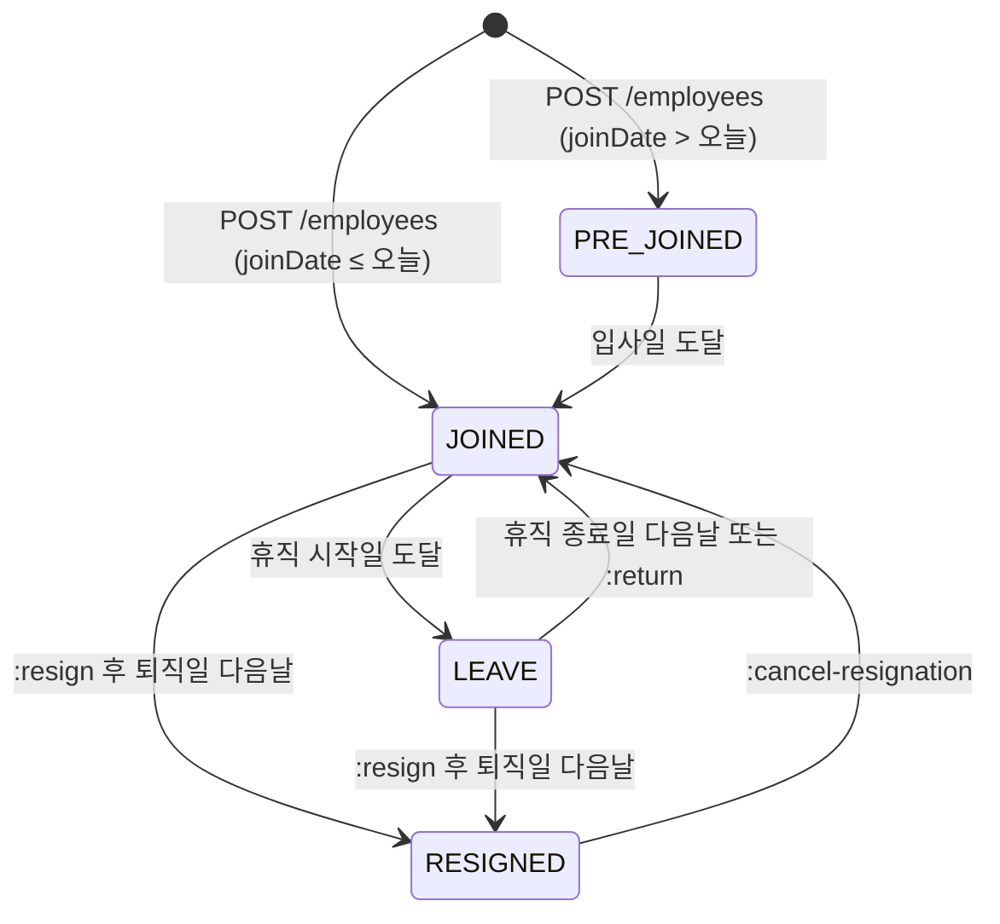

# HR: 직원·조직·계약·휴직·퇴직

직원(근로·일용·사업·기타소득자)과 직원에 딸린 장기 데이터(근로·급여계약, 4대보험 설정, 소득세 공제, 인적공제 대상자, 휴직, 퇴직, 메모, 문서 보관함), 부서·직위를 다룹니다. 전자서명·제증명·서식 모음은 [documents.md](documents.md), 급여 계산과 퇴직금 정산은 [payroll.md](payroll.md)에 있습니다.

## 현행에서 고칠 점

- **직원 종류마다 경로 묶음이 따로 있습니다.** `wage-employees`만 전체 CRUD와 하위 리소스가 있고 `daily/business/other-employees`는 `PATCH`만 있습니다. 서버 테이블도 종류별 4개 + generic FK(`wageemployee` 등 Django ContentType 이름)입니다 ([spec §2.1](../reference/spec/hr.md))
- **같은 직원 목록이 두 세대입니다.** 세무 기장 고객은 레거시 `GET /employee/`(한글 `employment_status`), 급여 구독 고객은 `wage-employees`(영문 `status`, 쿼리는 정수 `1`–`5`)를 씁니다. 급여 구독이면 레거시 메뉴를 클라이언트가 숨깁니다(P1)
- **한글·소문자 상태가 섞여 있습니다.** `재직/휴직/퇴사/임시저장/입사처리중/퇴사처리중/휴직처리중`, `scheduled/active/expired`, `in_progress/completed/excluded`(P4)
- **상태가 저장값인지 계산값인지 드러나지 않습니다.** `WORKING`과 `JOINED`의 차이가 화면 필터에만 있고, "처리중"은 4대보험 신고 작업 플래그(`employee_work.is_*_work`)에서 나옵니다
- **퇴직이 `PUT/DELETE retirement-info`입니다.** 퇴직금 유형 같은 설정 저장과 퇴직 등록(상태 변경 + 상실신고)이 한 요청에 섞여, 어떤 저장이 상태를 바꾸는지 경로에서 보이지 않습니다
- **검증 전용 엔드포인트가 있습니다.** `social-insurance-info/preview`(미저장 값)와 `redetermine`(저장값)이 같은 판정을 두 경로로 부릅니다. 클라이언트가 `AbortSignal`로 취소합니다
- **일괄 교체가 삭제를 겸합니다.** `departments/bulk`는 목록 전체를 교체하고 빠진 항목을 지웁니다. 사용 중인 항목이 빠지면 400입니다
- **주민등록번호·계좌번호를 마스킹 값으로 되돌려 보내면 "변경 없음"으로 해석합니다.** 응답 값과 요청 값의 의미가 다릅니다
- **메모 이력 경로만 끝 슬래시가 없습니다** (`memo-histories`). FormData 업로드는 클라이언트가 snake_case 키를 직접 씁니다(P4)
- **첨부가 여러 호출입니다.** 문서 보관함·가족 첨부는 멀티파트 한 번이지만, 전자서명 완료본을 보관함에 넣는 일은 서버 후속처리(추정)라 보이지 않습니다(P2)

## 용어

| 업무 용어 | 키 |
|---|---|
| 직원(구성원) | `Employee` |
| 소득 유형: 근로·일용·사업·기타소득자 | `kind`: `WAGE` / `DAILY` / `BUSINESS` / `OTHER` |
| 재직 상태: 입사예정·재직·휴직·퇴직 | `status`: `PRE_JOINED` / `JOINED` / `LEAVE` / `RESIGNED` (파생) |
| 주민등록번호·외국인등록번호·여권번호 | `registrationNumber` (응답은 `registrationNumberMasked`), `identityNumberType`: `RRN` / `PASSPORT` |
| 내외국인 | `isForeigner` |
| 국적 / 체류자격 | `nationalityCode` (ISO 3166-1 alpha-2) / `visaCode` (`E-9`) |
| 담당업무(4대보험 직종코드) | `occupationCode` |
| 사번 | `employeeNumber` |
| 입사일 / 퇴직일 | `joinDate` / `resignation.leaveDate` |
| 퇴직(상실)사유 / 상세사유 | `leavingReasonCode` / `leavingDetailReasonCode` (고용보험 상실사유 코드 그대로) |
| 퇴직금·퇴직연금 유형 | `retirementPlan.benefitType`: `SEVERANCE_PAY` / `DB` / `DC` |
| 퇴직금 중간정산 | `retirementPlan.interimSettlement` |
| 퇴직금 정산 상태 | `severanceSettlementStatus`: `IN_PROGRESS` / `COMPLETED` / `EXCLUDED` (Payroll이 알려 줌) |
| 휴직 / 복직 | `Leave` / `:return` |
| 휴직사유: 출산전후휴가·육아휴직·질병·기타 | `reason`: `MATERNITY` / `PARENTAL` / `ILLNESS` / `OTHER` |
| 근로계약 / 급여계약 | `WorkContract` / `PayrollContract` |
| 계약 형태: 정규직·계약직(기간제) | `contractType`: `PERMANENT` / `FIXED_TERM` |
| 근로형태: 일반·단시간·초단시간 | `workType`: `FULL_TIME` / `PART_TIME` / `SHORT_PART_TIME` |
| 임금 산정 방식 | `wageType`: `MONTHLY` / `DAILY` / `HOURLY` |
| 무기계약 전환 | `indefiniteConversion` |
| 4대보험: 국민연금·건강·고용·산재 | `nps` / `nhis` / `ei` / `iais` |
| 4대보험 자격 판정 | `InsuranceEligibility` |
| 4대보험 신고(취득·상실·휴직·복직·피부양자) | `InsuranceFiling`, `kind`: `ACQUISITION` / `LOSS` / `LEAVE` / `RETURN` / `DEPENDANT` |
| 소득세 및 기타공제 | `TaxWithholding` |
| 인적공제 대상자 | `FamilyMember` |
| 특이사항 | `Memo` |
| 문서 보관함 | `EmployeeDocument` |
| 부서 / 직위 | `Department` / `Position` |

## 직원 애그리거트

```
Employee
├─ id, kind: WAGE | DAILY | BUSINESS | OTHER
├─ identity: name, englishName?, identityNumberType, registrationNumber(암호문), registrationNumberHash(HMAC), birthDate
├─ nationality: isForeigner, nationalityCode?, visaCode?, isResident, countryOfResidence
├─ contact: email?, phone?
├─ placement: employeeNumber?, departmentId?, positionId?, occupationCode?
├─ joinDate, isRejoin
├─ retirementPlan: { benefitType, interimSettlement?: { date, reasonCode } }
├─ resignation?: { leaveDate, leavingReasonCode, leavingDetailReasonCode?, severanceAmount? }
├─ severanceSettlementStatus? (Payroll 이벤트로 갱신)
├─ paymentAccount?: { bankCode, accountNumber(암호문), accountHolder }   # DAILY·BUSINESS·OTHER만
├─ source: MANUAL | ESIGN | ERP_IMPORT
├─ status (파생, 저장 안 함), warnings[] (파생), allowedActions[]
└─ version
```

- **직원은 `kind` 하나로 구분하는 한 애그리거트입니다.** 현행 4개 경로 묶음과 종류별 테이블을 `/employees` 하나로 합칩니다. 하위 리소스(계약·4대보험·공제·가족·휴직)는 `WAGE`만 받고, 다른 종류에 만들면 422 `EMPLOYEE_KIND_NOT_SUPPORTED`입니다. 계좌는 `WAGE`면 급여계약에, 나머지는 직원에 둡니다
- **같은 사람이 두 종류로 등록될 수 있습니다** (근로자이면서 기타소득 지급 대상). 중복 판정은 같은 `kind` 안에서만 합니다 ([employee-duplicate-rrn](../reference/rules/employee-duplicate-rrn.md))
- **레거시 "직원 관리"와 "구성원 정보"를 합칩니다.** 세무 기장 고객(`TAXATION`)과 급여 구독 고객(`PAYROLL`)이 같은 `/employees`를 씁니다. 메뉴 숨김 규칙은 [identity-access.md](identity-access.md)의 메뉴 트리가 서버에서 정합니다

### 상태 파생

상태는 저장하지 않고, 조회 시점(`asOf`, 기본은 회사 시간대 오늘)의 날짜로 계산합니다 ([employee-status](../reference/rules/employee-status.md)).



| 순서 | 조건 | 상태 |
|---:|---|---|
| 1 | `resignation.leaveDate < asOf` | `RESIGNED` (퇴직일 당일까지 재직) |
| 2 | `joinDate > asOf` | `PRE_JOINED` |
| 3 | `start ≤ asOf < (actualReturnDate ?? endDate + 1)`인 휴직이 있음 | `LEAVE` |
| 4 | 그 밖 | `JOINED` |

- 현행 `WORKING`(재직이면서 휴직 아님)은 이 표의 `JOINED`와 같습니다. 재직 전체는 `?status=JOINED,LEAVE`로 조회합니다
- 탭 건수는 `GET /employees:count?groupBy=status`입니다. 현행 `count-by-status`의 `{all, joined, …}` 키를 상태 enum으로 바꿉니다
- **레거시 한글 상태는 쓰지 않습니다.** `임시저장`은 `warnings`의 `MISSING_REGISTRATION_NUMBER`, `○○처리중`은 열린 4대보험 신고(`pendingInsuranceFilings`)로 표현합니다. 이관 매핑은 [legacy-employment-status](../reference/rules/legacy-employment-status.md)에 있습니다

### 경고

목록·상세 응답의 `warnings[]`는 서버가 계산합니다. 현행 목록의 ▲ 아이콘과 `contract-expiry-alert` 배너를 대신합니다.

| `code` | 조건 | 규칙 |
|---|---|---|
| `MISSING_REGISTRATION_NUMBER` | `WAGE`인데 주민등록번호가 없음 (전자서명으로 생성된 신규 계약자 등) | [contract-expiry-warning](../reference/rules/contract-expiry-warning.md) |
| `CONTRACT_EXPIRING_SOON` | 퇴직 전이고, 현재 기간제 계약 종료일이 오늘부터 30일 안 | 같음 |
| `CONTRACT_EXPIRED` | 퇴직 전이고, 현재 기간제 계약 종료일이 지났는데 뒤이은 계약이 없음 | 같음 |
| `INDEFINITE_CONVERSION_TARGET` | 퇴직 전이고, 연속된 기간제 계약이 2년을 넘었거나 90일 안에 넘음 (만 55세 이상 제외) | [indefinite-conversion-alert](../reference/rules/indefinite-conversion-alert.md) |

### 엔드포인트

```
GET    /employees?kind=&status=&q=&departmentId=&positionId=&warning=&dateField=&from=&to=&asOf=&sort=&cursor=
GET    /employees:count?groupBy=status|warning&kind=&q=
POST   /employees                                    ?dryRun=true 로 중복만 확인
GET    /employees/{employeeId}
PATCH  /employees/{employeeId}                       If-Match. registrationNumber를 보내면 새 값으로 바꿈
DELETE /employees/{employeeId}                       If-Match
GET    /employees/{employeeId}/registration-number   X-Access-Reason 필수, 열람 기록
POST   /employees/{employeeId}:resign                If-Match { leaveDate, leavingReasonCode, leavingDetailReasonCode?, severanceAmount? }
POST   /employees/{employeeId}:cancel-resignation    If-Match
POST   /employees:export                             X-Access-Reason 필수 → Job (xlsx)
```

- **등록 필수값은 이름, 주민등록번호(여권이면 여권번호 + 생년월일), 입사일입니다** (`WAGE`). 전자서명 완료로 생기는 직원만 주민등록번호 없이 만들어지고 `MISSING_REGISTRATION_NUMBER` 경고를 받습니다
- **중복:** 같은 회사·같은 `kind`에 같은 주민등록번호(HMAC)가 있으면 409 `EMPLOYEE_DUPLICATE`(`duplicateEmployeeId`)입니다. `isRejoin: true`이고 겹치는 직원이 모두 `RESIGNED`면 허용합니다. 유일성은 저장소 제약 `(companyId, kind, registrationNumberHash, activeKey)`로 보장합니다
- **마스킹 값 되돌려 보내기를 없앱니다.** `PATCH`에 `registrationNumber`가 없으면 그대로이고, 있으면 새 값입니다. `*`가 섞인 값은 400 `INVALID_VALUE`입니다
- **퇴직은 커맨드입니다.** `:resign`이 퇴직일·사유를 기록하고 상실신고(`LOSS`)를 열고 `employee.resigned`를 냅니다. 퇴직금 유형·중간정산 같은 설정은 `PATCH`의 `retirementPlan`으로 저장합니다 ([retirement-validation](../reference/rules/retirement-validation.md))
- **삭제 가드:** 퇴직금 정산이 `COMPLETED`면 409 `RETIREMENT_COMPLETED`입니다. 급여대장에 들어간 직원도 막아야 하지만 그 사실은 Payroll이 알고 있어 [열린 질문](#열린-질문)에 둡니다
- `allowedActions`: `UPDATE`, `DELETE`, `RESIGN`, `CANCEL_RESIGNATION`, `REGISTER_LEAVE`

## 유효일 하위 리소스

급여 계산은 "그 달에 유효했던 값"이 필요합니다. 계약은 기간(`startDate`–`endDate`)으로, 4대보험·공제 설정은 `effectiveFrom`부터 다음 버전 전까지 유효한 행으로 쌓습니다. 이전 값을 덮어쓰지 않습니다.

### 근로계약

```
WorkContract
├─ id, employeeId, origin: MANUAL | ESIGN, esignRequestId?
├─ contractType: PERMANENT | FIXED_TERM, startDate, endDate?
├─ workType, occupationCode?, weeklyWorkHours?, workSchedulePolicyId?, workConditionId?
├─ probation?: { months, payRatePpm }
├─ jobDescription?, documentId?
└─ status (파생): SCHEDULED | ACTIVE | EXPIRED
```

```
GET    /employees/{employeeId}/work-contracts
POST   /employees/{employeeId}/work-contracts
GET    /work-contracts/{workContractId}
PUT    /work-contracts/{workContractId}          If-Match
DELETE /work-contracts/{workContractId}
GET    /employees/{employeeId}/indefinite-conversion?asOf=
```

- 기간제는 종료일이 필수이고, 수습 감액(지급률 100% 미만)은 1년 이상 계약에만 허용합니다 ([work-contract-validation](../reference/rules/work-contract-validation.md))
- 지급률은 ppm입니다(`90% = 900000`). 현행 정수 퍼센트(`90`)를 바꿉니다

### 급여계약

```
PayrollContract
├─ id, employeeId, esignRequestId?, startDate, endDate?
├─ wageType, amount, monthlyWorkHours(+source: POLICY|MANUAL), dailyWorkHours?
├─ paymentItems[]: { paymentItemId, amount, enabled, ordinaryWage, countsTowardMinimumWage }
├─ fixedAllowances: { overtime|night|holiday|holidayOvertime: { enabled, hours, amount } }, fixedAllowanceAutoCalc
├─ bonus?: { amount, inOrdinaryWage }, annualSalary?
├─ payTiming: { month: CURRENT|NEXT, day: 1–31 }, payMethod: TRANSFER|CASH
├─ account?: { bankCode, accountNumber(암호문), accountHolder }   # 응답은 accountNumberMasked
└─ derived: baseSalary, baseHourlyWage, ordinaryHourlyWage, probationHourlyWage, minimumWageHourly, warnings[BELOW_MINIMUM_WAGE]
```

```
GET    /employees/{employeeId}/payroll-contracts
POST   /employees/{employeeId}/payroll-contracts
GET    /payroll-contracts/{payrollContractId}
PUT    /payroll-contracts/{payrollContractId}     If-Match
DELETE /payroll-contracts/{payrollContractId}
GET    /payroll-contracts/{payrollContractId}/account-number    X-Access-Reason 필수
```

- 파생 금액은 서버가 계산합니다 ([payroll-contract-wage](../reference/rules/payroll-contract-wage.md)). 최저임금 미달은 저장을 막지 않고 `warnings`에 `BELOW_MINIMUM_WAGE`로 담습니다. 최저시급은 Payroll의 기준표(`rateTable`)에서 계약 시작일 기준으로 읽습니다
- 기본 급여조건(지급시기·방법·계좌)은 급여 계산에 쓰므로 급여계약에 둡니다(현행 미확인 사항 10)

### 4대보험 설정과 자격 판정

```
GET  /employees/{employeeId}/social-insurance?asOf=
PUT  /employees/{employeeId}/social-insurance             { effectiveFrom, ...설정 }  If-Match
POST /employees/{employeeId}/social-insurance:determine   { 저장하지 않은 값(선택) } → { determinations, messages, recommended }
```

- **자격 판정은 순수 규칙입니다** ([social-insurance-eligibility](../reference/rules/social-insurance-eligibility.md)). 입력은 생년월일·입사일·내외국인·체류자격·주 소정근로시간·대표자/친족 여부이고, 출력은 판정 코드와 권장 가입 여부입니다
- `:determine` 하나가 현행 `preview`(미저장 값)와 `redetermine`(저장값)을 대신합니다. 본문이 비면 저장된 값으로 판정합니다. 저장하지 않으므로 커맨드지만 멱등입니다
- 판정·안내 코드는 `NPS_OVER_60_NEW_HIRE`, `NPS_OVER_60_INCUMBENT`, `EI_OVER_65_NEW_HIRE`, `NPS_UNDER_60_HOURS_ENROLLED`, `EI_FOREIGNER_OPTIONAL`, `EI_FOREIGNER_RECIPROCITY_AGREEMENT`, `EI_FOREIGNER_RECIPROCITY_NON_AGREEMENT`로 대문자를 맞춥니다
- 제외 사유는 한글 문장 대신 코드(`AGE_60_OR_OVER`, `SHORT_PART_TIME`, …)로 받고, 표시 문자열은 `GET /reference/insurance-exclusion-reasons`가 줍니다
- 판정 결과는 권장값입니다. 사용자가 다르게 저장할 수 있고, 그 차이는 `GET` 응답의 `warnings`(`ELIGIBILITY_MISMATCH`)로 보여 줍니다

### 소득세 공제

```
GET  /employees/{employeeId}/tax-withholding?asOf=
PUT  /employees/{employeeId}/tax-withholding    { effectiveFrom, ... }  If-Match
GET  /reference/income-tax-reduction-reasons
```

- 감면 유형·사유·기간·감면율 검증은 [deduction-validation](../reference/rules/deduction-validation.md)에 있습니다. 조정비율은 ppm(`80% = 800000`)입니다
- `dependantsCount`, `childrenAged8To20Count`는 인적공제 대상자에서 파생하는 읽기 전용 값입니다 ([dependant-count](../reference/rules/dependant-count.md))

### 인적공제 대상자

```
GET    /employees/{employeeId}/family-members
POST   /employees/{employeeId}/family-members
GET    /family-members/{familyMemberId}
PUT    /family-members/{familyMemberId}
DELETE /family-members/{familyMemberId}
POST   /family-members/{familyMemberId}/attachments           multipart (file) → { fileId }
DELETE /family-members/{familyMemberId}/attachments/{fileId}
GET    /family-members/{familyMemberId}/registration-number   X-Access-Reason 필수
```

- 관계·연말정산 공제 구분은 영문 enum(`SPOUSE`, `CHILD`, `PARENT`, …)으로 바꿉니다. 비과세(육아수당) 대상은 만 6세 이하 자녀·손자녀만 허용합니다
- `healthInsuranceDependant`를 켜면 피부양자 신고(`DEPENDANT`)를 엽니다

## 휴직

```
Leave
├─ id, employeeId, reason: MATERNITY | PARENTAL | ILLNESS | OTHER
├─ startDate, endDate, expectedReturnDate, actualReturnDate?
├─ paid?: { allowance }, includeInServiceYears
├─ npsPaymentException, nhisNoticeDeferral
└─ status (파생): SCHEDULED | ONGOING | ENDED
```

```
GET    /employees/{employeeId}/leaves
POST   /employees/{employeeId}/leaves             If-Match(직원 버전)
GET    /employees/{employeeId}/leaves:summary?asOf=
GET    /leaves/{leaveId}
PATCH  /leaves/{leaveId}                          If-Match
DELETE /leaves/{leaveId}                          If-Match
POST   /leaves/{leaveId}:return                   { returnDate }  If-Match → 복직
```

- 휴직 등록·수정·삭제는 직원 상태를 바꾸므로 휴직과 직원의 `version`을 함께 올립니다
- **복직은 커맨드입니다.** 현행은 `PUT`에 `actual_return_date`를 넣었습니다. `:return`이 복직일을 기록하고 복직 신고(`RETURN`)를 엽니다
- 기간 겹침은 422 `LEAVE_OVERLAP`(`overlappingLeaveId`)입니다. 육아휴직은 근속에 항상 포함하고, 건강보험 납입고지유예는 1개월 이상 휴직에만 허용합니다 ([leave-validation](../reference/rules/leave-validation.md))
- 육아휴직 누적 365일 초과는 막지 않고 `warnings`(`PARENTAL_LEAVE_LIMIT_EXCEEDED`)로 알립니다. 자녀별 한도라 자녀를 모르는 서버가 막을 수 없습니다
- 휴직 등록이 휴직 신고(`LEAVE`)를 엽니다. 국민연금 납부예외·건강보험 고지유예 옵션은 신고 내용에 들어갑니다

## 퇴직

`POST /employees/{employeeId}:resign`과 `:cancel-resignation`이 맡습니다. 퇴직 사유 코드표는 고용보험 상실사유 코드를 그대로 씁니다(`GET /reference/leaving-reasons`).

- 퇴직일은 입사일 이후, 중간정산일 이후여야 합니다(422 `LEAVE_DATE_BEFORE_INTERIM`)
- 고른 (상세)사유는 상실신고(`LOSS`)에 그대로 들어갑니다
- 퇴직금 정산이 `COMPLETED`면 `:cancel-resignation`과 `DELETE`가 409 `RETIREMENT_COMPLETED`입니다. 정산 상태는 Payroll의 `severance-settlement.status-changed` 이벤트로 받습니다
- 퇴직 후 휴직 종료일은 퇴직일을 넘을 수 없습니다

## 4대보험 신고

```
InsuranceFiling
├─ id, employeeId, kind: ACQUISITION | LOSS | LEAVE | RETURN | DEPENDANT
├─ source: { type: EMPLOYEE | LEAVE | FAMILY_MEMBER, id }, payload
├─ status: PENDING | DONE | FAILED | WITHDRAWN
└─ requestedAt, processedAt?, resultMessage?
```

```
GET  /insurance-filings?status=&employeeId=&kind=
POST /insurance-filings/{insuranceFilingId}:complete      세무 대리인
POST /insurance-filings/{insuranceFilingId}:fail          { message }
```

- 직원 등록·퇴직·휴직·복직·피부양자 등록이 `PENDING` 신고를 같은 트랜잭션에서 만듭니다. 원인이 취소되면(퇴직 취소, 휴직 삭제) 열린 신고를 `WITHDRAWN`으로 닫습니다
- 현행 `employee_work.is_*_work` 플래그와 "○○처리중" 상태를 이 리소스가 대신합니다. 처리 주체는 지금처럼 세무 대리인이고, 자동 EDI는 범위 밖입니다 ([integrations.md](integrations.md))

## 조직

```
GET    /departments
POST   /departments                    { name }
PATCH  /departments/{departmentId}     { name }
DELETE /departments/{departmentId}     한 번이라도 배정됐으면 409 DEPARTMENT_IN_USE
POST   /departments:reorder            { ids[] }
(직위도 같은 형태: /positions, POSITION_IN_USE)
```

- 현행 `bulk`(전체 교체, 빠진 항목 삭제)를 생성·수정·삭제·재정렬로 나눕니다. 이름은 회사 안에서 유일합니다(409 `DEPARTMENT_NAME_TAKEN`)
- `inUse`는 직원에 배정된 적이 있으면 `true`이고 다시 `false`가 되지 않습니다 ([organization-unit-in-use](../reference/rules/organization-unit-in-use.md))

## 메모와 문서 보관함

```
GET    /employees/{employeeId}/memo                 → { content, updatedAt, updatedBy, version }
PUT    /employees/{employeeId}/memo                 If-Match { content }  빈 문자열이면 비움
GET    /employees/{employeeId}/memo/revisions
GET    /employees/{employeeId}/documents?category=
POST   /employees/{employeeId}/documents            multipart { category, file }
GET    /employee-documents/{documentId}
GET    /employee-documents/{documentId}/file        열람 기록
DELETE /employee-documents/{documentId}             origin=UPLOAD만
GET    /reference/document-categories
```

- 카테고리는 `CONTRACT` / `CERTIFICATE` / `CONSENT` / `RESIGNATION` / `OTHER`, 출처는 `UPLOAD` / `ESIGN` / `CERTIFICATE`입니다. 전자서명 완료본과 발급 증명서는 Documents 이벤트로 서버가 넣습니다
- 파일은 PDF·JPEG·PNG, 10MB 이하이고 MIME은 서버가 내용으로 판정합니다(클라이언트가 보낸 `mime_type`을 믿지 않습니다)
- 서명·발급에서 온 문서는 원본 보존을 위해 지우지 않습니다(409 `DOCUMENT_LOCKED`)

## 개인정보

[compliance.md](compliance.md#개인정보-최소-노출)를 따릅니다.

- 주민등록번호·외국인등록번호·여권번호·계좌번호는 `PersonalDataCipher`(AES-256-GCM, 키는 KMS)로 암호화하고, 중복 판정은 회사와 무관한 HMAC 키로 만든 `registrationNumberHash`로 합니다. 암호문은 매번 달라 비교할 수 없고, 평문 해시는 13자리 공간이라 사전 공격에 약하기 때문입니다
- 응답은 `registrationNumberMasked`(`900101-1******`, 여권은 끝 3자리만), `accountNumberMasked`(끝 4자리)만 넣습니다
- 원문은 `GET …/registration-number`, `GET …/account-number`로만 주고 `X-Access-Reason`을 필수로 받아 열람 기록(`PersonalDataAccessLog`)을 남깁니다. 권한은 `employee:reveal-rrn`, `employee:reveal-account`로 따로 둡니다
- 생년월일은 주민등록번호에서 파생하고(7번째 자리로 세기 판정), 여권이면 입력을 받습니다

## Payroll에 주는 조회 서비스

Payroll은 HR 저장소를 직접 읽지 않고 `apps/api/src/modules/hr/hr.public.ts`의 `HrDirectory`만 씁니다. Documents도 같은 서비스로 수신자·증명서 값을 채웁니다.

| 메서드 | 돌려주는 것 | 쓰는 곳 |
|---|---|---|
| `findEmployee(companyId, employeeId, asOf)` | 직원 스냅샷(상태·부서·직위 이름·마스킹 번호 포함) | 급여대장 행, 전자서명 수신자, 증명서 |
| `listEmployees(companyId, { asOf, kinds?, statuses? })` | 그날 기준 직원 목록 | 급여대장 대상자 |
| `listEmployeesEmployedBetween(companyId, from, to, kinds?)` | 기간 중 하루라도 재직한 직원 | 귀속월 급여대장, 원천세 |
| `findWorkContract(companyId, employeeId, asOf)` / `listWorkContracts` | 그날 유효한 근로계약 | 소정근로시간, 수습 |
| `findPayrollContract(companyId, employeeId, asOf)` | 그날 유효한 급여계약(계좌는 마스킹) | 기본급·지급항목 |
| `findSocialInsurance(companyId, employeeId, asOf)` | 그날 유효한 4대보험 설정 | 보험료 계산 |
| `findTaxWithholding(companyId, employeeId, asOf)` | 그날 유효한 공제 설정 + 공제대상 가족 수 | 간이세액 |
| `listDependants(companyId, employeeId, asOf)` | 인적공제 대상자 | 연말정산, 비과세 수당 |
| `listLeavesOverlapping(companyId, employeeId, from, to)` | 기간과 겹치는 휴직 | 일할 계산, 근속 |
| `findRetirement(companyId, employeeId)` | 퇴직일·사유·퇴직금 유형·중간정산·정산 상태 | 퇴직금 정산 |
| `revealRegistrationNumber(companyId, employeeId, reason)` | 원문 주민등록번호 | 원천세 신고 파일 (열람 기록) |

- 계좌 원문은 이체 파일을 만들 때만 `revealPaymentAccount(companyId, payrollContractId, reason)`로 받습니다
- 현행 급여가 HR 테이블에 쓰던 `setSeveranceSettlementStatus`는 Payroll 이벤트(`severance-settlement.status-changed`)를 HR이 받는 것으로 바꿉니다

## 이벤트

| 이벤트 | 낼 때 | 받는 곳 |
|---|---|---|
| `employee.registered` | `POST /employees`, 전자서명 완료로 신규 생성 | Payroll(급여대장 대상자), Assistant |
| `employee.updated` | 인적 정보·배치 변경 | Payroll(미확정 급여대장 갱신) |
| `employee.resigned` / `employee.resignation-canceled` | `:resign` / `:cancel-resignation` | Payroll(퇴직금 정산 시작·취소) |
| `leave.registered` / `leave.changed` / `leave.returned` | 휴직 등록·수정·삭제·복직 | Payroll(일할 계산) |
| `work-contract.changed` / `payroll-contract.changed` | 계약 생성·수정·삭제 | Payroll |
| `insurance-filing.requested` | 신고가 열림 | 세무 대리인 할 일([tax.md](tax.md)) |

| 받는 이벤트 | 하는 일 |
|---|---|
| `esign.completed` (Documents) | 근로·연봉계약서면 근로계약(`origin: ESIGN`)과 급여계약을 만들고, 수신자가 직원이 아니면 `WAGE` 직원을 만들고, 완료본을 보관함에 넣고, 사직서면 퇴직 사유 초안을 남깁니다 (현행 R29) |
| `certificate.issued` (Documents) | 증명서 PDF를 보관함에 넣습니다 |
| `severance-settlement.status-changed` (Payroll) | `severanceSettlementStatus`를 갱신합니다 |

## 오류 코드

| 코드 | HTTP | 뜻 |
|---|---:|---|
| `EMPLOYEE_NOT_FOUND`, `LEAVE_NOT_FOUND`, `WORK_CONTRACT_NOT_FOUND`, `PAYROLL_CONTRACT_NOT_FOUND`, `FAMILY_MEMBER_NOT_FOUND`, `DEPARTMENT_NOT_FOUND`, `POSITION_NOT_FOUND`, `INSURANCE_FILING_NOT_FOUND` | 404 | |
| `EMPLOYEE_DUPLICATE` | 409 | 같은 종류에 같은 주민등록번호 (`duplicateEmployeeId`) |
| `RETIREMENT_COMPLETED` | 409 | 퇴직금 정산 완료 직원의 삭제·퇴직 취소 |
| `EMPLOYEE_NOT_RESIGNED` | 409 | 퇴직하지 않은 직원의 퇴직 취소 |
| `DEPARTMENT_IN_USE`, `POSITION_IN_USE` | 409 | 배정된 적 있는 조직 삭제 |
| `DEPARTMENT_NAME_TAKEN`, `POSITION_NAME_TAKEN` | 409 | 이름 중복 |
| `INSURANCE_FILING_TRANSITION_INVALID` | 409 | 닫힌 신고 처리 |
| `DOCUMENT_LOCKED` | 409 | 서명·발급에서 온 문서 삭제 |
| `EMPLOYEE_KIND_NOT_SUPPORTED` | 422 | `WAGE`가 아닌 직원에 하위 리소스 |
| `LEAVE_DATE_BEFORE_INTERIM`, `LEAVE_DATE_BEFORE_JOIN` | 422 | 퇴직일 검증 |
| `LEAVING_REASON_INVALID` | 422 | 사유·상세사유 조합이 없음 |
| `LEAVE_OVERLAP`, `LEAVE_PERIOD_INVALID` | 422 | 휴직 겹침, 기간·복직일·고지유예 조건 위반 (`violations`) |
| `WORK_CONTRACT_INVALID`, `PAYROLL_CONTRACT_INVALID`, `TAX_WITHHOLDING_INVALID`, `FAMILY_MEMBER_INVALID` | 422 | 규칙 위반 (`violations[].code`) |
| `EMPLOYEE_INVALID` | 422 | 주민등록번호 형식·여권 생년월일 누락 등 |

현행 `DUPLICATE_EMPLOYEE`는 `EMPLOYEE_DUPLICATE`로, 400이던 업무 규칙 오류는 409/422로 나눕니다.

## 권한

| 권한 | 엔드포인트 | 플랜 |
|---|---|---|
| `employee:read` | 직원·하위 리소스 조회, 건수 | `PAYROLL` 또는 `TAXATION` |
| `employee:create`, `employee:update`, `employee:delete` | 직원 등록·수정·삭제, 하위 리소스 쓰기, 휴직 | 같음 |
| `employee:resign` | `:resign`, `:cancel-resignation` | 같음 |
| `employee:reveal-rrn`, `employee:reveal-account` | 원문 조회 | 같음 |
| `employee:export` | `:export` | 같음 |
| `organization:read`, `organization:update` | 부서·직위 | 같음 |
| `insurance-filing:read`, `insurance-filing:process` | 4대보험 신고 목록, 처리 | 같음 (처리는 세무 대리인) |

## 현행 엔드포인트 대응

번호는 [spec §5](../reference/spec/hr.md#5-엔드포인트-표)입니다. `…`은 `/api/company/:companyId/employment`, `WE`는 `…/wage-employees/:employeeId`입니다. 서식 모음·전자서명·제증명(#1–2, #5–13, #75–101)은 [documents.md](documents.md#현행-엔드포인트-대응)에 있습니다.

| # | 현행 | 재설계 | 비고 |
|---:|---|---|---|
| 3 | `GET /api/company/:id/employee/` (레거시, `simple`) | `GET /employees` | 한글 `employment_status`를 `status` + `warnings` + `pendingInsuranceFilings`로 |
| 4 | `GET …/employee/leaving-reason/` | `GET /reference/leaving-reasons` | |
| 14 | `GET …/wage-employees/` | `GET /employees?kind=WAGE` | 정수 상태 코드 → enum |
| 15 | `GET …/wage-employees/count-by-status/` | `GET /employees:count?groupBy=status` | |
| 16 | `GET …/wage-employees/export/` | `POST /employees:export` → Job | X-Access-Reason |
| 17 | `GET …/wage-employees/contract-expiry-alert/` | `GET /employees?warning=CONTRACT_EXPIRING_SOON,CONTRACT_EXPIRED`, `GET /employees:count?groupBy=warning` | 배너 전용 엔드포인트 제거 |
| 18 | `POST …/wage-employees/` | `POST /employees` | 409 `EMPLOYEE_DUPLICATE` |
| 19 | `DELETE WE/` | `DELETE /employees/{employeeId}` | |
| 20, 21 | `GET/PATCH WE/` | `GET/PATCH /employees/{employeeId}` | |
| 22, 23 | `GET/PUT WE/common-info/` | 없앰 → `GET/PATCH /employees/{employeeId}` | 인적 정보와 직원 정보를 한 리소스로 |
| 24 | `GET WE/leave-of-absence-info/` | `GET /employees/{employeeId}/leaves:summary` | |
| 25, 27 | `GET/POST WE/leave-of-absences/` | `GET/POST /employees/{employeeId}/leaves` | |
| 26, 28, 29 | `GET/PUT/DELETE WE/leave-of-absences/:loaId/` | `GET/PATCH/DELETE /leaves/{leaveId}`, 복직은 `POST /leaves/{leaveId}:return` | |
| 30–32 | `GET/PUT/DELETE WE/memo/` | `GET/PUT /employees/{employeeId}/memo` | DELETE는 빈 내용 PUT |
| 33 | `GET WE/memo-histories` | `GET /employees/{employeeId}/memo/revisions` | |
| 34, 36 | `GET …/departments/`, `GET …/positions/` | `GET /departments`, `GET /positions` | |
| 35, 37 | `POST …/departments/bulk/`, `…/positions/bulk/` | `POST/PATCH/DELETE /departments…`, `POST /departments:reorder` (직위 같음) | 전체 교체 제거 |
| 38–42 | `WE/family-members/…` | `/employees/{employeeId}/family-members`, `/family-members/{familyMemberId}` | |
| 43–45 | `…/family-members/:familyId/attachments/…` | `POST/DELETE /family-members/{familyMemberId}/attachments…` | PATCH(교체)는 삭제 + 등록 |
| 46 | `GET WE/work-contracts/indefinite-conversion-alert/` | `GET /employees/{employeeId}/indefinite-conversion` | 목록 경고에도 포함 |
| 47–51 | `WE/work-contracts/…` | `/employees/{employeeId}/work-contracts`, `/work-contracts/{workContractId}` | |
| 52–56 | `WE/payroll-contracts/…` | `/employees/{employeeId}/payroll-contracts`, `/payroll-contracts/{payrollContractId}` | |
| 57, 58 | `GET/PUT WE/social-insurance-info/` | `GET/PUT /employees/{employeeId}/social-insurance` | `effectiveFrom` |
| 59, 60 | `POST WE/social-insurance-info/preview/`, `GET …/redetermine/` | `POST /employees/{employeeId}/social-insurance:determine` | 둘을 하나로 |
| 61 | `GET WE/retirement-info/` | `GET /employees/{employeeId}` (`retirementPlan`, `resignation`) | |
| 62 | `PUT WE/retirement-info/` | 설정: `PATCH /employees/{employeeId}`, 퇴직: `POST /employees/{employeeId}:resign` | 상태를 바꾸는 저장을 커맨드로 |
| 63 | `DELETE WE/retirement-info/` | `POST /employees/{employeeId}:cancel-resignation` | |
| 64, 65 | `GET/PUT WE/deduction-info/` | `GET/PUT /employees/{employeeId}/tax-withholding` | `effectiveFrom` |
| 66 | `GET …/wage-employees/income-tax-reduction-reasons/` | `GET /reference/income-tax-reduction-reasons` | |
| 67–69 | `PATCH …/{business,daily,other}-employees/:id/` | `PATCH /employees/{employeeId}` | `kind`로 구분 |
| — | `GET/POST …/{daily,business,other}-employees`, `GET …/:id` (레거시 구현이 추가) | `GET/POST /employees?kind=`, `GET /employees/{employeeId}` | |
| 70, 72 | `GET/POST WE/documents/` | `GET/POST /employees/{employeeId}/documents` | multipart 키 camelCase, MIME 서버 판정 |
| 71, 73 | `GET/DELETE WE/documents/:documentId/` | `GET/DELETE /employee-documents/{documentId}` | |
| 74 | `GET WE/documents/:documentId/download/` | `GET /employee-documents/{documentId}/file` | |
| 5 | `GET …/settings/document-categories/` | `GET /reference/document-categories` | 문서 보관함과 템플릿이 같이 씀 |

## 구현 상태

`apps/api/src/modules/hr/`에 있습니다. 저장소는 메모리 구현만 있고(PostgreSQL·outbox 미연결), 개인정보 암호화는 결정적인 가짜(`PersonalDataCipher.layerFake`)입니다. `HrMemoryLive`에 데모 회사(`DEMO_COMPANY_ID`) 데이터가 들어 있습니다.

| 영역 | 상태 |
|---|---|
| 순수 규칙 (상태 파생, 중복, 경고, 근로계약 검증, 임금 계산, 무기계약 전환, 4대보험 판정, 휴직 검증·요약, 퇴직 검증·사유표, 조직 사용 여부, 공제 검증, 공제대상 가족 수, 레거시 상태 매핑) | 구현, 단위·픽스처 테스트 13개 규칙 |
| 직원 (`GET/POST /employees`, `GET/PATCH/DELETE /employees/{id}`, `:resign`, `:cancel-resignation`, `registration-number:reveal`) | 구현, HTTP 테스트. 목록 필터는 `kind`·`status` 하나씩, 건수 엔드포인트는 미구현(`totalCount`로 대신) |
| 휴직 (`GET/POST /employees/{id}/leaves`, `/leaves/{leaveId}:return`, `DELETE /leaves/{leaveId}`) | 구현, HTTP 테스트. 수정(`PATCH`)은 미구현 |
| 근로계약 (`GET/POST /employees/{id}/work-contracts`), 무기계약 전환 조회 | 구현, HTTP 테스트. 계약 수정·삭제 미구현 |
| 4대보험 판정 (`POST /employees/{id}/social-insurance:determine`) | 구현(저장 없는 권장값), HTTP 테스트. 설정 저장(`PUT`) 미구현 |
| 부서·직위 (CRUD, `:reorder`) | 구현, HTTP 테스트 |
| `HrDirectory` (`hr.public.ts`) | 구현: 직원 조회·목록·기간 재직자, 유효 근로계약, 겹치는 휴직, 주민번호 원문(열람 기록). 급여계약·4대보험·공제·인적공제·퇴직 조회는 미구현 |
| 4대보험 신고 | 직원 등록(취득)·퇴사(상실)·휴직·복직 때 `PENDING` 생성, 퇴사 취소·휴직 삭제 때 철회만 구현. 목록과 처리 커맨드 미구현 |
| 급여계약·임금 계산, 소득세 공제, 인적공제 대상자 | 규칙만 구현. 엔드포인트 미구현 |
| 퇴직 정보(급여 형태·중간정산), 퇴직금 정산 상태 구독 | 미구현. 정산 상태 필드(`severanceSettlementStatus`)와 삭제·퇴사 취소 가드만 있습니다 |
| 메모, 문서 보관함, 가족 첨부, 엑셀 내보내기, 계좌 원문 조회 | 미구현 |
| 이벤트 발행·구독 (`esign_request.completed` 처리 포함) | 미구현. 이벤트 버스가 없습니다 |
| 멱등성 키 재응답 | 미구현 |

## 열린 질문

1. **급여대장에 들어간 직원 삭제:** 현행은 퇴직금 정산 완료만 막습니다. 확정 급여대장에 행이 있는 직원도 막으려면 Payroll이 `HrDirectory` 반대 방향 조회(`PayrollUsage.hasLedgerRows`)를 HR에 줘야 합니다. 포트를 HR에 둘지, 삭제 대신 보관(`ARCHIVED`)만 허용할지 정해야 합니다
2. **같은 사람의 여러 `kind`:** 근로자를 기타소득자로도 등록할 때 인적 정보를 공유할지(Person 분리) 복사할지. 지금은 복사이고 중복 판정을 `kind`별로 합니다
3. **고정임금제 가산율(R10):** 화면 값이 가산 없는 1.0배라 그대로 두었습니다. Payroll 계산 엔진과 맞춰야 합니다 ([payroll-contract-wage](../reference/rules/payroll-contract-wage.md))
4. **고용보험 상호주의 국가 목록:** 확인한 자료가 없어 비어 있습니다. 비어 있는 동안 상호주의 체류자격은 모두 가입 제외 권장입니다
5. **계약 만료 경고 30일, 무기계약 전환 사전 알림 90일:** 제품 값을 확인하지 못했습니다. 회사 설정으로 둘지 정해야 합니다
6. **4대보험 신고 처리 주체:** 세무 대리인 큐로 두었습니다. 급여 구독만 쓰는 회사(대리인 없음)에서 누가 처리하는지 정해야 합니다
7. **ERP 이관 직원:** 현행 "임시저장"으로 들어오는 더존·세무사랑 직원은 `source: ERP_IMPORT` + `MISSING_REGISTRATION_NUMBER` 경고로 둡니다. 이관 작업의 형태(Job)는 [integrations.md](integrations.md)와 맞춰야 합니다
