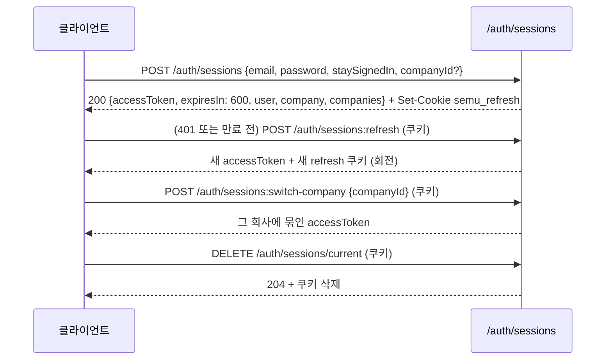
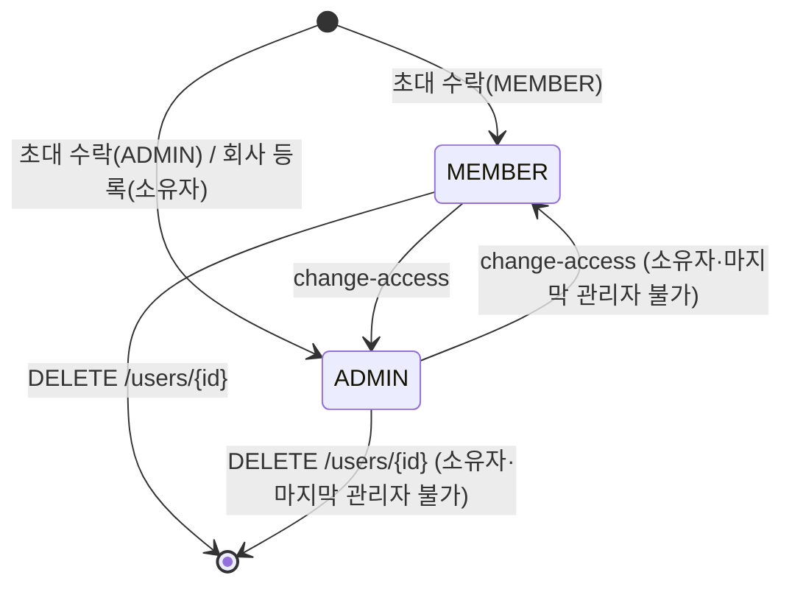
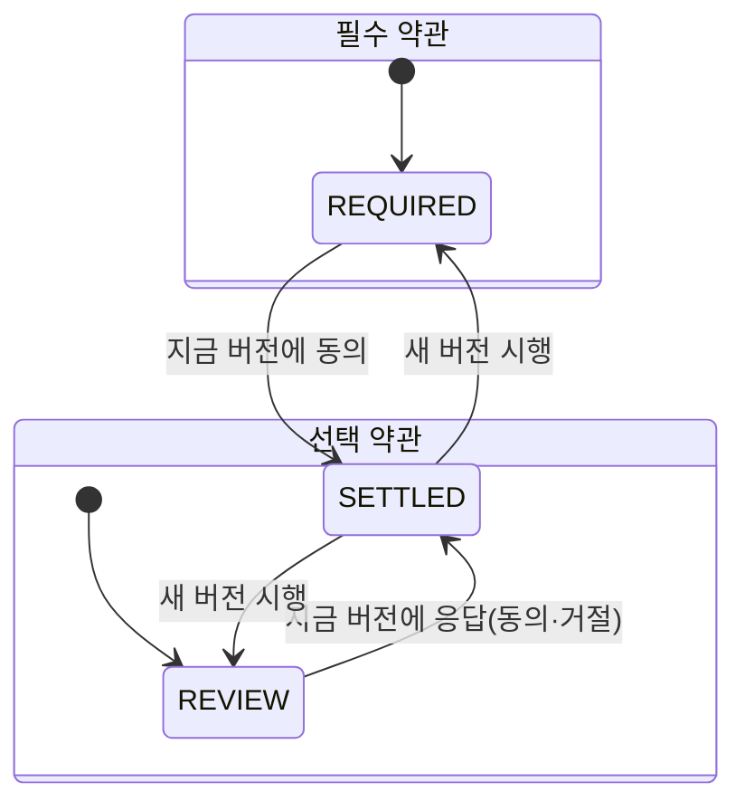
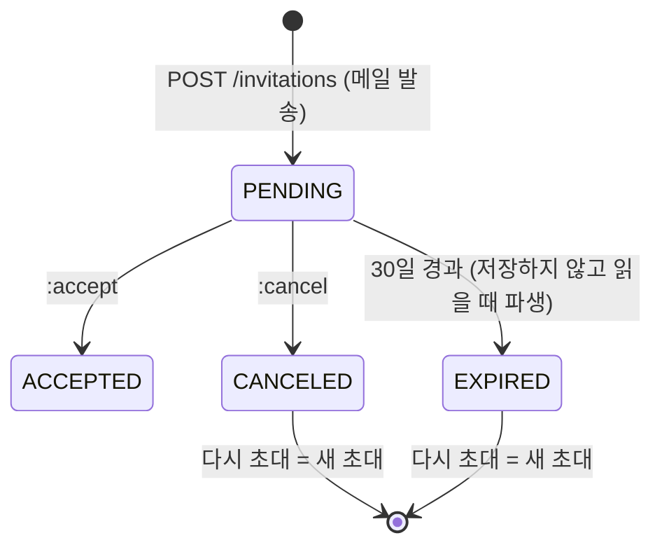

# Identity & Access: 회사·사용자·권한·세션·약관

회사(테넌트), 사용자와 소속, 세무 대리인 배정, 권한 그룹, 로그인 세션, 약관 동의, 구성원 초대, 감사 로그를 다룹니다. 다른 모든 컨텍스트는 이 컨텍스트가 넣어 주는 `CurrentActor`와 `authorize`로만 접근을 판정합니다. 코드는 [`apps/api/src/modules/identity-access/`](../../apps/api/src/modules/identity-access/)에 있습니다.

## 현행에서 고칠 점

| 현행 | 문제 | 재설계 |
|---|---|---|
| nexus 쿠키 세션 + CSRF와 회사 JWT 두 인증 방식. JWT를 `localStorage`에 두고 `window.__CLAIR_GET_JWT`로 노출 (P5) | XSS 한 번이면 회사 토큰이 샙니다. 두 방식의 만료가 따로 놉니다 | 짧은 access token(10분, `Authorization` 헤더) + `HttpOnly; Secure; SameSite=Strict; Path=/v1/auth` refresh 쿠키. CSRF 토큰이 필요 없습니다 |
| 앱 초기화가 nexus `/user/me` + sf `/member/profile`을 합치고 이메일이 다르면 로그아웃 (P2) | 원자성이 없고 두 ID 체계가 섞입니다 | 로그인·refresh 응답 하나가 사용자·회사·플랜·전환 대상을 함께 줍니다. `/me`가 계산된 권한을 줍니다 |
| 회사 ID가 nexus ID와 `sfCompanyId` 둘. 경로마다 회사 ID (P3) | 클라이언트가 문자열로 비교하고, 다른 회사 ID를 넣는 실수를 서버가 막지 못합니다 | 회사 ID는 하나(`cmp_…`). **토큰 하나 = 회사 하나**이고 경로에 회사 ID가 없습니다. 전환은 `POST /auth/sessions:switch-company` |
| 메뉴 노출·업셀·약관 재동의를 클라이언트가 판정 (P1) | 서버 API는 열려 있어 우회됩니다 | 권한(`resource:action`)·플랜·약관을 서버가 계산해 `Actor`에 담고, 엔드포인트마다 `authorize`로 막습니다. `/me`가 `permissions`·`promotions`·`pendingTermCodes`를 내려 화면은 그리기만 합니다 |
| 권한 그룹이 메뉴 ID 묶음 | 메뉴 개편이 권한 데이터를 깨뜨립니다. 관리자 전용 행위가 메뉴로 표현되지 않습니다 | 권한 그룹은 권한 문자열 프리셋입니다. 메뉴 코드는 [대응표](#현행-메뉴-코드--권한)로 옮깁니다. 관리자 전용 동작은 그룹에 넣을 수 없습니다 |
| 약관 재동의 판정이 `history.isAgreed`에서 null로 터짐. 버전을 타입 섞어 비교 | 신규 사용자 진입이 깨지고 `2`와 `"2"`가 다른 버전이 됩니다 | 서버가 `SETTLED`/`REQUIRED`/`REVIEW`로 판정합니다. 버전은 문자열입니다 |
| 데모 로그인이 `GET /member/demo/`로 비밀번호를 받아 다시 로그인 | 비밀번호가 응답에 실립니다 | `POST /auth/sessions:demo` 한 번. 데모 계정은 비밀번호 로그인을 막고 읽기 전용입니다 |

## 용어

| 용어 | 영문 | 뜻 |
|---|---|---|
| 회사 | `Company` | 테넌트. 모든 업무 데이터의 범위 |
| 사용자 | `User` | 로그인 주체. 이메일은 소문자로 정규화합니다 |
| 사용자 종류 | `UserKind` | `CLIENT`(고객사 사용자), `AGENCY_STAFF`(세무 대리인 담당자), `AGENCY_MANAGER`(팀장) |
| 소속 | `Membership` | 고객사 사용자와 회사의 관계. `access`는 `ADMIN`(현행 `is_admin`) 또는 `MEMBER` |
| 소유자 | `isOwner` | 회사를 등록한 사용자. 현행 `isSystemAdmin`. 강등·내보내기 불가 |
| 배정 | `AgencyAssignment` | 세무 대리인 담당자와 회사의 관계. 팀장은 팀원의 배정도 봅니다 |
| 행위자 | `Actor` | 토큰 하나가 나타내는 "회사 X에서의 사용자 Y". `kind`는 `CLIENT`·`AGENCY` |
| 권한 | `Permission` | `resource:action`. `resource:*`와 `*` 와일드카드 |
| 기본 권한 | `BASE_PERMISSIONS` | 모든 구성원이 갖는 권한(홈·AI 비서·지원사업·서식·급여 계산기 등 현행 "모두에게 열린 메뉴") |
| 권한 그룹 | `Role` | 회사별 권한 프리셋. 구성원에게 여럿 줄 수 있고 합집합입니다 |
| 그룹 템플릿 | `RoleTemplate` | 현행 `GET /api/perm/roles`의 기본 그룹(경리·인사·급여·세무·설정) |
| 플랜 | `Plan` | `TAXATION`(세무 기장), `PAYROLL`(급여 아웃소싱). Billing 구독에서 파생 |
| 프로모션 | `promotions` | 업셀을 보여 줄 플랜. 무료 회사는 모든 플랜, 본사 대리인 회사는 빠진 급여 플랜 |
| 약관 용도 | `TermPurpose` | `SIGNUP`, `TAX`, `CONSULTING` |
| 세션 | `Session` | 로그인 한 번. refresh token 회전의 단위 |
| 가입 토큰 | `onboardingToken` | 회사가 없는 사용자가 `POST /companies`에만 쓰는 토큰 |

## 행위자와 권한 계산

토큰을 발급할 때(로그인·refresh·전환) `ActorDirectory.resolve(userId, companyId)`가 행위자를 계산해 토큰에 묶습니다. 요청마다 다시 계산하지 않으므로, 계산 근거가 바뀌면 [access token 폐기](#토큰-무효화)로 다음 refresh에서 새로 계산하게 합니다.

| 행위자 | 근거 | 권한 |
|---|---|---|
| `CLIENT` + `ADMIN` | 소속 | `*` |
| `CLIENT` + `MEMBER` | 소속 | `BASE_PERMISSIONS` ∪ 부여한 그룹들의 권한 |
| `AGENCY` | 배정(본인 또는 팀원) | `*`. 약관 게이트를 건너뜁니다 |

- 플랜은 Billing이 구현하는 `CompanyPlans` 포트에서 가져옵니다
- `pendingTermCodes`는 지금 회사에 적용되는 용도(`SIGNUP`, 회사가 `TAXATION`이면 `TAX`)의 필수 약관 중 동의하지 않은 코드입니다
- 데모 계정(`isDemo`)은 `:read`가 아닌 권한을 쓰는 요청을 모두 거절당합니다

`authorize({ permission, plans?, requiresTerms? })`의 판정 순서는 **플랜 → 권한 → 약관 → 데모 쓰기**입니다. 플랜이 먼저인 이유는 권한이 있어도 구독이 없으면 업셀(403 `ENTITLEMENT_REQUIRED`)을 보여야 하기 때문입니다. 메뉴 트리는 서버가 내리지 않고, 클라이언트가 `/me`로 권한 → 플랜 순서로 그립니다.

### 권한 카탈로그

다른 컨텍스트의 `authorize` 문자열은 [`permission-catalog.ts`](../../apps/api/src/modules/identity-access/permissions/permission-catalog.ts)의 표에 있어야 합니다. **관리자 전용** 동작은 권한 그룹에 넣을 수 없고, 관리자 전용 동작이 있는 리소스는 `resource:*`로도 줄 수 없습니다.

| 영역 | 리소스: 동작 (굵게 = 관리자 전용) | 플랜 |
|---|---|---|
| 설정 | `company`: read, update · `member`: read, **update**, **remove** · `role`: read, **create**, **update**, **delete** · `invitation`: read, **create**, **cancel** · `audit-log`: **read** | |
| 구독·결제 | `subscription`: read · `payment`: read · `billing-mandate`: read, create · `consultation`: create | |
| | `service-contract`: read · `company-document`: read, upload | TAXATION |
| 연동 | `integration`: CRUD · `scrap-request`: read, create · `certificate`: read, create, delete · `external-service`: read, manage · `business-status`: read · `messenger-channel`: link | |
| | `hometax-delegation`: read, agree | TAXATION |
| AI 비서 | `conversation`: read, create, delete · `grant`: read | |
| 인사·문서 | `employee`: CRUD | TAXATION 또는 PAYROLL |
| | `document-form`: read | |
| | `esign-request`: read, create, send, cancel · `esign-template`: CRUD · `certificate-issuance`: read, create | PAYROLL |
| 급여 | `payroll-ledger`: CRUD, approve · `payslip`: read, send | TAXATION 또는 PAYROLL |
| | `payroll-setting`: read, update · `severance-settlement`: CRUD | PAYROLL |
| | `labor-cost-report`: read | TAXATION |
| | `salary-calculation`: create | |
| 경리 | `evidence`: CRUD, classify · `bank-account`: read, update · `bank-transaction`: read, update · `partner`: CRUD · `tax-invoice`: read, issue · `sales-transaction`: CRUD · `giro`: read, pay · `account-title`: read, update · `classification-rule`: CRUD · `realtime-report`: read | |
| | `settlement-report`: read | TAXATION |
| 세무 | `vat-filing`·`withholding-tax-filing`·`corporate-tax-filing`·`income-tax-filing`: read, update, submit | TAXATION |
| | `estimated-vat`: read · `action-card`: read, update | |

`BASE_PERMISSIONS`: `company:read`, `action-card:read`, `conversation:read|create|delete`, `grant:read`, `document-form:read`, `salary-calculation:create`, `business-status:read`, `messenger-channel:link`, `consultation:create`.

### 현행 메뉴 코드 → 권한

이관할 때 현행 권한 그룹의 메뉴 코드를 권한으로 바꿉니다(`permissionsForLegacyMenus`). "모두"는 권한 그룹 없이 열린 메뉴로, 기본 권한이 덮습니다.

| 메뉴 코드 | 권한 | 플랜 |
|---|---|---|
| `today`, `ai_agent`, `grant_recommendation`, `document_form`, `salary_calculator` | 모두 | |
| `realtime_*`, `estimated_vat` | `realtime-report:read`, `estimated-vat:read` | |
| `report_*`, `settlement_reports_*` | `settlement-report:read` | TAXATION |
| `bookkeeping_*`, `settings_accounting` | 해당 경리 리소스(`evidence:*`, `bank-transaction:*`, `partner:*`, `tax-invoice:*`, `giro:*`, `account-title:*`, `classification-rule:*` …) | |
| `employee_management` | `employee:*` | TAXATION |
| `employment_employee` | `employee:*` | PAYROLL |
| `employment_e_sign`, `settings_e_sign` | `esign-request:*`, `esign-template:*` | PAYROLL |
| `employment_certificate` | `certificate-issuance:*` | PAYROLL |
| `payroll_settlement`, `payroll_management` | `payroll-ledger:*`, `payslip:*` | PAYROLL |
| `payroll_setting` | `payroll-setting:*` | PAYROLL |
| `severance_pay_settlement` | `severance-settlement:*` | PAYROLL |
| `tax_surtax`, `tax_withholding`, `tax_corporation`, `tax_aggr_income` | `vat-filing:*`, `withholding-tax-filing:*`, `corporate-tax-filing:*`, `income-tax-filing:*` | TAXATION |
| `company_management` | `company:*` | |
| `user_management` | `member:read`, `role:read`, `invitation:read` (초대·권한 변경은 관리자만) | |
| `integrate_tax`, `integrate_transaction` | `integration:*`, `scrap-request:*` | |
| `cert_management` | `certificate:*` | |
| `external_services` | `external-service:*` | |
| `service_payment` | `subscription:read`, `payment:read`, `billing-mandate:*` | |
| `contract_consent` | `service-contract:read`, `company-document:*`, `hometax-delegation:*` | TAXATION |

## 리소스

| 리소스 | 경로 | 비고 |
|---|---|---|
| 세션 | `/auth/sessions` | 인증 전. refresh 쿠키 |
| 나 | `/me` | 약관 게이트에 걸려도 부를 수 있습니다 |
| 약관 | `/terms`, `/me/term-agreements` | `/terms`는 인증 전 |
| 지금 회사 | `/companies/current` | ETag/`If-Match` |
| 회사 등록 | `/companies` | access token 또는 `onboardingToken` |
| 구성원 | `/users`, `/users/{userId}` | 세무 대리인 배정은 나오지 않습니다 |
| 권한 그룹 | `/roles`, `/role-templates`, `/permissions` | `/permissions`는 그룹에 넣을 수 있는 권한만 |
| 초대 | `/invitations`, `/invitations:preview`, `/invitations:accept` | 링크 토큰은 본문으로 받습니다 |
| 감사 로그 | `/audit-logs` | 관리자 전용 |

## 세션과 토큰

- refresh token은 `<sessionId>.<secret>`이고 저장소에는 secret의 SHA-256만 둡니다. 쿠키 수명은 1일, `staySignedIn`이면 14일
- **회전과 재사용 탐지:** refresh마다 secret을 바꾸고 이전 해시를 기억합니다. 이전 secret이 다시 오면 탈취로 보고 세션을 폐기합니다(401 `SESSION_INVALID`, 감사 `SESSION_REUSE_DETECTED`)
- refresh·전환·로그아웃은 그 세션의 이전 access token을 즉시 폐기합니다
- 회사 선택: 요청한 `companyId`(접근 불가면 404) → 마지막으로 쓴 회사 → 가장 먼저 소속된 회사. 회사가 없으면 access token 대신 `onboardingToken`을 줍니다
- 로그인 실패: 모르는 이메일과 틀린 비밀번호는 같은 401 `INVALID_CREDENTIALS`. 연속 5회 틀리면 423 `ACCOUNT_LOCKED`(해제는 비밀번호 재설정, 미구현)
- 비밀번호는 scrypt(N=16384, r=8, p=1)로 저장합니다. 정책은 8–20자, 영문·숫자 포함, 공백 불가([password-policy](../reference/rules/password-policy.md))
- 비밀번호 변경(`POST /me/password:change`)은 그 사용자의 모든 세션을 폐기합니다

### 토큰 무효화

행위자 계산의 근거가 바뀌면 `Sessions.invalidateAccess(userId, companyId?)`로 그 사용자의 access token만 폐기합니다. 세션은 남으므로 클라이언트는 401을 받고 refresh로 새 권한을 받습니다.

| 원인 | 대상 |
|---|---|
| 구성원 접근 수준·그룹 변경, 내보내기 | 그 사용자, 그 회사 |
| 권한 그룹 수정·삭제 | 그 그룹을 가진 구성원 |
| 약관 응답 | 응답한 사용자 |
| 초대 수락 | 수락한 사용자 |

플랜 변경(구독 시작·해지)은 Billing 이벤트를 받아 같은 방식으로 폐기할 예정입니다. 그 전까지는 access token 수명(10분)이 지연의 상한입니다.

## 회사

- `GET /companies/current`는 `company:read`(기본 권한), `PATCH`는 `company:update`(관리자). `If-Match` 버전이 다르면 412
- 상호·사업자등록번호·사업자 형태는 등록 때 정하고 바꾸지 않습니다. 급여 지급일 등 업무 설정은 각 컨텍스트가 가집니다
- `POST /companies`: 사업자등록번호 검증 숫자([business-number-checksum](../reference/rules/business-number-checksum.md))가 틀리면 422, 이미 등록된 번호면 409. 등록한 사용자가 소유자 관리자가 되고, 클라이언트는 `:switch-company`로 그 회사 토큰을 받습니다
- 회사의 세무 대리인(`agency.kind` = `HQ`|`BRANCH`)은 배정 데이터에서 읽습니다. 본사 담당 회사는 급여 프로모션을 봅니다

## 구성원

- `POST /users/{userId}:change-access {access, roleIds}`: 관리자는 그룹을 갖지 않으므로 `ADMIN`이면 `roleIds`를 비웁니다. 없는 그룹이면 404 `ROLE_NOT_FOUND`
- 소유자는 409 `OWNER_IMMUTABLE`, 마지막 관리자는 409 `LAST_ADMIN`
- 내보내도 계정은 남습니다. 회사가 하나도 없게 된 사용자는 다음 로그인에서 `onboardingToken`을 받습니다

## 권한 그룹

- `POST /roles {name, permissions, templateCode?}`: 관리자 전용 권한이나 카탈로그에 없는 권한은 422 `PERMISSION_NOT_GRANTABLE`(거절한 권한 목록 포함). 같은 이름은 409
- `PUT /roles/{roleId}`(`If-Match`)는 그룹 전체를 바꿉니다. `DELETE`는 구성원에게서 그룹을 떼고 지웁니다
- 응답의 `memberCount`가 현행 `GET …/perm/role/:rid/company-users`를 대신합니다. 그룹별 구성원 목록이 필요하면 `/users`를 `roleIds`로 거릅니다

## 약관

- 적용 용도: `SIGNUP`은 모두, `TAX`는 **지금 회사**가 `TAXATION`일 때(현행은 "소속 회사 중 하나라도")
- `REQUIRED`가 남으면 `pendingTermCodes`에 들어가고, `requiresTerms: true`인 제품 API가 403 `TERMS_REAGREEMENT_REQUIRED`입니다. `REVIEW`는 막지 않고 `/me.termCodesToReview`로 안내만 합니다
- `POST /me/term-agreements {decisions:[{termId, agreed}]}`: 필수 약관 거절은 422 `REQUIRED_TERM_DECLINED`, 지금 버전이 아닌 ID는 409 `TERM_VERSION_OUTDATED`
- 가입·초대 수락은 `SIGNUP` 필수 약관을 모두 덮어야 합니다(422 `REQUIRED_TERMS_MISSING`)

## 초대

- 관리자 전용(`invitation:create|cancel`). 회사·이메일당 `PENDING`은 하나(409 `INVITATION_ALREADY_PENDING`, 기존 `invitationId` 포함), 이미 구성원이면 409 `INVITEE_ALREADY_MEMBER`
- 링크 토큰은 메일에만 실리고 저장소에는 SHA-256만 남습니다. 경로 대신 본문으로 받아 접근 로그에 남지 않게 합니다
- 수락: 계정이 있으면 그 계정으로 로그인한 상태(`Authorization`)이거나 비밀번호를 보내야 합니다. 다른 계정으로 로그인했으면 403 `INVITATION_ACCOUNT_MISMATCH`. 계정이 없으면 이름·비밀번호·필수 약관으로 가입합니다. 성공하면 그 회사에 묶인 세션을 엽니다
- 닫힌 초대의 수락·취소는 410 `INVITATION_CLOSED`(`reason`: 만료·취소·수락됨)
- 목록 응답의 `allowedActions`(`CANCEL`|`REINVITE`)와 `remainingDays`(올림)로 화면이 버튼과 문구를 정합니다

## 데모

`POST /auth/sessions:demo`가 공용 데모 계정(`demo@semu.example`)으로 세션을 엽니다. 데모 계정은 비밀번호 로그인·비밀번호 변경을 막고, `authorize`가 읽기 외 요청을 403으로 거절합니다. 데모 회사 데이터는 각 컨텍스트의 데모 시드가 채웁니다.

## 감사 로그

`AuditLog`는 덧붙이기만 합니다. 로그인 성공·실패·잠금, 로그아웃, refresh 재사용, 회사 전환, 비밀번호 변경, 회사 등록·수정, 구성원 접근 변경·내보내기, 그룹 생성·수정·삭제, 초대 생성·취소·수락, 약관 응답을 남깁니다. `GET /audit-logs`는 최근 것부터 커서 페이지로 돌려줍니다. 쓰기 요청 전체의 before/after 감사는 [conventions.md](conventions.md#감사와-열람-기록)가 따로 다룹니다.

## 다른 컨텍스트와의 계약

| 방향 | 이름 | 형태 |
|---|---|---|
| 제공 | `CurrentActor`, `authorize`, `decideAccess`, `Authentication` | 모든 그룹이 씁니다 |
| 포트(Billing 구현) | `CompanyPlans` | `plansOf(companyId): Effect<ReadonlySet<Plan>>` |
| 포트(알림 구현) | `Mailer` | `send({to, template: INVITATION\|PASSWORD_RESET\|EMAIL_VERIFICATION, token, data})` |
| 받을 이벤트(예정) | `SubscriptionStarted`/`SubscriptionEnded` | 그 회사 사용자들의 access token 폐기 |

## 오류 코드

| 코드 | 상태 | 뜻 |
|---|---|---|
| `INVALID_CREDENTIALS` | 401 | 이메일·비밀번호가 틀림(구분하지 않음) |
| `ACCOUNT_LOCKED` | 423 | 연속 5회 실패로 잠김 |
| `SESSION_INVALID` | 401 | refresh 쿠키가 없거나 만료·폐기·재사용 |
| `UNAUTHENTICATED` | 401 | access token이 없거나 만료·폐기 |
| `PASSWORD_POLICY_VIOLATED` | 422 | `violations[].code`: `PASSWORD_LENGTH`, `PASSWORD_LETTER_REQUIRED`, `PASSWORD_DIGIT_REQUIRED`, `PASSWORD_WHITESPACE` |
| `DEMO_READ_ONLY` | 403 | 데모 계정의 변경 시도 |
| `COMPANY_NOT_FOUND` | 404 | 없거나 접근할 수 없는 회사(구분하지 않음) |
| `BUSINESS_NUMBER_INVALID` | 422 | 사업자등록번호 검증 숫자 오류 |
| `COMPANY_ALREADY_REGISTERED` | 409 | 같은 사업자등록번호의 회사가 있음 |
| `MEMBER_NOT_FOUND` | 404 | 이 회사의 구성원이 아님 |
| `OWNER_IMMUTABLE` | 409 | 소유자 강등·내보내기 |
| `LAST_ADMIN` | 409 | 마지막 관리자 강등·내보내기 |
| `ROLE_NOT_FOUND` | 404 | 없는 권한 그룹 |
| `PERMISSION_NOT_GRANTABLE` | 422 | 그룹에 넣을 수 없는 권한(`permissions`) |
| `ROLE_NAME_TAKEN` | 409 | 같은 이름의 그룹 |
| `INVITATION_NOT_FOUND` | 404 | 없는 초대 또는 링크 토큰 |
| `INVITEE_ALREADY_MEMBER` | 409 | 이미 구성원 |
| `INVITATION_ALREADY_PENDING` | 409 | 대기 중인 초대가 있음(`invitationId`) |
| `INVITATION_CLOSED` | 410 | 만료·취소·수락된 초대(`reason`) |
| `INVITATION_ACCOUNT_MISMATCH` | 403 | 초대받은 이메일이 아닌 계정 |
| `REQUIRED_TERM_DECLINED` | 422 | 필수 약관 거절 |
| `TERM_VERSION_OUTDATED` | 409 | 지금 버전이 아닌 약관 ID |
| `REQUIRED_TERMS_MISSING` | 422 | 가입에 필요한 약관 동의가 빠짐 |
| `PERMISSION_DENIED`, `ENTITLEMENT_REQUIRED`, `TERMS_REAGREEMENT_REQUIRED`, `VERSION_MISMATCH`, `VALIDATION_FAILED` | | 공통([conventions.md](conventions.md#오류)) |

## 현행 엔드포인트 대응

번호는 [platform 스펙 §5](../reference/spec/platform.md#5-엔드포인트-표)입니다. 다른 컨텍스트로 간 엔드포인트는 해당 문서에 있습니다.

| # | 현행 | 재설계 |
|---|---|---|
| 1 | `POST /api/login/` | `POST /auth/sessions` |
| 2 | `POST /api/login/social/` | 미구현. `POST /auth/sessions:social`(카카오) 예정 |
| 3 | `GET /api/login/overtax/` | 미구현. 제휴 SSO는 `POST /auth/sessions:partner` 예정 |
| 4 | `POST /api/logout/` | `DELETE /auth/sessions/current` |
| 5 | `GET /api/user/me/` | `GET /me` (로그인 응답의 `companies`) |
| 6 | `POST /api/user/me/jwt/` | `POST /auth/sessions:switch-company` |
| 7 | `PATCH /api/user/me/password-change/` | `POST /me/password:change` |
| 8 | `GET /api/user/me/term-agreements/` | `GET /me/term-agreements` |
| 9 | `PATCH /api/user/me/term-agreements/` | `POST /me/term-agreements` |
| 10 | `GET /api/terms/` | `GET /terms?purpose=` |
| 11–13 | 비밀번호 재설정 토큰 확인·재설정·메일 | 미구현. `POST /auth/password-resets`(202), `POST /auth/password-resets:complete` 예정 |
| 14 | `GET /api/pre-signup/check/business_number/` | `POST /companies`의 422/409로 대신. 사전 확인은 미구현(`GET /companies:check?businessNumber=` 검토) |
| 15–17 | 이메일 중복 확인·인증 메일·이메일 가입 | 미구현. `POST /auth/signups`, `:verify` 예정 |
| 18 | `POST /api/signup/user/invitation/:token/` | `POST /invitations:accept` |
| 19 | `POST /api/signup/company/` | `POST /companies` |
| 20 | `POST /api/signup/company/:token/` | 미구현(수임 초대 기반 등록, Billing 리드와 함께) |
| 21–24 | `/api/external/*` 파트너 연결 | 미구현. 파트너 키 인증 그룹 예정 ([billing.md](billing.md)) |
| 25–26 | 공개 상담 신청, CMS 출금 동의 | [billing.md](billing.md) |
| 27–28 | 게스트 약관 동의 조회·저장 | 미구현. 상담 리드의 `CONSULTING` 약관 동의는 Billing이 `Terms.current('CONSULTING')`로 기록 예정 |
| 29 | `GET /api/member/profile/` | 사라짐. `GET /me` |
| 30 | `GET /api/member/demo/` | `POST /auth/sessions:demo` |
| 31 | `GET /api/member/active_invitations/` | 미구현. 회사 없는 사용자의 `GET /me/invitations` 예정 |
| 32–33 | 상담 채널 토큰 | [integrations.md](integrations.md) |
| 34–36 | 가입 초대 확인·이메일 인증·약관 동의(sf) | [billing.md](billing.md)(수임 가입 흐름) |
| 37–44 | 기장료 계산, 직접 계약, 리드 | [billing.md](billing.md) |
| 45 | `GET /api/company/:cid/` | `GET /companies/current` |
| 46 | `PATCH /api/company/:cid/` | `PATCH /companies/current` |
| 47 | `GET /api/company/:cid/user/` | `GET /users` (초대는 `GET /invitations`) |
| 48 | `GET /api/company/:cid/user/:uid/` | `GET /users/{userId}` |
| 49 | `GET /api/company/:cid/user/invitation/` | `POST /invitations`의 409로 대신 |
| 50 | `PUT /api/company/:cid/user/:uid/permissions/` | `POST /users/{userId}:change-access` |
| 51 | `DELETE /api/company/:cid/user/:uid/` | `DELETE /users/{userId}` |
| 52 | `GET …/user/:uid/permission-check/` | 사라짐. `/me.permissions` |
| 53–56 | 메뉴 트리·접근 메뉴·회사 메뉴 | 사라짐. 클라이언트가 `/me`의 `permissions`·`plans`·`promotions`로 그립니다 |
| 57–58 | 메뉴 즐겨찾기 | 미구현. `/me/favorites` 예정(메뉴 ID 대신 화면 키) |
| 59 | `GET /api/company/:cid/internal-invitation/` | `GET /invitations` |
| 60 | `POST /api/company/:cid/internal-invitation/` | `POST /invitations` |
| 61 | `DELETE …/internal-invitation/:invId/` | `POST /invitations/{invitationId}:cancel` |
| 62 | `GET /api/internal-invitation/:token/` | `POST /invitations:preview` |
| 63 | `POST /api/internal-invitation/:token/accept/` | `POST /invitations:accept` |
| 64 | `GET /api/perm/menus` | `GET /permissions` |
| 65 | `GET /api/perm/roles` | `GET /role-templates` |
| 66–69 | 권한 그룹 목록·생성·수정·삭제 | `GET/POST /roles`, `PUT/DELETE /roles/{roleId}` |
| 70 | `GET …/perm/role/:rid/company-users` | `Role.memberCount` + `GET /users` |
| 71–74 | 구독, 회사 상담, 결제 내역, 구독 프록시 | [billing.md](billing.md) |
| 75 | `GET /api/company/:sid/` (sf) | `GET /companies/current` (`agency` 포함) |
| 76–77 | `GET/PATCH /api/settings/company/:sid/` | `GET/PATCH /companies/current` |
| 78–81 | 첨부·양식·계약서 | [billing.md](billing.md) |
| 82–83 | 홈택스 수임동의 | [integrations.md](integrations.md) |

## 구현 상태

| 항목 | 상태 |
|---|---|
| 로그인·refresh 회전·재사용 탐지·전환·로그아웃·데모·잠금 | 구현 (`sessions/`) |
| `/me`, 비밀번호 변경 | 구현 |
| 약관 조회·응답, 약관 게이트 | 구현 |
| 지금 회사 조회·수정, 회사 등록 | 구현 |
| 구성원 목록·상세·접근 변경·내보내기 | 구현 |
| 권한 그룹 CRUD, 템플릿, 권한 목록 | 구현 |
| 초대 생성·목록·취소·미리보기·수락(가입 포함) | 구현 |
| 감사 로그 조회 | 구현 |
| 행위자 계산(소속·배정·팀장·플랜·약관·프로모션) | 구현 (`access/actor-directory.ts`) |
| access token 만료 | `AccessTokens.layerExpiring` 구현. 서버 진입점 교체는 공유 변경 필요 |
| 비밀번호 재설정, 이메일 가입, 소셜·제휴 로그인, 파트너 연결, 즐겨찾기, 회사 없는 사용자의 초대 목록 | 미구현 |
| 구독 변경 이벤트로 토큰 폐기 | 미구현 (Billing 이벤트 대기) |
| 저장소 | 메모리 구현만 |

## 열린 질문

1. 로그인 잠금 해제를 비밀번호 재설정으로만 할지, 시간(예: 30분)으로도 풀지 정해야 합니다
2. 회사 없는 사용자의 화면(현행 `/no-company`, `/register-company`)에서 받은 초대 목록을 보일 엔드포인트가 필요합니다(`GET /me/invitations`)
3. 세무 대리인 담당자가 회사 정보를 수정하거나 구성원을 관리하는 것을 허용할지(지금은 `*`) 데스크 업무 범위와 맞춰야 합니다
4. 플랜 변경을 토큰에 즉시 반영하려면 Billing의 구독 이벤트를 받아야 합니다. 이벤트 이름과 시점을 [events.md](events.md)에서 합의해야 합니다
5. 세무 약관(혜움 약관) 목록과 코드는 매뉴얼에만 있어 실제 약관 카탈로그를 받아야 합니다
6. 그룹별 구성원 조회를 `/users?roleId=` 필터로 둘지 정해야 합니다
