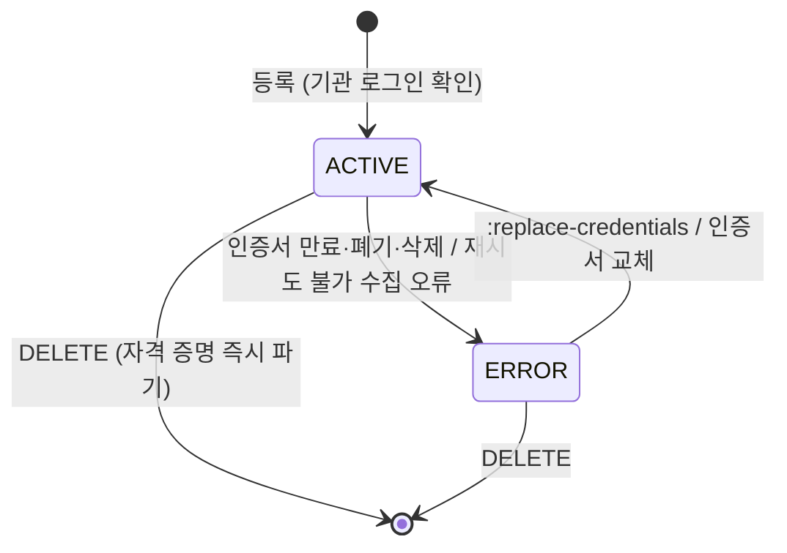
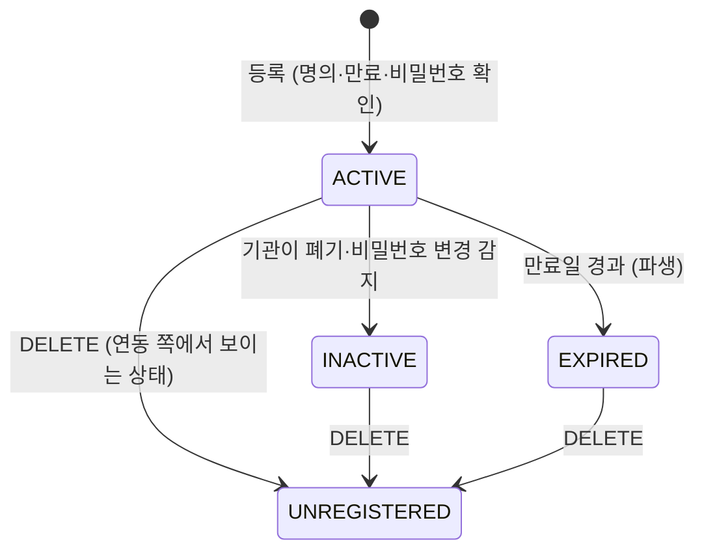
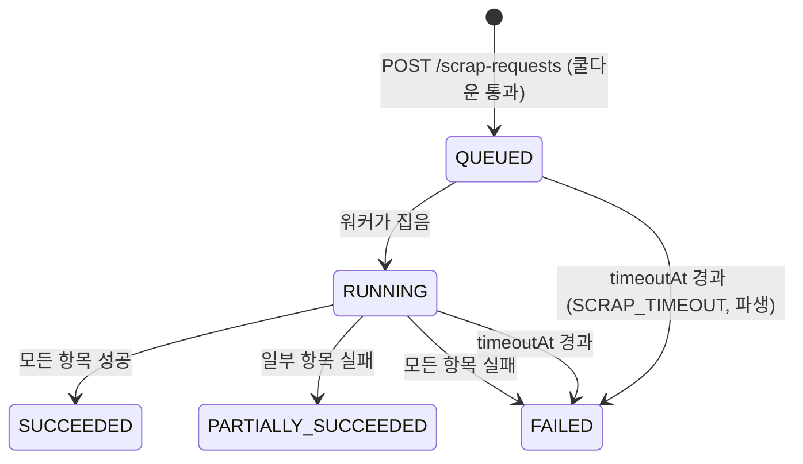
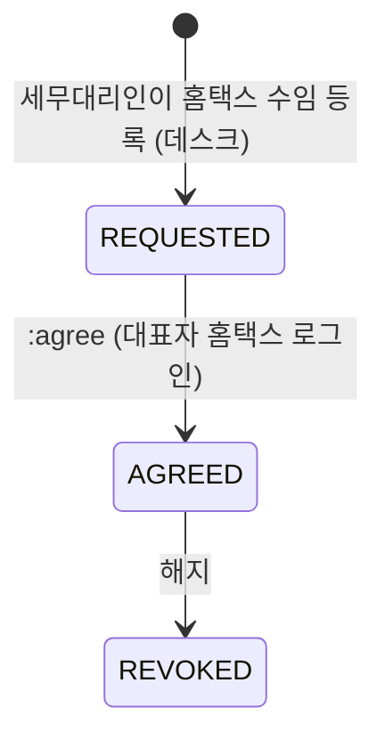
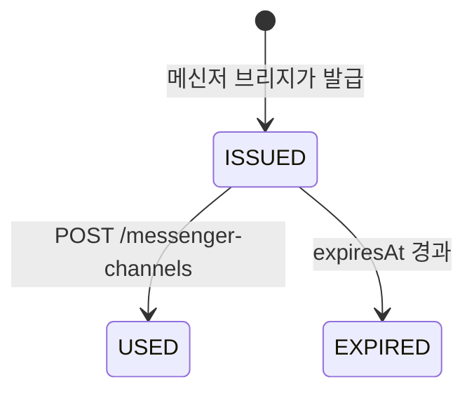

# Integrations: 기관 연동·인증서·수집

회사가 외부 기관(홈택스·여신금융협회·카드사·은행·인터넷지로·PG·배달앱·쇼핑몰)에 로그인할 자격 증명을 맡기고, 서버가 그 자격으로 거래 내역을 수집해 Bookkeeping으로 넘기는 일을 다룹니다. 공동인증서 보관, 홈택스 세무대리인 수임동의, 사업자 상태조회, 상담 채널 연결도 여기에 둡니다.

코드는 [`apps/api/src/modules/integrations/`](../../apps/api/src/modules/integrations/)에 있습니다.

## 현행에서 고칠 점

- **유형마다 경로와 응답이 다릅니다.** `/integrations/hometax`, `/integrations/creditcard/:id/:cardId`, `/integrations/bank/accounts`, `/integrations/pg/scrap-request`, `/integrations/v2/` 등 45개 경로가 같은 개념(연동·항목·수집)을 유형별로 따로 표현합니다. 상세(`v2`)와 상태 화면(`status`) 응답 모양도 다릅니다
- **수집 상태가 두 축입니다.** 요청은 `request|done|timeout`, 폴링은 `PROGRESS|SUCCESS|FAIL`이고, 일부 항목만 실패해도 묶음 전체가 `FAIL`로 보입니다
- **쿨다운과 재시도 판정이 화면에 있습니다.** 재시도 버튼은 기관 유형마다 다른 클라이언트 식(B:91826)으로 켜고, 결과가 없을 때 기본값도 유형마다 다릅니다. 진행 중인 시스템 수집은 버튼을 막지만 남은 시간은 0초로 보입니다
- **기관별 제약이 매뉴얼에만 있습니다.** 지로는 인증서만, 하나·롯데·삼성 법인카드는 ID/PW만, 신한은행은 빠른조회 계정만이라는 규칙을 서버가 검사하지 않습니다. 인증서 연동 `가능`/`불가` 표시도 클라이언트가 계산합니다
- **오류 형태가 섞입니다.** 한도 초과·인증 방법 오류가 400 `VALIDATION_FAILED`(snake_case `field`)이고, 상담 채널은 영어 문장(`token is invalid`)을 클라이언트가 문자열로 비교합니다
- **등록이 120초 동기 호출입니다.** 후보 조회·등록·첫 수집이 수집 업체를 동기로 기다립니다
- **회사 ID가 둘입니다.** remittance는 `/api/company/:cid/...`, 상담 채널은 sf 회사 ID를 본문에 받습니다

## 용어

| 업무 용어 | 키 |
|---|---|
| 기관 연동 | `Integration` |
| 기관 종류 | `InstitutionType`: `HOMETAX`, `CARD_SALES`(여신금융협회), `CREDIT_CARD`(카드사), `BANK`, `SPEED_BANK`(빠른조회), `GIRO`(인터넷지로), `PG`, `DELIVERY`(배달앱), `ALLRA`(쇼핑몰) |
| 카드사·은행·PG사·배달앱 코드 | `institutionCode` |
| 인증 방법 | `authMethod`: `ID_PASSWORD`, `CERTIFICATE`, `SPEED_LOOKUP`, `API_KEY`, `OAUTH` |
| 카드·계좌·매장·SCM | `IntegrationItem` (`kind: CARD | ACCOUNT | STORE | SCM`, `key`) |
| PG 상점아이디 | `accountId`(= MID), 연동키 `keys` |
| 공동인증서 | `SigningCertificate` (`ownerType: PERSONAL | BUSINESS`, `usage: GENERAL | BANK | ETAX`) |
| 서명 비밀번호 | `signPassword` |
| 수집 요청 | `ScrapRequest` (`Job`) |
| 수동 / 정기 수집 | `requester: USER | SYSTEM` |
| 쿨다운 | `nextAvailableAt`, `retryAfterSeconds` |
| 세무대리인 수임동의 | `HometaxDelegation` |
| 사업자 상태 | `BusinessStatus` (`ACTIVE | SUSPENDED | CLOSED | UNREGISTERED`) |
| 상담 채널 | `MessengerChannel` (`KAKAOTALK | SLACK`) |

## 기관 연동

### 상태



- `status`는 저장하지 않고 파생합니다. 인증서 연동인데 인증서가 `ACTIVE`가 아니거나, 마지막 수집이 재시도할 수 없는 오류(비밀번호 오류·계정 잠김)로 끝났으면 `ERROR`입니다
- `allowedActions`: `SCRAP`(인증서가 쓸 수 있을 때), `RETRY`(마지막 수집이 재시도 가능한 오류로 실패했을 때), `REPLACE_CREDENTIALS`(OAuth 제외), `DELETE`. 항목도 `RETRY`, `ACTIVATE`/`DEACTIVATE`, `DELETE`를 가집니다
- 재시도 판정은 [scrap-retry.ts](../../apps/api/src/modules/integrations/integrations/scrap-retry.ts)의 식 하나입니다. 인증서 연동은 인증서가 `ACTIVE`일 때만, 그 밖에는 마지막 결과의 `isRetryable`(어댑터가 오류 코드로 분류)입니다. 홈택스 ID + 인증서 연동은 연동 둘이므로 각자 판정합니다

### 리소스

```
Integration
├─ type, institutionCode?, authMethod, isCorporate
├─ accountId?            # 로그인 ID 또는 PG MID (평문)
├─ certificateId?, certificateStatus?
├─ keys?                 # PG 공개 키 + 비밀 키는 "********"
├─ items[] { key, kind, institutionCode, name, numberMasked?, isActive, lastScrap?, allowedActions }
├─ canIssueTaxInvoice    # 홈택스 인증서 연동만 참
├─ usableForTaxFiling    # 세무사 프로그램으로 넘길 수 있는 연동 (인증서 연동은 거짓)
├─ ipWhitelist?          # 이니시스·나이스페이 대사 IP 52.78.5.241
├─ status, lastScrap?, allowedActions, version
```

```
GET    /integrations?type=                              → { items, limits[{ type, max, used, unit }] }
GET    /integrations/{integrationId}
POST   /integrations:list-candidates                    { type, authMethod, institutionCodes, isCorporate, 자격 증명 } → 카드·계좌·매장 후보
POST   /integrations                                    { …같은 입력, itemKeys? } → 201
POST   /integrations/{integrationId}:replace-credentials  { password? | certificateId? | keys? }
PATCH  /integrations/{integrationId}/items/{itemKey}    { isActive?, number? }   # 계좌 on/off, 카드번호 보정
DELETE /integrations/{integrationId}/items/{itemKey}
DELETE /integrations/{integrationId}
```

- **등록 순서:** 형식 확인 → 인증 방법·기관 수·PG 키·중복([integration-registration-limits](../reference/rules/integration-registration-limits.md)) → 인증서 확인 → 기관 로그인(후보 조회 또는 자격 확인) → 항목 한도 → 봉해서 저장. 판정은 [registration-limits.ts](../../apps/api/src/modules/integrations/integrations/registration-limits.ts)의 순수 함수입니다
- **기관별 인증 방법:** 홈택스 ID/PW·인증서(공존 가능), 여신협회 ID/PW, 카드사·은행 ID/PW(기관 하나씩)·인증서(여럿 한 번에), 빠른조회 전용 계정, 지로 인증서만, PG 연동키, 배달 ID/PW, 올라 OAuth. 하나·롯데·삼성 법인카드는 인증서를 받지 않습니다
- **한도:** 카드·계좌·배달 매장은 활성 항목 수, PG는 연동 수로 유형별 20입니다. 비활성 항목은 세지 않습니다
- **첫 수집은 등록과 분리합니다.** 등록은 기관 로그인 확인까지만 동기로 하고, 수집은 클라이언트가 `POST /scrap-requests`로 요청하거나 정기 스케줄러가 만듭니다
- 등록한 항목은 같은 유형의 다른 연동과 `key`가 겹치면 새 항목으로 세지 않습니다. 고른 항목이 모두 등록돼 있으면 409 `INTEGRATION_DUPLICATE`(`NO_NEW_ITEMS`)입니다

### 자격 증명 보관

- ID/PW, PG 비밀 키, 인증서 묶음·서명 비밀번호는 `CredentialVault`가 AES-256-GCM으로 봉해 저장합니다(`keyVersion` 포함). 서버는 `CredentialVault.layerDataKey`로 서버 데이터 키에서 HKDF로 파생한 키를 쓰고, 테스트와 `IntegrationsMemoryLive`만 고정 키(`layerMemory()`)를 씁니다. 데모 연동·인증서 자격 증명도 그 환경의 금고로 봉해 시드합니다. 운영에서는 KMS가 데이터 키를 감쌉니다 ([compliance.md](compliance.md#외부-기관-자격-증명))
- 원문은 수집 워커 경계 안에서만 엽니다. 응답·로그·감사 기록에는 로그인 ID와 PG 공개 키만 남습니다
- 인터넷지로 ID·비밀번호, 홈택스 수임동의용 대표자 로그인 정보는 어댑터로만 넘기고 저장하지 않습니다 (매뉴얼 약속)
- 연동을 지우면 봉한 자격 증명도 함께 지웁니다

### 업종 코드

- 현행 `get-business_types`/`update-business_types`는 홈택스에서 업종 코드를 긁어 회사 정보에 넣습니다. 재설계는 홈택스 수집 결과의 하나로 보고, 회사 업종의 주인인 Identity & Access에 이벤트로 넘깁니다. 지원사업 추천([grant-recommendation](../reference/rules/grant-recommendation.md))의 업종도 여기서 옵니다 (구현 전)

## 공동인증서

### 상태



- `EXPIRED`는 저장하지 않고 `expiresOn < 오늘(Asia/Seoul)`로 파생합니다. 만료일 당일까지는 씁니다
- 삭제는 소프트 삭제입니다. 그 인증서로 만든 연동은 `certificateStatus: UNREGISTERED`, `status: ERROR`가 됩니다

### 리소스

```
GET    /certificates                                     → { items: SigningCertificate[] }
POST   /certificates                                     로컬 프로그램 산출물 { name, oid, serialNumber, issuedOn, expiresOn, ownerBusinessNumber?, ownerName?, encryptedBundle, signPassword } → 201
DELETE /certificates/{certificateId}
POST   /certificates/{certificateId}:verify-password     { signPassword } → 204 | 422
POST   /certificates/{certificateId}:join-giro           { giroLoginId, giroPassword, email, phone, agreedToGiroTerms } → 204
```

- 응답에 `usableFor`(이 인증서로 연동할 수 있는 기관)를 넣습니다. 연동 화면의 `가능`/`불가`를 서버가 정합니다
- 등록 판정은 [certificate-eligibility.ts](../../apps/api/src/modules/integrations/certificates/certificate-eligibility.ts)입니다. OID 분류 → 만료 → 명의(사업자 인증서는 사업자번호, 개인 인증서는 개인사업자 대표자 이름, 법인은 개인 인증서 거절) → 일련번호 중복 → 서명 비밀번호(어댑터) 순서입니다
- 사용 판정: 홈택스는 사업자 범용·전자세금용, 지로·은행·카드사는 법인이면 사업자, 개인사업자면 대표자 개인 명의의 범용·은행용입니다. 세무신고 기관 연동은 인증서 연동을 쓰지 못합니다(`usableForTaxFiling: false`)
- 사업자번호·대표자 이름은 Identity & Access가 구현할 `CompanyProfiles` 포트로 읽습니다

## 수집 요청

### 상태



- 현행 `request|done|timeout`과 폴링 `PROGRESS|SUCCESS|FAIL` 두 축을 `Job` 상태 하나로 합칩니다. 항목별 결과는 `result.items[]{ integrationId, itemKey, status, code, isRetryable, recordCount }`입니다
- 타임아웃(600초)은 저장하지 않고 읽을 때 파생합니다

### 쿨다운

- 사용자 요청은 그 기관 종류(`institutionType`)에 600초 쿨다운을 남깁니다(`nextAvailableAt`). 정기(시스템) 수집은 쿨다운을 만들지 않습니다. 값은 기관 종류별 정책 표([scrap-cooldown.ts](../../apps/api/src/modules/integrations/scrap-requests/scrap-cooldown.ts))입니다
- 앞 요청이 타임아웃 전에 진행 중이면 `RUNNING`으로 막고, 남은 시간을 `retryAfterSeconds`로 알려 줍니다. 쿨다운 중이면 `COOLDOWN`입니다. 둘 다 429 `SCRAP_REQUEST_TOO_SOON`입니다
- 판정 근거는 [scrap-cooldown](../reference/rules/scrap-cooldown.md)입니다

### 리소스

```
POST /scrap-requests                     Idempotency-Key  { institutionType, integrationId?, itemKey?, options? } → 202 ScrapRequest
POST /scrap-requests:request-all         Idempotency-Key  → 202 { items: ScrapRequest[], skipped[{ institutionType, reason, retryAfterSeconds }] }
GET  /scrap-requests:availability        → { items[{ institutionType, isConnected, canRequest, reason?, retryAfterSeconds?, latestRequestId? }] }
GET  /scrap-requests?institutionType=
GET  /scrap-requests/{scrapRequestId}
```

- 수집 요청은 외부 기관을 부르므로 `Idempotency-Key`가 필수입니다. 같은 키는 처음 만든 요청을 돌려줍니다
- 큐는 `ScrapQueue` 포트입니다. 메모리 구현은 같은 프로세스의 `ScrapWorker`가 바로 처리합니다
- 워커는 자격 증명을 열어 `ScrapingGateway.scrape`를 부르고, 성공한 항목의 레코드를 `ScrapedRecordSink`로 넘기고, 연동·항목의 `lastScrap`을 갱신합니다
- 공용 작업 조회 `GET /jobs/{jobId}`는 두지 않습니다([D11](review.md#결정)). `/scrap-requests/{id}`가 그 역할을 합니다
- **정기 수집**은 공용 실행기([conventions.md 정기 작업](conventions.md#정기-작업))의 작업 `integrations.scrap.<기관>-<HHMM>`이 합니다. 시각표는 정책값 `SCHEDULED_SCRAP_TIMES`([scrap-schedule.ts](../../apps/api/src/modules/integrations/scrap-requests/scrap-schedule.ts))입니다
  - 은행·빠른조회 매일 07:00, 카드사·여신금융협회 매일 07:30, 홈택스 매일 08:00, PG 매일 10:00·22:00, 배달 플랫폼 매일 10:00, 올라 매일 06:00. 지로는 납부 경로라 정기 수집이 없습니다
  - 은행·카드는 현행 매뉴얼의 "은행 등록 후 1일 뒤 확인"을 매일 한 번(전날분)으로 정했습니다(2026-11-14, #109, 열린 질문 8). 이 문구는 등록 다음날부터 내역이 보인다는 안내로 읽었습니다(#119). 카드는 은행과 같은 공동인증서로 붙는 일이 많아 30분 띄웁니다. 시각은 정책값이라 바꿔도 다른 규칙에 영향이 없습니다
  - 홈택스는 동의한(`AGREED`) 수임동의가 있는 회사만 정기 수집합니다. 없으면 그 회사는 `DELEGATION_REQUIRED`로 건너뜁니다(아래 [수임동의 확인](#수임동의-확인))
  - 그 기관 종류의 연동이 있는 회사마다 한 트랜잭션으로 `requester: SYSTEM` 요청을 만듭니다. 멱등 키는 `schedule:<슬롯>#<기관 종류>`라 재시도해도 같은 슬롯의 요청은 하나입니다
  - 시스템 요청은 쿨다운(`nextAvailableAt`)을 남기지 않고 사용자 쿨다운에 막히지도 않습니다. 앞 요청이 진행 중(타임아웃 전)이면 그 슬롯은 건너뜁니다
  - 마지막 수집이 재시도할 수 없게 실패한(`status: ERROR`, 비밀번호 오류·계정 잠김·인증서 없음) 연동은 건너뜁니다. 그 종류의 연동이 모두 그렇다면 요청을 만들지 않습니다(`PAUSED`). 같은 자격 증명으로 매일 로그인해 기관 계정이 잠기는 일을 막습니다. 자격 증명을 바꾸거나 수동 수집이 성공하면 다시 돕니다([rule-decisions/integrations.md](rule-decisions/integrations.md#scrap-retryable) 질문 6)
  - 인증서 서명 비밀번호는 인증서와 함께 봉해 보관하므로([compliance.md](compliance.md)) 정기 수집이 사람 없이 자격 증명을 엽니다
  - 수집 기간은 기관 어댑터가 정합니다. 배달의 "5일치" 같은 기간을 요청 옵션으로 넘기지 않습니다

## 홈택스 수임동의



```
GET  /hometax-delegations
POST /hometax-delegations/{delegationId}:agree     { hometaxLoginId, hometaxPassword }
```

- 세무 기장(`TAXATION`) 플랜이 필요합니다. 홈택스 로그인 정보는 `HometaxDelegationClient`로만 넘기고 저장하지 않습니다

### 수임동의 확인

[compliance.md](compliance.md#권한-범위와-대리인)의 "수임동의가 없는 회사의 홈택스 수집은 거절"을 수집 요청이 확인합니다(#119). 동의한(`AGREED`) 수임이 하나라도 있으면 통과이고, 동의 대기(`REQUESTED`)·해지(`REVOKED`)는 세지 않습니다.

| 누가 | 확인 | 없을 때 |
|---|---|---|
| 세무대리인(`actor.kind: AGENCY`) 수동 수집 | 함 | 422 `HOMETAX_DELEGATION_REQUIRED`. 전체 수집은 홈택스를 `skipped`(`reason: DELEGATION_REQUIRED`)에 넣고, 수집 가능 여부도 같은 `reason`입니다 |
| 정기 수집(`requester: SYSTEM`) | 함 | 그 회사를 건너뜀(`DELEGATION_REQUIRED`) |
| 회사 사용자(`CLIENT`) 수동 수집 | 안 함 | 자기 자격 증명으로 수집합니다. 수임은 대리인이 자료를 볼 근거라 무료 회사에는 없습니다 |

판정은 [hometax-delegation.ts](../../apps/api/src/modules/integrations/hometax-delegations/hometax-delegation.ts)의 `hasAgreedDelegation`, 결정은 [rule-decisions/integrations.md](rule-decisions/integrations.md#scrap-cooldown) 질문 7입니다.
- `REQUESTED`를 만드는 쪽은 세무대리인 데스크(범위 밖)입니다

## 사업자 상태조회

```
GET /business-statuses/{businessNumber}     → { businessNumber, status, taxType?, closedOn? }
```

- 국세청 공공데이터 API를 `BusinessStatusClient` 포트로 감쌉니다. 거래처 등록, 회사 등록 전 확인에 씁니다

## 상담 채널



```
POST /messenger-channels:preview     { token } → { messengerType, channelName, expiresAt }
POST /messenger-channels             { token } → 201 MessengerChannel
GET  /messenger-channels
```

- 연결할 회사는 로그인한 회사입니다. 현행 본문 `company_id`(sf ID)를 없애고, 다른 회사로 연결하려면 회사를 전환합니다
- 토큰은 해시만 저장하고, 없음 → 사용됨 → 만료 순서로 판정합니다([chat-channel-token](../reference/rules/chat-channel-token.md))
- 권한은 `messenger-channel:link`(모든 구성원 기본 권한)입니다

## 권한

| 권한 | 엔드포인트 | 플랜 |
|---|---|---|
| `integration:read` | 연동 목록·상세 | |
| `integration:create` | 후보 조회, 등록, 지로 간편가입 | |
| `integration:update` | 자격 증명 교체, 항목 수정 | |
| `integration:delete` | 연동·항목 삭제 | |
| `certificate:read` | 인증서 목록, 서명 비밀번호 확인 | |
| `certificate:create` / `certificate:delete` | 인증서 등록 / 삭제 | |
| `scrap-request:read` / `scrap-request:create` | 수집 조회·가능 여부 / 수집 요청 | |
| `hometax-delegation:read` / `hometax-delegation:agree` | 수임동의 조회 / 동의 | `TAXATION` |
| `business-status:read` | 사업자 상태조회 | |
| `messenger-channel:link` | 상담 채널 미리보기·연결·목록 | |

## 오류 코드

| 상태 | 코드 | 언제 |
|---|---|---|
| 400 | `VALIDATION_FAILED` | 인증 방법에 필요한 자격 증명이 빠짐, ID 로그인으로 기관 여럿 |
| 404 | `INTEGRATION_NOT_FOUND`, `INTEGRATION_ITEM_NOT_FOUND`, `CERTIFICATE_NOT_FOUND`, `SCRAP_REQUEST_NOT_FOUND`, `HOMETAX_DELEGATION_NOT_FOUND` | 이 회사에 없음 |
| 409 | `INTEGRATION_DUPLICATE` (`reason: SAME_INTEGRATION | NO_NEW_ITEMS`) | 같은 연동, 새 항목 없음 |
| 409 | `CERTIFICATE_DUPLICATE` | 같은 일련번호 |
| 409 | `HOMETAX_DELEGATION_TRANSITION_INVALID` | 동의 대기가 아님 |
| 422 | `AUTH_METHOD_NOT_SUPPORTED` (`field`) | 기관이 받지 않는 인증 방법 |
| 422 | `INTEGRATION_LIMIT_EXCEEDED` (`field`, `limit`) | 유형별 20 초과 |
| 422 | `PG_KEYS_INVALID` (`reason: UNKNOWN_PG_COMPANY | MID_NOT_SUPPORTED | KEY_MISSING`, `missing`) | PG사·MID·키 |
| 422 | `INSTITUTION_CREDENTIAL_REJECTED` (`reason`, `isRetryable`) | 기관 로그인 실패 |
| 422 | `CERTIFICATE_NOT_ACCEPTED` (`reason: OID_UNKNOWN | EXPIRED | TYPE_NOT_ALLOWED | OWNER_MISMATCH`, `field`) | 등록할 수 없는 인증서 |
| 422 | `CERTIFICATE_NOT_USABLE` (`reason: NOT_ALLOWED_FOR_INSTITUTION | NOT_ACTIVE`) | 이 기관에 못 쓰는 인증서 |
| 422 | `CERTIFICATE_PASSWORD_INCORRECT` | 서명 비밀번호 |
| 422 | `GIRO_SIGNUP_REJECTED`, `HOMETAX_CONSENT_REJECTED` | 지로·홈택스가 거절 |
| 422 | `INSTITUTION_NOT_CONNECTED` | 연동 없이 수집 요청 |
| 422 | `HOMETAX_DELEGATION_REQUIRED` | 세무대리인이 동의한 수임동의 없이 홈택스 수집 요청 |
| 422 | `CHAT_CHANNEL_TOKEN_INVALID`, `CHAT_CHANNEL_TOKEN_USED`, `CHAT_CHANNEL_TOKEN_EXPIRED` | 상담 채널 토큰 |
| 428 | `IDEMPOTENCY_KEY_REQUIRED` | 수집 요청에 키 없음 |
| 429 | `SCRAP_REQUEST_TOO_SOON` (`reason: RUNNING | COOLDOWN`, `retryAfterSeconds`) | 진행 중·쿨다운 |

## 포트와 이벤트

| 포트 | 방향 | 모양 | 구현 |
|---|---|---|---|
| `ScrapingGateway` | 밖으로 | `verifyCredential(login)`, `listCandidates(login)`, `scrape(job)`, `checkCertificatePassword(cert)`, `joinGiro(signup)` | 수집 업체 어댑터. 메모리는 결정적 가짜 |
| `ScrapedRecordSink` | Bookkeeping으로 | `accept({ companyId, institutionType, integrationId, itemKey?, scrapRequestId, isInitial, records[{ kind, externalId, occurredOn, amount, payload }] })` | Bookkeeping `ScrapedRecordIngestion` ([integrations-bookkeeping.ts](../../apps/api/src/wiring/integrations-bookkeeping.ts)). Integrations만 시험할 때는 기록만 하는 가짜 |
| `CompanyProfiles` | Identity & Access에서 | `profileOf(companyId) → { businessNumber, businessType, representativeNames }` | Identity & Access `CompanyDirectory` ([integrations-identity-access.ts](../../apps/api/src/wiring/integrations-identity-access.ts)). Integrations만 시험할 때는 데모 표 |
| `ScrapQueue` | 워커로 | `enqueue(companyId, requestId)` | 메시지 큐. 메모리는 즉시 처리 |
| `BusinessStatusClient` | 밖으로 | `lookup(businessNumber)` | 국세청 공공데이터. Bookkeeping 거래처 상태조회와 Identity & Access 회사 등록 전 폐업 확인([identity-access-integrations.ts](../../apps/api/src/wiring/identity-access-integrations.ts))도 공개 포트로 씀 |
| `HometaxInvoiceClient` | 밖으로 | `issue(request)`, `fetchDetail(companyId, approvalNumber)` | 홈택스 전자세금계산서 발급. Bookkeeping 세금계산서 발행이 씀. 메모리는 결정적 가짜 |
| `GiroPaymentClient` | 밖으로 | `pay(order)` | 금융결제원 인터넷지로 납부. Bookkeeping 지로 납부가 씀. 메모리는 결정적 가짜 |
| `HometaxDelegationClient` | 밖으로 | `consent({ businessNumber, agencyName, hometaxLoginId, hometaxPassword })` | 홈택스 |
| `CredentialVault` | 안 | `seal(fields)`, `open(sealed)` | 서버는 데이터 키 파생 AES-256-GCM(`layerDataKey`). 테스트는 고정 키 AES-GCM(`layerMemory()`) |

| 이벤트 (예정) | payload |
|---|---|
| `job.completed` (수집 요청) | `{ jobId, kind: SCRAP_REQUEST, status, institutionType }` |
| `integration.registered` / `integration.removed` | `{ integrationId, type }` |
| `integration.credential_rejected` | `{ integrationId, code }` (알림) |
| `certificate.expiring` | `{ certificateId, expiresOn }` (만료 30일 전, 스케줄러) |
| `company.industry_scraped` | `{ companyId, industryCodes[] }` → Identity & Access |

## 현행 엔드포인트 대응

번호는 [platform.md §5](../reference/spec/platform.md#5-엔드포인트-표)입니다. `R` = remittance `/api/company/:cid`.

| # | 현행 | 재설계 |
|---|---|---|
| 32 | `GET /api/member/chat-channel/?token=` | `POST /messenger-channels:preview` |
| 33 | `POST /api/member/chat-channel/` | `POST /messenger-channels` (회사는 토큰에서) |
| 82 | `GET /api/company/hometax/` | `GET /hometax-delegations` |
| 83 | `POST /api/company/hometax/` | `POST /hometax-delegations/{id}:agree` |
| 84 | `GET R/integrations/v2/?integration_type=` | `GET /integrations?type=` |
| 85 | `GET R/integrations/status/` | `GET /integrations` (`status`, `allowedActions`, `lastScrap`, `certificateStatus`) |
| 86 | `GET R/integrations/scraping-status/?id=` | `GET /scrap-requests/{id}` |
| 87 | `POST R/integrations/request-all-scrapping/` | `POST /scrap-requests:request-all` |
| 88 | `POST R/integrations/request-scrapping/:service` | `POST /scrap-requests {institutionType, integrationId?, itemKey?, options}` |
| 89 | `GET R/integrations/:service/last-scrap-request-status` | `GET /scrap-requests:availability` |
| 90 | `DELETE R/integrations/:integrationId/` | `DELETE /integrations/{id}` |
| 91 | `POST R/integrations/hometax/` | `POST /integrations {type: HOMETAX}` |
| 92 | `DELETE R/integrations/hometax/:id/` | `DELETE /integrations/{id}` |
| 93 | `POST R/integrations/cardsales/` | `POST /integrations {type: CARD_SALES}` |
| 94 | `POST R/integrations/creditcard/request-card-list` | `POST /integrations:list-candidates {type: CREDIT_CARD}` |
| 95 | `POST R/integrations/creditcard/` | `POST /integrations {type: CREDIT_CARD, itemKeys}` |
| 96 | `GET R/integrations/creditcard/:id` | `GET /integrations/{id}` |
| 97 | `PUT R/integrations/creditcard/:id/:cardId` | `PATCH /integrations/{id}/items/{itemKey} {number}` |
| 98 | `DELETE R/integrations/creditcard/:id/:cardId` | `DELETE /integrations/{id}/items/{itemKey}` |
| 99 | `POST R/integrations/bank/request-bank-list` | `POST /integrations:list-candidates {type: BANK}` |
| 100 | `POST R/integrations/bank/` | `POST /integrations {type: BANK, itemKeys}` |
| 101 | `PATCH R/integrations/bank/accounts` | `PATCH /integrations/{id}/items/{itemKey} {isActive}` (현금 보고서 표시 여부는 Bookkeeping 계좌 설정) |
| 102 | `GET R/integrations/bank/` | `GET /integrations?type=BANK` |
| 103 | `GET R/integrations/bank/:id` | `GET /integrations/{id}` |
| 104 | `DELETE R/integrations/bank/:id/:accountId` | `DELETE /integrations/{id}/items/{itemKey}` |
| 105 | `POST R/integrations/giro/` | `POST /integrations {type: GIRO, authMethod: CERTIFICATE}` |
| 106 | `POST R/integrations/speedbank/` | `POST /integrations {type: SPEED_BANK}` |
| 107 | `PATCH R/integrations/speedbank/:id/` | `POST /integrations/{id}:replace-credentials` |
| 108 | `DELETE R/integrations/speedbank/:id/` | `DELETE /integrations/{id}` |
| 109 | `GET R/integrations/pg/` | `GET /integrations?type=PG` + `GET /scrap-requests:availability` |
| 110 | `GET R/integrations/pg/:id/` | `GET /integrations/{id}` |
| 111 | `POST R/integrations/pg/` | `POST /integrations {type: PG, mid, keys}` |
| 112 | `DELETE R/integrations/pg/:id/` | `DELETE /integrations/{id}` |
| 113 | `POST R/integrations/pg/scrap-request/` | `POST /scrap-requests {institutionType: PG}` |
| 114 | `GET R/integrations/delivery/` | `GET /integrations?type=DELIVERY` + `GET /scrap-requests:availability` |
| 115 | `GET R/integrations/delivery/:id/` | `GET /integrations/{id}` |
| 116 | `POST R/integrations/delivery/` | `POST /integrations {type: DELIVERY}` (보고된 매장 모두 등록) |
| 117 | `DELETE R/integrations/delivery/store/:storeId/` | `DELETE /integrations/{id}/items/{itemKey}` |
| 118 | `POST R/integrations/delivery/scrap-request/` | `POST /scrap-requests {institutionType: DELIVERY}` |
| 119 | `GET R/cert/?detail=true` | `GET /certificates` (`status`, `usableFor`, `linkedIntegrationIds`) |
| 120 | `POST R/cert/` | `POST /certificates` |
| 121 | `DELETE R/cert/:id` | `DELETE /certificates/{id}` |
| 122 | `POST R/cert/:id/join/giro` | `POST /certificates/{id}:join-giro` |
| 123 | `POST R/cert/:id/password_check` | `POST /certificates/{id}:verify-password` |
| 124 | `GET R/partner/scrap/business-status` | `GET /business-statuses/{businessNumber}` |
| 125 | `POST R/partner/share-company/send` | Billing 파트너 연결로 넘김 ([billing.md](billing.md)) |
| 126 | `GET R/get-business_types` | Identity & Access 회사 업종(`GET /companies/current`) |
| 127 | `POST R/update-business_types` | 홈택스 수집 결과 → `company.industry_scraped` 이벤트 (구현 전) |
| 128 | `GET /api/company/:cid` (remittance) | Identity & Access `GET /companies/current` |

## 구현 상태

| 영역 | 코드 | 테스트 |
|---|---|---|
| 기관 연동 | [integrations/](../../apps/api/src/modules/integrations/integrations/) 등록·후보·조회·자격 증명 교체·항목·삭제 | [integrations.http.test.ts](../../apps/api/src/modules/integrations/integrations/integrations.http.test.ts), [registration-limits.fixtures.test.ts](../../apps/api/src/modules/integrations/integrations/registration-limits.fixtures.test.ts), [scrap-retry.fixtures.test.ts](../../apps/api/src/modules/integrations/integrations/scrap-retry.fixtures.test.ts) |
| 공동인증서 | [certificates/](../../apps/api/src/modules/integrations/certificates/) | [certificate-eligibility.fixtures.test.ts](../../apps/api/src/modules/integrations/certificates/certificate-eligibility.fixtures.test.ts), HTTP 테스트 |
| 수집 요청·워커·정기 수집(홈택스 수임동의 확인, 재시도 불가 실패 연동 건너뜀 `PAUSED`) | [scrap-requests/](../../apps/api/src/modules/integrations/scrap-requests/) (정기 수집 시각표 [scrap-schedule.ts](../../apps/api/src/modules/integrations/scrap-requests/scrap-schedule.ts), 건너뜀 판정 [scrap-retry.ts](../../apps/api/src/modules/integrations/integrations/scrap-retry.ts)의 `isPausedForSchedule`) | [scrap-requests.http.test.ts](../../apps/api/src/modules/integrations/scrap-requests/scrap-requests.http.test.ts), [scrap-worker.test.ts](../../apps/api/src/modules/integrations/scrap-requests/scrap-worker.test.ts), [scrap-cooldown.fixtures.test.ts](../../apps/api/src/modules/integrations/scrap-requests/scrap-cooldown.fixtures.test.ts), [scheduled-scrap-task.test.ts](../../apps/api/src/modules/integrations/scrap-requests/scheduled-scrap-task.test.ts), [hometax-delegation-check.test.ts](../../apps/api/src/modules/integrations/scrap-requests/hometax-delegation-check.test.ts) |
| 수임동의·사업자 상태·상담 채널 | [hometax-delegations/](../../apps/api/src/modules/integrations/hometax-delegations/), [business-statuses/](../../apps/api/src/modules/integrations/business-statuses/), [messenger-channels/](../../apps/api/src/modules/integrations/messenger-channels/) | [messenger-channels.http.test.ts](../../apps/api/src/modules/integrations/messenger-channels/messenger-channels.http.test.ts), [channel-token.fixtures.test.ts](../../apps/api/src/modules/integrations/messenger-channels/channel-token.fixtures.test.ts) |
| 자격 증명 금고 | [credential-vault.ts](../../apps/api/src/modules/integrations/credentials/credential-vault.ts) (메모리 키) | [credential-vault.test.ts](../../apps/api/src/modules/integrations/credentials/credential-vault.test.ts) |

구현하지 않은 것: 인증서 만료 알림, 인증서 `INACTIVE` 저장(연동은 수집 실패로만 봄, 열린 질문 5), 정기 수집 건너뜀(`PAUSED`) 알림, 업종 코드 수집, 올라 OAuth 콜백, 수임 등록(데스크), 상담 채널 토큰 발급(메신저 브리지), 이벤트 발행, 감사 로그 기록, `If-Match`.

## 열린 질문

1. 쿨다운 단위를 기관 종류로 둘지 연동·항목으로 좁힐지. 지금은 현행처럼 기관 종류입니다. 항목 하나만 다시 수집해도 그 종류 전체가 600초 막힙니다
2. 기관 코드표(카드사 `001`–`020`, 은행 `002`–`103`)와 이름의 대응. 하나·롯데·삼성 법인카드 제약은 지금 이름 코드(`HANA`, `LOTTE`, `SAMSUNG`)로 둡니다
3. 세무신고 기관 연동(`/integrate/tax`)의 홈택스 ID 연동과 내역 수집의 홈택스 ID 연동이 같은 레코드인지. 지금은 같은 레코드 하나이고 `usableForTaxFiling`으로 구분합니다
4. 인증서 OID 표를 참조데이터로 옮기고 KICA·tradesign을 채우는 일
5. ~~`INACTIVE`를 주기 검사로 감지할지, 수집 실패로만 갱신할지~~ 연동은 따로 저장하지 않고 수집 실패로만 봅니다. 재시도할 수 없는 실패는 `status: ERROR`로 보이고 정기 수집이 그 연동을 건너뜁니다(2026-11-14, #119). 인증서의 `INACTIVE` 저장은 [certificate-eligibility 질문 4](rule-decisions/integrations.md#certificate-eligibility)대로 어댑터가 폐기 오류를 줄 때입니다
6. 수집 레코드를 Bookkeeping에 넘길 때 같은 `externalId`를 다시 받는 경우의 처리(멱등 보장 주체)
7. ~~공용 `Job` 조회(`GET /jobs/{id}`)를 어느 모듈이 가질지~~ 두지 않음([D11](review.md#결정), 2026-11-14). `job.completed` 이벤트는 받을 소비자가 생기면 정함
8. ~~은행·카드의 정기 수집 주기~~ 매일 한 번(은행 07:00, 카드 07:30)으로 정함(2026-11-14, #109). 홈택스는 수임동의 확인을 넣고 매일 08:00으로 정함(#119). "은행 등록 후 1일 뒤 확인"은 등록한 다음날부터 내역이 보인다는 안내로 읽고 매일 수집을 유지합니다(#119). 매일 07:00 수집이 등록 다음날 첫 수집도 겸하고, 등록 다음날 한 번만 수집하면 그 뒤 거래가 들어오지 않습니다. 지원금 공고 수집(4시)은 [assistant.md 열린 질문 7](assistant.md#열린-질문)
