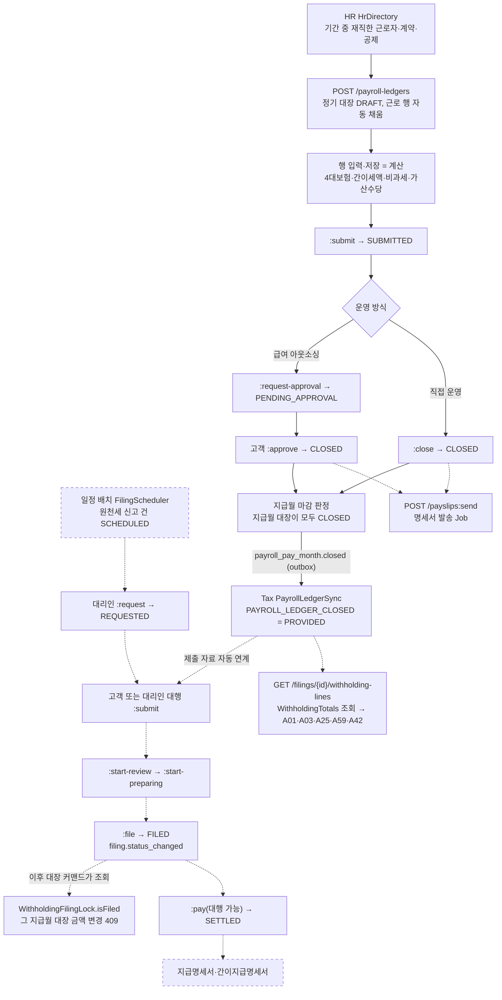
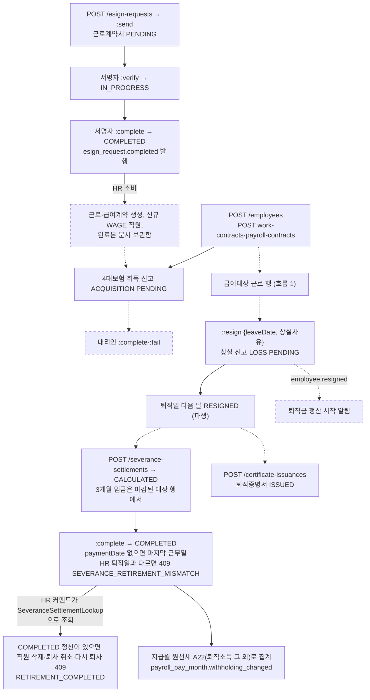
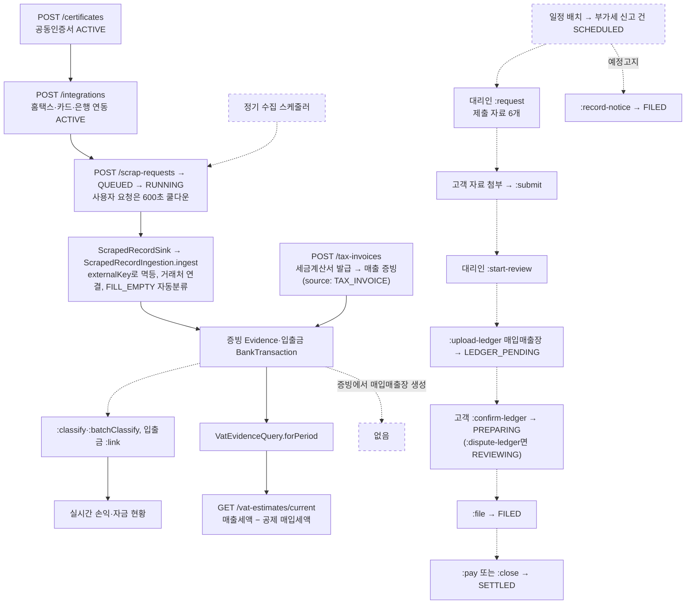

# 상태 전이 지도

설계 문서에 흩어진 상태 다이어그램의 색인과, 여러 컨텍스트를 가로지르는 업무 흐름 세 개를 모았습니다. 다이어그램 자체는 각 문서에 있고 여기서는 다시 그리지 않습니다. 개념 설명은 [glossary.md](glossary.md), 컨텍스트 사이의 이벤트와 공개 조회는 [events.md](events.md)를 보세요.

## 상태 색인

"검증 코드"는 전이를 판정하거나 상태를 파생하는 함수가 있는 파일입니다. 모두 `apps/api/src/modules/` 아래입니다. "저장"은 상태를 저장하고 커맨드로 바꾸는 것, "파생"은 저장하지 않고 날짜·다른 값으로 읽을 때 계산하는 것입니다([README.md 설계 원칙 3](README.md#설계-원칙)).

### 다이어그램이 있는 상태 (22개)

| 컨텍스트 | 집합체·리소스 | 상태 | 다이어그램 | 검증 코드 | 비고 |
|---|---|---|---|---|---|
| Tax | 신고 건 `Filing` | `SCHEDULED` `REQUESTED` `SUBMITTED` `REVIEWING` `LEDGER_PENDING` `PREPARING` `FILED` `SETTLED` `CANCELED` | [tax.md](tax.md#상태) | [filing-status.ts](../../apps/api/src/modules/tax/filings/filing-status.ts) `FILING_TRANSITIONS` | 저장. 커맨드 14개, 행위자(고객·대리인)를 전이표가 정함 |
| Payroll | 급여대장 `PayrollLedger` | `DRAFT` `SUBMITTED` `PENDING_APPROVAL` `CLOSED` | [payroll.md](payroll.md#상태) | [ledger-status.ts](../../apps/api/src/modules/payroll/ledgers/ledger-status.ts) `LEDGER_TRANSITIONS` | 저장. 운영 방식(아웃소싱·직접)마다 쓰는 전이가 다름 |
| Payroll | 퇴직금 정산 `SeveranceSettlement` | `CALCULATED` `COMPLETED` `EXCLUDED` | [payroll.md](payroll.md#퇴직금-정산) | [severance-settlement.ts](../../apps/api/src/modules/payroll/severance/severance-settlement.ts) `SEVERANCE_TRANSITIONS` | 저장 |
| HR | 직원 재직 상태 `Employee.status` | `PRE_JOINED` `JOINED` `LEAVE` `RESIGNED` | [hr.md](hr.md#상태-파생) | [employee-status.ts](../../apps/api/src/modules/hr/employees/employee-status.ts) `deriveEmployeeStatus` | 파생(입사일·휴직·퇴직일). `:resign`·`:return`은 날짜를 기록할 뿐 |
| Documents | 전자서명 요청 `EsignRequest` | `DRAFT` `PENDING` `IN_PROGRESS` `COMPLETED` `CANCELED` `EXPIRED` `SEND_FAILED` `VOIDED` | [documents.md](documents.md#상태) | [esign-request-status.ts](../../apps/api/src/modules/documents/esign/esign-request-status.ts) `transitionEsignRequest` | 저장. `EXPIRED`는 스케줄러가 없어 지금은 읽을 때 반영 |
| Documents | 제증명 발급 `CertificateIssuance` | `ISSUED` `SENDING` `SENT` `SEND_FAILED` `VOIDED` | [documents.md](documents.md#제증명-발급) | [certificate-rules.ts](../../apps/api/src/modules/documents/certificates/certificate-rules.ts) `transitionCertificate` | 저장. 삭제 대신 `:void` |
| Identity & Access | 구성원 `Membership.access` | `MEMBER` `ADMIN` | [identity-access.md](identity-access.md#구성원) | [members.ts](../../apps/api/src/modules/identity-access/members/members.ts) (`LastAdmin`·`OwnerImmutable`은 [membership.ts](../../apps/api/src/modules/identity-access/members/membership.ts)) | 저장. 소유자·마지막 관리자는 강등·제거 불가 |
| Identity & Access | 약관 동의 | `REQUIRED` `REVIEW` `SETTLED` | [identity-access.md](identity-access.md#약관) | [terms-consent.ts](../../apps/api/src/modules/identity-access/terms/terms-consent.ts) `consentStatus` | 파생(동의 이력의 버전과 지금 버전 비교) |
| Identity & Access | 초대 `Invitation` | `PENDING` `ACCEPTED` `CANCELED` `EXPIRED` | [identity-access.md](identity-access.md#초대) | [invitation-status.ts](../../apps/api/src/modules/identity-access/invitations/invitation-status.ts) `invitationStatus` | 저장, `EXPIRED`만 파생(30일) |
| Billing | 구독 `Subscription` | `PENDING` `ACTIVE` `CANCELLATION_SCHEDULED` `ENDED` | [billing.md](billing.md#상태) | [subscription-entitlement.ts](../../apps/api/src/modules/billing/subscriptions/subscription-entitlement.ts) `subscriptionTransition`, `refreshedStatus` | 저장, 날짜 도래 전이는 파생 |
| Billing | 결제 `Payment` | `SCHEDULED` `PAID` `FAILED` `RETRYING` `REFUNDED` | [billing.md](billing.md#상태) | [payment-schedule.ts](../../apps/api/src/modules/billing/payments/payment-schedule.ts) `paymentTransition` | 저장 |
| Billing | 결제 수단 `BillingMandate` | `PENDING` `REGISTERED` `REJECTED` `REVOKED` | [billing.md](billing.md#상태) | [billing-mandates.ts](../../apps/api/src/modules/billing/mandates/billing-mandates.ts) | 저장. 서면 동의서(`PENDING`) 경로는 미구현 |
| Billing | 서비스 계약 `ServiceContract` | 제안: `DRAFT` … `SIGNED` `ACTIVE` `EXPIRED` `ENDED` | [billing.md](billing.md#상태) | [service-contract.ts](../../apps/api/src/modules/billing/service-contracts/service-contract.ts) (`ACTIVE`·`ENDED`만) | 제안, 미구현. 코드는 조회만 |
| Integrations | 기관 연동 `Integration` | `ACTIVE` `ERROR` | [integrations.md](integrations.md#기관-연동) | [integrations.ts](../../apps/api/src/modules/integrations/integrations/integrations.ts) (응답 조립), [scrap-retry.ts](../../apps/api/src/modules/integrations/integrations/scrap-retry.ts) | 파생(인증서 상태, 마지막 수집 결과) |
| Integrations | 공동인증서 `SigningCertificate` | `ACTIVE` `EXPIRED` `INACTIVE` `UNREGISTERED` | [integrations.md](integrations.md#공동인증서) | [certificate-eligibility.ts](../../apps/api/src/modules/integrations/certificates/certificate-eligibility.ts) `certificateStatus` | `EXPIRED` 파생. `INACTIVE` 감지는 미구현 |
| Integrations | 수집 요청 `ScrapRequest` | `QUEUED` `RUNNING` `SUCCEEDED` `PARTIALLY_SUCCEEDED` `FAILED` | [integrations.md](integrations.md#수집-요청) | [scrap-cooldown.ts](../../apps/api/src/modules/integrations/scrap-requests/scrap-cooldown.ts) `effectiveJobStatus`, `summarizeItemResults` | 저장, 타임아웃(600초)은 파생 |
| Integrations | 홈택스 수임동의 `HometaxDelegation` | `REQUESTED` `AGREED` `REVOKED` | [integrations.md](integrations.md#홈택스-수임동의) | [hometax-delegations.http.ts](../../apps/api/src/modules/integrations/hometax-delegations/hometax-delegations.http.ts) (`DelegationTransitionInvalid`) | 저장. `:agree`만 구현, 등록·해지는 범위 밖 |
| Integrations | 상담 채널 토큰 | `ISSUED` `USED` `EXPIRED` | [integrations.md](integrations.md#상담-채널) | [channel-token.ts](../../apps/api/src/modules/integrations/messenger-channels/channel-token.ts) `checkChannelToken` | 판정만(토큰 발급은 메신저 브리지) |
| Bookkeeping | 입출금의 증빙 연결 `settlement.status` | `NOT_APPLICABLE` `PARTNER_REQUIRED` `UNMATCHED` `MATCHED` | [bookkeeping.md](bookkeeping.md#증빙-연결-상태) | [settlement-status.ts](../../apps/api/src/modules/bookkeeping/bank/settlement-status.ts) `settlementMatchStatus` | 파생(분류·거래처·연결) |
| Bookkeeping | 거래명세서 발급 잠금 | `EDITABLE` `ISSUING` `ISSUED` | [bookkeeping.md](bookkeeping.md#거래명세서와-세금계산서-발급) | [statement-validation.ts](../../apps/api/src/modules/bookkeeping/sales-transactions/statement-validation.ts) `statementLock` | 파생(발급 건 `TaxInvoice` 상태에서) |
| Bookkeeping | 지로 고지서 `Giro` | `TODO` `UNKNOWN` `DONE` `HIDDEN` | [bookkeeping.md](bookkeeping.md#지로-고지서) | [giro-status.ts](../../apps/api/src/modules/bookkeeping/giros/giro-status.ts) `transitionGiro`, `refreshStep` | 저장. 재수집도 전이를 일으킴 |
| Assistant | 지원사업 공고 `Grant` | `UPCOMING` `OPEN` `CLOSED` | [assistant.md](assistant.md#상태) | [grant-recommendation.ts](../../apps/api/src/modules/assistant/grants/grant-recommendation.ts) `isOpenOn` | 파생. 코드에는 상태 enum 없이 "오늘 열려 있는가"만 있음 |

### 다이어그램 없이 표나 필드로만 있는 상태

| 컨텍스트 | 리소스 | 상태 | 정의 위치 | 코드 | 비고 |
|---|---|---|---|---|---|
| Tax | 할 일 카드 `ActionCard` | `OPEN` `DONE` `SKIPPED_OVERDUE` | [tax.md](tax.md#할-일-카드) (신고 건 전이 → 카드 표) | [action-card-rules.ts](../../apps/api/src/modules/tax/action-cards/action-card-rules.ts) `filingCardEffects`, `completedCardStatus` | 신고 건 전이가 열고 닫음 |
| HR | 4대보험 신고 `InsuranceFiling` | `PENDING` `DONE` `FAILED` `WITHDRAWN` | [hr.md](hr.md#4대보험-신고) | [insurance-filing.types.ts](../../apps/api/src/modules/hr/insurance-filings/insurance-filing.types.ts) | `PENDING` 생성과 `WITHDRAWN`만 구현, `:complete`·`:fail` 미구현 |
| HR | 근로계약·급여계약 | `SCHEDULED` `ACTIVE` `EXPIRED` | [hr.md](hr.md#근로계약) | [work-contract-period.ts](../../apps/api/src/modules/hr/contracts/work-contract-period.ts) | 파생(계약 기간) |
| HR | 휴직 `Leave` | `SCHEDULED` `ONGOING` `ENDED` | [hr.md](hr.md#휴직) | 없음 | 미구현. 응답에 `status`가 없고 파생 함수도 없음. 직원의 `LEAVE`는 직원 상태 파생이 따로 계산 |
| Bookkeeping | 세금계산서 발급 건 `TaxInvoice` | `ISSUING` `ISSUED` `FAILED` | [bookkeeping.md](bookkeeping.md#거래명세서와-세금계산서-발급) | [sales-transaction-service.ts](../../apps/api/src/modules/bookkeeping/sales-transactions/sales-transaction-service.ts) | 결과를 모르면 `ISSUING`으로 남아 명세서를 잠금 |
| 공통 | 작업 `Job`(명세서 발송, 수집, 분류 적용) | `QUEUED` `RUNNING` `SUCCEEDED` `PARTIALLY_SUCCEEDED` `FAILED` `CANCELED` | [conventions.md](conventions.md#비동기-작업) | [job.types.ts](../../apps/api/src/shared/jobs/job.types.ts) | 공용 `GET /jobs/{id}`는 아직 없음 |

## 업무 흐름

아래 흐름도의 점선 테두리 상자는 설계만 있고 구현되지 않은 단계, 굵은 테두리 상자는 열린 질문으로 남은 단계입니다. 실선 화살표는 같은 요청이나 이벤트로 이어지는 것, 점선 화살표는 사람이 다음 일을 하거나 나중에 다른 요청이 조회하는 것입니다(라벨로 구분). 단계 이름은 각 문서의 커맨드와 [events.md](events.md#이벤트-목록)의 이벤트 이름을 씁니다.

### 1. 급여대장에서 원천세 납부까지

급여는 HR의 직원 정보로 대장을 채우고, 확정되면 그 지급월의 원천세 신고 건에 "급여대장 마감" 자료를 넘깁니다. 원천세가 신고되면 거꾸로 그 지급월 대장의 금액 변경을 막습니다.

- **대장 생성과 계산.** 귀속월의 첫 대장이 정기 대장이고, 임금산정 기간 중 하루라도 재직한 근로자로 근로 행을 채웁니다. 행을 저장하면 같은 요청에서 계산합니다([payroll.md](payroll.md#급여대장))
- **확정.** 아웃소싱은 담당자가 승인을 요청하고 고객이 승인하며, 직접 운영은 `:close` 하나로 끝납니다([payroll.md](payroll.md#상태))
- **자료 연계.** 마감·해제·생성·삭제·지급일 이동 모두가 지급월 판정을 다시 하고, 바뀐 지급월마다 `payroll_pay_month.closed`·`reopened`를 outbox에 씁니다. Tax는 회사와 지급월만 받아 `PayrollLedgers.summaryFor`로 다시 맞춥니다([withholding-ledger-closed](../reference/rules/withholding-ledger-closed.md), [payroll-tax.ts](../../apps/api/src/wiring/payroll-tax.ts)). 이 자동 연계 항목은 급여 플랜 회사의 신고 건에만 있습니다([payroll.md 열린 질문 10](payroll.md#열린-질문)). 원천세 금액은 이벤트에 싣지 않고, 신고서 줄이 필요할 때 Tax가 `WithholdingTotals`로 묻고 소득구분 코드로 바꿉니다([tax.md 원천세 신고서 줄](tax.md#원천세-신고서-줄))
- **신고와 잠금.** 원천세는 고객 커맨드를 대리인이 대행할 수 있습니다. `FILED`가 되면 Payroll은 이벤트가 아니라 조회(`WithholdingFilingLock`)로 그 지급월의 금액 변경을 막습니다([tax.md](tax.md#커맨드), [payroll.md](payroll.md#원천세-신고-잠금))
- **구현되지 않은 것.** 일정 배치는 서비스만 있고 매일 돌리는 실행기가 없습니다([tax.md](tax.md#구현-상태)). 원천세 신고서 줄은 읽기 전용 조회뿐이고 신고서 초안을 만들거나 저장하지 않습니다. 지급명세서는 모델링하지 않았습니다. 엑셀 가져오기도 설계만 있습니다([payroll.md](payroll.md#엑셀-가져오기))
- 통합 테스트: [payroll-tax.test.ts](../../apps/api/test/integration/payroll-tax.test.ts)

### 2. 입사부터 퇴직금 원천세까지

근로계약 전자서명으로 시작해 4대보험 취득, 급여, 퇴사, 퇴직금 정산, 퇴직소득 원천세로 이어지는 흐름입니다. 컨텍스트 사이 연결 중 HR이 소비하는 쪽이 대부분 아직 설계입니다.

- **전자서명.** 생성은 언제나 `DRAFT`이고, `PENDING`과 `IN_PROGRESS`의 경계는 본인확인 성공입니다. 완료하면 `esign_request.completed`를 메모리 이벤트로 냅니다([documents.md](documents.md#상태), [documents-ports.ts](../../apps/api/src/modules/documents/shared/documents-ports.ts))
- **HR 반영.** 서명 완료로 근로·급여계약과 직원을 만드는 소비자는 설계만 있습니다(현행 R29). 지금은 직원과 계약을 직접 등록합니다([hr.md](hr.md#이벤트), [hr.md](hr.md#구현-상태))
- **4대보험 신고.** 직원 등록(`ACQUISITION`), 퇴사(`LOSS`), 휴직·복직이 같은 트랜잭션에서 `PENDING` 신고를 열고, 퇴사 취소·휴직 삭제는 `WITHDRAWN`으로 닫습니다. 처리 커맨드는 없습니다([employees.ts](../../apps/api/src/modules/hr/employees/employees.ts), [leaves.ts](../../apps/api/src/modules/hr/leaves/leaves.ts))
- **퇴직금.** 정산은 Payroll이 `PayrollEmployeeDirectory`로 HR의 퇴사일을 읽어 만듭니다. 퇴직급여 제도는 HR에 없어 언제나 퇴직금으로 봅니다([payroll.md](payroll.md#퇴직금-정산), [payroll-hr.ts](../../apps/api/src/wiring/payroll-hr.ts))
- **완료 때 퇴직일 대조(2026-11-08).** 계산됨 정산은 HR이 막지 않으므로 퇴사 취소·직원 삭제·다른 날로 다시 퇴사가 정산을 낡게 만들 수 있습니다. `:complete`가 `PayrollEmployeeDirectory`로 HR 퇴직일을 다시 읽어 어긋나면 409 `SEVERANCE_RETIREMENT_MISMATCH`이고, 목록·상세는 `retirementMismatch`로 보입니다. HR이 정산에 쓰는 명령은 없습니다([payroll.md 퇴직금 정산](payroll.md#퇴직금-정산))
- **정산 가드.** 반대 방향은 이벤트가 아니라 조회입니다. HR은 정산 상태를 저장하지 않고 직원 삭제·퇴사 취소·다시 퇴사 때 `SeveranceSettlementLookup`으로 묻습니다. 정산 중 하나라도 `COMPLETED`면 409 `RETIREMENT_COMPLETED`이고, `CALCULATED`·`EXCLUDED`는 막지 않습니다. 막히면 정산을 `:reopen`합니다([hr.md](hr.md#퇴직), [hr-payroll.ts](../../apps/api/src/wiring/hr-payroll.ts))
- **퇴직소득 원천세(2026-11-08).** 지급일이 그 달인 완료 정산을 `PayrollWithholdingTotals`가 `RETIREMENT`로 모으고 Tax가 A22(퇴직소득 그 외)에 적습니다. 완료·다시 열기로 합계가 바뀐 지급월마다(대장이 없는 달 포함) `payroll_pay_month.withholding_changed`를 outbox로 내고, 신고된 지급월의 완료·다시 열기와 그 달로 들이는 지급일 변경은 대장처럼 409 `WITHHOLDING_FILED`입니다(계산됨 정산이 빠져나가는 것은 받음)([payroll.md 퇴직금 정산](payroll.md#퇴직금-정산))
- **구현되지 않은 것.** HR 이벤트(`employee.resigned` 등) 발행·구독이 없습니다([hr.md](hr.md#구현-상태)). 퇴사를 취소해도 계산됨 정산은 남습니다(완료만 막고 `retirementMismatch`로 표시, [payroll.md 열린 질문 16](payroll.md#열린-질문)). 중간정산과 퇴직 후보 목록도 없습니다

### 3. 수집에서 부가세 신고까지

외부 기관에서 거래를 가져와 증빙으로 쌓고, 분류해 실시간 보고서와 예상 부가세를 만들고, 대리인이 부가세를 신고합니다. 증빙과 신고 건은 예상 부가세 계산으로만 이어지고, 신고에 쓰는 매입매출장은 대리인이 따로 만들어 올립니다.

- **수집.** 등록은 기관 로그인 확인까지만 동기로 하고, 수집은 `ScrapRequest` 작업입니다. 일부 항목만 실패하면 `PARTIALLY_SUCCEEDED`입니다([integrations.md](integrations.md#수집-요청))
- **반영.** 레코드마다 거절 이유를 돌려주고 나머지는 반영합니다. 다시 와도 사람이 고친 분류·거래처·메모는 지킵니다([bookkeeping.md](bookkeeping.md#수집-반영-integrations--bookkeeping), [scraped-record-ingestion](../reference/rules/scraped-record-ingestion.md))
- **예상 부가세.** Tax가 Bookkeeping의 공개 조회로 증빙을 받아 법인은 분기, 개인은 반기로 계산합니다. 홈 카드의 기한은 Tax 세무 일정에서 받습니다([tax.md](tax.md#예상-부가세), [estimated-vat](../reference/rules/estimated-vat.md))
- **신고.** 부가세 신고 건만 매입매출장 확인 단계(`LEDGER_PENDING`)를 거칩니다. 예정고지 건은 자료 요청 없이 고지서로 끝납니다([tax.md](tax.md#상태))
- **구현되지 않은 것.** 정기 수집 스케줄러, 일정 배치 실행기, `evidence.ingested`·`job.completed` 이벤트가 없습니다([integrations.md](integrations.md#구현-상태), [events.md](events.md#이벤트-목록)). 홈택스 수임동의가 없는 회사의 홈택스 수집을 거절하는 규칙은 [compliance.md](compliance.md#권한-범위와-대리인)에만 있습니다
- 통합 테스트: [scraping-bookkeeping-tax.test.ts](../../apps/api/test/integration/scraping-bookkeeping-tax.test.ts)
