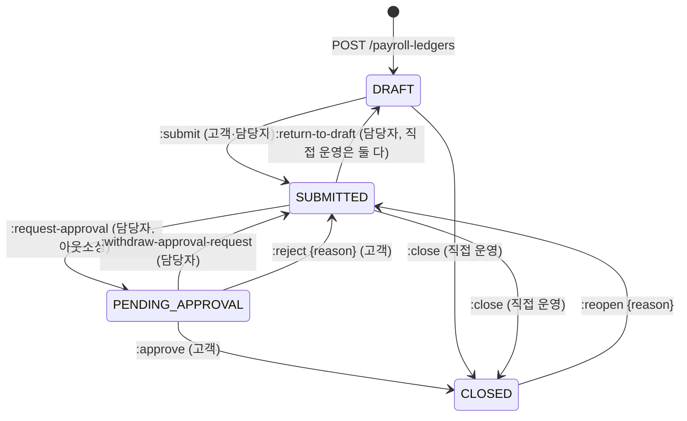
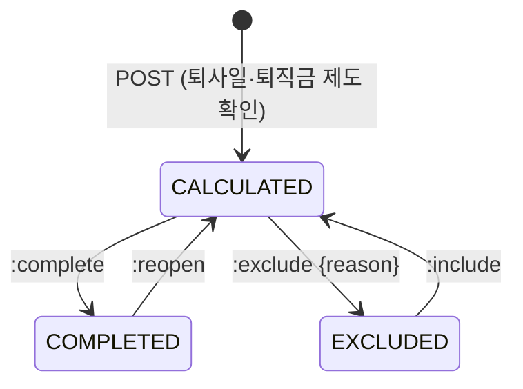
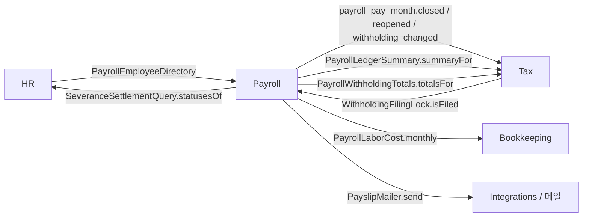

# Payroll: 계산 엔진·급여대장·명세서·퇴직금·인건비

급여 계산 엔진, 요율·간이세액 기준표, 회사 급여 설정, 소득자 명부, 급여대장(급여 아웃소싱과 직접 운영 모두), 급여명세서 발송, 퇴직금 정산, Bookkeeping에 주는 인건비 집계를 다룹니다. 코드는 [`apps/api/src/modules/payroll/`](../../apps/api/src/modules/payroll/)에 있습니다. 근거 자료는 [`docs/reference/spec/payroll.md`](../reference/spec/payroll.md)(이하 스펙), 매뉴얼 `alfred-manual/05-급여/`, `alfred-manual/08-설정/03-급여-설정.md`, 재설계 전 구현 `apps/api/legacy/src/modules/payroll/`입니다.

## 현행에서 고칠 점

- **급여만 응답 변환을 끕니다.** 다른 API는 snake_case ↔ camelCase를 인터셉터가 바꾸는데, 급여는 `other_deductions`·`taxable_incomes` 아래를 `LEGACY_RAW_KEYS`로 빼고, `transformKeys` 특이점 때문에 그 뒤에 오는 키까지 변환이 꺼집니다. 계산기 응답은 변환을 아예 끕니다 (P4). 재설계는 다른 컨텍스트와 같은 camelCase 하나이고, 지급·공제 항목은 키가 아니라 `code` 값을 가진 배열입니다
- **엑셀 업로드를 클라이언트가 채웁니다.** `POST /api/payroll/excel/`이 회사 경로 밖에서 파일을 파싱해 행을 돌려주면, 클라이언트가 그리드를 채운 뒤 따로 저장합니다. 파싱과 저장 사이에 상태가 바뀌어도 모르고, 잘못된 행은 저장할 때 섞여 들어갑니다 (P1, P2). 재설계는 대장에 붙은 가져오기 `Job` 하나가 검증·저장을 끝냅니다
- **대장 마감과 원천세 자료 갱신이 따로 움직입니다.** 승인 뒤 클라이언트가 원천세 화면을 다시 불러야 "급여대장 마감"이 바뀌고, 신고가 끝난 달의 승인 취소·반려를 막는 서버 규칙이 없습니다 (P2). 재설계는 마감·해제 요청 안에서 지급월 판정을 하고 이벤트를 내며, 원천세 신고가 끝난 지급월은 금액이 바뀌는 커맨드를 409로 막습니다
- **상태가 화면마다 다릅니다.** legacy는 `입력가능`·`계산중`·`완료`, BPO는 lazy chunk 안의 문자열과 `n/3` 단계, 명세서 발송과 데스크 내보내기도 상태처럼 쓰입니다. `cancel-approval` 하나가 요청 철회와 승인 취소를 겸합니다 (스펙 Q1, Q3)
- **입력 경로가 소득 종류만큼 복제됩니다.** `wage-monthly|wage-daily|wage-hourly|business|daily|other` × 입력·계산·삭제·동기화로 90개 가까운 경로입니다. 재설계는 행 하나의 `input.incomeType`으로 나눕니다
- **계산과 저장이 다른 요청입니다.** `calculate`(공제액 계산)와 `data`(임시저장)·`reset-calculation`이 나뉘어 계산 안 된 행이 저장됩니다. 재설계는 행을 저장할 때 서버가 같은 요청에서 계산합니다
- **규칙 상수가 화면에 있습니다.** 최저임금, 비과세 한도, 수당 배수 기본값, 추가 카드 생성 가능 여부를 화면이 판정하거나 그립니다 (P1). 재설계는 기준표·설정·`allowedActions`·`warnings`로 내려줍니다

## 용어

| 업무 용어 | 키 |
|---|---|
| 급여대장 (현행 급여카드) | `PayrollLedger` (`pyl_`) |
| 정기 대장 / 추가 대장 | `kind`: `REGULAR` / `ADDITIONAL` |
| 운영 방식 (급여 아웃소싱 / 직접 운영) | `workflow`: `CLIENT_APPROVAL` / `DIRECT_CLOSE` |
| 입력가능 / 제출(계산중) / 승인 대기 / 마감(완료) | `status`: `DRAFT` / `SUBMITTED` / `PENDING_APPROVAL` / `CLOSED` |
| 정산 진행 (n/3) | `step`: 1·2·3 |
| 귀속월 / 지급일 / 지급월 | `attributionMonth` / `paymentDate` / `paymentMonth` |
| 임금산정 기간 | `wagePeriod { start, end }` |
| 대장 행 (근로·일용·사업·기타) | `PayrollRow` (`pyr_`), `input.incomeType`: `WAGE_MONTHLY`·`WAGE_HOURLY`·`WAGE_DAILY`·`DAILY`·`BUSINESS`·`OTHER` |
| 직원 정보 사본 | `snapshot` |
| 소득자 명부 (직원이 아닌 일용·사업·기타소득자) | `Earner` (`ern_`), 행의 `earnerId` |
| 신원번호 종류 (주민등록번호 / 외국인등록번호 / 여권번호) | `identityType`: `RESIDENT` / `ALIEN` / `PASSPORT` |
| 신원번호 원문 / 가린 신원번호 | `registrationNumber` / `registrationNumberMasked` (HR 직원과 같은 이름, 여권번호도 이 이름) |
| 소득자 사본 (수신 주소·가린 신원번호·부서) | `earner { email, registrationNumberMasked, departmentName }` |
| 계산 결과 / 근거 | `result` / `result.breakdown[] { code, label, amount, formula }` |
| 기준표 (요율·간이세액·최저임금) | `RateTable` (`rtb_`), `effectiveFrom` |
| 미확인 값 | `unverifiedPaths` |
| 급여 설정 (현행 급여 지급 조건·공제 설정) | `PayrollSetting` |
| 수당 지급배수 | `multipliers` (ppm) |
| 산출방법 (요율 / 고지 / 간이세액표 / 직접 입력 / 미적용) | `deductionMethods`: `RATE`·`NOTICE`·`TAX_TABLE`·`MANUAL`·`NONE` |
| 급여명세서 | `Payslip` (`psl_`, 행 하나) |
| 퇴직금 정산 | `SeveranceSettlement` (`sev_`), `status`: `CALCULATED`·`COMPLETED`·`EXCLUDED` |
| 인건비 내역 | `LaborCostReport` |
| 원천세 신고 잠금 | `withholdingFiled` |
| 기타소득 구분 (인적용역 / 그 밖) | `otherIncomeCategory`: `PERSONAL_SERVICE` / `GENERAL` |
| 원천세 집계의 소득 종류 (근로·일용·사업·기타 / 퇴직) | `WithholdingIncomeKind`: 대장 행의 `LedgerIncomeKind`(`WAGE`·`DAILY`·`BUSINESS`·`OTHER`)와 완료 퇴직금 정산의 `RETIREMENT` |

## 계산 엔진

[`engine/`](../../apps/api/src/modules/payroll/engine/)은 Effect도 저장소도 모르는 순수 함수입니다. 행 입력과 기준표를 받아 결과와 근거를 돌려줍니다. 대장, 계산기, 퇴직금이 모두 이 엔진을 부릅니다.

### 단위

| 값 | 단위 | 이유 |
|---|---|---|
| 금액 | 원 정수 (`Won`) | 소수 원이 없음. 엔진 입구에서 `assertWon`이 정수가 아니면 거부 |
| 요율·배수·비율 | ppm 정수 (`4.75%` = 47500, `1.5배` = 1500000) | 부동소수 없이 곱셈과 절사를 정확히. 현행 `x100`·bp·퍼센트를 대신 |
| 근무 시간 | 분 정수 | 현행 소수 시간(`1.5`)과 주휴시간 반올림을 없앰 |
| 날짜 / 월 | `YYYY-MM-DD` / `YYYY-MM` | 회사 시간대(Asia/Seoul) 달력 날짜 |

### 절사

| 대상 | 규칙 |
|---|---|
| 4대보험 근로자·사업주 부담 | 10원 미만 절사 |
| 국민연금 기준소득월액 | 1,000원 미만 절사 후 상하한 |
| 근로소득 간이세액 | 10원 미만 절사, 비율 적용 뒤 다시 10원 미만 절사 |
| 일용·사업·기타 소득세, 지방소득세 | 원 미만 절사. 소득세 1,000원 미만 소액부징수 |
| 가산수당, 일할, 근태 공제, 평균임금, 퇴직금 | 원 미만 절사 |

곱셈·나눗셈은 `mulDiv(a, b, c)` 하나로 하고(중간값 `BigInt`), 통상시급처럼 나눠 떨어지지 않는 값은 저장하지 않고 분수로 들고 다닙니다.

### 검증된 규칙과 미확인 규칙

| 규칙 | 상태 | 근거 |
|---|---|---|
| [social-insurance-premiums](../reference/rules/social-insurance-premiums.md) | 요율·상하한(2026-07 포함)·연금·건강·장기요양 절사와 장기요양 비율 13.14% 확인, 고용·산재 절사는 학습용 가정 | 스펙 4.1, 법령·고시 원문 |
| [simple-income-tax](../reference/rules/simple-income-tax.md) | 산식 계수·자녀 공제액(2026-03 개정) 확인, 공식 표와 차이는 D4로 유지 | 스펙 4.2, 소득세법·별표 2 |
| [daily-worker-withholding](../reference/rules/daily-worker-withholding.md) | 확인 | 스펙 4.3 |
| [business-income-withholding](../reference/rules/business-income-withholding.md) | 3.3%·예술인 0.8%·업종코드(별지 제23호서식) 확인, 역산은 추정, 예술인 필요경비는 학습용 가정(빼지 않음) | 스펙 4.4, 보험료징수법 시행령, 소득세법 시행규칙 |
| [other-income-withholding](../reference/rules/other-income-withholding.md) | 20%·15%·과세최저한·지급사유 코드와 의제 경비율(별지 제23호서식) 확인 | 스펙 4.5, 소득세법 제129조, 소득세법 시행규칙 |
| [non-taxable-limits](../reference/rules/non-taxable-limits.md) | 10종 한도 확인, 보육수당은 자녀 1명당 한도 × HR의 대상 자녀 수(모르면 1명 + 경고) | 스펙 4.6, 소득세법·시행령 |
| [overtime-multipliers](../reference/rules/overtime-multipliers.md) | 확인 (배수는 회사 설정) | 스펙 4.8, 매뉴얼 |
| [wage-proration](../reference/rules/wage-proration.md) | 식 확인, 역일 기본·소정근로일 선택(설계 결정) | 스펙 4.10 |
| [minimum-wage-warning](../reference/rules/minimum-wage-warning.md) | 2026 최저시급 확인(고용노동부고시 제2025-47호), 경고만 하는 것은 추정 | 스펙 4.7 |
| [severance-pay](../reference/rules/severance-pay.md) | 식·퇴직소득 공제표 확인 | 스펙 4.11, 소득세법 제48조 |

기준표 값마다 `verification`에 법령·고시 원문 출처가 있습니다(2026-11-05 확인). 장기요양 비율은 2026-11-07에 2026. 1~10월도 보건복지부 보도자료로 확인했습니다. 남은 미확인 경로는 `employmentInsurance.premiumRoundingUnit`·`industrialAccident.premiumRoundingUnit`(10원 미만 절사는 학습용 가정), `industrialAccident.defaultEmployerRatePpm`(회사 입력), `wageIncomeTax.simpleTaxStrategy`(D4)입니다. 미확인 값은 기준표의 `unverifiedPaths`에 경로로 남고, 계산 결과는 그 경로를 쓴 근거 줄을 화면이 "미확인"으로 표시합니다. 결정은 [rule-decisions/payroll.md](rule-decisions/payroll.md)에 있습니다.

### 계산 결과

```
result
├─ grossPay, taxablePay, nonTaxablePay
├─ deductions { nationalPension, healthInsurance, longTermCare, employmentInsurance, incomeTax, localIncomeTax, other }
├─ deductionTotal, netPay
├─ employerInsurance { nationalPension, healthInsurance, longTermCare, employmentInsurance, industrialAccident }
├─ breakdown[] { code, label, amount, formula }       # "3,000,000 × 4.75%" 같은 근거
└─ warnings[]  { code, message }                      # BELOW_MINIMUM_WAGE, NON_TAXABLE_LIMIT_EXCEEDED, CHILDCARE_CHILDREN_UNKNOWN, CHILDCARE_CHILDREN_STALE, ...
```

## 기준표와 급여 설정

### 기준표

```
RateTable                    rtb_
├─ effectiveFrom             # YYYY-MM. 그 달부터 다음 기준표 전까지
├─ minimumWage { hourly, monthly, monthlyHours }
├─ nationalPension { employeeRatePpm, employerRatePpm, baseMin, baseMax }
├─ healthInsurance, longTermCare, employmentInsurance, industrialAccident
├─ localIncomeTax, dailyWorker, businessIncome, otherIncome, smallAmountExemption
├─ nonTaxable { [type]: { monthlyLimit, annualLimit } }
├─ wageIncomeTax, retirementIncomeTax                # 산식 상수(응답에는 요약만)
└─ unverifiedPaths[]
```

```
GET  /rate-tables?month=2026-03          그 달에 적용되는 기준표(없으면 전체 목록)
GET  /rate-tables/{rateTableId}
GET  /payroll-reference-codes            사업소득 업종, 기타소득 지급사유(경비율), 특고 직종. 항목마다 verified
POST /payroll-calculator:simulate        저장하지 않는 행 계산(실수령액 계산기)
```

- 기준표는 버전이 있는 참조 데이터입니다. 고시가 바뀌면 새 `effectiveFrom`을 더하고 지난 표는 고치지 않습니다. 지금은 2026-01, 2026-03(간이세액표 자녀 공제액 개정), 2026-07(국민연금 상하한), 2026-11(장기요양 비율 반올림 법정화) 네 버전을 코드에 두고 메모리 저장소에 올립니다
- **4대보험·최저임금은 귀속월, 원천세는 지급월 기준표를 씁니다.** 두 표가 다르면 소득세·지방소득세만 지급월 표로 다시 계산해 바꿉니다
- 그 달에 적용할 표가 없으면 422 `RATE_TABLE_NOT_FOUND`(`month`)입니다

### 급여 설정

```
GET   /payroll-settings
PATCH /payroll-settings    If-Match(선택)
```

| 필드 | 뜻 | 현행 이전 기본값 |
|---|---|---|
| `wagePeriodStartDay` | 임금산정 기간 시작일(1~28) | 1 |
| `paymentMonth`, `paymentDay` | 지급월(`SAME`·`NEXT`)과 지급일 | `SAME`, 25 |
| `underFiveEmployees` | 5인 미만 여부 | `false` |
| `multipliers` | 연장·야간·휴일·휴일연장 배수(ppm) | 5인 이상 기본값 |
| `deductionMethods` | 국민연금·건강보험·고용보험(`RATE`·`NOTICE`), 소득세(`TAX_TABLE`·`MANUAL`·`NONE`) | `NOTICE`, `NOTICE`, `RATE`, `TAX_TABLE` |
| `workflow` | 대장 운영 방식 | `DIRECT_CLOSE` |

- `underFiveEmployees`를 바꾸면서 `multipliers`를 보내지 않으면 새 규모의 기본 배수로 바꿉니다(매뉴얼 FAQ)
- HR은 `PayrollSettingQuery.isUnderFiveEmployees`(`payroll.public.ts`, 플랜·권한 확인 없음, HTTP 미공개)로 규모를 읽어 급여계약 고정수당에 `MULTIPLIERS_FIVE_OR_MORE`·`MULTIPLIERS_UNDER_FIVE`를 씁니다. 회사가 바꾼 `multipliers`는 HR에 넘기지 않습니다([hr.md 열린 질문 3](hr.md#열린-질문))
- `workflow` 변경은 `payroll-workflow:update` 권한이 더 필요합니다. 급여 아웃소싱 계약은 Billing의 일이라 보통 운영자만 바꿉니다
- 설정은 **새 대장에만** 적용됩니다. 대장은 만들 때 운영 방식과 지급일을 복사합니다
- 지급·공제 항목 카탈로그, 근무 일정 정책, 근로조건은 아직 없습니다([구현 상태](#구현-상태))

## 급여대장

### 리소스

```
PayrollLedger                              pyl_
├─ kind, workflow, status, step
├─ title, attributionMonth, paymentDate, paymentMonth, wagePeriod
├─ rowCount, totals { grossPay, deductionTotal, netPay, incomeTax, localIncomeTax, employerInsurance }
├─ rejection { reason, rejectedAt } | null, reopenReason
├─ withholdingFiled                       # 지급월 원천세 신고 여부(Tax 포트)
├─ allowedActions[], warnings[] { code, message, rowId? }
├─ calculatedAt, closedAt, version, createdAt, updatedAt
└─ rows[] (별도 경로)
    PayrollRow                             pyr_
    ├─ employeeId | null, earnerId | null, payeeName, incomeType   # 근로 행은 직원, 그 밖은 직원이나 소득자 하나
    ├─ earner { email, registrationNumberMasked, departmentName }   # 소득자 사본
    ├─ input                               # incomeType별 판별 유니온
    ├─ snapshot                            # 계산에 쓴 HR 정보
    └─ result
```

```
GET    /payroll-ledgers?attributionMonth=&paymentMonth=&status=&limit=&cursor=
POST   /payroll-ledgers                      { attributionMonth, paymentDate?, title? }          201 + ETag
GET    /payroll-ledgers/{ledgerId}                                                               ETag
PATCH  /payroll-ledgers/{ledgerId}           { paymentDate?, title? }                            If-Match
DELETE /payroll-ledgers/{ledgerId}                                                               If-Match, 204
GET    /payroll-ledgers/{ledgerId}/rows
POST   /payroll-ledgers/{ledgerId}/rows      { employeeId? | earnerId?, input }                  If-Match
PATCH  /payroll-ledgers/{ledgerId}/rows/{rowId}  { input }                                       If-Match
DELETE /payroll-ledgers/{ledgerId}/rows/{rowId}                                                  If-Match
POST   /payroll-ledgers/{ledgerId}:recalculate                                                   If-Match
POST   /payroll-ledgers/{ledgerId}:{transition}                                                  If-Match
POST   /payroll-ledgers/{ledgerId}:approve | :reject { reason }                                   If-Match
```

- **귀속월의 첫 대장이 정기 대장, 그다음이 추가 대장입니다.** 정기 대장을 만들 때 HR의 근로소득자(임금산정 기간 중 하루라도 재직)로 근로 행을 채우고, 중도 입·퇴사자는 역일 일할 입력을 넣습니다
- 지급일을 주지 않으면 설정의 지급월·지급일로 정하고, 추가 대장은 정기 대장의 지급일을 씁니다
- **행은 대장을 통해서만 바뀝니다.** 행을 저장하면 같은 요청에서 계산하고 대장 `version`을 올립니다. 행의 `If-Match`는 대장 버전입니다
- 근로 행은 직원이 필수(422 `PAYROLL_ROW_PAYEE_INVALID`, `EMPLOYEE_REQUIRED`), 일용·사업·기타 행은 직원이나 [소득자 명부](#소득자-명부)의 소득자 중 하나가 필수입니다(없으면 `PAYEE_REQUIRED`, 둘 다면 `PAYEE_AMBIGUOUS`, 명부에 없으면 `EARNER_NOT_FOUND`). 직원은 같은 회사 직원이어야 합니다(422 `EMPLOYEE_NOT_FOUND`). 행의 소득 종류와 소득자는 바꿀 수 없습니다(`INCOME_TYPE_CHANGED`). 행 수정은 계산 입력(`input`)만 받고, 소득자를 바꾸려면 행을 지우고 다시 넣습니다
- 이름(`payeeName`)은 입력받지 않고 직원이나 소득자의 이름을 소득자 사본과 같은 때에 복사합니다
- `:recalculate`는 HR 정보와 소득자 명부를 다시 읽어 사본을 갱신하고 모든 행을 다시 계산합니다(현행 `refresh-employee-info` + `calculate`)
- **행마다 소득자 사본(`earner`)을 둡니다.** 명세서 머리(가린 신원번호·부서)와 발송 주소가 이 값을 씁니다
  - 직원이 연결된 행은 HR의 이메일·가린 주민등록번호·부서를, 소득자를 가리키는 행은 명부의 이메일·가린 신원번호·부서를 복사합니다. 행을 만들 때(정기 대장 생성, 행 추가) 복사하고 `:recalculate` 때 다시 복사합니다. 직원이나 소득자가 그사이 없어졌으면 사본은 그대로 둡니다
  - **사본은 입력받지 않습니다(2026-11-08).** 직원이 없는 행도 명부의 소득자를 가리켜야 하고, 직접 적은 사본만 가진 행은 두지 않습니다. 사본만 적던 방식(#58)은 지급명세서에 필요한 원문을 둘 곳이 없었고, 명부와 직접 입력이 함께 있으면 같은 사람의 주소·부서가 두 군데서 어긋납니다. 한 번 올린 소득자는 다음 달 대장에서도 고르기만 하면 됩니다
  - 행에는 가린 값만 있습니다. 원천세 신고 파일·지급명세서처럼 원문이 필요한 곳은 직원이면 HR의 열람 기록이 남는 조회(`revealRegistrationNumber`), 소득자면 명부의 `:reveal`을 씁니다
  - **복사 시점은 계산 입력(`snapshot`)과 같습니다.** 마감 때 따로 복사하지 않습니다. 사본은 행의 다른 HR 값과 같은 때에 같은 방법(`:recalculate`)으로 갱신되어야 담당자가 한 번에 맞출 수 있고, 마감된 대장은 고칠 수 없으므로 명세서는 마감한 그대로의 주소로 갑니다. 마감 뒤 HR 이메일이 바뀌면 마감을 풀고 다시 계산해야 반영됩니다. 발송할 때 HR을 다시 읽던 방식은 마감 기록과 받는 사람이 어긋날 수 있어 버렸습니다
- 정기 대장은 추가 대장이 있으면 지울 수 없습니다(409 `PAYROLL_LEDGER_HAS_ADDITIONAL`). 대장 삭제는 입력 상태에서만 됩니다

### 소득자 명부

직원이 아닌 일용·사업·기타소득자를 회사마다 올려 두는 명부입니다(2026-11-08, [열린 질문 11](#열린-질문)). 직원이 없는 대장 행은 명부의 소득자를 `earnerId`로 가리키고, 사본은 명부에서 복사합니다. 코드는 [earners/](../../apps/api/src/modules/payroll/earners/)에 있습니다.

```
Earner                                     ern_
├─ name, identityType (RESIDENT | ALIEN | PASSPORT)
├─ registrationNumberMasked                # 900101-1******, 여권은 끝 3자리만
├─ email | null, departmentName | null     # 행 사본의 기본값
└─ version, createdAt, updatedAt
```

```
GET    /earners?limit=&cursor=                                                                   totalCount
POST   /earners                              { name, identityType, registrationNumber, email?, departmentName? }   201 + ETag
GET    /earners/{earnerId}                                                                       ETag
PATCH  /earners/{earnerId}                   { name?, identityType?, registrationNumber?, email?, departmentName? }  If-Match
DELETE /earners/{earnerId}                                                                       204
POST   /earners/{earnerId}/registration-number:reveal     X-Access-Reason                        { identityType, registrationNumber }
```

- **원문은 암호화해서만 둡니다.** HR 직원과 같은 공유 서비스 `PersonalDataCipher`(`src/shared/personal-data/`)로 암호화하고, 필드(`earnerRegistrationNumber`)마다 키와 AAD가 달라 HR 주민등록번호 암호문과 서로 열리지 않습니다. 응답·대장 행·로그에는 가린 값만 나갑니다
- **원문 열람.** `:reveal`은 `X-Access-Reason`을 필수로 받고(없으면 400) HR과 같은 열람 기록 `PersonalDataAccessLog`에 `earner:{earnerId}:registrationNumber`로 남깁니다. 권한은 `earner:reveal-rrn`으로 따로 둡니다
- **번호 검사(순수 규칙 [earner-identity.ts](../../apps/api/src/modules/payroll/earners/earner-identity.ts)).** 주민등록번호·외국인등록번호는 13자리(하이픈 있어도 됨)이고 7번째 자리가 종류와 맞아야 합니다(내국인 1·2·3·4·9·0, 외국인 5·6·7·8). 앞 6자리는 그 세기의 실제 날짜여야 합니다. 끝자리 검증번호는 보지 않습니다. 2020년 10월부터 새로 주는 주민등록번호는 검증 공식을 따르지 않고, HR 직원도 검사하지 않습니다. 여권번호는 영문·숫자 5~20자이고 대문자로 바꿉니다. 틀리면 422 `EARNER_INVALID`(`registrationNumber`·`INVALID_FORMAT`)입니다
- **종류를 바꾸려면 번호도 함께 줍니다**(없으면 422 `EARNER_INVALID`, `registrationNumber`·`REQUIRED`). 원문을 다시 열지 않고는 새 종류로 검사할 수 없기 때문입니다
- **중복.** 같은 회사에 같은 번호의 소득자가 있으면 409 `EARNER_DUPLICATE`(`duplicateEarnerId`)입니다. 암호문은 비교할 수 없어 HR과 같은 HMAC 해시로 찾습니다. 다른 회사는 같은 사람을 따로 올립니다
- **삭제.** 대장 행이 가리키는 소득자는 지울 수 없습니다(409 `EARNER_IN_USE`). 행에는 가린 값만 있어 지급명세서에 쓸 원문이 명부에만 있기 때문입니다
- **명부를 고쳐도 이미 만든 행은 그대로입니다.** 직원 정보와 같이 `:recalculate` 때 다시 복사하고, 마감된 대장은 마감한 그대로입니다
- 플랜·권한은 대장과 같습니다(`PAYROLL` 또는 `TAXATION`, [접근 요건](#접근-요건))
- 직원이 소득자 명부에도 있을 수 있습니다(같은 사람이 근로와 사업소득을 받는 경우). 근로 외 행에 직원을 이으면 HR 값을 쓰므로 명부에 따로 올리지 않아도 됩니다. 직원과 명부 사이의 중복은 보지 않습니다

### 상태



| 커맨드 | 출발 → 도착 | 아웃소싱 행위자 | 직접 운영 행위자 | 권한 | 신고 후 |
|---|---|---|---|---|---|
| `:submit` | `DRAFT` → `SUBMITTED` | 고객·담당자 | 고객·담당자 | `payroll-ledger:submit` | 막음 |
| `:return-to-draft` | `SUBMITTED` → `DRAFT` | 담당자 | 고객·담당자 | `payroll-ledger:submit` | 막음 |
| `:request-approval` | `SUBMITTED` → `PENDING_APPROVAL` | 담당자 | 없음 | `payroll-ledger:submit` | 허용 |
| `:withdraw-approval-request` | `PENDING_APPROVAL` → `SUBMITTED` | 담당자 | 없음 | `payroll-ledger:submit` | 막음 |
| `:approve` | `PENDING_APPROVAL` → `CLOSED` | 고객 | 없음 | `payroll-ledger:approve` | 허용 |
| `:reject` | `PENDING_APPROVAL` → `SUBMITTED` | 고객 | 없음 | `payroll-ledger:approve` | 막음 |
| `:close` | `DRAFT`·`SUBMITTED` → `CLOSED` | 없음 | 고객·담당자 | `payroll-ledger:close` | 허용 |
| `:reopen` | `CLOSED` → `SUBMITTED` | 고객·담당자 | 고객·담당자 | `payroll-ledger:close` | 막음 |

- 현행은 확정·해제를 세무 대리인만 했고 고객은 `PERMISSION_DENIED`였습니다. 직접 운영의 `:close`·`:reopen`은 고객·담당자 모두 할 수 있게 바꿨습니다. 해제는 원천세(지급월 마감 이벤트, 신고 잠금 `WITHHOLDING_FILED`)와 이어지므로, 고객의 해제를 다시 막을지는 `payroll-ledger:close` 권한을 누구에게 줄지와 함께 남은 질문입니다
- 전이표 하나([ledger-status.ts](../../apps/api/src/modules/payroll/ledgers/ledger-status.ts))를 서비스, `allowedActions`, 픽스처 테스트가 함께 봅니다. 규칙 문서는 [payroll-ledger-transitions](../reference/rules/payroll-ledger-transitions.md)입니다
- 검사 순서는 권한 → 버전 → 상태·운영 방식·행위자(409 `PAYROLL_LEDGER_TRANSITION_INVALID`, `ledgerStatus`, `action`) → 신고 잠금(409 `WITHHOLDING_FILED`)입니다
- **입력은 `DRAFT`에서 고객·담당자, `SUBMITTED`에서 담당자만 고칩니다.** 그 밖에는 409 `PAYROLL_LEDGER_READ_ONLY`입니다. 승인 대기 중에 고치려면 요청을 철회합니다
- `allowedActions`는 보는 행위자가 지금 보낼 수 있는 전이와 `EDIT_ROWS`, `RECALCULATE`, `DELETE`입니다. 신고 잠금에 걸리는 동작은 넣지 않습니다
- 명세서 발송과 데스크 내보내기는 상태가 아닙니다. 마감된 대장에 남는 기록입니다

### 추가 대장과 근로소득 중복

- 추가 대장은 귀속월의 정기 대장이 제출 이후일 때만 만들고, 처음 걸린 이유 하나를 409 `ADDITIONAL_LEDGER_BLOCKED`(`reason`: `NO_REGULAR_LEDGER`·`REGULAR_LEDGER_NOT_SUBMITTED`·`DRAFT_LEDGER_EXISTS`·`WITHHOLDING_DEADLINE_NEAR`)로 돌려줍니다. 원천세가 신고된 지급월은 409 `WITHHOLDING_FILED`입니다([additional-payroll-ledger](../reference/rules/additional-payroll-ledger.md))
- 추가 대장은 일용·사업·기타 행만 받습니다(409 `WAGE_ROW_ON_ADDITIONAL_LEDGER`). 한 직원은 귀속월마다 근로 행 하나뿐입니다(409 `WAGE_INCOME_DUPLICATED`, `ledgerId`)([duplicate-wage-income](../reference/rules/duplicate-wage-income.md))

### 원천세 신고 잠금

`WithholdingFilingLock.isFiled(companyId, paymentMonth)`가 참이면 그 지급월 대장의 다음을 409 `WITHHOLDING_FILED`(`paymentMonth`)로 막습니다.

- 금액을 되돌리는 전이: `:submit`, `:return-to-draft`, `:withdraw-approval-request`, `:reject`, `:reopen`
- 행 추가·수정·삭제, `:recalculate`, 대장 삭제
- 추가 대장 생성, 신고된 지급월로 또는 신고된 지급월에서 지급일 옮기기

마감 방향(`:request-approval`, `:approve`, `:close`)은 막지 않습니다. 신고 뒤에 늦게 승인하는 일은 금액을 바꾸지 않습니다.

퇴직금 정산도 같은 409로 막습니다. 신고된 지급월의 `:complete`·`:reopen`, 그리고 지급일을 그 달로 정하거나 옮기는 만들기·`PATCH`입니다. 대장과 두 가지가 다릅니다([퇴직금 정산](#퇴직금-정산)).

- 완료(마감 방향)도 막습니다. 정산의 완료가 곧 그 달 퇴직소득을 더하는 일이기 때문입니다
- 계산됨 정산을 신고된 달에서 **빼내거나 지급일을 지우는 것은 받습니다.** 계산됨 정산은 합계에 들지 않아 신고와 어긋나지 않고, 막으면 지급일을 정해 둔 뒤 그 달이 신고된 정산이 완료도 이동도 못 하고 갇힙니다. 대장은 미마감 대장도 신고된 달이면 편집 전체를 막아 빼낼 수 없습니다. 완료한 정산을 빼내려면 다시 열어야 하므로 여전히 막힙니다

## 엑셀 가져오기

현행 엑셀 업로드를 대장에 붙은 `Job`으로 바꿉니다. **설계만 있고 구현은 없습니다.**

```
GET  /payroll-ledgers/{ledgerId}/import-template?incomeType=WAGE_MONTHLY     양식 파일
POST /payroll-ledgers/{ledgerId}/imports        { fileId, incomeType, mode: MERGE|REPLACE }   Idempotency-Key, If-Match → 202 Job
GET  /jobs/{jobId}                                                                            결과: { imported, skipped, errors[] { rowNumber, column, code } }
```

- 파일은 파일 저장소에 먼저 올리고 `fileId`만 넘깁니다(현행 회사 경로 밖 multipart를 없앰)
- 작업은 대장이 입력 가능한 상태인지, 행위자가 고칠 수 있는지를 시작할 때와 쓰기 직전에 다시 봅니다. 버전이 바뀌었으면 작업이 `FAILED`(`VERSION_MISMATCH`)입니다
- 모든 행을 검증한 뒤 오류가 하나라도 있으면 아무것도 쓰지 않습니다. 오류가 없으면 행 추가·계산을 한 트랜잭션으로 하고 대장 `version`을 한 번 올립니다
- 직원은 주민번호 뒤 마스킹이 아닌 사번이나 HR `employeeId`로 맞춥니다. 이름만으로는 맞추지 않습니다

## 급여명세서

```
GET  /payslips?ledgerId=&paymentMonth=
GET  /payslips/{payslipId}
POST /payslips:send     { payslipIds[] }      Idempotency-Key 필수(없으면 428) → 202 Job
```

- 명세서는 **마감된 대장 행의 보기**입니다. 따로 저장하는 것은 발송 기록(`deliveries[] { sentAt, status: SENT|FAILED, reason }`)뿐이라 계산이 바뀌면 명세서도 바로 바뀝니다. 마감 전 대장의 행은 404 `PAYSLIP_NOT_FOUND`입니다
- 명세서는 행의 소득자 사본(`earner`)을 싣습니다
- 발송은 `PayslipMailer` 포트로 하고 결과를 `Job`(`SUCCEEDED`·`PARTIALLY_SUCCEEDED`·`FAILED`)에 담습니다. 받는 주소는 행의 `earner.email`이라 직원이 없는 일용·사업·기타소득자도 받습니다. 사본에 이메일이 없을 때만 `NO_EMAIL`로 실패합니다. 발송은 HR을 읽지 않습니다
- 멱등성은 [공통 규칙](conventions.md#멱등성)을 따릅니다. 키는 회사·행위자마다 따로이고 24시간 동안 기억합니다
  - 같은 키·같은 본문이면 처음 작업을 그대로 돌려줍니다. 본문이 다르면 422 `IDEMPOTENCY_KEY_REUSED`, 앞 요청이 아직 보내는 중이면 409 `IDEMPOTENCY_KEY_IN_PROGRESS`입니다
  - 메일을 보내기 전에 발송 요청 기록(`payroll_payslip_sends`, ID `<회사>:<사용자>:<키>`)을 `IN_PROGRESS`로 예약합니다. 확인과 예약은 저장소의 `claimSend` 한 번으로 합니다. 명세서를 한 건 보낼 때마다 그 결과를 기록의 `items`에 더하고, 끝나면 `COMPLETED`로 바꿉니다
  - 명세서 한 건의 메일 발송·저장 중 결함이 나면 503 `PAYSLIP_SEND_INTERRUPTED`입니다. 한 건이라도 보냈으면 `keepChanges`를 불러, 요청이 503이나 중단(연결 끊김)으로 끝나도 보낸 명세서의 발송 기록과 요청 기록(`INTERRUPTED`)을 커밋합니다. 같은 키·같은 본문으로 다시 보내면 결과가 있는 명세서는 건너뛰고 나머지만 보내며, 작업 ID는 처음 것입니다
  - 아무것도 보내기 전에 실패하면(명세서 없음 등) 예약을 남기지 않아, 같은 키로 본문을 고쳐 다시 보낼 수 있습니다
  - 시작한 발송은 연결이 끊겨도 끝까지 갑니다(중단 불가). 끝난 뒤 요청은 중단되지만 기록은 커밋되어, 재시도가 처음 작업을 돌려받습니다
  - **프로세스가 죽으면:** SQLite에서는 요청 전체가 트랜잭션 하나라 건별 기록도 커밋 전입니다. 발송 도중 프로세스가 죽으면 그 요청에서 보낸 **모든** 명세서의 기록이 사라지고, 같은 키로 재시도하면 전부 다시 보냅니다. 건별 기록이 도움이 되는 것은 프로세스가 살아 있는 채로 결함이 난 경우(503)뿐입니다. 메일 연동이 생기면 포트에 건별 멱등 키를 넘겨 막습니다
  - **메일을 보낸 뒤 기록 저장이 실패하면:** 그 명세서는 결과가 없는 것으로 남아(503), 같은 키로 재시도하면 다시 보냅니다. 메일 포트에 건별 멱등 키가 없어서입니다. 앞서 기록한 명세서는 다시 보내지 않습니다
  - 메일은 지금처럼 요청 안에서 보냅니다. 응답이 건별 결과를 담은 끝난 `Job`이라, 커밋 뒤(outbox)로 미루면 응답에 결과를 담을 수 없습니다
  - **알려진 제약(실제 메일 연동을 붙이기 전 블로커):** SQLite에서는 모든 요청(GET 포함)이 프로세스 잠금 하나 뒤의 `BEGIN IMMEDIATE` 트랜잭션입니다([conventions.md](conventions.md#멱등성)). 메일을 요청 안에서 보내므로 발송하는 동안 같은 프로세스의 다른 요청이 모두 줄을 서고, 다른 프로세스는 busy timeout(5초) 뒤 5xx를 받습니다. 가짜 메일러는 즉시 끝나 드러나지 않지만, 건당 수백 ms인 연동이면 수백 건 발송에 앱이 몇 분 멈춥니다. 연동을 붙이기 전에 `Job`을 `RUNNING`으로 돌려주고 발송을 트랜잭션 밖(outbox·작업자)으로 옮겨야 합니다
  - 건마다 요청 기록 전체(`items`)를 다시 저장하므로 쓰는 양이 건수의 제곱에 비례합니다(500건이면 수 MB). 지금 규모에서는 문제가 아니고, 발송을 작업자로 옮길 때 건별 행으로 나눕니다
  - 24시간이 지난 `INTERRUPTED` 기록도 다른 기록처럼 없는 것으로 봅니다. 그 뒤 같은 키로 보내면 새 요청이라 이미 보낸 명세서도 다시 보냅니다
  - 이 규칙 이전의 키(`payroll_payslip_responses` 표)는 읽지 않습니다. 배포 직전에 보낸 요청을 배포 뒤 같은 키로 재시도하면 다시 보냅니다. 그 표는 만료가 없던 응답만 담고 있어 이어 읽지 않기로 했습니다
- 발송은 대장 상태를 바꾸지 않습니다
- 현행 명세서 계산식 편집(`payment-formulas`)은 엔진의 `breakdown[].formula`가 대신합니다. 회사가 문구를 고치는 기능은 [열린 질문](#열린-질문)에 있습니다

## 퇴직금 정산

```
GET   /severance-settlements?status=&paymentMonth=
POST  /severance-settlements            { employeeId, input?, paymentDate? } 201 + ETag
GET   /severance-settlements/{settlementId}
PATCH /severance-settlements/{settlementId}   { input?, paymentDate? }       If-Match, CALCULATED만
POST  /severance-settlements/{settlementId}:complete | :reopen | :exclude {reason} | :include
```



- HR의 퇴사일이 없으면 422 `SEVERANCE_NOT_APPLICABLE`(`NOT_LEFT`), 퇴직급여 형태가 퇴직금이 아니면(`DB`·`DC`) `NOT_SEVERANCE_PAY_PLAN`입니다. 같은 직원의 정산이 이미 있으면 409 `SEVERANCE_SETTLEMENT_EXISTS`(`settlementId`)입니다
- 3개월 임금은 입력이 없으면 그 직원의 마감된 대장 행에서 가져옵니다. 상여·연차수당·통상임금(일)은 입력으로 받습니다
- 퇴직소득세는 **퇴직월** 기준표를 씁니다. 규칙은 [severance-pay](../reference/rules/severance-pay.md)입니다
- **지급일(`paymentDate`).** 원천세 퇴직소득 그 외(A22)는 지급일의 달(지급월)에 셉니다(2026-11-07 결정, 퇴직금은 대장 행이 아니라 정산에 둠. 줄 코드는 2026-11-08 서식 확인으로 A21에서 A22로 고침, [severance-pay 근거](../reference/rules/severance-pay.md#근거)). 퇴직금은 퇴직월과 다른 달에 줄 수 있어(법정 기한은 퇴직 뒤 14일) 퇴직월로는 묶을 수 없습니다
  - 계산됨에서는 없어도 됩니다. 만들기·`PATCH`로 정하고 `PATCH`의 `null`은 지웁니다. `PATCH`에서 빠진 필드(`input` 포함)는 그대로 둡니다
  - 지급일만 고치는 `PATCH`도 현행 `temp-save`처럼 다시 계산합니다. 그사이 기준표가 바뀌었으면 금액이 달라질 수 있고, 퇴직월 기준표가 없으면 422 `RATE_TABLE_NOT_FOUND`입니다
  - `:complete` 때 없으면 마지막 근무일로 채웁니다(현행 `complete`가 `payment_date`를 `base_date`로 채운 것과 같음). 그래서 완료된 정산은 모두 지급일이 있습니다. 완료를 막지 않은 이유: 현행 화면의 완료는 지급일 없이도 됐으므로 같은 기본값을 새 API가 한 곳에서 정합니다
  - 마지막 근무일보다 앞서면 422 `SEVERANCE_PAYMENT_DATE_INVALID`(`lastWorkDate`)입니다. 당일은 받습니다(위 기본값). 형식이 틀리거나 없는 날이면 400입니다
  - 완료한 정산의 지급일을 바꾸려면 `:reopen` 뒤 `PATCH`합니다. 다시 열어도 지급일은 남습니다
  - `?paymentMonth=YYYY-MM`은 지급일이 그 달인 정산만 줍니다. 원천세 요약은 `status=COMPLETED`와 함께 씁니다. 목록은 지금처럼 페이지 없이 회사 정산 전체입니다(퇴사자 수만큼)
  - 이 필드 전에 저장한 정산은 `paymentDate: null`이고 어느 지급월에도 들지 않습니다. 저장은 JSON 열이라 이관이 필요 없고, 다시 열고 완료하면 마지막 근무일로 채워집니다
- **원천세 연계(2026-11-08, [열린 질문 2](#열린-질문)).** 대장과 같은 세 가지(합계·신호·잠금)를 정산에도 둡니다. 판정은 순수 규칙 [severance-withholding.ts](../../apps/api/src/modules/payroll/severance/severance-withholding.ts)에 있습니다
  - **합계.** `PayrollWithholdingTotals.totalsFor`가 지급일이 그 달인 완료(`COMPLETED`) 정산을 `incomeKind: RETIREMENT` 한 줄로 더합니다. 인원은 직원 수, 총지급액·과세 지급액은 퇴직금(비과세 퇴직소득은 두지 않음), 세액은 퇴직소득세와 그 지방소득세입니다. 퇴직금이 0원인 정산(근속 1년 미만)은 지급한 퇴직소득이 없어 넣지 않습니다. 줄 순서는 근로·일용·퇴직·사업·기타이고, Tax가 A22(가감계 A20)로 적습니다. 대장이 없는 달에도 이 줄이 나옵니다
  - **신호.** 완료·다시 열기로 퇴직소득 합계가 바뀐 지급월마다 `payroll_pay_month.withholding_changed { companyId, paymentMonth }`를 대장 이벤트와 같은 outbox 채널로 냅니다. 대장이 없는 달에도 냅니다. 완료한 정산의 지급일은 `:reopen`(옛 달 알림) → `PATCH` → `:complete`(새 달 알림)로만 옮기므로 두 달 모두 알려집니다. 계산됨·제외 정산의 생성·수정·제외·제외 취소는 합계에 들지 않아 내지 않습니다. 대장의 `closed`·`reopened`를 쓰지 않은 것은 그 뜻이 "대장이 모두 마감"이라 대장 없는 달에 맞지 않아서입니다([events.md](events.md#형식)). 금액은 싣지 않습니다(한 달에 퇴직자가 한 명이면 합계가 개인 퇴직금)
  - **Tax의 처리.** Tax는 세 이벤트를 모두 같은 다시 맞춤(`PayrollLedgerSync`)으로 받습니다. 퇴직금만 바뀐 달은 대장 현황이 그대로라 "급여대장 마감" 항목도 그대로입니다(대장이 없는 달이면 `PENDING`으로 남고 제출은 막지 않음, [열린 질문 10](#열린-질문)). A22 줄은 Tax가 신고서 줄을 만들 때 합계 조회로 읽으므로 따로 저장할 것이 없습니다
  - **잠금.** 정산 변경이 건드리는 지급월 중 원천세가 신고된(`WithholdingFilingLock.isFiled`) 달이 있으면 저장하지 않고 409 `WITHHOLDING_FILED`(`paymentMonth`)입니다. 건드리는 달은 합계가 바뀐 달(완료·다시 열기)과, 지급일이 옮겨 갈 달(만들 때 정한 지급일, `PATCH`로 정하거나 옮긴 지급일, 완료 때 채운 마지막 근무일)입니다. 그래서 신고된 달에는 나중에 완료할 정산이 새로 들어가지 않습니다. 계산됨 정산을 신고된 달에서 빼내거나 지급일을 지우는 것과 같은 달 안의 입력 수정은 받습니다(합계와 상관없음, 대장과 다른 점은 [원천세 신고 잠금](#원천세-신고-잠금))
- **HR 가드.** 직원의 정산 중 하나라도 `COMPLETED`면 HR이 직원 삭제·퇴사 취소·다시 퇴사를 409 `RETIREMENT_COMPLETED`로 막습니다. HR은 `SeveranceSettlementQuery`로 묻습니다([열린 질문 16](#열린-질문))
- 중간정산, 후보 목록, 상태별 건수는 아직 없습니다([구현 상태](#구현-상태))

## 인건비

```
GET /labor-cost-reports/{year}    → { year, hasData, months[12] { month, amounts{wage,daily,business,other}, total, employerInsurance, totalWithEmployerInsurance, headcount{…}, employment{employed,joined,left} }, totals, updatedAt }
```

- 귀속월 기준으로, 제출 이후(`DRAFT`가 아닌) 대장의 행만 셉니다. `SUBMITTED`·`PENDING_APPROVAL`·`CLOSED`가 모두 들어가고 마감(`CLOSED`)까지 기다리지 않습니다. 현행처럼 계산 확정 이후 금액만 보입니다([ledger-status.ts](../../apps/api/src/modules/payroll/ledgers/ledger-status.ts) `countsAsCalculated`)
- 인원은 직원 ID(없으면 이름)로 중복 없이 셉니다. 재직·입사·퇴사 인원은 HR 포트에서 받습니다
- 현행 화면은 경리(결산 보고서) 메뉴에 있지만 데이터 주인은 급여입니다 (P3). 급여는 이 경로와 함께 공개 서비스 `PayrollLaborCost.monthly(companyId, year)`를 내고, Bookkeeping의 결산 보고서와 엑셀 내보내기가 그것을 씁니다. 그래서 이 경로는 `PAYROLL`과 `TAXATION` 플랜 중 하나면 엽니다

## 다른 컨텍스트와의 연결



| 방향 | 이름 | 형태 |
|---|---|---|
| 포트(HR 구현) | `PayrollEmployeeDirectory` | `listWageEarners(companyId, { start, end })`, `find(companyId, employeeId, asOf) → Option`, `employmentTrend(companyId, month) → { employed, joined, left }` |
| 포트(Tax 구현) | `WithholdingFilingLock` | `isFiled(companyId, paymentMonth) → boolean`. 급여대장과 퇴직금 정산이 씀 |
| 포트(메일 구현) | `PayslipMailer` | `send({ payslipId, to, subject }) → { ok: true } \| { ok: false, reason: NO_EMAIL \| REJECTED }` |
| 포트(아웃박스) | `PayrollEventPublisher` | `publish(event)`. 앱은 [payroll-tax.ts](../../apps/api/src/wiring/payroll-tax.ts)의 `PayrollEventsToTax`로 outbox 채널(`payroll_pay_month->tax`)에 씀. `layerMemory`는 Payroll만 시험할 때 쓰는 배열 |
| 내보냄(이벤트) | `payroll_pay_month.closed` | `{ eventId, companyId, paymentMonth, ledgerIds[], occurredAt }` |
| 내보냄(이벤트) | `payroll_pay_month.reopened` | `{ eventId, companyId, paymentMonth, occurredAt }` |
| 내보냄(이벤트) | `payroll_pay_month.withholding_changed` | `{ eventId, companyId, paymentMonth, occurredAt }`. 퇴직금 정산 완료·다시 열기 |
| 공개 조회 | `PayrollLaborCost.monthly(companyId, year)` | `LaborCostReport` |
| 공개 조회 | `PayrollLedgerSummary.summaryFor(companyId, paidFrom, paidTo)` | `{ ledgerCount, closedCount }`, 지급일 기준 |
| 공개 조회 | `PayrollWithholdingTotals.totalsFor(companyId, paymentMonth)` | `{ incomeKind, otherIncomeCategory, headcount, grossPay, taxablePay, incomeTax, localIncomeTax }[]`, 지급월의 **마감된** 대장만, 소득 종류(`WAGE`·`DAILY`·`BUSINESS`·`OTHER`)별, 기타소득은 인적용역(`PERSONAL_SERVICE`)·그 밖(`GENERAL`)으로 나눔. 지급일이 그 달인 **완료** 퇴직금 정산은 `RETIREMENT` 한 줄 |
| 공개 조회 | `SeveranceSettlementQuery.statusesOf(companyId, employeeId)` | 그 직원의 정산 상태 전부(`CALCULATED`·`COMPLETED`·`EXCLUDED`). HR `SeveranceSettlementLookup`을 [hr-payroll.ts](../../apps/api/src/wiring/hr-payroll.ts)가 이것으로 구현 |

- `PayrollEmployee`는 `{ id, name, registrationNumberMasked, email, departmentName, joinDate, leaveDate, paymentUnit, basePay, hourlyWage, dailyWage, monthlyStandardHours, dailyRestMinutes, socialInsurance { nationalPension, healthInsurance, employmentInsurance }, incomeTax { dependants, childrenAged8To20, childcareChildren { count, effectiveFrom } | null, withholdingRatePpm, manualAmount }, retirementBenefitType }`입니다. 4대보험 가입 판정(60세, 월 60시간 등)은 HR이 하고 급여는 결과만 받습니다
- `incomeTax.childcareChildren`은 HR 소득세 공제 설정의 `childcareChildrenCount`(과세기간 개시일 현재 6세 이하 자녀 수, 0–20)와 그 설정의 `effectiveFrom`이고, 값이 없으면 `null`입니다. 행 스냅숏에는 값이 있을 때만 `childcareChildren`·`childcareChildrenEffectiveFrom`으로 들어갑니다. 엔진은 기준표의 보육수당 한도가 자녀 1명당(`perChild`)이면 월 비과세 한도를 20만원 × 이 값으로 잡습니다(소득세법 제12조제3호머목2), 2026. 1. 1. 이후 지급분). 값이 없으면 1명으로 보고 `CHILDCARE_CHILDREN_UNKNOWN`, 설정 연도가 귀속 연도와 다르면 값은 그대로 쓰고 `CHILDCARE_CHILDREN_STALE` 경고를 붙입니다. 법정 한도는 직원 한 명의 그달 유형별 합계이고 회사 한도는 항목마다 봅니다. 근로 행은 직원·귀속월마다 하나라 이 한도가 직원 한 명의 그달 한도입니다([non-taxable-limits](../reference/rules/non-taxable-limits.md#서버-이전-시-주의))
- **지급월 마감 판정**은 지급일이 그 달인 대장이 하나 이상이고 모두 `CLOSED`일 때 참입니다([withholding-ledger-closed](../reference/rules/withholding-ledger-closed.md)). 마감·해제·생성·삭제·지급일 이동 요청 모두가 변경 전후를 비교해 바뀐 지급월마다 이벤트 하나를 냅니다
- **원천세 합계는 이벤트가 아니라 조회로 줍니다**(2026-11-08, [열린 질문 15](#열린-질문)). 지급월 마감 이벤트는 "그 지급월이 바뀌었다"만 알리고, Tax가 신고서 줄이 필요할 때 `PayrollWithholdingTotals.totalsFor`로 소득 종류별 합계를 묻습니다. 그래서 outbox 재전달·마감과 해제의 순서와 상관없이 Tax는 언제나 Payroll의 지금 값을 봅니다. 합계는 지급일이 그 달인 **마감된** 대장의 행과 **완료한** 퇴직금 정산만 더합니다([pay-month.ts](../../apps/api/src/modules/payroll/ledgers/pay-month.ts) `withholdingTotalsPaidIn`, [퇴직금 정산](#퇴직금-정산)). 기타소득은 지급사유가 소득세법 제21조제1항제19호의 인적용역(`76` 강연료등, `79` 자문료등, [reference-codes.ts](../../apps/api/src/modules/payroll/rate-tables/reference-codes.ts) `PERSONAL_SERVICE_OTHER_INCOME_CODES`)이면 `otherIncomeCategory: PERSONAL_SERVICE`, 그 밖이면 `GENERAL`로 나눠 더합니다. 지급사유가 없는 행은 계산과 같은 기본값 `76`으로 봅니다. 급여는 신고서 코드를 모르고, 소득 종류와 기타소득 구분을 원천징수이행상황신고서의 줄 코드(A01·A03·A22·A25·A59·A42)로 바꾸는 것은 Tax입니다([tax.md 원천세 신고서 줄](tax.md#원천세-신고서-줄))
- Tax는 지급월 변화를 받아 `PayrollLedgers.summaryFor`로 다시 맞춥니다. [payroll-tax.ts](../../apps/api/src/wiring/payroll-tax.ts)가 `payroll_pay_month.*`를 outbox 채널 `payroll_pay_month->tax`로 받아 `PayrollLedgerChanged { companyId, paymentMonth }`로 바꿔 Tax의 `PayrollLedgerSync`에 넘기고(SQLite는 대장 커맨드가 커밋된 뒤 자기 트랜잭션에서, 실패하면 릴레이가 다시), [tax-payroll.ts](../../apps/api/src/wiring/tax-payroll.ts)가 `PayrollLedgerSummary`·`PayrollWithholdingTotals`로 Tax 포트(`PayrollLedgers`·`WithholdingTotals`)를 구현합니다
- 다른 컨텍스트는 [payroll.public.ts](../../apps/api/src/modules/payroll/payroll.public.ts)만 가져옵니다. 급여는 HR·Tax 저장소를 읽지 않습니다

## 접근 요건

모든 경로는 플랜과 약관 동의가 필요합니다. 급여대장·행·명세서·소득자 명부·인건비 보고서는 `PAYROLL` 또는 `TAXATION`, 나머지(급여 설정·운영 방식, 기준표·참조 코드, 계산기, 퇴직금)는 `PAYROLL`입니다.

- **급여대장·명세서를 기장에도 엶 (2026-11-07 결정).** 현행 급여 관리(`payroll_management`)는 기장(`TAXATION`) 메뉴였고, 급여 아웃소싱(`PAYROLL`)은 급여 정산(`payroll_settlement`)으로 같은 대장을 썼습니다. 기장 고객을 `PAYROLL`로 옮기지 않고 두 플랜 모두에 엽니다. 플랜 목록은 권한 카탈로그의 `PAYROLL_LEDGER_PLANS` 한 곳이고, 카탈로그의 `payroll-ledger`·`payslip`·`earner`·`labor-cost-report`와 급여 엔드포인트([payroll-access.ts](../../apps/api/src/modules/payroll/payroll-access.ts)의 `LEDGER_PLANS`)가 함께 씁니다. 그래서 권한 그룹 화면의 `requiredPlans`와 엔드포인트가 어긋나지 않습니다. 둘 다 없으면 403 `ENTITLEMENT_REQUIRED`(`requiredPlans: ["TAXATION", "PAYROLL"]`)입니다
- **`PAYROLL`만 여는 경로.** 급여 설정·퇴직금·기준표·계산기는 현행에서도 급여 아웃소싱 메뉴(`payroll_setting`, `severance_pay_settlement`)였으므로 그대로 둡니다. 기장만 쓰는 회사의 대장은 저장된 급여 설정이 없으면 기본값(현행 기본값, 직접 운영)으로 계산합니다. 대장 계산이 안에서 설정·기준표를 읽는 것은 플랜을 보지 않습니다
- **약관.** 급여 전용 약관은 없습니다. `requiresTerms`는 회사 플랜이 정한 약관(가입 약관, 기장이면 세무 약관)을 보므로, 기장만 쓰는 회사는 스스로 동의할 수 있는 세무 약관에만 걸립니다(403 `TERMS_REAGREEMENT_REQUIRED`). 대리인은 약관 게이트를 건너뜁니다
- **원천세 제출 자료.** 원천세 신고 건의 "급여대장 마감분" 자동 연계 항목은 현행처럼 급여 플랜 회사에만 넣습니다([filing-requirements.ts](../../apps/api/src/modules/tax/filings/filing-requirements.ts)). 이 결정은 대장을 여는 플랜만 바꾸고 신고 체크리스트는 바꾸지 않았습니다. 이유는 둘입니다. 현행도 이 항목을 급여 구독 고객에게만 넣었습니다(지운 이전 설계 `docs/reference/legacy-design/tax-api-design.md`의 원천세 제출 자료 표, 커밋 `3c6f890`). 그리고 기장 고객은 대부분 급여대장을 쓰지 않으므로, 이 항목을 넣으면 기간에 대장이 없어 응답이 영영 `PENDING`으로 남습니다. 자동 연계 항목은 제출 전 남은 항목 검사에서 빠지므로(`filing-view.ts`의 `transitionFacts`) 제출을 막지는 않지만, 고객 화면에는 끝나지 않는 "대기" 항목으로 보여 혼란을 줍니다([열린 질문 10](#열린-질문))

| 엔드포인트 | 권한 |
|---|---|
| 급여 설정 조회 / 수정 | `payroll-setting:read` / `payroll-setting:update` (+ `workflow`는 `payroll-workflow:update`) |
| 기준표, 참조 코드 | `payroll-rate-table:read` |
| 계산기 | `payroll-calculator:simulate` |
| 대장·행 조회 | `payroll-ledger:read` |
| 대장 생성 / 수정·행·재계산 / 삭제 | `payroll-ledger:create` / `payroll-ledger:update` / `payroll-ledger:delete` |
| `:submit`, `:return-to-draft`, `:request-approval`, `:withdraw-approval-request` | `payroll-ledger:submit` |
| `:approve`, `:reject` | `payroll-ledger:approve` |
| `:close`, `:reopen` | `payroll-ledger:close` |
| 명세서 조회 / 발송 | `payslip:read` / `payslip:send` |
| 소득자 명부 조회 / 등록 / 수정 / 삭제 / 원문 열람 | `earner:read` / `earner:create` / `earner:update` / `earner:delete` / `earner:reveal-rrn` |
| 퇴직금 조회 / 생성 / 입력·제외·포함 / 확정·다시 열기 | `severance-settlement:read` / `:create` / `:update` / `:complete` |
| 인건비 보고서 | `labor-cost-report:read` |

- 권한은 "이 사용자가 할 수 있는가", 전이표의 행위자는 "이 대장에서 누구 차례인가"입니다. 담당자가 `:approve`를 보내면 권한이 있어도 409 `PAYROLL_LEDGER_TRANSITION_INVALID`입니다
- 역할별 권한 묶음은 Identity & Access의 역할 템플릿에 넣어야 합니다([공유 변경](#열린-질문))

## 오류 코드

| 상태 | `code` | 언제 | 추가 필드 |
|---|---|---|---|
| 400 | `VALIDATION_FAILED` | 스키마 위반(소수 금액, 없는 달, 빈 사유) | `violations` |
| 403 | `PERMISSION_DENIED`, `ENTITLEMENT_REQUIRED`, `TERMS_REAGREEMENT_REQUIRED` | 접근 요건 | 공통 |
| 404 | `PAYROLL_LEDGER_NOT_FOUND` | 없거나 다른 회사 대장 | |
| 404 | `PAYROLL_ROW_NOT_FOUND` | 대장에 없는 행 | |
| 404 | `RATE_TABLE_ID_NOT_FOUND` | 없는 기준표 ID | |
| 404 | `PAYSLIP_NOT_FOUND` | 없거나 마감 전 대장의 행 | |
| 404 | `SEVERANCE_SETTLEMENT_NOT_FOUND` | 없는 정산 | |
| 404 | `EARNER_NOT_FOUND` | 명부에 없거나 다른 회사 소득자 | |
| 409 | `PAYROLL_LEDGER_TRANSITION_INVALID` | 상태·운영 방식·행위자가 전이와 맞지 않음 | `ledgerStatus`, `action` |
| 409 | `PAYROLL_LEDGER_READ_ONLY` | 지금 상태에서 이 행위자가 입력을 고칠 수 없음 | `ledgerStatus` |
| 409 | `WITHHOLDING_FILED` | 원천세가 신고된 지급월의 금액 변경 | `paymentMonth` |
| 409 | `ADDITIONAL_LEDGER_BLOCKED` | 추가 대장 생성 조건 위반 | `reason` |
| 409 | `WAGE_ROW_ON_ADDITIONAL_LEDGER` | 추가 대장에 근로 행 | |
| 409 | `WAGE_INCOME_DUPLICATED` | 같은 귀속월 같은 직원의 두 번째 근로 행 | `ledgerId` |
| 409 | `PAYROLL_LEDGER_HAS_ADDITIONAL` | 추가 대장이 있는 정기 대장 삭제 | |
| 409 | `SEVERANCE_SETTLEMENT_EXISTS` | 같은 직원의 두 번째 정산 | `settlementId` |
| 409 | `SEVERANCE_TRANSITION_INVALID` | 상태와 맞지 않는 정산 커맨드·수정 | `settlementStatus`, `action` |
| 409 | `EARNER_DUPLICATE` | 같은 회사에 같은 신원번호의 소득자 | `duplicateEarnerId` |
| 409 | `EARNER_IN_USE` | 대장 행이 가리키는 소득자 삭제 | |
| 409 | `IDEMPOTENCY_KEY_IN_PROGRESS` | 같은 키의 명세서 발송이 아직 처리 중 | |
| 412 | `VERSION_MISMATCH` | `If-Match`가 현재 버전과 다름 | `currentVersion` |
| 422 | `PAYROLL_ROW_PAYEE_INVALID` | 근로 행에 직원 없음(`EMPLOYEE_REQUIRED`), 근로 외 행에 직원·소득자 없음(`PAYEE_REQUIRED`), 둘 다 줌(`PAYEE_AMBIGUOUS`), 명부에 없는 소득자(`EARNER_NOT_FOUND`), 소득 종류 변경(`INCOME_TYPE_CHANGED`) | `reason` |
| 422 | `EARNER_INVALID` | 신원번호 형식 오류(`INVALID_FORMAT`), 종류만 바꾸고 번호 없음(`REQUIRED`) | `violations` |
| 422 | `EMPLOYEE_NOT_FOUND` | HR에 없는 직원 | |
| 422 | `RATE_TABLE_NOT_FOUND` | 그 달에 적용할 기준표 없음 | `month` |
| 422 | `SEVERANCE_NOT_APPLICABLE` | 퇴사 전이거나 퇴직금 제도가 아님 | `reason` |
| 422 | `SEVERANCE_PAYMENT_DATE_INVALID` | 퇴직금 지급일이 마지막 근무일보다 앞섬 | `lastWorkDate` |
| 422 | `IDEMPOTENCY_KEY_REUSED` | 같은 키, 다른 본문의 명세서 발송 | |
| 428 | `IDEMPOTENCY_KEY_REQUIRED` | 키 없는 명세서 발송 | |
| 503 | `PAYSLIP_SEND_INTERRUPTED` | 메일 연동 오류로 발송이 중간에 멈춤. 같은 키로 다시 보내면 나머지만 보냄 | |

## 현행 엔드포인트 대응

번호는 스펙 5절의 번호입니다. 현행 경로는 `/api/company/:id/payroll` 아래(표시가 없으면), BPO는 그 아래 `/bpo`입니다.

### legacy 급여카드 (1-30)

| # | 현행 | 재설계 |
|---|---|---|
| 1-2 | `GET/POST /api/company/new-payroll/maintain-payroll/:id/` | 없앰. 기존 설정 유지 여부는 이관 때 한 번 정하는 일이고, 이관은 [기본값](#급여-설정)으로 합니다 |
| 3 | `GET /card-summary/` | `GET /payroll-ledgers` (`totals`, `rowCount`) |
| 4 | `GET /card-summary/group-by-attr-date/` | `GET /payroll-ledgers?attributionMonth=` (묶음은 클라이언트) |
| 5 | `GET /cards/:c/` | `GET /payroll-ledgers/{ledgerId}` + `GET .../rows`. 같은 귀속월 합본은 목록 필터로 |
| 6 | `POST /cards/:c/data/` | `POST`/`PATCH /payroll-ledgers/{ledgerId}/rows[/{rowId}]` (저장과 계산을 한 요청에) |
| 7 | `PATCH /cards/:c/update-name/` | `PATCH /payroll-ledgers/{ledgerId} { title }` |
| 8 | `POST /cards/:c/calculate/` | `POST /payroll-ledgers/{ledgerId}:submit` |
| 9 | `GET /cards/:c/card-status/` | `GET /payroll-ledgers/{ledgerId}`의 `status`, `step`, `allowedActions` |
| 10 | `GET /cards/:c/fixed-payrolls/` | `GET /payroll-ledgers/{ledgerId}/rows` |
| 11 | `GET /cards/fixed-payrolls-with-keyword/` | 없앰. 이전 급여 불러오기는 정기 대장 생성 때 HR 정보로 채우고, 지난 대장 행은 `GET .../rows`로 봄 |
| 12 | `GET /cards/employee-names/` | HR 직원 검색 (급여 밖) |
| 13 | `POST /cards/:c/additional-card/` | `POST /payroll-ledgers { attributionMonth }` (정기 대장이 있으면 추가 대장) |
| 14 | `DELETE /cards/:c/` | `DELETE /payroll-ledgers/{ledgerId}` |
| 15 | `POST /cards/:c/refresh-wage-employees-list/` | `POST /payroll-ledgers/{ledgerId}:recalculate` (사본 갱신). 명부 추가·제외는 행 추가·삭제 |
| 16 | `GET /cards/:c/inquire-wage-employees-change/` | 미구현. 대장 `warnings`에 명부 변동(`ROSTER_CHANGED`)을 넣는 안 ([열린 질문](#열린-질문)) |
| 17 | `GET /cards/:c/can-create-additional-card/` | 없앰. `POST /payroll-ledgers`가 409 `ADDITIONAL_LEDGER_BLOCKED`(`reason`)로 답함 |
| 18 | `GET /cards/:c/payslip/` | `GET /payslips?ledgerId=` |
| 19 | `POST /cards/:c/payslip/` | 없앰. 계산식은 `breakdown[].formula`, 이메일은 행의 소득자 사본(`earner`) |
| 20 | `GET /cards/:c/payslip/wage-salary/notifications/` | `GET /payslips?ledgerId=`의 `deliveries`, `GET /jobs/{jobId}` |
| 21 | `POST /cards/:c/payslip/wage-salary/notifications/` | `POST /payslips:send` (Idempotency-Key) |
| 22 | `POST /cards/:c/payslip/wage-salary/copy-payment-formulas/` | 없앰. 계산식은 엔진이 만듦 |
| 23-24 | `GET/POST /cards/:c/copy/` | 미구현. 이전 대장 입력 복사 `POST /payroll-ledgers { copyFromLedgerId }` 안 |
| 25 | `GET /api/payroll/business-income-types/` | `GET /payroll-reference-codes` (`businessIncome`) |
| 26 | `GET /api/payroll/special-occ-types/` | `GET /payroll-reference-codes` (`businessIncome`의 `ARTIST`·`SPECIAL` 구분) |
| 27 | `GET /api/payroll/other-labor-income-types/` | `GET /payroll-reference-codes` (`otherIncome`, 경비율 포함) |
| 28 | `GET /api/payroll/nation-codes/` | 공통 참조 데이터 (급여 밖). 외국인 정보는 HR |
| 29 | `GET /api/payroll/excel/` | `GET /payroll-ledgers/{ledgerId}/import-template` (미구현) |
| 30 | `POST /api/payroll/excel/` | `POST /payroll-ledgers/{ledgerId}/imports` → `Job` (미구현) |

### 계산기·세율표 (31-33)

| # | 현행 | 재설계 |
|---|---|---|
| 31 | `POST /api/payroll/calculator/simulate` | `POST /payroll-calculator:simulate` (행 입력과 같은 스키마) |
| 32 | `GET /api/tax-rates/simple/` | `GET /rate-tables?month=` (간이세액은 산식이라 표 대신 계산기로 확인) |
| 33 | `GET /api/tax-rates/necessary-expenses/` | `GET /payroll-reference-codes` (`otherIncome[].expenseRatePpm`) |

### BPO 대장 (34-45)

| # | 현행 | 재설계 |
|---|---|---|
| 34 | `GET /bpo/payment-date-list/` | 없앰. 지급일은 설정으로 기본값을 정하고 아무 날이나 받음 |
| 35 | `GET /bpo/card-summary/` | `GET /payroll-ledgers` |
| 36 | `POST /bpo/card/` | `POST /payroll-ledgers` |
| 37 | `GET /bpo/card/:c/` | `GET /payroll-ledgers/{ledgerId}` |
| 38 | `PUT /bpo/card/:c/` | `PATCH /payroll-ledgers/{ledgerId}`. 검토 요청은 `:submit` |
| 39 | `DELETE /bpo/card/:c/` | `DELETE /payroll-ledgers/{ledgerId}` |
| 40 | `GET /bpo/card/:c/status/` | `GET /payroll-ledgers/{ledgerId}`의 `status`, `step` |
| 41 | `POST /bpo/card/:c/reject/` | `POST /payroll-ledgers/{ledgerId}:reject { reason }` |
| 42 | `POST /bpo/card/:c/approve/` | `POST /payroll-ledgers/{ledgerId}:approve` |
| 43 | `POST /bpo/card/:c/request-approval/` | `POST /payroll-ledgers/{ledgerId}:request-approval` |
| 44 | `POST /bpo/card/:c/cancel-approval/` | `:withdraw-approval-request`(승인 대기) 또는 `:reopen { reason }`(마감 후) |
| 45 | `POST /bpo/card/:c/export-to-desk/` | 미구현. 데스크(세무 대리인 도구)는 범위 밖. 필요하면 `payroll_pay_month.closed`를 구독 |

### BPO 입력 (46-98)

| # | 현행 | 재설계 |
|---|---|---|
| 46-48, 85-87 | `GET /bpo/card/:c/:seg/payroll-input/` | `GET /payroll-ledgers/{ledgerId}/rows` (`incomeType`으로 거름) |
| 49-51 | `GET .../payroll-input/:r/work-infos/` | 행 `input.work`(분) |
| 52-54 | `GET .../payroll-input/:r/payroll-info/` | 행 `result.breakdown` |
| 55-57, 94-96 | `POST .../payroll-input/delete/` | `DELETE /payroll-ledgers/{ledgerId}/rows/{rowId}` |
| 58-60 | `PUT .../payroll-input/:r/` | `PATCH /payroll-ledgers/{ledgerId}/rows/{rowId}` |
| 61-63, 88-90 | `POST .../payroll-input/update/`, `POST .../payroll-input/` | 행마다 `POST`/`PATCH`. 일괄 저장은 엑셀 가져오기 `Job` |
| 64-66, 91-93 | `POST .../payroll-input/calculate/` | 없앰. 저장하면 계산. 전체 다시 계산은 `:recalculate` |
| 67-69 | `POST .../payroll-input/refresh-employee-info/` | `POST /payroll-ledgers/{ledgerId}:recalculate` |
| 70-72 | `POST .../payroll-input/reset-calculation/` | 없앰. 계산 안 된 행이 없음 |
| 73-78, 97-98 | `GET/POST .../work-input/`, `.../daily/work-input/` | 행 `input.work`, 일용 행 `input.workDays`. 근무 시트 화면은 행 목록으로 그림 |
| 79-80 | `GET/POST .../:seg/payroll-input/candidates/` | 후보는 HR 직원 검색, 추가는 `POST .../rows { employeeId }` |
| 81-84 | `GET/POST .../payment-items/`, `.../deduction-items/` (+ `/bulk/`) | 행 `input.paymentItems[]`, `otherDeductions[]`. 대장 단위 항목 표는 미구현 |

### BPO 명세서·메모·시프티 (99-113)

| # | 현행 | 재설계 |
|---|---|---|
| 99-102 | `GET .../{wage,business,daily,other}/payslip/` | `GET /payslips?ledgerId=` |
| 103-106 | `GET .../{…}/payslip/:r/` | `GET /payslips/{payslipId}` |
| 107 | `POST .../payslip/download/` | 미구현. PDF 렌더링은 Documents와 함께 정함 ([열린 질문](#열린-질문)) |
| 108 | `POST .../payslip/send/` | `POST /payslips:send` |
| 109-110 | `GET/POST /bpo/manager-memo/` | 미구현. 회사 메모는 Identity & Access의 회사 메모나 대장 `note`로 ([열린 질문](#열린-질문)) |
| 111-113 | `GET/POST/DELETE /bpo/shiftee-integration` | Integrations (근태 연동). 급여는 근무 시간을 행 입력으로 받음 |

### 퇴직금 정산 (114-128)

| # | 현행 | 재설계 |
|---|---|---|
| 114 | `GET /severance/settlements/` | `GET /severance-settlements?status=` |
| 115 | `GET .../filter-options/` | 없앰. 필터 값은 enum |
| 116 | `GET .../status-counts/` | 미구현. 목록 응답의 `counts` 안 |
| 117 | `GET .../:s/` | `GET /severance-settlements/{settlementId}` |
| 118-119 | `GET .../:s/monthly-wages/[:m/]` | 상세의 `result.breakdown`과 입력 `threeMonthWages` |
| 120 | `POST .../:s/temp-save/` | `PATCH /severance-settlements/{settlementId} { input, paymentDate }` |
| 121 | `POST .../:s/complete/` | `PATCH { input, paymentDate }`(바뀐 것이 있으면) + `POST /severance-settlements/{settlementId}:complete`. 지급일이 없으면 마지막 근무일 |
| 122 | `POST .../:s/reopen/` | `POST /severance-settlements/{settlementId}:reopen` |
| 123 | `GET .../interim-candidates/` | 미구현 (중간정산) |
| 124 | `POST .../` `{ kind, employee_ids }` | `POST /severance-settlements { employeeId }` (퇴직만, 한 명씩) |
| 125 | `DELETE .../:s/` | 없앰. 정산은 지우지 않고 `:exclude`로 뺌 |
| 126 | `GET .../retirement-candidates/` | 미구현. HR 퇴사자 중 정산이 없는 사람 |
| 127 | `POST .../:s/exclude/` | `POST /severance-settlements/{settlementId}:exclude { reason }` |
| 128 | `POST .../:s/include/` | `POST /severance-settlements/{settlementId}:include` |

### 급여 설정 (129-155)

현행 경로는 `/api/company/:id/employment/settings` 아래입니다.

| # | 현행 | 재설계 |
|---|---|---|
| 129-134 | `/work-conditions/` CRUD, `usage-status` | HR (근로조건은 직원 계약의 일부) |
| 135-136 | `GET/PATCH /payroll-terms/` | `GET/PATCH /payroll-settings` (지급일·임금산정 기간·배수·운영 방식) |
| 137-141 | `/payroll-payment-items/` CRUD | 미구현. `/payroll-payment-items` 카탈로그(통상임금·최저임금 산입, 비과세 유형) 안 |
| 142 | `GET /payroll-payment-categories/` | 미구현. 위 카탈로그의 표준 항목 |
| 143-144 | `GET/PATCH /payroll-deduction/` | `GET/PATCH /payroll-settings` (`deductionMethods`) |
| 145-149 | `/payroll-deduction-items/` CRUD | 미구현. `/payroll-deduction-items` 안 |
| 150-155 | `/work-schedule-policies/` CRUD, `usage-status` | HR 또는 근태 (근무 일정은 급여 입력의 출처) |

### 인건비 (Bookkeeping 스펙 N32-N33)

| 현행 | 재설계 |
|---|---|
| `GET /api/company/:id/report/labor-cost/:year/` | `GET /labor-cost-reports/{year}` + 공개 `PayrollLaborCost.monthly` |
| `GET /api/company/:id/report/labor-cost/:year/export/` | Bookkeeping 결산 엑셀 내보내기가 `PayrollLaborCost`로 만듦 (급여에는 없음) |

## 구현 상태

| 영역 | 상태 |
|---|---|
| 계산 엔진 (근로 3종·일용·사업·기타, 4대보험, 간이세액, 비과세, 가산수당, 일할, 최저임금, 퇴직금) | 구현 ([engine/](../../apps/api/src/modules/payroll/engine/)) |
| 기준표 2026-01·2026-03·2026-07·2026-11, 참조 코드, 계산기 | 구현 (메모리, [rate-tables-2026.ts](../../apps/api/src/modules/payroll/engine/rate-tables-2026.ts)) |
| 급여 설정 | 구현 (메모리) |
| 소득자 명부(신원번호 암호화·원문 열람 기록) | 구현 ([earners/](../../apps/api/src/modules/payroll/earners/), `payroll_earners` 표) |
| 급여대장·행·재계산·전이 8개·신고 잠금·추가 대장·중복 근로소득 | 구현 (메모리, [payroll-ledgers.ts](../../apps/api/src/modules/payroll/ledgers/payroll-ledgers.ts)) |
| 지급월 마감 이벤트 | 구현(outbox). 앱은 `PayrollEventsToTax`가 outbox 채널로 Tax에 넘김([payroll-tax.ts](../../apps/api/src/wiring/payroll-tax.ts)). `PayrollEventPublisher.layerMemory`는 Payroll 단독 시험·`PayrollMemoryLive`용. 원천세 금액은 싣지 않음 |
| 명세서 조회·발송 `Job` | 구현. `PayslipMailer.layerFake` |
| 퇴직금 정산 (퇴직) | 구현 (메모리). 원천세 합계(`RETIREMENT`)·지급월 신호(`payroll_pay_month.withholding_changed`)·신고 잠금 포함 |
| 인건비 보고서, `PayrollLaborCost`, `PayrollLedgerSummary`, `PayrollWithholdingTotals`, `SeveranceSettlementQuery` | 구현 |
| 포트 연결 (`PayrollEmployeeDirectory`, `WithholdingFilingLock`, `PayrollEventPublisher`) | `src/wiring/`에서 HR·Tax에 연결. 지급 단위·기본급·시급·일급은 HR 급여계약, 공제대상 가족 수·8–20세 자녀 수·원천징수 비율·직접 입력 세액은 HR 소득세 공제 설정에서 읽고, 그 값이 없는 직원만 기본값(월급제 300만 원, 가족 1명, 100%)을 씀. 퇴직급여 제도는 HR에 없어 언제나 퇴직금([payroll-hr.ts](../../apps/api/src/wiring/payroll-hr.ts)). `PayslipMailer`는 Integrations 메일 연동이 없어 가짜 |
| 엑셀 가져오기 `Job`, 양식 | 설계만 |
| 지급·공제 항목 카탈로그, 근무 일정 정책 | 없음 |
| 행 결과 수동 덮어쓰기(고지액 입력 외) | 없음 |
| 중간정산, 후보 목록, `LEAVE_DATE_BEFORE_INTERIM` | 없음 |
| 데스크 내보내기, 담당자 메모, 시프티, 명세서 PDF, CSV 내보내기 | 없음 |

규칙 픽스처 14개 59건은 모두 [engine.fixtures.test.ts](../../apps/api/src/modules/payroll/engine/engine.fixtures.test.ts)와 [ledger.fixtures.test.ts](../../apps/api/src/modules/payroll/ledgers/ledger.fixtures.test.ts)로 옮겼습니다. 결정은 [rule-decisions/payroll.md](rule-decisions/payroll.md)에 있습니다.

## 열린 질문

1. **간이세액표.** 공식 표(300만원·1인 74,350원)와 산식(60,380원)이 크게 다릅니다. 공식 표를 기준표 데이터로 넣고 `lookupSimpleTaxTable`로 바꿀지 확인이 필요합니다
2. **퇴직금 지급과 원천세.** ~~퇴직금을 퇴사월 대장 행으로 넣을지, 정산만 두고 원천세 퇴직소득 줄에 언제 넘길지~~ **정함(2026-11-07):** 정산에 지급일(`paymentDate`)을 두고 지급월의 완료 정산을 A22(퇴직소득 그 외)로 셉니다. 결정 때는 A21로 적었으나 A21은 연금계좌취급자가 쓰는 줄이라 2026-11-08에 줄 코드만 고쳤습니다([퇴직금 정산](#퇴직금-정산)). 남았던 것:
   - ~~합계에 `RETIREMENT`를 더할지, 완료·다시 열기도 그 달의 이벤트를 낼지(대장이 없는 달은?)~~ **정함(2026-11-08):** `PayrollWithholdingTotals`가 완료 정산을 `RETIREMENT`로 더하고(Tax는 A22), 합계가 바뀐 지급월마다 대장이 없는 달이어도 새 이벤트 `payroll_pay_month.withholding_changed`를 냅니다. Tax는 대장 이벤트와 같은 다시 맞춤으로 받습니다([퇴직금 정산](#퇴직금-정산))
   - ~~신고된 지급월의 정산 완료·다시 열기·지급일 이동을 막을지~~ **정함(2026-11-08):** 대장처럼 `WithholdingFilingLock`으로 막습니다(409 `WITHHOLDING_FILED`). 다만 계산됨 정산이 신고된 달에서 빠져나가는 것은 받습니다([원천세 신고 잠금](#원천세-신고-잠금)). 신고 정정과 함께 풀지는 3번과 같이 봅니다
3. **지급일 이동 잠금.** 급여대장은 지급일을 신고된 달로, 또는 신고된 달에서 옮기는 것을 모두 막습니다. 퇴직금 정산은 신고된 달로 들이는 것만 막고, 계산됨 정산이 빠져나가는 것은 받습니다(합계에 들지 않아서, [원천세 신고 잠금](#원천세-신고-잠금)). 신고 정정과 함께 허용할지, 미마감 대장도 정산처럼 빼낼 수 있게 할지 정해야 합니다
4. **명부 변동 알림.** 현행 `inquire-wage-employees-change`를 대장 `warnings`(`ROSTER_CHANGED`)로 줄지, HR 이벤트(`employee.joined`·`employee.resigned`, 미구현)를 받아 대장에 표시할지 정해야 합니다
5. **상여 대장.** 근로소득이 있는 별도 대장은 지금 막습니다. 상여를 따로 지급하는 회사가 있으면 간이세액 특례(지급대상기간)와 함께 설계합니다
6. **명세서 문구와 PDF.** 회사가 계산식 문구를 고치던 기능과 PDF 다운로드를 Documents의 렌더링으로 할지 정해야 합니다
7. **공유 변경.**
   - Identity & Access 역할 템플릿에 [접근 요건](#접근-요건)의 권한을 넣어야 합니다
   - ID 접두사(`pyl`·`pyr`·`psl`·`sev`·`rtb`)는 공유 목록에 이미 있어 변경이 필요 없습니다. 소득자 명부의 `ern`은 2026-11-08에 더했습니다
   - [payroll-hr.ts](../../apps/api/src/wiring/payroll-hr.ts)는 급여계약의 파생 기본급만 넘기고 지급항목·고정수당·상여는 넘기지 않습니다. `PayrollEmployee`에 계약 지급항목 자리를 둘지, 급여 설정의 항목으로만 둘지 정해야 합니다
   - 퇴직급여 제도(`retirementBenefitType`)는 HR 퇴직 정보가 생기면 기본값(`SEVERANCE_PAY`) 대신 그 값을 써야 합니다
8. **담당자 메모.** BPO 담당자 특이사항을 회사 단위로 둘지 대장 단위로 둘지 정해야 합니다
9. **2027 기준표 재확인.** 조세특례제한법 제30조(중소기업 취업자 소득세 감면)는 2026. 12. 31.까지 취업한 사람만 대상입니다. 2027 기준표를 만들 때 일몰 연장 여부를 확인하고, 연장되지 않으면 2027년 이후 취업자에게 감면 입력을 받지 않도록 정해야 합니다([simple-income-tax](../reference/rules/simple-income-tax.md#서버-이전-시-주의))
10. **기장 회사의 "급여대장 마감분".** 급여대장을 기장(`TAXATION`)에도 열었지만 원천세의 "급여대장 마감분" 자동 연계 항목은 급여 플랜 회사에만 넣습니다([접근 요건](#접근-요건)). 대장을 쓰는 기장 회사에도 넣으려면 "신고 기간에 대장이 있으면 마감 여부로, 없으면 `NOT_APPLICABLE`" 같은 규칙이 필요합니다. 지금 판정(`payrollLedgerResponse`)은 대장이 없으면 `PENDING`이라, 그대로 넣으면 대장을 쓰지 않는 기장 회사의 화면에 끝나지 않는 대기 항목이 남습니다(제출은 막지 않음). 기간 중에 대장이 생기거나 지워질 때 항목을 넣고 빼는 것도 함께 정합니다
11. **근로 외 소득자의 명세서 수신 주소와 소득자 사본.** ~~명세서별 수신 주소를 둘지, 행(또는 `Payslip`)에 소득자 사본(수신 주소, 가린 주민등록번호, 부서)을 둘지~~ **정함(2026-11-08):** 대장 행에 소득자 사본(`earner { email, registrationNumberMasked, departmentName }`)을 둡니다([급여대장](#급여대장)). 직원이 연결된 행은 HR 값을 행 생성·`:recalculate` 때 복사합니다. 명세서 발송은 행의 주소를 써서 근로 외 소득자도 받고, 주소가 없을 때만 `NO_EMAIL`입니다([급여명세서](#급여명세서)). 현행 BPO가 대장 행에 저장한 주소로 보내던 방식과 같습니다.
    - ~~직원이 없는 소득자의 전체 주민등록번호(지급명세서용)를 어디 둘지, 여권번호로만 신원을 확인하는 소득자를 어떻게 받을지~~ **정함(2026-11-08, #63):** Payroll에 회사별 [소득자 명부](#소득자-명부)(`Earner`)를 둡니다. 신원번호는 종류(`RESIDENT`·`ALIEN`·`PASSPORT`)와 함께 받아 HR과 같은 `PersonalDataCipher`로 암호화하고, 원문 열람은 HR처럼 사유를 받아 `PersonalDataAccessLog`에 남깁니다. 직원이 없는 행은 `earnerId`로 명부를 가리키고 사본(이름·가린 신원번호·이메일·부서)은 명부에서 행 생성·`:recalculate` 때 복사합니다
    - 사본을 직접 적는 입력(#58의 `earner`, `payeeName`)은 없앴습니다. 명부와 직접 입력을 함께 두면 원문 없는 행이 남고 같은 사람의 값이 두 군데서 어긋나기 때문입니다(도메인 학습 저장소라 이전 입력은 남기지 않음)
    - `PersonalDataCipher`·`PersonalDataAccessLog`는 HR 안에 있다가 두 컨텍스트가 함께 쓰게 되어 `src/shared/personal-data/`로 옮겼습니다. Payroll이 HR 내부를 읽지 않고, 열람 기록은 한 표(`personal_data_accesses`)에 남습니다. HR 필드의 키 용도(`hr/registrationNumber` 등)는 그대로라 저장한 암호문은 그대로 열립니다
    - 남은 것: 직원이면서 소득자 명부에도 있는 사람의 중복은 보지 않습니다. 지급명세서 제출 파일은 아직 없습니다
12. **고정 연장근로 초과분.** 지금은 담당자가 약정 시간을 넘은 연장 분만 행에 넣습니다. 행에 고정 연장 약정 분을 받아 `max(0, 실제 − 약정)`을 가산하려면 HR 급여계약의 고정수당 시간을 `PayrollEmployee`로 넘겨야 합니다(7번의 계약 지급항목과 함께, [규칙 결정](rule-decisions/payroll.md#overtime-multipliers) 1)
13. **수습 감액과 최저임금 경고.** 급여 경고는 감액 없이 최저시급과 비교합니다. HR 포트가 수습 시작일과 감액 허용 여부(급여계약 검증 결과)를 주면, 그 달이 수습 3개월 안이고 허용된 경우에만 90%로 비교할 수 있습니다([규칙 결정](rule-decisions/payroll.md#minimum-wage-warning) 2)
14. **예술인 고용보험 보수.** 고시 필요경비(재단 안내 25%), 기준보수 하한(80만원), 월평균소득 50만원 미만 적용 제외를 고시 원문으로 확인하면 기준표에 함께 넣습니다. 지금은 지급액 전체에 0.8%를 곱합니다(학습용 가정, [규칙 결정](rule-decisions/payroll.md#business-income-withholding) 2)
15. **원천세 집계의 소비.** ~~`payroll_pay_month.closed`가 싣는 `withholding[]`을 Tax가 쓸지, 이벤트로 받을지 조회로 받을지, 신고서 코드 표를 어디 둘지~~ **정함(2026-11-08):** Tax가 조회 포트로 받습니다(#44, #48). 한 것:
    - Tax 포트 `WithholdingTotals.totalsFor(companyId, paymentMonth)`를 Payroll 공개 조회 `PayrollWithholdingTotals`로 구현했습니다([tax-payroll.ts](../../apps/api/src/wiring/tax-payroll.ts)). 지급월의 마감된 대장만 더합니다. 이벤트로 받지 않아 outbox 재전달·순서 문제가 없습니다
    - 소득 종류 → 원천징수이행상황신고서(별지 제21호서식) 소득구분 코드 표는 Tax의 순수 규칙 모듈 [withholding-return.ts](../../apps/api/src/modules/tax/filings/withholding-return.ts)에 있습니다. `WAGE` A01, `DAILY` A03, `BUSINESS` A25, `OTHER`는 인적용역(`PERSONAL_SERVICE`) A59와 그 외(`GENERAL`) A42(둘 다 가감계 A40), `RETIREMENT` A22(완료 퇴직금 정산, 2026-11-08). 서식에서 A40은 기타소득의 가감계이고, 제21조제1항제19호 인적용역은 2024. 1. 1. 이후 지급분부터 A59 줄입니다. 어떤 지급사유가 인적용역인지는 Payroll 참조 데이터가, 어느 줄에 적을지는 Tax가 정합니다
    - 쓰는 곳은 `GET /filings/{filingId}/withholding-lines` 하나입니다([tax.md 원천세 신고서 줄](tax.md#원천세-신고서-줄)). 신고서 초안을 만들거나 저장하지는 않습니다
    - `payroll_pay_month.closed`에서 `withholding[]`을 뺐습니다
16. **퇴직금 정산 상태를 HR에 알리기.** ~~HR 필드 `severanceSettlementStatus`를 이벤트로 채울지, 상태 매핑을 어떻게 할지~~ **정함(2026-11-08):** 이벤트 대신 HR이 조회 포트로 묻습니다. HR은 정산 상태를 저장하지 않습니다
    - HR 포트 `SeveranceSettlementLookup`([severance-settlement-lookup.ts](../../apps/api/src/modules/hr/ports/severance-settlement-lookup.ts))을 [hr-payroll.ts](../../apps/api/src/wiring/hr-payroll.ts)가 Payroll 공개 조회 `SeveranceSettlementQuery`로 구현합니다. 그 직원의 정산 상태를 모두 돌려주고, 상태 값은 Payroll과 같아 매핑이 없습니다
    - HR 직원 삭제·퇴사 취소·다시 퇴사가 이 포트에 묻고, 정산 중 하나라도 `COMPLETED`면 409 `RETIREMENT_COMPLETED`입니다. 지급한 퇴직금은 그 퇴직일·근속기간으로 계산했고 지급월 원천세 퇴직소득(A22)에 들어가므로, 최신 정산이 아니어도 완료가 하나 있으면 퇴직 기록을 바꾸거나 지울 수 없습니다. `CALCULATED`는 지급 전이라(현행도 완료만 막음), `EXCLUDED`는 정산하지 않기로 한 것이라 막지 않습니다. 막히면 `:reopen`으로 계산됨으로 되돌린 뒤 합니다
    - 이벤트를 쓰지 않은 이유: HR이 필요한 것은 커맨드 순간의 판정 하나뿐이라 조회로 충분하고, 이벤트로 받으면 outbox 재전달·순서와 한 직원의 여러 정산(제외 후 새 정산)을 필드 하나로 줄이는 매핑을 따로 정해야 합니다
    - 남은 것: 퇴사 취소가 계산됨 정산을 남기고(마지막 근무일이 더는 퇴직일이 아님), 계산됨 정산이 있는 직원을 삭제하면 직원 없는 정산이 남습니다. 정산을 자동으로 제외할지, 완료 때 HR 퇴직일과 다시 맞출지는 정하지 않았습니다
