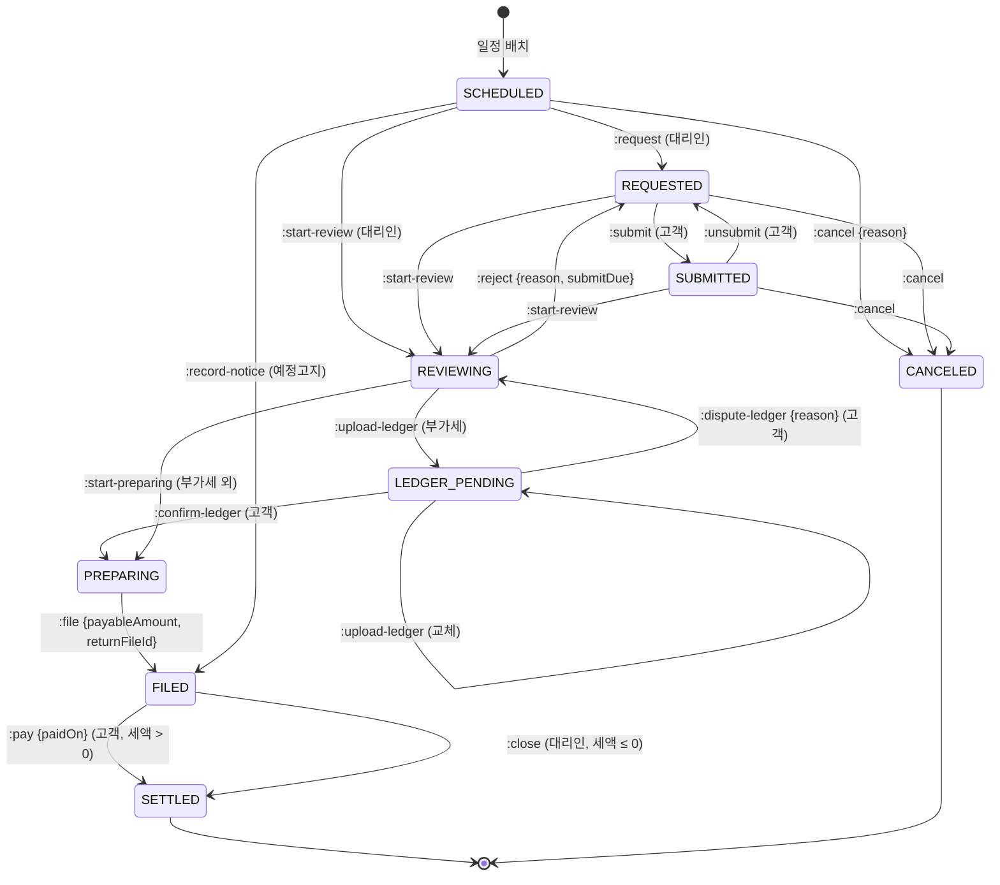
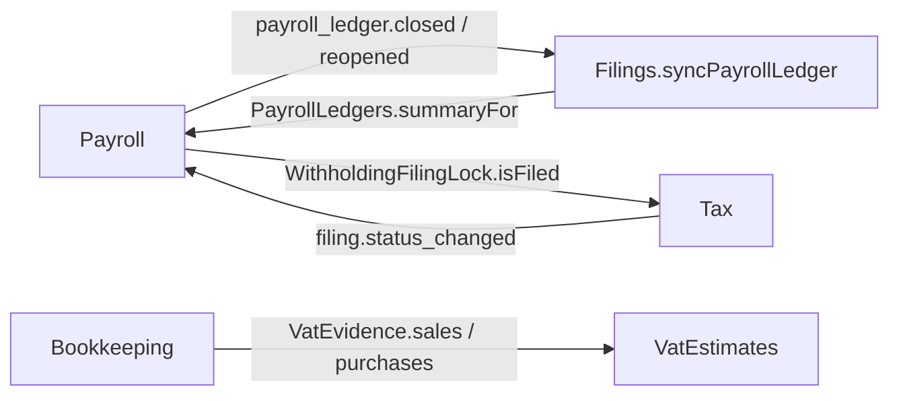

# Tax: 신고 건·세무 일정·할 일 카드·예상 부가세

세무 기장 고객과 세무 대리인이 함께 다루는 신고 건(부가세·원천세·법인세·종합소득세)의 진행, 그 일정을 만드는 세무 달력, 홈의 할 일 카드, 증빙으로 계산하는 예상 부가세를 다룹니다. 코드는 [`apps/api/src/modules/tax/`](../../apps/api/src/modules/tax/)에 있습니다.

## 현행에서 고칠 점

- **고객과 대리인이 다른 경로를 씁니다.** 고객은 `/tax/:taxType/:filingId/submit`, 대리인은 `/desk/filings/:filingId/request`. 같은 신고 건인데 세목이 경로에 들어가고(`surtax`, `withholding-tax`), 행위자 구분이 경로에 숨어 있습니다
- **행위자 불일치가 권한 부족과 같은 오류입니다.** 대리인이 고객의 `pay`를 보내면 403 `PERMISSION_DENIED`라 화면이 "권한 없음"과 "고객이 할 일"을 구분하지 못합니다
- **신고서 업로드와 신고 완료가 두 요청입니다.** `POST /desk/filings/:id/documents` 다음 `POST /desk/filings/:id/file`. 사이에 실패하면 문서만 남고, 신고서 없이 `file`하면 422입니다 (P2)
- **매입매출장 교체가 전이표에 없습니다.** 업로드 경로 안의 분기라 `allowedActions`로 드러나지 않습니다
- **예정고지 건이 자료 요청 흐름을 받습니다.** 고지서로 끝나는 건인데 `request`·`startReview`가 열려 있습니다
- **`submitted`에서 취소할 수 없습니다.** 고객이 낸 뒤 의무가 사라지면 대리인이 일부러 검토를 시작해야 합니다
- **화면 문구를 서버가 만듭니다.** 진행 단계(`자료 검토중`), 카드 제목(`2026년 4분기 부가세 자료 제출`), 바로가기 경로, 제출 항목 라벨이 응답에 들어 있습니다 (P1)
- **카드 노출을 메뉴 코드로 거릅니다.** 메뉴 트리가 바뀌면 카드가 사라집니다 (P5)
- **진행 현황이 신고 건 목록과 같은 데이터를 다른 경로(`/home/tracker`)로 줍니다**
- **원천세와 급여대장이 따로 움직입니다.** 급여대장 마감과 원천세 `payroll_ledger_closed` 항목이 Payroll 모듈 안에서 Tax 표를 직접 고칩니다 (P3)
- **카드 과세 비율이 bp, 응답에 `is_refund`·`last_scrap_status`가 있습니다.** 부호로 알 수 있는 값과 다른 컨텍스트의 상태가 섞였습니다 (P4)

## 용어

| 업무 용어 | 키 |
|---|---|
| 신고 건 | `Filing` |
| 세목 | `taxType`: `VAT`(부가세), `WITHHOLDING_TAX`(원천세), `CORPORATE_TAX`(법인세), `INCOME_TAX`(종합소득세) |
| 신고 종류 | `kind`: `PRELIMINARY`(예정), `FINAL`(확정), `NOTICE`(예정고지·예정부과·종합소득세 중간예납 고지), `MONTHLY`, `SEMIANNUAL`, `INTERIM`(법인세 중간예납), `ANNUAL` |
| 기간 키 | `periodKey`: `2026-H2`, `2026-10`, `2026` |
| 수정신고 차수 | `revision` |
| 법정 기한 / 신고 기한 / 납부 기한 | `statutoryDue` / `dueDate` / `paymentDue` |
| 자료 제출 마감 | `submitDue` |
| 제출 자료 항목 | `Requirement` (`code`, `response`: `PENDING`·`PROVIDED`·`NOT_APPLICABLE`) |
| 자동 연계 항목 | `autoLinked` (급여대장 마감 `PAYROLL_LEDGER_CLOSED`) |
| 매입매출장 / 신고서 / 납부서 / 고지서 | `FilingDocument.type`: `LEDGER` / `RETURN` / `PAYMENT_SLIP` / `NOTICE` |
| 납부할 세액 | `payableAmount` (음수 = 환급) |
| 종결 방식 | `settlement`: `PAID`, `REFUND`, `NO_PAYMENT` |
| 진행 단계 | `progress.stage`: `MATERIALS_OPEN`, `UNDER_REVIEW`, `LEDGER_CONFIRMATION`, `PREPARING`, `PAYMENT`, `CLOSED` |
| 기한 경과 | `isOverdue` |
| 오늘의 할 일 카드 | `ActionCard` (`kind`: `SUBMIT_MATERIALS`, `CONFIRM_LEDGER`, `REVIEW_FILING_RESULT`, `PAY_TAX`) |
| 넘어가기 | `completion: SKIP` → `SKIPPED_OVERDUE`(마감 후) |
| 세무 설정 | `TaxProfile` (`fiscalYearEndMonth`, `withholdingCycle`, `vatPreliminaryMode`, `sincereFilingTarget`, `taxableCardRatioPpm`) |
| 예상 부가세 | `VatEstimate` (`outputTax`, `inputTax`, `estimatedTax`) |

## 신고 건

### 리소스

```
Filing                                   fil_
├─ taxType, kind, periodKey, revision
├─ periodStart, periodEnd
├─ statutoryDue, dueDate, paymentDue     # 예정고지는 statutoryDue·dueDate가 null
├─ submitDue                             # :request·:reject가 정함
├─ status, isOverdue, progress           # isOverdue·progress는 저장하지 않고 계산
├─ payableAmount, settlement, paidOn
├─ ledgerUploadedAt, ledgerConfirmedAt, ledgerDisputeCount, paymentSlipSentAt
├─ requirements[] { code, response, autoLinked, note, fileIds[], updatedAt }
├─ documents[]    { id(fdc_), type, fileId, createdAt, firstViewedAt, replacedAt }
├─ allowedActions[]                      # 보는 행위자 기준
├─ version, updatedAt
└─ history[] (별도 경로)  { type, actorKind, fromStatus, toStatus, detail, occurredAt }
```

```
GET    /filings?taxType=&status=&open=&limit=&cursor=     기간 끝 최근 순
GET    /filings/{filingId}                                 ETag
GET    /filings/{filingId}/history
POST   /filings/{filingId}:{command}                       If-Match (선택)
PATCH  /filings/{filingId}/requirements/{code}             { response: PENDING|NOT_APPLICABLE, note? }
POST   /filings/{filingId}/requirements/{code}/files       { fileId }
DELETE /filings/{filingId}/requirements/{code}/files/{fileId}
POST   /filings/{filingId}/documents                       { type: RETURN|PAYMENT_SLIP, fileId }   대리인
GET    /filings/{filingId}/documents/{documentId}          고객의 첫 열람을 기록
```

- **고객과 대리인이 같은 경로를 씁니다.** 행위자는 토큰의 `actor.kind`이고, 커맨드마다 할 수 있는 행위자가 전이표에 있습니다. 세목은 경로가 아니라 필드입니다
- **회사 하나의 신고 건만 봅니다.** 대리인도 회사 토큰으로 들어옵니다. 담당 회사 여러 곳을 가로지르는 업무 큐는 [열린 질문](#열린-질문)에 있습니다
- **파일 본문은 파일 저장소가 갖습니다.** 신고 건은 `fileId`(`fle_`)만 들고, 업로드는 파일 저장소의 업로드 흐름으로 먼저 끝냅니다
- 수정신고는 `revision`을 올린 새 신고 건입니다. 지금은 만드는 경로가 없습니다

### 상태



- 전이표 하나([filing-status.ts](../../apps/api/src/modules/tax/filings/filing-status.ts))를 서비스, `allowedActions`, 테스트가 함께 봅니다
- 검사 순서는 행위자 → 출발 상태와 신고 건 조건 → 제출 자료입니다. 버전은 그보다 먼저 봅니다
- **예정고지 건(`kind: NOTICE`)은 `:record-notice`, `:cancel`, `:pay`, `:close`만 받습니다.** 자료 요청·검토 흐름이 없습니다
- **기한이 지나도 막지 않습니다.** 신고서를 내기 전이고 `dueDate ?? paymentDue`가 회사 시간대 오늘보다 앞이면 `isOverdue: true`입니다
- 상태가 바뀌면 같은 요청에서 [할 일 카드](#할-일-카드)를 열고 닫고 `filing.status_changed`를 내보냅니다

### 커맨드

| 커맨드 | 본문 | 행위자 | 권한 | 조건·효과 |
|---|---|---|---|---|
| `:request` | `{ submitDue, message? }` | 대리인 | `filing:process` | `submitDue`를 정하고 자료 제출 카드를 엶 |
| `:submit` | | 고객 | `filing:submit` | 자동 연계가 아닌 `PENDING` 항목이 있으면 422 `FILING_REQUIREMENTS_PENDING`(`requirementCodes`) |
| `:unsubmit` | | 고객 | `filing:submit` | |
| `:start-review` | | 대리인 | `filing:process` | 고객은 더 고칠 수 없음 |
| `:reject` | `{ reason, submitDue }` | 대리인 | `filing:process` | 자료 제출 카드를 다시 엶(`reopenCount` +1) |
| `:upload-ledger` | `{ ledgerFileId }` | 대리인 | `filing:process` | 부가세만. `LEDGER_PENDING`에서 보내면 매입매출장을 바꾸고 확인 시각을 지움 |
| `:confirm-ledger` | | 고객 | `filing:confirm-ledger` | |
| `:dispute-ledger` | `{ reason }` | 고객 | `filing:confirm-ledger` | `ledgerDisputeCount` +1 |
| `:start-preparing` | | 대리인 | `filing:process` | 부가세 외 |
| `:file` | `{ payableAmount, paymentDue?, returnFileId, paymentSlipFileId? }` | 대리인 | `filing:process` | 신고서(와 납부서)를 붙이고 신고 완료를 한 트랜잭션에서. `paymentDue`가 없으면 기존 납부 기한 |
| `:record-notice` | `{ noticeFileId, payableAmount ≥ 0, paymentDue }` | 대리인 | `filing:process` | 예정고지만. 고지서를 붙임 |
| `:pay` | `{ paidOn }` | 고객 | `filing:pay` | `payableAmount > 0`. `settlement: PAID` |
| `:close` | | 대리인 | `filing:process` | `payableAmount ≤ 0`. 음수면 `REFUND`, 0이면 `NO_PAYMENT` |
| `:cancel` | `{ reason }` | 대리인 | `filing:process` | 열린 카드를 모두 닫음 |

- 응답은 바뀐 신고 건과 `ETag`입니다. `If-Match`가 있고 버전이 다르면 412 `VERSION_MISMATCH`입니다
- 사유·메시지·금액은 이력 `detail`에 남습니다

### allowedActions

`allowedActions`는 지금 상태에서 **보는 행위자가** 보낼 수 있는 커맨드입니다. 행위자·출발 상태·세목·종류·세액 부호를 모두 통과한 것만 넣습니다.

| 상태 | 고객 | 대리인 |
|---|---|---|
| `SCHEDULED` | | `REQUEST`, `START_REVIEW`, `CANCEL` (예정고지는 `RECORD_NOTICE`, `CANCEL`) |
| `REQUESTED` | `SUBMIT` | `START_REVIEW`, `CANCEL` |
| `SUBMITTED` | `UNSUBMIT` | `START_REVIEW`, `CANCEL` |
| `REVIEWING` | | `REJECT`, `UPLOAD_LEDGER`(부가세) 또는 `START_PREPARING`(그 밖) |
| `LEDGER_PENDING` | `CONFIRM_LEDGER`, `DISPUTE_LEDGER` | `UPLOAD_LEDGER` |
| `PREPARING` | | `FILE` |
| `FILED` | `PAY` (세액 > 0) | `CLOSE` (세액 ≤ 0) |
| `SETTLED`, `CANCELED` | | |

- `SUBMIT`은 남은 항목이 있어도 넣습니다. 버튼을 켜 두고 누르면 422로 남은 항목을 알려 주는 편이 화면에 낫기 때문입니다

### 제출 자료

- 신고 건을 만들 때 세목별 체크리스트를 복사합니다([filing-requirements](../reference/rules/filing-requirements.md)). 부가세 6개, 원천세 6개(급여 플랜 회사는 `PAYROLL_LEDGER_CLOSED`를 맨 앞에), 예정고지·법인세·종합소득세는 없습니다
- 항목 라벨은 내려주지 않습니다. 클라이언트가 `code`로 문구를 고릅니다
- 고객은 `REQUESTED`에서만 고칩니다. 그 밖에는 409 `FILING_LOCKED`입니다. `If-Match`는 받지 않습니다(상태로 잠그고, 고칠 때마다 `version`은 오릅니다)
- 파일이 붙으면 `PROVIDED`, 마지막 파일을 떼면 `PENDING`입니다. 파일이 붙은 항목에 `PENDING`을 고르면 `PROVIDED`로 남고, `NOT_APPLICABLE`은 422 `REQUIREMENT_HAS_FILES`입니다
- 자동 연계 항목은 고객이 고칠 수 없고(409 `REQUIREMENT_AUTO_LINKED`), 제출 검사에서도 뺍니다

### 문서

| 문서 | 붙이는 길 | 고객에게 보이는 상태 |
|---|---|---|
| `LEDGER` | `:upload-ledger` | `LEDGER_PENDING`, `PREPARING`, `FILED`, `SETTLED` |
| `RETURN` | `:file`, `POST /documents` | `FILED`, `SETTLED` |
| `PAYMENT_SLIP` | `:file`, `POST /documents` | `FILED`, `SETTLED` |
| `NOTICE` | `:record-notice` | `FILED`, `SETTLED` |

- 같은 종류를 다시 붙이면 앞 문서에 `replacedAt`을 남기고 고객에게는 새 문서만 보입니다. 대리인은 모두 봅니다
- `POST /documents`는 `PREPARING`·`FILED`에서만 받습니다(그 밖에는 409 `FILING_LOCKED`). `FILED`에서 납부서를 붙이면 `paymentSlipSentAt`을 남깁니다
- 고객이 문서를 처음 열면 `firstViewedAt`을 남기고, 신고서·고지서면 결과 확인 카드를 닫습니다. 고객이 볼 수 없는 문서는 404 `FILING_DOCUMENT_NOT_FOUND`입니다

## 세무 일정

```
GET /tax-calendar?year=2026    → { items: [{ taxType, kind, periodKey, periodStart, periodEnd, statutoryDue, dueDate, paymentDue, filingId, filingStatus }] }
```

- 저장하지 않고 회사 세무 설정(`TaxProfile`)과 공휴일표로 그때 계산합니다([filing-obligations](../reference/rules/filing-obligations.md), [filing-deadline-rollover](../reference/rules/filing-deadline-rollover.md)). 납부 기한이 그 해 안인 의무를 기한 순으로 주고, 만들어진 신고 건(가장 큰 `revision`)을 붙입니다
- 세무 설정이 없는 회사는 404 `TAX_PROFILE_NOT_FOUND`입니다
- **일정 배치**(`FilingScheduler`, 엔드포인트 없음)는 매일, 그리고 공휴일표·세무 설정이 바뀐 뒤 돕니다. 오늘부터 120일 안의 의무에 대해
  - 신고 건이 없으면 `SCHEDULED`로 만들고 체크리스트를 복사합니다. 급여 플랜 회사의 원천세는 `PAYROLL_LEDGER_CLOSED`를 바로 맞춥니다
  - 있으면(취소된 것 포함) 만들지 않고, `SCHEDULED`·`REQUESTED`면 기한만 새로 맞춥니다(이력 `DEADLINES_REFRESHED`)
  - 창 안의 `SCHEDULED` 신고 건이 의무에 없으면 `CANCELED`로 바꾸고(이력 `SCHEDULE_CANCELED`) 카드를 닫고 이벤트를 냅니다
- 같은 날 다시 돌려도 아무것도 바뀌지 않습니다

## 할 일 카드

```
GET  /action-cards?status=OPEN|CLOSED&limit=&cursor=    진행중은 마감일 순, 완료는 최근 순
GET  /action-cards:summary                               { openCount, closedCount, nearestDueDate }
POST /action-cards/{cardId}:complete                     { completion: DONE|SKIP }
```

```
ActionCard                               acd_
├─ kind, status: OPEN | DONE | SKIPPED_OVERDUE
├─ subject { type: FILING, filingId, taxType, filingKind, periodKey }
├─ dueDate, reopenCount
└─ createdAt, completedAt
```

| 신고 건 전이 | 카드 |
|---|---|
| `:request`, `:reject`, `:unsubmit` | `SUBMIT_MATERIALS` 열기, 마감일 = `submitDue` |
| `:submit`, `:start-review` | `SUBMIT_MATERIALS` 닫기 |
| `:upload-ledger` | `CONFIRM_LEDGER` 열기, 마감일 = 신고 기한 − 3일 |
| `:confirm-ledger`, `:dispute-ledger` | `CONFIRM_LEDGER` 닫기 |
| `:file`, `:record-notice` | `REVIEW_FILING_RESULT` 열기(신고 기한, 없으면 납부 기한). 세액 > 0이면 `PAY_TAX` 열기(납부 기한) |
| `:pay`, `:close` | `PAY_TAX` 닫기 |
| `:cancel`, 일정 배치 취소 | 모두 닫기 |
| 고객이 신고서·고지서를 처음 엶 | `REVIEW_FILING_RESULT` 닫기 |

- 규칙은 [action-card-lifecycle](../reference/rules/action-card-lifecycle.md)이고 판정은 [action-card-rules.ts](../../apps/api/src/modules/tax/action-cards/action-card-rules.ts)의 순수 함수입니다
- **제목·바로가기를 내려주지 않습니다.** 클라이언트가 `kind`와 `subject`로 문구와 화면을 고릅니다
- **카드마다 보는 요건(`permission` + `plans`)을 저장합니다.** 신고 건 카드는 `filing:read` + `TAXATION`입니다. 요건을 갖추지 못한 행위자에게는 목록·개수·완료 모두에서 없는 카드입니다(완료는 404)
- 카드는 신고 건·종류마다 하나입니다. 시스템이 닫으면 `DONE`, 사용자가 넘어가면 마감일(회사 시간대) 이후일 때 `SKIPPED_OVERDUE`입니다. 닫힌 카드 완료는 409 `ACTION_CARD_CLOSED`입니다

## 예상 부가세

```
GET /vat-estimates/current?on=2026-11-05    → { period, asOf, outputTax, inputTax, estimatedTax, cardSplitEstimated, breakdown[], excluded }
GET /vat-estimates?years=3                  → { items: [{ year, half, amount, source: CONFIRMED|ESTIMATED }] }
```

- 규칙은 [estimated-vat](../reference/rules/estimated-vat.md)이고 계산은 [vat-estimate.ts](../../apps/api/src/modules/tax/vat-estimates/vat-estimate.ts)의 순수 함수입니다
- `on`(기본 회사 시간대 오늘)이 속한 기간(법인 분기, 개인 반기)을 기간 시작부터 `on`까지의 증빙으로 계산합니다
- 카드 과세 비율은 `taxableCardRatioPpm`(ppm)입니다. 세무 설정이 없으면 100%입니다
- `estimatedTax < 0`이면 환급 예상입니다. `isRefund`는 두지 않습니다
- `breakdown[]`은 출처별 `vatAmount`, `includedInTotal`, `lastSyncedAt`입니다. 수집 작업 상태는 Integrations의 수집 요청에서 봅니다
- 추이는 세무 기장(`TAXATION`) 고객이면 확정 신고한 반기에 신고 세액(예정고지 제외)을 씁니다

## 접근 요건

| 엔드포인트 | 권한 | 플랜 | 약관 |
|---|---|---|---|
| 신고 건 조회, 문서 열람, 세무 일정 | `filing:read` | `TAXATION` | 필요 |
| 제출 자료 응답·파일 | `filing:update` | `TAXATION` | 필요 |
| `:submit`, `:unsubmit` | `filing:submit` | `TAXATION` | 필요 |
| `:confirm-ledger`, `:dispute-ledger` | `filing:confirm-ledger` | `TAXATION` | 필요 |
| `:pay` | `filing:pay` | `TAXATION` | 필요 |
| 대리인 커맨드, 문서 붙이기 | `filing:process` | `TAXATION` | 필요(대리인은 건너뜀) |
| 할 일 카드 조회 / 완료 | `action-card:read` / `action-card:complete` | 카드마다 | |
| 예상 부가세 | `estimated-vat:read` | | |

- 권한을 통과해도 행위자가 틀리면 403 `FILING_ACTOR_NOT_ALLOWED`(`action`, `requiredActorKind`)입니다. 권한은 "이 사용자가 할 수 있는가", 행위자는 "이 신고 건에서 누구 차례인가"입니다
- 예상 부가세는 플랜 없이 열고(현행 무료 고객도 봄), 확정 세액을 쓸지만 플랜으로 정합니다

## 오류 코드

| 상태 | `code` | 언제 | 추가 필드 |
|---|---|---|---|
| 400 | `VALIDATION_FAILED` | 스키마 위반(소수 세액, 없는 날짜, 빠진 `returnFileId`) | `violations` |
| 403 | `PERMISSION_DENIED`, `ENTITLEMENT_REQUIRED`, `TERMS_REAGREEMENT_REQUIRED` | 접근 요건 | 공통 |
| 403 | `FILING_ACTOR_NOT_ALLOWED` | 다른 행위자의 커맨드, 고객의 문서 붙이기 | `action`, `requiredActorKind` |
| 404 | `FILING_NOT_FOUND` | 없거나 다른 회사 신고 건 | |
| 404 | `REQUIREMENT_NOT_FOUND` | 신고 건에 없는 항목 코드 | |
| 404 | `REQUIREMENT_FILE_NOT_FOUND` | 항목에 붙지 않은 파일 떼기 | |
| 404 | `FILING_DOCUMENT_NOT_FOUND` | 없거나 고객이 지금 볼 수 없는 문서 | |
| 404 | `ACTION_CARD_NOT_FOUND` | 없거나 볼 수 없는 카드 | |
| 404 | `TAX_PROFILE_NOT_FOUND` | 세무 설정이 없는 회사의 세무 일정 | |
| 409 | `FILING_TRANSITION_INVALID` | 상태·세목·종류·세액 부호가 커맨드와 맞지 않음 | `currentStatus`, `command` |
| 409 | `FILING_LOCKED` | `REQUESTED` 밖의 자료 변경, `PREPARING`·`FILED` 밖의 문서 붙이기 | `currentStatus` |
| 409 | `REQUIREMENT_AUTO_LINKED` | 자동 연계 항목 변경 | |
| 409 | `ACTION_CARD_CLOSED` | 닫힌 카드 완료 | `currentStatus` |
| 412 | `VERSION_MISMATCH` | `If-Match`가 현재 버전과 다름 | `currentVersion` |
| 422 | `FILING_REQUIREMENTS_PENDING` | 남은 항목이 있는 `:submit` | `requirementCodes` |
| 422 | `REQUIREMENT_HAS_FILES` | 파일이 붙은 항목에 `NOT_APPLICABLE` | |

## 다른 컨텍스트와의 연결



| 방향 | 이름 | 형태 |
|---|---|---|
| 내보냄(이벤트) | `filing.status_changed` | `{ companyId, filingId, taxType, kind, periodStart, periodEnd, fromStatus, toStatus, payableAmount, occurredAt }` |
| 받음(이벤트) | Payroll `payroll_pay_month.closed`·`payroll_pay_month.reopened` | [payroll-tax.ts](../../apps/api/src/wiring/payroll-tax.ts)가 `PayrollLedgerChanged { companyId, paymentMonth }`로 바꿔 `PayrollLedgerSync.apply`(= `Filings.syncPayrollLedger`)를 같은 요청 안에서 부름 |
| 공개 조회 | `VatEstimateQuery.current(companyId, businessType, asOf)` | `{ period, asOf, estimatedTax, dueDate }`. Bookkeeping 홈 카드가 씀 |
| 공개 조회 | `WithholdingFilingLock.isFiled(companyId, paymentMonth)` | 그 지급월을 덮는 원천세(가장 큰 `revision`, 취소 제외)가 `FILED`·`SETTLED`인지. Payroll이 급여대장 잠금에 씀 |
| 포트(Payroll 구현) | `PayrollLedgers.summaryFor(companyId, paidFrom, paidTo)` | `{ ledgerCount, closedCount }`, 지급일 기준 |
| 포트(Bookkeeping 구현) | `VatEvidence.sales/purchases(companyId, from, to)` | 매출 `{ id, source, issuedOn, totalAmount, vatAmount, dedupeGroup, syncedAt }`(발행일·ID 순), 매입 `{ id, source, issuedOn, vatAmount, deductible, syncedAt }` |
| 포트(Identity·Billing·Tax 설정) | `TaxProfiles.get/listTaxation` | 사업자 형태·플랜과 세무 설정을 합친 `TaxProfile` |
| 포트(운영) | `PublicHolidays.between(from, to)` | 기한을 미루는 쉬는 날(주말 제외) |
| 포트(아웃박스) | `TaxEvents.publish(events)` | 지금은 메모리. 아웃박스가 생기면 같은 트랜잭션에 씀 |

- 원천세는 지급 시기 기준이라 급여대장의 **지급월**로 신고 건을 찾습니다
- Tax는 Payroll·Bookkeeping 저장소를 읽지 않습니다. 공개 타입은 [tax.public.ts](../../apps/api/src/modules/tax/tax.public.ts)에 있습니다

## 현행 엔드포인트 대응

현행 고객 경로는 모두 `/api/company/:companyId` 아래, 대리인 경로는 `/api/desk` 아래입니다.

| 현행 | 재설계 |
|---|---|
| `GET /tax/:taxType/` `?year=` | `GET /filings?taxType=` (연도는 `periodKey`·기간으로 거름) |
| `GET /tax/:taxType/:filingId/` | `GET /filings/{filingId}` |
| `PUT /tax/:taxType/:filingId/requirements/:code/` | `PATCH /filings/{filingId}/requirements/{code}` |
| `POST /tax/:taxType/:filingId/requirements/:code/files/` (multipart) | 파일 저장소 업로드 → `POST /filings/{filingId}/requirements/{code}/files { fileId }` |
| `GET /tax/:taxType/:filingId/requirements/:code/files/:fileId/` | 파일 저장소 다운로드 (`fileId`) |
| `DELETE /tax/:taxType/:filingId/requirements/:code/files/:fileId/` | `DELETE /filings/{filingId}/requirements/{code}/files/{fileId}` |
| `POST /tax/:taxType/:filingId/submit/` | `POST /filings/{filingId}:submit` |
| `POST /tax/:taxType/:filingId/unsubmit/` | `POST /filings/{filingId}:unsubmit` |
| `POST /tax/surtax/:filingId/ledger/confirm/` | `POST /filings/{filingId}:confirm-ledger` |
| `POST /tax/surtax/:filingId/ledger/dispute/` | `POST /filings/{filingId}:dispute-ledger` |
| `GET /tax/:taxType/:filingId/documents/:docId/` | `GET /filings/{filingId}/documents/{documentId}` (메타데이터 + 열람 기록) → 파일 저장소 다운로드 |
| `POST /tax/:taxType/:filingId/pay/` | `POST /filings/{filingId}:pay` |
| `GET /tax/calendar/?year=` | `GET /tax-calendar?year=` |
| `GET /reports/estimated-vat/?on=` | `GET /vat-estimates/current?on=` |
| `GET /reports/estimated-vat/trend/?years=` | `GET /vat-estimates?years=` |
| `GET /home/action-cards/summary` | `GET /action-cards:summary` |
| `GET /home/action-cards/active` | `GET /action-cards?status=OPEN` |
| `GET /home/action-cards/archived` | `GET /action-cards?status=CLOSED` |
| `POST /home/action-cards/:cardId/complete` `{ completion_reason }` | `POST /action-cards/{cardId}:complete { completion }` |
| `GET /home/tracker` | `GET /filings?open=true` (항목의 `progress`) |
| `GET /menu/menu-tree/:version/` | Identity & Access (세무 밖) |
| `GET /desk/filings/?status=&due_before=&cursor=` | 담당 회사를 가로지르는 업무 큐. 설계만 ([열린 질문](#열린-질문)) |
| `GET /desk/filings/:filingId/` | `GET /filings/{filingId}` (대리인 토큰) |
| `GET /desk/filings/:filingId/files/:fileId/` | 파일 저장소 다운로드 |
| `GET /desk/filings/:filingId/documents/:docId/` | `GET /filings/{filingId}/documents/{documentId}` |
| `POST /desk/filings/:filingId/request/` | `POST /filings/{filingId}:request` |
| `POST /desk/filings/:filingId/start-review/` | `POST /filings/{filingId}:start-review` |
| `POST /desk/filings/:filingId/reject/` | `POST /filings/{filingId}:reject` |
| `POST /desk/filings/:filingId/ledger/` | `POST /filings/{filingId}:upload-ledger { ledgerFileId }` (교체 포함) |
| `POST /desk/filings/:filingId/start-preparing/` | `POST /filings/{filingId}:start-preparing` |
| `POST /desk/filings/:filingId/documents/` | `POST /filings/{filingId}/documents` (교체·납부서 추가) 또는 `:file`에 함께 |
| `POST /desk/filings/:filingId/file/` | `POST /filings/{filingId}:file { payableAmount, returnFileId, ... }` |
| `POST /desk/filings/:filingId/record-notice/` | `POST /filings/{filingId}:record-notice { noticeFileId, ... }` |
| `POST /desk/filings/:filingId/close/` | `POST /filings/{filingId}:close` |
| `POST /desk/filings/:filingId/cancel/` | `POST /filings/{filingId}:cancel` |
| 일정 배치 `jobs/schedule-filings.ts` | `FilingScheduler.run` (엔드포인트 없음) |

현행 sf `GET /tax/surtax/` 목록의 레거시 필드(`year`, `quarter`, `payment_deadline`, `purchase_sales_ledger_*`, `payment_slip_sent`, `amount`, `process_step`)는 `periodKey`·`periodStart`, `paymentDue`, `ledgerUploadedAt`·`ledgerConfirmedAt`, `paymentSlipSentAt`, `payableAmount`, `progress`가 대신합니다. 이관 때 이름 대응은 [legacy-names.ts](../../apps/api/src/modules/tax/legacy-names.ts)에 있습니다.

## 구현 상태

| 영역 | 상태 |
|---|---|
| 신고 건 조회·커맨드 14개·제출 자료·문서·이력 | 구현 (메모리 저장소, [filings.ts](../../apps/api/src/modules/tax/filings/filings.ts)) |
| 할 일 카드 | 구현 ([action-cards.ts](../../apps/api/src/modules/tax/action-cards/action-cards.ts)) |
| 세무 일정 조회 | 구현 ([tax-calendar.ts](../../apps/api/src/modules/tax/calendar/tax-calendar.ts)) |
| 일정 배치 | 서비스만 (`FilingSchedulerLive`). 매일 돌릴 실행기는 없음 |
| 예상 부가세·추이 | 구현 ([vat-estimates.ts](../../apps/api/src/modules/tax/vat-estimates/vat-estimates.ts)) |
| 공개 서비스 (`WithholdingFilingLock`, `PayrollLedgerSync`, `VatEstimateQuery`) | 구현 (`TaxPublicLive`). `src/wiring/`에서 Payroll·Bookkeeping에 연결 |
| 포트 연결(`PayrollLedgers`, `VatEvidence`, `TaxProfiles`, `PublicHolidays`) | `src/wiring/`에서 Payroll·Bookkeeping·Identity & Access·Billing·공유 공휴일표에 연결. 세무 설정(결산월·원천세 주기·예정 신고 방식·성실신고·카드 과세 비율)은 저장소가 없어 기본값([tax-identity-access.ts](../../apps/api/src/wiring/tax-identity-access.ts)) |
| 이벤트 아웃박스 | 없음 (`TaxEvents.layerMemory`) |
| 대리인 업무 큐, 수정신고, 감사 로그 | 없음 |

규칙 픽스처는 모두 `*.fixtures.test.ts`로 옮겼고, 옮기지 않은 케이스와 이유는 각 테스트 파일의 `NOT_PORTED`에 있습니다. 결정은 [rule-decisions/tax.md](rule-decisions/tax.md)에 있습니다.

## 열린 질문

1. **대리인 업무 큐.** 담당 회사 전체를 가로지르는 `GET /desk/filings`는 회사 토큰 하나로 풀 수 없습니다. 대리인 전용 토큰(회사 없음) + `GET /agency/filings?companyId=&status=&dueBefore=`로 둘지, Identity & Access의 대리인 배정 모델과 함께 정해야 합니다
2. **파일 저장소의 소유.** `fileId`(`fle_`)를 누가 발급하고 다운로드 권한을 어떻게 신고 건 상태(문서 노출)와 맞출지 정해야 합니다. 지금은 신고 건이 `fileId`만 들고 노출 판정은 Tax가 합니다
3. **문서 열람 기록의 경로.** `GET /filings/{filingId}/documents/{documentId}`가 첫 열람을 기록합니다(GET에 부수효과). 다운로드 URL 발급을 `POST .../documents/{documentId}:open`으로 바꿀지 파일 저장소 설계와 함께 정합니다
4. **수정신고.** `revision`은 있지만 만드는 커맨드(`POST /filings/{filingId}:amend`)와 원 신고 건과의 관계를 정하지 않았습니다
5. **법인세·종합소득세 자료.** 체크리스트가 없어 고객 흐름이 비어 있습니다. 결산 자료(재고·가지급금 등) 항목을 만들지 업무 확인이 필요합니다
6. **간이과세자 설정의 출처.** 중간예납과 간이과세자 일정은 의무 계산에 넣었고, 분납은 신고 건의 `paymentDue`로 덮어씁니다 ([rule-decisions](rule-decisions/tax.md#filing-obligations)). 회사 세무 설정 저장소가 없어 프로필의 `vatTaxpayerType`은 지금 `GENERAL`입니다. 사업자 상태조회의 과세 유형으로 채울지 정해야 합니다
7. **세무 밖 할 일 카드.** 기관 연동 만료 같은 카드를 다른 컨텍스트가 열 수 있게 하려면 `ActionCards`를 공개 포트로 내야 합니다
