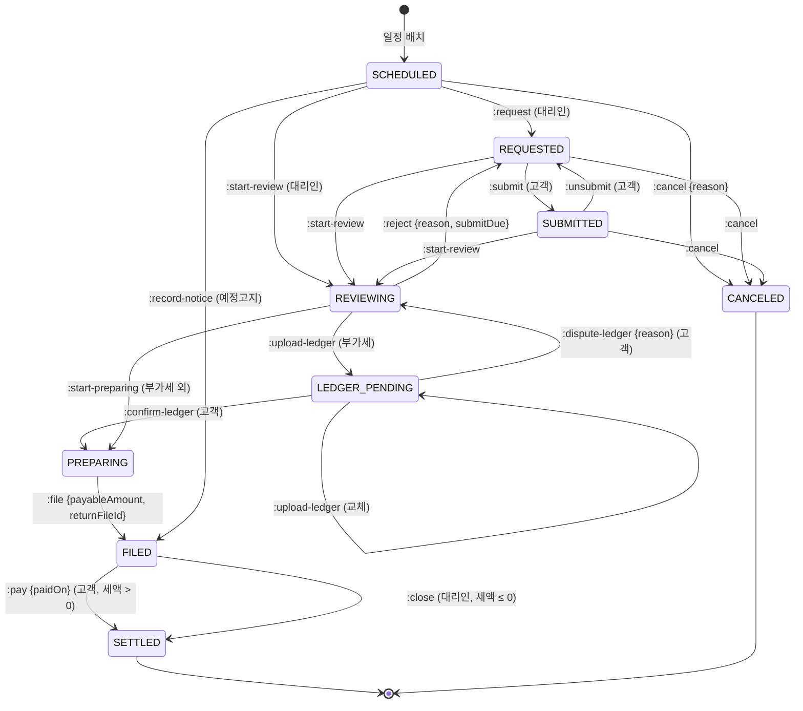
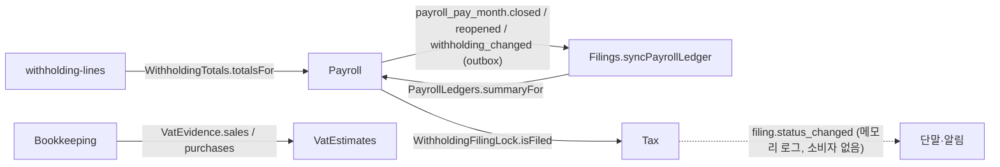

# Tax: 신고 건·세무 일정·할 일 카드·예상 부가세·결산 보고서

세무 기장 고객과 세무 대리인이 함께 다루는 신고 건(부가세·원천세·법인세·종합소득세)의 진행, 그 일정을 만드는 세무 달력, 홈의 할 일 카드, 증빙으로 계산하는 예상 부가세, 일정을 정하는 회사 세무 설정, 그리고 담당자가 올린 결산으로 만드는 세무 보고서를 다룹니다. 코드는 [`apps/api/src/modules/tax/`](../../apps/api/src/modules/tax/)에 있습니다.

## 현행에서 고칠 점

- **고객과 대리인이 다른 경로를 씁니다.** 고객은 `/tax/:taxType/:filingId/submit`, 대리인은 `/desk/filings/:filingId/request`. 같은 신고 건인데 세목이 경로에 들어가고(`surtax`, `withholding-tax`), 행위자 구분이 경로에 숨어 있습니다
- **행위자 불일치가 권한 부족과 같은 오류입니다.** 대리인이 고객의 `pay`를 보내면 403 `PERMISSION_DENIED`라 화면이 "권한 없음"과 "고객이 할 일"을 구분하지 못합니다
- **신고서 업로드와 신고 완료가 두 요청입니다.** `POST /desk/filings/:id/documents` 다음 `POST /desk/filings/:id/file`. 사이에 실패하면 문서만 남고, 신고서 없이 `file`하면 422입니다 (P2)
- **매입매출장 교체가 전이표에 없습니다.** 업로드 경로 안의 분기라 `allowedActions`로 드러나지 않습니다
- **예정고지 건이 자료 요청 흐름을 받습니다.** 고지서로 끝나는 건인데 `request`·`startReview`가 열려 있습니다
- **`submitted`에서 취소할 수 없습니다.** 고객이 낸 뒤 의무가 사라지면 대리인이 일부러 검토를 시작해야 합니다
- **화면 문구를 서버가 만듭니다.** 진행 단계(`자료 검토중`), 카드 제목(`2026년 4분기 부가세 자료 제출`), 바로가기 경로, 제출 항목 라벨이 응답에 들어 있습니다 (P1)
- **카드 노출을 메뉴 코드로 거릅니다.** 메뉴 트리가 바뀌면 카드가 사라집니다 (P5)
- **진행 현황이 신고 건 목록과 같은 데이터를 다른 경로(`/home/tracker`)로 줍니다**
- **원천세와 급여대장이 따로 움직입니다.** 급여대장 마감과 원천세 `payroll_ledger_closed` 항목이 Payroll 모듈 안에서 Tax 표를 직접 고칩니다 (P3)
- **카드 과세 비율이 bp, 응답에 `is_refund`·`last_scrap_status`가 있습니다.** 부호로 알 수 있는 값과 다른 컨텍스트의 상태가 섞였습니다 (P4)

## 용어

| 업무 용어 | 키 |
|---|---|
| 신고 건 | `Filing` |
| 세목 | `taxType`: `VAT`(부가세), `WITHHOLDING_TAX`(원천세), `CORPORATE_TAX`(법인세), `INCOME_TAX`(종합소득세) |
| 신고 종류 | `kind`: `PRELIMINARY`(예정), `FINAL`(확정), `NOTICE`(예정고지·예정부과·종합소득세 중간예납 고지), `MONTHLY`, `SEMIANNUAL`, `INTERIM`(법인세 중간예납), `ANNUAL` |
| 기간 키 | `periodKey`: `2026-H2`, `2026-10`, `2026` |
| 수정신고 차수 | `revision` |
| 법정 기한 / 신고 기한 / 납부 기한 | `statutoryDue` / `dueDate` / `paymentDue` |
| 자료 제출 마감 | `submitDue` |
| 제출 자료 항목 | `Requirement` (`code`, `response`: `PENDING`·`PROVIDED`·`NOT_APPLICABLE`) |
| 자동 연계 항목 | `autoLinked` (급여대장 마감 `PAYROLL_LEDGER_CLOSED`) |
| 원천세 합계 (지급월·소득 종류별) | `WithholdingTotal` (`incomeKind`: `WAGE`·`DAILY`·`BUSINESS`·`OTHER`·`RETIREMENT`, `otherIncomeCategory`: `PERSONAL_SERVICE`(인적용역)·`GENERAL`) |
| 원천세 신고서 줄 / 소득구분 코드 / 가감계 | `WithholdingReturnLine` / `lineCode` / `subtotalCode` |
| 매입매출장 / 신고서 / 납부서 / 고지서 | `FilingDocument.type`: `LEDGER` / `RETURN` / `PAYMENT_SLIP` / `NOTICE` |
| 납부할 세액 | `payableAmount` (음수 = 환급) |
| 종결 방식 | `settlement`: `PAID`, `REFUND`, `NO_PAYMENT` |
| 진행 단계 | `progress.stage`: `MATERIALS_OPEN`, `UNDER_REVIEW`, `LEDGER_CONFIRMATION`, `PREPARING`, `PAYMENT`, `CLOSED` |
| 기한 경과 | `isOverdue` |
| 오늘의 할 일 카드 | `ActionCard` (`kind`: `SUBMIT_MATERIALS`, `CONFIRM_LEDGER`, `REVIEW_FILING_RESULT`, `PAY_TAX`) |
| 넘어가기 | `completion: SKIP` → `SKIPPED_OVERDUE`(마감 후) |
| 세무 설정 | `TaxSetting` (`fiscalYearEndMonth`, `withholdingCycle`, `withholdingSemiannualFrom`, `sincereFilingTarget`, `vatTaxpayerType`, `vatSimplifiedInvoiceIssuer`, `taxableCardRatioPpm`, `vatSupplyAmounts`, `vatPreliminaryElections`) |
| 세무 프로필 (회사 사실 + 세무 설정) | `TaxProfile` (`companyId`, `businessType`, `plans` + 세무 설정) |
| 사업연도 종료 월 (결산월) | `fiscalYearEndMonth` (1–12) |
| 원천세 납부 주기 | `withholdingCycle`: `MONTHLY`(매월), `SEMIANNUAL`(반기별 납부 승인) |
| 반기 납부 적용 시작 반기 | `withholdingSemiannualFrom` (`2027-H1`, 반기 납부일 때만) |
| 결산 스냅샷 / 결산 기준일 | 담당자가 올린 사업연도 결산 숫자 / `closedThrough` |
| 사업연도 (끝나는 해) | `fiscalYear` (`2026`), 기간은 `period { start, end }` |
| 손익 섹션 | `REVENUE`(매출액), `COST_OF_SALES`(매출원가), `GROSS_PROFIT`(매출총이익), `SELLING_AND_ADMINISTRATIVE_EXPENSES`(판매비와관리비), `OPERATING_INCOME`(영업이익), `NON_OPERATING_INCOME`(영업외수익), `NON_OPERATING_EXPENSES`(영업외비용), `INCOME_TAXES`(법인세등·소득세등), `NET_INCOME`(당기순이익) |
| 재무상태표 구분 | `BalanceSheetGroup`: `CURRENT_ASSETS`, `NON_CURRENT_ASSETS`, `CURRENT_LIABILITIES`, `NON_CURRENT_LIABILITIES`, `CAPITAL_STOCK`, `CAPITAL_SURPLUS`, `CAPITAL_ADJUSTMENTS`, `ACCUMULATED_OTHER_COMPREHENSIVE_INCOME`, `RETAINED_EARNINGS` |
| 재무 비율 | `ratios.*Ppm` (1 = 1,000,000, 분모가 0이면 `null`) |
| 미수 / 미지급 / 거래처 원장 / ERP 거래처 코드 | `receivable`·`receivables` / `payable`·`payables` / `PartnerLedger` / `partnerCode` |
| 전기 이월 / 증가 / 감소 / 잔액 | `openingBalance` / `increase` / `decrease` / `closingBalance`·`balance` |
| 현금성 계정 / 기초 잔액 / 보유자금 / 순유입 | `CashAccount`: `CASH`, `CHECKING_DEPOSIT`, `ORDINARY_DEPOSIT`, `OTHER_DEPOSITS` / `openingBalances` / `fundsHeld` / `netInflow` |
| 성실신고확인 대상 | `sincereFilingTarget` |
| 부가세 과세 유형 | `vatTaxpayerType`: `GENERAL`(일반과세자), `SIMPLIFIED`(간이과세자) |
| 간이과세자의 세금계산서 발급 | `vatSimplifiedInvoiceIssuer` |
| 카드 매출 과세 비율 | `taxableCardRatioPpm` (ppm, 100% = 1,000,000) |
| 과세기간별 공급가액 합계 | `vatSupplyAmounts` (과세기간 키 `2026-H2` → 원) |
| 예정신고 선택 사유 | `vatPreliminaryElections` (과세기간 키 → `BUSINESS_DECLINE`(휴업·사업 부진), `EARLY_REFUND`(조기환급)) |
| 예상 부가세 | `VatEstimate` (`outputTax`, `inputTax`, `estimatedTax`) |

**부가세 예정 기간(예정고지 판정).** 사업자는 원칙적으로 예정신고합니다(부가가치세법 제48조 ①). 개인사업자와 직전 과세기간 공급가액 합계액이 1억 5천만 원 미만인 법인사업자는 세무서가 직전 과세기간 납부세액의 50%를 고지·징수합니다(제48조 ③, 1억 5천만 원은 시행령 제90조 ④). 징수할 금액이 50만 원 미만이거나 간이과세자에서 일반과세자로 바뀐 경우 등은 고지하지 않습니다(제48조 ③ 단서 1–3호). 고지 대상이라도 휴업·사업 부진 등으로 예정신고기간의 공급가액 또는 납부세액이 직전 과세기간의 1/3에 미달하거나 그 기간분을 조기환급 받으려면 예정신고할 수 있습니다(제48조 ④, 시행령 제90조 ⑥ 1·2호).

신고 일정은 예정신고기간마다 판정 규칙([vat-preliminary-notice.ts](../../apps/api/src/modules/tax/calendar/vat-preliminary-notice.ts))으로 예정고지(`NOTICE`)와 예정신고(`PRELIMINARY`)를 정합니다. 입력은 세무 설정의 두 값입니다.

- **직전 과세기간 공급가액:** `vatSupplyAmounts`의 직전 과세기간 값(1기는 전년 2기, 2기는 같은 해 1기)입니다. 확정 신고서의 값을 대리인이 확정 신고 뒤 넣습니다. 신고 건에 기록하지 않고 세무 설정에 둔 것은 일정 배치가 다음 기 예정 건을 120일 전(확정 신고 기한보다 앞)에 만들기 때문입니다. 값이 바뀌어 판정이 달라지면 배치가 `SCHEDULED`인 예정 건을 취소하고 다른 종류를 만들며, 되돌리면 배치가 취소한 건을 되살립니다. 예정고지와 예정 신고는 예정신고기간마다 한 자리라, 예정 건이 이미 `SCHEDULED`를 지났거나 대리인이 취소했으면 판정이 바뀌어도 다른 종류를 만들지 않고 대리인이 정리합니다. 이미 만든 확정 건의 기간(반기 전체 또는 남은 3개월)은 다시 계산하지 않으므로 대리인이 고칩니다. 법인은 값이 없으면(신설 법인, 아직 넣지 않음) 고지 대상인지 알 수 없어 원칙대로 예정신고입니다. 개인은 값과 상관없이 예정고지입니다
- **예정신고 선택:** `vatPreliminaryElections`에 그 과세기간과 사유를 넣으면 예정신고입니다. 1/3 미달 여부는 대리인이 판단하고 사유만 받습니다

50만 원 미만 등 고지하지 않는 경우는 직전 과세기간 납부세액을 받지 않아 판정하지 않고, 고지 건으로 두고 대리인이 취소합니다. 두 값은 대리인이 [세무 설정](#세무-설정)(`PATCH /tax-settings`)으로 넣습니다. 넣지 않은 회사는 비어 있어 법인 예정신고, 개인 예정고지입니다(이전 고정 분기와 같은 결과)

## 신고 건

### 리소스

```
Filing                                   fil_
├─ taxType, kind, periodKey, revision
├─ periodStart, periodEnd
├─ statutoryDue, dueDate, paymentDue     # 예정고지는 statutoryDue·dueDate가 null
├─ submitDue                             # :request·:reject가 정함
├─ status, isOverdue, progress           # isOverdue·progress는 저장하지 않고 계산
├─ payableAmount, settlement, paidOn
├─ ledgerUploadedAt, ledgerConfirmedAt, ledgerDisputeCount, paymentSlipSentAt
├─ requirements[] { code, response, autoLinked, note, fileIds[], updatedAt }
├─ documents[]    { id(fdc_), type, fileId, createdAt, firstViewedAt, replacedAt }
├─ allowedActions[]                      # 보는 행위자 기준
├─ version, updatedAt
└─ history[] (별도 경로)  { type, actorKind, onBehalfOf?, fromStatus, toStatus, detail, occurredAt }
```

```
GET    /filings?taxType=&status=&open=&limit=&cursor=     기간 끝 최근 순
GET    /filings/{filingId}                                 ETag
GET    /filings/{filingId}/history
GET    /filings/{filingId}/withholding-lines               원천세 신고서 줄(지급월별)
POST   /filings/{filingId}:{command}                       If-Match (선택)
PATCH  /filings/{filingId}/requirements/{code}             { response: PENDING|NOT_APPLICABLE, note? }
POST   /filings/{filingId}/requirements/{code}/files       { fileId }
DELETE /filings/{filingId}/requirements/{code}/files/{fileId}
POST   /filings/{filingId}/documents                       { type: RETURN|PAYMENT_SLIP, fileId }   대리인
GET    /filings/{filingId}/documents/{documentId}          고객의 첫 열람을 기록
```

- **고객과 대리인이 같은 경로를 씁니다.** 행위자는 토큰의 `actor.kind`이고, 커맨드마다 할 수 있는 행위자가 전이표에 있습니다. 세목은 경로가 아니라 필드입니다
- **회사 하나의 신고 건만 봅니다.** 대리인도 회사 토큰으로 들어와 처리합니다. 담당 회사 여러 곳을 가로지르는 조회는 대리인 범위 토큰의 `GET /agency/filings`·`GET /agency/action-cards`입니다([대리인 작업 큐](agency-queue.md))
- **파일 본문은 파일 저장소가 갖습니다.** 신고 건은 `fileId`(`fle_`)만 들고, 업로드는 파일 저장소의 업로드 흐름으로 먼저 끝냅니다
- 수정신고는 `revision`을 올린 새 신고 건입니다. 지금은 만드는 경로가 없습니다

### 상태



- 전이표 하나([filing-status.ts](../../apps/api/src/modules/tax/filings/filing-status.ts))를 서비스, `allowedActions`, 테스트가 함께 봅니다
- 검사 순서는 행위자 → 출발 상태와 신고 건 조건 → 제출 자료입니다. 버전은 그보다 먼저 봅니다
- **예정고지 건(`kind: NOTICE`)은 `:record-notice`, `:cancel`, `:pay`, `:close`만 받습니다.** 자료 요청·검토 흐름이 없습니다
- **기한이 지나도 막지 않습니다.** 신고서를 내기 전이고 `dueDate ?? paymentDue`가 회사 시간대 오늘보다 앞이면 `isOverdue: true`입니다
- 상태가 바뀌면 같은 요청에서 [할 일 카드](#할-일-카드)를 열고 닫고 `filing.status_changed`를 내보냅니다

### 커맨드

| 커맨드 | 본문 | 행위자 | 권한 | 조건·효과 |
|---|---|---|---|---|
| `:request` | `{ submitDue, message? }` | 대리인 | `filing:process` | `submitDue`를 정하고 자료 제출 카드를 엶 |
| `:submit` | | 고객 (원천세는 대리인 대행) | `filing:submit` | 자동 연계가 아닌 `PENDING` 항목이 있으면 422 `FILING_REQUIREMENTS_PENDING`(`requirementCodes`) |
| `:unsubmit` | | 고객 (원천세는 대리인 대행) | `filing:submit` | |
| `:start-review` | | 대리인 | `filing:process` | 고객은 더 고칠 수 없음 |
| `:reject` | `{ reason, submitDue }` | 대리인 | `filing:process` | 자료 제출 카드를 다시 엶(`reopenCount` +1) |
| `:upload-ledger` | `{ ledgerFileId }` | 대리인 | `filing:process` | 부가세만. `LEDGER_PENDING`에서 보내면 매입매출장을 바꾸고 확인 시각을 지움 |
| `:confirm-ledger` | | 고객 | `filing:confirm-ledger` | |
| `:dispute-ledger` | `{ reason }` | 고객 | `filing:confirm-ledger` | `ledgerDisputeCount` +1 |
| `:start-preparing` | | 대리인 | `filing:process` | 부가세 외 |
| `:file` | `{ payableAmount, paymentDue?, returnFileId, paymentSlipFileId? }` | 대리인 | `filing:process` | 신고서(와 납부서)를 붙이고 신고 완료를 한 트랜잭션에서. `paymentDue`가 없으면 기존 납부 기한 |
| `:record-notice` | `{ noticeFileId, payableAmount ≥ 0, paymentDue }` | 대리인 | `filing:process` | 예정고지만. 고지서를 붙임 |
| `:pay` | `{ paidOn }` | 고객 (원천세는 대리인 대행) | `filing:pay` | `payableAmount > 0`. `settlement: PAID` |
| `:close` | | 대리인 | `filing:process` | `payableAmount ≤ 0`. 음수면 `REFUND`, 0이면 `NO_PAYMENT` |
| `:cancel` | `{ reason }` | 대리인 | `filing:process` | 열린 카드를 모두 닫음 |

- 응답은 바뀐 신고 건과 `ETag`입니다. `If-Match`가 있고 버전이 다르면 412 `VERSION_MISMATCH`입니다
- 시스템 반영도 버전을 올립니다(#71). 그사이 옛 `ETag`로 보낸 요청은 412 `VERSION_MISMATCH`를 받고, 다시 읽고 재시도합니다. 응답이 실제로 바뀌었으므로 의도한 동작입니다
  - 급여대장 이벤트(`PayrollLedgerSync`): `CANCELED`가 아닌 원천세 건(이미 `FILED`·`SETTLED`인 건 포함)의 자동 연계 항목이 바뀌면 `version`이 오르고 이력 `REQUIREMENT_LINKED`가 남습니다. 바뀐 항목이 없으면 저장하지 않아 버전도 그대로입니다
  - 일정 배치의 되살리기(`CANCELED` → `SCHEDULED`): 상태가 바뀌므로 언제나 `version`이 오르고 `SCHEDULE_RESTORED`가 남습니다. 자동 연계 항목이 바뀌었으면 그 뒤에 `REQUIREMENT_LINKED`도 남습니다
- 사유·메시지·금액은 이력 `detail`에 남습니다
- **대리인 대행(2026-11-07).** 그 회사에 배정된 세무 대리인은 원천세의 `:submit`·`:unsubmit`·`:pay`를 고객 대신 보낼 수 있습니다. 전이표의 행위자는 그대로 고객이고 규칙에 대행 세목(`agencyProxyTaxTypes`)을 둡니다. 이력의 `actorKind`·`actorId`는 요청한 대리인이고 `onBehalfOf: CLIENT`가 붙습니다. 대리인이 고친 제출 자료 응답·파일 이력에도 같은 표시가 붙습니다(제출 자료 쓰기는 전부터 세목과 상관없이 대리인도 받음). 상태 전이·할 일 카드·`filing.status_changed`는 고객이 보낸 것과 같습니다
  - 범위는 결정이 다룬 원천세뿐입니다. 부가세·법인세·종합소득세의 고객 커맨드와 매입매출장 확인·이의는 대리인이 보내면 그대로 403 `FILING_ACTOR_NOT_ALLOWED`입니다. 넓히려면 `AGENCY_PROXY_TAX_TYPES`에 세목을 더합니다
  - 배정은 회사 토큰을 발급할 때 봅니다. 배정되지 않은 회사의 토큰은 받을 수 없고(`COMPANY_NOT_FOUND`), 다른 회사 토큰으로는 신고 건이 없습니다(404). 권한은 대리인 기본 권한의 `filing:*`(`filing:submit`·`filing:pay`)입니다
  - 회사 토큰은 요청마다 배정을 다시 보지 않습니다. 배정이 풀린 대리인도 이미 받은 회사 토큰이 끝날 때까지(최대 10분) 그 회사의 제출·납부를 대행할 수 있고, refresh부터 막힙니다([identity-access.md 열린 질문 9](identity-access.md#열린-질문))
  - 별도 대행 커맨드를 두지 않은 이유: 전이·효과가 고객 커맨드와 같아 커맨드·경로·카드 트리거·현행 번역을 두 벌로 늘릴 뿐이고, 차이는 "누가"뿐이라 이력의 행위자와 대행 표시로 충분합니다

### allowedActions

`allowedActions`는 지금 상태에서 **보는 행위자가** 보낼 수 있는 커맨드입니다. 행위자·출발 상태·세목·종류·세액 부호를 모두 통과한 것만 넣습니다.

| 상태 | 고객 | 대리인 |
|---|---|---|
| `SCHEDULED` | | `REQUEST`, `START_REVIEW`, `CANCEL` (예정고지는 `RECORD_NOTICE`, `CANCEL`) |
| `REQUESTED` | `SUBMIT` | `START_REVIEW`, `CANCEL` |
| `SUBMITTED` | `UNSUBMIT` | `START_REVIEW`, `CANCEL` |
| `REVIEWING` | | `REJECT`, `UPLOAD_LEDGER`(부가세) 또는 `START_PREPARING`(그 밖) |
| `LEDGER_PENDING` | `CONFIRM_LEDGER`, `DISPUTE_LEDGER` | `UPLOAD_LEDGER` |
| `PREPARING` | | `FILE` |
| `FILED` | `PAY` (세액 > 0) | `CLOSE` (세액 ≤ 0) |
| `SETTLED`, `CANCELED` | | |

- `SUBMIT`은 남은 항목이 있어도 넣습니다. 버튼을 켜 두고 누르면 422로 남은 항목을 알려 주는 편이 화면에 낫기 때문입니다
- 대리인이 대행할 수 있는 고객 커맨드는 대리인의 `allowedActions`에 넣지 않습니다. 차례인 행위자의 커맨드만 넣어 대리인 큐의 `allowedActions`가 "대리인이 할 일"로 남게 합니다

### 제출 자료

- 신고 건을 만들 때 세목별 체크리스트를 복사합니다([filing-requirements](../reference/rules/filing-requirements.md)). 부가세 6개, 원천세 6개(급여 플랜 회사는 `PAYROLL_LEDGER_CLOSED`를 맨 앞에), 예정고지·법인세·종합소득세는 없습니다
- 항목 라벨은 내려주지 않습니다. 클라이언트가 `code`로 문구를 고릅니다
- 고객은 `REQUESTED`에서만 고칩니다. 그 밖에는 409 `FILING_LOCKED`입니다. `If-Match`는 받지 않습니다(상태로 잠그고, 고칠 때마다 `version`은 오릅니다)
- 파일이 붙으면 `PROVIDED`, 마지막 파일을 떼면 `PENDING`입니다. 파일이 붙은 항목에 `PENDING`을 고르면 `PROVIDED`로 남고, `NOT_APPLICABLE`은 422 `REQUIREMENT_HAS_FILES`입니다
- 자동 연계 항목은 고객이 고칠 수 없고(409 `REQUIREMENT_AUTO_LINKED`), 제출 검사에서도 뺍니다

### 문서

| 문서 | 붙이는 길 | 고객에게 보이는 상태 |
|---|---|---|
| `LEDGER` | `:upload-ledger` | `LEDGER_PENDING`, `PREPARING`, `FILED`, `SETTLED` |
| `RETURN` | `:file`, `POST /documents` | `FILED`, `SETTLED` |
| `PAYMENT_SLIP` | `:file`, `POST /documents` | `FILED`, `SETTLED` |
| `NOTICE` | `:record-notice` | `FILED`, `SETTLED` |

- 같은 종류를 다시 붙이면 앞 문서에 `replacedAt`을 남기고 고객에게는 새 문서만 보입니다. 대리인은 모두 봅니다
- `POST /documents`는 `PREPARING`·`FILED`에서만 받습니다(그 밖에는 409 `FILING_LOCKED`). `FILED`에서 납부서를 붙이면 `paymentSlipSentAt`을 남깁니다
- 고객이 문서를 처음 열면 `firstViewedAt`을 남기고, 신고서·고지서면 결과 확인 카드를 닫습니다. 고객이 볼 수 없는 문서는 404 `FILING_DOCUMENT_NOT_FOUND`입니다

### 원천세 신고서 줄

```
GET /filings/{filingId}/withholding-lines
→ { items: [ { paymentMonth, ledgerCount, closedCount,
               lines: [ { lineCode, subtotalCode, incomeKind, otherIncomeCategory,
                          headcount, grossPay, taxablePay, incomeTax, localIncomeTax } ] } ] }
```

원천세 신고 건 기간의 지급월마다 Payroll의 소득 종류별 원천세 합계에 원천징수이행상황신고서의 소득구분 코드를 붙여 보여 줍니다(2026-11-08, [payroll.md 열린 질문 15](payroll.md#열린-질문)). 대리인이 신고서를 쓸 때 대장 합계를 어느 줄에 옮길지 보는 읽기 전용 조회이고, 신고서 초안을 만들거나 저장하지는 않습니다.

- **합계는 조회 포트로 받습니다.** `WithholdingTotals.totalsFor(companyId, paymentMonth)`를 [tax-payroll.ts](../../apps/api/src/wiring/tax-payroll.ts)가 Payroll의 `PayrollWithholdingTotals`로 구현합니다. 지급월 마감 이벤트는 금액을 싣지 않으므로 outbox 재전달·순서와 상관없이 부를 때의 값입니다
- **마감된 대장만 더합니다.** 같은 달의 `ledgerCount`·`closedCount`(`PayrollLedgers.summaryFor`)를 함께 주어, 둘이 다르면 아직 바뀔 수 있는 합계임을 알 수 있습니다
- **퇴직소득(A22)은 완료한 퇴직금 정산에서 옵니다**(2026-11-08, [payroll.md 퇴직금 정산](payroll.md#퇴직금-정산)). 지급일이 그 달인 완료 정산을 Payroll이 `RETIREMENT` 한 줄로 모읍니다. 대장이 아니라서 `ledgerCount`·`closedCount`와 상관없고, 대장이 없는 달(둘 다 0)에도 이 줄만 나올 수 있습니다. 완료한 정산은 신고 뒤 다시 열 수 없으므로(409 `WITHHOLDING_FILED`) 마감된 대장처럼 확정된 값입니다
- 매월 신고 건은 지급월 하나, 반기 신고 건은 여섯 달을 하나씩 줍니다. 반기 신고서의 인원 규칙(간이세액은 마지막 달 인원, 일용근로는 월별 순인원 합계 등)은 계산하지 않습니다
- 원천세가 아닌 신고 건은 `items`가 비어 있습니다. 접근 요건은 신고 건 조회(`filing:read`, `TAXATION`)와 같습니다
- 코드 표는 순수 규칙 모듈 [withholding-return.ts](../../apps/api/src/modules/tax/filings/withholding-return.ts)에 있습니다. 출처는 소득세법 시행규칙 [별지 제21호서식](https://www.law.go.kr/LSW/flDownload.do?flSeq=164450873) 원천징수이행상황신고서 <개정 2026. 5. 22.> 제1쪽 "원천징수 명세 및 납부세액"입니다

| 소득 종류 `incomeKind` | 기타소득 구분 `otherIncomeCategory` | 줄 `lineCode` | 가감계 `subtotalCode` | 서식의 줄 |
|---|---|---|---|---|
| `WAGE` | `null` | A01 | A10 | 근로소득 간이세액 |
| `WAGE_MID_YEAR_SETTLEMENT` | `null` | A02 | A10 | 근로소득 중도퇴사. 지급일이 그 달인 확정 중도퇴사자 연말정산 |
| `DAILY` | `null` | A03 | A10 | 근로소득 일용근로 |
| `WAGE_ANNUAL_SETTLEMENT` | `null` | A04 | A10 | 근로소득 연말정산(합계). 지급일이 그 달인 확정 연말정산 |
| `RETIREMENT` | `null` | A22 | A20 | 퇴직소득 그 외. 지급일이 그 달인 완료 퇴직금 정산 |
| `BUSINESS` | `null` | A25 | A30 | 사업소득 매월징수 |
| `OTHER` | `PERSONAL_SERVICE` | A59 | A40 | 기타소득 인적용역(소득세법 제21조제1항제19호) |
| `OTHER` | `GENERAL` | A42 | A40 | 기타소득 그 외 |

- 줄은 위 표 순서(서식 제1쪽의 차례)로 늘어놓습니다. 기타소득은 서식에서 인적용역(A59)이 그 외(A42)보다 위에 있어 코드 순서와 다릅니다
- **기타소득의 인적용역.** 서식 제1쪽 참고사항 5는 제21조제1항제19호의 인적용역소득(A59)을 2024. 1. 1. 이후 지급분부터 적용한다고 합니다. 대장 행의 지급사유 중 `76`(강연료등, 제19호 가목~라목)과 `79`(자문료등, "제21조 제1항 제19호에 해당하는 소득")가 그렇습니다(별지 제23호서식(4) 소득구분코드 표). 행의 기본 지급사유가 `76`이므로 지급사유 없이 넣은 기타소득도 A59입니다. 어떤 지급사유가 인적용역인지는 Payroll 참조 데이터([reference-codes.ts](../../apps/api/src/modules/payroll/rate-tables/reference-codes.ts) `PERSONAL_SERVICE_OTHER_INCOME_CODES`)가, 구분을 어느 줄에 적을지는 Tax가 정합니다. 구분이 없는 기타소득은 그 외(A42)로 둡니다
- 기타소득의 A40은 가감계이고, 대장 행은 연금계좌(A41)·종교인소득(A43·A44)·가상자산(A49)이 아닙니다. 인적용역이 아닌 지급사유(상금 `71`, 원고료 `75` 등)는 "그 외" A42 줄입니다. 납부할 세액은 가감계(A10·A30·A40)를 기준으로 계산합니다(서식 작성방법 3. 라.)
- 퇴직소득의 A21은 연금계좌에서 지급한 금액으로 금융회사가 적습니다. 퇴직금과 확정급여형(DB) 퇴직연금의 퇴직소득은 A22입니다(작성방법 3. 가.)
- 대장의 근로 행은 간이세액(A01)이고, 중도퇴사(A02)·연말정산(A04)은 Payroll의 확정 근로소득 정산에서 옵니다([payroll.md 근로소득 정산](payroll.md#근로소득-정산), 2026-11-14 #80). 세액은 차감징수세액이라 환급이면 음수입니다. 서식은 환급을 따로 적는 칸(조정환급)이 있어 음수 세액을 어디에 적을지는 아직 모델링하지 않습니다. 연말정산의 분납신청(A05)·납부금액(A06)도 없습니다
- 지방소득세(`localIncomeTax`)는 이 신고서가 아니라 지방세 특별징수 신고에 적지만 함께 보여 줍니다

## 세무 일정

```
GET /tax-calendar?year=2026    → { items: [{ taxType, kind, periodKey, periodStart, periodEnd, statutoryDue, dueDate, paymentDue, filingId, filingStatus }] }
```

- 저장하지 않고 회사 세무 설정(`TaxProfile`)과 공휴일표로 그때 계산합니다([filing-obligations](../reference/rules/filing-obligations.md), [filing-deadline-rollover](../reference/rules/filing-deadline-rollover.md)). 납부 기한이 그 해 안인 의무를 기한 순으로 주고, 만들어진 신고 건(가장 큰 `revision`)을 붙입니다
- 회사(`TaxCompanies`)를 찾지 못하면 404 `TAX_PROFILE_NOT_FOUND`입니다. 세무 설정을 저장하지 않은 회사는 기본 설정으로 계산합니다
- **일정 배치**(`FilingScheduler`, 엔드포인트 없음)는 매일, 그리고 공휴일표가 바뀐 뒤 돕니다. 세무 설정을 고쳐도 바로 돌지 않고 다음 실행이 새 설정을 씁니다([세무 설정](#세무-설정)). 오늘부터 120일 안의 의무에 대해
  - 신고 건이 없으면 `SCHEDULED`로 만들고 체크리스트를 복사합니다. 급여 플랜 회사의 원천세는 `PAYROLL_LEDGER_CLOSED`를 바로 맞춥니다
  - 있으면 만들지 않고, `SCHEDULED`·`REQUESTED`면 기한만 새로 맞춥니다(이력 `DEADLINES_REFRESHED`)
  - 사람이 취소한 건은 다시 만들지 않습니다. 배치가 취소한 건(이력 `SCHEDULE_CANCELED`)은 의무가 다시 생기면 `SCHEDULED`로 되살리고 기한을 맞춥니다(이력 `SCHEDULE_RESTORED`, 이벤트)
    - 되살릴 때 자동 연계 항목(`autoLinked`, 지금은 `PAYROLL_LEDGER_CLOSED`)만 Payroll의 지금 마감 현황으로 다시 맞춥니다(2026-11-08 결정, #64). 취소된 동안에는 급여대장 이벤트(`PayrollLedgerSync`)가 그 건을 건너뛰므로, 원천세를 매월 → 반기 → 매월로 바꿨다 되돌리는 사이 급여대장 마감이 바뀌었으면 취소 전 값이 남기 때문입니다. 이벤트 반영과 같은 판정(`filing.aggregate.ts`의 자동 연계 다시 맞추기)으로 맞추고, 응답이 바뀌면 `SCHEDULE_RESTORED` 뒤에 이력 `REQUIREMENT_LINKED`를 남깁니다. 고객·대리인이 답한 항목(응답·파일·메모)은 취소 전 그대로 둡니다. 어느 항목이 자동 연계인지는 체크리스트를 복사할 때(`requirementTemplate`) 붙인 `autoLinked`로만 가립니다
  - 부가세 예정고지(`NOTICE`)와 예정 신고(`PRELIMINARY`)는 예정신고기간마다 한 자리입니다. 그 자리에 `SCHEDULED`를 지난 건이나 사람이 취소한 건이 있으면 다른 종류를 만들거나 되살리지 않습니다
  - 배치 기간 안의 `SCHEDULED` 신고 건이 의무에 없으면 `CANCELED`로 바꾸고(이력 `SCHEDULE_CANCELED`) 카드를 닫고 이벤트를 냅니다
- 같은 날 다시 돌려도 아무것도 바뀌지 않습니다

## 할 일 카드

```
GET  /action-cards?status=OPEN|CLOSED&limit=&cursor=    진행중은 마감일 순, 완료는 최근 순
GET  /action-cards:summary                               { openCount, closedCount, nearestDueDate }
POST /action-cards/{cardId}:complete                     { completion: DONE|SKIP }
```

```
ActionCard                               acd_
├─ kind, status: OPEN | DONE | SKIPPED_OVERDUE
├─ subject { type: FILING, filingId, taxType, filingKind, periodKey }
├─ dueDate, reopenCount
└─ createdAt, completedAt
```

| 신고 건 전이 | 카드 |
|---|---|
| `:request`, `:reject`, `:unsubmit` | `SUBMIT_MATERIALS` 열기, 마감일 = `submitDue` |
| `:submit`, `:start-review` | `SUBMIT_MATERIALS` 닫기 |
| `:upload-ledger` | `CONFIRM_LEDGER` 열기, 마감일 = 신고 기한 − 3일 |
| `:confirm-ledger`, `:dispute-ledger` | `CONFIRM_LEDGER` 닫기 |
| `:file`, `:record-notice` | `REVIEW_FILING_RESULT` 열기(신고 기한, 없으면 납부 기한). 세액 > 0이면 `PAY_TAX` 열기(납부 기한) |
| `:pay`, `:close` | `PAY_TAX` 닫기 |
| `:cancel`, 일정 배치 취소 | 모두 닫기 |
| 고객이 신고서·고지서를 처음 엶 | `REVIEW_FILING_RESULT` 닫기 |

- 규칙은 [action-card-lifecycle](../reference/rules/action-card-lifecycle.md)이고 판정은 [action-card-rules.ts](../../apps/api/src/modules/tax/action-cards/action-card-rules.ts)의 순수 함수입니다
- **제목·바로가기를 내려주지 않습니다.** 클라이언트가 `kind`와 `subject`로 문구와 화면을 고릅니다
- **카드마다 보는 요건(`permission` + `plans`)을 저장합니다.** 신고 건 카드는 `filing:read` + `TAXATION`입니다. 요건을 갖추지 못한 행위자에게는 목록·개수·완료 모두에서 없는 카드입니다(완료는 404)
- 카드는 신고 건·종류마다 하나입니다. 시스템이 닫으면 `DONE`, 사용자가 넘어가면 마감일(회사 시간대) 이후일 때 `SKIPPED_OVERDUE`입니다. 닫힌 카드 완료는 409 `ACTION_CARD_CLOSED`입니다

## 예상 부가세

```
GET /vat-estimates/current?on=2026-11-05    → { period, asOf, outputTax, inputTax, estimatedTax, cardSplitEstimated, breakdown[], excluded }
GET /vat-estimates?years=3                  → { items: [{ year, half, amount, source: CONFIRMED|ESTIMATED }] }
```

- 규칙은 [estimated-vat](../reference/rules/estimated-vat.md)이고 계산은 [vat-estimate.ts](../../apps/api/src/modules/tax/vat-estimates/vat-estimate.ts)의 순수 함수입니다
- `on`(기본 회사 시간대 오늘)이 속한 기간(법인 분기, 개인 반기)을 기간 시작부터 `on`까지의 증빙으로 계산합니다
- 카드 과세 비율은 [세무 설정](#세무-설정)의 `taxableCardRatioPpm`(ppm)입니다. 저장하지 않았으면 100%입니다
- `estimatedTax < 0`이면 환급 예상입니다. `isRefund`는 두지 않습니다
- `breakdown[]`은 출처별 `vatAmount`, `includedInTotal`, `lastSyncedAt`입니다. 수집 작업 상태는 Integrations의 수집 요청에서 봅니다
- 추이는 세무 기장(`TAXATION`) 고객이면 확정 신고한 반기에 신고 세액(예정고지 제외)을 씁니다

## 세무 설정

```
GET   /tax-settings    → TaxSetting (ETag)
PATCH /tax-settings    If-Match(선택) { fiscalYearEndMonth?, withholdingCycle?, withholdingSemiannualFrom?, sincereFilingTarget?, vatTaxpayerType?,
                       vatSimplifiedInvoiceIssuer?, taxableCardRatioPpm?, vatSupplyAmounts?, vatPreliminaryElections? }
```

회사마다 한 건인 싱글턴 리소스이고, Tax가 소유합니다(`tax_settings` 표, [settings/](../../apps/api/src/modules/tax/settings/)). 신고 일정·예상 부가세가 쓰는 세무 사실 중 Tax가 정하는 값입니다. 사업자 형태와 플랜은 회사·구독의 사실이라 여기 두지 않습니다.

```jsonc
{
  "fiscalYearEndMonth": 12,
  "withholdingCycle": "SEMIANNUAL",
  "withholdingSemiannualFrom": "2027-H1",
  "sincereFilingTarget": false,
  "vatTaxpayerType": "GENERAL",
  "vatSimplifiedInvoiceIssuer": false,
  "taxableCardRatioPpm": 1000000,
  "vatSupplyAmounts": { "2026-H1": 120000000 },
  "vatPreliminaryElections": { "2027-H1": "EARLY_REFUND" },
  "version": 3,
  "updatedAt": "2026-11-11T01:02:03.000Z"
}
```

- 저장한 적 없는 회사는 기본 설정(`version: 0`, `updatedAt: null`)입니다. 12월 결산, 매월 원천세(`withholdingSemiannualFrom: null`), 성실신고확인 대상 아님, 일반과세자, 카드 매출 전부 과세, 과세기간별 값 없음입니다. 저장소가 생기기 전 모든 회사가 쓰던 값과 같아 저장소를 들여도 일정이 바뀌지 않습니다
- `PATCH`는 보낸 필드만 바꿉니다. 과세기간별 값(`vatSupplyAmounts`·`vatPreliminaryElections`)은 맵 전체를 보낸 값으로 바꿉니다. 응답의 `ETag`를 `If-Match`로 보내면 버전을 검사하고, 다르면 412 `VERSION_MISMATCH`입니다
- **원천세 반기 납부의 적용 시작(2026-11-11 결정).** 반기별 납부는 승인을 받은 반기의 다음 반기부터 적용합니다(소득세법 제128조 ②, 시행령 제186조). 그래서 `withholdingCycle: SEMIANNUAL`에는 적용 시작 반기 `withholdingSemiannualFrom`(`YYYY-H1`·`YYYY-H2`)을 함께 넣고, 의무 계산은 그 반기 앞은 매월, 그 반기부터는 반기로 합니다([filing-obligations.ts](../../apps/api/src/modules/tax/calendar/filing-obligations.ts)). 매월로 되돌릴 때는 `withholdingSemiannualFrom: null`을 같이 보냅니다
- `vatSupplyAmounts`·`vatPreliminaryElections`는 일반과세자의 예정고지 판정(부가가치세법 제48조 ③·④) 입력입니다. 간이과세자는 과세기간이 1년이고(제5조 ① 1호) 예정부과로 판정하므로 이 값을 쓰지 않습니다. 남아 있어도 거절하지 않고 무시합니다
- 고친 결과 전체를 회사의 사업자 형태로 검증하고([tax-setting-rules.ts](../../apps/api/src/modules/tax/settings/tax-setting-rules.ts)), 어긋나면 422 `TAX_SETTING_INVALID`(`reason`, `field`)입니다. 정수가 아닌 값처럼 스키마를 어기면 400 `VALIDATION_FAILED`입니다

| `reason` | 언제 | 근거 |
|---|---|---|
| `FISCAL_YEAR_END_MONTH_OUT_OF_RANGE` | 결산월이 1–12 밖 | |
| `SEMIANNUAL_START_REQUIRED` | 원천세 반기 납부인데 `withholdingSemiannualFrom`이 없음 | 승인받은 반기의 다음 반기부터 적용(소득세법 제128조 ②, 시행령 제186조) |
| `SEMIANNUAL_START_NOT_ALLOWED` | 매월 납부인데 `withholdingSemiannualFrom`이 있음 | |
| `INDIVIDUAL_FISCAL_YEAR_NOT_CALENDAR` | 개인사업자의 결산월이 12가 아님 | 소득세 과세기간은 1월 1일–12월 31일(소득세법 제5조 ①) |
| `CORPORATION_CANNOT_BE_SIMPLIFIED` | 법인의 `vatTaxpayerType: SIMPLIFIED` | 간이과세는 개인사업자만(부가가치세법 제61조 ①) |
| `INVOICE_ISSUER_REQUIRES_SIMPLIFIED` | 간이과세자가 아닌데 `vatSimplifiedInvoiceIssuer: true`. 간이과세자에서 일반과세자로 바꿀 때 발급 여부가 참이면 같은 요청에 `vatSimplifiedInvoiceIssuer: false`를 보냄 | 예정부과 대신 예정신고를 정하는 값(제66조 ③) |
| `TAXABLE_CARD_RATIO_OUT_OF_RANGE` | 카드 과세 비율이 0–1,000,000ppm 밖 | |
| `PERIOD_KEY_INVALID` | 과세기간별 값의 키(`field`에 키를 붙임)나 `withholdingSemiannualFrom`이 `YYYY-H1`·`YYYY-H2`가 아님 | 일반과세자 과세기간(부가가치세법 제5조 ①), 원천세 반기 |
| `VAT_SUPPLY_AMOUNT_INVALID` | 공급가액이 음수이거나 정수가 아님 | |

**프로필 합치기(2026-11-11 결정).** 일정 배치·세무 달력·예상 부가세는 전처럼 `TaxProfiles`로 `TaxProfile`을 읽습니다. 다른 컨텍스트 포트는 Tax가 모르는 회사 사실만 받는 `TaxCompanies`(`{ companyId, businessType, plans }`, [tax-identity-access.ts](../../apps/api/src/wiring/tax-identity-access.ts))로 줄였고, `TaxProfiles`는 그 포트와 `TaxSettingRepository`를 Tax 안에서 합치는 내부 서비스가 됐습니다([tax-profiles.ts](../../apps/api/src/modules/tax/calendar/tax-profiles.ts)). 어댑터가 Tax의 설정 공개 조회를 읽어 합치는 방법도 있었지만, 그러면 Tax의 저장소가 다른 컨텍스트 어댑터를 거쳐 Tax로 돌아오고, Tax만 띄운 테스트에서는 저장한 설정이 일정에 보이지 않습니다. 합치기를 설정을 가진 쪽에 두어 프로필을 쓰는 코드는 바뀌지 않았습니다.

**이미 만든 신고 건(2026-11-11 결정).** 설정을 고쳐도 이미 있는 신고 건을 그 자리에서 고치지 않고, 일정 배치를 바로 돌리지도 않습니다. 다음 `FilingScheduler.run`이 새 설정으로 의무를 계산하고, 배치의 원래 규칙대로만 맞춥니다([세무 일정](#세무-일정)). 배치 기간 안에서 의무에서 빠진 `SCHEDULED` 건은 취소되고 새 의무의 건이 만들어집니다. 같은 자리(세목·종류·기간 키)에 이미 있는 `SCHEDULED`·`REQUESTED` 건은 기한만 새로 맞추고 기간은 다시 계산하지 않으며, 의무에서 빠진 `REQUESTED` 이후 건은 그대로 두어 대리인이 정리합니다. 그래서 결산월을 바꾸면 기간 키가 같은 법인세 건의 기간(`periodStart`·`periodEnd`)은 대리인이 고칩니다. 예를 들어 2026-11-11에 원천세를 2027년 1기부터 반기 납부(`withholdingSemiannualFrom: 2027-H1`)로 저장하면, 다음 실행은 2026년 11·12월분 매월 건을 그대로 두고 배치 기간 안의 2027년 1·2월분 `SCHEDULED` 매월 건을 취소합니다. 2027년 1기 반기 건(`SEMIANNUAL:2027-H1`, 7월 10일)은 납부 기한이 배치 기간(120일)에 들 때 만들어집니다. 적용 시작이 없는 설정 둘(반기 납부 포기, 결산월 변경)은 지난 기간까지 바꿔 계산하므로 [열린 질문 10](#열린-질문)에 적었습니다.
- 가정: 설정은 대리인이 드물게(반기 납부 승인과 적용 반기, 확정 신고 뒤 공급가액 입력, 결산월 변경) 고치고, 매일 배치가 하루 안에 따라잡으면 충분합니다. 고친 직후의 세무 달력(`GET /tax-calendar`)은 그때 계산하므로 바로 새 설정을 보여 줍니다
- 다시 볼 때: 매일 돌릴 실행기가 생기지 않은 채 설정 변경이 신고 건에 바로 보여야 하거나, 고객이 직접 설정을 고치게 되어 변경 직후의 신고 건 목록이 어긋나는 일이 잦아지면 `PATCH` 뒤 그 회사만 `runFor`로 돌리거나 이벤트로 배치를 깨웁니다

**이벤트를 내지 않습니다.** 같은 싱글턴 설정인 급여 설정(`PATCH /payroll-settings`)도 이벤트를 내지 않고, `tax_settings.changed`를 받을 소비자가 없습니다(일정 배치는 다음 실행에서 설정을 다시 읽음). 설정 변경을 다른 컨텍스트나 단말이 알아야 하거나, 위의 즉시 반영이 필요해지면 `tax_settings.changed`를 [events.md](events.md#이벤트-목록) 규약대로 더합니다.

## 결산 보고서

```
GET /settlement-reports                               → { items: [{ report, fiscalYear, closedThrough, updatedAt }] }
GET /settlement-reports/profit-loss/{fiscalYear}      → ProfitLossReport (ETag)
PUT /settlement-reports/profit-loss/{fiscalYear}      If-Match(선택) { closedThrough, months: [{ month, sections }] } → ProfitLossReport (ETag)
GET /settlement-reports/cash-flow/{fiscalYear}        → CashFlowReport (ETag)
PUT /settlement-reports/cash-flow/{fiscalYear}        If-Match(선택) { closedThrough, openingBalances, months: [{ month, accounts }] } → CashFlowReport (ETag)
GET /settlement-reports/balance-sheet/{fiscalYear}    → BalanceSheetReport (ETag)
PUT /settlement-reports/balance-sheet/{fiscalYear}    If-Match(선택) { closedThrough, months: [{ month, groups, inventories, tradeReceivables }] } → BalanceSheetReport (ETag)
GET /settlement-reports/receivable-payable/{fiscalYear}                       → ReceivablePayableReport (ETag)
PUT /settlement-reports/receivable-payable/{fiscalYear}                       If-Match(선택) { closedThrough, receivables, payables } → ReceivablePayableReport (ETag)
GET /settlement-reports/receivable-payable/{fiscalYear}/{side}/{partnerCode}  → PartnerLedgerReport (side = receivables | payables, ETag 없음)
```

담당자가 ERP에서 결산한 뒤 올린 스냅샷(결산 스냅샷)으로 세무 보고서를 보여 줍니다. 실시간 보고서(`/reports/*`, [Bookkeeping](bookkeeping.md#실시간-보고서))는 분류한 증빙과 입출금을 바로 집계하고, 결산 보고서는 담당자가 올린 숫자를 그대로 보여 주므로 두 숫자는 다를 수 있습니다. 코드는 [settlement/](../../apps/api/src/modules/tax/settlement/)에 있습니다.

**담당 컨텍스트(2026-11-11 결정).** 결산 보고서는 Tax 안의 하위 모듈로 둡니다. 별도 컨텍스트로 빼지 않은 이유는 다음과 같습니다.
- 결산을 하는 사람이 세무 대리인이고, 볼 수 있는 고객도 세무 기장(`TAXATION`) 고객입니다. 신고 건과 행위자·플랜이 같습니다
- 사업연도 기간을 Tax의 세무 설정(`fiscalYearEndMonth`)으로 정합니다. 법인세 확정 신고 건의 기간과 같은 계산입니다
- 결산 숫자는 법인세·종합소득세 신고의 재료입니다([열린 질문 5](#열린-질문)). 신고 건과 같은 컨텍스트에 두어야 나중에 이을 때 포트가 필요 없습니다
- 다시 볼 때: 결산 보고서가 세무 기장 밖(예: 경리만 쓰는 고객의 자체 결산)으로 넓어지거나, 회계 원장을 이 서비스가 직접 갖게 되면 회계(Accounting) 컨텍스트로 뺍니다

**모든 결산 보고서에 공통인 것.** 보고서마다 회사·사업연도에 한 건이고(`tax_settlement_<보고서>` 표), 대리인이 통째로 올립니다. 결산 기준일(월말)과 월 목록(사업연도 첫 달부터 기준일이 속한 달까지 빠짐없이)은 같은 규칙으로 봅니다([settlement-rules.ts](../../apps/api/src/modules/tax/settlement/settlement-rules.ts) `validateSnapshotMonths`). 보고서마다 따로 올리므로 사업연도마다 결산 기준일이 다를 수 있습니다.

**프리미엄 결산(2026-11-11 결정).** 원본은 자금 흐름, 재무상태표, 미수·미지급을 세무 기장 고객 중 "프리미엄 결산(월·분기·반기) 대상"만 보게 합니다. 이 구분을 플랜이나 부가 상품으로 두지 않고, 스냅샷이 올라왔는지로만 보여 줍니다. 대리인은 프리미엄 고객에게만 이 보고서를 올리고, 올리지 않은 고객은 `GET /settlement-reports`에 그 보고서가 없어 화면이 예시 데이터를 보여 줍니다. 읽기 요건은 모든 결산 보고서가 같습니다(`settlement-report:read`, `TAXATION`).
- 가정: 프리미엄 결산은 대리인과의 계약으로 정해지는 업무 범위이고, 고객이 스스로 켜고 끄는 상품이 아닙니다
- 다시 볼 때: Billing이 프리미엄 결산을 따로 청구하게 되거나, 계약이 끝난 고객에게 지난 보고서를 숨겨야 하면 플랜(또는 부가 상품)을 두고 읽기 요건에 넣습니다

**손익계산서 스냅샷.** 회사·사업연도마다 한 건이고(`tax_settlement_profit_loss` 표), 올릴 때마다 통째로 바뀝니다. 결산 수정은 다시 올리기입니다. 사업연도 이름(`fiscalYear`)은 사업연도가 끝나는 해입니다. 3월 결산 법인의 2026 사업연도는 2025-04-01–2026-03-31입니다.

```jsonc
// PUT 본문 (months는 사업연도 첫 달부터 결산 기준일이 속한 달까지 빠짐없이)
{
  "closedThrough": "2026-10-31", // 월말
  "months": [{
    "month": "2026-01",
    "sections": {
      "REVENUE": { "amount": 10000000, "accounts": [{ "name": "상품매출", "amount": 10000000 }] },
      "COST_OF_SALES": { "amount": 400, "accounts": [
        { "name": "기초제품재고액", "amount": 100 }, { "name": "당기제품제조원가", "amount": 500 }, { "name": "기말제품재고액", "amount": -200 }
      ] },
      "SELLING_AND_ADMINISTRATIVE_EXPENSES": { "amount": 3000000, "accounts": [] },
      "NON_OPERATING_INCOME": { "amount": 0, "accounts": [] },
      "NON_OPERATING_EXPENSES": { "amount": 0, "accounts": [] },
      "INCOME_TAXES": { "amount": 500000, "accounts": [] }
    }
  }]
}
```

- 담당자는 여섯 섹션(매출액, 매출원가, 판매비와관리비, 영업외수익, 영업외비용, 법인세등)만 올립니다. `INCOME_TAXES`는 법인이면 법인세등, 개인이면 소득세등이고, 이름은 화면이 사업자 형태로 고릅니다. 개인사업자의 소득세는 보통 사업 비용이 아니라 인출금으로 처리하므로 이 섹션은 대개 0일 것으로 봅니다(확인 필요). 원본 화면에 행이 있어 그대로 둡니다
- 응답은 계산 섹션 세 개를 더해 손익계산서 순서로 줍니다. 매출총이익 = 매출액 − 매출원가, 영업이익 = 매출총이익 − 판매비와관리비, 당기순이익 = 영업이익 + 영업외수익 − 영업외비용 − 법인세등입니다. 담당자가 계산 섹션까지 보내면 올린 값과 계산이 어긋날 수 있어서, 계산 섹션은 받지 않습니다. 기업회계기준 손익계산서의 법인세비용차감전순이익(영업이익 + 영업외수익 − 영업외비용) 행은 원본 화면에 없어 두지 않았습니다. 필요하면 계산 섹션 하나로 더합니다
- 응답의 `total`은 사업연도 첫 달부터 결산 기준일까지의 누계(손익계산서의 "당기")입니다. 계정은 이름으로 묶습니다
- 계정 이름은 ERP 계정과목 이름을 그대로 쓰는 표시용 문자열입니다. 회사 계정과목표(Bookkeeping `account-titles`)와 잇지 않습니다. 현행도 결산 계정명을 키로 그대로 썼습니다. 원본 저장 형태는 계정에 계층(`매출원가/기초제품재고액`)이 있었지만, 화면은 섹션 아래 한 단계만 보여 주므로 계정을 평평하게 둡니다
- 계정 금액은 섹션 합계에 더하는 부호로 적습니다. 매출원가의 기말재고액처럼 줄이는 계정은 음수입니다. 그래서 계정이 있으면 섹션 합계는 계정 금액의 합과 같아야 합니다. 현행 응답은 줄이는 계정도 양수로 보여 줘서 합이 맞는지 볼 수 없었습니다
- 금액 부호는 보지 않습니다. 영업외비용 환입이나 법인세 환급처럼 섹션 합계가 음수일 수 있습니다
- 사업연도 기간은 올릴 때의 세무 설정으로 정해서 스냅샷에 함께 저장합니다. 결산월을 바꿔도 이미 올린 스냅샷의 기간은 그대로이고, 다시 올리면 새 기간으로 검증합니다
- 사업연도는 언제나 12개월로 계산합니다. 1년보다 짧은 사업연도(설립 첫 사업연도, 결산월을 바꾼 해, 법인세법 제6조·제7조)는 반영하지 못합니다. 예를 들어 2026년 7월에 설립한 12월 결산 법인은 1–6월을 0원으로 채워 올려야 하고, 응답의 `period.start`도 1월 1일입니다. 법인세 확정 신고 건의 기간과 같은 한계이고 [열린 질문 10](#열린-질문)과 함께 풉니다
- `PUT`은 대리인 전용(`settlement-report:upload`)입니다. 대리인은 회사 토큰으로 전환해 부릅니다. 처음 올릴 때의 `If-Match`는 `"0"`이고, 버전이 다르면 412 `VERSION_MISMATCH`입니다
- 올리지 않은 사업연도를 읽으면 404 `SETTLEMENT_REPORT_NOT_FOUND`입니다. 화면은 `GET /settlement-reports`가 비어 있으면 예시 데이터를 보여 줍니다(현행 `closing_list`가 빈 경우와 같음)
- 이벤트를 내지 않습니다. 결산이 올라온 것을 알릴 소비자(알림·할 일 카드)가 아직 없습니다

어긋나면 422 `SETTLEMENT_SNAPSHOT_INVALID`(`reason`, `field`)입니다([settlement-rules.ts](../../apps/api/src/modules/tax/settlement/settlement-rules.ts)). `field`는 본문 안의 위치(`months[2].sections.REVENUE.amount`)입니다.

| `reason` | 언제 |
|---|---|
| `CLOSED_THROUGH_OUT_OF_PERIOD` | 결산 기준일이 사업연도 밖 |
| `CLOSED_THROUGH_IN_FUTURE` | 결산 기준일이 오늘(회사 시간대)보다 늦음 |
| `CLOSED_THROUGH_NOT_MONTH_END` | 결산 기준일이 월말이 아님. 월별 손익을 받으므로 달 중간을 기준일로 두면 그 달의 기준일 뒤 거래가 들었는지 알 수 없음 |
| `MONTH_OUT_OF_RANGE` | 사업연도 첫 달 앞이거나 결산 기준일이 속한 달 뒤의 달 |
| `MONTH_DUPLICATED` | 같은 달이 두 번 |
| `MONTH_MISSING` | 사업연도 첫 달부터 결산 기준일이 속한 달 사이에 빠진 달 |
| `ACCOUNT_NAME_BLANK` | 계정 이름이 비었음(공백만 포함) |
| `ACCOUNT_DUPLICATED` | 섹션 안에서 계정 이름이 겹침(앞뒤 공백을 지우고 봄) |
| `SECTION_TOTAL_MISMATCH` | 계정이 있는데 섹션 합계가 계정 금액의 합과 다름 |
| `CASH_AMOUNT_NEGATIVE` | 자금 흐름의 유입이나 유출이 음수 |
| `CASH_BALANCE_MISMATCH` | 자금 흐름 계정의 월말 잔액이 전월 말 잔액(첫 달은 기초 잔액) + 유입 − 유출과 다름 |
| `BALANCE_SHEET_UNBALANCED` | 재무상태표의 그 달 자산 총계가 부채 총계 + 자본 총계와 다름(`field`는 `months[i]`) |
| `CURRENT_ASSET_COMPONENT_INVALID` | 재고자산이나 매출채권이 음수이거나, 둘의 합이 유동자산보다 큼 |
| `PARTNER_BLANK` | 미수·미지급 거래처의 코드나 이름이 비었음 |
| `PARTNER_DUPLICATED` | 미수 또는 미지급 한쪽 안에서 거래처 코드가 겹침(앞뒤 공백을 지우고 봄) |
| `ENTRY_DATE_OUT_OF_RANGE` | 거래 날짜가 사업연도 시작일 앞이거나 결산 기준일 뒤 |
| `ENTRY_AMOUNT_NEGATIVE` | 거래의 증가나 감소가 음수 |
| `PARTNER_CODE_RESERVED` | 거래처 코드가 `.`이나 `..`(원장 경로에 쓸 수 없음) |

**자금 흐름 스냅샷.** 현금성 계정 네 개(`CASH` 현금, `CHECKING_DEPOSIT` 당좌예금, `ORDINARY_DEPOSIT` 보통예금, `OTHER_DEPOSITS` 제예금)의 월별 유입·유출·월말 잔액입니다(`tax_settlement_cash_flow` 표, [cash-flow-rules.ts](../../apps/api/src/modules/tax/settlement/cash-flow-rules.ts)).
- 담당자는 사업연도 시작일의 계정별 잔액(`openingBalances`)과 달마다 계정별 `{ inflow, outflow, closingBalance }`를 올립니다. 네 계정은 모두 보냅니다. 움직이지 않은 계정은 0과 같은 잔액입니다
- 계정마다 월말 잔액 = 전월 말 잔액(첫 달은 기초 잔액) + 유입 − 유출이어야 합니다. 원장에서 뽑은 숫자라 어긋나면 올린 숫자가 잘못된 것입니다. 기초 잔액을 받는 이유가 이 검사입니다. 현행은 기초 잔액이 없어 첫 달 잔액을 맞출 수 없었습니다
- 유입과 유출은 0 이상입니다. 잔액은 음수일 수 있습니다(당좌차월)
- 사업연도 사이의 연속성(올해 기초 잔액 = 지난 사업연도 마지막 달 잔액)은 보지 않습니다. 사업연도마다 따로 올리고 지난 사업연도가 없을 수도 있기 때문입니다
- 응답은 달마다 네 계정의 합(`inflow`, `outflow`), 순유입 `netInflow` = 유입 − 유출(음수면 순유출), 보유자금 `fundsHeld` = 네 계정 월말 잔액의 합을 채웁니다. 최상위 `fundsHeld`는 결산 기준일(마지막 달)의 보유자금입니다. 보유자금은 당좌예금의 음수 잔액(당좌차월)을 뺀 순액입니다. 재무상태표는 기말 당좌차월을 현금성자산이 아니라 단기차입금(부채)으로 보여 주는 것으로 알고 있어(확인 필요), 재무상태표를 만들 때 두 숫자가 다를 수 있습니다
- 현행 요약의 보유자금은 "현금성자산 + 연내 만기 자산"이라고 안내했지만 연내 만기 자산의 정의를 확인하지 못했습니다. 여기서는 네 계정의 잔액만 셉니다. 정기예금처럼 만기가 있는 자산을 넣어야 하면 계정을 더합니다
- 현행의 `effluent`(유출)는 `outflow`로 바꿨습니다. 실시간 자금 현황(Bookkeeping `cash-status`)과는 원천이 달라 숫자가 다를 수 있습니다

**재무상태표 스냅샷.** 달마다 월말 재무상태입니다(`tax_settlement_balance_sheet` 표, [balance-sheet-rules.ts](../../apps/api/src/modules/tax/settlement/balance-sheet-rules.ts)).
- 담당자는 달마다 아홉 구분(유동자산, 비유동자산, 유동부채, 비유동부채, 자본금, 자본잉여금, 자본조정, 기타포괄손익누계액, 이익잉여금)을 손익계산서 섹션과 같은 모양(`{ amount, accounts }`)으로 올립니다. 계정 규칙도 같습니다
- 달마다 자산 총계 = 부채 총계 + 자본 총계여야 합니다. 재무상태표의 등식이라 어긋나면 올린 숫자가 잘못된 것입니다. 구분 금액의 부호는 보지 않습니다. 결손이 쌓이면 이익잉여금과 자본 총계가 음수(자본잠식)일 수 있습니다
- 재고자산(`inventories`)과 매출채권(`tradeReceivables`)은 회전율의 분모라 따로 받습니다. 유동자산의 일부이므로 0 이상이고 둘의 합이 유동자산을 넘지 않습니다. 원본은 계정을 3단계까지 저장해 이 값을 찾았지만, 계정 이름으로 찾으면 ERP마다 이름이 달라 틀리기 쉬워서 담당자가 직접 넣게 했습니다
- 응답은 달마다 총계(`assets`, `liabilities`, `equity`, `liabilitiesAndEquity`)와 재무 비율 여덟 개를 채웁니다. 비율은 ppm(1 = 1,000,000)입니다. 백분율 비율(자기자본비율 60%)은 600,000이고, 회전율(1.5회)은 1,500,000입니다. 0에서 먼 쪽으로 반올림하고, 분모가 0이면 `null`입니다

| 비율 | 산식 |
|---|---|
| `equityRatioPpm` 자기자본비율 | 자본 / 자산 |
| `debtRatioPpm` 부채비율 | 부채 / 자본 |
| `currentRatioPpm` 유동비율 | 유동자산 / 유동부채 |
| `returnOnAssetsPpm` 총자산순이익률 | 누적 당기순이익 / 자산 |
| `returnOnEquityPpm` 자기자본순이익률 | 누적 당기순이익 / 자본 |
| `totalAssetTurnoverPpm` 총자산회전율 | 누적 매출액 / 자산 |
| `inventoryTurnoverPpm` 재고자산회전율 | 누적 매출액 / 재고자산 |
| `receivablesTurnoverPpm` 매출채권회전율 | 누적 매출액 / 매출채권 |

- 누적은 같은 사업연도 손익계산서 스냅샷의 첫 달부터 그 달까지입니다. 손익계산서는 따로 올리므로 읽을 때 계산하고, 그 달의 손익이 없거나, 결산월을 바꾼 사이에 한쪽만 다시 올려 두 스냅샷의 사업연도 기간이 다르면 손익을 쓰는 다섯 비율은 `null`입니다([열린 질문 10](#열린-질문)). 손익계산서를 나중에 올리거나 고쳐도 재무상태표를 다시 올릴 필요가 없습니다
- 산식은 원본 화면 그대로입니다. 분석 교과서의 ROA·회전율은 평균 자산(기초와 기말의 평균)과 1년 기준 손익을 쓰지만, 여기서는 그 달 말 잔액과 사업연도 첫 달부터의 누계를 씁니다. 그래서 사업연도 초반에는 수익성과 회전율 비율이 작게 나옵니다. 자본이 음수(자본잠식)이면 부채비율과 ROE도 음수로 나오므로 화면이 따로 표시해야 합니다
- 현행 요약(`closing_date`, `assets`, `liabilities`, `equity`)과 차트의 최상위 값은 마지막 달 값과 같아 따로 두지 않습니다. 화면이 `months`의 마지막을 씁니다

**미수·미지급 스냅샷.** ERP 거래처별 미수(받을 돈)와 미지급(줄 돈) 원장입니다(`tax_settlement_receivable_payable` 표, [receivable-payable-rules.ts](../../apps/api/src/modules/tax/settlement/receivable-payable-rules.ts)).
- **거래처는 ERP 거래처 코드 그대로입니다(2026-11-11 결정).** 앱 거래처(Bookkeeping `partners`)와 잇지 않고, 결산 보고서 안에서만 `partnerCode`와 이름으로 씁니다. 결산 숫자는 담당자가 올린 그대로 보여 주는 다른 결산 보고서와 같은 방식이고, Bookkeeping에 조회 포트를 더하지 않아도 됩니다. 거래처 원장 화면에서 앱 거래처 화면으로 건너가지는 못합니다. 실시간 거래처 미정산(Bookkeeping `outstanding`)과 숫자가 다를 수 있습니다
  - 다시 볼 때: 고객이 결산 미수에서 앱 거래처의 증빙·입출금으로 바로 가야 한다는 요구가 생기면, 업로드 때 사업자번호를 함께 받아 Bookkeeping 거래처를 찾는 포트를 둡니다
- 담당자는 거래처마다 코드, 이름, 전기 이월 잔액(`openingBalance`), 거래(`date`, `summary`, `increase`, `decrease`)를 올립니다
- 월별 합계, 거래처별 합계, 거래처 원장의 누적 잔액은 모두 서버가 거래에서 계산합니다. 원본은 세 가지를 따로 저장해서 서로 어긋날 수 있었습니다(원본 명세의 불변식 "Σ 거래처 잔액 = 마지막 달 잔액"을 지킬 장치가 없었음). 거래 하나만 받으면 어긋날 수 없습니다
  - 기말 잔액 = 기초 잔액 + 증가 − 감소(거래처, 달, 전체 모두)
  - 달의 기초 잔액 = 전월 기말 잔액. 첫 달은 거래처 전기 이월의 합입니다
  - 달은 사업연도 첫 달부터 결산 기준일이 속한 달까지 거래가 없는 달도 모두 냅니다
- 거래 날짜는 사업연도 시작일부터 결산 기준일까지입니다. 증가·감소는 0 이상이고, 잔액은 음수일 수 있습니다(선수금, 초과 지급)
- 같은 거래처가 미수와 미지급에 함께 있을 수 있습니다(물건을 사고팔기도 하는 거래처). 한쪽 안에서는 코드가 겹치지 않습니다
- 거래처 원장(`GET .../{side}/{partnerCode}`)은 거래를 날짜 순(같은 날은 올린 순서)으로 놓고 거래마다 누적 잔액을 붙입니다. 거래처 코드는 저장한 값과 경로 값 모두 앞뒤 공백을 지우고 견주고, 경로에 넣을 때는 URL 인코딩합니다. 거래처가 없으면 404 `SETTLEMENT_PARTNER_NOT_FOUND`입니다. 읽기 전용 파생 화면이라 ETag를 주지 않습니다
- 거래처 코드 `.`·`..`는 받지 않습니다(422 `PARTNER_CODE_RESERVED`). 인코딩해도 점은 그대로라 URL 정규화가 원장 경로를 요약 경로로 바꾸기 때문입니다
- 올해 전기 이월이 지난 사업연도 스냅샷의 기말 잔액과 같은지는 보지 않습니다. 자금 흐름의 기초 잔액과 같은 방침입니다(사업연도마다 따로 올리고 지난 사업연도가 없을 수도 있음)
- 현행은 거래처 목록을 페이지로 나눴지만 여기서는 한 응답에 모두 줍니다. 결산 거래처 수가 한 회사에 수백 개를 넘지 않는다고 보고, 넘으면 `partners`를 커서 페이지로 뺍니다
- 현행 거래처 표의 "내용"(`IT 서비스 및 컨설팅 외 1건`)은 화면 문구라 서버가 만들지 않습니다. 거래 수(`entryCount`)와 원장의 적요로 화면이 만듭니다
- 비용 분석은 손익계산서 응답으로 화면이 계산하므로 따로 두지 않습니다
- 인건비 내역은 결산 스냅샷이 아니라 Payroll 데이터라 Bookkeeping의 `GET /reports/labor-cost`에 그대로 둡니다

## 접근 요건

| 엔드포인트 | 권한 | 플랜 | 약관 |
|---|---|---|---|
| 신고 건 조회(원천세 신고서 줄 포함), 문서 열람, 세무 일정 | `filing:read` | `TAXATION` | 필요 |
| 제출 자료 응답·파일 | `filing:update` | `TAXATION` | 필요 |
| `:submit`, `:unsubmit` | `filing:submit` | `TAXATION` | 필요 |
| `:confirm-ledger`, `:dispute-ledger` | `filing:confirm-ledger` | `TAXATION` | 필요 |
| `:pay` | `filing:pay` | `TAXATION` | 필요 |
| 대리인 커맨드, 문서 붙이기 | `filing:process` | `TAXATION` | 필요(대리인은 건너뜀) |
| 할 일 카드 조회 / 완료 | `action-card:read` / `action-card:complete` | 카드마다 | |
| 대리인 큐 `GET /agency/filings` | `filing:read`(대리인 범위) | `TAXATION`인 담당 회사만 남김 | 건너뜀 |
| 대리인 큐 `GET /agency/action-cards` | `action-card:read`(대리인 범위) | 카드마다 | 건너뜀 |
| 예상 부가세 | `estimated-vat:read` | | |
| 세무 설정 조회 / 수정 | `tax-setting:read` / `tax-setting:update` | `TAXATION` | 필요 |
| 결산 보고서 목록·조회 | `settlement-report:read` | `TAXATION` | 필요 |
| 결산 스냅샷 올리기 | `settlement-report:upload`(대리인 전용) | `TAXATION` | 필요(대리인은 건너뜀) |

- 권한을 통과해도 행위자가 틀리면 403 `FILING_ACTOR_NOT_ALLOWED`(`action`, `requiredActorKind`)입니다. 권한은 "이 사용자가 할 수 있는가", 행위자는 "이 신고 건에서 누구 차례인가"입니다. 원천세의 고객 커맨드는 대리인도 대행할 수 있습니다([커맨드](#커맨드))
- `filing:process`는 대리인 전용(D5)이라 고객 관리자의 `*`에도 없습니다. 신고 건을 볼 수 있는(`filing:read`) 고객이 대리인 커맨드나 문서 붙이기를 부르면 `PERMISSION_DENIED` 대신 같은 403 `FILING_ACTOR_NOT_ALLOWED`(`requiredActorKind: AGENCY`)로 돌려줍니다. 플랜·약관 재동의·데모 쓰기 검사는 D5 전처럼 각자의 오류를 먼저 줍니다. 권한 검사에서 바로 거절하므로 신고 건이 없거나 `If-Match`가 달라도 이 오류가 먼저입니다
- 세무 설정은 고객 관리자(`*`)와 배정된 세무 대리인(대리인 기본 권한의 `tax-setting:*`)이 읽고 고칩니다. 데모 계정은 읽기만 합니다
- 결산 보고서는 고객 관리자(`*`), 대리인, `settlement-report:read`를 받은 구성원이 읽습니다. 데모 계정도 읽습니다. 올리기(`settlement-report:upload`)는 `filing:process`처럼 대리인 전용이라 고객 관리자의 `*`에도 없고, 고객이 부르면 403 `PERMISSION_DENIED`입니다
- 예상 부가세는 플랜 없이 열고(현행 무료 고객도 봄), 확정 세액을 쓸지만 플랜으로 정합니다

## 오류 코드

| 상태 | `code` | 언제 | 추가 필드 |
|---|---|---|---|
| 400 | `VALIDATION_FAILED` | 스키마 위반(소수 세액, 없는 날짜, 빠진 `returnFileId`) | `violations` |
| 403 | `PERMISSION_DENIED`, `ENTITLEMENT_REQUIRED`, `TERMS_REAGREEMENT_REQUIRED` | 접근 요건 | 공통 |
| 403 | `FILING_ACTOR_NOT_ALLOWED` | 다른 행위자의 커맨드, 고객의 문서 붙이기 | `action`, `requiredActorKind` |
| 404 | `FILING_NOT_FOUND` | 없거나 다른 회사 신고 건 | |
| 404 | `REQUIREMENT_NOT_FOUND` | 신고 건에 없는 항목 코드 | |
| 404 | `REQUIREMENT_FILE_NOT_FOUND` | 항목에 붙지 않은 파일 떼기 | |
| 404 | `FILING_DOCUMENT_NOT_FOUND` | 없거나 고객이 지금 볼 수 없는 문서 | |
| 404 | `ACTION_CARD_NOT_FOUND` | 없거나 볼 수 없는 카드 | |
| 404 | `SETTLEMENT_REPORT_NOT_FOUND` | 아직 올리지 않은 사업연도의 결산 보고서 | |
| 404 | `SETTLEMENT_PARTNER_NOT_FOUND` | 미수·미지급 스냅샷에 없는 ERP 거래처의 원장 | |
| 404 | `TAX_PROFILE_NOT_FOUND` | 회사 사실(`TaxCompanies`)이 없는 회사의 세무 일정 | |
| 409 | `FILING_TRANSITION_INVALID` | 상태·세목·종류·세액 부호가 커맨드와 맞지 않음 | `currentStatus`, `command` |
| 409 | `FILING_LOCKED` | `REQUESTED` 밖의 자료 변경, `PREPARING`·`FILED` 밖의 문서 붙이기 | `currentStatus` |
| 409 | `REQUIREMENT_AUTO_LINKED` | 자동 연계 항목 변경 | |
| 409 | `ACTION_CARD_CLOSED` | 닫힌 카드 완료 | `currentStatus` |
| 412 | `VERSION_MISMATCH` | `If-Match`가 현재 버전과 다름 | `currentVersion` |
| 422 | `FILING_REQUIREMENTS_PENDING` | 남은 항목이 있는 `:submit` | `requirementCodes` |
| 422 | `REQUIREMENT_HAS_FILES` | 파일이 붙은 항목에 `NOT_APPLICABLE` | |
| 422 | `TAX_SETTING_INVALID` | 사업자 형태나 법령에 맞지 않는 세무 설정([세무 설정](#세무-설정)) | `reason`, `field` |
| 422 | `SETTLEMENT_SNAPSHOT_INVALID` | 사업연도·결산 기준일·손익 규칙에 맞지 않는 결산 스냅샷([결산 보고서](#결산-보고서)) | `reason`, `field` |

## 다른 컨텍스트와의 연결



- 화살표는 부르는 쪽에서 불리는 쪽으로, 이벤트는 내는 쪽에서 받는 쪽으로 그렸습니다. Payroll은 `filing.status_changed`를 받지 않습니다. 급여대장 잠금은 커맨드마다 `WithholdingFilingLock.isFiled`로 Tax에 묻습니다([payroll-tax.ts](../../apps/api/src/wiring/payroll-tax.ts)). `filing.status_changed`는 지금 `TaxEvents.layerMemory`에 쌓일 뿐이고 단말·알림 소비자는 설계입니다([events.md](events.md#이벤트-목록))

| 방향 | 이름 | 형태 |
|---|---|---|
| 내보냄(이벤트) | `filing.status_changed` | `{ companyId, filingId, taxType, kind, periodStart, periodEnd, fromStatus, toStatus, payableAmount, occurredAt }` |
| 받음(이벤트) | Payroll `payroll_pay_month.closed`·`payroll_pay_month.reopened`·`payroll_pay_month.withholding_changed` | [payroll-tax.ts](../../apps/api/src/wiring/payroll-tax.ts)가 `PayrollLedgerChanged { companyId, paymentMonth }`로 바꿔 `PayrollLedgerSync.apply`(= `Filings.syncPayrollLedger`)를 부름. outbox로 급여 커맨드가 커밋된 뒤 자기 트랜잭션에서 반영하고, 실패하면 릴레이가 다시 넘김. 세 이벤트 모두 같은 다시 맞춤이라 멱등입니다. 퇴직금만 바뀐 달(`withholding_changed`)은 대장 현황이 그대로라 "급여대장 마감" 항목도 그대로이고(대장이 없는 달이면 `PENDING`), A22 줄은 [원천세 신고서 줄](#원천세-신고서-줄)이 부를 때 읽음 |
| 공개 조회 | `VatEstimateQuery.current(companyId, businessType, asOf)` | `{ period, asOf, estimatedTax, dueDate }`. Bookkeeping 홈 카드가 씀 |
| 공개 조회 | `AgencyWorkloadQuery.of(companies)` | 회사(`companyId`, `plans`)마다 `{ openFilingCount, overdueFilingCount, openActionCardCount, nearestDueDate }`. Identity & Access의 `AgencyWorkload` 포트가 씀([identity-access-tax.ts](../../apps/api/src/wiring/identity-access-tax.ts)) |
| 받음(인가) | Identity & Access `CurrentAgent`, `authorizeAgency` | 대리인 큐가 담당 회사(플랜 포함)를 받음. Tax는 배정을 읽지 않음 |
| 공개 조회 | `WithholdingFilingLock.isFiled(companyId, paymentMonth)` | 그 지급월을 덮는 원천세(가장 큰 `revision`, 취소 제외)가 `FILED`·`SETTLED`인지. Payroll이 급여대장과 퇴직금 정산 잠금에 씀 |
| 포트(Payroll 구현) | `PayrollLedgers.summaryFor(companyId, paidFrom, paidTo)` | `{ ledgerCount, closedCount }`, 지급일 기준 |
| 포트(Payroll 구현) | `WithholdingTotals.totalsFor(companyId, paymentMonth)` | `{ incomeKind, otherIncomeCategory, headcount, grossPay, taxablePay, incomeTax, localIncomeTax }[]`, 지급월의 마감 대장과 완료 퇴직금 정산(`RETIREMENT`)만. [원천세 신고서 줄](#원천세-신고서-줄)이 씀 |
| 포트(Bookkeeping 구현) | `VatEvidence.sales/purchases(companyId, from, to)` | 매출 `{ id, source, issuedOn, totalAmount, vatAmount, dedupeGroup, syncedAt }`(발행일·ID 순), 매입 `{ id, source, issuedOn, vatAmount, deductible, syncedAt }` |
| 포트(Identity·Billing) | `TaxCompanies.get/listTaxation` | `{ companyId, businessType, plans }`. Tax의 `TaxProfiles`가 세무 설정 저장소와 합쳐 `TaxProfile`을 만듦([세무 설정](#세무-설정)) |
| 포트(운영) | `PublicHolidays.between(from, to)` | 기한을 미루는 쉬는 날(주말 제외) |
| 포트(아웃박스) | `TaxEvents.publish(events)` | 지금은 메모리. 아웃박스가 생기면 같은 트랜잭션에 씀 |

- 원천세는 지급 시기 기준이라 급여대장의 **지급월**로 신고 건을 찾습니다
- Tax는 Payroll·Bookkeeping 저장소를 읽지 않습니다. 공개 타입은 [tax.public.ts](../../apps/api/src/modules/tax/tax.public.ts)에 있습니다

## 현행 엔드포인트 대응

현행 고객 경로는 모두 `/api/company/:companyId` 아래, 대리인 경로는 `/api/desk` 아래입니다.

| 현행 | 재설계 |
|---|---|
| `GET /tax/:taxType/` `?year=` | `GET /filings?taxType=` (연도는 `periodKey`·기간으로 거름) |
| `GET /tax/:taxType/:filingId/` | `GET /filings/{filingId}` |
| `PUT /tax/:taxType/:filingId/requirements/:code/` | `PATCH /filings/{filingId}/requirements/{code}` |
| `POST /tax/:taxType/:filingId/requirements/:code/files/` (multipart) | 파일 저장소 업로드 → `POST /filings/{filingId}/requirements/{code}/files { fileId }` |
| `GET /tax/:taxType/:filingId/requirements/:code/files/:fileId/` | 파일 저장소 다운로드 (`fileId`) |
| `DELETE /tax/:taxType/:filingId/requirements/:code/files/:fileId/` | `DELETE /filings/{filingId}/requirements/{code}/files/{fileId}` |
| `POST /tax/:taxType/:filingId/submit/` | `POST /filings/{filingId}:submit` |
| `POST /tax/:taxType/:filingId/unsubmit/` | `POST /filings/{filingId}:unsubmit` |
| `POST /tax/surtax/:filingId/ledger/confirm/` | `POST /filings/{filingId}:confirm-ledger` |
| `POST /tax/surtax/:filingId/ledger/dispute/` | `POST /filings/{filingId}:dispute-ledger` |
| `GET /tax/:taxType/:filingId/documents/:docId/` | `GET /filings/{filingId}/documents/{documentId}` (메타데이터 + 열람 기록) → 파일 저장소 다운로드 |
| `POST /tax/:taxType/:filingId/pay/` | `POST /filings/{filingId}:pay` |
| `GET /tax/calendar/?year=` | `GET /tax-calendar?year=` |
| `GET /reports/estimated-vat/?on=` | `GET /vat-estimates/current?on=` |
| `GET /reports/estimated-vat/trend/?years=` | `GET /vat-estimates?years=` |
| `GET /home/action-cards/summary` | `GET /action-cards:summary` |
| `GET /home/action-cards/active` | `GET /action-cards?status=OPEN` |
| `GET /home/action-cards/archived` | `GET /action-cards?status=CLOSED` |
| `POST /home/action-cards/:cardId/complete` `{ completion_reason }` | `POST /action-cards/{cardId}:complete { completion }` |
| `GET /home/tracker` | `GET /filings?open=true` (항목의 `progress`) |
| `GET /menu/menu-tree/:version/` | Identity & Access (세무 밖) |
| `GET /desk/filings/?status=&due_before=&cursor=` | `GET /agency/filings?status=&dueTo=&cursor=` (대리인 범위 토큰, [agency-queue.md](agency-queue.md)) |
| `GET /desk/filings/:filingId/` | `GET /filings/{filingId}` (대리인 토큰) |
| `GET /desk/filings/:filingId/files/:fileId/` | 파일 저장소 다운로드 |
| `GET /desk/filings/:filingId/documents/:docId/` | `GET /filings/{filingId}/documents/{documentId}` |
| `POST /desk/filings/:filingId/request/` | `POST /filings/{filingId}:request` |
| `POST /desk/filings/:filingId/start-review/` | `POST /filings/{filingId}:start-review` |
| `POST /desk/filings/:filingId/reject/` | `POST /filings/{filingId}:reject` |
| `POST /desk/filings/:filingId/ledger/` | `POST /filings/{filingId}:upload-ledger { ledgerFileId }` (교체 포함) |
| `POST /desk/filings/:filingId/start-preparing/` | `POST /filings/{filingId}:start-preparing` |
| `POST /desk/filings/:filingId/documents/` | `POST /filings/{filingId}/documents` (교체·납부서 추가) 또는 `:file`에 함께 |
| `POST /desk/filings/:filingId/file/` | `POST /filings/{filingId}:file { payableAmount, returnFileId, ... }` |
| `POST /desk/filings/:filingId/record-notice/` | `POST /filings/{filingId}:record-notice { noticeFileId, ... }` |
| `POST /desk/filings/:filingId/close/` | `POST /filings/{filingId}:close` |
| `POST /desk/filings/:filingId/cancel/` | `POST /filings/{filingId}:cancel` |
| `GET /report/profit-loss/:year/`, `GET /report/profit-loss/:year/month-range/` | `GET /settlement-reports/profit-loss/{fiscalYear}` (전년 비교는 두 사업연도를 읽음) |
| `GET /report/cash-flow/:year/`, `GET /report/cash-flow/summary/` | `GET /settlement-reports/cash-flow/{fiscalYear}` (요약의 보유자금은 응답의 `fundsHeld`) |
| `GET /report/balance-sheet/table/:year/`, `GET /report/balance-sheet/chart/:year/`, `GET /report/balance-sheet/summary/` | `GET /settlement-reports/balance-sheet/{fiscalYear}` (표는 `groups`, 차트는 `ratios`, 요약은 마지막 달 `totals`) |
| `GET /accounting/settlement/receivable-payable/:year/`, `.../receivable-by-partner/:year/`, `.../payable-by-partner/:year/`, `.../receivable-payable/summary/` | `GET /settlement-reports/receivable-payable/{fiscalYear}` (월별은 `months`, 거래처별은 `partners`, 요약은 `closingBalance`) |
| `GET /accounting/settlement/:kind-by-partner/:year/:partnerId/` | `GET /settlement-reports/receivable-payable/{fiscalYear}/{side}/{partnerCode}` |
| 각 보고서의 `summary/`의 `closing_list` | `GET /settlement-reports` |
| `GET`·`PUT /api/desk/companies/:companyId/settlements/:year/:scope` | `PUT /settlement-reports/profit-loss/{fiscalYear}`(`scope=pl`), `PUT /settlement-reports/cash-flow/{fiscalYear}`(`scope=cash`), `PUT /settlement-reports/balance-sheet/{fiscalYear}`(`scope=bs`), `PUT /settlement-reports/receivable-payable/{fiscalYear}`(`scope=ar_ap`). 회사 토큰, 대리인 전용. 현행 `GET`(담당자가 올린 값 다시 보기)은 같은 경로의 `GET` |
| 일정 배치 `jobs/schedule-filings.ts` | `FilingScheduler.run` (엔드포인트 없음) |

현행 sf `GET /tax/surtax/` 목록의 레거시 필드(`year`, `quarter`, `payment_deadline`, `purchase_sales_ledger_*`, `payment_slip_sent`, `amount`, `process_step`)는 `periodKey`·`periodStart`, `paymentDue`, `ledgerUploadedAt`·`ledgerConfirmedAt`, `paymentSlipSentAt`, `payableAmount`, `progress`가 대신합니다. 이관 때 이름 대응은 [legacy-names.ts](../../apps/api/src/modules/tax/legacy-names.ts)에 있습니다.

## 구현 상태

| 영역 | 상태 |
|---|---|
| 신고 건 조회·커맨드 14개·제출 자료·문서·이력 | 구현 (메모리 저장소, [filings.ts](../../apps/api/src/modules/tax/filings/filings.ts)). 판정은 애그리거트 [filing.aggregate.ts](../../apps/api/src/modules/tax/filings/filing.aggregate.ts)([domain-model.md](domain-model.md#시범에서-정한-것)) |
| 할 일 카드 | 구현 ([action-cards.ts](../../apps/api/src/modules/tax/action-cards/action-cards.ts)) |
| 세무 일정 조회 | 구현 ([tax-calendar.ts](../../apps/api/src/modules/tax/calendar/tax-calendar.ts)) |
| 일정 배치 | 서비스만 (`FilingSchedulerLive`). 매일 돌릴 실행기는 없음 |
| 예상 부가세·추이 | 구현 ([vat-estimates.ts](../../apps/api/src/modules/tax/vat-estimates/vat-estimates.ts)) |
| 공개 서비스 (`WithholdingFilingLock`, `PayrollLedgerSync`, `VatEstimateQuery`) | 구현 (`TaxPublicLive`). `src/wiring/`에서 Payroll·Bookkeeping에 연결 |
| 원천세 신고서 줄(`GET /filings/{filingId}/withholding-lines`) | 구현. 읽기 전용, 신고서 초안 저장 없음 ([withholding-return.ts](../../apps/api/src/modules/tax/filings/withholding-return.ts)) |
| 포트 연결(`PayrollLedgers`, `WithholdingTotals`, `VatEvidence`, `TaxCompanies`, `PublicHolidays`) | `src/wiring/`에서 Payroll·Bookkeeping·Identity & Access·Billing·공유 공휴일표에 연결 |
| 세무 설정(`GET/PATCH /tax-settings`) | 구현 (`tax_settings` 표, [settings/](../../apps/api/src/modules/tax/settings/)). `TaxProfiles`가 `TaxCompanies`와 합침. 바꾸면 다음 일정 배치부터 반영 |
| 결산 보고서 네 개(`GET /settlement-reports`, `GET/PUT /settlement-reports/{profit-loss,cash-flow,balance-sheet,receivable-payable}/{fiscalYear}`, 거래처 원장) | 구현 (`tax_settlement_*` 표 네 개, [settlement/](../../apps/api/src/modules/tax/settlement/)). 엑셀 내보내기는 없음 |
| 이벤트 아웃박스 | 없음 (`TaxEvents.layerMemory`) |
| 대리인 작업 큐(`GET /agency/filings`, `GET /agency/action-cards`, `AgencyWorkloadQuery`) | 구현 ([agency/](../../apps/api/src/modules/tax/agency/)) |
| 수정신고, 감사 로그 | 없음 |

규칙 픽스처는 모두 `*.fixtures.test.ts`로 옮겼고, 옮기지 않은 케이스와 이유는 각 테스트 파일의 `NOT_PORTED`에 있습니다. 결정은 [rule-decisions/tax.md](rule-decisions/tax.md)에 있습니다.

## 열린 질문

1. ~~대리인 업무 큐~~: D3으로 정했습니다. 대리인 범위 토큰 + `GET /agency/filings`·`GET /agency/action-cards`이고 처리는 회사 토큰으로 합니다([agency-queue.md](agency-queue.md))
2. **파일 저장소의 소유.** `fileId`(`fle_`)를 누가 발급하고 다운로드 권한을 어떻게 신고 건 상태(문서 노출)와 맞출지 정해야 합니다. 지금은 신고 건이 `fileId`만 들고 노출 판정은 Tax가 합니다
3. **문서 열람 기록의 경로.** `GET /filings/{filingId}/documents/{documentId}`가 첫 열람을 기록합니다(GET에 부수효과). 다운로드 URL 발급을 `POST .../documents/{documentId}:open`으로 바꿀지 파일 저장소 설계와 함께 정합니다
4. **수정신고.** `revision`은 있지만 만드는 커맨드(`POST /filings/{filingId}:amend`)와 원 신고 건과의 관계를 정하지 않았습니다
5. **법인세·종합소득세 자료.** 체크리스트가 없어 고객 흐름이 비어 있습니다. 결산 자료(재고·가지급금 등) 항목을 만들지 업무 확인이 필요합니다
6. **간이과세자 설정의 출처와 남은 예외.** 중간예납과 간이과세자 일정은 의무 계산에 넣었고, 분납은 신고 건의 `paymentDue`로 덮어씁니다 ([rule-decisions](rule-decisions/tax.md#filing-obligations)). 세무 설정 저장소(`GET/PATCH /tax-settings`)가 생겨 과세 유형·세금계산서 발급 여부·과세기간별 공급가액·예정신고 선택을 대리인이 넣습니다. 넣지 않은 회사는 일반과세자이고 나머지는 비어 있습니다. 남은 것: `vatTaxpayerType`을 사업자 상태조회(Integrations `BusinessStatusClient`)의 과세 유형으로 처음 채우거나 어긋남을 알려 줄지, `vatSupplyAmounts`를 확정 신고(`:file`)의 신고서 값에서 바로 넣을지 정해야 합니다. 아직 계산하지 않는 것: 과세 유형이 바뀐 해의 반기 과세기간과 예정부과 제외(부가가치세법 제5조 ④·제66조 ① 2호), 중간예납기준액이 없는 복식부기의무자의 11월 중간예납추계액 신고(소득세법 제65조 ⑤). 지금은 대리인이 그해 신고 건을 고칩니다
7. **세무 밖 할 일 카드.** 기관 연동 만료 같은 카드를 다른 컨텍스트가 열 수 있게 하려면 `ActionCards`를 공개 포트로 내야 합니다
8. **대행 커맨드의 발견.** `allowedActions`는 차례인 행위자의 커맨드만 넣어서, 대리인이 보는 원천세 신고 건에는 대행할 수 있는 `SUBMIT`·`UNSUBMIT`·`PAY`가 없습니다. `/v1`의 대리인 화면이 이 버튼을 켜려면 별도 목록(예: `proxyActions`)을 둘지, 클라이언트가 세목·상태로 고를지 정해야 합니다
9. ~~결산 기반 세무 보고서의 담당~~: Tax 안의 하위 모듈로 정했고 손익계산서를 먼저 만들었습니다([결산 보고서](#결산-보고서)). 남은 보고서는 열린 질문 11입니다
10. **적용 시점이 없는 세무 설정.** 원천세 반기 납부의 시작은 `withholdingSemiannualFrom`으로 적용 반기를 두었지만, 나머지 설정은 저장하면 모든 기간에 같은 값으로 계산합니다. 알려진 두 경우가 있습니다.
    - **반기 납부 포기:** 매월 납부로 되돌리면(`withholdingSemiannualFrom: null`) 지난 반기까지 매월로 계산합니다. 실제로는 포기한 뒤의 기간부터 매월 납부로 돌아가므로, 지난 반기는 반기 납부로 남아야 합니다. 배치는 기간 안의 `SCHEDULED` 반기 건을 취소하고 매월 건을 만들므로, 이미 지난 반기의 건은 대리인이 정리합니다
    - **결산월 변경:** 결산월을 바꾸면 지난 사업연도까지 새 결산월로 계산합니다. 실제로는 직전 사업연도 종료일부터 3개월 안에 변경 신고를 하고, 종전 사업연도 개시일부터 변경된 사업연도 개시일 전날까지를 한 사업연도로 봅니다(법인세법 제7조). 이미 만든 법인세 건의 기간은 대리인이 고칩니다
    - 두 경우 모두 설정에 적용 시작(반기·사업연도)을 두거나 설정 이력을 기간별로 저장하면 풀립니다. 대리인이 고치는 일이 잦아지면 정합니다
11. ~~나머지 결산 보고서~~: 프리미엄 결산은 플랜 없이 스냅샷이 있는지로 보여 주고, 미수·미지급의 거래처는 ERP 코드 그대로 두기로 정했습니다(2026-11-11). 결산 보고서 네 개를 모두 만들었습니다([결산 보고서](#결산-보고서))
