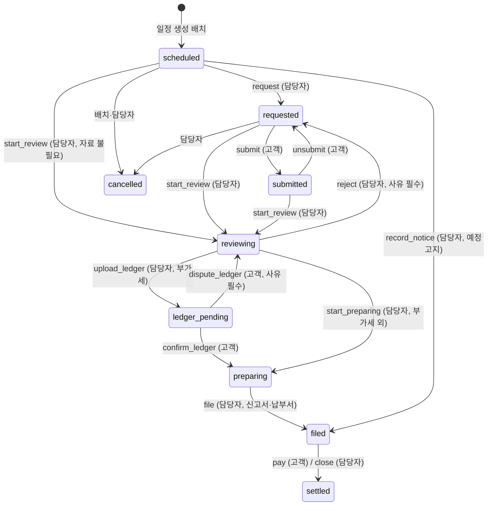

# 세무 API 설계 (Hono + SQLite)

> 상태: 초안 v0.4 · 2026-11-01 · 구현: [`apps/api`](../apps/api/README.md)
> 근거:
> - `alfred-manual/`: Alfred Business 매뉴얼 크롤링본
> - `app-alfred-kr/reverse/`: 현행 웹 클라이언트 엔트리 번들 분석
> - `alfred-interview-brief.html`
>
> 변경 내역: [14. 변경 내역](#14-변경-내역)

이 문서는 Alfred Business의 **세무** 메뉴(부가세·원천세·법인세/종합소득세)를 받쳐 줄 백엔드 API를 다시 설계한 것입니다. 세무 메뉴와 연결된 기능(오늘의 할 일, 진행 현황 트래커, 예상 부가세)도 함께 다룹니다. 출발점은 두 가지입니다. 하나는 매뉴얼에 적힌 고객 화면의 동작이고, 다른 하나는 현행 클라이언트(`app.alfred.kr`)가 실제로 호출하는 API와 라우팅 구조입니다. 여기서 거꾸로 짚어 가며 서버 모델과 규칙을 정했습니다.

---

## 1. 현행 클라이언트 분석

`app-alfred-kr/index.js`는 Vite 프로덕션 엔트리 청크입니다. 분석 산출물은 `app-alfred-kr/reverse/`(`README.md`, `routes.tsv`, `api-endpoints.txt`, `index.pretty.js`)에 있습니다. 페이지 컴포넌트는 lazy chunk로 분리되어 있어 이 파일에는 포함되지 않았습니다. 따라서 응답 필드 중 일부는 데모 목업 데이터와 호출 시그니처를 보고 **추정**한 것입니다.

### 1.1 세무 메뉴는 레거시 "리포트 앱"을 마운트한다

| 라우트 | 이름 | `meta.reportEntryPoint` |
| --- | --- | --- |
| `/tax/surtax:postUrl(.*)` | `Report-Surtax` | `surtax` |
| `/tax/withholding-tax:postUrl(.*)` | `Report-WithholdingTax` | `withholding-tax` |
| `/tax/corporation-tax:postUrl(.*)` | `Report-CorporationTax` | `corporation-tax` |
| `/tax/aggr-income-tax:postUrl(.*)` | `Report-AggrIncomeTax` | `aggr-income-tax` |
| `/year-end-settlement:postUrl(.*)` | `Report-YearEnd` | `year-end` |

이 라우트들은 Vue 3 페이지가 아닙니다. 모두 `ReportWrapper` 컴포넌트가 처리합니다(`index.pretty.js` `_sfc_main$7`). 동작은 다음과 같습니다.

- `renderReportApp`이 빌드 매니페스트에서 `src/{entry}/app.ts` 번들을 찾아 `<script>`로 로드하고, 컨테이너 `div#app`에 마운트합니다.
- 공통 스크립트로 jQuery, jquery.mask, jquery.form을 CDN에서 먼저 로드합니다(`useCommonScript`).
- 언마운트할 때는 `window.__REPORT_VM.$destroy()`를 호출합니다. `$destroy`는 Vue 2 인스턴스 API이므로 리포트 앱은 Vue 2 기반으로 보입니다.
- 하위 경로(`:postUrl(.*)`)는 `window.__REPORT_ROUTER.replaceFromClair()`로 리포트 앱 쪽 라우터에 넘깁니다(`reportWrapperRouteGuard`).
- 권한 오류는 리포트 앱이 `ReportCustomEvent`로 `ReportAccessDeniedError`를 던지면, 래퍼가 받아 `MenuAccessDenied` 화면으로 바꿔 보여 줍니다.

**설계 시사점.** 새 API는 레거시 리포트 앱의 백엔드를 **점진적으로 교체(strangler)**하는 대상입니다. 화면 경로(`/tax/surtax` 등)와 세목 이름(`surtax`, `withholding-tax`, `corporation-tax`, `aggr-income-tax`)은 그대로 유지하고, 세목 단위로 새 페이지와 새 API로 넘어갑니다([11. 이관 전략](#11-이관-전략)). 권한 오류는 지금도 별도 화면으로 처리하고 있으므로, 서버가 내려주는 오류 코드로 이 화면을 구분할 수 있게 합니다.

### 1.2 부가세의 현행 진행 단계

```js
var ProcessStep = {
  Closed: "부가세 마감", Paid: "부가세 납부", InProgress: "부가세 작업중",
  LedgerConfirmed: "매입매출장 확인", Reviewing: "자료 검토중", submittable: "자료 제출 가능",
}
```

`GET /api/company/:id/tax/surtax/` 목록 항목의 형태는 데모 목업(`createSurtaxItem`) 기준으로 다음과 같습니다.

```jsonc
{
  "id": 0, "company": 123, "year": 2026, "quarter": 3,
  "dueDate": "2026-10-26", "paymentDeadline": "2026-10-26",
  "purchaseSalesLedgerUploadCompleted": "2026-10-15",
  "purchaseSalesLedgerConfirmCompleted": "2026-10-17",
  "paymentSlipSent": "2026-10-24",
  "amount": 482000,
  "processStep": "부가세 마감"
}
```

v0.2 설계와 비교하면 다음 세 가지가 다릅니다.

1. **매입매출장 확인 단계가 있습니다.** 담당자가 매입매출장을 올리면(`…UploadCompleted`) 고객이 확인합니다(`…ConfirmCompleted`). 그다음에 신고 작업이 시작됩니다. v0.2에는 이 고객 확인 단계가 없었습니다.
2. **신고 기한(`dueDate`)과 납부 기한(`paymentDeadline`)을 따로 저장합니다.**
3. **단계별 완료 시각을 목록 응답에 바로 넣어 줍니다.** 이벤트 로그를 다시 조립하지 않아도 목록 화면이 단계 진행을 그릴 수 있습니다.

enum 선언 순서(`Closed`가 먼저)는 실제 진행 순서의 역순입니다. 실제 진행 순서는 마일스톤 필드를 근거로 `자료 제출 가능 → 자료 검토중 → 매입매출장 확인 → 부가세 작업중 → 부가세 납부 → 부가세 마감`으로 **추정**했습니다.

### 1.3 메뉴는 서버가 트리로 내려준다

- **메뉴 트리 조회.** `GET /api/company/:id/menu/menu-tree/:version/`가 사용자용 메뉴 트리를 돌려줍니다. 회사 전체 기준 트리는 `getCompanyAccessibleMenuTree`로 따로 받습니다.
- **버전과 fallback.** 클라이언트는 자기 릴리스에 맞는 버전 문자열(현재 `"2026.08_퇴직금정산"`)과 `"latest"`를 동시에 요청합니다. 지정한 버전을 찾지 못하면 `latest`로 대신하고, 이 사실을 Sentry에 남깁니다.
- **노드 형태.** `{ id, name, code, category, accessiblePermissions, isFavoritable, isFavorite, favoritedAt, isPromotion, promotionUrl, icon, to, children }`이고 깊이는 3단입니다.
- **업셀 메뉴.** 잠긴 기능은 메뉴에서 빠지지 않고 `isPromotion: true`와 `promotionUrl`이 붙은 노드로 내려옵니다. 클라이언트는 무료 회사(`company.isFree`)이거나 일부 코드에서 HQ 에이전시인 경우에만 이 노드를 보여 줍니다.
- **클라이언트 쪽 예외 규칙.** `MENU_EXCLUSION_RULES`가 추가로 메뉴를 숨깁니다. 예를 들어 급여 구독 회사에서는 `employee_management`를 숨기고, 시스템 관리자가 아니면 `/ai-agent`를 숨깁니다.
- **라우트 가드.** `checkPermissionGuard`는 이동하려는 경로를 3뎁스 메뉴와 매칭합니다. 매칭되는 메뉴가 없으면 토스트를 띄우고 `/dashboard`로 보냅니다. 프로모션 메뉴이면 `promotionUrl`로 보냅니다.

**설계 시사점.**
- 접근 판정 결과는 개별 403 응답이 아니라 **메뉴 트리 자체**로 전달됩니다. 권한이 없으면 노드가 없고, 구독이 없으면 프로모션 노드가 내려옵니다.
- 클라이언트에 흩어져 있는 예외 규칙은 서버의 트리 생성 로직으로 모읍니다.
- API를 직접 호출할 때 돌려주는 403 코드는 트리와 같은 판정 함수에서 나오게 해서 둘이 어긋나지 않게 합니다.

### 1.4 사용자, 회사, 인증

- **사용자 유형은 테이블 하나에서 구분합니다.** `UserType`은 `Client(0)`, `AgencyMember(1, 기장직원)`, `AgencyManager(2, 팀장)`, `Admin(3, 운영자)`, `Bot(4)`, `LaborAgent(51, 노무대행)`, `DemoClient(99)`입니다. 담당자도 고객과 같은 사용자 테이블에 있고, 담당자용 도구는 `desk.alfred.kr`로 분리되어 있습니다.
- **백엔드가 둘입니다.**
  - `nexus-api`: 사용자, 회사, 권한, 약관을 담당합니다. 쿠키 세션과 `X-CSRFToken`(`nexus_csrftoken`)을 씁니다.
  - `sf-api`: 기장, 급여, 증빙, 세무 같은 도메인을 담당합니다. 쿠키 세션과 `csrftoken`을 씁니다.
  - 같은 회사라도 `sf-api`에서는 별도의 `sfCompanyId`를 씁니다.
- **JWT는 회사 단위입니다.** payload의 `company_id`와 현재 회사가 다르거나 `exp`가 지나면 `/api/user/me/jwt/`로 다시 발급받습니다.
- **세무 약관 동의 게이트가 있습니다.** 회사의 `taxPlan === "taxation"`이면(세무 기장 고객), `checkHasTaxRequiredConsent`가 `tax` 약관 동의를 확인하고 동의하지 않았으면 `/tax-agree-terms`로 보냅니다.
- **구독 플래그.** 회사 객체에 `taxPlan`, `hasPayrollPlan`, `isFree`가 있습니다.

### 1.5 와이어 규약

- **케이스 변환.** 서버는 snake_case로 주고받습니다. 클라이언트 인터셉터가 요청을 보낼 때 camelCase를 snake_case로, 응답을 받을 때 snake_case를 camelCase로 바꿉니다(`reverse/src/http/case-transform.ts`).
- **경로 형식.** Django 스타일로 경로 끝에 슬래시가 붙습니다(`/tax/surtax/`).
- **목록 응답.** DRF 페이지네이션 봉투 `{ count, next, previous, results }`를 쓰고, 할 일 카드는 `?limit=&offset=`으로 페이지를 넘깁니다.
- **요청 헤더.** 요청마다 `X-Original-Path`(현재 화면 경로)를 붙입니다.
- **에러 리포팅.** 에러는 경로 숫자를 `{id}`로 바꾼 이름으로 Sentry에 묶입니다.
- **비동기 작업 상태.** 상태 값이 enum으로 정해져 있습니다.
  - 스크래핑 요청: `request | done | timeout`
  - 수집: `PROGRESS | SUCCESS | FAIL`
  - 인증서: `ACTIVE | EXPIRED | INACTIVE | UNREGISTERED`
  - 명세서 발송: `in_flight | success | fail`
- **데모 모드.** 데모 사용자일 때는 서버가 아니라 클라이언트가 API 모듈을 목업(`createSurtaxDemoApi` 등)으로 바꿔 끼웁니다.

### 1.6 연결된 현행 API

| 기능 | 현행 엔드포인트 |
| --- | --- |
| 오늘의 할 일 | `GET /home/action-cards/summary`, `GET /home/action-cards/active?limit=&offset=`, `GET /home/action-cards/archived?limit=&offset=`, `POST /home/action-cards/:id/complete { completion_reason }` |
| 진행 현황 | `GET /home/tracker` |
| 세금 납부(지로) | `GET /giros/`, `GET /giros/summary`, `POST /giros/:id/manual_done { memo }`, `POST /giros/:id/hide { memo }`, `POST /api/v2/company/:id/giros/:id/payment` (타임아웃 120초) |
| 예상 부가세 | 화면 경로 `/reports/estimated-vat` (구 경로 `/basic-reports/estimated-vat`에서 리다이렉트) |
| 수집 상태 | `GET /integrations/:service/last-scrap-request-status` |

위 경로는 모두 `/api/company/:companyId` 아래에 있습니다.

---

## 2. 범위

### 목표

| 영역 | 근거 | 이 API가 제공하는 것 |
| --- | --- | --- |
| 세목별 신고 건 | 매뉴얼 `06-세무/*`, 클라이언트 1.1·1.2 | 신고 일정, 제출 자료 체크리스트, 단계별 진행, 매입매출장 확인, 신고서·납부서 열람 |
| 담당자 작업 | 매뉴얼 "자료제출 요청을 발송하면 …", `UserType.AgencyMember` | 자료 요청, 검토, 매입매출장 업로드, 신고 완료 등록 |
| 오늘의 할 일, 진행 현황 | 매뉴얼 `03-오늘의-할-일.md`, 클라이언트 1.6 | 현행 `action-cards`·`tracker`와 호환되는 응답 |
| 예상 부가세 | 매뉴얼 `02-예상-부가세.md` | 법인은 분기, 개인은 반기 단위 예상 세액과 수집 신선도 |
| 메뉴와 접근 제어 | 매뉴얼 `02-사용자-관리.md`, 클라이언트 1.3·1.4 | 버전별 메뉴 트리(프로모션 노드 포함), 세무 약관 게이트, 직접 호출 시 판정 코드 |

> **근거의 한계.** 매뉴얼에 화면 설명이 있는 세목은 부가세와 원천세뿐이고, 클라이언트에서 응답 형태를 확인할 수 있는 세목은 부가세뿐입니다. 원천세·법인세·종소세는 부가세 흐름에서 매입매출장 단계를 뺀 형태라고 **가정**했습니다.

### 범위 밖

- 연동과 수집 배치. 결과가 `sales_evidence`·`purchase_evidence`에 쌓여 있다고 가정합니다.
- 신고서 작성과 전자 신고. 세무사 프로그램에서 처리합니다.
- 지로 고지서 조회와 납부. 현행 `/giros/*`가 그대로 담당합니다. 신고 건과의 연결만 [13. 확장 지점](#13-확장-지점)에서 다룹니다.
- 연말정산(`year-end`), 간이과세자, 중간예납, 수정신고와 기한후신고. 스키마에 확장할 자리(`kind`, `revision`)만 남겨 둡니다.
- 로그인, 회원가입, JWT 발급. `nexus-api`가 맡습니다. 이 API는 발급된 회사 단위 JWT를 검증만 합니다.

---

## 3. 행위자와 접근 모델

### 행위자

| 행위자 | `user_type` | API 경로 |
| --- | --- | --- |
| 고객 관리자·일반 사용자 | `0 Client` (+ 회사 내 역할과 권한 그룹) | `/api/company/:companyId/...` |
| 세무 담당자 | `1 AgencyMember` | `/api/desk/...` |
| 팀장 | `2 AgencyManager` (팀원이 맡은 회사 전체) | `/api/desk/...` |
| 자동화 | `4 Bot` | 내부 배치만. `filing_events.actor_type = 'system'` |
| 데모 | `99 DemoClient` | 모든 쓰기 요청을 거부(403 `DEMO_READ_ONLY`). 화면은 클라이언트 목업을 계속 씁니다 |

현행 구조에 맞춰 고객과 담당자를 **같은 사용자 테이블**에 두고 `user_type`으로 구분합니다(v0.2의 `staff_members`는 없앴습니다). 경로는 고객용 `/api/company/*`와 담당자용 `/api/desk/*`로 나눴습니다. 같은 신고 건이라도 허용되는 전이가 다르기 때문입니다. 담당자 경로는 `user_type IN (1, 2)`인 사용자만 쓸 수 있고, 맡은 회사의 신고 건이 아니면 404를 돌려줍니다.

### 인증

- `Authorization: Bearer <JWT>`의 서명과 `exp`를 검증합니다.
- 고객 경로에서는 `payload.company_id`가 경로의 `:companyId`와 같아야 합니다. 다르면 403 `COMPANY_MISMATCH`를 돌려줍니다. 클라이언트는 이미 회사를 바꿀 때마다 JWT를 다시 발급받으므로 별도 흐름을 추가할 필요가 없습니다.
- 회사 ID는 `sf-api`의 `sfCompanyId` 체계를 씁니다. nexus 회사 ID와는 `company_links` 테이블로 연결합니다.

### 접근 판정

```
decide(user, company, menuCode) =
  1. applicable(company.business_type, menuCode)   → 실패: 노드 없음 / 404 NOT_FOUND
  2. permission(user, menuCode)                    → 실패: 노드 없음 / 403 PERMISSION_DENIED
  3. entitlement(company.plans, menuCode)          → 실패: 프로모션 노드 / 403 ENTITLEMENT_REQUIRED (+ promotion_url)
  4. consent(user, 'tax')  (tax_plan = 'taxation') → 실패: 노드는 정상 / 403 TAX_TERMS_REQUIRED
```

판정 결과는 두 곳에서 쓰입니다.

- **메뉴 트리.** `GET /menu/menu-tree/:version/`은 이 함수로 노드마다 노출 여부와 `is_promotion`을 정합니다. 클라이언트에 있던 `MENU_EXCLUSION_RULES`도 여기로 옮깁니다. 등록되지 않은 버전이면 404를 돌려주고, 클라이언트는 지금처럼 `latest`로 대신합니다.
- **API 직접 호출.** `requireMenu(code)` 미들웨어가 같은 함수를 호출합니다. 화면 경로를 바꿔 들어오거나 API를 직접 호출해도 트리와 같은 결론이 납니다. 레거시 리포트 앱의 `ReportAccessDeniedError`는 403 `PERMISSION_DENIED`에 대응합니다.

판정 순서에도 이유가 있습니다. 권한(2)을 구독(3)보다 먼저 봅니다. 권한이 없는 사용자에게까지 업셀 노드를 보여 주지 않으려는 것입니다. 약관(4)은 노드 노출에는 영향을 주지 않고 데이터 접근만 막습니다. 클라이언트 가드가 메뉴에 들어가기 전에 `/tax-agree-terms`로 보내 주기 때문입니다.

### 메뉴 코드 (가정)

현행 번들에서 확인한 코드는 `employee_management`, `pb_employment`, `pb_payroll_management`뿐입니다. 세무 메뉴 코드는 같은 snake_case 규칙을 따른다고 가정했습니다.

| 코드 | 경로 | 필요 구독 | 적용 대상 |
| --- | --- | --- | --- |
| `tax_surtax` | `/tax/surtax` | `taxation` | 전체 |
| `tax_withholding` | `/tax/withholding-tax` | `taxation` | 전체 |
| `tax_corporation` | `/tax/corporation-tax` | `taxation` | 법인 |
| `tax_aggr_income` | `/tax/aggr-income-tax` | `taxation` | 개인 |
| `estimated_vat` | `/reports/estimated-vat` | 없음 | 전체 |
| `today` | `/today` | 없음 | 전체 (`requiresMenuAccess: false`) |

---

## 4. 도메인 모델

### 핵심 개념

- **신고 건(`tax_filings`)**: 한 회사, 한 세목, 한 신고 기간의 신고 1건입니다.
- **제출 자료 항목(`filing_requirements`)**: 신고 건마다 템플릿에서 복사해 만드는 체크리스트입니다.
- **신고 문서(`filing_documents`)**: 매입매출장(`ledger`), 신고서(`return`), 납부서(`payment_slip`), 예정고지서(`notice`)입니다. 매입매출장은 `ledger_pending` 단계부터, 나머지는 `filed` 단계부터 고객에게 보입니다.
- **신고 이력(`filing_events`)**: 상태 전이와 주요 행위의 감사 로그입니다. 삭제하지 않습니다.
- **할 일 카드(`action_cards`)**: 현행 `/home/action-cards`와 호환되는 홈 카드입니다.

### 제출 자료 템플릿

| 세목 | 코드 | 항목 |
| --- | --- | --- |
| 부가세 | `pg_online_sales` | PG사·온라인 매출 내역 |
| | `export_fx` | 국외 수출 자료(외화 계좌 거래 내역) |
| | `paper_tax_invoice` | 당월분 종이 세금계산서·종이 계산서 |
| | `simple_receipt` | 당월분 간이영수증 |
| | `ending_inventory` | 당월 말 재고금액 |
| | `deposit_fund_accounts` | 예·적금 계좌, 펀드 계좌 |
| 원천세 | `payroll_ledger_closed` | 급여대장 마감분 (급여 구독 고객만, 자동 연계, `auto_linked = 1`) |
| | `business_income` | 사업소득(프리랜서·용역비) 지급 내역 |
| | `other_income` | 기타소득 지급 내역 |
| | `daily_wage` | 일용직 근로소득 지급 내역 |
| | `retirement_income` | 퇴직소득 지급 내역 |
| | `interest_dividend` | 이자·배당소득 등 지급 내역 |
| | `unreflected_bonus` | 급여에 반영되지 않은 상여·수당 지급 내역 |

`auto_linked` 항목은 제출 완료 검사에서 뺍니다. 연계 상태는 응답의 `linked_status`(`closed | open`)로 보여 줍니다.

### 신고 건 상태 머신



| 상태 | 현행 `ProcessStep` | 고객 | 담당자 |
| --- | --- | --- | --- |
| `scheduled` | (없음) | 일정 조회 | `request`, `start_review`, `record_notice`, `cancel` |
| `requested` | 자료 제출 가능 | 항목 응답, 파일 업로드·삭제, `submit` | `start_review`, `cancel` |
| `submitted` | 자료 검토중 | `unsubmit` | `start_review` |
| `reviewing` | 자료 검토중 | 조회만 | `reject`, `upload_ledger`(부가세), `start_preparing`(부가세 외) |
| `ledger_pending` | 매입매출장 확인 | 매입매출장 열람, `confirm_ledger`, `dispute_ledger` | 매입매출장 교체 |
| `preparing` | 부가세 작업중 | 조회만 | 문서 업로드, `file` |
| `filed` | 부가세 납부 | 문서 열람, `pay` (`payable_amount > 0`) | 문서 교체, `close` (`payable_amount <= 0`) |
| `settled` | 부가세 마감 | 조회만 | 없음 |
| `cancelled` | (없음) | 조회만 | 없음 |

현행 단계 하나(자료 검토중)가 새 상태 둘(`submitted`, `reviewing`)에 대응합니다. 둘로 나눈 이유는 고객 수정이 잠기는 시점을 상태로 구분하기 위해서입니다. 화면에 단계를 표시할 때는 `step` 필드(9절)가 현행 단계 이름 기준으로 다시 묶어 줍니다.

설계 규칙:

1. **잠금 시점은 상태로 표현합니다.** `reviewing` 이후에 들어오는 고객의 자료 쓰기 요청은 `409 INVALID_TRANSITION`입니다. 예외는 `ledger_pending`의 확인·이의 두 가지뿐입니다.
2. **매입매출장 이의가 반복되면 기록에 남깁니다.** `dispute_ledger`마다 `filing_events`에 사유를 쌓고, 응답에 `ledger_dispute_count`를 넣습니다. 담당자 큐는 이 값으로 정렬할 수 있습니다.
3. **기한 경과는 상태로 두지 않고 계산합니다.** `due_date < today(KST)`이면서 상태가 아직 `filed`에 이르지 않았으면 `is_overdue: true`입니다.
4. **전이는 조건부 UPDATE 한 문장으로 처리합니다.** `WHERE id=? AND company_id=? AND status IN (…) AND version=?`. 영향받은 행이 0이면 현재 행을 다시 읽어 원인을 가립니다. 상태가 맞지 않으면 409, 버전만 다르면 412입니다.
5. **전이 규칙은 `TRANSITIONS` 상수 한 곳에만 둡니다**(10절). 서비스와 테스트가 모두 이 상수를 참조합니다.
6. **종결 정보는 CHECK 제약으로 상태와 묶습니다.** `settled`이면 반드시 `settlement`가 있고, `paid`이면 반드시 `paid_on`이 있습니다. `payable_amount`의 부호는 `settlement`와 맞아야 합니다(양수는 `paid`, 음수는 `refund`, 0은 `no_payment`).
7. **마일스톤 시각은 비정규화 컬럼으로 둡니다.** `ledger_uploaded_at`, `ledger_confirmed_at`, `payment_slip_sent_at`은 전이와 같은 트랜잭션에서 채웁니다. 현행 목록 응답의 `purchase_sales_ledger_*`, `payment_slip_sent`가 이 컬럼에서 나옵니다.

---

## 5. 신고 기한 계산

기한 계산은 DB와 시계에 의존하지 않는 순수 함수로 분리합니다(`modules/tax-calendar/`).

### 법정 기한 규칙 (일반과세자)

| 세목 | 대상 | 신고 단위 | 신고 기한 |
| --- | --- | --- | --- |
| 부가세 | 법인 | 과세기간 1기(1~6월)·2기(7~12월). 예정 신고 대상 기간은 1~3월·7~9월, 확정 신고 대상 기간은 예정에서 신고하지 않은 나머지 | 신고 대상 기간 종료일이 속한 달의 다음 달 25일 |
| 부가세 | 개인 | 1기·2기 확정 신고 (예정 기간은 원칙적으로 고지) | 7월 25일 / 다음 해 1월 25일 |
| 원천세 | 원칙 | 지급월 | 지급월의 다음 달 10일 |
| 원천세 | 반기별 납부 승인 사업장 | 1~6월·7~12월 지급분 | 7월 10일 / 다음 해 1월 10일 |
| 법인세 | 법인 | 사업연도 | 사업연도 종료일이 속한 달의 말일부터 3개월 (성실신고확인 대상 법인은 4개월) |
| 종합소득세 | 개인 | 전년도 | 5월 31일 (성실신고확인 대상자는 6월 30일) |

**신고 기한과 납부 기한.** 현행 응답은 `dueDate`와 `paymentDeadline`을 따로 둡니다. 위 세목은 신고 기한과 납부 기한이 같으므로, 기본값으로 `payment_due = due_date`를 넣습니다. 예정고지 건(`kind = 'notice'`)은 신고 기한이 없고 고지서에 적힌 납부 기한만 있습니다. 그래서 이 경우에는 `payment_due`를 담당자가 입력합니다. 법인세 분납처럼 납부 기한이 따로 생기는 경우도 이 컬럼으로 처리합니다.

**신고 기간은 저장해 두고 다시 계산하지 않습니다.** 확정 신고가 어느 기간을 대상으로 하는지는 앞서 예정 신고를 했는지에 따라 달라집니다. 그래서 신고 건을 만들 때 `period_start`와 `period_end`를 정해서 저장합니다. 현행 응답과 맞추기 위해 `year`와 `quarter`도 함께 저장합니다. 반기 신고는 `quarter`에 반기의 마지막 분기 번호(2 또는 4)를 넣습니다. 이 값은 추정입니다.

**기한 특례.** 국세기본법 제5조에 따라 기한이 토요일, 일요일, 공휴일, 대체공휴일, 근로자의 날이면 그다음 날로 미룹니다. 미룬 날도 이 중 하나이면 계속 미룹니다. 근로자의 날은 공휴일이 아닐 수 있으므로 `public_holidays`에 `kind = 'statutory_extra'`로 따로 넣습니다. 임시공휴일 지정처럼 공휴일 테이블이 바뀌면 열린 신고 건의 기한을 다시 계산합니다.

**부가세 예정 기간.** 개인 일반과세자와 직전 과세기간 공급가액이 1억 5천만 원 미만인 법인은 원칙적으로 예정고지를 받습니다. 고지 금액은 직전 기 납부세액의 50%이고, 그 금액이 50만 원 미만이면 고지하지 않습니다. 휴업하거나 사업이 부진한 경우(직전 기 대비 1/3 미달), 또는 조기환급을 받으려는 경우에는 예정 신고를 선택할 수 있습니다.
- 기본 경로는 회사 설정 `vat_preliminary_mode`로 정합니다.
- 기간마다 담당자가 `notice`와 `preliminary` 중 하나를 고를 수 있습니다.
- 금액 기준은 `tax_rules`에 둡니다.

### 시그니처

```ts
export function resolveFilingPeriods(input: CalendarInput): FilingPeriod[]

export function applyDeadlineRollover(date: PlainDate, holidays: ReadonlySet<PlainDate>): PlainDate
```

`PlainDate`는 `YYYY-MM-DD` 문자열의 브랜드 타입입니다. 계산은 연·월·일 정수로만 하고, 요일은 `Date.UTC`로 구합니다. "오늘"은 `Asia/Seoul` 기준으로 요청 핸들러에서 한 번만 계산해 넘겨줍니다.

### 테스트 예시 (요일 검증 완료)

| 입력 | 법정 기한 | 특례 적용 후 | 이유 |
| --- | --- | --- | --- |
| 법인 부가세 2026-1기 예정 | 2026-04-25 | 2026-04-27 | 토요일 |
| 개인 종소세 2025년 귀속 | 2026-05-31 | 2026-06-01 | 일요일 |
| 법인 부가세 2026-1기 확정 | 2026-07-25 | 2026-07-27 | 토요일 |
| 법인 부가세 2026-2기 예정 | 2026-10-25 | 2026-10-26 | 일요일 |
| 원천세 2026-10 지급분 | 2026-11-10 | 2026-11-10 | 평일 |
| 원천세 반기 2026 하반기 지급분 | 2027-01-10 | 2027-01-11 | 일요일 |
| 법인 부가세 2026-2기 확정 | 2027-01-25 | 2027-01-25 | 평일 |
| 12월 결산 법인세 2026 사업연도 | 2027-03-31 | 2027-03-31 | 평일 |
| 12월 결산 성실신고확인 법인 2026 사업연도 | 2027-04-30 | 2027-04-30 | 평일 |

---

## 6. 예상 부가세

### 계산

```
매출세액 = Σ sales_evidence.vat_amount     (합계 대상 출처만, dedupe_group당 1건, 취소분은 음수)
매입세액 = Σ purchase_evidence.vat_amount  where deductible = 1
예상 부가세 = 매출세액 − 매입세액            (음수이면 is_refund = true)
```

- 금액은 모두 원 단위 정수입니다.
- 세금계산서와 현금영수증은 원천 데이터에 있는 세액을 그대로 씁니다. 카드 총액에서 세액을 뽑을 때는 `splitVatFromTotal`을 씁니다.
  - 계산식은 `abs(total) − floor(abs(total) × 10 / 11)`이고, 결과에 원래 금액의 부호를 다시 붙입니다.
  - 이렇게 하면 취소 거래의 세액이 원거래 세액과 정확히 대칭이 됩니다.
  - 여기에 과세 비율 `taxable_card_ratio_bp`를 곱합니다.
- 매뉴얼에 따르면 여신금융협회 카드 매출은 오프라인분만 들어오므로 `card`와 `pg`는 겹치지 않습니다. 반면 `mall`과 `delivery`는 `pg`와 같은 결제일 수 있습니다. 그래서 `dedupe_group`이 채워지기 전까지는 `mall`과 `delivery`를 합계에서 빼고 내역에만 보여 줍니다.
- 기간은 법인이면 오늘이 속한 분기, 개인이면 오늘이 속한 반기입니다.

### 수집 신선도

출처별 `breakdown`에는 마지막 수집 시각과 마지막 스크래핑 요청 상태를 함께 넣습니다. 상태 값은 현행 클라이언트의 enum(`request | done | timeout`)을 그대로 씁니다. 화면은 이 값으로 숫자가 비어 있거나 작은 이유를 구분해 보여 줄 수 있습니다. 이유는 셋 중 하나입니다. 연동이 안 된 경우, 새벽 배치가 아직 돌지 않은 경우, 수집이 실패한 경우입니다.

```jsonc
{
  "period": { "start": "2026-10-01", "end": "2026-12-31", "unit": "quarter" },
  "output_tax": 4820000,
  "input_tax": 3115400,
  "estimated_tax": 1704600,
  "is_refund": false,
  "card_split_estimated": true,
  "breakdown": [
    { "source": "tax_invoice", "side": "sales", "vat_amount": 3900000, "included_in_total": true,
      "last_synced_at": "2026-11-01T04:12:00+09:00", "last_scrap_status": "done" },
    { "source": "delivery", "side": "sales", "vat_amount": 210000, "included_in_total": false,
      "last_synced_at": "2026-10-31T10:05:00+09:00", "last_scrap_status": "timeout" }
  ],
  "excluded": { "non_deductible_count": 12, "unclassified_count": 37 }
}
```

### 추이

과세기간(1기·2기)마다 값을 하나씩 돌려줍니다. 어떤 값을 쓰는지는 조건에 따라 다릅니다.

| 조건 | 사용하는 값 | `source` |
| --- | --- | --- |
| `taxation` 고객이고, 그 과세기간의 확정 신고 건이 `filed` 이상 | `preliminary`와 `final` 신고 건의 `payable_amount` 합. 예정고지(`notice`) 금액은 넣지 않음 | `"confirmed"` |
| 그 밖의 경우 | 증빙 합계 | `"estimated"` |

---

## 7. 오늘의 할 일과 진행 현황

### 현행 API와 호환

| 현행 | 이 설계 |
| --- | --- |
| `GET /home/action-cards/summary` | 진행중·완료 카드 개수, 가장 가까운 마감일 |
| `GET /home/action-cards/active?limit=&offset=` | `status = 'open'`인 카드. 정렬은 `due_date IS NULL, due_date, created_at, id` |
| `GET /home/action-cards/archived?limit=&offset=` | `status IN ('done','skipped_overdue')`인 카드. 정렬은 `completed_at DESC, id DESC` |
| `POST /home/action-cards/:id/complete { completion_reason }` | `completion_reason`은 `done` 또는 `skip`. 결과는 아래 규칙으로 정합니다 |
| `GET /home/tracker` | 열린 신고 건마다 현재 단계와 전체 단계 수 (진행률 막대용) |

응답은 DRF 봉투 `{ count, next, previous, results }`입니다. 쿼리 파라미터 이름(`completion_reason`)은 클라이언트 인터셉터가 바꿔 주는 snake_case 형식에 맞췄습니다. `completion_reason`이 받는 값은 이 설계에서 정한 것입니다. 현행 값은 lazy chunk에 들어 있어 확인하지 못했습니다.

### 카드 생성 규칙

| 트리거 | 카드 `kind` | 마감일 | 자동 완료 조건 |
| --- | --- | --- | --- |
| `request`, `reject` | `submit_materials` | `submit_due` | 신고 건이 `submitted` 이상이 됨 |
| `upload_ledger` | `confirm_ledger` | 신고 기한(`due_date`) −3일 | `confirm_ledger` 또는 `dispute_ledger` 처리 |
| `file`, `record_notice` | `review_filing_result` | 법정 기한 | 고객이 문서를 처음 열람 |
| `file`, `record_notice`이고 `payable_amount > 0` | `pay_tax` | `payment_due` | 신고 건이 `settled`가 됨 |
| `cancel` | 열린 카드를 모두 닫음 | | |

- 카드에는 `menu_code`가 있습니다. 목록 조회와 완료 처리는 접근 판정을 통과한 카드에만 적용합니다. 세무 권한이 없는 사용자에게는 세무 카드를 보여 주지 않습니다.
- 카드 중복은 `UNIQUE(company_id, source_type, source_id, kind)`로 막습니다. 반려되면 기존 카드를 다시 열고 `reopen_count`를 올립니다. 이전 기록은 `action_card_events`에 남깁니다.
- 카드 생성은 상태 전이와 같은 트랜잭션에서 처리합니다.
- 자동 완료된 카드는 항상 `done`입니다. 사용자가 직접 닫은 카드(`completion_reason = 'skip'`)는 완료 시각을 KST 날짜로 바꿔 마감일과 비교합니다. 마감일 이내면 `done`, 지났으면 `skipped_overdue`입니다.

### 트래커의 단계 표시

```jsonc
{
  "results": [
    { "filing_id": "f_01", "tax_type": "surtax", "year": 2026, "quarter": 4,
      "step": "자료 제출 가능", "step_index": 1, "step_count": 6,
      "due_date": "2027-01-25", "is_overdue": false, "cta_path": "/tax/surtax" }
  ]
}
```

`step`은 4절 표의 현행 `ProcessStep` 이름입니다. 부가세 외 세목은 `매입매출장 확인`이 없으므로 `step_count`가 5입니다. 단계 이름은 서버가 정해서 내려줍니다. 레거시 리포트 앱과 새 화면이 같은 이름을 쓰게 하기 위해서입니다.

---

## 8. 저장소 설계

### SQLite 설정과 타입 규칙

```sql
PRAGMA journal_mode = WAL;
PRAGMA foreign_keys = ON;
PRAGMA busy_timeout = 5000;
```

모든 테이블은 `STRICT`로 만듭니다. 값의 종류별 컬럼 타입은 다음과 같습니다.

| 값 | 타입 |
| --- | --- |
| 금액 | `INTEGER` |
| 날짜 | `TEXT` (`YYYY-MM-DD`, KST) |
| 시각 | `TEXT` (ISO 8601, `+09:00`) |

테넌트 격리는 스키마에서 강제합니다. 부모 테이블에 `UNIQUE(company_id, id)`를 두고, 자식 테이블은 `(company_id, parent_id)` 복합 FK로 부모를 참조합니다.

### 스키마

```sql
CREATE TABLE companies (
  id                     TEXT PRIMARY KEY,
  nexus_company_id       TEXT NOT NULL UNIQUE,
  name                   TEXT NOT NULL,
  business_number        TEXT NOT NULL UNIQUE,
  business_type          TEXT NOT NULL CHECK (business_type IN ('corporate','individual')),
  tax_plan               TEXT CHECK (tax_plan IN ('taxation')),
  has_payroll_plan       INTEGER NOT NULL DEFAULT 0 CHECK (has_payroll_plan IN (0,1)),
  fiscal_year_end_month  INTEGER NOT NULL DEFAULT 12 CHECK (fiscal_year_end_month BETWEEN 1 AND 12),
  withholding_semiannual INTEGER NOT NULL DEFAULT 0 CHECK (withholding_semiannual IN (0,1)),
  vat_preliminary_mode   TEXT NOT NULL DEFAULT 'filing' CHECK (vat_preliminary_mode IN ('filing','notice')),
  sincere_filing_target  INTEGER NOT NULL DEFAULT 0 CHECK (sincere_filing_target IN (0,1)),
  taxable_card_ratio_bp  INTEGER NOT NULL DEFAULT 10000 CHECK (taxable_card_ratio_bp BETWEEN 0 AND 10000),
  created_at             TEXT NOT NULL
) STRICT;

CREATE TABLE users (
  id          TEXT PRIMARY KEY,
  email       TEXT NOT NULL UNIQUE,
  user_type   INTEGER NOT NULL CHECK (user_type IN (0,1,2,3,4,51,99)),
  manager_id  TEXT REFERENCES users(id)
) STRICT;

CREATE TABLE term_agreements (
  user_id     TEXT NOT NULL REFERENCES users(id),
  term_type   TEXT NOT NULL CHECK (term_type IN ('signup','tax')),
  version     TEXT NOT NULL,
  agreed_at   TEXT NOT NULL,
  PRIMARY KEY (user_id, term_type, version)
) STRICT;

CREATE TABLE memberships (
  company_id  TEXT NOT NULL REFERENCES companies(id),
  user_id     TEXT NOT NULL REFERENCES users(id),
  role        TEXT NOT NULL CHECK (role IN ('admin','member')),
  PRIMARY KEY (company_id, user_id)
) STRICT;

CREATE TABLE perm_roles (
  id          TEXT PRIMARY KEY,
  company_id  TEXT NOT NULL REFERENCES companies(id),
  name        TEXT NOT NULL,
  menu_codes  TEXT NOT NULL CHECK (json_valid(menu_codes)),
  UNIQUE (company_id, name),
  UNIQUE (company_id, id)
) STRICT;

CREATE TABLE membership_roles (
  company_id  TEXT NOT NULL,
  user_id     TEXT NOT NULL,
  role_id     TEXT NOT NULL,
  PRIMARY KEY (company_id, user_id, role_id),
  FOREIGN KEY (company_id, user_id) REFERENCES memberships(company_id, user_id) ON DELETE CASCADE,
  FOREIGN KEY (company_id, role_id) REFERENCES perm_roles(company_id, id) ON DELETE CASCADE
) STRICT;

CREATE TABLE agency_assignments (
  user_id     TEXT NOT NULL REFERENCES users(id),
  company_id  TEXT NOT NULL REFERENCES companies(id),
  PRIMARY KEY (user_id, company_id)
) STRICT;

CREATE TABLE menu_tree_versions (
  version     TEXT PRIMARY KEY,
  tree        TEXT NOT NULL CHECK (json_valid(tree)),
  is_latest   INTEGER NOT NULL DEFAULT 0 CHECK (is_latest IN (0,1)),
  created_at  TEXT NOT NULL
) STRICT;
CREATE UNIQUE INDEX menu_tree_versions_latest ON menu_tree_versions (is_latest) WHERE is_latest = 1;

CREATE TABLE tax_filings (
  id                    TEXT PRIMARY KEY,
  company_id            TEXT NOT NULL REFERENCES companies(id),
  tax_type              TEXT NOT NULL CHECK (tax_type IN ('surtax','withholding_tax','corporation_tax','aggr_income_tax')),
  kind                  TEXT NOT NULL CHECK (kind IN ('preliminary','final','notice','monthly','semiannual','annual')),
  tax_period_key        TEXT NOT NULL,
  revision              INTEGER NOT NULL DEFAULT 0,
  year                  INTEGER NOT NULL,
  quarter               INTEGER CHECK (quarter BETWEEN 1 AND 4),
  period_start          TEXT NOT NULL,
  period_end            TEXT NOT NULL,
  statutory_due         TEXT,
  due_date              TEXT,
  payment_due           TEXT,
  submit_due            TEXT,
  status                TEXT NOT NULL CHECK (status IN ('scheduled','requested','submitted','reviewing','ledger_pending','preparing','filed','settled','cancelled')),
  payable_amount        INTEGER,
  settlement            TEXT CHECK (settlement IN ('paid','refund','no_payment')),
  paid_on               TEXT,
  ledger_uploaded_at    TEXT,
  ledger_confirmed_at   TEXT,
  ledger_dispute_count  INTEGER NOT NULL DEFAULT 0,
  payment_slip_sent_at  TEXT,
  version               INTEGER NOT NULL DEFAULT 0,
  created_at            TEXT NOT NULL,
  updated_at            TEXT NOT NULL,
  UNIQUE (company_id, id),
  UNIQUE (company_id, tax_type, tax_period_key, revision),
  CHECK ((kind = 'notice') OR (due_date IS NOT NULL AND statutory_due IS NOT NULL)),
  CHECK (status <> 'ledger_pending' OR tax_type = 'surtax'),
  CHECK ((status IN ('filed','settled')) = (payable_amount IS NOT NULL)),
  CHECK ((status IN ('filed','settled')) <= (payment_due IS NOT NULL)),
  CHECK ((status = 'settled') = (settlement IS NOT NULL)),
  CHECK ((settlement = 'paid') = (paid_on IS NOT NULL)),
  CHECK (settlement IS NULL
         OR (settlement = 'paid'       AND payable_amount > 0)
         OR (settlement = 'refund'     AND payable_amount < 0)
         OR (settlement = 'no_payment' AND payable_amount = 0))
) STRICT;
CREATE INDEX tax_filings_company_list ON tax_filings (company_id, tax_type, year DESC, quarter DESC);
CREATE INDEX tax_filings_open ON tax_filings (status, due_date) WHERE status NOT IN ('settled','cancelled');

CREATE TABLE filing_requirements (
  company_id    TEXT NOT NULL,
  filing_id     TEXT NOT NULL,
  code          TEXT NOT NULL,
  label         TEXT NOT NULL,
  response      TEXT NOT NULL DEFAULT 'pending' CHECK (response IN ('pending','provided','not_applicable')),
  auto_linked   INTEGER NOT NULL DEFAULT 0 CHECK (auto_linked IN (0,1)),
  note          TEXT,
  updated_by    TEXT,
  updated_at    TEXT,
  PRIMARY KEY (filing_id, code),
  FOREIGN KEY (company_id, filing_id) REFERENCES tax_filings(company_id, id)
) STRICT;

CREATE TABLE files (
  id            TEXT PRIMARY KEY,
  company_id    TEXT NOT NULL REFERENCES companies(id),
  storage_key   TEXT NOT NULL UNIQUE,
  original_name TEXT NOT NULL,
  mime_type     TEXT NOT NULL,
  size_bytes    INTEGER NOT NULL,
  sha256        TEXT NOT NULL,
  uploaded_by   TEXT NOT NULL REFERENCES users(id),
  created_at    TEXT NOT NULL,
  UNIQUE (company_id, id),
  UNIQUE (company_id, sha256)
) STRICT;

CREATE TABLE requirement_files (
  company_id  TEXT NOT NULL,
  filing_id   TEXT NOT NULL,
  code        TEXT NOT NULL,
  file_id     TEXT NOT NULL,
  PRIMARY KEY (filing_id, code, file_id),
  FOREIGN KEY (filing_id, code)     REFERENCES filing_requirements(filing_id, code) ON DELETE CASCADE,
  FOREIGN KEY (company_id, file_id) REFERENCES files(company_id, id)
) STRICT;

CREATE TABLE filing_documents (
  id              TEXT PRIMARY KEY,
  company_id      TEXT NOT NULL,
  filing_id       TEXT NOT NULL,
  doc_type        TEXT NOT NULL CHECK (doc_type IN ('ledger','return','payment_slip','notice')),
  file_id         TEXT NOT NULL,
  first_viewed_at TEXT,
  replaced_at     TEXT,
  created_at      TEXT NOT NULL,
  FOREIGN KEY (company_id, filing_id) REFERENCES tax_filings(company_id, id),
  FOREIGN KEY (company_id, file_id)   REFERENCES files(company_id, id)
) STRICT;

CREATE TABLE filing_events (
  id          INTEGER PRIMARY KEY,
  company_id  TEXT NOT NULL,
  filing_id   TEXT NOT NULL,
  actor_type  TEXT NOT NULL CHECK (actor_type IN ('client','agency','system')),
  actor_id    TEXT,
  type        TEXT NOT NULL,
  from_status TEXT,
  to_status   TEXT,
  payload     TEXT CHECK (payload IS NULL OR json_valid(payload)),
  created_at  TEXT NOT NULL,
  FOREIGN KEY (company_id, filing_id) REFERENCES tax_filings(company_id, id) ON DELETE RESTRICT
) STRICT;
CREATE INDEX filing_events_filing ON filing_events (filing_id, id);

CREATE TABLE action_cards (
  id            TEXT PRIMARY KEY,
  company_id    TEXT NOT NULL REFERENCES companies(id),
  source_type   TEXT NOT NULL,
  source_id     TEXT NOT NULL,
  kind          TEXT NOT NULL,
  menu_code     TEXT NOT NULL,
  title         TEXT NOT NULL,
  cta_path      TEXT NOT NULL,
  due_date      TEXT,
  status        TEXT NOT NULL CHECK (status IN ('open','done','skipped_overdue')),
  reopen_count  INTEGER NOT NULL DEFAULT 0,
  created_at    TEXT NOT NULL,
  completed_at  TEXT,
  UNIQUE (company_id, source_type, source_id, kind),
  CHECK ((status = 'open') = (completed_at IS NULL))
) STRICT;
CREATE INDEX action_cards_open ON action_cards (company_id, status, due_date);

CREATE TABLE action_card_events (
  id          INTEGER PRIMARY KEY,
  card_id     TEXT NOT NULL REFERENCES action_cards(id),
  type        TEXT NOT NULL CHECK (type IN ('created','completed','skipped','reopened','closed_by_system')),
  actor_id    TEXT,
  created_at  TEXT NOT NULL
) STRICT;

CREATE TABLE sales_evidence (
  id              TEXT PRIMARY KEY,
  company_id      TEXT NOT NULL REFERENCES companies(id),
  source          TEXT NOT NULL CHECK (source IN ('tax_invoice','cash_receipt','card','pg','mall','delivery')),
  issued_on       TEXT NOT NULL,
  total_amount    INTEGER NOT NULL,
  supply_amount   INTEGER,
  vat_amount      INTEGER,
  dedupe_group    TEXT,
  synced_at       TEXT NOT NULL
) STRICT;
CREATE INDEX sales_evidence_period ON sales_evidence (company_id, issued_on);

CREATE TABLE purchase_evidence (
  id              TEXT PRIMARY KEY,
  company_id      TEXT NOT NULL REFERENCES companies(id),
  source          TEXT NOT NULL CHECK (source IN ('tax_invoice','cash_receipt','card')),
  issued_on       TEXT NOT NULL,
  supply_amount   INTEGER NOT NULL,
  vat_amount      INTEGER NOT NULL,
  account_code    TEXT,
  deductible      INTEGER CHECK (deductible IN (0,1)),
  synced_at       TEXT NOT NULL
) STRICT;
CREATE INDEX purchase_evidence_period ON purchase_evidence (company_id, issued_on);

CREATE TABLE scrap_requests (
  company_id    TEXT NOT NULL REFERENCES companies(id),
  service       TEXT NOT NULL,
  status        TEXT NOT NULL CHECK (status IN ('request','done','timeout')),
  requested_at  TEXT NOT NULL,
  finished_at   TEXT,
  PRIMARY KEY (company_id, service, requested_at)
) STRICT;

CREATE TABLE public_holidays (
  date  TEXT PRIMARY KEY,
  name  TEXT NOT NULL,
  kind  TEXT NOT NULL CHECK (kind IN ('public','substitute','temporary','statutory_extra'))
) STRICT;

CREATE TABLE tax_rules (
  key             TEXT NOT NULL,
  effective_from  TEXT NOT NULL,
  value           TEXT NOT NULL CHECK (json_valid(value)),
  PRIMARY KEY (key, effective_from)
) STRICT;
```

`users`, `memberships`, `perm_roles`, `term_agreements`는 원래 `nexus-api`가 소유한 데이터입니다. 이 API는 이 테이블들을 **읽기 전용 복제본**으로 둡니다. 동기화는 nexus 변경 이벤트 웹훅으로 하거나, `/api/perm/*` 응답을 60초 동안 캐시해 처리합니다. 판정 로직에서는 `AccessDirectory` 인터페이스로 감싸 데이터 출처를 숨깁니다. 로컬 개발과 테스트는 SQLite 구현체로, 운영은 nexus 어댑터로 돌립니다.

### 파일 업로드 순서

`node:sqlite`(`DatabaseSync`) 트랜잭션은 동기식이라 그 안에서 `await`를 쓸 수 없습니다. 그래서 업로드는 다음 순서로 처리합니다.

1. multipart를 파싱하기 전에 `bodyLimit`(20MB)를 적용합니다.
2. 매직 바이트로 파일 형식을 판별합니다. 허용하는 형식은 PDF, PNG, JPEG, XLSX, CSV입니다. ZIP은 받지 않습니다.
3. 스트리밍하면서 sha256을 계산하고, `FileStorage.put`으로 임시 키에 저장합니다.
4. 동기 트랜잭션 하나에서 아래 작업을 처리합니다.
   - 버전을 조건부로 올립니다. 상태는 `requested`이어야 하고, 매입매출장이면 담당자가 `reviewing`이나 `ledger_pending` 상태에서 올린 것이어야 합니다.
   - `files`에 INSERT합니다. sha256이 겹치면 기존 행을 재사용합니다.
   - 연결 행을 INSERT합니다.
5. 트랜잭션이 실패하면 저장한 blob을 지웁니다. 그래도 남는 blob은 고아 정리 배치가 지웁니다.

다운로드는 항상 API를 거칩니다. 응답에는 `Content-Disposition: attachment`와 `X-Content-Type-Options: nosniff`를 붙입니다. 운영 환경에서는 SSE-KMS로 암호화하고 비동기 바이러스 검사를 돌립니다.

---

## 9. API

### 공통 규약 (현행 클라이언트와 호환)

- **JSON은 snake_case.** 현행 axios 인터셉터가 camelCase로 바꿔 주므로 클라이언트 코드를 고칠 필요가 없습니다.
- **경로 끝 슬래시는 있어도 되고 없어도 됩니다.** Hono를 `new Hono({ strict: false })`로 만들어 `/tax/surtax`와 `/tax/surtax/`를 같은 경로로 처리합니다.
- **목록은 DRF 봉투를 씁니다.** 형태는 `{ count, next, previous, results }`이고 `?limit=&offset=`으로 페이지를 나눕니다. 신고 건과 카드는 회사당 수십~수백 건이라 offset 방식의 비용과 페이지 밀림이 문제가 되지 않습니다. 담당자 업무 큐도 우선 같은 offset 방식을 씁니다. 큐가 커지면 `?cursor=`로 바꿉니다.
- **오류도 DRF 형식을 씁니다.** 형태는 `{ "detail": string, "code": string, "errors"?: { [field]: string[] } }`입니다. 상태 코드는 다음과 같습니다.

| 상황 | HTTP 상태 |
| --- | --- |
| 검증 실패 | 422 |
| 접근 판정 실패 | 403 또는 404 (3절) |
| 허용되지 않는 전이 | 409 |
| 버전 충돌 | 412 |
| `If-Match` 누락 | 428 |

- **상태 전이 요청은 `If-Match: "<version>"`이 필요합니다.** 상세 응답의 `ETag`에 현재 버전이 담겨 있습니다. 제출 자료 응답 수정과 파일 첨부는 `version`을 올리기만 하고 `If-Match`를 요구하지 않습니다. 고객이 항목을 하나씩 채우는 동안 매번 버전을 맞추게 하면 화면만 번거로워지고, 잠금은 상태(`requested`)로 이미 보장되기 때문입니다.
- **`X-Original-Path`는 로그에만 씁니다.** 요청 로그에 남겨 화면과 API 호출을 이어 볼 수 있게 할 뿐, 권한 판정에는 쓰지 않습니다.
- **RPC 타입은 내보내지 않습니다.** 라우트 모듈마다 `Hono<AppEnv>` 반환 타입을 명시하면 라우트 추론 타입이 지워져 `hc<AppType>()`이 쓸모가 없어집니다. 새 화면이 타입 클라이언트를 원하면 zod 스키마에서 OpenAPI를 생성하는 쪽을 검토합니다(13절).

### 고객 API (`/api/company/:companyId`)

| 메서드 | 경로 | 설명 | 메뉴 코드 / 허용 상태 |
| --- | --- | --- | --- |
| GET | `/menu/menu-tree/:version/` | 판정을 반영한 3뎁스 메뉴 트리 | 없음 |
| GET | `/tax/:taxType/` | 신고 건 목록. `taxType`은 `surtax`, `withholding-tax`, `corporation-tax`, `aggr-income-tax` 중 하나. `?year=` | `tax_*` |
| GET | `/tax/:taxType/:filingId/` | 상세: 제출 항목, 파일, 열람 가능한 문서, 타임라인 | 같음 |
| PUT | `/tax/:taxType/:filingId/requirements/:code/` | `{ response: 'not_applicable' \| 'pending', note? }` | `requested` |
| POST | `/tax/:taxType/:filingId/requirements/:code/files/` | multipart 업로드 | `requested` |
| GET | `/tax/:taxType/:filingId/requirements/:code/files/:fileId/` | 본인 회사 파일 다운로드 | 전체 |
| DELETE | `/tax/:taxType/:filingId/requirements/:code/files/:fileId/` | 연결 해제 | `requested` |
| POST | `/tax/:taxType/:filingId/submit/` | 제출 완료. 아직 `pending`인 항목이 있으면 422 | `requested → submitted` |
| POST | `/tax/:taxType/:filingId/unsubmit/` | 제출 취소 | `submitted → requested` |
| POST | `/tax/surtax/:filingId/ledger/confirm/` | 매입매출장 확인 | `ledger_pending → preparing` |
| POST | `/tax/surtax/:filingId/ledger/dispute/` | `{ reason }` 매입매출장 이의 | `ledger_pending → reviewing` |
| GET | `/tax/:taxType/:filingId/documents/:docId/` | 문서 다운로드. 처음 열람한 시각을 기록 | 문서 종류별 노출 상태 |
| POST | `/tax/:taxType/:filingId/pay/` | `{ paid_on }` 납부 확인 | `filed → settled` |
| GET | `/tax/calendar/?year=` | 연간 신고 일정 | `tax_*` 중 하나 이상 |
| GET | `/reports/estimated-vat/?on=` | 예상 부가세 | `estimated_vat` |
| GET | `/reports/estimated-vat/trend/?years=` | 부가세 추이 | 같음 |
| GET | `/home/action-cards/summary` | 7절 | `today` |
| GET | `/home/action-cards/active` | 7절 | `today` |
| GET | `/home/action-cards/archived` | 7절 | `today` |
| POST | `/home/action-cards/:cardId/complete` | 7절 | `today` + 카드의 `menu_code` |
| GET | `/home/tracker` | 7절 | `today` |

`GET /tax/surtax/` 목록 항목은 현행 형태를 그대로 포함합니다. 필드는 `year`, `quarter`, `due_date`, `payment_deadline`, `purchase_sales_ledger_upload_completed`, `purchase_sales_ledger_confirm_completed`, `payment_slip_sent`, `amount`, `process_step`입니다. 그래서 레거시 리포트 앱이 이 엔드포인트를 그대로 호출해도 동작합니다(11절). 새 필드(`status`, `is_overdue`, `version`)는 이 뒤에 추가합니다.

### 담당자 API (`/api/desk`)

| 메서드 | 경로 | 설명 | 전이 |
| --- | --- | --- | --- |
| GET | `/filings/?status=&due_before=&cursor=` | 담당 회사 업무 큐. 팀장은 팀원이 맡은 회사까지 포함 | 없음 |
| GET | `/filings/:filingId/` | 상세 (고객 응답, 파일, 이의 사유, 타임라인) | 없음 |
| GET | `/filings/:filingId/files/:fileId/` | 고객 파일 다운로드 | 없음 |
| POST | `/filings/:filingId/request/` | `{ submit_due, message? }` | `scheduled → requested` |
| POST | `/filings/:filingId/start-review/` | 검토 시작. 이때부터 고객은 수정 불가 | `scheduled\|requested\|submitted → reviewing` |
| POST | `/filings/:filingId/reject/` | `{ reason, submit_due }` | `reviewing → requested` |
| POST | `/filings/:filingId/ledger/` | 매입매출장 업로드 | `reviewing → ledger_pending` (부가세). `ledger_pending`에서는 문서 교체 |
| POST | `/filings/:filingId/start-preparing/` | 부가세 외 세목의 작업 시작 | `reviewing → preparing` |
| POST | `/filings/:filingId/documents/` | 신고서·납부서 업로드 | `preparing`, `filed` |
| POST | `/filings/:filingId/file/` | `{ payable_amount, payment_due? }` 신고서가 없으면 422 | `preparing → filed` |
| POST | `/filings/:filingId/record-notice/` | `{ payable_amount, payment_due }` + 고지서 | `scheduled → filed` (`kind = 'notice'`) |
| POST | `/filings/:filingId/close/` | 환급 또는 무납부로 종결 | `filed → settled` |
| POST | `/filings/:filingId/cancel/` | `{ reason }` | `scheduled\|requested → cancelled` |

담당자 경로의 판정은 세 단계입니다.
- `user_type`이 1 또는 2인지 확인합니다.
- `agency_assignments`에 해당 회사가 있는지 확인합니다. 팀장이면 `manager_id`로 이어진 팀원의 배정까지 함께 봅니다.
- 배정되지 않은 회사의 신고 건이면 404를 돌려줍니다.

---

## 10. 코드 구조

실제 구현(`apps/api`)의 구조입니다. 타입과 유틸은 `*.types.ts`, `*.utils.ts`로 분리했습니다.

```
apps/api/
├── src/
│   ├── index.ts                       # @hono/node-server serve
│   ├── app.ts                         # createApp(deps): new Hono({ strict: false })
│   ├── app.types.ts                   # ServiceDeps, AppDeps, AppEnv
│   ├── env.ts                         # JWT_SECRET(32자 이상) 필수
│   ├── db/
│   │   ├── client.ts                  # openDatabase(PRAGMA), migrate()
│   │   ├── query.ts                   # queryOne/All, execute, transaction(BEGIN IMMEDIATE)
│   │   ├── seed.ts                    # 데모 회사·사용자·증빙
│   │   └── migrations/0001-init.sql   # 8절 DDL
│   ├── middleware/
│   │   ├── auth.ts                    # HS256 JWT → 사용자 로드
│   │   ├── company-scope.ts           # company_id 일치, 소속 확인, 데모 쓰기 차단
│   │   ├── access.ts                  # requireMenu, requireTaxMenu
│   │   ├── agency-scope.ts            # user_type 1·2 + 배정(팀장은 팀원 배정 포함)
│   │   ├── if-match.ts
│   │   ├── validation.ts              # zod 실패 → 422
│   │   └── error-handler.ts           # DomainError → DRF 형식
│   ├── lib/
│   │   ├── plain-date.ts(.types)
│   │   ├── money.ts
│   │   ├── clock.ts(.types)
│   │   ├── domain-error.ts(.types)
│   │   ├── drf-pagination.ts(.types)
│   │   ├── http.ts                    # multipart 읽기, 다운로드 응답
│   │   └── file-storage/              # local, memory, sniff-mime
│   ├── modules/
│   │   ├── access/                    # decide(), menu-codes, user-type, access-directory
│   │   ├── companies/
│   │   ├── menu-tree/                 # 버전 트리 + decide() → 노드 필터, 프로모션
│   │   ├── tax-calendar/              # resolveFilingPeriods, applyDeadlineRollover
│   │   ├── filings/
│   │   │   ├── filings.routes.ts      # 고객 API
│   │   │   ├── filings.desk-routes.ts # 담당자 API
│   │   │   ├── filings.service.ts
│   │   │   ├── filings.repository.ts
│   │   │   ├── filings.serializer.ts  # 현행 /tax/surtax/ 필드 포함
│   │   │   ├── filings.schema.ts
│   │   │   ├── filing-status.ts       # TRANSITIONS
│   │   │   ├── filing-cards.ts        # 전이 → 할 일 카드 효과
│   │   │   ├── process-step.ts
│   │   │   └── requirement-templates.ts
│   │   ├── action-cards/              # /home/action-cards, /home/tracker
│   │   ├── tracker/
│   │   └── estimated-vat/
│   └── jobs/
│       ├── schedule-filings.ts
│       └── sweep-orphan-files.ts
├── scripts/                           # seed.ts, schedule-filings.ts
└── test/                              # vitest, :memory: DB + fixedClock
```

### 핵심 코드 스케치

```ts
export const TRANSITIONS = {
  request:        { from: ['scheduled'],                           to: 'requested',      actor: 'agency' },
  submit:         { from: ['requested'],                           to: 'submitted',      actor: 'client', guard: 'noPendingClientItems' },
  unsubmit:       { from: ['submitted'],                           to: 'requested',      actor: 'client' },
  startReview:    { from: ['scheduled', 'requested', 'submitted'], to: 'reviewing',      actor: 'agency' },
  reject:         { from: ['reviewing'],                           to: 'requested',      actor: 'agency' },
  uploadLedger:   { from: ['reviewing'],                           to: 'ledger_pending', actor: 'agency', guard: 'isSurtax' },
  confirmLedger:  { from: ['ledger_pending'],                      to: 'preparing',      actor: 'client' },
  disputeLedger:  { from: ['ledger_pending'],                      to: 'reviewing',      actor: 'client' },
  startPreparing: { from: ['reviewing'],                           to: 'preparing',      actor: 'agency', guard: 'isNotSurtax' },
  file:           { from: ['preparing'],                           to: 'filed',          actor: 'agency', guard: 'hasReturnDocument' },
  recordNotice:   { from: ['scheduled'],                           to: 'filed',          actor: 'agency', guard: 'isNoticeKind' },
  pay:            { from: ['filed'],                               to: 'settled',        actor: 'client', guard: 'payableIsPositive' },
  close:          { from: ['filed'],                               to: 'settled',        actor: 'agency', guard: 'payableIsNotPositive' },
  cancel:         { from: ['scheduled', 'requested'],              to: 'cancelled',      actor: 'agency' },
} as const satisfies Record<string, TransitionRule>
```

```ts
export const PROCESS_STEPS = {
  surtax:  ['자료 제출 가능', '자료 검토중', '매입매출장 확인', '부가세 작업중', '부가세 납부', '부가세 마감'],
  default: ['자료 제출 가능', '자료 검토중', '작업중', '납부', '마감'],
} as const satisfies Record<string, readonly string[]>
```

부가세 외 세목의 단계 이름은 현행 데이터에서 확인하지 못했습니다. 그래서 부가세 이름에서 세목 접두어를 뺀 형태로 **가정**했습니다.

---

## 11. 이관 전략

세무 화면은 레거시 리포트 앱이 맡고 있으므로 한 번에 바꾸지 않고 세목별로 넘깁니다.

1. **API를 먼저 바꿉니다.** 새 API가 `GET /api/company/:id/tax/surtax/`를 현행 응답 형태 그대로 제공합니다(`legacy-surtax.mapper.ts`). 리포트 앱의 API base만 새 서비스로 바꾸고 화면은 그대로 둡니다. 기존 데이터는 `ProcessStep`을 새 `status`로 바꾸는 매핑 표(4절)에 따라 일괄 이관합니다. `자료 검토중`은 고객 수정 잠금 여부를 알 수 없으므로 보수적으로 `reviewing`으로 넣습니다.
2. **화면을 세목 단위로 교체합니다.** 라우트 `/tax/surtax:postUrl(.*)`의 컴포넌트를 `ReportWrapper`에서 새 Vue 3 페이지로 바꿉니다. 경로는 바뀌지 않으므로 북마크와 할 일 카드의 `cta_path`가 그대로 동작합니다. 회사별 기능 플래그로 일부 회사부터 엽니다.
3. **세목 순서.** 부가세 → 원천세 → 법인세·종소세 순서로 진행합니다. 부가세는 응답 형태를 확인할 수 있어 위험이 가장 작고, 원천세는 급여 BPO와의 연계를 함께 검증해야 하기 때문입니다.
4. **레거시를 정리합니다.** 리포트 앱 진입점이 모두 사라지면 `useCommonScript`의 jQuery 로드와 `__REPORT_VM`·`__REPORT_ROUTER` 전역을 제거합니다. `reportEntryPoint: "document"`와 `"new-employment"`도 같은 래퍼를 쓰므로, 래퍼는 이 둘까지 옮긴 뒤에 없앱니다.

---

## 12. 설계 검토

### 결정과 대안

| 결정 | 근거 | 버린 대안 |
| --- | --- | --- |
| 현행 와이어 규약(snake_case, DRF 봉투, 경로 끝 슬래시) 따르기 | 기존 axios 인터셉터와 리포트 앱을 수정하지 않고 백엔드만 바꿀 수 있습니다 | camelCase에 cursor만 쓰는 새 규약. 새 화면에는 깔끔하지만 이관 1단계가 불가능해집니다 |
| 접근 판정 결과를 메뉴 트리와 403 코드 양쪽에 같은 함수로 제공 | 현행은 메뉴 트리가 사실상 권한의 원천입니다. API 판정이 트리와 어긋나면 화면에서는 보이는데 호출하면 403이 나는 상황이 생깁니다 | 403 코드만 제공. 업셀 노드를 만들 수 없습니다 |
| 고객과 담당자를 사용자 테이블 하나에 두기 | 현행 `UserType`과 nexus 계정 체계를 따릅니다 | 별도 `staff_members` 테이블(v0.2). 데이터가 두 군데로 나뉩니다 |
| `submitted`와 `reviewing` 분리 | 고객 수정이 잠기는 시점을 상태로 구분할 수 있습니다 | 현행처럼 `자료 검토중` 하나로 표현. 잠금 시점이 모호해집니다 |
| 마일스톤 시각을 비정규화 컬럼으로 저장 | 목록 응답의 현행 필드를 조인 없이 채울 수 있습니다 | 이벤트 로그에서 계산. 목록 쿼리가 N+1이 됩니다 |
| 데모 사용자의 쓰기 차단 | 데모 목업은 클라이언트가 처리합니다. 서버는 데모 계정이 실수로 실제 데이터에 쓰지 못하게만 막으면 됩니다 | 서버에서 데모 데이터 제공. 현행 구조와 중복됩니다 |

### 위험과 대응

1. **nexus 권한 복제본이 지연될 수 있습니다.** 권한을 회수해도 최대 60초 동안 이전 권한으로 접근할 수 있습니다. 대응: 권한 변경 웹훅이 오면 캐시를 즉시 무효화합니다. 세무 문서 다운로드처럼 민감한 작업은 캐시를 거치지 않고 판정합니다.
2. **현행 단계 순서는 추정입니다.** enum 선언 순서와 데모 데이터에서 유추했습니다. 대응: 이관 1단계 전에 레거시 리포트 앱 청크(`src/surtax/app.ts`)에서 단계 렌더링 순서를 확인합니다.
3. **매입매출장 이의가 반복될 수 있습니다.** 이의와 재업로드가 반복되면 신고 기한이 위협받습니다. 대응: `confirm_ledger` 카드의 마감일을 신고 기한 −3일로 잡습니다. `ledger_dispute_count`가 2 이상이면 팀장 큐에 올립니다.
4. **SQLite에는 쓰기 잠금이 하나뿐입니다.** 증빙 수집 배치와 API 쓰기가 같은 잠금을 놓고 경합합니다. 대응: 배치를 1,000행 단위 트랜잭션으로 나눕니다. 그래도 경합이 크면 증빙을 별도 DB 파일로 분리해 `ATTACH`합니다.
5. **예상 부가세가 이중 계상되거나 불공제 판정이 늦을 수 있습니다.** 대응: 합계에 넣는 출처를 제한하고, 미분류 건은 건수만 보여 줍니다. 이 때문에 예상 세액은 보수적으로(높게) 나옵니다.
6. **법령이 바뀔 수 있습니다.** 대응: 기준 금액은 `tax_rules`에, 공휴일은 테이블에 두고, 공휴일 적재를 연간 운영 체크리스트에 넣습니다.
7. **파일에 개인정보가 들어 있습니다.** 대응: 암호화 저장, 접근 로그, 5년 보존 정책을 적용하고 로그에는 파일 본문을 남기지 않습니다.
8. **번들이 노출되어 있습니다(참고).** 분석 README에 따르면 엔트리 번들 끝에 `sourceMappingURL`이 남아 있고 식별자도 난독화되어 있지 않습니다. 이 API와 직접 관련은 없지만, 클라이언트 가드는 UX일 뿐이라는 점을 다시 확인시켜 줍니다. 모든 판정은 서버에서 다시 합니다.

### 열린 질문

- 현행 `completion_reason` 값과 할 일 카드의 필드 목록은 무엇입니까? lazy chunk에 있어 확인하지 못했습니다.
- 세무 메뉴의 실제 `code` 값은 무엇입니까? 메뉴 트리 응답에서 확인해야 합니다.
- 반기 단위 신고 건(개인 부가세)에서 현행 `quarter`는 어떤 값입니까?
- 법정 기한이 지난 뒤에도 고객 제출을 받습니까? 초안은 받고 `is_overdue`만 표시합니다.
- 신고 건의 `pay`와 지로 고지서의 `manual_done`·`payment`를 연결합니까? 연결한다면 어느 쪽이 기준입니까?

---

## 13. 확장 지점

| 항목 | 필요한 변경 |
| --- | --- |
| 지로 고지서 연동 | `giros.tax_filing_id`로 연결. 고지서 `payment` 성공이나 `manual_done` 처리 시 `pay` 전이를 실행 |
| 연말정산 (`/year-end-settlement`) | `tax_type = 'year_end_settlement'` 추가, 2월분 원천세·지급명세서(3월 10일)와 연결 |
| 간이과세자 부가세 | `companies.vat_type` 추가, `tax-calendar` 규칙 분기 추가 |
| 중간예납 (법인세 8월 31일, 종소세 11월 30일 고지) | `kind = 'interim'` 추가, 종소세는 `record_notice` 재사용 |
| 수정신고·기한후신고 | 같은 `tax_period_key`에 `revision + 1`로 새 신고 건 생성 |
| 낼 세금 알림 (D-3, 평일 09:30) | 알림 아웃박스 추가 |
| AI 비서의 신고 현황 조회 | 서비스 계층을 도구 함수로 노출하고 `decide()`를 재사용 |

---

## 14. 변경 내역

### v0.4: 구현 반영

`apps/api` 구현 과정에서 바뀐 결정입니다.

| 변경 | 이유 |
| --- | --- |
| better-sqlite3 + Drizzle 대신 Node 내장 `node:sqlite`(`DatabaseSync`)와 얇은 쿼리 헬퍼 사용 | 네이티브 빌드가 필요 없고 Node 26에서 경고 없이 동작합니다. 스키마는 SQL 마이그레이션 하나로 관리합니다 |
| `AppType`/`hc` RPC 타입 내보내기 제거 | 명시적 `Hono<AppEnv>` 반환 타입이 라우트 추론을 지웁니다 |
| 제출 자료 수정·첨부는 `If-Match` 없이 `version`만 올림, 상태 전이만 `If-Match` 필수 | 항목 단위 편집의 마찰을 줄이고, 잠금은 상태로 보장합니다 |
| `confirm_ledger` 카드 마감일을 `due_date − 3일`로 단순화 | 매입매출장은 고객 자료 제출이 끝난 뒤 올라오므로 `submit_due`는 이미 지난 날짜입니다 |
| 담당자 큐도 offset 페이지네이션 | 초기 규모에서는 충분하고 응답 형태를 하나로 유지합니다 |
| `employee_management`는 `taxation` 플랜을 요구하는 자리 표시 정의 | 실제 조건은 nexus 메뉴 데이터로 확인해야 합니다 |


### v0.3: 현행 클라이언트 반영

| 변경 | 근거 (1절) |
| --- | --- |
| `reviewing`, `ledger_pending` 상태와 매입매출장 확인·이의 전이 추가 | 1.2 `ProcessStep`, `purchaseSalesLedger*` |
| `payment_due`와 마일스톤 컬럼 추가, 현행 `/tax/surtax/` 응답 매퍼 추가 | 1.2 |
| 세목 이름을 `surtax`, `withholding_tax`, `corporation_tax`, `aggr_income_tax`로 통일 | 1.1 라우트와 `reportEntryPoint` |
| 버전별 메뉴 트리 API와 프로모션 노드 추가, 클라이언트 예외 규칙을 서버로 이동 | 1.3 |
| 고객과 담당자를 `users.user_type` 하나로 통합(`staff_members` 제거), 경로 `/api/staff`를 `/api/desk`로 변경 | 1.4 `UserType`, `desk.alfred.kr` |
| 회사 단위 JWT 검증, 세무 약관 게이트, 데모 계정 쓰기 차단 추가 | 1.4 |
| snake_case, DRF 봉투와 오류 형식, `strict: false` 적용 | 1.5 |
| `tasks`를 `action_cards`로 바꾸고 현행 경로와 맞춤, `tracker` 추가 | 1.6 |
| 예상 부가세 경로를 `/reports/estimated-vat`로 변경, 스크래핑 상태 포함 | 1.5, 1.6 |
| 이관 전략(11절) 추가 | 1.1 |

### v0.2: 독립 리뷰 반영 (14건 중 13건 반영, 1건 부분 반영)

- 비동기 업로드 경합을 막도록 업로드 순서를 정함
- 복합 FK로 테넌트 격리
- 할 일 카드 권한 필터 추가
- 상태 머신 표기 통일, `pay`/`close` 분리
- 예정고지 경로 추가
- 배치가 기한을 다시 계산하도록 하고 `cancelled`·`revision` 추가
- 세법 서술 정정
- 카드 세액 분해 보정: 카드와 PG의 중복 지적은 부분 반영. 매뉴얼상 여신협회 카드 매출은 오프라인분이라 두 출처 합산을 유지함
- 담당자 조회·다운로드 엔드포인트 추가
- 감사 로그 삭제 금지(RESTRICT)
- 409/412/428 응답 코드 정리
- 카드 정렬과 이력 보정
- 업로드 방어 강화
- 매뉴얼과 다르게 쓴 부분 정정
