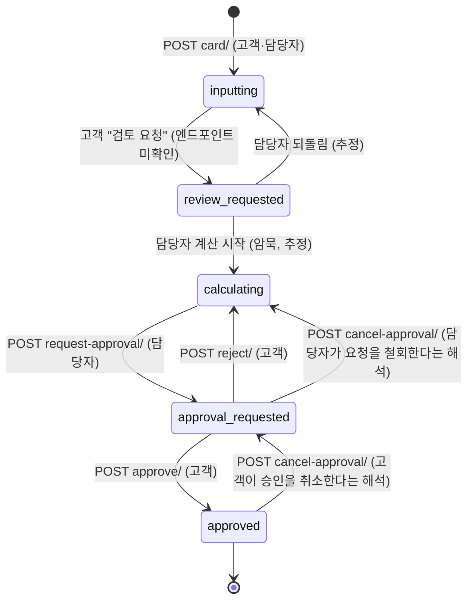

# 급여(payroll) 백엔드 스펙 노트

> 대상: Hono + SQLite 재구현에서 급여 스키마, 계산 엔진, API를 설계할 사람.
> 근거: `alfred-manual/` (매뉴얼, 스크린샷 약 27장 판독), `app-alfred-kr/reverse/` (번들 `index.pretty.js`, 재구성 `src/payroll/**`), `docs/tax-api-design.md`.
> 표기: **[매뉴얼]** 매뉴얼 본문, **[화면]** 스크린샷 판독, **[번들]** 클라이언트 코드에서 확인, **추정** 근거 없는 추론, **확인 필요** 숫자·규정이 불확실.
> 응답 스키마는 페이지 lazy chunk에만 있어서 번들에서 거의 드러나지 않는다. 응답 필드는 화면 열 이름을 근거로 추정한 것이다.

---

## 0. 요약

- 급여 API는 **두 세대**가 공존한다.
  - **구 급여카드(legacy)**: `/api/company/:id/payroll/cards*`, `card-summary*`. 화면 `/company/payroll`(메뉴명 "급여 관리"). **세무 기장 고객**에게 노출된다. 번들 `sfApi.payroll`(`index.pretty.js:72902-73040`).
  - **BPO 급여 정산**: `/api/company/:id/payroll/bpo/**`. 화면 `/payroll-settlement`(메뉴명 "급여 정산"), 퇴직금 `/severance-pay-settlement`. **급여 구독 고객**(`hasPayrollPlan`)에게 노출된다. 번들 `sfApi.employment.payroll`(`index.pretty.js:73908-74413`).
- 매뉴얼은 "급여 관리는 향후 급여 정산으로 통합될 예정"이라고 적고 있다 [매뉴얼 05-급여/01-급여-관리/README.md]. **신규 구현의 주 대상은 BPO**이고, legacy는 호환 계층으로 보면 된다.
- 계산 주체는 **담당자(기장직원, `AgencyMember`)**다. 고객은 입력하고 요청하고 승인한다. 엔진은 담당자 도구와 고객의 "공제액 계산" 버튼이 같이 쓴다.
- 엔드포인트는 **155개**(동사+정규화 경로 기준, 소득 유형 세그먼트를 펼쳐서 셈)다. 세그먼트를 경로 파라미터 하나로 묶으면 **약 90개**다(5절).

---

## 1. 화면과 흐름

### 1.1 메뉴 노출 [매뉴얼 09-Alfred-Business-메뉴-구조.md, 05-급여/README.md]

| 메뉴 | 화면 경로 | 노출 조건 | API 세대 |
| --- | --- | --- | --- |
| 급여 > 급여 정산 | `/payroll-settlement`, `/payroll-settlement/:id/{wage-monthly,wage-daily,wage-hourly,daily,business,other}` | 급여 구독, 또는 급여 구독과 세무 기장을 함께 쓰는 고객 | BPO |
| 급여 > 급여 관리 | `/company/payroll`, `/company/payroll/:payrollId/:incomeType`, `…/specification-list` | 세무 기장 고객 | legacy |
| 급여 > 급여 계산기 | `/salary-calculator/{wage,daily,business,other}` | 공통 | `/api/payroll/calculator/simulate` |
| 퇴직금 정산 | `/severance-pay-settlement/{severance-pay,mid-severance-pay}[/detail]` | 급여 구독 추정. 메뉴 트리 버전 `"2026.08_퇴직금정산"`(`index.pretty.js:77590`) | BPO severance |
| 설정 > 운영 설정 > 급여 설정 | `/payroll-setting/{conditions-of-employment,work-schedule-policy,payroll-terms,payment-items,deduction-items}` | 급여 구독 | `employment/settings/*` |

- 구독 판정: 회사의 `subscriptions[].code === "payroll" && isSubscribed`이면 `hasPayrollPlan`이다(`index.pretty.js:72531`). 이 플래그가 켜지면 `employee_management` 메뉴를 숨긴다(`MENU_EXCLUSION_RULES`, `:77551`).
- 메뉴 코드는 `pb_employment`, `pb_payroll_management`가 번들에 있다(`:77615`). HQ 대행사(`isHQAgency`)와 무료 회사에는 프로모션 노드로 보인다.

### 1.2 급여 정산 (BPO) 흐름

번들 경로와 화면 판독으로 다시 그린 흐름이다. 매뉴얼 [05-급여/02-급여-정산.md]은 "급여 입력 → 급여 계산중 → 급여 마감" 3단계로 설명한다. 목록 화면은 상태를 `1/3 정산 진행`처럼 단계 분수로 보여 준다 [화면 0cabe5ca].

| # | 단계 | 누가 | 화면 동작 | API |
| --- | --- | --- | --- | --- |
| 1 | 급여대장 생성 | 고객 또는 담당자 | "급여 대장 생성하기" 버튼. 지급일을 고르고 제목을 입력한다(예: "2026년 02월 급여 대장") | `GET payment-date-list/` → `POST card/` |
| 2 | 대상자 추가 | 고객 또는 담당자 | 소득 유형별 탭에서 후보 직원을 추가하거나 행을 추가한다 | `GET/POST card/:c/:segment/payroll-input/candidates/` |
| 3 | 근무 입력 | 고객 또는 담당자 | 근로(월급·일급·시급)와 일용의 근무 시트(시간, 일수) | `GET/POST card/:c/:seg/work-input/` |
| 4 | 급여 입력 | 고객 또는 담당자 | 지급 항목과 공제 항목 금액. 항목 단위 일괄 수정 | `payroll-input/update/`, `PUT payroll-input/:row/`, `payment-items/bulk/`, `deduction-items/bulk/` |
| 5 | 임시 저장 | 고객 또는 담당자 | "임시 저장" [화면 a51e04c1] | `payroll-input/update/` 또는 `PUT card/:c/` (추정) |
| 6 | (고객) 검토 요청 | **고객** | 매뉴얼의 "2. 검토 요청". 이후 고객은 수정할 수 없다 | **미확인**. 별도 엔드포인트가 번들에 없다. `PUT card/:c/`로 상태를 바꾸는 것으로 추정 |
| 7 | 계산·내부 검토 | **담당자** | 당월 특이사항 반영 → 임시저장 → 내부 검토·확정 | `payroll-input/calculate/`, `reset-calculation/`, `refresh-employee-info/`, `manager-memo/` |
| 8 | 승인 요청 | **담당자** | "검토 요청" 버튼. 화면 주석: "회원사의 검토 '승인'이 이루어지는 작업과정이므로 충분히 검토 후 요청할 것" [화면 a51e04c1] | `POST card/:c/request-approval/` |
| 9a | 승인 | **고객**(회원사 대표 또는 담당자) | 승인 | `POST card/:c/approve/` |
| 9b | 반려 | **고객** | 수정이 필요하면 반려한다. 담당자가 재정산한 뒤 8단계부터 다시 한다 | `POST card/:c/reject/` (body 없음. 사유는 특이사항이나 채팅으로 전달하는 것으로 추정) |
| 9c | 승인 취소 | 고객 추정 | 승인된 대장 상단에 "승인 취소" 버튼이 있다 [화면 9a1be1b4] | `POST card/:c/cancel-approval/` |
| 10 | 정산 완료(마감) | 시스템 | `완료` 태그. 차인지급액을 확인하고 이체한다 | `GET card/:c/status/` |
| 11 | 명세서 발송 | **고객** | 급여대장 → 급여명세서 관리 → 근로자 전체 선택 → 발송. 이체가 끝났는지 확인한 뒤 고객이 발송 시점을 정한다 [매뉴얼] | `GET card/:c/{wage,business,daily,other}/payslip/`, `POST payslip/send/`, `POST payslip/download/` |
| 12 | desk 내보내기 | **담당자** | 기장(세무사랑 등)으로 반영 | `POST card/:c/export-to-desk/?export_type=…` |

- 특이사항(`manager-memo`)은 화면 상단 접이식 영역이다. 회사 단위로 저장된다(경로에 카드 ID가 없다). 담당자가 쓰고 회원사 대표에게도 공유된다 [매뉴얼, 화면 a51e04c1].
- 승인된 대장 헤더에는 "다운로드"(급여대장 파일), "승인 취소", "급여 명세서 관리"가 있다 [화면 9a1be1b4].
- 명세서 관리 모달 열 [화면 12fcebc8]: 선택, 이름, 생년월일, 소득유형, 부서, 이메일, **발송상태**(`성공`/`미발송`, 그 밖에 `발송중`/`실패` 추정), 발송, 다운로드. 하단 일괄 버튼: "급여 명세서 발송", "급여 명세서 다운로드". 사업소득 행에도 이메일과 발송 버튼이 있으므로, **BPO는 근로 외 소득도 발송**할 수 있다(legacy는 근로만).

### 1.3 급여 관리 (legacy 카드) 흐름 [매뉴얼 05-급여/01-급여-관리/*]

① 급여 카드 확인 → ② 내용 확인·변동 반영 → ③ 계산 요청 → (담당자: 계산·확정·ERP 입력) → ④ 계산 완료 확인 → ⑤ 급여 지급 → ⑥ 급여명세서 관리·발송

| 단계 | 누가 | 내용 | API |
| --- | --- | --- | --- |
| 카드 자동 생성 | 시스템(배치) | 급여 설정을 기준으로 매월 **기본 급여카드**(`kind=default`)를 만든다. 근로소득 대상자는 직원 명부에서 자동으로 채운다 | 배치(엔드포인트 없음). 직전 카드 복사는 `GET/POST cards/:c/copy/` |
| 목록 | 고객 | `입력가능` / `계산중` / `완료` 섹션. 카드마다 근로·일용·사업·기타 인원수를 보여 주고, 완료 카드는 소득별 합계와 "세후지급 총계"를 보여 준다 [화면 aa80c23f, c8d02f5f] | `GET card-summary/`, `GET card-summary/group-by-attr-date/?fixed_cards_only&attr_date&status` |
| 입력 | 고객 | 탭은 근로/일용/사업/기타. 근로 탭 도구: 직원관리, 수당관리, 기타 공제금 관리, 새로고침 [화면 d834b09a] | `GET cards/:c/`, `POST cards/:c/data/` |
| 명부 변동 확인 | 고객 | 입사자·퇴사자를 반영한다 | `GET inquire-wage-employees-change/`, `POST refresh-wage-employees-list/` |
| 임시 저장 | 고객 | | `POST cards/:c/data/` |
| 계산 요청 | 고객 | 확인 팝업: "급여계산을 요청하면 기장 담당자가 급여를 계산하게 되고 내용을 수정할 수 없습니다" [화면 2e52311b]. 입력하지 않은 소득 유형이 있으면 안내 문구를 먼저 띄운다 | `POST cards/:c/calculate/` (추정: 이름은 calculate지만 화면 동작은 "계산 요청"이다) |
| 계산·확정 | 담당자 | desk에서 한다(범위 밖) | — |
| 완료 확인 | 고객 | `완료` 태그. 같은 귀속월 카드는 "YYYY년 M월 전체 급여내역"으로 묶어서 보여 준다(기본 카드 외 N개) [화면 746d23ba] | `GET cards/:c/?fixed_cards_only=true`, `GET cards/:c/fixed-payrolls/?income_type=` |
| 명세서 계산식 | 고객 | 수당마다 산출 계산식을 텍스트로 넣는다(근로기준법 개정, 2021-11-19 시행). "전월 계산식 불러오기", "입력내용 저장", "급여 명세서 발송", "PDF 다운로드" [화면 fe61281a] | `GET/POST cards/:c/payslip/`, `POST payslip/wage-salary/copy-payment-formulas/` |
| 발송 | 고객 | 이메일 필수. 미리보기를 지원한다. `발송중` → 1~2분 뒤 `성공`, 실패하면 `실패`. 재발송할 수 있다 | `POST/GET cards/:c/payslip/wage-salary/notifications/` |
| 추가 카드 | 고객 | 아래 1.4절 | `GET can-create-additional-card/`, `POST additional-card/`, `DELETE cards/:c/` |
| 카드 이름 변경 | 고객 | 연필 아이콘 | `PATCH cards/:c/update-name/ {name}` |

### 1.4 추가 급여카드 규칙 [매뉴얼 01-…추가-급여-생성…md]

- `계산중` 또는 `완료` 상태인 카드에서만 "급여카드 추가"를 할 수 있다. 새 카드는 같은 귀속월로 만들어진다.
- **일용·사업·기타 소득만** 넣을 수 있다. 근로소득은 기본 카드에서만 입력한다. 근로소득을 다시 입력하려면 담당자가 카드를 `입력가능`으로 되돌려야 한다.
- 생성 불가 조건(`can-create-additional-card`가 판정):
  1. 회사에 `입력가능` 상태 카드가 이미 있다.
  2. 해당 귀속분 원천세가 이미 신고되었다.
  3. 원천세 신고 마감일 5일 전부터. 매뉴얼 예시: 9/10 신고분이면 8/5까지 생성하고 계산 요청할 수 있다. 예시의 날짜 산식이 앞뒤가 맞지 않으므로 **기준일은 확인 필요**.
- 삭제는 `입력가능`일 때만 가능하다. 화면 문구는 "이 급여카드 삭제"다.
- 화면 하단 고지: "익월 10일은 원천세 신고 마감일입니다. 해당일 이후 변경이 필요한 경우 가산세가 발생합니다." [화면 d834b09a]

### 1.5 소득 유형별 입력 화면 (legacy와 BPO 공통 개념)

| 유형 | BPO 세그먼트 | legacy 세그먼트 | 대상자 반영 | 입력 열 [화면] |
| --- | --- | --- | --- | --- |
| 근로(월급제) | `wage-monthly` | `wage-salary` | 직원 명부에서 자동으로 | 성명, 상태(재직/신규입사/퇴사), 일할계산(요청 체크), 기본급, 과세수당(상여·성과급·자격수당…), 비과세수당(식대·연구수당·육아수당·차량유지비·육아휴직수당·학자금지원·국외근로·직무발명보상금), 공제액(기타 공제금), 지급액 |
| 근로(일급제) | `wage-daily` | (wage-salary에 포함) | 자동 | BPO 전용. 근무 시트에 일수 |
| 근로(시급제) | `wage-hourly` | (wage-salary에 포함) | 자동 | BPO 전용. 근무 시트에 시간 |
| 일용 | `daily` | `daily` | 직접 입력(행 추가, 이전 급여 불러오기, 엑셀 업로드) | 성명, 주민등록번호, 내외국인 여부, 거주국가, 대표자 본인 혹은 동거 친족 여부, **근무일자**(귀속월 안의 날짜 다중 선택), 근무일수(자동), 일평균 근무시간, 지급일, 지급액 [화면 5dce0a37] |
| 사업 | `business` | `business` | 직접 입력 | 성명, 주민번호, 내외국인, 거주국가, 지급일, **사업소득유형**(기타자영업(프리랜서), 가수, 간병인, 기타모집수당…), 예술인·특고 추가 열(고용보험 대상여부, 계약기간(계약유형), 단기 계약 근무일자, 특수고용직 직종코드), **세금공제 여부**(`세금공제전` 등), 지급액 [화면 36f51fbd, 6fa20585] |
| 기타 | `other` | `other-labor` | 직접 입력 | 성명, 주민번호, 내외국인, 거주국가, 지급일, **지급사유**(필요경비 없는 기타소득, 주식매수선택권 행사이익, 그 밖에 필요경비 있는 기타소득, 연금·공제부금해지소득, 서화·골동품 양도소득…), 세금공제 여부, 지급액 [화면 09009340] |

- "이 귀속년월 전체급여 보기" 토글이 있다. 같은 귀속월의 다른 카드까지 합쳐서 보여 준다.
- 세금공제 여부의 값 집합은 `세금공제전` 하나만 판독했다. 지급액이 세전인지 세후(역산)인지를 고르는 선택으로 추정한다(`세금공제후` 추정).
- 근로 행 하단 메뉴 [매뉴얼]:
  - 구성원 정보 동기화(`refresh-employee-info`): 근태·지급·공제 값은 유지한다.
  - 공제액 계산(`calculate`).
  - 정산 초기화(`reset-calculation`): 수동 수정을 모두 버린다.
  - 대상자 삭제(`delete`).
- 각 금액 셀의 `fx` 아이콘은 적용된 계산식을 보여 준다. **엔진은 금액과 함께 계산식 문자열(근거)을 돌려줘야 한다.**

---

## 2. 엔티티와 필드

필드 이름은 snake_case 제안이다. 화면이나 번들에서 직접 확인한 이름은 ✓로 표시한다.

### 2.1 `payroll_cards` (급여대장 / 급여카드)

| 필드 | 타입 | 근거 | 비고 |
| --- | --- | --- | --- |
| `id` | int | | |
| `company_id` | int | | sf 회사 ID |
| `generation` | `legacy` \| `bpo` | 추정 | 두 세대를 한 테이블에 둘지는 설계 선택 |
| `kind` | `default` \| `addition` | ✓ `PayrollCardKind` (`payroll.constants.ts:8`) | legacy의 추가 카드. BPO는 한 귀속월에 여러 대장을 만들 수 있다 [화면 0cabe5ca] |
| `parent_card_id` | int? | 추정 | 추가 카드가 생겨난 원래 카드 |
| `name` / `title` | text | ✓ `update-name {name}`, 화면 "제목" | |
| `attribution_month` | `YYYY-MM` | ✓ `attr_date` 파라미터, 화면 "귀속연월" | |
| `payment_date` | date | ✓ 화면 "지급일", `payment-date-list` | BPO 목록에 지급일이 빈 행도 있다 → nullable |
| `period_start`, `period_end` | date | 추정 | `payroll_terms`의 임금산정 기간에서 파생 |
| `status` | enum | 3절 | |
| `approval_requested_at/by`, `approved_at/by`, `rejected_at/by` | | 추정 | 감사용 |
| `exported_to_desk_at`, `export_type` | | 추정 | |
| `headcount_by_type` | 파생 | ✓ 화면 "근로소득 N명…" | 목록 응답 |
| `total_by_type`, `net_total` | 파생 | ✓ 화면 "세후지급 총계" | |
| `withholding_filed` | 파생 | 추정 | 원천세 신고 여부. 추가 카드 생성 가드에 쓴다 |
| `version` | int | tax-api 규약 | 낙관적 잠금 |

### 2.2 `payroll_rows` (입력 행; 직원 × 카드 × 소득유형)

공통 필드:

- `id`(`RowId`), `card_id`, `income_type`(`wage_monthly|wage_daily|wage_hourly|daily|business|other`), `employee_id`(근로 유형만; 일용·사업·기타는 nullable, 인적사항을 행에 직접 저장)
- `name`, `resident_no`(암호화), `is_foreigner`, `residence_country`(nation-codes), `payment_date`
- `gross_pay`(지급액 합계), `taxable_pay`, `non_taxable_pay`, `deduction_total`, `net_pay`(차인지급액)
- `is_manually_overridden`: `reset-calculation`이 되돌릴 대상
- `calc_trace` JSON: `fx`에 보여 줄 계산식과 근거

유형별 필드:

| 유형 | 필드 |
| --- | --- |
| 근로 (`wage-*`) | `employment_status_label`(재직/신규입사/퇴사 [화면]), `prorate_requested` ✓(일할계산 요청), `base_pay`, 지급 항목 금액 배열(`taxable_incomes` ✓ legacy raw key), 공제 항목 배열(`other_deductions` ✓ legacy raw key), 4대보험·소득세·지방소득세 금액, 연말정산 소득세·농특세(담당자가 입력 [매뉴얼]), 근무 정보(`work-infos`: 소정근로시간, 연장·야간·휴일·휴일연장 시간, 지각·조퇴·결근 시간, 주휴공제 일수) |
| 일용 (`daily`) | `is_owner_or_cohabiting_relative` ✓, `work_dates[]` ✓, `work_days` ✓(파생), `avg_daily_hours` ✓, `pay_amount` ✓, 고용보험, 소득세, 지방소득세 |
| 사업 (`business`) | `business_income_type_code` ✓(`/api/payroll/business-income-types/?target_date`), `detail_type` ∈ `artist|special` ✓(`BUSINESS_INCOME_DETAIL_TYPE`), `employment_insurance_applicable` ✓, `contract_type` ✓(계약기간), `short_term_work_dates[]` ✓, `special_occ_type_code` ✓(`/api/payroll/special-occ-types/`), `tax_deduction_mode` ✓(세금공제 여부), `pay_amount` |
| 기타 (`other`) | `other_income_type_code` ✓(지급사유, `/api/payroll/other-labor-income-types/`), `tax_deduction_mode`, `pay_amount`, `necessary_expense`(파생, `/api/tax-rates/necessary-expenses/`) |

### 2.3 카드 단위 근무 입력 (`work-input`)

- BPO `wage-monthly|wage-daily|wage-hourly|daily`에 있다. 카드 전체 직원의 근무 시트를 한 번에 조회하고 저장한다(`GET/POST …/work-input/`).
- 행 단위 상세는 `GET payroll-input/:row/work-infos/`로 조회한다.
- 입력 단위 [매뉴얼]: 근태 기반 공제는 **시간 단위**다. 주휴공제만 **일 단위**이고, 이때 소정근로시간 항목에 일 주휴시간을 추가로 입력한다.
- Shiftee 연동(`attendance_record_integration`)이 켜져 있으면 이 시트를 외부 데이터로 채운다(추정, 7절).

### 2.4 지급 항목 (`payroll_payment_items`, 설정) [매뉴얼 08-설정/03, 화면 5caba01c, 6938e484, f738fc2a, 7df365b3]

| 필드 | 값 |
| --- | --- |
| `name` | 항목명. 표준 항목은 "불러오기"(카탈로그)로 고르고, 아니면 직접 입력한다. **비과세 항목과 연차수당은 표준 항목명이 필수**다(세무사랑 코드 연동) |
| `source` | `catalog` \| `custom` (분류: 불러오기/직접입력) |
| `catalog_code` | 카탈로그 항목 ID. `payroll-payment-categories`가 분류 목록을 준다(추정) |
| `default_amount` | 금액. 전 직원 동일 지급일 때만 넣는다 |
| `is_taxable` | 과세여부(과세/비과세) |
| `non_taxable_limit_enabled`, `non_taxable_limit_amount` | 비과세 한도 설정/미설정, 한도 금액(예: 연구수당 200,000원) |
| `include_in_monthly_salary` | 월급여 포함여부 |
| `include_in_ordinary_wage` | 통상시급 포함여부 |
| `include_in_average_wage` | 평균임금 포함여부 |
| `include_in_minimum_wage` | 최저시급 포함여부 |
| `show_formula_on_payslip`, `formula_text` | 임금명세서에 계산방법 표기, 계산방법 |
| `usage_status` | 추정(work-conditions·work-schedule-policies에는 `usage-status` 엔드포인트가 있고, 지급 항목에는 없다) |

- 카탈로그 예시(불러오기 모달 열: 항목명 / 과세여부 / 설명): 연장근로수당, 야간근로수당, 휴일근로수당, 휴일연장근로수당(모두 과세), 연차휴가수당/연차수당, 고정연장·고정야간·고정휴일·고정휴일연장근로수당, 기본급, 연구수당(비과세), 식대.
- 비과세 유형(legacy 수당관리 드롭다운, 고정 목록) [화면 b1396623, d834b09a]: 식대, 연구수당, 육아수당, 차량유지비, 육아휴직수당, 학자금지원, 국외근로, 직무발명보상금. **비과세 한도 카테고리 테이블**이 필요하다(4.6절).
- 카드 단위 지급 항목: `GET card/:c/payment-items/?employment_type=` → 이번 달 쓰지 않는 항목은 체크를 해제한다 [매뉴얼 "항목 설정"]. 금액 일괄 수정은 `POST card/:c/payment-items/bulk/`. 새 항목은 설정 메뉴에서만 추가할 수 있다.

### 2.5 공제 (`payroll_deduction` 회사 설정, `payroll_deduction_items` 추가 항목) [화면 19e847b9, 매뉴얼]

`payroll-deduction`은 회사당 하나인 싱글턴이다(GET/PATCH).

| 항목 | 산출방법 enum | 추가 옵션 |
| --- | --- | --- |
| 국민연금 | `notice`(고지 기준. 고지 금액을 스크래핑해서 공제) | `pay_on_acquisition_month`(취득월 납부 여부: 미희망/희망) |
| 건강보험(+장기요양) | `notice`(보수월액 기반 고지) \| `rate`(실지급액 × 요율) | |
| 고용보험 | `notice` \| `rate` | |
| 근로소득세 | `tax_table_based` ✓ \| `manual_input` ✓ \| `none` (`INCOME_TAX_CALC_METHOD`, `:73876`. `none`은 매뉴얼의 "미적용") | 직원별 설정은 HR `deduction-info` |

`payroll-deduction-items`(CRUD)는 사용자 정의 공제 항목이다. 필드는 `name`과 `amount_mode` ∈ `fixed`(직접입력, 금액) | `on_settlement`(정산 시 급여대장에서 입력)다. 예: 선지급금(가불), 사내 동호회비 [매뉴얼 근로 소득 입력 FAQ].

### 2.6 급여명세서 (`payslips`)

- 키는 (`card_id`, `row_id`)이고, 소득 유형별 목록과 상세가 있다(`wage|business|daily|other`).
- 필드: `email`, `formula_by_item` JSON(수당별 계산식 텍스트, legacy `payment-formulas`), `notification_status` ∈ `in_flight|success|fail` ✓(`PayslipNotificationStatus`, `:72992`). 아직 보내지 않았으면 null이고 화면에 "미발송"으로 표시한다. `sent_at`, `fail_reason`(추정).
- 발송 이력은 재발송을 감안해 별도 `payslip_notifications`로 두는 편이 낫다(추정).
- 다운로드(`payslip/download`)는 Blob(PDF 또는 zip, 추정)이다. body는 선택한 row id 목록으로 추정한다.

### 2.7 담당자 메모 (`manager_memo`)

회사당 하나다(`GET/POST /payroll/bpo/manager-memo/`). 필드는 `content`(텍스트), `updated_by`, `updated_at`(추정). 매뉴얼 표기는 "특이사항"이다. 카드별 메모가 아닌 점에 유의한다. 귀속월별로 바꾸는 운영이라면 이력이 필요하다(추정).

### 2.8 퇴직금 정산 (`severance_settlements`) [번들 `:73834-73858`, `:74334-74367`]

| 필드 | 값 |
| --- | --- |
| `kind` | `retirement`(퇴직) \| `interim`(중간정산). 생성은 같은 `POST settlements/` 엔드포인트이고 body로 구분한다 |
| `status` | `in_progress` \| `completed` \| `excluded` ✓ `SEVERANCE_SETTLEMENT_STATUS` |
| `employee_id`, `join_date`, `leave_date`(퇴직일 또는 중간정산 기준일) | |
| `interim_reason` | ✓ `SEVERANCE_EARLY_SETT_REASON`: `home_purchase`, `rent_deposit`, `medical_treatment`, `bankruptcy`, `personal_rehabilitation`, `wage_peak`, `work_hours_reduction`, `legal_work_hours_reduction`, `etc_gov_notice` |
| `retirement_benefit_type` | ✓ `RETIREMENT_BENEFIT_TYPE`: `grant`(퇴직금), `pension_db`, `pension_dc`. 회사 기본값은 payroll-terms, 직원 값은 HR `retirement-info` |
| `monthly_wages[]` | 평균임금 산정 기초 월별 임금(`monthly-wages`, 월별 상세 `monthly-wages/:monthId`) |
| `average_daily_wage`, `ordinary_daily_wage`, `service_days`, `severance_pay`, `retirement_income_tax`, `local_tax`, `net_pay` | 추정 |
| `exclude_reason` | `exclude` body(추정) |
| 오류 코드 | ✓ `RETIREMENT_INFO_ERROR_CODE.LEAVE_DATE_BEFORE_INTERIM`: 퇴직일이 중간정산일보다 앞이면 오류 |

### 2.9 설정 엔티티

**`payroll_terms`**: 회사당 하나(GET/PATCH). 화면 탭명은 "급여 조건"이고 매뉴얼은 "급여 정책"이라 부른다 [화면 70c83e80, 861a9624, ea48206e, 3f52c487, 3b9f629f].

| 필드 | 값 (✓ 번들 상수, `:73271-73280`) |
| --- | --- |
| `wage_period_start_day` | 1~31. "매달 N일부터 1개월" |
| `payment_month` | ✓ `current` \| `next` \| `previous` (화면에는 당월/익월만 있다) |
| `payment_day` | 1~31. 31은 "31일 (말일)" |
| `payment_method` | ✓ `bank_transfer` \| `cash_payment` |
| `attendance_record_integration` | ✓ `none` \| `manual_input` (화면: 미연동/연동). Shiftee 값은 아직 없다 |
| `is_under_five_employees` | 5인 미만 여부 |
| `fixed_overtime_multiplier`, `fixed_night_multiplier`, `fixed_holiday_multiplier`, `fixed_holiday_overtime_multiplier` | 5인 이상 기본값 1.5 / 0.5 / 1.5 / 2, 5인 미만 기본값 1 / 0 / 1 / 1. 회사가 수정할 수 있다 |
| `retirement_benefit_type` | `grant` \| `pension_db` \| `pension_dc` |
| 최저임금(읽기 전용) | 2026년 최저시급 10,320원, 월 최저임금 2,156,880원 [화면 3b9f629f]. 연도별 기준표에서 내려준다 |
| `payment_unit` | ✓ `PAYMENT_UNIT` `monthly|daily|hourly`. 직원 급여계약(HR)에 쓰인다. 소득 세그먼트 `wage-monthly/daily/hourly`와 대응한다 |

복수 급여일은 지원하지 않는다. 대표 급여일 하나만 정한다 [매뉴얼 FAQ].

**`work_conditions`**(근로 조건, CRUD + `usage-status`): `name`, `work_place`, `probation_months`(0이면 없음), `probation_pay_rate`(%, 기본 100), `usage_status`. 계약서 내용과 동기화할 수 있다 [화면 c6df1711, 5c38cedb].

**`work_schedule_policies`**(근로시간 정책, CRUD(PUT) + `usage-status`) [번들 `:73338-73370`, 화면 c7509102]:

- `name`, `paid_weekly_holidays[]`(유급주휴일), `unpaid_holidays[]`(무급휴무일). 요일 값은 ✓ `DAY_OF_WEEK` MONDAY=0 … SUNDAY=6이다.
- `contractual_work_schedule_type` ✓ `weekly|biweekly|monthly` 와 주기별 요일×시간 표.
- `weekly_rest_hours_input_method` ✓ `auto_calculated`(그 밖에 `manual` 추정. 매뉴얼은 "직접 입력"이라 쓴다)와 `weekly_rest_hours`.
- `fixed_overtime_work_schedule_type` ✓ `none|daily|weekly|monthly`(매뉴얼: 없음/요일별/주간합계/월간합계).
- `fixed_overtime_input_type` ✓ `none|actual|additional`(실근로 시간 / 가산 근로 시간).
- 고정 시간외 항목 `work_type` ✓ `extended|night|holiday|holiday_extended`와 시간 값.

### 2.10 payroll이 필요로 하는 직원 필드 (HR 노트 참조)

`wage-employees`에서 다음을 쓴다.

- 이름, 주민번호 또는 여권(`IDENTIFICATION_NUMBER_TYPE` `registration|passport`), 내외국인, 국적, 부서, 이메일(명세서), 입사일·퇴사일, `EMPLOYEE_STATUS`(`PRE_JOINED|WORKING|JOINED|LEAVE|RESIGNED`).
- `payroll-contracts`: 지급단위 `PAYMENT_UNIT`, 기본급, 시급, 일급, 고정 지급 항목.
- `work-contracts`: `WORK_TYPE` `regular|part_time|short_time`, 근로조건 ID, 근로시간정책 ID, 계약기간.
- `social-insurance-info`: 가입·제외 여부와 제외 사유 `NPS/NHIS/EI/IAIS_EXCLUSION_REASON`, 보수월액·기준소득월액, `DETERMINATION_CODE`.
- `deduction-info`: `INCOME_TAX_CALC_METHOD`, `INCOME_TAX_REDUCTION_TYPE` `none|small_biz|returning_korean_talent|foreign_technician`, `INCOME_TAX_REDUCTION_APPLICATION_TYPE` `""|payroll|year_end_set`, 원천징수 비율(80/100/120%, 추정), 수동 세액.
- `families`: 공제대상가족수와 8~20세 자녀 수(간이세액표 입력).
- `leave-of-absences`: 휴직(일할, 보험료 처리).
- `retirement-info`: 퇴직 정산 트리거.

---

## 3. 상태와 전이

### 3.1 번들에서 확인한 상수 (전부)

| 상수 | 값 | 위치 |
| --- | --- | --- |
| `PayrollCardKind` | `default`, `addition` | `payroll.constants.ts:8` (번들 소비처는 lazy chunk) |
| `PayslipNotificationStatus` | `in_flight`, `success`, `fail` | `index.pretty.js:72992` |
| `INCOME_TYPES` (legacy) | `wage-salary`, `daily`, `business`, `other-labor` | `:102493` `incomeTypeToKR` → 근로/일용/사업/기타 |
| `BPO_INPUT_SEGMENTS` | `wage-monthly`, `wage-daily`, `wage-hourly`, `business`, `daily`, `other` | URL |
| payslip 세그먼트 | `wage`, `business`, `daily`, `other` | URL |
| `BUSINESS_INCOME_DETAIL_TYPE` | `artist`, `special` | `payroll.constants.ts:32` |
| `SEVERANCE_SETTLEMENT_STATUS` | `in_progress`, `completed`, `excluded` | `:73839` |
| `SALARY_CALCULATOR_TAB_SEGMENT` | `wage`, `daily`, `business`, `other` | `:102557` |

**급여카드 상태 enum은 엔트리 번들에 없다.** 카드 상태 문자열은 lazy chunk에만 있다. 아래 상태 이름은 화면 라벨과 엔드포인트 이름에서 만든 **제안**이다.

### 3.2 BPO 카드 상태 머신 (제안)

화면 라벨: `입력가능`, `정산 진행 (n/3)`, `완료`. 엔드포인트: `request-approval`, `approve`, `reject`, `cancel-approval`.



| 상태(제안) | 단계 | 고객 쓰기 | 담당자 쓰기 |
| --- | --- | --- | --- |
| `inputting` | 1/3 급여 입력 | 입력, 후보 추가, 삭제, 임시저장, 카드 삭제 | 모두 |
| `review_requested` | 2/3 (추정) | 없음 | 입력과 계산 |
| `calculating` | 2/3 계산중 | 없음 | 입력, 계산, 메모, `request-approval` |
| `approval_requested` | 2/3 | `approve`, `reject` | `cancel-approval`(추정) |
| `approved` (= 마감, `완료`) | 3/3 | 명세서 발송·다운로드, `cancel-approval` [화면 9a1be1b4] | `export-to-desk` |

- `cancel-approval`의 주체와 대상 상태는 화면에서 "승인 취소" 버튼이 **승인 완료 대장**에 보인다는 것만 확인했다. 두 해석(요청 철회 / 승인 취소)을 모두 허용하거나, 승인 이후만 허용하는 것 중 하나를 골라야 한다(8절).
- 잠금 규칙은 tax-api-design 4절과 같다. 상태가 맞지 않는 쓰기는 `409 INVALID_TRANSITION`으로 돌려준다. 전이는 조건부 UPDATE(`status IN (…) AND version=?`)로 한다.
- 원천세가 신고된 귀속월의 카드에 대한 `cancel-approval`, `reject`, 재계산은 막거나 경고해야 한다(추정).

### 3.3 legacy 카드 상태

라벨은 `입력가능` → `계산중` → `완료`이고, 진행 바는 "1. 입력가능 / 2. 계산중 / 3. 완료"다 [화면 d834b09a, 746d23ba].

- `입력가능 → 계산중`: 고객이 `POST cards/:c/calculate/`를 호출한다(추정).
- `계산중 → 완료`: 담당자가 desk에서 확정한다(`fixed`. `fixed_cards_only`, `fixed-payrolls` 이름에서 추론).
- `계산중|완료 → 입력가능`: 담당자의 "해제"(desk).
- `card-status/`의 응답 값 문자열은 미확인이다. 후보는 `input_available|calculating|done`(추정)이다.
- 같은 귀속월에 `default` 하나와 `addition` 여러 개가 있을 수 있다. `group-by-attr-date`가 이를 묶어 준다.

### 3.4 퇴직금 정산 상태

- `in_progress`에서 `temp-save`, `complete`(→ `completed`), `exclude`(→ `excluded`, body에 사유 추정)를 할 수 있다.
- `completed`에서 `reopen`(→ `in_progress`)을 할 수 있다.
- `excluded`에서 `include`(→ `in_progress`)를 할 수 있다.
- `DELETE`는 `in_progress`에서만 가능하다(추정).
- `status-counts`는 탭 배지용이다.
- 퇴직 후보(`retirement-candidates`)는 퇴사일이 있고 `retirement_benefit_type=grant`이며 1년 이상 근속한 직원으로 추정한다.
- 중간정산 후보(`interim-candidates`)는 재직자다.

### 3.5 명세서 발송 상태

`null(미발송) → in_flight → success | fail`. `fail`과 `success` 모두 재발송할 수 있다(`fail`은 재발송 권장). 매뉴얼에 따르면 `in_flight`에서 `success`까지 1~2분 걸리므로 비동기 큐가 필요하다.

---

## 4. 계산 규칙

각 항목에 **매뉴얼 명시 여부**를 적었다. 2026년 수치는 아는 범위에서만 적었고, 확신이 없으면 **확인 필요**로 표시했다.

> **설계 원칙**: 요율, 한도, 세액표는 코드에 넣지 않고 **적용 시작일이 있는 기준표**(`tax_rate_tables`: `kind`, `effective_from`, `effective_to`, `payload`)로 둔다. 현행 API `/api/tax-rates/simple/`, `/api/tax-rates/necessary-expenses/`, `/api/payroll/*-types/?target_date=`가 모두 기준일로 조회한다. 기준일 형식은 `YYYYMM`(`TARGET_DATE_PATTERN = /^(?!0000)\d{4}(0[1-9]|1[0-2])$/`, `:74662`, tax-rates 모듈 바로 옆에 정의되어 있으므로 그 파라미터로 추정)이다.

### 4.1 4대보험 근로자 부담분

매뉴얼에는 **산출방법(고지/요율)만** 있고 요율은 없다.

| 보험 | 2026 근로자 부담 | 기준 | 확신도 |
| --- | --- | --- | --- |
| 국민연금 | 4.75% (총 9.5%. 2025년 연금개혁으로 2026년부터 매년 0.5%p씩 올려 13%까지) | 기준소득월액. 상한·하한이 있고 매년 7월에 바뀐다(2025.7~2026.6 하한 40만원 / 상한 637만원). 2026.7 이후 값은 **확인 필요** | 요율 높음, 상하한 확인 필요 |
| 건강보험 | 3.595% (총 7.19%) | 보수월액 | 높음(확인 권장) |
| 장기요양 | 건강보험료 × 13.14% (2026) | 건강보험료 | **확인 필요** |
| 고용보험(실업급여) | 0.9% | 보수(비과세 제외) | 높음 |
| 산재보험 | 근로자 부담 없음 | — | 높음 |
| 예술인·노무제공자 고용보험 | 0.8% (본인) | 보수(필요경비 공제 후) | **확인 필요** |

- 고지 기준(`notice`)이면 공단 고지액(스크래핑)을 그대로 공제한다. 엔진은 계산하지 않고 외부 입력을 받는다.
- 요율 기준(`rate`)이면 해당 월 실지급 과세 보수 × 요율로 계산한다.
- 원단위 절사 규칙이 필요하다(보험료 10원 미만 절사가 관행, **확인 필요**).
- 국민연금 "취득월 납부 여부": 월 중 취득자는 취득월 보험료를 희망할 때만 공제한다(1일 취득자는 당월 부과). 세부 규칙은 **확인 필요**.
- 제외 사유(번들 상수): 60세 이상(국민연금), 65세 이후 고용(고용보험), 월 60시간 미만 단시간, 주 15시간 미만, 대표자와 동거 친족(고용·산재) 등. HR 데이터에서 판정한다.
- 일용근로자: 고용보험만 기본으로 적용한다. 월 8일 이상 또는 60시간 이상이면 국민연금과 건강보험 대상이 된다(번들 `DAILY_WORKER` 제외 사유 문구 "월 8일 또는 60h 미만").

### 4.2 근로소득세 (간이세액표) + 지방소득세

- 매뉴얼에는 "국세청 간이세액표에 따라 자동 산출 / 직접 입력 / 미적용"만 있다.
- 입력은 월 과세급여(비과세 제외), 공제대상가족수(본인 포함), 8~20세 자녀 수(자녀세액공제 차감), 근로자가 선택한 원천징수 비율(80/100/120%)이다.
- 출력은 소득세(원 미만 절사)이고, **지방소득세는 소득세 × 10%**(원 미만 절사)다.
- 월 1,000만원 초과 구간은 표가 아니라 산식이다. 간이세액표는 소득세법 시행령 별표 2이고, 2024년 개정본 이후 **2026년 개정 여부 확인 필요**. 표 데이터는 `GET /api/tax-rates/simple/`로 제공한다(이름에서 추정).
- 중소기업 취업자 감면(`small_biz`): 감면율 90%, 연 200만원 한도. 적용 방식은 `INCOME_TAX_REDUCTION_APPLICATION_TYPE` `payroll`(매월 반영) | `year_end_set`(연말정산 때 반영)이다. 감면율과 한도는 **확인 필요**.
- 연말정산 정산분(소득세·농특세 추가 징수나 환급)은 담당자가 입력한다 [매뉴얼]. 엔진은 계산하지 않고 공제 항목으로 받는다.
- 상여 등 지급대상기간이 있는 경우의 간이세액 특례는 **미지원으로 보이며 확인 필요**.

### 4.3 일용근로소득 (매뉴얼에 규칙 없음)

```
과세표준 = max(0, 일급여 − 150,000)                 // 일 단위
산출세액 = 과세표준 × 6%
원천징수 소득세 = 산출세액 − 산출세액 × 55%          // 근로소득세액공제
→ 원천징수세액이 1,000원 미만이면 0 (소액부징수)
지방소득세 = 소득세 × 10%
```

- 일 15만원 공제, 6%, 55% 세액공제는 확신한다. 2026년 비과세 일액 상향이 논의되었으나 **확인 필요**.
- 일별 지급액은 행의 `지급액 / 근무일수`로 나누는지, 근무일별 금액을 받는지 정해야 한다. 화면은 행 단위 총액과 근무일자 다중 선택이므로 **균등 분할로 추정**한다.
- 소액부징수를 일 단위로 판정할지 지급 건 단위로 판정할지 **확인 필요**.

### 4.4 사업소득 (매뉴얼에 규칙 없음)

- 소득세 = 지급액 × 3%, 지방소득세 = 소득세 × 10%(= 0.3%). 합계 3.3%. 원 미만 절사하고, 소득세가 1,000원 미만이면 소액부징수한다.
- `세금공제 여부`가 "세금공제후"(세후 지급액 입력)라면 역산한다: `지급액 = 실지급 / (1 − 0.033)`(추정).
- 예술인·특고는 고용보험(4.1절)을 추가로 계산한다. 업종코드는 `/api/payroll/business-income-types/`와 `special-occ-types`에서 가져오고, 이는 간이지급명세서 업종코드에 대응한다.
- 외국인 비거주자는 다른 세율(조세조약)을 쓴다. **미지원으로 추정**.

### 4.5 기타소득 (매뉴얼에 규칙 없음)

```
필요경비 = 지급액 × 경비율(지급사유별: 60% 의제 / 0% "필요경비 없는 기타소득" / 실제경비)
기타소득금액 = 지급액 − 필요경비
과세최저한: 기타소득금액 ≤ 50,000원(건별)이면 과세 안 함
소득세 = 기타소득금액 × 20%   (복권 등 3억 초과 30%는 범위 밖)
지방소득세 = 소득세 × 10%    → 실효 22% × 소득금액 (60% 경비면 지급액의 8.8%)
```

- 경비율은 `GET /api/tax-rates/necessary-expenses/?target_date`로 조회한다(이름에서 추정).
- 연금계좌·공제부금 해지 소득은 15%로 분리과세하는 등 사유마다 세율이 다르다. **확인 필요**. 지급사유 목록은 `/api/payroll/other-labor-income-types/?target_date=`에서 받는다.

### 4.6 비과세 한도 (근로소득)

매뉴얼에는 "비과세 유형은 지정되어 있으며 최대 입력 가능 금액이 제한"이라는 문장만 있다.

| 카테고리(화면 항목명) | 월 한도 | 확신도 |
| --- | --- | --- |
| 식대 | 200,000 | 높음(2023~) |
| 자가운전보조금(차량유지비) | 200,000 | 높음 |
| 출산·보육수당(육아수당, 6세 이하) | 200,000 | 높음(2024~) |
| 연구보조비(연구수당) | 200,000 | 높음 |
| 국외근로 | 1,000,000 (원양·해외건설 5,000,000) | 중간, 확인 필요 |
| 생산직 등 야간근로수당 | 연 2,400,000 (월정액급여 기준 이하) | **확인 필요** |
| 육아휴직수당, 학자금지원, 직무발명보상금(연 700만원) | 항목별 | **확인 필요** |

- 한도를 넘는 금액은 과세로 바꾼다(`taxable_pay`에 더한다).
- 회사가 설정에서 넣는 `non_taxable_limit_amount`와 법정 한도 중 **작은 값**을 쓴다(추정).

### 4.7 통상임금, 통상시급, 최저임금

- 통상시급 = (통상시급 포함 항목 월합계) ÷ 월 소정근로시간(유급 주휴 포함). 주 40시간이면 (40 + 8) × 4.345 ≈ **209시간**이다.
- 주 소정근로시간이 40시간 미만이면 (주 소정 + 주휴) × 365/7/12로 구한다.
- 시간 수는 근로시간 정책(주기별 소정근로시간 + 주휴시간)에서 계산한다.
- 매뉴얼은 항목 플래그 "통상시급 포함 여부"만 명시하고 공식은 적지 않았다.
- 최저임금 검증: (최저시급 포함 항목 합계) ÷ 소정근로시간 ≥ 해당 귀속연도 최저시급. 2026년 최저시급은 **10,320원**, 월 **2,156,880원**(= 10,320 × 209) [화면 3b9f629f]. 위반하면 경고만 하고 차단하지는 않는 것으로 추정한다.
- 수습: 근로조건의 `probation_pay_rate`(예: 90%)를 수습 기간 동안 적용한다. 수습 최저임금 감액(90%)은 1년 이상 계약하고 단순노무가 아닌 경우에만 가능하다(법규, 확인 권장).

### 4.8 연장, 야간, 휴일 가산 (매뉴얼에 기본 배수 명시)

| 구분 | 5인 이상 기본 배수 | 5인 미만 기본 배수 | 공식 [화면 861a9624, ea48206e] |
| --- | --- | --- | --- |
| 연장 | 1.5 | 1 | 시간 × 통상시급 × 배수 |
| 야간(22:00~06:00) | 0.5 (가산분만) | 0 | 〃 |
| 휴일(8시간 이내) | 1.5 | 1 | 〃 |
| 휴일 연장(8시간 초과) | 2.0 | 1 | 〃 |

- 배수는 회사 설정값(`payroll_terms`)을 쓴다.
- 고정 시간외 근로(포괄임금 성격)는 근로시간 정책의 `fixed_overtime_*`에서 매월 자동으로 지급한다. 입력 타입이 `actual`이면 시간 × 배수, `additional`이면 이미 가산된 시간 × 1로 계산한다(매뉴얼 예: 연장 실근로 20시간 → 가산 30시간).
- 실제 연장근로가 고정분을 넘으면 차액을 지급하는지는 **미확인**.
- 근태 공제: 지각·조퇴·결근 시간 × 통상시급으로 추정한다. 결근이 있는 주는 주휴공제(일 단위 × 1일 주휴시간 × 통상시급)를 한다.

### 4.9 주휴수당 (매뉴얼은 "주휴시간 자동 계산/직접 입력"만 명시)

- 요건: 주 소정근로 15시간 이상이고 소정근로일을 개근.
- 1일 주휴시간 = 주 소정근로시간 ÷ 소정근로일수(주 5일 기준 ÷ 5), 최대 8시간. 주휴수당 = 주휴시간 × 시급.
- 월급제는 기본급에 포함되어 있다(209시간에 반영). 별도 지급이 필요한 것은 **시급제(`wage-hourly`)**와 일급제다.
- 월 환산 주수(4.345)를 쓸지 실제 주 단위로 계산할지는 **회사 정책이며 확인 필요**.

### 4.10 일할계산 (매뉴얼에 기능 명시, 공식 없음)

- 중도 입사·퇴사, 수습, 휴직이면 자동으로 일할한다. legacy에서는 "일할계산 요청" 체크로 켠다.
- 공식은 `월급 × 재직일수 ÷ 해당월 역일수`(역일 기준)와 소정근로일 기준이 모두 쓰인다. **어느 방식인지 확인 필요**. 근거는 `fx`로 노출한다.

### 4.11 퇴직금 (번들 상수와 엔드포인트만 있고 매뉴얼에 계산 설명 없음)

- 요건: 계속근로 1년 이상, 4주 평균 주 15시간 이상, `retirement_benefit_type = grant`. DB형과 DC형은 퇴직금 정산 대상이 아니다(DC는 부담금 납입, 추정).
- **평균임금(일)** = 산정사유 발생일 이전 3개월 임금총액 ÷ 그 기간 총 역일수.
  - 3개월 안의 휴직 기간과 임금은 뺀다.
  - 연간 상여금 × 3/12, 직전 연도 미사용 연차수당 × 3/12를 더한다(실무 관행).
  - 지급 항목의 "평균임금 포함 여부" 플래그로 대상을 고른다. `monthly-wages`가 이 3개월 데이터다.
- 평균임금이 통상임금(일)보다 낮으면 통상임금으로 한다.
- **퇴직금** = 평균임금 × 30 × (재직일수 ÷ 365).
- 퇴직소득세: 근속연수공제 → 환산급여(×12/근속연수) → 환산급여공제 → 세율 → ÷12 × 근속연수. 지방소득세는 10%다.
  - 공제표는 연도별 기준표로 둔다. **수치 확인 필요**.
  - 퇴직연금 계좌(IRP)로 이전하면 과세를 이연한다. **범위 확인 필요**.
- 중간정산은 사유 enum이 있다. 정산하면 근속 기산일이 재설정된다(이후 퇴직 정산의 시작일 = 중간정산일 다음 날).
- `LEAVE_DATE_BEFORE_INTERIM` 검증이 있다.

### 4.12 급여계산기 (`POST /api/payroll/calculator/simulate`)

- 탭은 월급제 상용직 / 일용직 / 사업소득자 / 기타소득자이고, 지급액 대비 공제액과 차인지급액을 보여 준다 [매뉴얼 03].
- 응답 변환이 꺼져 있다(`disableResponseTransform`). **응답 키는 snake_case 그대로 소비**한다.
- body는 탭별 입력이다(추정): `type`, 지급액, 비과세액, 가족수, 자녀수, 근무일수 등.
- 같은 엔진을 쓰되 상태 없이(저장하지 않고) 실행해야 한다.

### 4.13 엔진 인터페이스 제안

```
calculateRow(input: {incomeType, attributionMonth, paymentDate, employeeSnapshot, items[], workInfo, companyPolicy}, tables: RateTables)
  → {lines: [{code, amount, taxable, formula}], insurance: {...}, incomeTax, localTax, gross, deductions, net, warnings[]}
```

- 순수 함수로 만든다. 표는 기준일(`attribution_month` 또는 `payment_date`)로 조회한다. 4대보험은 귀속월 기준, 원천세는 지급일 기준이 원칙이다(**확인 필요**).
- 수동 수정은 `override` 레이어로 따로 저장한다. `reset-calculation`은 이 레이어를 지운다.

---

## 5. 엔드포인트 표

- 경로는 모두 `sf-api` 기준이다. `:id` = 회사(sfCompanyId), `:c` = 카드, `:r` = 행, `:s` = 정산, `:m` = 월.
- 요청 키는 클라이언트에서 camelCase로 만들고 인터셉터가 snake_case로 바꾼다. **서버는 snake_case로 받는다.** 예외는 legacy raw key(`other_deductions`, `taxable_incomes`)로, 이 키 **아래**는 변환하지 않는다(`LEGACY_RAW_KEYS`). 그리고 `transformKeys` 특이점 때문에 같은 객체에서 skip 키 **뒤에 오는 키들도** 하위 변환이 꺼진다(README).
- "번들" 열은 `app-alfred-kr/reverse/index.pretty.js`의 줄 번호다. "재구성" 열은 `src/payroll/` 아래 파일:줄이다.
- 응답 열의 "—"는 번들에서 알 수 없다는 뜻이다. 화면을 근거로 한 추정은 *기울임*으로 표시했다.

### 5.1 legacy 급여카드 (30)

| # | 동사 | 경로 | 메서드 | 목적 | 요청 | 응답 | 번들 / 재구성 |
| --- | --- | --- | --- | --- | --- | --- | --- |
| 1 | GET | `/api/company/new-payroll/maintain-payroll/:id/` | getMaintainPayroll | 기존 급여 설정 유지 여부 | — | *{maintain: bool}* | 72902 / legacy-payroll.api.ts:30 |
| 2 | POST | 〃 | postMaintainPayroll | 기존 설정 유지 확정 | — | — | 72904 / :32 |
| 3 | GET | `/api/company/:id/payroll/card-summary/` | getPayrollCards | 카드 요약 목록 | params(자유) | *카드[], 소득별 인원·합계* | 72911 / :35 |
| 4 | GET | `/api/company/:id/payroll/card-summary/group-by-attr-date/` | getPayrollCardsGroupByAttrDate | 귀속월별로 묶은 목록 | `fixed_cards_only`, `attr_date`, `status` | *귀속월 → 카드[]* | 72913 / :37 |
| 5 | GET | `/api/company/:id/payroll/cards/:c/` | getPayrollCardDetail / getPayrollCardDetailByAttrDate | 카드 상세(같은 귀속월 확정분 합본 옵션) | `fixed_cards_only?` | *소득별 행, `other_deductions`, `taxable_incomes`(raw)* | 72917, 72921 / :41,:43 |
| 6 | POST | `/api/company/:id/payroll/cards/:c/data/` | postPayrollCardData | 카드 행 저장(임시저장) | 행 데이터. `otherDeductions`·`taxableIncomes` 하위는 원래 키 | — | 72926 / :45 |
| 7 | PATCH | `/api/company/:id/payroll/cards/:c/update-name/` | patchPayrollCardName | 카드명 변경 | `name` | — | 72930 / :49 (선행 `/` 없음) |
| 8 | POST | `/api/company/:id/payroll/cards/:c/calculate/` | postPayrollCardCalculate | 계산 요청(입력가능 → 계산중, 추정) | — | — | 72946 / :60 |
| 9 | GET | `/api/company/:id/payroll/cards/:c/card-status/` | getPayrollCardStatus | 카드 상태 | — | *{status}* | 72948 / :62 |
| 10 | GET | `/api/company/:id/payroll/cards/:c/fixed-payrolls/` | getFixedPayrollsWithAttrDate | 확정된 소득유형 행 | `income_type` | *행[]* | 72956 / :64 |
| 11 | GET | `/api/company/:id/payroll/cards/fixed-payrolls-with-keyword/` | getFixedPayrollsWithKeyword | "이전 급여 불러오기" 검색(추정) | `income_type`, `keyword` | *행[]* | 72960 / :66 |
| 12 | GET | `/api/company/:id/payroll/cards/employee-names/` | getEmployeeNames | 이름 자동완성 | `income_type`, `keyword` | *string[]* | 72964 / :70 |
| 13 | POST | `/api/company/:id/payroll/cards/:c/additional-card/` | postAdditionalCard | 추가 카드 생성 | — | *새 카드* | 72973 / :79 |
| 14 | DELETE | `/api/company/:id/payroll/cards/:c/` | deleteAdditionalCard | 추가 카드 삭제(입력가능일 때만) | — | 204 | 72975 / :81 |
| 15 | POST | `/api/company/:id/payroll/cards/:c/refresh-wage-employees-list/` | postRefreshWageEmployeesList | 근로자 목록을 명부와 동기화 | — | — | 72977 / :82 |
| 16 | GET | `/api/company/:id/payroll/cards/:c/inquire-wage-employees-change/` | getInquireWageSalaryEmployeesChange | 명부 변동 여부 | — | *{changed, added[], removed[]}* | 72981 / :84 |
| 17 | GET | `/api/company/:id/payroll/cards/:c/can-create-additional-card/` | getCanCreateAdditionalCard | 추가 카드 생성 가능 여부 | — | *{can_create, reason}* | 72985 / :86 |
| 18 | GET | `/api/company/:id/payroll/cards/:c/payslip/` | getPayrollPayslipList | 명세서 목록 | — | *행[] + 계산식, raw 키* | 72989 / :89 |
| 19 | POST | `/api/company/:id/payroll/cards/:c/payslip/` | postPayrollPayslipData | 명세서 계산식·이메일 저장 | `{wage_salary: [...]}` (`taxableIncomes` raw) | — | 73003 / :93 |
| 20 | GET | `/api/company/:id/payroll/cards/:c/payslip/wage-salary/notifications/` | getPayrollPayslipNotifications | 발송 상태 | — | *[{row_id, status: in_flight\|success\|fail}]* | 72999 / :91 |
| 21 | POST | 〃 | postPayrollPayslipNotifications | 명세서 이메일 발송 | *{row_ids[]}* | — | 73009 / :99 |
| 22 | POST | `/api/company/:id/payroll/cards/:c/payslip/wage-salary/copy-payment-formulas/` | postGetPayslipPrevMonthData | 전월 계산식 불러오기 | 자유 | *계산식 맵* | 73014 / :101 |
| 23 | GET | `/api/company/:id/payroll/cards/:c/copy/` | getMaintainPayrollCard | 이전 기간 카드 복사 가능 여부 | — | — | 73019 / :104 |
| 24 | POST | 〃 | postMaintainPayrollCard | 이전 기간 카드 복사 | — | — | 73021 / :105 |
| 25 | GET | `/api/payroll/business-income-types/` | getBusinessIncomeTypes | 사업소득 업종 목록 | `target_date` | *[{code, name, detail_type?}]* | 72935 / :52 |
| 26 | GET | `/api/payroll/special-occ-types/` | getSpecialOccTypes | 특고 직종코드 | `target_date` | *[{code,name}]* | 72939 / :54 |
| 27 | GET | `/api/payroll/other-labor-income-types/` | getOtherLaborIncomeTypes | 기타소득 지급사유 | `target_date` | *[{code,name,expense_rate?}]* | 72941 / :56 |
| 28 | GET | `/api/payroll/nation-codes/` | getNationCodes | 국가 코드 | — | *[{code,name}]* | 72944 / :58 |
| 29 | GET | `/api/payroll/excel/` | getPayrollExcelFormFile | 엑셀 양식(`혜움_급여입력_양식.xlsx`) | — | 파일 | 72967 / :75 |
| 30 | POST | `/api/payroll/excel/` | postPayrollExcelUpload | 엑셀 업로드(multipart). **회사 경로가 아니다** | FormData(파일, 카드 ID 추정) | *파싱된 행* | 72969 / :76 |

### 5.2 급여계산기, 세율표 (3)

| # | 동사 | 경로 | 메서드 | 목적 | 요청 | 응답 | 번들 |
| --- | --- | --- | --- | --- | --- | --- | --- |
| 31 | POST | `/api/payroll/calculator/simulate` (끝 슬래시 없음) | postSimulate | 실수령액 시뮬레이션 | 탭별 입력(추정) | snake_case 그대로(변환 끔) | 74684 / salary-calculator.api.ts:21 |
| 32 | GET | `/api/tax-rates/simple/` | getTaxRatesSimple | 간이세액표 조회(추정) | params(`target_date` YYYYMM 추정) | — | 74665 (재구성 없음) |
| 33 | GET | `/api/tax-rates/necessary-expenses/` | getTaxRatesNecessaryExpenses | 필요경비율 조회(추정) | params | — | 74667 (재구성 없음) |

### 5.3 BPO 카드 (12)

| # | 동사 | 경로 (`/api/company/:id/payroll/bpo` 아래) | 메서드 | 목적 | 요청 | 응답 | 번들 / 재구성 cards.api.ts |
| --- | --- | --- | --- | --- | --- | --- | --- |
| 34 | GET | `/payment-date-list/` | getPaymentDateList | 생성할 수 있는 지급일 | params(귀속월 추정) | *date[]* | 73910 / :19 |
| 35 | GET | `/card-summary/` | getPayrollList | 대장 목록(상태, 귀속연월, 지급일, 제목, 소득별 인원) | `year` 등(예제 `{year: 2026}`), 정렬, 페이지 | *DRF 페이지* | 73912 / :21 |
| 36 | POST | `/card/` | postPayrollCard | 대장 생성 | *attribution_month, payment_date, title* | *카드* | 73914 / :22 |
| 37 | GET | `/card/:c/` | getPayrollCard | 대장 헤더 | — | *카드* | 73916 / :23 |
| 38 | PUT | `/card/:c/` | putPayrollCard | 헤더 수정(제목, 지급일. 고객의 검토 요청도 이것으로 추정) | 카드 전체 | — | 73918 / :24 |
| 39 | DELETE | `/card/:c/` | deletePayrollCard | 대장 삭제 | — | 204 | 73920 / :25 |
| 40 | GET | `/card/:c/status/` | getPayrollCardStatus | 진행 상태 | — | *{status, step}* | 73922 / :26 |
| 41 | POST | `/card/:c/reject/` | postPayrollCardReject | 반려(고객) | 없음 | — | 73924 / :27 |
| 42 | POST | `/card/:c/approve/` | postPayrollCardApprove | 승인(고객) | 없음 | — | 73926 / :28 |
| 43 | POST | `/card/:c/request-approval/` | postPayrollCardRequestApproval | 승인 요청(담당자) | 없음 | — | 73928 / :31 |
| 44 | POST | `/card/:c/cancel-approval/` | postPayrollCardCancelApproval | 승인 취소 또는 요청 철회 | 없음 | — | 73930 / :33 |
| 45 | POST | `/card/:c/export-to-desk/?export_type=` | postPayrollCardExportToDesk | 기장 desk로 내보내기 | query `export_type`(값 미확인) | — | 73932 / :29 |

### 5.4 BPO 근로 입력: `:seg` ∈ `wage-monthly|wage-daily|wage-hourly` (11 × 3 = 33)

메서드 이름은 `{verb}{WageMonthly|WageDaily|WageHourly}{Rest}` 형태다. 번들 위치는 monthly 73951-73998, daily 74020-74065, hourly 74085-74130이다. 재구성은 inputs.api.ts:16-37이다.

| # | 동사 | 경로 (`…/bpo/card/:c/:seg` 아래) | Rest 이름 | 목적 | 요청 | 응답 |
| --- | --- | --- | --- | --- | --- | --- |
| 46-48 | GET | `/payroll-input/` | PayrollInput | 행 목록 | — | *행[] (직원, 지급·공제 항목, 합계)* |
| 49-51 | GET | `/payroll-input/:r/work-infos/` | PayrollInputWorkInfos | 행의 근무 기록 | — | *시간·일수* |
| 52-54 | GET | `/payroll-input/:r/payroll-info/` | PayrollInputPayrollInfo | 행의 급여 내역(fx 근거 추정) | — | — |
| 55-57 | POST | `/payroll-input/delete/` | PayrollInputDelete | 대상자 삭제 | *{ids: []}* | — |
| 58-60 | PUT | `/payroll-input/:r/` | PayrollInputItem | 행 교체 | 행 | — |
| 61-63 | POST | `/payroll-input/update/` | PayrollInputUpdate | 여러 행 수정 | *{rows: []}* | — |
| 64-66 | POST | `/payroll-input/calculate/` | PayrollInputCalculate | 공제액 계산 | `{ids: [...]}` (재구성 예제) | *계산된 행* |
| 67-69 | POST | `/payroll-input/refresh-employee-info/` | PayrollInputRefreshEmployeeInfo | 구성원 정보 동기화 | *{ids}* | — |
| 70-72 | POST | `/payroll-input/reset-calculation/` | PayrollInputResetCalculation | 정산 초기화 | *{ids}* | — |
| 73-75 | GET | `/work-input/` | WorkInput | 카드 근무 시트 | — | *직원 × 근무* |
| 76-78 | POST | `/work-input/` | WorkInputUpdate | 근무 시트 저장 | 시트 | — |

### 5.5 BPO 입력 공통 (6)

| # | 동사 | 경로 (`…/bpo/card/:c` 아래) | 메서드 | 목적 | 요청 | 번들 / inputs.api.ts |
| --- | --- | --- | --- | --- | --- | --- |
| 79 | GET | `/:seg/payroll-input/candidates/` | getPayrollInputCandidates | 추가할 수 있는 직원(`:seg`는 BPO 6종) | params | 74150 / :60 |
| 80 | POST | `/:seg/payroll-input/candidates/` | postPayrollInputCandidatesCreate | 후보 추가 | *{employee_ids}* | 74155 / :62 |
| 81 | GET | `/payment-items/` | getPayrollInputPaymentItems | 카드 지급 항목(고용형태별) | `employment_type` + params | 74164 / :64 |
| 82 | POST | `/payment-items/bulk/` | postPayrollInputPaymentItemsBulk | 지급 항목 금액·사용 일괄 수정 | 자유 | 74168 / :66 |
| 83 | GET | `/deduction-items/` | getPayrollInputDeductionItems | 카드 공제 항목 | `employment_type` + params | 74177 / :68 |
| 84 | POST | `/deduction-items/bulk/` | postPayrollInputDeductionItemsBulk | 공제 항목 일괄 수정 | 자유 | 74181 / :70 |

`employment_type` 값은 미확인이다. `wage_monthly` 계열이나 `PAYMENT_UNIT`으로 추정한다.

### 5.6 BPO 단순 입력: `:seg` ∈ `business|daily|other` (4 × 3 + 2 = 14)

번들 위치는 business 74190-74203, daily 74213-74232, other 74242-74255다. 재구성은 inputs.api.ts:39-57이다.

| # | 동사 | 경로 (`…/bpo/card/:c/:seg` 아래) | Rest | 목적 | 요청 |
| --- | --- | --- | --- | --- | --- |
| 85-87 | GET | `/payroll-input/` | PayrollInput | 행 목록 | — |
| 88-90 | POST | `/payroll-input/` | PayrollInput | 행 저장(전체 upsert 추정) | *{rows: [2.2절 필드]}* |
| 91-93 | POST | `/payroll-input/calculate/` | PayrollInputCalculate | 원천세 계산 | 자유 |
| 94-96 | POST | `/payroll-input/delete/` | PayrollInputDelete | 행 삭제 | *{ids}* |
| 97 | GET | `/daily/work-input/` | getDailyWorkInput | 일용 근무 시트 | — |
| 98 | POST | `/daily/work-input/` | postDailyWorkInputUpdate | 일용 근무 시트 저장 | 시트 |

### 5.7 BPO 급여명세서 (10)

번들 위치는 74276-74321이다. 재구성은 payslip.api.ts:11-35다.

| # | 동사 | 경로 (`…/bpo/card/:c` 아래) | 메서드 | 목적 | 요청 | 응답 |
| --- | --- | --- | --- | --- | --- | --- |
| 99-102 | GET | `/{wage,business,daily,other}/payslip/` | get{Wage,Business,Daily,Other}Payslip | 명세서 목록(이름, 생년월일, 소득유형, 부서, 이메일, 발송상태) | params | *행[]* |
| 103-106 | GET | `/{…}/payslip/:r/` | get…PayslipDetail | 명세서 1건(미리보기) | — | *명세서* |
| 107 | POST | `/payslip/download/` | postPayslipDownload | 선택 명세서 파일 | *{row_ids, income_type?}* | Blob(변환 끔) |
| 108 | POST | `/payslip/send/` | postPayslipSend | 선택 명세서 발송 | *{row_ids}* | — |

### 5.8 BPO 메모, Shiftee (5)

| # | 동사 | 경로 | 메서드 | 목적 | 번들 |
| --- | --- | --- | --- | --- | --- |
| 109 | GET | `/api/company/:id/payroll/bpo/manager-memo/` | managerMemo.getManagerMemo | 특이사항 조회 | 74327 / bpo.api.ts:14 |
| 110 | POST | 〃 | managerMemo.postManagerMemo | 특이사항 저장 *{content}* | 74329 / :15 |
| 111 | GET | `/api/company/:id/payroll/bpo/shiftee-integration` (끝 슬래시 없음) | shifteeIntegration.getShifteeIntegration | 연동 상태 | 74673 (재구성 없음) |
| 112 | POST | 〃 | postShifteeIntegration | 시프티 회사 생성과 연동 *{company_name, representative_name, email}* (매뉴얼 입력 필드) | 74675 |
| 113 | DELETE | 〃 | deleteShifteeIntegration | 연동 해제. 재연동은 막혀 있다 | 74677 |

### 5.9 퇴직금 정산 (15 경로, 16 메서드)

경로는 `/api/company/:id/payroll/bpo/severance/settlements` 아래다. 번들 위치는 74334-74367이고, 재구성은 severance.api.ts:14-35다.

| # | 동사 | 경로 | 메서드 | 목적 | 요청 |
| --- | --- | --- | --- | --- | --- |
| 114 | GET | `/` | getSeverancePaySettlements | 정산 목록 | params(status, kind, 페이지 추정) |
| 115 | GET | `/filter-options/` | getSeverancePaySettlementFilterOptions | 필터 값 | params |
| 116 | GET | `/status-counts/` | getSeverancePaySettlementStatusCounts | 상태별 건수 | params |
| 117 | GET | `/:s/` | getSeverancePaySettlement | 상세 | — |
| 118 | GET | `/:s/monthly-wages/` | getSeverancePaySettlementMonthlyWages | 평균임금 기초 3개월 | params |
| 119 | GET | `/:s/monthly-wages/:m/` | getSeverancePaySettlementMonthlyWageDetail | 월 상세 | — |
| 120 | POST | `/:s/temp-save/` | tempSaveSeverancePaySettlement | 임시 저장 | 정산 입력 |
| 121 | POST | `/:s/complete/` | completeSeverancePaySettlement | 확정 → `completed` | 정산 입력 |
| 122 | POST | `/:s/reopen/` | reopenSeverancePaySettlement | 다시 열기 → `in_progress` | — |
| 123 | GET | `/interim-candidates/` | getSeverancePaySettlementInterimCandidates | 중간정산 대상 | params |
| 124 | POST | `/` | createInterimSeverancePaySettlements / createRetirementSeverancePaySettlements | 생성(종류는 body로) | *{kind, employee_ids, reason?, base_date?}* |
| 125 | DELETE | `/:s/` | deleteSeverancePaySettlement | 삭제 | — |
| 126 | GET | `/retirement-candidates/` | getSeverancePaySettlementRetirementCandidates | 퇴직 정산 대상 | params |
| 127 | POST | `/:s/exclude/` | excludeSeverancePaySettlement | 제외 → `excluded` | *{reason}* |
| 128 | POST | `/:s/include/` | includeSeverancePaySettlement | 제외 해제 | — |

### 5.10 급여 설정 (27)

경로는 `/api/company/:id/employment/settings` 아래다. 번들 위치는 73249-73397이고, `sfApi.employment.payroll.*Settings*`에 붙는다(`:74368-74400`). 재구성은 없다.

| # | 동사 | 경로 | 메서드 | 요청 키(추정 포함) |
| --- | --- | --- | --- | --- |
| 129 | GET | `/work-conditions/` | getSettingsWorkConditions | params |
| 130 | GET | `/work-conditions/:wc/` | getSettingsWorkCondition | — |
| 131 | POST | `/work-conditions/` | postSettingsWorkCondition | name, work_place, probation_months, probation_pay_rate |
| 132 | PATCH | `/work-conditions/:wc/` | patchSettingsWorkCondition | 〃 |
| 133 | PATCH | `/work-conditions/:wc/usage-status/` | patchSettingsWorkConditionUsageStatus | *{is_active}* |
| 134 | DELETE | `/work-conditions/:wc/` | deleteSettingsWorkCondition | — |
| 135 | GET | `/payroll-terms/` | getSettingsPayrollTerms | — |
| 136 | PATCH | `/payroll-terms/` | patchSettingsPayrollTerms | 2.9절 필드 |
| 137 | GET | `/payroll-payment-items/` | getSettingsPayrollPaymentItems | params |
| 138 | GET | `/payroll-payment-items/:pi/` | getSettingsPayrollPaymentItem | — |
| 139 | POST | `/payroll-payment-items/` | postSettingsPayrollPaymentItem | 2.4절 필드 |
| 140 | PATCH | `/payroll-payment-items/:pi/` | patchSettingsPayrollPaymentItem | 〃 |
| 141 | DELETE | `/payroll-payment-items/:pi/` | deleteSettingsPayrollPaymentItem | — |
| 142 | GET | `/payroll-payment-categories/` | getSettingsPayrollPaymentCategories | params(검색어, 분류. "항목 불러오기" 카탈로그 추정) |
| 143 | GET | `/payroll-deduction/` | getSettingsPayrollDeduction | — |
| 144 | PATCH | `/payroll-deduction/` | patchSettingsPayrollDeduction | 2.5절 산출방법 |
| 145 | GET | `/payroll-deduction-items/` | getSettingsPayrollDeductionItems | params |
| 146 | GET | `/payroll-deduction-items/:di/` | getSettingsPayrollDeductionItem | — |
| 147 | POST | `/payroll-deduction-items/` | postSettingsPayrollDeductionItem | name, amount_mode, amount |
| 148 | PATCH | `/payroll-deduction-items/:di/` | patchSettingsPayrollDeductionItem | 〃 |
| 149 | DELETE | `/payroll-deduction-items/:di/` | deleteSettingsPayrollDeductionItem | — |
| 150 | GET | `/work-schedule-policies/` | getSettingsWorkSchedulePolicies | params |
| 151 | GET | `/work-schedule-policies/:p/` | getSettingsWorkSchedulePolicy | — |
| 152 | POST | `/work-schedule-policies/` | postSettingsWorkSchedulePolicy | 2.9절 |
| 153 | PUT | `/work-schedule-policies/:p/` | putSettingsWorkSchedulePolicy | 〃 (전체 교체) |
| 154 | DELETE | `/work-schedule-policies/:p/` | deleteSettingsWorkSchedulePolicy | 사용 중이면 거부(추정) |
| 155 | PATCH | `/work-schedule-policies/:p/usage-status/` | patchSettingsWorkSchedulePolicyUsageStatus | *{is_active}* |

**합계 155개.** 재구현 단순화 안: BPO 입력은 `:seg` 경로 파라미터 하나로 라우팅하고, 세그먼트별로 허용하는 동작 표(wage 11종 / simple 4종 / daily +2)로 검증한다. 이렇게 하면 핸들러를 약 90개로 줄일 수 있다. 클라이언트 URL은 그대로 호환된다.

### 5.11 권한 매트릭스 (제안, tax-api 3절과 같은 방식)

| 동작 | Client(0) | AgencyMember(1)·Manager(2) | 비고 |
| --- | --- | --- | --- |
| 설정 CRUD | ○ | ○ | |
| 카드 생성·입력·임시저장 | 상태가 `inputting`일 때 ○ | ○ | |
| calculate, reset, refresh | legacy·BPO 모두 고객의 "공제액 계산" ○ | ○ | 계산 결과 확정은 담당자 |
| request-approval, export-to-desk, manager-memo POST | × | ○ | |
| approve, reject | ○ | × (대행 승인 금지 추정) | |
| cancel-approval | ○(승인 후, 추정) | ○(요청 철회, 추정) | |
| 명세서 발송 | ○ | ○ | 매뉴얼은 고객이 발송 시점을 관리하라고 권장한다 |
| 퇴직금 정산 | ○(조회, 추정) | ○ | |
| DemoClient(99) | 쓰기 403 `DEMO_READ_ONLY` | | |

tax-api는 담당자 경로를 `/api/desk/*`로 분리했지만, **급여의 현행 클라이언트는 담당자 동작(`request-approval`, `export-to-desk`)도 `/api/company/:id/payroll/bpo/` 아래에서 호출**한다. 같은 경로에서 `user_type`과 담당 회사 배정으로 판정해야 한다.

---

## 6. 원천세, 회계 연계

### 6.1 원천세 (`tax-api-design.md` 4절 `payroll_ledger_closed`)

- 원천세 신고 건의 제출 자료 항목 `payroll_ledger_closed`는 `auto_linked = 1`이고 `linked_status` ∈ `closed|open`이다.
  - 귀속월(정확히는 **지급월**, 원천세는 지급 시기 기준) 대장이 모두 `approved`(BPO) 또는 `완료`(legacy)이면 `closed`, 하나라도 미마감이면 `open`으로 제안한다.
- 원천세 화면은 "원천세 신고 대상 급여 대장 마감 내용 확인"을 보여 준다 [매뉴얼 06-세무/02-원천세.md]. 카드에는 소득세와 지방소득세 합계가 있다 [화면 494f02d7].
- payroll이 원천세 쪽에 넘겨야 할 집계(지급월 기준, 소득 종류별)는 다음과 같다. 원천징수이행상황신고서 코드 기준이다.

  | 코드 | 내용 |
  | --- | --- |
  | A01 | 근로 간이세액(인원, 총지급액(과세 + 일부 비과세), 소득세, 농특세) |
  | A02 | 중도퇴사 |
  | A03 | 일용근로 |
  | A04 | 연말정산 |
  | A21~A22 | 퇴직(퇴직금 정산 `completed`) |
  | A25 | 사업소득 |
  | A26 | 연말정산 사업 |
  | A40~ | 기타소득 |

  지방소득세(특별징수)는 같은 집계 × 10%다. 코드 매핑의 정확성은 **확인 필요**.
- 간이지급명세서(사업·일용·근로 월별 또는 반기별)와 일용근로소득 지급명세서(분기, 현재는 월별)에 필요한 행 단위 데이터: 성명, 주민번호, 내외국인, 거주국, 업종코드, 지급액, 세액, 근무일수. 이 데이터 때문에 **행 단위 원본을 보존**해야 한다.
- 매뉴얼의 원천세 "별도 제출 자료"(사업·기타·일용·퇴직·미반영 상여)는 **급여 서비스로 처리하지 않은 지급분**이다. 이 노트의 BPO 대장으로 처리했다면 자동 연계 대상이다.
- 잠금 규칙:
  - 원천세 신고 건이 `filed` 이상이면 그 지급월의 대장에 대한 `cancel-approval`, `reject`, 재계산, 추가 카드 생성을 막는다(매뉴얼의 추가 카드 규칙과 일치).
  - 원천세 마감일 5일 전부터 추가 카드 생성을 막는다.

### 6.2 회계(기장) 연계

- `export-to-desk?export_type=…`가 대장을 기장 시스템(desk, 세무사랑 추정)으로 넘긴다. `export_type` 값 후보는 `payroll_ledger`(급여대장) / `journal`(인건비 분개)일 것으로 추정하나 **미확인**이다.
- 비과세 항목명을 표준명으로 강제하는 이유가 "세무사랑 코드 연동"이다 [매뉴얼 08-설정/03 FAQ]. 지급 항목 카탈로그 코드 ↔ 세무사랑 수당 코드 매핑 테이블이 필요하다.
- 인건비 분개에 필요한 집계(제안):
  - 급여(직원)와 임원급여 구분: 직원 데이터의 임원 여부가 필요하다. **미확인**.
  - 잡급(일용), 지급수수료나 외주용역비(사업소득), 기타소득 지급액.
  - 예수금(소득세, 지방소득세, 4대보험 근로자분), 회사부담 4대보험(복리후생비·보험료). 회사부담분은 이 노트 범위의 엔진에 없다. 결산 보고서의 "인건비 내역"(세무 보고서 > 손익계산서 탭)이 쓰므로 **사업주 부담분도 계산해 두는 것을 권장**한다.
  - 퇴직급여.
  - 미지급급여(지급일이 익월이면).
- legacy 흐름의 "ERP 입력"(담당자)도 같은 연계로 본다.

---

## 7. 외부 연동 경계

| 연동 | 현행 | 백엔드 경계 |
| --- | --- | --- |
| **Shiftee**(근태) | `GET/POST/DELETE /payroll/bpo/shiftee-integration`. 연동하면 Alfred가 시프티 회사를 만들고 최고관리자를 가입시킨다(회사명·대표자명은 Alfred 회사 정보로 자동 채움, 이메일은 시프티 미가입 이메일만). 신규 고객만 가능하고, 해제 후 재연동은 막혀 있다. 시프티에 "급여 담당자" 직원이 자동으로 추가된다(향후 근태 기반 급여 정산용) [매뉴얼 08-설정/09] | 현재 근태 데이터를 가져오는 API는 번들에 없다. `ATTENDANCE_RECORD_INTEGRATION`에도 `none|manual_input`만 있다. **근태 → `work-input` 자동 채움은 미구현 또는 계획 단계로 추정**. 시프티 API 호출을 어댑터로 분리하고, 연동 상태 테이블(`external_integrations`: provider, external_company_id, admin_email, status, promotion_applied, unlinked_at)을 둔다 |
| 명세서 발송 | legacy는 이메일만(근로소득자만). BPO `payslip/send`는 사업소득 행에도 발송 버튼이 있다. 이메일이 없는 행은 "등록하기 +"로 표시한다 [화면 12fcebc8] | 메일 발송 큐 → `in_flight` → 콜백이나 폴링 → `success|fail`. SMS·카카오 알림톡은 번들과 매뉴얼에 근거가 없다(**미확인**). 첨부 PDF 렌더러가 필요하다 |
| 명세서·대장 다운로드 | BPO `payslip/download`(Blob), legacy "급여대장 다운로드", "PDF 다운로드", 대장 헤더 "다운로드" | 서버에서 PDF와 엑셀을 생성한다. 대장 다운로드 엔드포인트는 번들에 없다(lazy chunk나 정적 링크 추정) |
| 엑셀 업로드 | legacy `GET/POST /api/payroll/excel/`(회사 경로 아님), 일용·사업·기타 탭. 양식은 `혜움_급여입력_양식.xlsx`(25.8KB). 복사 붙여넣기도 지원한다 | 업로드하면 파싱·검증한 행을 돌려주고 클라이언트가 그리드에 채우는 방식으로 추정한다(카드 ID를 받지 않으므로 서버에 바로 저장하지 않을 가능성이 높다). BPO에는 엑셀 엔드포인트가 없다 |
| desk export | `export-to-desk` | 6.2절 |
| 4대보험 고지액 | 국민연금(·건강·고용) "고지 기준" = 고지 금액 스크래핑 [매뉴얼] | 스크래핑 결과를 직원 × 월 × 보험별 고지액 테이블로 받는다. 수집 모듈은 경계 밖이다 |
| 기준표 | `/api/tax-rates/*`, `/api/payroll/*-types`, `nation-codes` | 운영자가 연도별로 넣는 마스터 데이터. 시드 마이그레이션 |

---

## 8. 미확인 사항

1. **BPO 카드 상태 enum 문자열과 단계 매핑.** 번들에 없다. 목록의 `n/3`이 무엇을 세는지(입력/계산중/마감)와 `GET status/` 응답 형태를 알아야 한다. lazy chunk `index-NYzhjLEq.js`(목록), `index-CWuwXsFF.js`(상세)를 받으면 확인할 수 있다.
2. **고객 "검토 요청"(입력 완료) 엔드포인트.** `request-approval`은 담당자가 고객에게 보내는 요청으로 보인다. 고객 → 담당자 전이가 `PUT card/`인지 다른 경로인지 미확인이다.
3. **`cancel-approval`의 주체와 허용 상태**(요청 철회 vs 승인 취소). `reject`에 사유 body가 있는지도 모른다.
4. **`export_type` 값**과 desk 쪽 수신 형식.
5. **`employment_type` 파라미터 값**(`payment-items`, `deduction-items`).
6. legacy `calculate`가 서버 계산인지, 상태 전이(계산 요청)인지, 둘 다인지. legacy `card-status` 값.
7. 엑셀 업로드 응답과 저장 방식, 양식 열 정의.
8. `/api/tax-rates/simple/`과 `necessary-expenses`의 정확한 의미와 응답(간이세액표 전체를 주는지, 단건 조회인지).
9. 급여계산기 `simulate`의 body와 응답 키(snake_case 그대로).
10. 일할계산 방식(역일 vs 소정근로일), 주휴 월 환산(4.345주 vs 실제 주), 고정 OT 초과분 처리.
11. 2026년 수치 중 **확인 필요**로 표시한 것: 장기요양 요율, 국민연금 2026.7~ 상하한, 간이세액표 개정, 일용 비과세 일액, 비과세 한도(야간근로·국외근로·직무발명), 퇴직소득 공제표, 예술인·노무제공자 고용보험 요율과 경비율, 원천세 코드 매핑.
12. 퇴직금 정산과 급여대장의 관계: 퇴직금을 별도 지급하는지, 퇴사월 대장에 행으로 들어가는지. 원천세 A21 연계 시점도 미확인이다.
13. manager-memo가 회사 단위 하나뿐인지, 카드나 귀속월별인지(경로상 회사 단위).
14. 명세서 발송 채널(SMS·알림톡) 지원 여부, 발송 실패 사유 코드.
15. Shiftee 근태를 실제로 가져오는 범위(현재 번들에는 연동 생성과 해제만 있다).
16. legacy 기본 카드 **자동 생성 배치**의 실행 시점(임금산정 기간 시작일? 매월 1일?)과 `maintain-payroll`(신규 급여 전환 시 기존 설정 유지 동의로 추정)의 정확한 의미.
17. 한 귀속월에 BPO 대장을 여러 개 만들 때(화면에 같은 2026.02 대장 2개) 근로소득이 중복되는 것을 막는 규칙.
